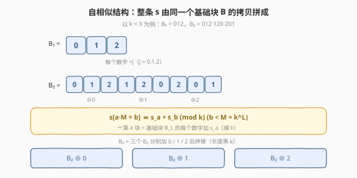
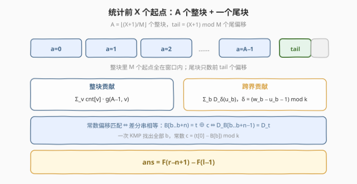
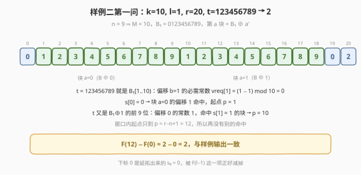

# Codeforces 2249E1 字符串（简单版） 题解

## 1. 题目概述

- **标题 / 题号**：字符串（简单版）（Codeforces 2249E1，英文名 String (Easy Version)）
- **链接**：https://codeforces.com/problemset/problem/2249/E1
- **来源**：Codeforces Round 1112 (Div. 1) · Problem E1
- **难度**：2800（Div. 1 E1，2250 分）
- **限制**：时间 2 s / 内存 512 MB
- **标签**：字符串，分治，实现，KMP / Z 函数，数位统计

**题意**：记 $\mathrm{popcount}_k(m)$ 为 $m$ 在 $k$ 进制下各位数字之和，定义无限长 $k$ 进制串

$$s_i=\bigl(\mathrm{popcount}_k(i)\bmod k\bigr)\qquad(i\ge 1).$$

$q$ 次询问，每次给出十进制整数 $l,r,n$ 和一个长度恰为 $n$ 的 $k$ 进制串 $t$（**允许前导零**），求 $t$ 在子串 $s_l s_{l+1}\cdots s_r$ 中出现了多少次。数字 $10..61$ 依次用 $\mathtt{A..Z}$、$\mathtt{a..z}$ 表示。多测格式：第一行 $k,q$，随后每个询问两行（`l r n` 与 $t$），逐组输出答案。

**约束**（与困难版的唯一区别就在这两行）：

- $2\le k\le 10$，$1\le q\le 1000$，所有询问的 $n$ 之和 $\le 2\times10^6$
- $1\le l\le r\le 10^{17}$，$1\le n\le 2\times10^6$
- 答案可达 $10^{17}$ 量级（如 $k=2,\ n=1$），必须 64 位整数

> 因为 $k\le10$，「$n\ge1$ 的最小 $k$ 的幂」最多是 $10n$，所有询问的块长之和不超过 $2\times10^7$，所以**每次询问重建基础块**也完全够用，不必像困难版那样跨询问缓存、压内存。

> 💡 题面里没有任何「创建一个变量存中间结果」之类的额外指令，全部要求就是上述定义与询问，按题意实现即可。

## 2. 示例与观察
**样例 1**

```text
输入：
3 4
5 17 3
201
5 17 2
01
1239 1231231209 5
01201
123002 231203 4
1202

输出：
2
3
21046666
8325
```

**样例 2**

```text
输入：
10 3
1 20 9
123456789
15 20332 3
678
1234 56789 2
01

输出：
2
1625
5000
```

## 3. 解题思路

### 3.1 暴力思路

先把 $s_l\ldots s_r$ 造出来再逐位比较，代价 $O((r-l+1)\cdot n)$：$r$ 能到 $10^{17}$，光是生成就不可能。只枚举起点、用 $\mathrm{popcount}$ 现算每一位也没救，同样是 $10^{17}$ 个起点。

要害在于：这条序列并不是随机的，它有**严格的自相似结构**，可以按「块」批量数。

### 3.2 核心观察：基础块副本与常数偏移



设 $M=k^L$，$0\le b<M$。此时 $aM+b$ 的 $k$ 进制表示就是「$a$ 的数字」拼上「$b$ 的 $L$ 位（允许前导零）」，位数相加无进位，于是

$$s_{aM+b}=\bigl(\mathrm{popcount}_k(a)+\mathrm{popcount}_k(b)\bigr)\bmod k=(s_a+s_b)\bmod k .$$

也就是说：**长度为 $M$ 的第 $a$ 块，等于基础块 $B=(s_0,s_1,\dots,s_{M-1})$ 逐位加 $s_a$（模 $k$）**。整条序列只有 $k$ 种不同的块内容，而「用哪一种」由 $s_a$ 决定。

取 $M$ 为**不小于 $n$ 的最小 $k$ 的幂**，则 $M<kn$。因为 $n\le M$，长度 $n$ 的窗口最多只跨一个块边界。写起点 $p=aM+b$：

- **不跨界**（$b\le M-n$）：命中当且仅当 $B[b..b+n)$ 与 $t$ 差一个常数，且该常数正好是 $s_a$；
- **跨界**（$b>M-n$）：左半段要常数 $s_a$、右半段要常数 $s_{a+1}$，这样的起点只有 $n-1$ 个。

### 3.3 算法流程：差分串匹配 + 块分布统计



**第一步：把“差一个常数”变成“完全相等”。** 记 $D_B[i]=(B[i+1]-B[i])\bmod k$，$D_t$ 同理。整体加常数不改变相邻差，因此

$$B[b..b+n)=t\oplus c\iff D_B[b..b+n-1)=D_t,\qquad c=(t_0-B[b])\bmod k .$$

对 $D_B$（长度 $M-1$）和模式 $D_t$（长度 $n-1$）跑一遍 KMP，就能得到每个不跨界偏移 $b$ 必需的常数 $vreq[b]$，进而统计 $cnt[v]$。

**第二步：跨界偏移单独判定。** 对 $b\in[M-n+1,M-1]$，左段要 $D_B[b..M-1)$ 等于 $D_t$ 的前缀，右段要 $D_B[0..b+n-M-1)$ 等于 $D_t$ 的后缀。把这两组比较各拼成一个长 $2n$ 的串做 Z 函数，判定就是 $O(1)$，并同时得到可能成立的常数对 $(u_b,w_b)$。

**第三步：块分布用数论闭式。** 整块贡献要按 $s_a$ 汇总，跨界贡献要按 $(s_a,s_{a+1})$ 汇总：

- $g(N,v)=\#\{a\le N:s_a=v\}$：设 $N=qk+d$，则 $g(N,v)=q+[\,((v-s_q)\bmod k)\le d\,]$，$O(1)$ 求得。
- $s_{a+1}\equiv s_a+1+r(a)\pmod k$，其中 $r(a)$ 为 $a$ 末尾连续 $k-1$ 的个数。
- 每个 $a\ge0$ 唯一写成 $a=b\,k^{r+1}+d\,k^{r}+(k^{r}-1)$（$r=r(a)$，$d$ 是第 $r$ 位，$0\le d\le k-2$，允许前导 $0$），此时 $s_a\equiv s_b+d-r\pmod k$。

于是 $D_\delta(u)=\#\{a\le N:s_a=u,\ r(a)\equiv\delta\pmod k\}$ 可以整批算出来：枚举 $r,d$，可行的 $b$ 是一个前缀，按 $g$ 的形状拆成「均匀的 $\lfloor B/k\rfloor$ 份 + 一段环上连续区间」，用差分数组累加即可（$O(k\log_k N+k^2)$）。

**第四步：前缀计数。** 令 $F(X)=\#\{p\le X: s_{p..p+n-1}=t\}$（$X<0$ 记 $0$），$A=\lfloor (X+1)/M\rfloor$ 是整块个数：

$$F(X)=\underbrace{\sum_{v}cnt[v]\,g(A-1,v)}_{\text{整块}}+\underbrace{\sum_{b\ \text{跨界}}D_{\delta_b}(u_b)}_{\text{跨界}}+\underbrace{\text{扫描尾块前 }(X+1)\bmod M\text{ 个偏移}}_{\text{尾块}} ,$$

其中 $\delta_b=(w_b-u_b-1)\bmod k$。最终答案

$$\text{ans}=F(r-n+1)-F(l-1),$$

因为「$t$ 出现在 $s_l..s_r$ 内」等价于「起点 $p\in[l,r-n+1]$」。

### 3.4 示例演算



看样例二第一问：$k=10,\ l=1,\ r=20,\ n=9,\ t=\mathtt{123456789}$。

- $n=9$ 故 $M=10$，基础块 $B=\mathtt{0123456789}$，第 $a$ 块就是把 $B$ 每个数字加 $s_a$。
- $t=B[1..10)$，所以偏移 $b=1$ 的必需常数 $vreq[1]=(t_0-B[1])\bmod10=0$；块 $a=0$ 有 $s_0=0$，在 $p=0\cdot10+1=1$ 命中一次。
- 同时 $t=\mathtt{123456789}$ 也是 $B\oplus1$ 的前 $9$ 位，即偏移 $b=0$ 的必需常数是 $1$；块 $a=1$ 有 $s_1=1$，在 $p=10$ 再命中一次。
- 起点上界是 $r-n+1=12$，块 $a=2$ 的偏移 $0$ 对应 $p=20>12$，不算。故 $F(12)-F(0)=2-0=2$，与输出一致。

## 4. 算法细节

1. **块长与层数**：从 $M=1$ 开始反复乘 $k$ 直到 $M\ge n$，同时记下 $k$ 进制的层数 $L$，块就取 $B_L$；简单版 $k\le10$ 时 $M<10n\le2\times10^7$，`int` 足够放下 $M$ 与偏移。
2. **块内数据用 `vector<unsigned char>`**：数值域只有 $0..k-1$，一字节一个数，$2\times10^7$ 也才 20 MB，且对缓存友好。
3. **差分串不落地**：KMP 扫描时用 $B[i+1]-B[i]$ 现算字符，省掉一份长度 $M-1$ 的数组；跨界判定只需要 $B$ 的前后各 $n-1$ 位差分，同样现取。
4. **偏移数组用 `int` 或 `signed char`**：存「必需常数」，$-1$ 表示无解；KMP 每命中一次就记下 $vreq[b]$ 并累加 $cnt[v]$。
5. **Z 的边界**：左段长 $L_c=M-1-b$、右段长 $L_p=n-1-p$ 可能为 $0$，此时条件恒真，**必须先短路**，否则会访问到 $z[2R+1]$ 而越界。
6. **环上区间加**：每个 $(r,d)$ 对 $D_\delta$ 的贡献是「全体均匀量 + 一段连续区间」，区间跨过 $k$ 时要拆成 $[start,k)$ 与 $[0,rest)$ 两段写差分，最后统一前缀和。
7. **64 位**：$A$、$tail$、$g$ 的返回值、$D_\delta$ 全部用 `long long`；$cnt[v]\cdot g\le 10^{17}$，不会溢出，但用 `int` 会直接炸。
8. **多测**：每次询问新建 $B$、$vreq$、$cU/cW$、$Dt$（简单版不必缓存），输出逐行刷新即可。

## 5. 正确性证明

**引理 1（块位移）**：对任意 $L\ge1$、$M=k^L$、$a\ge0$、$0\le b<M$，都有 $s_{aM+b}\equiv s_a+s_b\pmod k$。

**证明**：$b<k^L$，故 $aM+b$ 的 $k$ 进制表示是 $a$ 的表示与 $b$ 的 $L$ 位（补前导零）的直接拼接，无进位，位数和相加，模 $k$ 得结论。∎

**引理 2（差分判据）**：两个等长串 $u,t$ 满足「$u$ 是 $t$ 逐位加同一常数」，当且仅当 $D_u=D_t$；此时常数唯一，等于 $(t_0-u_0)\bmod k$。

**证明**：必要性由相邻差抵消常数得到。充分性：差分全等说明 $u_j-u_0\equiv t_j-t_0$ 对一切 $j$ 成立，取 $c=(t_0-u_0)\bmod k$ 即有 $u_j\equiv t_j+c$；又 $j=0$ 迫使 $c$ 唯一。∎

**引理 3（$g$ 的闭式）**：若 $N=qk+d$（$0\le d<k$），则 $g(N,v)=q+[\,((v-s_q)\bmod k)\le d\,]$。

**证明**：把 $0..N$ 写成 $x=q'k+c$。$q'<q$ 时 $c$ 取遍 $0..k-1$，而 $s_{q'k+c}\equiv s_{q'}+c$（引理 1），恰有一个 $c$ 命中 $v$，共 $q$ 个；$q'=q$ 时 $c\le d$，条件即 $((v-s_q)\bmod k)\le d$。∎

**引理 4（相邻移位）**：$s_{a+1}\equiv s_a+1+r(a)\pmod k$，$r(a)$ 为 $a$ 末尾连续 $k-1$ 的个数。

**证明**：$a+1$ 把末尾 $r$ 个 $k-1$ 进位成 $0$、第 $r$ 位加 $1$，位数和变化 $1-(k-1)r\equiv1+r\pmod k$。∎

**引理 5（分解与 $s_a$）**：每个 $a\ge0$ 唯一写成 $a=b\,k^{r+1}+d\,k^{r}+(k^{r}-1)$，其中 $r=r(a)$、$0\le d\le k-2$、$b\ge0$，且此时 $s_a\equiv s_b+d-r\pmod k$。

**证明**：$a$ 的低 $r$ 位全为 $k-1$，第 $r$ 位 $d<k-1$（可为前导零），更高位组成 $b$，唯一；位数和为 $\mathrm{popcount}(b)+d+r(k-1)$，模 $k$ 得 $s_b+d-r$。∎

**定理**：3.3 节的 $F(X)$ 恰为起点 $\le X$ 的命中数，故 $\text{ans}=F(r-n+1)-F(l-1)$ 正确。

**证明**：按 $M$ 切块后，前 $A$ 块是整块。整块 $a$ 内，不跨界偏移的命中数由引理 1、2 恰为 $cnt[s_a]$；跨界偏移的命中由引理 4 等价于 $s_a=u_b$ 且 $r(a)\equiv\delta_b$，对全部 $a\le A-1$ 求和就是 $D_{\delta_b}(u_b)$。两类偏移互补且覆盖整块所有 $M$ 个起点。尾块按定义逐个偏移比较。于是 $F(X)$ 正确，两个前缀相减给出起点区间 $[l,r-n+1]$ 的出现次数。∎

## 6. 复杂度分析

- **时间**：单次询问 $O(M+n+k\log_k X+k^2)$，其中 $M$ 为不小于 $n$ 的最小 $k$ 的幂，$M<kn$。简单版 $k\le10$，因此 $\sum M\le10\sum n\le2\times10^7$，与 $q\le1000$ 一起看绰绰有余；本机实测最坏约 $0.35$ s。
- **空间**：$O(M+n)$。基础块与 $vreq$ 各约 $10^7$ 字节量级，跨界判定还要 4 条长度 $\approx 2n$ 的 `int` 串（$\rm YA/YB/zA/zB$），故峰值由 $n$ 决定：$n=2\times10^6$ 时本机实测峰值约 $175$ MB，仍远低于 $512$ MB。

## 7. 参考代码

### C++17

```cpp
// Codeforces 2249E1 - String (Easy Version)
// s[i] = (digitsum_k(i) mod k); count occurrences of t inside s[l..r]
#include <bits/stdc++.h>
using namespace std;
typedef long long ll;

int K;

static int digitSumMod(ll x) { int s = 0; while (x) { s = (s + (int)(x % K)) % K; x /= K; } return s; }
static int trailingCnt(ll x) { int r = 0; while (x && x % K == (ll)(K - 1)) { ++r; x /= K; } return r; }

// #{ a in [0,N] : s_a == v }
static ll gCount(ll N, int v) {
    if (N < 0) return 0;
    ll q = N / K;
    int off = (int)(((ll)v - digitSumMod(q)) % K);
    if (off < 0) off += K;
    return q + (off <= (int)(N % K) ? 1 : 0);
}

// block of size k^lvl : B[i] = digitsum_k(i) mod k
static vector<unsigned char> buildBlock(int lvl) {
    vector<unsigned char> B(1, 0);
    for (int t = 0; t < lvl; ++t) {
        size_t M = B.size();
        B.resize(M * K);
        for (int j = 1; j < K; ++j)
            for (size_t i = 0; i < M; ++i) {
                int v = (int)B[i] + j;
                if (v >= K) v -= K;
                B[j * M + i] = (unsigned char)v;
            }
    }
    return B;
}

// D[delta*K+u] = #{ a in [0,N] : s_a == u, (#trailing (k-1) digits of a) % K == delta }
static vector<ll> buildD(ll N) {
    vector<ll> D((size_t)K * K, 0);
    vector<ll> uni((size_t)K, 0);
    vector<int> dif((size_t)K * (K + 1), 0);
    ll pw = 1;
    for (int r = 0;; ++r) {
        if (pw - 1 > N) break;
        int delta = r % K;
        int* drow = &dif[(size_t)delta * (K + 1)];
        for (int d = 0; d < K - 1; ++d) {
            ll base = (ll)d * pw + (pw - 1);
            if (base > N) break;
            ll bnum = (N - base) / (pw * (ll)K);
            uni[delta] += bnum / K;
            ll d0 = bnum % K, bq = bnum / K;
            int start = (int)(((ll)digitSumMod(bq) + d - delta) % K);
            if (start < 0) start += K;
            int len = (int)d0 + 1;
            if (start + len <= K) { drow[start]++; drow[start + len]--; }
            else { drow[start]++; drow[K]--; drow[0]++; drow[start + len - K]--; }
        }
        if (pw > (N + 1) / K) break;
        pw *= K;
    }
    for (int delta = 0; delta < K; ++delta) {
        int run = 0;
        const int* drow = &dif[(size_t)delta * (K + 1)];
        for (int u = 0; u < K; ++u) { run += drow[u]; D[(size_t)delta * K + u] += uni[delta] + run; }
    }
    return D;
}

static vector<int> zfunc(const vector<int>& s) {
    int n = (int)s.size();
    vector<int> z((size_t)n, 0);
    int l = 0, r = 0;
    for (int i = 1; i < n; ++i) {
        if (i < r) z[i] = min(r - i, z[i - l]);
        while (i + z[i] < n && s[z[i]] == s[i + z[i]]) ++z[i];
        if (i + z[i] > r) { l = i; r = i + z[i]; }
    }
    return z;
}

static int dec1(char c) {
    if (c >= '0' && c <= '9') return c - '0';
    if (c >= 'A' && c <= 'Z') return c - 'A' + 10;
    return c - 'a' + 36;
}

static ll solveQuery(ll l, ll r, const string& ts) {
    int n = (int)ts.size();
    if ((ll)n > r - l + 1) return 0;
    int M = 1, lvl = 0;
    while (M < n) { M *= K; ++lvl; }
    vector<unsigned char> B = buildBlock(lvl);
    vector<int> T((size_t)n);
    for (int i = 0; i < n; ++i) T[i] = dec1(ts[i]);
    int R = n - 1;
    vector<int> Dt((size_t)R);
    for (int j = 0; j < R; ++j) Dt[j] = (T[j + 1] - T[j] + K) % K;
    vector<int> fail((size_t)R, 0);
    for (int i = 1; i < R; ++i) {
        int j = fail[i - 1];
        while (j > 0 && Dt[i] != Dt[j]) j = fail[j - 1];
        if (Dt[i] == Dt[j]) ++j;
        fail[i] = j;
    }
    int lim = M - n;                                  // largest non-crossing offset
    vector<int> vreq((size_t)lim + 1, -1), cntv((size_t)K, 0);
    if (R == 0) {
        for (int b = 0; b <= lim; ++b) { int v = (T[0] - B[b] + K) % K; cntv[v]++; vreq[b] = v; }
    } else {
        int j = 0;
        for (int i = 0; i + 1 < M; ++i) {
            int c = (B[i + 1] - B[i] + K) % K;
            while (j > 0 && c != Dt[j]) j = fail[j - 1];
            if (c == Dt[j]) ++j;
            if (j == R) {
                int b = i - R + 1;
                if (b <= lim) { int v = (T[0] - B[b] + K) % K; cntv[v]++; vreq[b] = v; }
                j = fail[j - 1];
            }
        }
    }
    int cnum = (n >= 2) ? n - 1 : 0;
    vector<int> cU((size_t)cnum, -1), cW((size_t)cnum, -1);
    if (cnum > 0) {
        vector<int> YA(Dt); YA.push_back(K);
        for (int i = 0; i < R; ++i) { int idx = M - 1 - R + i; YA.push_back((B[idx + 1] - B[idx] + K) % K); }
        vector<int> zA = zfunc(YA);
        vector<int> YB;
        for (int i = 0; i < R; ++i) YB.push_back((B[i + 1] - B[i] + K) % K);
        YB.push_back(K); YB.insert(YB.end(), Dt.begin(), Dt.end());
        vector<int> zB = zfunc(YB);
        for (int b = M - n + 1; b <= M - 1; ++b) {
            int idx = b - (M - n + 1);
            int Lc = M - 1 - b, p = M - b, Lp = R - p;
            bool okA = (Lc == 0) || (zA[2 * R + 1 - Lc] >= Lc);
            bool okB = (Lp == 0) || (zB[R + 1 + p] >= Lp);
            if (okA && okB) { cU[idx] = (T[0] - B[b] + K) % K; cW[idx] = (T[p] - (int)B[0] + K) % K; }
        }
    }
    auto F = [&](ll X) -> ll {
        if (X < 0) return 0;
        ll A = (X + 1) / M, tail = (X + 1) % M, res = 0;
        if (A > 0) {
            for (int v = 0; v < K; ++v) if (cntv[v]) res += (ll)cntv[v] * gCount(A - 1, v);
            if (cnum > 0) {
                vector<ll> D = buildD(A - 1);
                for (int idx = 0; idx < cnum; ++idx) {
                    if (cU[idx] < 0) continue;
                    int delta = (cW[idx] - cU[idx] - 1 + K) % K;
                    res += D[(size_t)delta * K + cU[idx]];
                }
            }
        }
        if (tail > 0) {
            int sA = digitSumMod(A);
            int sA1 = (sA + 1 + trailingCnt(A)) % K;
            int limB = (int)min(tail - 1, (ll)lim);
            for (int b = 0; b <= limB; ++b) if (vreq[b] == sA) ++res;
            for (ll b = limB + 1; b < tail; ++b) {
                ll idx = b - (M - n + 1);
                if (idx < 0) continue;
                if (cU[(size_t)idx] == sA && cW[(size_t)idx] == sA1) ++res;
            }
        }
        return res;
    };
    ll right = r - n + 1;
    if (right < l) return 0;
    return F(right) - F(l - 1);
}

int main() {
    ios::sync_with_stdio(false);
    cin.tie(nullptr);
    int q;
    if (!(cin >> K >> q)) return 0;
    for (int i = 0; i < q; ++i) {
        ll l, r, n;
        string t;
        cin >> l >> r >> n >> t;
        cout << solveQuery(l, r, t) << '\n';
    }
    return 0;
}

```

### Python3

```python
import sys


def dec(ch):
    if 48 <= ch <= 57: return ch - 48
    if 65 <= ch <= 90: return ch - 65 + 10
    return ch - 97 + 36


def digit_sum_mod(x, K):
    s = 0
    while x:
        s = (s + x % K) % K
        x //= K
    return s


def trailing_cnt(x, K):
    r = 0
    while x and x % K == K - 1:
        r += 1
        x //= K
    return r


def g_count(N, v, K):
    if N < 0: return 0
    qq, d0 = divmod(N, K)
    off = (v - digit_sum_mod(qq, K)) % K
    return qq + (1 if off <= d0 else 0)


def build_D(N, K):
    D = [0] * (K * K)
    uni = [0] * K
    dif = [[0] * (K + 1) for _ in range(K)]
    pw, r = 1, 0
    while pw - 1 <= N:
        delta = r % K
        drow = dif[delta]
        for d in range(K - 1):
            base = d * pw + (pw - 1)
            if base > N: break
            bnum = (N - base) // (pw * K)
            uni[delta] += bnum // K
            d0, bq = bnum % K, bnum // K
            start = (digit_sum_mod(bq, K) + d - delta) % K
            ln = d0 + 1
            if start + ln <= K:
                drow[start] += 1; drow[start + ln] -= 1
            else:
                drow[start] += 1; drow[K] -= 1; drow[0] += 1; drow[start + ln - K] -= 1
        if pw > (N + 1) // K: break
        pw *= K; r += 1
    for delta in range(K):
        run = 0; drow = dif[delta]; base = delta * K; add = uni[delta]
        for u in range(K):
            run += drow[u]; D[base + u] += add + run
    return D


def zfunc(s):
    n = len(s); z = [0] * n
    l = r = 0
    for i in range(1, n):
        if i < r: z[i] = min(r - i, z[i - l])
        while i + z[i] < n and s[z[i]] == s[i + z[i]]: z[i] += 1
        if i + z[i] > r: l, r = i, i + z[i]
    return z


def build_block(K, lvl):
    B = bytearray([0])
    for _ in range(lvl):                  # B_{L+1} = concat_j (B_L + j)
        Mb = len(B); nb = bytearray(Mb * K); nb[:Mb] = B
        for j in range(1, K):
            off = j * Mb
            for i in range(Mb):
                v = B[i] + j
                if v >= K: v -= K
                nb[off + i] = v
        B = nb
    return B


def solve_query(K, l, r, t):
    n = len(t)
    if n > r - l + 1: return 0
    M, lvl = 1, 0
    while M < n: M *= K; lvl += 1
    B = build_block(K, lvl)
    R = n - 1
    Dt = [(t[j + 1] - t[j]) % K for j in range(R)]
    fail = [0] * R
    for i in range(1, R):
        j = fail[i - 1]
        while j > 0 and Dt[i] != Dt[j]: j = fail[j - 1]
        if Dt[i] == Dt[j]: j += 1
        fail[i] = j
    lim = M - n
    vreq = [-1] * (lim + 1); cntv = [0] * K
    t0 = t[0]
    if R == 0:
        for b in range(lim + 1):
            v = (t0 - B[b]) % K
            cntv[v] += 1; vreq[b] = v
    else:
        j = 0
        for i in range(M - 1):
            c = (B[i + 1] - B[i]) % K
            while j > 0 and c != Dt[j]: j = fail[j - 1]
            if c == Dt[j]: j += 1
            if j == R:
                b = i - R + 1
                if b <= lim:
                    v = (t0 - B[b]) % K
                    cntv[v] += 1; vreq[b] = v
                j = fail[j - 1]
    cnum = n - 1 if n >= 2 else 0
    cU = [-1] * cnum; cW = [-1] * cnum
    if cnum > 0:
        YA = Dt + [K] + [(B[M - 1 - R + i + 1] - B[M - 1 - R + i]) % K for i in range(R)]
        zA = zfunc(YA)
        YB = [(B[i + 1] - B[i]) % K for i in range(R)] + [K] + Dt
        zB = zfunc(YB)
        for b in range(M - n + 1, M):
            idx = b - (M - n + 1)
            Lc, p, Lp = M - 1 - b, M - b, n - 1 - (M - b)
            if (Lc == 0 or zA[2 * R + 1 - Lc] >= Lc) and (Lp == 0 or zB[R + 1 + p] >= Lp):
                cU[idx] = (t0 - B[b]) % K
                cW[idx] = (t[p] - B[0]) % K

    def F(X):
        if X < 0: return 0
        A, tail = divmod(X + 1, M)
        res = 0
        if A > 0:
            for v in range(K):
                if cntv[v]: res += cntv[v] * g_count(A - 1, v, K)
            if cnum > 0:
                D = build_D(A - 1, K)
                for idx in range(cnum):
                    u = cU[idx]
                    if u < 0: continue
                    res += D[(cW[idx] - u - 1) % K * K + u]
        if tail > 0:
            sA = digit_sum_mod(A, K)
            sA1 = (sA + 1 + trailing_cnt(A, K)) % K
            limB = min(tail - 1, lim)
            for b in range(limB + 1):
                if vreq[b] == sA: res += 1
            for b in range(limB + 1, tail):
                idx = b - (M - n + 1)
                if idx < 0: continue
                if cU[idx] == sA and cW[idx] == sA1: res += 1
        return res

    right = r - n + 1
    return F(right) - F(l - 1)


def main():
    data = sys.stdin.buffer.read().split()
    if not data: return
    K = int(data[0]); q = int(data[1]); p = 2
    out = []
    for _ in range(q):
        l = int(data[p]); r = int(data[p + 1])
        t = [dec(ch) for ch in data[p + 3]]; p += 4
        out.append(str(solve_query(K, l, r, t)))
    sys.stdout.write("\n".join(out) + "\n")


main()

```

> 注：Python 版与 C++ 同算法，简单版最坏也要扫 $2\times10^7$ 个字符，CPython 下**预期 TLE**（PyPy 可试，但仍需小心），列出来是为了让思路可以独立复现。

## 8. 边界情况与易错点

1. **$n>r-l+1$**：模式比窗口长，答案直接 $0$；否则 $r-n+1<l$，$F$ 相减会得到负数。
2. **$l=1$ 要算 $F(0)$**：序列被人为延拓到 $s_0=0$，$F(0)$ 正好扣掉起点 $0$；不延拓就会整体差一位。
3. **$n=1$**：$M=1$，没有跨界偏移，$vreq$ 只有一项，而 $A=X+1$ 会到 $10^{17}$，$g$ 的结果必须用 `long long`。
4. **$n=M$（$n$ 恰是 $k$ 的幂）**：不跨界偏移只剩 $b=0$，跨界偏移有 $M-1$ 个，两类的边界最容易写反。
5. **前导零**：$t$ 必须按字符串逐位转成数值，不能当整数读入，否则长度与前导零都丢了。
6. **Z 下标越界**：$L_c=0$ 或 $L_p=0$ 时要短路，直接写会取到 $z[2R+1]$。
7. **$k=2$ 时 $r(a)$ 可达几十**：必须 `% K` 之后再作为 $D_\delta$ 的行号。
8. **环上区间加写错**：区间长度 $d_0+1\le k$，跨尾时要拆两段，漏写会让 $D_\delta$ 出现负值。

## 9. 验证记录

- **编译环境与命令**：`clang++ -std=c++17 -O2`（本机无 GNU g++，配 `codeforces/tools/include/bits/stdc++.h` 兼容头；正文代码只用标准库，可原样提交 GNU C++17）；Python 侧为 `Python 3.9.6`。
- **官方样例**：1 / 1 通过（按 Codeforces 标准 checker 的 token 比对，忽略空白与大小写）。
- **复核状态**：audited（2026-11-19 统一回归：编译 + 官方样例；写作期的随机对拍与暴力未重跑）。

## 相关题目与扩展

- [Codeforces 2249E2. String (Hard Version)](https://codeforces.com/problemset/problem/2249/E2)：本题困难版，$k\le62,\ q\le10^4$，同一套结构，但需要跨询问缓存基础块、按字节压内存。
- [Codeforces 471D. MUH and Cube Walls](https://codeforces.com/problemset/problem/471/D)：用差分串把「整体平移」变成「完全相等」，再跑 KMP，思路与本篇第一步一致。
- [LeetCode 28. 找出字符串中第一个匹配项的下标](https://leetcode.cn/problems/find-the-index-of-the-first-occurrence-in-a-string/)：KMP 模板。
- [LeetCode 2223. 构造字符串的总得分和](https://leetcode.cn/problems/sum-of-scores-of-built-strings/)：Z 函数模板，对应本篇第二步。

**延伸思考**：本题的答案是「起点个数」，若改成统计**所有**出现位置之和、或对同一 $t$ 多次询问，可以把 $cnt[v]$、$D_\delta(u)$ 与 $F$ 的块分布部分做成与 $t$ 无关的预计算，单次查询只剩 $O(M)$ 的差分匹配；另一个方向是把块长取成小于 $n$ 的 $k$ 的幂，让窗口跨更多块——条件会变成对连续多个 $s_a$ 的约束，需要更复杂的联合分布，这正是困难版也不采用的做法。
