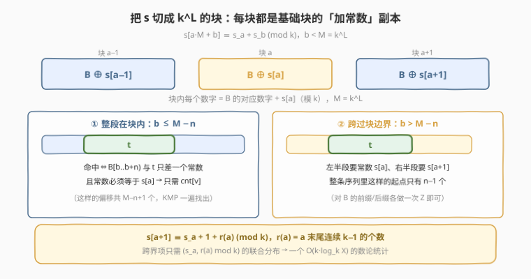
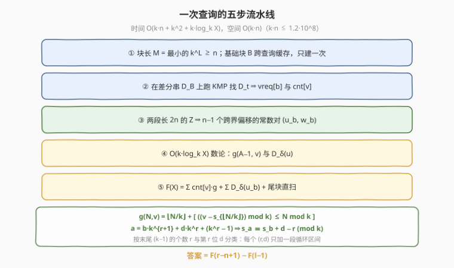
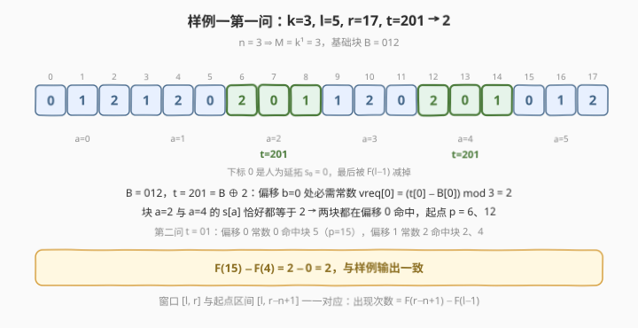

# Codeforces 2249E2 字符串（困难版） 题解

## 1. 题目概述

- **标题 / 题号**：字符串（困难版）（Codeforces 2249E2，英文名 String (Hard Version)）
- **链接**：https://codeforces.com/problemset/problem/2249/E2
- **来源**：Codeforces Round 1112 (Div. 1) · Problem E2
- **难度**：3000（Div. 1 E2，1750 分）
- **限制**：时间 2 s / 内存 512 MB
- **标签**：字符串，分治，实现，KMP / Z 函数，数位统计

**题意**：记 $\mathrm{popcount}_k(m)$ 为 $m$ 在 $k$ 进制下各位数字之和，定义无限长 $k$ 进制串

$$s_i=\bigl(\mathrm{popcount}_k(i)\bmod k\bigr)\qquad(i\ge 1).$$

$q$ 次询问，每次给出十进制整数 $l,r,n$ 和一个长度恰为 $n$ 的 $k$ 进制串 $t$（**允许前导零**），求 $t$ 在子串 $s_l s_{l+1}\cdots s_r$ 中出现的次数。数字 $10..61$ 依次用 $\mathtt{A..Z}$、$\mathtt{a..z}$ 表示。多测格式：第一行 $k,q$，随后每个询问两行（`l r n` 与 $t$），逐组输出答案。

**约束**：

- $2\le k\le 62$，$1\le q\le 10^4$，所有询问的 $n$ 之和 $\le 2\times10^6$
- $1\le l\le r\le 10^{17}$：窗口长达 $10^{17}$，不可能逐位生成
- $1\le n\le 2\times10^6$：模式本身可以很长，且 $t$ 必须按字符读（前导零有意义）
- 答案可达 $10^{17}$ 量级（如 $k=2,\ n=1$），必须 64 位整数

> 💡 题面没有任何「变量注入 / 额外指令」类句子，唯一要求就是按定义统计出现次数。

## 2. 示例

**样例 1**

```text
输入：
3 4
5 17 3
201
5 17 2
01
1239 1231231209 5
01201
123002 231203 4
1202

输出：
2
3
21046666
8325
```

**样例 2**

```text
输入：
10 3
1 20 9
123456789
15 20332 3
678
1234 56789 2
01

输出：
2
1625
5000
```

**样例 3**（仅困难版有，$k=62$）

```text
输入：
62 1
1 100000 62
0123456789ABCDEFGHIJKLMNOPQRSTUVWXYZabcdefghijklmnopqrstuvwxyz

输出：
25
```

## 3. 解题思路

### 3.1 暴力思路

逐位造出 $s_l\ldots s_r$ 再与 $t$ 比较：代价 $O((r-l+1)\cdot n)$，而 $r$ 可达 $10^{17}$，直接爆炸。即使只枚举起点 $p\in[l,r-n+1]$ 并用 $\mathrm{popcount}$ 现算每一位，也是 $10^{17}$ 次。

**必须找到“批量计数”的结构**：这条序列是自相似的，同一段内容会以 $k$ 种“整体加常数”的形式反复出现。

### 3.2 核心观察：块位移恒等式



取 $M=k^L$。若 $b<M$，则 $aM+b$ 的 $k$ 进制表示就是「$a$ 的数字」后面接上「$b$ 的 $L$ 位（可为前导零）」，两部分位数直接相加、**无进位**，于是

$$s_{aM+b}\equiv s_a+s_b\pmod k.$$

换句话说：**第 $a$ 块（长度 $M$）就是基础块 $B=(s_0,\dots,s_{M-1})$ 逐位加 $s_a$（模 $k$）得到的副本**，块内容只有 $k$ 种可能。

取 $M$ 为**最小的 $k$ 的幂且 $M\ge n$**，则 $M<kn$。由于 $n\le M$，任何长度 $n$ 的窗口至多跨过一个块边界。设起点 $p=aM+b$：

- **整块内**（$b\le M-n$）：命中 $\iff$ $B[b..b+n)$ 与 $t$ 只差一个常数，且这个常数必须等于 $s_a$；
- **跨界**（$b>M-n$）：左半段要常数 $s_a$、右半段要常数 $s_{a+1}$，这样的偏移只有 $n-1$ 个。

### 3.3 算法流程：差分匹配 + 数论统计



**(1) 差分串把“加常数”变成“相等”。** 令 $D_B[i]=(B[i+1]-B[i])\bmod k$，$D_t$ 同理。整体加常数不改变相邻差，故

$$B[b..b+n)=t\oplus c\iff D_B[b..b+n-1)=D_t,\qquad c=(t_0-B[b])\bmod k .$$

于是对 $D_B$ 与 $D_t$ 跑一次 KMP，就能得到每个不跨界偏移 $b$ 的必需常数 $vreq[b]$，并统计 $cnt[v]=\#\{b\le M-n: vreq[b]=v\}$。

**(2) 跨界偏移。** 对 $b\in[M-n+1,M-1]$，左段长度 $M-b$、右段长度 $b+n-M$，分别要求「$D_B$ 的后缀 = $D_t$ 的前缀」与「$D_B$ 的前缀 = $D_t$ 的后缀」。把这两段各拼成长度 $2n$ 的串做一次 Z 函数，即可 $O(1)$ 判定每个 $b$，得到唯一可能的常数对 $(u_b,w_b)$。

**(3) 块分布用数论闭式算。** 整块要按 $s_a$ 分类，跨界要按 $(s_a,s_{a+1})$ 分类：

- $g(N,v)=\#\{a\le N:s_a=v\}$：设 $N=qk+d$，则 $g(N,v)=q+[\,((v-s_q)\bmod k)\le d\,]$，$O(1)$。
- $s_{a+1}\equiv s_a+1+r(a)\pmod k$，其中 $r(a)$ 是 $a$ 末尾连续 $k-1$ 的个数。
- 每个 $a\ge0$ 唯一写成 $a=b\,k^{r+1}+d\,k^r+(k^r-1)$（$r=r(a)$，$d$ 是第 $r$ 位，$0\le d\le k-2$，允许是前导 $0$），此时 $s_a\equiv s_b+d-r$。

于是 $D_\delta(u)=\#\{a\le N: s_a=u,\ r(a)\equiv\delta\pmod k\}$ 可以这样批量算：对每个 $r$，枚举 $d$，$b$ 的可取范围是一个前缀 $[0,B_{r,d}]$，其中按 $g$ 的形状贡献「$B_{r,d}$ 份均匀量 + 一段长度 $d_0+1$ 的循环区间」。全部用差分数组累加，$O(k\log_k N+k^2)$。

**(4) 前缀计数。** 令 $F(X)=\#\{p\le X: s_{p..p+n-1}=t\}$（$X<0$ 时为 $0$），$A=\lfloor (X+1)/M\rfloor$，则

$$F(X)=\sum_{v}cnt[v]\cdot g(A-1,v)+\sum_{b\ \text{跨界且有效}}D_{\delta_b}(u_b)+\text{尾块逐偏移扫描},$$

其中 $\delta_b=(w_b-u_b-1)\bmod k$（由 $s_{a+1}=s_a+1+r(a)$ 解出 $r(a)$ 的余数）。最终

$$\text{ans}=F(r-n+1)-F(l-1).$$

### 3.4 示例演算



对样例一第一问（$k=3,\ l=5,\ r=17,\ n=3,\ t=\mathtt{201}$）：$n=3$ 故 $M=3^1=3$，基础块 $B=\mathtt{012}$。

- $t=\mathtt{201}=B\oplus2$，所以偏移 $b=0$ 的必需常数是 $vreq[0]=(t_0-B[0])\bmod3=2$；偏移 $b=1$ 需要 $B[1..4)=\mathtt{120}$ 与 $t$ 同差，但 $t-\mathtt{120}$ 不是常数，故无效。
- 块 $a=2$ 与 $a=4$ 的 $s_a$ 都是 $2$，两块在偏移 $0$ 处各命中一次：起点 $p=6,12$。
- $F(15)-F(4)=2-0=2$，与输出一致。第二问 $t=\mathtt{01}$（$n=2$）时偏移 $0$ 常数 $0$ 命中块 $a=5$，偏移 $1$ 常数 $2$ 命中块 $a=2,4$，共 $3$ 次。

## 4. 算法细节

1. **基础块只建一次**。$B_L$ 恰是 $B_{L+1}$ 的前缀（$B_{L+1}=\bigoplus_{j=0}^{k-1}(B_L+j)$），所以把所有询问读进来、求出最大层数后自底向上扩一次即可；用 `unsigned char` 存，$M\le 1.5\times10^7$ 只占 15 MB。
2. **差分串不要显式存**。$D_B$ 长度 $M-1$，若再开一份 `int` 数组就是 60 MB；KMP 扫描时由 $B[i+1]-B[i]$ 现算即可。跨界判定要用的只是 $B$ 的前 $n-1$ 位后缀/前缀差分，现场取。
3. **偏移数组用 `signed char`**。$vreq[b]\in[-1,k-1]$、$k\le62$，一个字节足够，省下一半内存也更快。
4. **Z 的下标要小心**。左段长度 $L_c=M-1-b$、右段长度 $L_p=n-1-p$ 都可能为 $0$（此时恒真），必须短路，否则会取到 $z[2R+1]$ 越界。
5. **循环区间加用差分数组**。每个 $(r,d)$ 对 $D_\delta$ 只贡献「全体均匀 $+$ 一段环上连续区间」；环区间跨尾时拆成 $[start,k)$ 与 $[0,\text{rest})$ 两段，最后对每个 $\delta$ 做一次前缀和。
6. **64 位运算**。$A$ 可达 $10^{17}$、$cnt[v]\le M$，但 $cnt[v]\cdot g$ 约为 $10^{17}/k$，`long long` 足够；$g$ 的返回值、$D_\delta$ 都必须是 `long long`。$N\le 10^{17}$ 时 $pw\cdot k\le 6.3\times10^{18}$ 仍在 `long long` 内。
7. **多测清空**。$B$、`Dtbl` 跨询问复用（`Dtbl` 每次 `buildD` 重置），$vreq$、$cnt$、$cU$、$cW$ 每次按新 $M,n$ 重新分配。
8. **常数优化**。整块贡献只在 $K$ 个值上求和；尾块扫描是纯数组比较；最坏输入（$k=62$、8 组 $n\approx2.4\times10^5$）本机实测 $0.6\sim0.9$ s、峰值内存约 $45$ MB；$n=2\times10^6$（$k=2$）时约 $0.3$ s、峰值约 $91$ MB。

## 5. 正确性证明

**引理 1（块位移）**：对任意 $L\ge1$、$M=k^L$、$a\ge0$、$0\le b<M$，有 $s_{aM+b}\equiv s_a+s_b\pmod k$。

**证明**：$b<k^L$，故 $aM+b$ 的 $k$ 进制表示就是 $a$ 的表示后接 $b$ 的 $L$ 位（含前导零），拼接无进位，$\mathrm{popcount}_k(aM+b)=\mathrm{popcount}_k(a)+\mathrm{popcount}_k(b)$，模 $k$ 即得。∎

**引理 2（差分判据）**：设 $|u|=|t|=n$。$u$ 是 $t$ 的某个整体加常数副本，当且仅当 $D_u=D_t$；此时常数唯一，$c=(t_0-u_0)\bmod k$。

**证明**：若 $u_j\equiv t_j+c$，则 $D_u[j]=u_{j+1}-u_j\equiv t_{j+1}-t_j=D_t[j]$。反之若差分全等，则对任意 $j$ 有 $u_j-u_0\equiv t_j-t_0$，即 $u_j\equiv t_j+(u_0-t_0)$，取 $c=(t_0-u_0)\bmod k$ 即可；由 $j=0$ 知 $c$ 唯一。∎

**引理 3（$g$ 的闭式）**：$N=qk+d$（$0\le d<k$）时，$g(N,v)=q+[\,((v-s_q)\bmod k)\le d\,]$。

**证明**：把 $0..N$ 写成 $x=q'k+c$。当 $q'<q$ 时 $c$ 取遍 $0..k-1$，而 $s_{q'k+c}\equiv s_{q'}+c$，对固定 $q'$ 恰有一个 $c$ 命中 $v$，共 $q$ 个；当 $q'=q$ 时只剩 $c=0..d$，条件化为 $((v-s_q)\bmod k)\le d$。∎

**引理 4（移位递推）**：$s_{a+1}\equiv s_a+1+r(a)\pmod k$，$r(a)$ 为 $a$ 末尾连续 $k-1$ 的个数。

**证明**：$a+1$ 相当于把末尾 $r$ 个 $k-1$ 全部进位成 $0$、第 $r$ 位加 $1$，位数和变化为 $1-(k-1)r\equiv 1+r\pmod k$。∎

**引理 5（$a$ 的分解）**：每个 $a\ge0$ 唯一写成 $a=b\,k^{r+1}+d\,k^r+(k^r-1)$，其中 $r=r(a)$、$0\le d\le k-2$、$b\ge0$；此时 $s_a\equiv s_b+d-r\pmod k$。

**证明**：$a$ 的第 $0..r-1$ 位均为 $k-1$，第 $r$ 位 $d<k-1$（可以是前导 $0$），更高位构成 $b$，唯一性显然。位数和为 $\mathrm{popcount}(b)+d+r(k-1)$，模 $k$ 即 $s_b+d-r$。∎

**定理**：第 3.3 节的 $F(X)$ 公式恰等于起点 $\le X$ 的命中数，故 $\text{ans}=F(r-n+1)-F(l-1)$ 正确。

**证明**：把 $[0,X]$ 按 $M$ 切块，前 $A$ 块为整块、第 $A$ 块只剩前 $tail$ 个偏移。整块 $a$ 内：偏移 $b\le M-n$ 的命中数由引理 1、2 恰为 $cnt[s_a]$；偏移 $b>M-n$ 的命中由引理 4 化为 $s_a=u_b$ 且 $r(a)\equiv\delta_b$，对 $a$ 求和即 $D_{\delta_b}(u_b)$。两部分偏移互不重叠且覆盖整块全部 $M$ 个起点，故整块计数正确；尾块按定义逐偏移比较，天然正确。两类计数相加得 $F(X)$，相减即得起点落在 $[l,r-n+1]$ 的出现次数。∎

## 6. 复杂度分析

- **时间**：单次询问 $O(M+n+k\log_k X+k^2)$，其中 $M$ 是 $\ge n$ 的最小 $k$ 的幂，$M<kn$，故为 $O(kn+k^2+k\log_k X)$。所有询问合计 $\sum M\le k\sum n\le 1.24\times10^8$，基础块只建一次；$2$ s 时限内本机实测最坏 $0.6\sim0.9$ s（$k=62$、8 组 $n\approx2.4\times10^5$），仍有两倍以上余量。
- **空间**：$O(M+n)$，即基础块（$\le15$ MB）、$vreq$（$\le15$ MB）、两条长度 $\approx 2n$ 的 `int` 串与少量临时数组；本机实测峰值：8 组 $n\approx2.4\times10^5$ 约 $45$ MB，$n=2\times10^6$ 时约 $91$ MB，均远低于 $512$ MB。

## 7. 参考代码

### C++17

```cpp
#include <bits/stdc++.h>
using namespace std;
typedef long long ll;

static int K;
static vector<unsigned char> B;   // B_L[i] = digitsum_k(i) mod k, i < k^L
static ll builtM = 1;             // current length = k^builtLvl
static int builtLvl = 0;
static vector<ll> Dtbl;           // D[delta*K+u]

static int digitSumMod(ll x) { int s = 0; while (x) { s = (s + (int)(x % K)) % K; x /= K; } return s; }
static int trailingCnt(ll x) { int r = 0; while (x && x % K == (ll)(K - 1)) { ++r; x /= K; } return r; }

// #{ a in [0,N] : s_a == v }
static ll gCount(ll N, int v) {
    if (N < 0) return 0;
    ll q = N / K;
    int off = (int)(((ll)v - digitSumMod(q)) % K);
    if (off < 0) off += K;
    return q + (off <= (int)(N % K) ? 1 : 0);
}

static void buildTo(int lvl) {
    while (builtLvl < lvl) {
        ll M = builtM;
        B.resize((size_t)M * K);
        for (int j = 1; j < K; ++j)
            for (ll i = 0; i < M; ++i) {
                int v = (int)B[i] + j;
                if (v >= K) v -= K;
                B[(size_t)j * M + i] = (unsigned char)v;
            }
        builtM = M * K;
        ++builtLvl;
    }
}

// D[delta*K+u] = #{ a<=N : s_a=u, (#trailing k-1 digits of a) % K = delta }
static void buildD(ll N) {
    fill(Dtbl.begin(), Dtbl.end(), 0LL);
    vector<ll> uni((size_t)K, 0);
    vector<int> dif((size_t)K * (K + 1), 0);
    ll pw = 1;
    for (int r = 0;; ++r) {
        if (pw - 1 > N) break;
        int delta = r % K;
        int* drow = &dif[(size_t)delta * (K + 1)];
        for (int d = 0; d < K - 1; ++d) {
            ll base = (ll)d * pw + (pw - 1);           // a = b*k^{r+1} + d*k^r + (k^r-1)
            if (base > N) break;
            ll bnum = (N - base) / (pw * (ll)K);        // 0 <= b <= bnum
            uni[delta] += bnum / K;
            ll d0 = bnum % K, bq = bnum / K;
            int start = (int)(((ll)digitSumMod(bq) + d - delta) % K);
            if (start < 0) start += K;
            int len = (int)d0 + 1;
            if (start + len <= K) { drow[start]++; drow[start + len]--; }
            else { drow[start]++; drow[K]--; drow[0]++; drow[start + len - K]--; }
        }
        if (pw > (N + 1) / K) break;
        pw *= K;
    }
    for (int delta = 0; delta < K; ++delta) {
        int run = 0;
        const int* drow = &dif[(size_t)delta * (K + 1)];
        for (int u = 0; u < K; ++u) { run += drow[u]; Dtbl[(size_t)delta * K + u] += uni[delta] + run; }
    }
}

static vector<int> zfunc(const vector<int>& s) {
    int n = (int)s.size();
    vector<int> z((size_t)n, 0);
    int l = 0, r = 0;
    for (int i = 1; i < n; ++i) {
        if (i < r) z[i] = min(r - i, z[i - l]);
        while (i + z[i] < n && s[z[i]] == s[i + z[i]]) ++z[i];
        if (i + z[i] > r) { l = i; r = i + z[i]; }
    }
    return z;
}

static int dec1(char c) {
    if (c >= '0' && c <= '9') return c - '0';
    if (c >= 'A' && c <= 'Z') return c - 'A' + 10;
    return c - 'a' + 36;
}

static vector<signed char> vreq;    // 必需常数 for non-crossing offset (-1 = none)
static vector<signed char> cU, cW;  // 必需常数对 for crossing offset
static vector<int> cntv;

static ll solveQuery(ll l, ll r, const string& ts) {
    int n = (int)ts.size();
    if ((ll)n > r - l + 1) return 0;
    int lvl = 0; ll M = 1;
    while (M < (ll)n) { M *= K; ++lvl; }
    vector<int> T((size_t)n);
    for (int i = 0; i < n; ++i) T[i] = dec1(ts[i]);
    int R = n - 1;
    vector<unsigned char> Dt((size_t)R);
    for (int j = 0; j < R; ++j) { int d = T[j + 1] - T[j]; if (d < 0) d += K; Dt[j] = (unsigned char)d; }
    vector<int> fail((size_t)R, 0);
    for (int i = 1; i < R; ++i) {
        int j = fail[i - 1];
        while (j > 0 && Dt[i] != Dt[j]) j = fail[j - 1];
        if (Dt[i] == Dt[j]) ++j;
        fail[i] = j;
    }
    ll lim = M - n;                                    // 最大不跨界偏移
    vreq.assign((size_t)lim + 1, -1);
    cntv.assign((size_t)K, 0);
    if (R == 0) {
        for (ll b = 0; b <= lim; ++b) { int v = T[0] - (int)B[b]; if (v < 0) v += K; ++cntv[v]; vreq[b] = (signed char)v; }
    } else {
        int j = 0;
        for (ll i = 0; i + 1 < M; ++i) {                // KMP over D_B (M-1 chars)
            int c = (int)B[i + 1] - (int)B[i]; if (c < 0) c += K;
            while (j > 0 && c != (int)Dt[j]) j = fail[j - 1];
            if (c == (int)Dt[j]) ++j;
            if (j == R) {
                ll b = i - R + 1;
                if (b <= lim) { int v = T[0] - (int)B[b]; if (v < 0) v += K; ++cntv[v]; vreq[b] = (signed char)v; }
                j = fail[j - 1];
            }
        }
    }
    int cnum = (n >= 2) ? n - 1 : 0;
    cU.assign((size_t)cnum, -1); cW.assign((size_t)cnum, -1);
    if (cnum > 0) {
        vector<int> YA; YA.reserve((size_t)2 * R + 1);   // D_t + sep + D_B 末尾 R 位
        for (int i = 0; i < R; ++i) YA.push_back(Dt[i]);
        YA.push_back(K);
        for (int i = 0; i < R; ++i) { ll idx = M - 1 - R + i; YA.push_back((B[idx + 1] - B[idx] + K) % K); }
        vector<int> zA = zfunc(YA);
        vector<int> YB; YB.reserve((size_t)2 * R + 1);   // D_B 前 R 位 + sep + D_t
        for (int i = 0; i < R; ++i) YB.push_back((B[i + 1] - B[i] + K) % K);
        YB.push_back(K); YB.insert(YB.end(), Dt.begin(), Dt.end());
        vector<int> zB = zfunc(YB);
        for (ll b = M - n + 1; b <= M - 1; ++b) {
            int idx = (int)(b - (M - n + 1));
            int Lc = (int)(M - 1 - b), p = (int)(M - b), Lp = R - p;
            bool okA = (Lc == 0) || (zA[(size_t)(2 * R + 1 - Lc)] >= Lc);
            bool okB = (Lp == 0) || (zB[(size_t)(R + 1 + p)] >= Lp);
            if (okA && okB) {
                cU[idx] = (signed char)((T[0] - (int)B[b] + K) % K);
                cW[idx] = (signed char)((T[p] - (int)B[0] + K) % K);
            }
        }
    }
    auto F = [&](ll X) -> ll {
        if (X < 0) return 0;
        ll A = (X + 1) / M, tail = (X + 1) % M, res = 0;
        if (A > 0) {
            for (int v = 0; v < K; ++v) if (cntv[v]) res += (ll)cntv[v] * gCount(A - 1, v);
            if (cnum > 0) {
                buildD(A - 1);
                for (int idx = 0; idx < cnum; ++idx) {
                    if (cU[idx] < 0) continue;
                    int delta = (cW[idx] - cU[idx] - 1 + K) % K;
                    res += Dtbl[(size_t)delta * K + cU[idx]];
                }
            }
        }
        if (tail > 0) {                                  // 尾块：直接逐偏移比较
            int sA = digitSumMod(A), sA1 = (sA + 1 + trailingCnt(A)) % K;
            ll limB = min(tail - 1, lim), b = 0;
            for (; b <= limB; ++b) if (vreq[b] == sA) ++res;
            for (; b <= tail - 1; ++b) {
                ll idx = b - (M - n + 1);
                if (idx < 0) continue;
                if (cU[(size_t)idx] == sA && cW[(size_t)idx] == sA1) ++res;
            }
        }
        return res;
    };
    ll right = r - n + 1;
    return F(right) - F(l - 1);
}

int main() {
    ios::sync_with_stdio(false);
    cin.tie(nullptr);
    int q;
    if (!(cin >> K >> q)) return 0;
    vector<ll> ql((size_t)q), qr((size_t)q);
    vector<string> qt((size_t)q);
    for (int i = 0; i < q; ++i) { ll n; cin >> ql[i] >> qr[i] >> n >> qt[i]; }
    int need = 0;
    for (int i = 0; i < q; ++i) {
        int lvl = 0; ll m = 1;
        while (m < (ll)qt[i].size()) { m *= K; ++lvl; }
        need = max(need, lvl);
    }
    Dtbl.assign((size_t)K * K, 0);
    B.assign(1, 0);
    buildTo(need);
    for (int i = 0; i < q; ++i) cout << solveQuery(ql[i], qr[i], qt[i]) << '\n';
    return 0;
}
```

### Python3

```python
import sys


def dec(ch):
    if 48 <= ch <= 57: return ch - 48
    if 65 <= ch <= 90: return ch - 65 + 10
    return ch - 97 + 36


def digit_sum_mod(x, K):
    s = 0
    while x:
        s = (s + x % K) % K
        x //= K
    return s


def trailing_cnt(x, K):
    r = 0
    while x and x % K == K - 1:
        r += 1
        x //= K
    return r


def g_count(N, v, K):
    if N < 0: return 0
    qq, d0 = divmod(N, K)
    off = (v - digit_sum_mod(qq, K)) % K
    return qq + (1 if off <= d0 else 0)


def build_D(N, K):
    D = [0] * (K * K)
    uni = [0] * K
    dif = [[0] * (K + 1) for _ in range(K)]
    pw, r = 1, 0
    while pw - 1 <= N:
        delta = r % K
        drow = dif[delta]
        for d in range(K - 1):
            base = d * pw + (pw - 1)
            if base > N: break
            bnum = (N - base) // (pw * K)
            uni[delta] += bnum // K
            d0, bq = bnum % K, bnum // K
            start = (digit_sum_mod(bq, K) + d - delta) % K
            ln = d0 + 1
            if start + ln <= K:
                drow[start] += 1; drow[start + ln] -= 1
            else:
                drow[start] += 1; drow[K] -= 1; drow[0] += 1; drow[start + ln - K] -= 1
        if pw > (N + 1) // K: break
        pw *= K; r += 1
    for delta in range(K):
        run = 0; drow = dif[delta]; base = delta * K; add = uni[delta]
        for u in range(K):
            run += drow[u]; D[base + u] += add + run
    return D


def zfunc(s):
    n = len(s); z = [0] * n
    l = r = 0
    for i in range(1, n):
        if i < r: z[i] = min(r - i, z[i - l])
        while i + z[i] < n and s[z[i]] == s[i + z[i]]: z[i] += 1
        if i + z[i] > r: l, r = i, i + z[i]
    return z


def solve_query(K, B, l, r, t):
    n = len(t)
    if n > r - l + 1: return 0
    M = 1
    while M < n: M *= K
    R = n - 1
    Dt = [(t[j + 1] - t[j]) % K for j in range(R)]
    fail = [0] * R
    for i in range(1, R):
        j = fail[i - 1]
        while j > 0 and Dt[i] != Dt[j]: j = fail[j - 1]
        if Dt[i] == Dt[j]: j += 1
        fail[i] = j
    lim = M - n
    vreq = [-1] * (lim + 1); cntv = [0] * K
    t0 = t[0]
    if R == 0:
        for b in range(lim + 1):
            v = (t0 - B[b]) % K
            cntv[v] += 1; vreq[b] = v
    else:
        j = 0
        for i in range(M - 1):
            c = (B[i + 1] - B[i]) % K
            while j > 0 and c != Dt[j]: j = fail[j - 1]
            if c == Dt[j]: j += 1
            if j == R:
                b = i - R + 1
                if b <= lim:
                    v = (t0 - B[b]) % K
                    cntv[v] += 1; vreq[b] = v
                j = fail[j - 1]
    cnum = n - 1 if n >= 2 else 0
    cU = [-1] * cnum; cW = [-1] * cnum
    if cnum > 0:
        YA = Dt + [K] + [(B[M - 1 - R + i + 1] - B[M - 1 - R + i]) % K for i in range(R)]
        zA = zfunc(YA)
        YB = [(B[i + 1] - B[i]) % K for i in range(R)] + [K] + Dt
        zB = zfunc(YB)
        for b in range(M - n + 1, M):
            idx = b - (M - n + 1)
            Lc, p, Lp = M - 1 - b, M - b, n - 1 - (M - b)
            if (Lc == 0 or zA[2 * R + 1 - Lc] >= Lc) and (Lp == 0 or zB[R + 1 + p] >= Lp):
                cU[idx] = (t0 - B[b]) % K
                cW[idx] = (t[p] - B[0]) % K

    def F(X):
        if X < 0: return 0
        A, tail = divmod(X + 1, M)
        res = 0
        if A > 0:
            for v in range(K):
                if cntv[v]: res += cntv[v] * g_count(A - 1, v, K)
            if cnum > 0:
                D = build_D(A - 1, K)
                for idx in range(cnum):
                    u = cU[idx]
                    if u < 0: continue
                    res += D[(cW[idx] - u - 1) % K * K + u]
        if tail > 0:
            sA = digit_sum_mod(A, K)
            sA1 = (sA + 1 + trailing_cnt(A, K)) % K
            limB = min(tail - 1, lim)
            for b in range(limB + 1):
                if vreq[b] == sA: res += 1
            for b in range(limB + 1, tail):
                idx = b - (M - n + 1)
                if idx < 0: continue
                if cU[idx] == sA and cW[idx] == sA1: res += 1
        return res

    right = r - n + 1
    return F(right) - F(l - 1)


def main():
    data = sys.stdin.buffer.read().split()
    if not data: return
    K = int(data[0]); q = int(data[1]); p = 2
    queries = []; maxlvl = 0
    for _ in range(q):
        l = int(data[p]); r = int(data[p + 1])
        t = [dec(ch) for ch in data[p + 3]]; p += 4
        queries.append((l, r, t))
        m, lv = 1, 0
        while m < len(t): m *= K; lv += 1
        if lv > maxlvl: maxlvl = lv
    B = bytearray([0]); lvl = 0
    while lvl < maxlvl:                       # B_{L+1} = concat_j (B_L + j)
        Mb = len(B); nb = bytearray(Mb * K); nb[:Mb] = B
        for j in range(1, K):
            off = j * Mb
            for i in range(Mb):
                v = B[i] + j
                if v >= K: v -= K
                nb[off + i] = v
        B = nb; lvl += 1
    out = [str(solve_query(K, B, l, r, t)) for (l, r, t) in queries]
    sys.stdout.write("\n".join(out) + "\n")


main()
```

> 注：Python 版与 C++ 用的是同一个算法，但纯 Python 在最坏输入（$M\approx1.5\times10^7$）上要几十秒，**预期 TLE**；这里保留它是为了让思路可独立复现（PyPy 下中小数据可用）。

## 8. 边界情况与易错点

1. **模式比窗口长**：$n>r-l+1$ 时立刻输出 $0$；若不提前返回，$r-n+1<l$ 会让 $F$ 相减得负数。
2. **$l=1$ 时必须算 $F(0)$**：我们有意把序列延拓到 $s_0=0$，$F(0)$ 恰好扣掉起点 $0$ 那一项；漏掉延拓就会整体偏移一位。
3. **$n=1$**：$M=1$，没有跨界偏移，$vreq$ 只有一个元素，$A=X+1$ 可能到 $10^{17}$，`g` 的答案要在 `long long` 里。
4. **$n=M$**：不跨界偏移只剩 $b=0$，跨界偏移有 $M-1$ 个；此时边界分支最容易写错。
5. **$t$ 的前导零**：必须按字符串逐位读成 $k$ 进制数字，不能当整数读，否则前导零丢失、长度也不对。
6. **Z 的下标越界**：$L_c$ 或 $L_p$ 为 $0$ 时官方写法会访问 $z[2R+1]$，必须先判 $0$。
7. **$k=2$ 时 $r(a)$ 很大**（$a$ 可能有几十位），必须取 `% K` 之后才放进 $D_\delta$，否则越界。
8. **多测复用基础块**：`B` 是跨询问共享的，扩层时只能在尾部追加（$B_L$ 是 $B_{L+1}$ 的前缀），不要让 `builtM`/`builtLvl` 与真实长度脱节。

## 相关题目与扩展

- [Codeforces 2249E1. String (Easy Version)](https://codeforces.com/problemset/problem/2249/E1)：本题简单版，同一套结构，只是 $k\le10,\ q\le1000$。
- [Codeforces 471D. MUH and Cube Walls](https://codeforces.com/problemset/problem/471/D)：用「差分串 + KMP」把“整体加常数”变成“完全相等”，与本题第 (1) 步同一套路。
- [LeetCode 28. 找出字符串中第一个匹配项的下标](https://leetcode.cn/problems/find-the-index-of-the-first-occurrence-in-a-string/)：KMP 的标准写法。
- [LeetCode 2223. 构造字符串的总得分和](https://leetcode.cn/problems/sum-of-scores-of-built-strings/)：Z 函数的模板题，本题跨界判定就靠它。

**延伸思考**：若把块长取成小于 $n$ 的 $k$ 的幂，窗口会跨多块，条件要同时约束连续的 $s_a,s_{a+1},s_{a+2}$，此时需要“连续 $r(a)$ 的联合分布”，复杂度会多一个 $k$ 的因子；若序列换成别的 $k$-自动序列（例如 Thue–Morse 的 $\mathrm{popcount}\bmod2$），只要仍有“块 = 基础块加常数/异或常数”的结构，整套方法照搬即可——本题真正用到的是**自相似 + 常数偏移**这两条性质。
