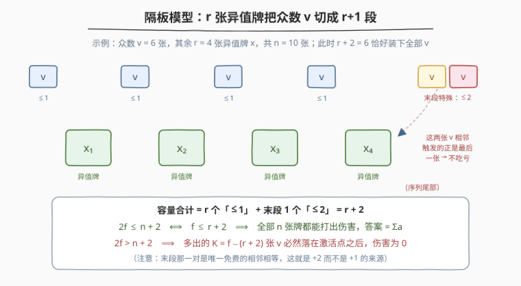
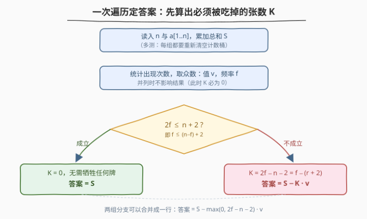
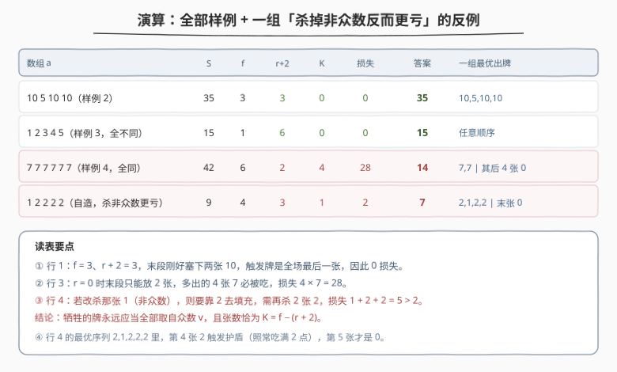

# Codeforces 2252A 首领战 题解

## 1. 题目概述

- **标题 / 题号**：首领战（Codeforces 2252A，英文名 Boss Fight）
- **链接**：https://codeforces.com/problemset/problem/2252/A
- **来源**：Codeforces Round 1115 (Div. 2) · Problem A
- **难度**：800
- **限制**：时间 1 s / 内存 256 MB
- **标签**：贪心，数据结构，计数

**题意**：你手上有 $n$ 张法术牌，第 $i$ 张造成 $a_i$ 点伤害，出牌顺序可以任意重排。Boss 带一块自适应护盾：**一旦你连续打出两张伤害完全相同的牌**，护盾永久激活——触发护盾的那张牌仍造成正常伤害，但**此后**打出的所有牌都只造成 $0$ 伤害。问：Boss 的血量最高能是多少，才能保证你最优排序后一定把他打死？换句话说，求**能打出的最大总伤害**。

多组数据：第一行 $t$，每组先给 $n$，再给一行 $n$ 个整数，逐组输出一个整数。

**约束**：

- $1 \le t \le 100$
- $1 \le n \le 50$
- $1 \le a_i \le 1000$
- 答案上界 $50 \times 1000 = 5 \times 10^4$，32 位整型够用，但中间量用 `long long` 更省心

## 2. 示例与观察
```text
输入：
4
1
100
4
10 5 10 10
5
1 2 3 4 5
6
7 7 7 7 7 7

输出：
100
35
15
14
```

逐组说明（官方 note 要点）：

- $n=1$：只有一张牌，无相邻可言，打满 $100$；$n=4$，$\{10,5,10,10\}$：按 $10,5,10,10$ 出牌，护盾直到第 4 张（最后一张）才触发，四张全部打满 $35$。
- $n=5$，$\{1,2,3,4,5\}$：所有牌互不相同，随便排都打满 $1+2+3+4+5=15$。
- $n=6$，六个 $7$：第 2 张就与第 1 张相同而触发，之后 4 张全部 $0$，只剩 $7+7=14$。

补一组自造样例（★，覆盖「两张相同」与「杀非众数更亏」两个临界）：

```text
输入（★自造）：
3
2
5 5
5
1 2 2 2 2
3
1000 1000 1

输出（★自造）：
10
7
2001
```

- $\{5,5\}$：$2f=4=n+2$ 不超限，两张都打满；$\{1000,1000,1\}$ 按 $1000,1,1000$ 出牌全不相同邻，$2001$ 全打满。
- $\{1,2,2,2,2\}$：众数 $2$ 出现 $4$ 次、异值牌只有 $1$ 张，最多保住 $2,1,2,2$，损失一张 $2$。

## 3. 解题思路

### 3.1 暴力思路

枚举手牌的全部 $n!$ 种排列，对每种排列从左到右模拟：一旦当前牌与前一张相同就标记护盾激活，此牌照常加伤害、后面的全部跳过，取所有排列的最大值。复杂度 $O(n! \cdot n)$，而 $n \le 50$ 时 $50! \approx 3 \times 10^{64}$，完全不可行；暴力版只能作为 $n \le 8$ 的对拍工具。

真正要回答的只有一个问题：**哪些牌、多少张牌会被护盾吃掉**。

### 3.2 核心观察：隔板模型

设出现次数最多的值（众数）为 $v$、出现 $f$ 次，其余 $r = n - f$ 张牌与 $v$ 都不同。

把所有 $v$ 想象成「要放到空位里的球」，把其余 $r$ 张牌想象成「隔板」。把隔板排成一列会把整条序列切成 $r+1$ 段：最前面一段、相邻两张隔板之间的 $r-1$ 段、最后一段。**同一段里的两张 $v$ 一定在序列中相邻**，于是段内第二张 $v$ 就会触发护盾。

关键一点：触发护盾的那张牌**仍然造成正常伤害**，所以如果触发发生在整条序列的末尾，我们一分钱都不亏。这等价于：允许**最后一段**放 2 张 $v$，其余 $r$ 段每段最多放 1 张。

于是「全部 $n$ 张都能打满伤害」的容量上限是

$$f \le \underbrace{1 + 1 + \cdots + 1}_{r\ \text{段}} + \underbrace{1}_{\text{末段多放的那一张}} = r + 2 \iff 2f \le n + 2$$



反之若 $2f > n + 2$，多出的 $K = f - (r + 2) = 2f - n - 2$ 张 $v$ 无论怎么排都只能落在激活点之后，伤害为 $0$。**而且这是唯一的最优牺牲方式**：牺牲一张非 $v$ 的牌不会让末段变长，反而要再牺牲更多张 $v$（严格证明见 §5 引理 2），所以牺牲的牌全部取自 $v$、张数恰为 $K$。

> 💡 一句话记忆：**先看众数够不够放，放不下的 $K$ 张众数必然白给**。之所以是 $+2$ 而不是 $+1$，是因为末尾那一对「免费」。

### 3.3 算法流程

一次遍历即可完成全部计算：

1. 累加总和 $S$，同时用计数表统计每个值出现次数，记录众数 $(v, f)$（只在频次**严格变大**时更新）。
2. 计算 $K = \max(0,\ 2f - n - 2)$。
3. 输出 $S - K \cdot v$。



> ⚠️ 本解法只输出数值，**不需要真的构造排列**。若强行构造：把 $r$ 张异值牌排开，前 $r$ 个空位各塞 1 张 $v$，剩下的 $f - r \le 2$ 张塞进末尾空位，多出的 $K$ 张直接丢到队尾（它们会被护盾吃掉）即可。

### 3.4 示例演算



| 数组 $a$ | $S$ | $f$ | $r+2$ | $K$ | 损失 $K\cdot v$ | 答案 |
|---|---|---|---|---|---|---|
| $10,5,10,10$ | 35 | 3 | 3 | 0 | 0 | 35 |
| $1,2,3,4,5$ | 15 | 1 | 6 | 0 | 0 | 15 |
| $7,7,7,7,7,7$ | 42 | 6 | 2 | 4 | 28 | 14 |
| $1,2,2,2,2$ | 9 | 4 | 3 | 1 | 2 | 7 |

最后一行值得单独看：如果改去牺牲那张 $1$，剩余的 $\{2,2,2,2\}$ 众数仍是 $2$ 且出现 $4$ 次，$2f=8 > 4+2$，还得再牺牲两张 $2$，总损失 $1+2+2=5 > 2$。这正说明「牺牲便宜的非众数」是**更差**的选择。

## 4. 算法细节

- **多测清空**：`unordered_map` 每组重建；若用 `vector<int> cnt(1001)` 桶，必须每组 `fill` 清零，否则上一组的频次会污染 $f$。
- **负值必须夹到 0**：$2f - n - 2$ 在 $n=1,f=1$ 时为 $-1$，不夹 0 会**多算**伤害（把 $v$ 加了回去）。
- **众数只认严格更大**：并列众数时 $2f \le n$ 必然成立，$K=0$，所以 `if (c > best)` 而不写 `>=` 完全安全，也省掉比较 $v$ 的麻烦。
- **计数方式**：$a_i \le 1000$，可直接开 $1001$ 大小的桶；$n \le 50$ 用哈希表也够。两者都是 $O(n)$。
- **类型安全**：写成 `2LL * f`、`k * (long long)modeVal`，避免 `int` 乘法在更大数据上的隐患。
- **I/O**：`ios::sync_with_stdio(false)` + `cin.tie(nullptr)`（或 `scanf/printf`），本题规模下都不构成瓶颈。
- **无需特判**：$n=1$ 由公式自动处理，不必写分支。

## 5. 正确性证明

**引理 1（满伤害排列的充要条件）**：设数组长度为 $n$，众数 $v$ 出现 $f$ 次、其余异值牌 $r = n - f$ 张。则存在一种出牌顺序，使得护盾**一张牌也不吃掉**（即不存在相邻相等，或唯一一处相邻相等恰好是最后两张），当且仅当 $f \le r + 2$。

**证明**：

*必要性*。任取一种出牌顺序，把其中 $r$ 张非 $v$ 的牌删掉。剩下的 $f$ 张 $v$ 被切成 $r+1$ 段（段可为空）。同段内任意两张 $v$ 在原序列中相邻，因此若某段长度 $\ge 2$，段内第二张 $v$ 就会触发护盾。既然要求一张都不被吃掉，触发就只能发生在序列最末尾且至多一次，于是只有最后一段可能长 2、其余 $r$ 段至多长 1，得 $f \le r + 2$。

*充分性*。把 $r$ 张异值牌任意排成一列，它们之间形成 $r+1$ 个空位。在前 $r$ 个空位里各放 1 张 $v$（$v$ 不够就留空），剩下的 $f - r \le 2$ 张 $v$ 全部塞进最后一个空位。此时只有末段可能长 2，相邻相等仅可能出现在序列最后两张之间；即便触发，其后已无牌可打，伤害全额保留。若 $f \le r$，连末段都不超过 1 张，序列根本无相邻相等。∎

**引理 2（损失下界）**：记 $S = \sum a_i$。若 $f > r + 2$，则任意出牌顺序造成的总伤害不超过 $S - (f - r - 2)\,v$。

**证明**：设护盾在序列中首次触发于第 $j$ 张牌（若全程不触发取 $j = n$），存活前缀 $P = (a_1, \dots, a_j)$ 中 $v$ 出现 $f'$ 次、非 $v$ 牌 $r'$ 张。$P$ 内部至多一处相邻相等且只能在 $P$ 的末尾，故与引理 1 同样的隔板计数给出 $f' \le r' + 2 \le r + 2$。于是至少有 $f - f' \ge f - r - 2$ 张 $v$ 落在 $P$ 之后、伤害为 $0$，仅这部分损失就已达 $(f - f')v \ge (f - r - 2)v$；此外每张落在 $P$ 之后的非 $v$ 牌还会**额外**损失正伤害。故总伤害 $\le S - (f - r - 2)v$。∎

**定理**：最优总伤害为

$$S - \max(0,\ 2f - n - 2)\cdot v .$$

**证明**：分两种情形。

- 若 $2f \le n + 2$：由引理 1 存在满伤害顺序，收益为 $S$，而 $S$ 显然是任何顺序的上界，故最优值 $= S$，与 $\max(0,\cdot) = 0$ 一致。
- 若 $2f > n + 2$：令 $K = f - (r+2) = 2f - n - 2 > 0$。引理 2 给出上界 $S - Kv$。另一方面，弃掉任意 $K$ 张 $v$，剩余多重集众数仍是 $v$ 且只有 $f - K = r + 2$ 张，异值牌仍是 $r$ 张，满足引理 1，可构造满伤害顺序，收益恰为 $S - Kv$。上下界重合，最优值 $= S - Kv$。∎

## 6. 复杂度分析

- **时间**：每组数据一次遍历，计数与求众数均为 $O(n)$；`unordered_map` 均摊 $O(1)$，总时间 $O(\sum n) \le 100 \times 50 = 5000$ 次基本操作。$1$ s 时限下绰绰有余（实测最大约束含进程启动约 $5$ ms）。
- **空间**：哈希表或桶，$O(\text{distinct}) \le O(n) \le 50$（桶实现为 $O(\max a_i) = O(1000)$）；除此之外只有常数级变量。
- **常数优化**：本题无需任何特殊优化，读入即可算出答案。

## 7. 参考代码

### C++17

```cpp
#include <bits/stdc++.h>
using namespace std;

int main() {
    ios::sync_with_stdio(false);
    cin.tie(nullptr);

    int t;
    cin >> t;
    while (t--) {
        int n;
        cin >> n;

        long long sum = 0;           // 全部牌的总伤害 S
        int best = 0, modeVal = 0;   // 众数出现次数 f、众数取值 v
        unordered_map<int, int> cnt;
        cnt.reserve(2 * n + 8);

        for (int i = 0; i < n; ++i) {
            int x;
            cin >> x;
            sum += x;
            int c = ++cnt[x];
            if (c > best) {          // 只在严格变大时更新，并列时 K 必为 0
                best = c;
                modeVal = x;
            }
        }

        long long k = 2LL * best - n - 2;   // 必须被护盾吃掉的牌数
        if (k < 0) k = 0;                    // n = 1 时为负，需夹到 0
        cout << sum - k * (long long)modeVal << '\n';
    }
    return 0;
}
```

### Python3

```python
import sys


def main() -> None:
    data = sys.stdin.buffer.read().split()
    if not data:
        return
    t = int(data[0])
    pos = 1
    out = []
    for _ in range(t):
        n = int(data[pos])
        pos += 1
        cnt = {}
        total = 0
        best = 0
        mode_val = 0
        for i in range(pos, pos + n):
            x = int(data[i])
            total += x
            c = cnt.get(x, 0) + 1
            cnt[x] = c
            if c > best:
                best = c
                mode_val = x
        pos += n
        k = max(0, 2 * best - n - 2)
        out.append(str(total - k * mode_val))
    sys.stdout.write("\n".join(out) + "\n")


if __name__ == "__main__":
    main()
```

## 8. 边界情况与易错点

1. **$n = 1$**：没有相邻对，永不触发。公式给 $2-1-2 = -1$，夹 0 后答案就是 $a_1$；忘记夹 0 会输出 $a_1 + a_1$。
2. **全部相同**（$f = n$）：$K = n - 2$。$n=2$ 时 $K=0$（两张都打满），$n \ge 3$ 时只有前两张有效。写成 $K = n-1$ 就会把样例 4 算成 $7$。
3. **触发牌仍吃满伤害**：这是本题最大的坑，答案的「保留张数」是 $r+2$ 而不是 $r+1$。样例 4 的 $14$ 而非 $7$ 就是这一点的直接体现。
4. **并列众数**：两个值都出现最多时必有 $2f \le n$，$K = 0$，取哪个 $v$ 都不影响答案，所以代码里用严格大于更新即可。
5. **多测清空与读入格式**：桶不清零、哈希表复用残留会让 $f$ 虚高、答案偏小；读入是「先 $t$，每组先 $n$ 再 $n$ 个数」，Python 版用游标 `pos` 推进，避免逐行 `input()` 遇到空行的麻烦。

## 9. 验证记录

- **编译环境与命令**：`clang++ -std=c++17 -O2`（本机无 GNU g++，配 `codeforces/tools/include/bits/stdc++.h` 兼容头；正文代码只用标准库，可原样提交 GNU C++17）；Python 侧为 `Python 3.9.6`。
- **官方样例**：1 / 1 通过（按 Codeforces 标准 checker 的 token 比对，忽略空白与大小写）。
- **复核状态**：audited（2026-11-19 统一回归：编译 + 官方样例；写作期的随机对拍与暴力未重跑）。

## 相关题目与扩展

- [LeetCode 767. 重构字符串](https://leetcode.cn/problems/reorganize-string/)：同一套「隔板 / 空位」判定，条件是 $2f \le n+1$；本题因为末尾那一对「免费」放宽成 $2f \le n+2$，可直接对照。
- [LeetCode 1054. 距离相等的条形码](https://leetcode.cn/problems/distant-barcodes/)：在相同判定下要求真的输出一个相邻不相同的构造。
- [LeetCode 621. 任务调度器](https://leetcode.cn/problems/task-scheduler/)：同样是「最大频率决定最少空位数」的模型，只是空位要填冷却。

**延伸思考**：

1. 若护盾改为「连续 $k$ 张相同才触发」，末段容量变成 $k$，判定改成 $f \le r + k$，答案变成 $S - \max(0, f - r - k)v$。
2. 若要求输出**字典序最小**的最优排列，只需在保证「段内不超容」的前提下每次取最小可用值，用堆贪心解决。
3. 若 $a_i$ 放大到 $10^9$、$n$ 到 $10^6$，本解照旧（哈希 + `long long`，答案上界约 $10^{15}$）；但若护盾改成「触发后伤害减半」，最优牺牲顺序就未必只取众数了。
