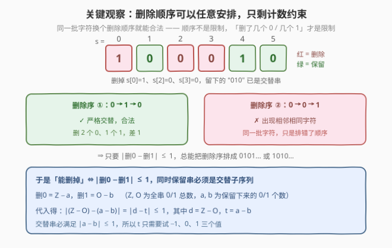
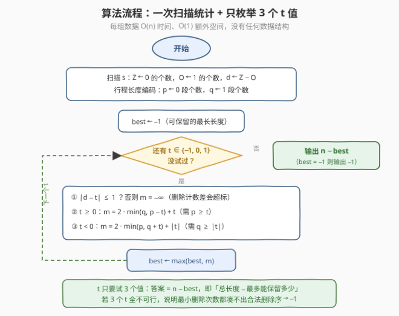
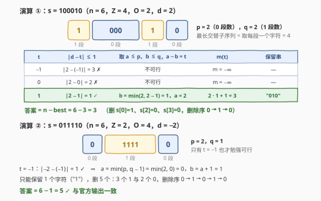

# Codeforces 2252B 不断变化 题解

## 1. 题目概述

- **标题 / 题号**：不断变化（Codeforces 2252B，英文名 Always Changing）
- **链接**：https://codeforces.com/problemset/problem/2252/B
- **来源**：Codeforces Round 1115 (Div. 2) · Problem B（UTC 2026-08-06）
- **难度**：1100
- **限制**：时间 1.5 s / 内存 256 MB
- **标签**：字符串，动态规划，贪心，数学

**题意**：给定长度 $n$ 的 01 串 $s$。可以执行「删掉当前串里任意一个字符」的操作任意多次（也可以零次），但有一条额外规则：**被删掉的字符按删除先后必须严格交替**——上一次删的是 `0`，这次就必须删 `1`，反之亦然；第一次删 `0` 或 `1` 都允许。要求把 $s$ 变成**交替串**（任意两个相邻字符都不同），求最少的删除次数；做不到则输出 `-1`。多组数据：第一行 $t$；每组先给 $n$，再给一行长度 $n$ 的 01 串；每组输出一行答案。

注意「任意一个字符」意味着**删除的位置和顺序都是我们自己挑的**：只要最终删掉的 `0` 有几个、`1` 有几个定下来，总能排出一个合法的删除顺序。所以真正的约束只落在两个计数上，这一点是整题的钥匙（§3.2 观察 1）。

**约束**：

- $1 \le t \le 10^4$
- $1 \le n \le 2 \times 10^5$
- 所有测试用例的 $\sum n \le 2 \times 10^5$
- $s$ 仅由 `0`、`1` 组成

## 2. 示例与观察
官方样例（输入 / 输出原样）：

```text
输入：
5
4
0101
3
111
6
100110
6
100010
6
011110

输出：
0
-1
2
3
5
```

- `0101` 已交替，删 0 个；`111` 至少要删两个 `1`，但连续删两个 `1` 违反交替规则（没有 `0` 可穿插），无解。
- `100110` 删掉 1 个 `0` 与 1 个 `1`（删除序 `0,1`），剩下 `1010`，共 2 次。
- `100010` 光删两个 `0` 会让「删 0 比删 1 多 2 个」而不合法，必须额外删掉边缘的 1 个 `1`：删 `0,1,0` 三个字符，剩下 `010`，共 3 次。
- `011110` 消除重复本需删 3 个 `1`，配平又要删 2 个 `0`，只剩 1 个字符，共 5 次。

```text
输入（自造，★ 压边界）：
4
1
0
2
11
3
000
5
01110

输出：
0
1
-1
3
```

`0` 已交替，`11` 删 1 个 `1` 即交替；`000` 需删 2 个 `0`，非法，输出 `-1`；`01110` 压缩成 `010` 后删 1 个 `0`、2 个 `1`（删除序 `0,1,0`），共 3 次。

## 3. 解题思路

### 3.1 暴力思路

把「删哪些位置」当作 01 决策枚举，共 $2^n$ 种方案，每种判一下保留串是否交替、被删的 0/1 个数差是否 $\le 1$，取最小删除数。复杂度 $O(2^n \cdot n)$，$n = 20$ 就已经 $10^7$ 量级，$n = 2\times10^5$ 完全不可行。更自然的贪心是「先把每个极长同字符段压缩成一个字符」：设压缩后交替串长度（即段数）为 $k$，多余的 $n-k$ 个字符必须删，此时被删的 `0` 与 `1` 的个数也确定了；若两者之差超过 1，就再从串里补删几个字符来配平。**问题在于补删的代价说不清**：样例 5 的 `011110` 压缩成 `010`，原本只需删 3 个 `1`，为配平得把两个 `0` 也删掉，结果只剩 1 个字符、答案 5；而样例 4 的 `100010` 只需补删 1 个 `1`。补几个、补哪种，取决于「保留资源和计数平衡如何折中」，用纯贪心很难一次定对。正确的做法是找一个**同时刻画长度和计数差**的小参数并枚举它。

### 3.2 核心观察：删除顺序自由，不受限制的只剩计数



**观察 1（删除顺序不是限制）**：一个交替序列里 `0` 与 `1` 的个数之差至多为 1；反过来，若被删字符中 `0` 有 $x$ 个、`1` 有 $y$ 个且 $|x-y| \le 1$，就把个数多的那种字符放第一个、交替着删（$x=y$ 时 `0101…` 或 `1010…` 均可，$x=y+1$ 时 `010…0`，$y=x+1$ 时对称）。删除位置可以任意挑，所以只要计数满足条件就一定能排出合法顺序。于是「删除方案存在合法顺序」当且仅当

$$|\mathrm{del}_0 - \mathrm{del}_1| \le 1 .$$

**观察 2（保留串 = 每段至多一个字符）**：保留下来的是 $s$ 的一个子序列，且必须相邻不同。把 $s$ 拆成极长同字符的**段**（行程长度编码）$R_1, R_2, \ldots, R_k$。同一段是连续区间，在其中取两个字符，它们之间不可能夹着别的段的位置，故在子序列里必然相邻且相等 → 非法；而段与段之间字符天然交替，每段各取 1 个必然合法。所以最长交替子序列长度**恰好等于段数** $k$，且任何合法保留方案 = 若干段的「每段挑一个」。

**观察 3（把约束翻译成一个三值参数）**：设全串 `0`、`1` 总数为 $Z, O$，保留的 `0`、`1` 个数为 $a, b$，记 $t = a - b$、$d = Z - O$。则 $\mathrm{del}_0 = Z - a$、$\mathrm{del}_1 = O - b$，观察 1 化成 $|d - t| \le 1$。而保留串是交替串，必有 $|a - b| \le 1$，所以 **$t$ 只有 $-1, 0, 1$ 三种取值**——只需枚举 3 个 $t$，复杂度和 $n$ 脱钩。

**观察 4（给定 $t$ 时的最优保留长度）**：段只有 `0` 段和 `1` 段两种，由段号奇偶性决定。设 `0` 段有 $p$ 个、`1` 段有 $q$ 个（$p+q=k$）。取任意 $a$ 个 `0` 段与 $b$ 个 `1` 段就得到一个合法交替子序列，长度 $a+b$、差值 $a-b=t$。于是求 $\max a+b$ 就是一个二元线性规划，直接解出

$$m(t) = \begin{cases} 2\min(q,\, p - t) + t, & t \ge 0 \ (\text{需 } p \ge t),\\[2pt] 2\min(p,\, q + t) + |t|, & t < 0 \ (\text{需 } q \ge |t|).\end{cases}$$

最终答案 $\text{ans} = n - \max m(t)$（$t$ 取遍 $\{-1,0,1\}$ 中满足 $|d-t| \le 1$ 且可行的值）；若不存在可行的 $t$，输出 `-1`。

### 3.3 算法流程



1. 扫描 $s$：统计 $Z, O$ 得 $d = Z - O$；同时数段——`i == 0 || s[i] != s[i-1]` 时开启新段，按字符累加 $p$ 或 $q$。
2. `best = -1`，对 $t = -1, 0, 1$：$|d - t| > 1$ 跳过；$t \ge 0$ 时需 $p \ge t$，取 $m = 2\min(q, p-t) + t$；$t < 0$ 时需 $q \ge -t$，取 $m = 2\min(p, q+t) + |t|$；`best = max(best, m)`。
3. 输出 `best < 0 ? -1 : n - best`。

### 3.4 示例演算



以 $s = \texttt{100010}$ 为例：段为 `1 | 000 | 1 | 0`，故 $p = 2$（`000`、`0`）、$q = 2$，$Z = 4, O = 2, d = 2$。$t = -1$ 时 $|2-(-1)| = 3 > 1$、$t = 0$ 时 $|2-0| = 2 > 1$，都被丢弃；$t = 1$ 时 $|2-1| = 1$ 通过，$b = \min(q, p-t) = \min(2,1) = 1$，$m = 2 \cdot 1 + 1 = 3$，对应保留 `010`。答案 $6 - 3 = 3$，与官方输出一致。对称地，$s = \texttt{011110}$ 有 $d = -2$，只有 $t = -1$ 可行：$a = \min(p, q + t) = \min(2, 0) = 0$，$m = 1$，答案 $6 - 1 = 5$。

## 4. 算法细节

1. **多测清空**：$Z, O, p, q, d, best$ 全部声明在每组循环体内（或每次显式重置）。把它们放全局又忘记清空，是本题最常见的 WA 来源。
2. **段数统计的下标边界**：从 `i = 0` 开始循环，判据写作 `i == 0 || s[i] != s[i-1]`，只用一个短路条件就能同时处理首字符，不必特判。
3. **可行性必须显式判**：$p < t$ 时 $p - t$ 为负，$\min(q, p-t)$ 会给出负数，$m$ 直接变负、答案反而变大。所以 $p \ge t$、$q \ge |t|$ 一定要在公式前用 `continue` 跳过，不能靠 `max(0, ...)` 糊过去（那等于允许「不存在的段」）。
4. **`best` 用 `-1` 初始化**：`0` 是合法结果（原串已交替），只有 `-1` 才能表示「一个可行 $t$ 都没有」。最后判 `best < 0` 输出 `-1`，不要写成 `best == -1` 与「答案恰为 0」混淆——判 `best` 而不是判答案，语义清晰。
5. **数据类型与常数**：$n \le 2\times10^5$，所有量都在 `int` 范围内，不需要 `long long`；但 $d$ 可能为负，**不要用 `unsigned`**。每组只有一次线性扫描加 3 次常数运算，总操作数 $10^6$ 量级，无需任何优化。
6. **I/O 与输出**：$t$ 可达 $10^4$，C++ 关同步、用 `'\n'`，Python 用 `sys.stdin.buffer.read().split()` 一次读完；题目只要次数，**不要真的模拟删除过程**（那是 $O(n^2)$，会超时）。

## 5. 正确性证明

**引理 1**：对任意保留方案，存在合法删除顺序当且仅当 $|\mathrm{del}_0 - \mathrm{del}_1| \le 1$。

**证明**：必要性：删除序 $x_1, \ldots, x_r$ 严格交替，若 $r$ 为偶数则 `0` 与 `1` 各占一半；若 $r$ 为奇数，则交错着排必然一边比另一边多恰好一个，故两种字符的个数差不超过 1。充分性：设 $\mathrm{del}_0 = x, \mathrm{del}_1 = y$。$x = y$ 时按 `0,1,0,1,\ldots` 删；$x = y+1$ 时按 `0,1,\ldots,0`（以 `0` 开头结尾）删；$y = x+1$ 时对称。每一步都能在待删集合里找到对应字符（删除位置随便挑，不要求相邻），故该顺序可实现。∎

**引理 2**：$s$ 的一个子序列是交替串，当且仅当它从每个极长同字符段中至多取 1 个字符；因此最长交替子序列长度等于段数 $k$。

**证明**：若同一段 $R_j$ 被取了两个位置，由于 $R_j$ 在 $s$ 中是连续区间，这两个位置之间不存在任何属于其他段的字符，故它们在子序列中相邻且字符相同，矛盾。反之若每段至多取 1 个，任取子序列中相邻的两个字符，它们所属段号不同；段字符按段号奇偶交替，故两字符不同。取每段各 1 个即得长度 $k$ 的交替子序列，配合前半部分即得最大性。∎

**引理 3**：固定 $t \in \{-1,0,1\}$ 时，满足 $a - b = t$ 的最长合法保留长度为 $m(t)$，即上述分段公式。

**证明**：由引理 2，保留方案等价于选取 $a$ 个 `0` 段与 $b$ 个 `1` 段，长度 $a+b$，且 $0 \le a \le p$、$0 \le b \le q$；反之任一组满足这些约束的 $(a,b)$ 都能取到（段之间字符交替，任意子集都合法）。于是问题化为 $\max a+b$，约束 $a - b = t$。当 $t \ge 0$ 时 $a = b + t$，需 $b + t \le p$ 且 $b \le q$，故 $b$ 最优取 $\min(q, p-t)$（$p \ge t$ 时非负），代回得 $m = 2\min(q,p-t) + t$；$t < 0$ 时令 $b = a + |t|$，同理解得 $m = 2\min(p, q-|t|) + |t|$。∎

**定理**：算法输出的数值是最少删除次数（或正确地判定无解）。

**证明**：任何合法方案都确定一个保留串，它是交替串，故 $t = a - b \in \{-1,0,1\}$；又由引理 1，其删除计数必须满足 $|d - t| \le 1$。所以合法方案一定落在算法枚举的某个 $t$ 上，其保留长度不超过引理 3 给出的 $m(t)$，即删除次数不少于 $n - \max m(t)$。另一方面，对取到 $\max$ 的那个 $t$，引理 3 的构造给出保留长度恰为 $m(t)$ 的合法方案，其 $|\mathrm{del}_0 - \mathrm{del}_1| = |d - t| \le 1$，由引理 1 可排出合法删除序，达到下界。若所有 $t$ 都不可行，则任何保留串都违反计数约束，无解，输出 `-1` 正确。∎

**推论**：题目无解当且仅当 $|Z - O| \ge 3$。

**证明**：若 $|d| \le 1$，取 $t = 0$ 有 $|d - 0| \le 1$，且 $a = b = 0$ 总可行（$m(0) = 2\min(p,q) \ge 0$）；若 $d = 2$，则 $Z \ge O + 2 \ge 2$，至少有一个 `0` 段使 $p \ge 1$，取 $t = 1$ 可行；$d = -2$ 对称（至少一个 `1` 段）。若 $|d| \ge 3$，则对任意 $t \in \{-1,0,1\}$ 有 $|d - t| \ge |d| - |t| \ge 3 - 1 = 2 > 1$，三个 $t$ 全部不可行。∎

## 6. 复杂度分析

- **时间**：每组一次线性扫描统计 $Z, O, p, q$，再 $O(1)$ 枚举 3 个 $t$，故单组 $O(n)$、总计 $O(\sum n)$，不超过 $2\times10^5$ 次基本操作。实测 C++17（`-O2`）在 $t = 10^4$、$\sum n = 2\times10^5$ 的极限数据上约 $27$ ms、单组 $n = 2\times10^5$ 约 $16$ ms（均含进程启动与读入），Python3 分别约 $43$ ms / $34$ ms。相对 1.5 s 时限有近百倍余量，且无递归、无大数运算。
- **空间**：只有若干 `int` 计数器，除读入字符串 $s$ 的 $O(n)$ 外额外空间 $O(1)$，远低于 256 MB。

## 7. 参考代码

### C++17

```cpp
#include <bits/stdc++.h>
using namespace std;

int main() {
    ios::sync_with_stdio(false);
    cin.tie(nullptr);
    int t;
    if (!(cin >> t)) return 0;               // 空输入防护
    while (t--) {
        int n;
        string s;
        cin >> n >> s;
        int zeros = 0, ones = 0;              // Z, O
        for (char c : s) (c == '0' ? zeros : ones)++;
        int zSeg = 0, oSeg = 0;               // p: 0 段数, q: 1 段数
        for (int i = 0; i < n; i++)
            if (i == 0 || s[i] != s[i - 1])
                (s[i] == '0' ? zSeg : oSeg)++;
        int d = zeros - ones;                 // Z - O
        int best = -1;                        // 最长可保留长度；-1 表示无可行 t
        for (int tgt = -1; tgt <= 1; tgt++) {
            if (abs(d - tgt) > 1) continue;   // 删除计数差必须 <= 1
            int m;
            if (tgt >= 0) {
                if (zSeg < tgt) continue;     // 0 段不够，a - b = tgt 取不到
                m = 2 * min(oSeg, zSeg - tgt) + tgt;
            } else {
                int need = -tgt;
                if (oSeg < need) continue;    // 1 段不够
                m = 2 * min(zSeg, oSeg - need) + need;
            }
            best = max(best, m);
        }
        cout << (best < 0 ? -1 : n - best) << '\n';
    }
    return 0;
}
```

### Python3

```python
import sys


def main() -> None:
    data = sys.stdin.buffer.read().split()
    if not data:                                  # 空输入防护
        return
    t = int(data[0])
    pos = 1
    out = []
    for _ in range(t):
        n = int(data[pos])
        s = data[pos + 1].decode()
        pos += 2
        zeros = s.count('0')
        ones = n - zeros
        z_seg = o_seg = 0                         # p, q
        prev = ''
        for c in s:
            if c != prev:
                if c == '0':
                    z_seg += 1
                else:
                    o_seg += 1
                prev = c
        d = zeros - ones
        best = -1
        for tgt in (-1, 0, 1):
            if abs(d - tgt) > 1:
                continue
            if tgt >= 0:
                if z_seg < tgt:
                    continue
                m = 2 * min(o_seg, z_seg - tgt) + tgt
            else:
                need = -tgt
                if o_seg < need:
                    continue
                m = 2 * min(z_seg, o_seg - need) + need
            if m > best:
                best = m
        out.append(str(-1 if best < 0 else n - best))
    sys.stdout.write('\n'.join(out) + '\n')


main()
```

## 8. 边界情况与易错点

1. **$|Z - O| \ge 3$ 直接无解**：例如 `111`（$d = -3$）、`000`（$d = 3$）。此时三个 $t$ 全部被 $|d - t| > 1$ 挡掉，`best` 保持 `-1`，输出 `-1`，不需要特判——但**若把 $|d - t| > 1$ 的判断写成 $\ge 1$，或干脆忘记判断，就会在这些点上输出错误的次数**。
2. **全同字符要分长度**：`11` 输出 `1`（$d = -2$、$t = -1$、$m = 1$，删一个 `1` 后单字符恒交替），`00` 同理；但 `111`、`0000` 需要连续删两个及以上同字符，违反交替规则，判定为 `-1`。不要因为「只有一种字符」就一律输出 `-1`。
3. **原串已交替**（如 `0101`、`0`、`1`）：答案为 0，此时 `best = n`，注意 `best = -1` 的判定要放在 `n - best` 之外，否则会把 0 次误判成无解。
4. **$p < t$ 的负数陷阱**：若省略 `zSeg < tgt` 的判空，`min(oSeg, zSeg - tgt)` 取到负数，$m$ 变负，`n - m > n`，输出比 $n$ 还大的次数。同理 $t < 0$ 时要判 `oSeg < -tgt`。
5. **多测清空**：$t \le 10^4$，把 `zeros/ones/zSeg/oSeg/best` 定义在循环外会串数据；这也是 `sum n` 类型题目最典型的 WA。
6. **下标与读入**：按 $n$ 遍历即可，不要对 `s.size()` 做额外假设；Python 用 `data[pos + 1]` 取串后 `pos += 2`，别漏加。每组输出一行整数，不要输出构造方案或多余空格。

## 9. 验证记录

- **编译环境与命令**：`clang++ -std=c++17 -O2`（本机无 GNU g++，配 `codeforces/tools/include/bits/stdc++.h` 兼容头；正文代码只用标准库，可原样提交 GNU C++17）；Python 侧为 `Python 3.9.6`。
- **官方样例**：1 / 1 通过（按 Codeforces 标准 checker 的 token 比对，忽略空白与大小写）。
- **复核状态**：audited（2026-11-19 统一回归：编译 + 官方样例；写作期的随机对拍与暴力未重跑）。

## 相关题目与扩展

- [Codeforces 1343C Alternating Subsequence](https://codeforces.com/problemset/problem/1343/C)：把串按符号分段、每段取极值，正是本题「每段至多取一个字符」的同一视角。
- [LeetCode 376. 摆动序列](https://leetcode.cn/problems/wiggle-subsequence/)：最长摆动子序列长度 = 极值点个数，可与本题观察 2 对照理解「压缩到段」的合法性。
- [LeetCode 978. 最长湍流子数组](https://leetcode.cn/problems/longest-turbulent-subarray/)：把「段」的视角用在子数组上（连续约束更强），差分符号交替即可。

**延伸思考**：

1. **去掉「删除必须交替」这条规则**：答案立刻变成 $n - k$（$k$ 为段数），因为删除数量不再受限，只需每段留 1 个。可见本题的全部难度都来自那个计数差约束。
2. **把「删除」换成「把一个字符改成另一个字符」**：合法删除序的约束消失，问题变成「用最少修改使串交替」，这是经典的两套目标串（`0101…` 与 `1010…`）取较小不同位数，$O(n)$ 解决。对比可见：删除改变长度、修改不改变长度，两者约束结构完全不同。
3. **字符集从两种扩到 $\sigma$ 种**：段数仍是关键，但「每段取一个」得到的计数向量有 $\sigma$ 个分量，参数 $t$ 从 3 个取值变成 $O(n)$ 种组合，需要枚举主字符或做桶计数来避免退化成 $O(n\sigma)$。
4. **放宽到「至多一次不交替」**：等价于把 $|\mathrm{del}_0 - \mathrm{del}_1| \le 1$ 放宽为 $\le 2$，$t$ 的枚举范围扩成 $\{-2,\ldots,2\}$、其余公式不变，可作为检验「是否真懂参数化」的小练习。
