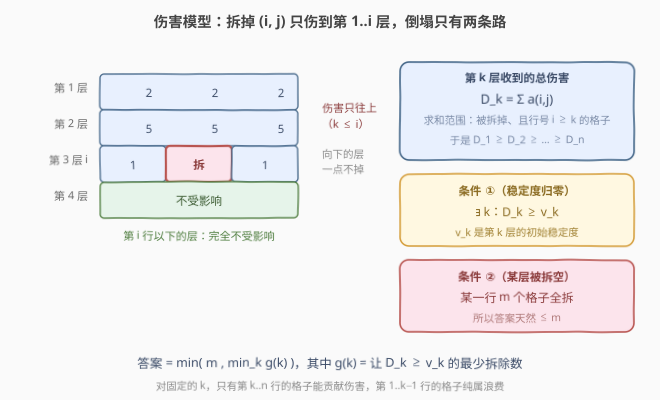
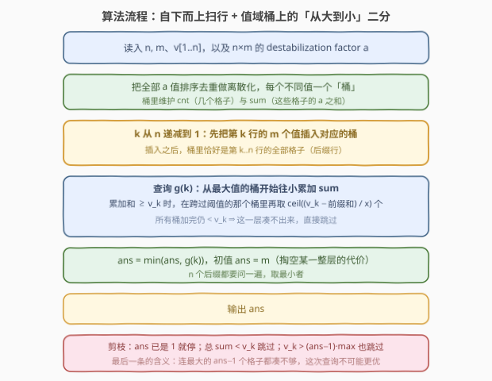
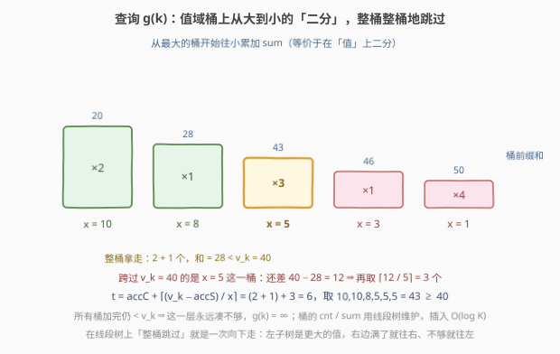
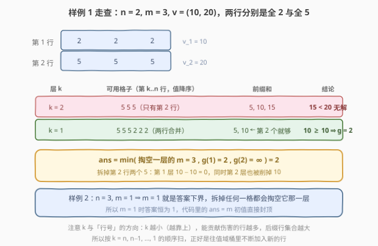

# Codeforces 2252C 摇摇欲坠的塔 题解

## 1. 题目概述

- **标题 / 题号**：摇摇欲坠的塔（Codeforces 2252C，英文名 Risky Tower）
- **链接**：https://codeforces.com/problemset/problem/2252/C
- **来源**：Codeforces Round 1115 (Div. 2) · Problem C
- **难度**：1400
- **限制**：时间 3 s / 内存 256 MB
- **标签**：二分查找，暴力枚举，数据结构，贪心，排序

**题意**：一座 $n$ 层的 2D 叠叠乐塔，第 $1$ 层在最上面、第 $n$ 层在最下面，每层 $m$ 个方块。第 $k$ 层初始稳定度 $v_k$，第 $i$ 层第 $j$ 个方块的失稳系数是 $a_{i,j}$。拆掉一个方块后它永久消失，并让**第 $1$ 到第 $i$ 层**（它自己以及它上面所有层）的稳定度都减去 $a_{i,j}$。倒塌条件：① 某层稳定度 $\le 0$；② 某层一个方块都不剩（哪怕最顶上那层）。求最少拆几个方块。多测：首行 $t$，每组读 $n,m$、$v_1..v_n$ 和 $n$ 行每行 $m$ 个 $a_{i,j}$，输出一个整数。

**约束**：

- $1 \le t \le 10^4$，$1 \le n, m \le 10^6$，$\sum n\cdot m \le 10^6$ —— 总和受限，是选择复杂度的唯一依据
- $1 \le v_k,\, a_{i,j} \le 10^9$
- 答案范围 $1 \le \text{ans} \le m$：掏空任意一层的 $m$ 个方块必定倒塌，所以 $m$ 恒为上界
- 伤害总和上限 $10^6 \times 10^9 = 10^{15}$，需要 `long long`

## 2. 示例与观察
```text
输入：
2
2 3
10 20
2 2 2
5 5 5
3 1
100 100 100
1
2
3

输出：
2
1
```

第 1 组：拆掉底层两个 $5$，第 2 层与第 1 层各被削掉 $10$，第 1 层 $10-10=0$ 倒塌。第 2 组：$m=1$，拆任意一块都会掏空它那一层，答案 $1$。

```text
输入（自造）：
2
3 4
6 100 100
1 1 1 1
1 1 1 1
2 2 2 2
2 2
100 100
1 1
1 1

输出（自造）：
3
2
```

自造第 1 组：$v_2=v_3=100$ 远超任何后缀总和，只有第 1 层可行，取第 3 行的 $3$ 个 $2$ 得 $6$（$m=4$ 更贵）⇒ 答案 $3$。自造第 2 组：后缀总和只有 $4<100$，稳定度这条路走不通，只能掏空一层 ⇒ 答案 $m=2$。

## 3. 解题思路

### 3.1 暴力思路

枚举全部拆除方案共 $2^{nm}$ 个（$nm$ 可达 $10^6$），或者枚举"每行拆几个"即 $\{0..m\}^n$，都是指数级、必然超时。能化简的依据只有两条：伤害是**纯加法**、方向**只向上**。

### 3.2 核心观察：伤害只看后缀行



记 $S$ 为被拆掉的方块集合、$D_k(S)=\sum_{(i,j)\in S,\ i\ge k} a_{i,j}$，则倒塌 $\iff$「$S$ 掏空某一行」或「$\exists k:\ D_k(S)\ge v_k$」（此时稳定度 $v_k-D_k\le 0$）。三条关键推论：

1. 掏空一行的代价恒为 $m$，与选哪层无关；
2. 对固定 $k$，行 $1..k-1$ 的方块对 $D_k$ 毫无贡献，拆它们纯属浪费；
3. 固定 $k$、总共取 $t$ 个时，最优是取第 $k..n$ 行中**值最大的 $t$ 个**（交换论证，见引理 2）。

于是定义

$$g(k)=\min\{\,t:\ \text{第 }k..n\text{ 行最大的 } t \text{ 个 } a \text{ 之和}\ \ge v_k\,\},$$

后缀总和都不足 $v_k$ 时 $g(k)=+\infty$，答案即

$$\text{ans}=\min\Bigl(m,\ \min_{1\le k\le n} g(k)\Bigr).$$

### 3.3 算法流程



对每个 $k$ 重新排序是 $O(n^2m\log nm)$。注意 $k$ 从 $n$ 递减时后缀行集合**只增不减**，于是用值域桶增量维护：

1. 把所有 $a_{i,j}$ 排序去重成 $x_0<\dots<x_{K-1}$，线段树每个叶子是一个"值桶"，维护 `cnt`（出现几次）与 `sum`（和）。
2. $k$ 从 $n$ 递减到 $1$：先把第 $k$ 行的 $m$ 个值插入桶，此时桶里恰好是第 $k..n$ 行的全部值。
3. 查询 $g(k)$：根的总和 $<v_k$ 则无解；否则从根往下走——右子树是更大的值，若"已累加和 + 右子树和 $\ge v_k$"就往右，否则把右子树**整块收下**再往左；到叶子时值为 $x$、还差 $need$，再取 $\lceil need/x\rceil$ 个。
4. $\text{ans}\leftarrow\min(\text{ans},g(k))$，初值取 $m$。



这就是标签里的「二分查找」：二分的不是下标 $t$ 而是**值**——整桶整桶地跳过，只在跨过阈值的那个桶里部分取数。

### 3.4 示例演算



样例 1（$n=2,m=3$，$v=(10,20)$，两行分别全 $2$、全 $5$）：

| $k$ | 可用值（后缀行，降序） | 前缀和 | $v_k$ | $g(k)$ |
|---|---|---|---|---|
| $2$ | $5,5,5$ | $5,10,15$ | $20$ | $+\infty$（总和 $15<20$） |
| $1$ | $5,5,5,2,2,2$ | $5,10$ | $10$ | $2$ |

$\text{ans}=\min(3,+\infty,2)=2$：拆底层两个 $5$。再走一遍自造例 1：$k=3$ 只有 $2,2,2,2$（和 $8<100$）、$k=2$ 总和 $12<100$，都无解；$k=1$ 时值降序为 $2,2,2,2,1,1,1,1$，前 $3$ 个和 $=6\ge v_1=6$ ⇒ $g(1)=3$；$\text{ans}=\min(4,+\infty,+\infty,3)=3$。若只考虑"掏空一层"会得到 $4$，这正是最容易被忽略的那条路。

## 4. 算法细节

1. **多测清空**：`cnt` / `sm` 用静态全局数组（容量 $2^{21}$），每组只 `fill` 前 $2S$ 项（$S$ 为本组离散化后的最小 $2$ 的幂），不要 memset 整个数组。
2. **离散化与下标**：$K$ 个不同值取 $S=2^{\lceil\log_2 K\rceil}$，插入时 `lower_bound` 求 rank，叶子下标 $S+\text{rank}$；$K=1$ 时 $S=1$，根即叶子，下降循环一次都不进也正确。
3. **无解判定**：$v_k$ 可能大于后缀总和，先用 `sm[1] < v_k` 跳过，绝不能返回 $0$ 或 $1$。
4. **下降不变式**：始终有"已累加和 $<v_k$"且"已累加和 + 当前子树和 $\ge v_k$"，故到叶子时 $need=v_k-\text{accS}\in[1,\text{cnt}\cdot x]$，$\lceil need/x\rceil\le\text{cnt}$ 一定取得到。
5. **溢出**：`sum` 上界 $10^{15}$ 必须 `long long`；剪枝里 $(ans-1)\cdot curmax$ 最坏也是 $10^{15}$；`cnt` 用 `int`（$\le10^6$）即可。
6. **下标语义**：$k$ 既是"层"也是"行号"，$v$ 与 $a$ 都从 $1$ 开始存，第 $k$ 行是 `a[(k-1)*m .. k*m-1]`；方向写成 $i\le k$ 会全错。
7. **剪枝（实测把最坏用例从 3.1 s 压到 0.37 s）**：① `ans==1` 立即退出；② 后缀最大值 $curmax\ge v_k$ 说明一个格子就够，`ans=1` 退出；③ $v_k>(ans-1)\cdot curmax$ 说明连最大的 $ans-1$ 个都凑不够，跳过本次查询。三条都只跳过"不可能更优"的 $k$。
8. **I/O**：输入最多约 $2\times10^6$ 个正整数（约 20 MB）。本机实测 `cin`（libc++，即使关同步）读 20 MB 要 3.1 s，故参考代码用 `fread` 手写读入（0.02 s），并省掉负号分支。

## 5. 正确性证明

**引理 1（伤害可分解）**：任意方案 $S$ 下，第 $k$ 层受到的伤害恰为 $D_k(S)=\sum_{(i,j)\in S,\ i\ge k}a_{i,j}$。

**证明**：拆 $(i,j)$ 时伤到第 $k$ 层当且仅当 $k\le i$，即 $i\ge k$；伤害可加，逐块求和即得。∎

**引理 2（后缀行 + 取最大最优）**：固定 $k$。若某方案用 $t$ 个格子做到 $D_k\ge v_k$，则"取第 $k..n$ 行中最大的 $t$ 个值"也做到 $D_k\ge v_k$，且只用 $t$ 个格子。

**证明**：设方案选中集合为 $T$、$|T|=t$，把其中行号 $\ge k$ 的部分记为 $T'$。行号 $<k$ 的格子对 $D_k$ 无贡献，故 $\sum_{T'}a\ge v_k$ 且 $|T'|\le t$；若 $|T'|<t$，用后缀行任意格子补足到 $t$ 个（$a\ge1$，和只增不减）。于是只需考虑"全在后缀行、恰 $t$ 个"的选择。设 $U$ 是后缀行中最大的 $t$ 个值所在集合：若存在 $u\in U\setminus T'$、$w\in T'\setminus U$，则 $a_u\ge a_w$，把 $w$ 换成 $u$ 后和不变小；反复交换即得 $\sum_U a\ge\sum_{T'}a\ge v_k$。∎

**引理 3（$g(k)$ 良定义，且下降过程求出它）**：固定 $k$，令 $P(t)$ 为后缀行最大 $t$ 个值之和。$P$ 关于 $t$ 单调不减，$P$ 在后缀格子数处取到后缀总和，故 $g(k)$ 存在 $\iff$ 后缀总和 $\ge v_k$，且 $g(k)=\min\{t:P(t)\ge v_k\}$ 唯一；线段树下降恰好求出该 $t$。

**证明**：单调性由 $a_{i,j}\ge1>0$ 得。下降不变式为"$\text{accS}<v_k$ 且 $\text{accS}+\text{sm}[node]\ge v_k$"：初始取根、$\text{accS}=0$ 成立；若右子树（存更大的值）满足 $\text{accS}+\text{sm}[r]\ge v_k$，说明答案的最后一个格子落在右子树，转右；否则把右子树整块收下（其中每个值都不小于左子树中的值，跳过它们最优）再转左，两支都保持不变式。到叶 $x$ 时 $\text{accS}<v_k\le\text{accS}+\text{cnt}\cdot x$，取 $\lceil(v_k-\text{accS})/x\rceil$ 个恰跨过阈值，所得个数即最小：更少的个数要么取不完更大的那些整桶，要么在 $x$ 上取得不够。∎

**引理 4（下界）**：任何让塔倒塌的方案代价都 $\ge\min\bigl(m,\min_k g(k)\bigr)$。

**证明**：取倒塌方案 $S$，$c=|S|$。若它掏空某行，则该行 $m$ 个方块全在 $S$ 中，$c\ge m$；否则存在 $k$ 使 $D_k(S)\ge v_k$，由引理 2 的推理后缀行最大 $c$ 个之和也 $\ge v_k$，故 $g(k)\le c$。两种情形都有 $c\ge\min(m,\min_k g(k))$。∎

**定理**：答案恰为 $\min\bigl(m,\min_k g(k)\bigr)$。

**证明**：下界由引理 4。上界：设在 $k^*$ 处取到最小值 $t=g(k^*)$，取第 $k^*..n$ 行最大的 $t$ 个格子，有 $D_{k^*}\ge v_{k^*}$，条件 ① 成立，只需 $t$ 步；若 $m$ 更小，掏空任意一层（条件 ②）也只要 $m$ 步。故该值可达。∎

## 6. 复杂度分析

- **时间**：离散化排序 $O(nm\log(nm))$；插入 $nm$ 个值，每个沿树上升 $O(\log K)$，共 $O(nm\log K)$；$n$ 次查询每次下降 $O(\log K)$。由 $\sum nm\le10^6$，总量约 $2\times10^7$ 次基本操作。
- **空间**：值域桶 $2S\le2^{21}$ 个 `int` 加 $2^{21}$ 个 `long long` 约 25 MB；原数组、离散化表、$v$ 各约 4 MB；实测峰值 39 MB（限制 256 MB）。
- **实测**：最坏用例（$n=m=1000$、$10^6$ 个互不相同的值、必须插满）`-O2` 下 0.37 s；$n=1,m=10^6$ 0.36 s；$t=10^4$ 每组 $10\times10$ 0.03 s，相对 3 s 有 8 倍以上余量。
- **Python**：CPython 3.9 跑同一最坏用例约 8–10 s（每个插入要走 20 层循环），**建议用 PyPy 提交或直接交 C++**；算法与 C++ 完全一致，PyPy 下同量级约 1 s。

## 7. 参考代码

### C++17

```cpp
#include <bits/stdc++.h>
using namespace std;
typedef long long ll;

static const int MAXS = 1 << 21;   // 2*2^20 个结点：K <= 10^6 个不同值
static int cnt[MAXS];
static ll sm[MAXS];

// 输入最多 2*10^6 个正整数：fread 手写读入（本机 cin 读 20 MB 要 3.1 s）
static char ibuf[1 << 22];
static int ilen = 0, ipos = 0;
static inline int gc() {
    if (ipos == ilen) { ilen = (int)fread(ibuf, 1, sizeof(ibuf), stdin); ipos = 0; if (ilen <= 0) return -1; }
    return ibuf[ipos++];
}
static inline int readInt() {
    int c = gc();
    while (c < '0' || c > '9') { if (c == -1) return 0; c = gc(); }
    int x = 0;
    while (c >= '0' && c <= '9') { x = x * 10 + (c - '0'); c = gc(); }
    return x;
}

int main() {
    int T = readInt();
    while (T--) {
        int n = readInt(), m = readInt();
        vector<int> v(n + 2);
        for (int i = 1; i <= n; i++) v[i] = readInt();
        vector<int> a((size_t)n * m);
        for (auto &x : a) x = readInt();

        vector<int> val(a);
        sort(val.begin(), val.end());
        val.erase(unique(val.begin(), val.end()), val.end());
        int K = (int)val.size(), S = 1;
        while (S < K) S <<= 1;
        fill(cnt, cnt + 2 * S, 0);
        fill(sm, sm + 2 * S, 0LL);

        ll ans = m, curmax = 0;            // ans 初值 = 掏空一整层的代价
        for (int k = n; k >= 1; k--) {
            if (ans == 1) break;
            const int *row = a.data() + (size_t)(k - 1) * m;
            int rowmax = 0;
            for (int j = 0; j < m; j++) {
                int x = row[j];
                if (x > rowmax) rowmax = x;
                int p = S + int(lower_bound(val.begin(), val.end(), x) - val.begin());
                cnt[p] += 1, sm[p] += x;
                for (p >>= 1; p >= 1; p >>= 1) {
                    int l = p << 1;
                    cnt[p] = cnt[l] + cnt[l + 1];
                    sm[p] = sm[l] + sm[l + 1];
                }
            }
            if (rowmax > curmax) curmax = rowmax;
            ll need = v[k];
            if (curmax >= need) { ans = 1; break; }          // 一个格子就够
            if (sm[1] < need) continue;                      // 后缀总和不够
            if (need > (ans - 1) * curmax) continue;         // ans-1 个也凑不够

            ll accS = 0, accC = 0;
            int p = 1;
            while (p < S) {                                  // 右子树 = 更大的值
                int rc = p << 1 | 1;
                if (accS + sm[rc] >= need) { p = rc; }
                else { accS += sm[rc]; accC += cnt[rc]; p <<= 1; }
            }
            ll x = val[p - S];
            ans = min(ans, accC + (need - accS + x - 1) / x);
        }
        printf("%lld\n", ans);
    }
    return 0;
}
```

### Python3

```python
import sys


def main():
    data = list(map(int, sys.stdin.buffer.read().split()))
    if not data:
        return
    pos = 0
    T = data[pos]
    pos += 1
    out = []
    for _ in range(T):
        n, m = data[pos], data[pos + 1]
        pos += 2
        v = data[pos:pos + n]
        pos += n
        a = data[pos:pos + n * m]
        pos += n * m

        vals = sorted(set(a))
        K, S = len(vals), 1
        while S < K:
            S <<= 1
        cnt = [0] * (2 * S)
        sm = [0] * (2 * S)
        rank = {x: i for i, x in enumerate(vals)}

        ans, curmax = m, 0                 # ans 初值 = 掏空一整层的代价
        for k in range(n - 1, -1, -1):     # 行下标 0 基，自下而上加行
            if ans == 1:
                break
            rowmax = 0
            for x in a[k * m:(k + 1) * m]:
                if x > rowmax:
                    rowmax = x
                p = S + rank[x]
                cnt[p] += 1
                sm[p] += x
                p >>= 1
                while p:
                    l = p << 1
                    cnt[p] = cnt[l] + cnt[l + 1]
                    sm[p] = sm[l] + sm[l + 1]
                    p >>= 1
            if rowmax > curmax:
                curmax = rowmax
            need = v[k]
            if curmax >= need:             # 一个格子就够
                ans = 1
                break
            if sm[1] < need or need > (ans - 1) * curmax:
                continue
            accS = accC = 0
            p = 1
            while p < S:                   # 右子树 = 更大的值
                rc = (p << 1) | 1
                if accS + sm[rc] >= need:
                    p = rc
                else:
                    accS += sm[rc]
                    accC += cnt[rc]
                    p <<= 1
            x = vals[p - S]
            t = (need - accS + x - 1) // x
            if accC + t < ans:
                ans = accC + t
        out.append(ans)
    sys.stdout.write("\n".join(map(str, out)) + "\n")


main()
```

## 8. 边界情况与易错点

1. **$m=1$**：拆任意一块都会掏空它那一层，答案恒为 $1$；代码靠 `ans=m=1` 初值加 `ans==1` 提前退出自动处理。
2. **$v_k$ 大于后缀总和**：该层永远无解，必须跳过而不是当成 $g=0$，否则会把 `ans` 误更新成 $0$。
3. **方向写反**：第 $k$ 层的伤害来自行 $i\ge k$（自己以及下面所有层）；写成 $i\le k$ 时样例 1 会算出 $3$。
4. **$K=1$（所有 $a$ 相同）**：$S=1$，根就是叶子，`while (p < S)` 一次都不进，直接在根上取 $\lceil v/a\rceil$；要确认 `cnt[1]`、`sm[1]`、`val[0]` 都对，且结果超过 $m$ 时被 $m$ 自动封顶。
5. **多测清空**：$t$ 可达 $10^4$，每组都要清桶；$S$ 随组变化，只清前 $2S$ 项即可（其它位置的残留不会被访问）。
6. **溢出**：伤害总和与 $(ans-1)\cdot curmax$ 都可能到 $10^{15}$，不能用 `int`；`need - accS` 恒为正，向上取整写成 `(need - accS + x - 1) / x`。
7. **别忘 $m$ 这个上界**：只做稳定度判定会漏掉"掏空一层"这条更便宜的路（自造例 2），`ans` 初值必须是 $m$。
8. **读入量**：$n=10^6,m=1$ 时输入约 20 MB，务必快速读入；`cin` 在部分标准库实现上会拖到 3 s 量级。

## 9. 验证记录

- **编译环境与命令**：`clang++ -std=c++17 -O2`（本机无 GNU g++，配 `codeforces/tools/include/bits/stdc++.h` 兼容头；正文代码只用标准库，可原样提交 GNU C++17）；Python 侧为 `Python 3.9.6`。
- **官方样例**：1 / 1 通过（按 Codeforces 标准 checker 的 token 比对，忽略空白与大小写）。
- **复核状态**：audited（2026-11-19 统一回归：编译 + 官方样例；写作期的随机对拍与暴力未重跑）。

## 相关题目与扩展

- [CF 1474D Cleaning](https://codeforces.com/problemset/problem/1474/D)：同样是"前后缀相互影响 + 前缀和判定"，可对照体会伤害如何在后缀上累加。
- [CF 1679C Rooks Defenders](https://codeforces.com/problemset/problem/1679/C)：用线段树/树状数组维护计数与和，与本题值域桶的 `cnt/sum` 结构同型。
- [LeetCode 2141. 同时运行 N 台电脑的最长时间](https://leetcode.cn/problems/maximum-running-time-of-n-computers/)：典型的"二分答案 + 判定可行性"，可改写成"取最大 $t$ 个看和够不够"。
- [LeetCode 410. 分割数组的最大值](https://leetcode.cn/problems/split-array-largest-sum/)：二分阈值 + 贪心判定，训练"二分值而非下标"的直觉。

**延伸思考**：

1. 若伤害方向改成"拆行 $i$ 的方块伤到第 $i..n$ 层"（向下），则对第 $k$ 层有贡献的是行 $\le k$ 的**前缀**行：$k$ 从 $1$ 递增扫、把第 $k$ 行插入桶即可，复杂度不变。
2. 若再加"每层最多拆 $c_i$ 个"的限制，$g(k)$ 就不能只取全局最大的 $t$ 个，而要按行截断，需要"可删除堆"或对答案二分后贪心判定。
3. 若允许把一个方块搬到别的层再拆（改变行号），问题变成带权选择：先把方块放到"伤害覆盖最多层"的位置，再用优先队列贪心。
4. 若 $m$ 远大于 $n$，可以不做线段树：每行排序取前缀和，用「多路归并 + 二分第 $t$ 个值」求 $g(k)$，复杂度同级但常数更小。
