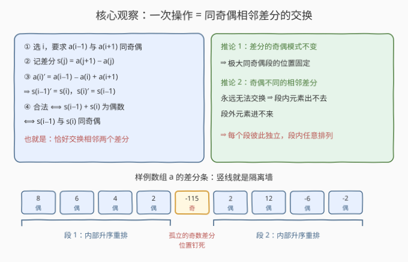
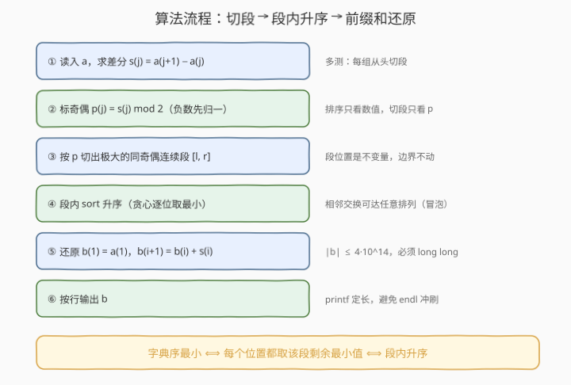
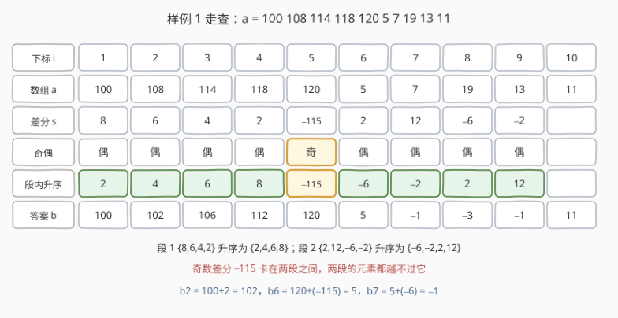

# Codeforces 2252D 数组替换 题解

## 1. 题目概述

- **标题 / 题号**：数组替换（Codeforces 2252D，英文名 Array Replacement）
- **链接**：https://codeforces.com/problemset/problem/2252/D
- **来源**：Codeforces Round 1115 (Div. 2) · Problem D
- **难度**：1700（1750 分）
- **限制**：时间 2 s / 内存 256 MB
- **标签**：贪心、排序

**题意**：给定长度 $n$ 的数组 $a$。可以执行任意多次（含零次）如下操作：选下标 $i$（$2 \le i \le n-1$），要求 $a_{i-1}$ 与 $a_{i+1}$ **奇偶性相同**，然后把 $a_i$ 替换为

$$a_{i-1} - a_i + a_{i+1}.$$

问能得到的**字典序最小**的数组。多测：第一行 $t$，每组给 $n$ 与 $n$ 个整数，输出 $n$ 个整数。

**约束**：

- $1 \le t \le 10^{4}$，$3 \le n \le 2\cdot 10^{5}$，$\sum n \le 2\cdot 10^{5}$
- $-10^{9} \le a_i \le 10^{9}$：差分可达 $2\cdot 10^{9}$，前缀和（即答案元素）可达约 $4\cdot 10^{14}$，**必须 64 位**
- 负数取模的奇偶判断需要归一化，否则切段会错

## 2. 示例

```text
输入
3
10
100 108 114 118 120 5 7 19 13 11
3
1 2 3
4
10 10 8 4

输出
100 102 106 112 120 5 -1 -3 -1 11
1 2 3
10 6 4 4
```

- 第 2 组：唯一可选下标是 $i=2$，$a_1=1$ 与 $a_3=3$ 同为奇数，替换后 $a_2 = 1-2+3 = 2$，数组不变。
- 第 3 组：$10\to(10,8,8,4)\to(10,8,4,4)\to(10,6,4,4)$。

自造示例（已与暴力对拍一致）：

```text
输入
2
5
0 5 2 9 4
6
0 2 5 9 10 7

输出
0 -5 -8 -3 4
0 2 5 9 6 7
```

第一组差分为 $5,-3,7,-5$ **全为奇数**，属于同一个段，升序后为 $-5,-3,5,7$，故答案为 $0,-5,-8,-3,4$；第二组差分为 $2,3,4,1,-3$，奇偶模式为「偶奇偶奇奇」，切成 $[2]\;[3]\;[4]\;[1,-3]$ 四段，只有最后一段需要升序。

## 3. 解题思路

### 3.1 暴力思路

从初始数组出发 BFS：对每个合法 $i$ 生成新状态，去重后取字典序最小者。状态确实是有限的（见 3.2 的结构），但最坏情况全数组同奇偶时差分可任意重排，状态数达到 $(n-1)!$ 量级，$n=2\cdot 10^{5}$ 完全不可行。暴力只能退化为 $n\le 7$ 的对拍工具。

### 3.2 核心观察：差分视角 —— 操作就是交换同奇偶的相邻差分



记差分 $s_j = a_{j+1} - a_j$（$1 \le j \le n-1$）。把替换公式代入差分：

$$s_{i-1}' = a_i' - a_{i-1} = a_{i+1} - a_i = s_i,\qquad s_i' = a_{i+1} - a_i' = a_i - a_{i-1} = s_{i-1},$$

其余 $s_j$ 不受影响 —— **操作恰好是把 $s_{i-1}$ 与 $s_i$ 换位**，$a_1$ 从不被修改。再看合法性，因为 $a_{i+1} - a_{i-1} = s_{i-1} + s_i$：

$$a_{i-1} \equiv a_{i+1} \pmod 2 \iff s_{i-1} + s_i \equiv 0 \pmod 2 \iff s_{i-1} \equiv s_i \pmod 2 .$$

即**只有同奇偶的相邻差分才能交换**。又因 $a_i' = a_i + (s_i - s_{i-1})$ 而括号内是偶数，$a_i$ 的奇偶性也不变，所以整个数组的奇偶模式是不变量。于是「极大的同奇偶差分连续段」在位置上被永久固定：元素要换到相邻位置只能靠这对位置上的交换，而段缝处两项奇偶不同、交换非法，所以任何元素都越不过这条缝；段内任意两个相邻项奇偶相同，可以随意换位。

### 3.3 算法流程



1. 计算 $s_j = a_{j+1} - a_j$，并令 $p_j = s_j \bmod 2 \in \{0,1\}$（负数先归一化）。
2. 从左到右切出极大的同奇偶段 $[l,r]$：满足 $p_l = p_{l+1} = \dots = p_r$，且 $l=1$ 或 $p_{l-1}\ne p_l$，$r=n-1$ 或 $p_{r+1}\ne p_r$。
3. 每一段内部**升序排序**。
4. 还原：$b_1 = a_1$，$b_{i+1} = b_i + s_i$，输出 $b$。

为什么「段内升序」就是字典序最小？$b_1$ 恒等于 $a_1$，之后 $b_{k+1} = b_k + s_k$，所以最小化字典序等价于依次最小化 $s_1, s_2, \dots$。每个 $s_k$ 只能从它所在段的元素中取，且段内任意排列都可达 —— 于是在每个位置取「本段剩余元素的最小值」，正是整段升序。

### 3.4 示例演算



以样例 1 为例，$a = 100,108,114,118,120,5,7,19,13,11$：

- 差分 $s = 8,6,4,2,-115,2,12,-6,-2$，奇偶为「偶偶偶偶**奇**偶偶偶偶」。
- 切段：段 1 为 $s_1..s_4=\{8,6,4,2\}\to\{2,4,6,8\}$；段 2 为 $s_6..s_9=\{2,12,-6,-2\}\to\{-6,-2,2,12\}$；$s_5=-115$ 单独成段（长度 1，不变）。注意 $-115$ 卡在两段之间：即使段 2 里有 $-6$ 这样更小的值，它也**不能**被搬到 $s_5$ 或更左侧。
- 前缀和还原：$100,\;100{+}2,\;{+}4,\;{+}6,\;{+}8,\;{-}115,\;{-}6,\;{-}2,\;{+}2,\;{+}12$ 得 $100,102,106,112,120,5,-1,-3,-1,11$，与官方输出一致。

再看样例 3：$a=10,10,8,4$，差分为 $0,-2,-4$ 全为偶数，只有一段，升序后 $-4,-2,0$，还原得 $10,6,4,4$。

## 4. 算法细节

1. **奇偶归一化**：C++ 的 `%` 对负数取余仍为负（$-115 \bmod 2 = -1$），若直接拿 `s % 2` 当标记，奇数会得到 $-1$ 与 $1$ 两种值，切段时被误判成「不同奇偶」。统一用 `((x % 2) + 2) % 2`，或用位技巧 `(long long)(x) & 1`。
2. **64 位**：单个差分 $\lvert s_j\rvert \le 2\cdot 10^{9}$ 勉强能塞进 32 位，但前缀和可达 $4\cdot 10^{14}$，答案元素与还原过程一律用 `long long`（Python 无需处理）。
3. **线性切段 + 排序总代价**：右指针单调右移切段，总代价 $O(n)$，不要对每个位置重新向后扫；各段长度之和为 $n-1$，故 $\sum L\log L \le (n-1)\log(n-1)$，一趟排序即可，不需要模拟交换。
4. **多测清空**：所有容器在循环体内新建（或用 `n` 长度的局部 `vector`），$\sum n\le 2\cdot 10^{5}$ 保证总分配量可控；**不要**对 $2\cdot10^{5}$ 的全局数组做 $10^4$ 次 `memset`。
5. **I/O**：C++ 用 `scanf/printf` 或关闭同步的 `cin/cout` 配 `'\n'`；$n$ 个整数输出时最后一个后面直接换行，无多余空行。
6. **长度 1 的段**：天然处理正确（排序一个元素不变），无需特判；$n=3$ 时 $s$ 只有两个元素，可能成一段也可能成两段，逻辑同样成立。

## 5. 正确性证明

**引理 1（操作 = 交换）**：对合法下标 $i$，一次操作后只有 $s_{i-1}$ 与 $s_i$ 互换，其余差分及 $a_1$ 均不变。

**证明**：由 $s_{i-1}' = a_i' - a_{i-1} = (a_{i-1}+a_{i+1}-a_i) - a_{i-1} = a_{i+1}-a_i = s_i$ 与 $s_i' = a_{i+1} - a_i' = a_i - a_{i-1} = s_{i-1}$ 得互换；$s_{j}$（$j\notin\{i-1,i\}$）只涉及未被修改的元素，故不变；$a_1$ 的下标 $1 < 2 \le i$，从不被写入。∎

**引理 2（不变量）**：任意操作序列后，每个 $s_j$ 的奇偶性与每个 $a_i$ 的奇偶性都不变。

**证明**：交换不改变各自奇偶，由引理 1 得 $p_j$ 全不变；又 $a_i = a_1 + \sum_{j<i} s_j$ 的模 2 值只由 $a_1$ 与 $p_1,\dots,p_{i-1}$ 决定，故 $a_i$ 的奇偶也不变。∎

**引理 3（段内任意排列可达）**：若 $[l,r]$ 是同奇偶段，则 $s_l,\dots,s_r$ 的任一排列都可由某个操作序列实现。

**证明**：段内任意相邻两项 $s_j,s_{j+1}$ 满足 $p_j=p_{j+1}$，故对应操作（下标 $i=j+1$）合法，可直接互换；而相邻换位生成对称群 $S_{r-l+1}$（冒泡排序即是一组显式构造）。又由引理 1，交换只在段内进行，段结构全程不变，故每一步都合法。∎

**引理 4（壁不可穿越）**：设 $p_j \ne p_{j+1}$，则任何操作序列后，位置 $1..j$ 上的差分多重集与位置 $j+1..n-1$ 上的差分多重集都保持初始值。特别地，每个同奇偶段 $[l,r]$ 上的差分多重集始终是 $\{s_l,\dots,s_r\}$。

**证明**：由引理 1，操作只是交换某对相邻位置 $(k,k+1)$。若 $k\ne j$，该交换不跨越分界，两侧多重集各自不变；若 $k=j$，则需要 $p_j=p_{j+1}$，与假设矛盾，故此交换永不发生。于是「位置 $1..j$」这一侧的元素一个也出不去、外面的也进不来。对每个段边界应用该结论，再用多重集相减即得段内多重集不变。∎

**定理**：算法输出的 $b$ 可达，且是所有可达数组中的字典序最小者。

**证明**：

*可达性*：设切段为 $[l_1,r_1],\dots,[l_m,r_m]$。在每段内把差分按升序排列，由引理 3 该排列可达，再由引理 1 中 $a_1$ 不变，按 $b_1=a_1,\;b_{i+1}=b_i+s_i$ 还原即得 $b$。

*最小性*：设 $c$ 是任一可达数组，其差分为 $t$。由引理 4，对每个段 $[l,r]$，$(t_l,\dots,t_r)$ 是 $(s_l,\dots,s_r)$ 的排列；由引理 1，$c_1 = a_1 = b_1$。反设 $c$ 字典序严格小于 $b$，令 $k+1$ 是第一个 $c_{k+1}\ne b_{k+1}$ 的位置，则 $k \ge 1$ 且 $c_{k+1} < b_{k+1}$，且 $c_j = b_j\;(j\le k)$。

设 $k$ 所在的段为 $[l,r]$。由于 $c_j=b_j$ 对 $j \le k$ 成立，
$$c_{k+1} - b_{k+1} = \Bigl(a_1+\sum_{j\le k} t_j\Bigr) - \Bigl(a_1+\sum_{j\le k} s_j\Bigr) = t_k - s_k < 0 ,$$
最后一个等号用了 $c_k = b_k$，即 $\sum_{j<k} t_j = \sum_{j<k} s_j$。但 $b$ 在该段内升序，故 $s_k$ 是 $\{s_l,\dots,s_r\}$ 中第 $k-l+1$ 小的元素；而 $(t_l,\dots,t_{k-1})$ 是段内 $k-l$ 个互不相同的元素，$t_k$ 取自剩下的 $r-k+1$ 个元素，其值不可能小于「剩下元素的最小值」= 第 $k-l+1$ 小 = $s_k$。矛盾。故 $c \ge b$，$b$ 最小。∎

## 6. 复杂度分析

- **时间**：切段 $O(n)$；排序 $\sum_{\text{段}} O(L\log L) \le O(n\log n)$；前缀和还原 $O(n)$。总时间 $O(n\log n)$，对 $\sum n\le 2\cdot 10^{5}$ 而言极小。
- **空间**：差分、奇偶标记、答案各一个长度 $O(n)$ 的数组，共 $O(n)$；无递归、无哈希。
- **实测**：单组 $n=2\cdot10^{5}$ 叠加到 2 倍上限（两组）时，C++ 约 $0.08$ s，Python 约 $0.30$ s，距 2 s 时限有 6–25 倍余量。

## 7. 参考代码

### C++17

```cpp
#include <cstdio>
#include <vector>
#include <algorithm>
using namespace std;
typedef long long ll;

int main() {
    int t;
    if (scanf("%d", &t) != 1) return 0;
    while (t--) {
        int n;
        scanf("%d", &n);
        vector<ll> a(n);
        for (int i = 0; i < n; i++) scanf("%lld", &a[i]);
        // 差分 s[i] = a[i+1] - a[i]，长度 n-1
        vector<ll> s(n - 1);
        vector<int> par(n - 1);
        for (int i = 0; i + 1 < n; i++) {
            s[i] = a[i + 1] - a[i];
            par[i] = (int)(((s[i] % 2) + 2) % 2);   // 负数取模归一化
        }
        // 极大同奇偶连续段内部可任意重排 -> 段内升序即字典序最小
        int l = 0;
        while (l < n - 1) {
            int r = l;
            while (r + 1 < n - 1 && par[r + 1] == par[l]) r++;
            sort(s.begin() + l, s.begin() + r + 1);
            l = r + 1;
        }
        // 前缀和还原
        vector<ll> b(n);
        b[0] = a[0];
        for (int i = 1; i < n; i++) b[i] = b[i - 1] + s[i - 1];
        for (int i = 0; i < n; i++)
            printf("%lld%c", b[i], i + 1 == n ? '\n' : ' ');
    }
    return 0;
}
```

### Python3

```python
import sys


def solve(n, a):
    # 差分 s[i] = a[i+1] - a[i]
    s = [a[i + 1] - a[i] for i in range(n - 1)]
    par = [x & 1 for x in s]          # Python 中负数 & 1 已归一化为 0/1
    # 切出极大的同奇偶段，段内升序
    l, m = 0, n - 1
    while l < m:
        r = l
        while r + 1 < m and par[r + 1] == par[l]:
            r += 1
        s[l:r + 1] = sorted(s[l:r + 1])
        l = r + 1
    # 前缀和还原
    res = [0] * n
    res[0] = cur = a[0]
    for i in range(1, n):
        cur += s[i - 1]
        res[i] = cur
    return res


def main():
    data = sys.stdin.buffer.read().split()
    if not data:
        return
    t = int(data[0])
    pos = 1
    out = []
    for _ in range(t):
        n = int(data[pos]); pos += 1
        a = list(map(int, data[pos:pos + n])); pos += n
        out.append(' '.join(map(str, solve(n, a))))
    sys.stdout.write('\n'.join(out) + '\n')


main()
```

## 8. 边界情况与易错点

1. **负数奇偶没归一**：C++ 的 `%` 会给负数（$-115 \bmod 2 = -1$），若直接当标记，同为奇数的差分会被判成 $-1$ 与 $1$ 两类，段被切碎，答案偏大。必须归一化为 $0/1$。
2. **32 位溢出**：答案元素可达 $4\cdot10^{14}$，`int` 溢出后输出乱码甚至负数；差分、前缀和、输出全部用 `long long`。
3. **全数组同奇偶（只有一个段）**：这是最坏情况，差分整体升序；若按「模拟交换」写会得到 $O(n^2)$ 甚至死循环，必须直接排序。
4. **全部差分奇偶交错（每段长度 1）**：任何操作都非法，答案等于原数组；此时不能误以为「总能排序」，排序循环必须按段进行。
5. **$n=3$**：只有 $i=2$ 一个候选，若 $a_1,a_3$ 奇偶不同则无法操作；若相同则两个差分同奇偶，排序后答案可能改变（如 $a=[0,5,2]$ 差分为 $5,-3$，升序后 $-3,5$，答案 $[0,-3,2]$）。
6. **多测的累计开销与输出**：$t$ 可达 $10^4$，不要写 `memset(a, 0, sizeof(a))` 这类全量清零；输出用 `'\n'` 而非 `endl`，每行恰好 $n$ 个数、行间不放空行，本解法无尾随空格。

## 相关题目与扩展

- [Codeforces 1733C Parity Shuffle Sorting](https://codeforces.com/problemset/problem/1733/C)：奇偶性作为不变量决定操作可达集合，思路同源。
- [Codeforces 1442A Extreme Subtraction](https://codeforces.com/problemset/problem/1442/A)：把区间操作翻译成差分上的加减，差分视角的标准应用。
- [LeetCode 1526. 形成目标数组的子数组最少增加次数](https://leetcode.cn/problems/minimum-number-of-increments-on-subarrays-to-form-a-target-array/)：差分数组上做贪心累加，与本题「差分独立、前缀和还原」互为表里。
- [LeetCode 1589. 所有排列中最大的和](https://leetcode.cn/problems/maximum-sum-obtained-of-any-permutation/)：同样是先排序再前缀和，体现「重排可自由选择时贪心升序」的套路。

**延伸思考**：

1. 若把要求改成「$a_{i-1}$ 与 $a_{i+1}$ **奇偶不同**」才可操作，则合法交换的是**异奇偶**相邻差分，隔断结构恰好反转（同奇偶处变成墙），答案变为「每个异奇偶交替段内升序」。
2. 若彻底去掉奇偶限制（任意 $i$ 都可操作），则任意相邻差分可交换，差分可全局升序 —— 答案就是全体差分排序后前缀和，本题可看作该经典结论在「奇偶墙」限制下的分段版本。
3. 求字典序**最大**时，把每段改为降序即可，证明完全对称。
4. 若限制操作次数为 $K$，问题变成「用至多 $K$ 次相邻交换把数组变得尽量小」，可用逆序对 / 逐位贪心处理，复杂度会上升到带权匹配。
