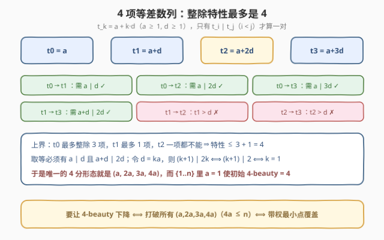
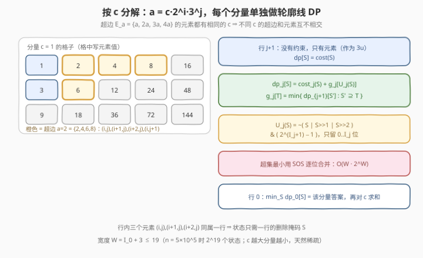
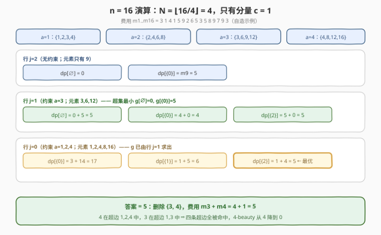

# Codeforces 2253F 4-beauty 题解

## 1. 题目概述

- **标题 / 题号**：4-美丽度（Codeforces 2253F，英文名 4-beauty）
- **链接**：https://codeforces.com/problemset/problem/2253/F
- **来源**：Educational Codeforces Round 193 (Rated for Div. 2) · Problem F（UTC 2026-08-07）
- **难度**：2600
- **限制**：时间 5 s / 内存 1024 MB
- **标签**：位运算（状压），动态规划，图论，数学，数论

**题意**：对整数集合 $S$，**整除特性** 是满足 $x\ne y$、$x,y\in S$ 且 $y\mid x$ 的有序对 $(x,y)$ 的数量。对集合 $A$，**4-beauty** 是 $A$ 中所有"四项等差数列"（四个不同数，升序后公差为正）的整除特性的最大值，不存在则为 $0$。初始集合为 $\{1,\dots,n\}$，删去 $i$ 花费 $m_i$，求让 4-beauty **严格下降** 的最小总花费。

**约束**：

- 单组数据：第一行 $n$，第二行 $m_1,\dots,m_n$；
- $4\le n\le 5\times 10^5$，$1\le m_i\le 10^9$；
- 4-beauty 只取 $0\sim4$，答案上界约 $1.25\times10^{14}$，需 64 位整数。

## 2. 示例与观察
**官方样例 1–4**

```text
样例 1
输入
4
5 3 7 2
输出
2

样例 2
输入
5
1 100 100 100 1
输出
1

样例 3
输入
8
2 10 100 10 100 3 100 100
输出
5

样例 4
输入
10
9 9 7 4 8 2 6 5 1 10
输出
4
```

- 样例 1：唯一四项等差数列是 $1,2,3,4$（特性 4），删 $4$ 花费 2，集合已无四项等差数列。
- 样例 2：删 $1$ 即打破 $\{1,2,3,4\}$，花费 1。
- 样例 3：超边 $\{1,2,3,4\}$ 与 $\{2,4,6,8\}$；删 $1,6$ 花 $2+3=5$，只删 $2$ 要 10。
- 样例 4：仍是这两条超边，删 $4$（花费 4）同时命中，优于删 $1,6$（$9+2=11$）。

**自造示例：$n=16$，费用取 $\pi$ 的前 16 位数字**

```text
输入
16
3 1 4 1 5 9 2 6 5 3 5 8 9 7 9 3
输出
5
```

四条超边 $\{1,2,3,4\},\{2,4,6,8\},\{3,6,9,12\},\{4,8,12,16\}$，删 $\{3,4\}$ 花 $4+1=5$，见 3.4 的演算。

## 3. 解题思路

### 3.1 暴力思路

公差 $d$ 与首项 $a$ 决定一个四元组，共 $O(n^2)$ 个，每个数 12 个有序对即可得到初始 4-beauty；但"最少花费"是带权点覆盖，要在 $2^n$ 种删除方案里挑出"打破所有取到最大值的四元组"的方案，$n=5\times10^5$ 时不可行。所以先要看清"满分四元组"的形态。

### 3.2 核心观察：满分四元组只能是 $(a,2a,3a,4a)$



设四元组升序为 $t_k=a+kd$（$k=0,1,2,3$，$d\ge1$）。若 $t_i\mid t_j\ (i<j)$，则 $t_i\mid t_j-t_i=(j-i)d$。

- $t_2=a+2d>d$，若 $t_2\mid t_3$ 需 $t_2\mid d$，矛盾 ⇒ **$t_2$ 不整除任何项**；
- $t_1=a+d>d$，若 $t_1\mid t_2$ 需 $t_1\mid d$，矛盾 ⇒ **$t_1$ 最多整除 $t_3$**（需 $t_1\mid2d$）；
- 只有 $t_0=a$ 可能整除其余三项（$a\mid d$ 时 $a\mid2d,3d$ 自动成立）。

故特性 $\le 3+1=4$，取等需 $a\mid d$ 且 $a+d\mid 2d$。令 $d=ka\ (k\ge1)$，则 $a(k+1)\mid2ka\iff(k+1)\mid2k\iff(k+1)\mid2$，得 $k=1$，即 $d=a$。

**结论**：$n\ge4$ 时集合含 $1,2,3,4$，初始 4-beauty 恒为 4；所有 4 分四元组恰为 $(a,2a,3a,4a)$，$4a\le n$。删除只会让 4-beauty 变小，于是"让 4-beauty 下降"等价于：**每条超边 $E_a=\{a,2a,3a,4a\}\ (4a\le n)$ 至少删一个元素**，求最小费用——元素权为 $m_i$ 的最小权点覆盖。

### 3.3 算法流程：按 $c$ 分解 + $2^i3^j$ 轮廓线 DP



**分解**：写 $a=c\cdot2^i3^j$，$c$ 不含因子 $2,3$。$E_a$ 的四元素为 $a\cdot s\ (s\in\{1,2,3,4\})$，而 $s$ 均为 $2^{i'}3^{j'}$ 形式，故四元素的 $c$ 部分相同；不同 $c$ 的超边无公共元素，可独立求解后相加。

**格点化**：固定 $c$，用 $(i,j)$ 表示 $c\cdot2^i3^j$。超边 $E_a$（$a=c2^i3^j$）恰为 $\{(i,j),(i+1,j),(i+2,j),(i,j+1)\}$：三点共享同一行 $j$，只有一点在上一行。约束点为 $2^i3^j\le M=\lfloor N/c\rfloor$（$N=\lfloor n/4\rfloor$），即行 $j=0..J=\max\{j:3^j\le M\}$；行 $J+1$ 只有元素（作为 $3u$）而无约束。

**轮廓线 DP**：$j$ 从 $J+1$ 推到 $0$，状态为该行删除掩码 $S$；$cost_j(S)$ 为该行费用，$I_j=\max\{i:c2^i3^j\le N\}$。则
$$dp_j[S]=cost_j(S)+\min_{S'\supseteq U_j(S)}dp_{j+1}[S'],\qquad U_j(S)=\{i\le I_j:S_i=S_{i+1}=S_{i+2}=0\}$$
约束 $(i,j)$ 要求 $S_i\vee S_{i+1}\vee S_{i+2}\vee S'_i$，故上一行须补上所有"本行窗口 $i,i+1,i+2$ 全零"的位置，位运算即
$$U_j(S)=\overline{S\,|\,(S\gg1)\,|\,(S\gg2)}\ \&\ (2^{I_j+1}-1).$$
"超集最小值"用 SOS（高维后缀 min）逐位合并，$O(W2^W)$；初值 $dp_{J+1}[S]=cost_{J+1}(S)$，分量答案 $=\min_S dp_0[S]$，全局答案 $=\sum_c$ 分量答案。

### 3.4 示例演算



$n=16$、$N=4$，只有分量 $c=1$（唯一 $\le4$ 且与 6 互素的数）。四条超边 $a=1,2,3,4$ 对应约束点 $(0,0),(1,0),(2,0)$ 与 $(0,1)$。

- 行 $j=2$：无约束，元素只有 $9$（$18>16$）⇒ $dp[\varnothing]=0$，$dp[\{0\}]=m_9=5$。
- 行 $j=1$：约束 $a=3$（窗口 $i=0$），元素 $3,6,12$。$dp[\varnothing]=0+5=5$；$dp[\{0\}]=m_3=4$（$U=\varnothing$）；$dp[\{2\}]=m_{12}=5$。
- 行 $j=0$：约束 $a=1,2,4$（窗口 $0,1,2$）。$dp[\{2\}]=m_4+\min dp_1=1+4=5$（$U=\varnothing$）；$dp[\{1\}]=m_2+\min_{S'\supseteq\{2\}}dp_1=1+5=6$；$dp[\{0\}]=m_1+\min_{S'\supseteq\{1,2\}}dp_1=3+14=17$。
- 取最小得 **5**：删 $\{3,4\}$；$4\in E_1\cap E_2\cap E_4$、$3\in E_1\cap E_3$，四条超边全命中。✓

## 4. 算法细节

1. **分量枚举**：$c$ 从 $1$ 到 $N$ 只取 $\gcd(c,6)=1$；$M=\lfloor N/c\rfloor$、$J=\max\{j:3^j\le M\}$，行范围 $j=0..J+1$（必须含"纯元素行"$J+1$，它代表删 $3a$）。
2. **列宽裁剪**：只有位置 $0..K$ 有用，$K=I_0+2$（窗口最多到 $I_j+2\le I_0+2$），$W=K+1$；$c=1,n=5\times10^5$ 时 $I_0=16$、$W=19$。
3. **元素不存在**：$c2^i3^j>n$ 时权重记 $\infty$，掩码自然不会选它，也避免越界。
4. **每行费用表**：子集和递推 $cost[S]=cost[S\setminus lowbit]+w_{\mathrm{ctz}(S)}$，$O(2^W)$；数组用 `assign` 复用。
5. **SOS**：对每位 $b$ 合并 $g[T]$ 与 $g[T\cup\{b\}]$，最终 $g[T]=\min_{S'\supseteq T}dp_{j+1}[S']$，查询只取 $g[U_j(S)]$。
6. **INF 与溢出**：$\infty=4\times10^{18}$，加法前先判 $\infty$（$\infty+\infty$ 会溢出 `long long`）；真实答案约 $1.25\times10^{14}$，安全。
7. **I/O**：本题没有多测（不是先读 $T$），只读一组；用 `cin` 时务必 `sync_with_stdio(false)`。
8. **常数**：$c$ 大的分量宽度很小（$W=3$ 时仅 8 个状态），总运算量远小于"每个分量都按 $2^{19}$"，见第 6 节。

## 5. 正确性证明

**引理 1**：公差 $d\ge1$ 的四项等差数列 $t_k=a+kd$ 的整除特性 $\le4$，等于 $4$ 当且仅当 $d=a$。

**证明**：若 $t_i\mid t_j\ (i<j)$ 则 $t_i\mid(j-i)d$。$t_2>d$ 使 $t_2\mid t_3$ 不可能，$t_2$ 不是任何对的除数；$t_1>d$ 使 $t_1\mid t_2$ 不可能，$t_1$ 至多整除 $t_3$；$t_0$ 至多整除其余三项。故总数 $\le4$。取等需 $a\mid d$ 与 $a+d\mid 2d$，令 $d=ka$ 得 $(k+1)\mid2k$，又 $\gcd(k+1,k)=1$ 故 $(k+1)\mid2$，结合 $k\ge1$ 得 $k=1$。∎

**引理 2**：$n\ge4$ 时 $\{1,\dots,n\}$ 的 4-beauty 为 $4$。

**证明**：$(1,2,3,4)$ 是公差 1 的四项等差数列，特性为 $1\mid2,1\mid3,1\mid4,2\mid4$ 共 4 对，达到引理 1 的上界。∎

**引理 3**：记 $\mathrm{rad}(x)$ 为 $x$ 去掉全部因子 $2,3$ 后的部分，则 $E_a$ 中元素的 $\mathrm{rad}$ 均为 $\mathrm{rad}(a)$；若 $\mathrm{rad}(a)\ne\mathrm{rad}(b)$ 则 $E_a\cap E_b=\varnothing$。

**证明**：$2,3,4=2^2$ 只含因子 $2,3$，故 $\mathrm{rad}(a\cdot s)=\mathrm{rad}(a)$。若 $x\in E_a\cap E_b$，则 $\mathrm{rad}(a)=\mathrm{rad}(x)=\mathrm{rad}(b)$，矛盾。∎

**引理 4**：分量 $c$ 内令 $a=c2^i3^j$，则 $E_a$ 对应 $\{(i,j),(i+1,j),(i+2,j),(i,j+1)\}$。

**证明**：$2a=c2^{i+1}3^j$、$3a=c2^i3^{j+1}$、$4a=c2^{i+2}3^j$，读出坐标即得。∎

**引理 5（SOS）**：逐位合并后 $g[T]=\min_{S'\supseteq T}dp_{j+1}[S']$。

**证明**：每维合并对"含该位/不含该位"两支取 `min`，各维独立，合并 $W$ 维即得全部超集的最小值。∎

**定理**：设 $dp_j[S]$ 为只考虑行 $j..J+1$、行 $j$ 掩码为 $S$、且行 $j..J$ 的约束全被破坏时的最小费用，则上述递推成立，$\min_S dp_0[S]$ 为该分量最小覆盖费用，各分量求和为原问题答案。

**证明**：对 $j$ 从 $J$ 到 $0$ 归纳。约束 $(i,j)$ 被破坏 $\iff S'\supseteq U_j(S)$；行 $j..J$ 的约束全破坏 $\iff$ 行 $j$ 的约束由 $(S,S')$ 保证且行 $j+1..J$ 的由 $dp_{j+1}[S']$ 保证；费用按行可加（每个元素只属于一行一分量）。由引理 3、4，分量间无共享元素与约束，故全局最优为各分量最优之和。∎

## 6. 复杂度分析

- **单分量**：行数 $O(\log_3(N/c)+2)$，状态 $2^{W_c}$，$W_c=\lfloor\log_2(N/c)\rfloor+3$，每行一次 SOS ⇒ $O\!\left((N/c)\log^2(N/c)\right)$。
- **总计**：$\sum_{\gcd(c,6)=1,c\le N}O\!\left(\frac{N}{c}\log^2\frac{N}{c}\right)$，宽松上界 $O(N\log^3N)$；$n=5\times10^5$ 时约 $1.6\times10^8$ 次合并。
- **空间**：$4\times2^{W}$ 个 `long long`（$W\le19$ 约 16 MB）加输入 $O(n)$，共约 20 MB，远低于 1024 MB。
- **实测**（Apple clang -O2，$n=5\times10^5$）：随机/最坏费用 0.80–0.95 s（DP 约 0.15 s，其余为 iostream 读入；改用 `scanf` 总计 0.14 s），对 5 s 时限余量充足。

## 7. 参考代码

### C++17

```cpp
#include <bits/stdc++.h>
using namespace std;
typedef long long ll;
static const ll INF = (ll)4e18;
int main() {
    ios::sync_with_stdio(false);
    cin.tie(nullptr);
    int n;
    cin >> n;
    vector<ll> m(n + 1);
    for (int i = 1; i <= n; i++) cin >> m[i];
    int N = n / 4;                 // 需要打破的超边下标 a = 1..N
    ll ans = 0;
    vector<ll> dp, g, cost, ndp;
    for (int c = 1; c <= N; c++) {         // c = a 去掉所有因子 2、3
        if (c % 2 == 0 || c % 3 == 0) continue;
        int M = N / c;                      // 允许的 3-smooth 部分 u <= M
        int J = 0;
        for (int p = 1; p * 3 <= M; p *= 3) J++;   // 约束行 j = 0..J
        // Ic[j] = max i 满足 c*2^i*3^j <= N
        vector<int> Ic(J + 1);
        int p3 = 1;
        for (int j = 0; j <= J; j++) {
            int lim = N / c / p3, i = 0, v = 1;
            while (v * 2 <= lim) { v *= 2; i++; }
            Ic[j] = i;
            p3 *= 3;
        }
        int K = Ic[0] + 2;                  // 只有位置 0..K 可能有用
        int W = K + 1, sz = 1 << W;
        dp.assign(sz, INF);
        g.assign(sz, INF);
        cost.assign(sz, INF);
        ndp.assign(sz, INF);
        // 行 j 的费用表：cost[S] = 删掉掩码 S 中元素的费用
        auto build = [&](int j, vector<ll>& a) {
            ll w[24];
            ll base = c;
            for (int t = 0; t < j; t++) base *= 3;
            ll v = base;
            for (int i = 0; i < W; i++) {
                w[i] = (i <= K && v <= n) ? m[(size_t)v] : INF;
                v <<= 1;
            }
            a[0] = 0;
            for (int S = 1; S < sz; S++) {
                int low = S & (-S), i = __builtin_ctz((unsigned)S);
                ll prev = a[S ^ low];
                a[S] = (prev >= INF || w[i] >= INF) ? INF : prev + w[i];
            }
        };
        build(J + 1, dp);                  // 顶层行 J+1：只有元素、没有约束
        for (int j = J; j >= 0; j--) {
            // g[T] = min{ dp[S'] : S' 是 T 的超集 }（SOS 高维后缀 min）
            g = dp;
            for (int b = 0; b < W; b++) {
                int bit = 1 << b;
                for (int st = 0; st < sz; st += (bit << 1))
                    for (int t = 0; t < bit; t++)
                        g[st + t] = min(g[st + t], g[st + bit + t]);
            }
            int nI = Ic[j];
            unsigned keep = (1u << (nI + 1)) - 1u;
            build(j, cost);
            for (int S = 0; S < sz; S++) {
                if (cost[S] >= INF) { ndp[S] = INF; continue; }
                // 本行窗口覆盖不到的约束 i，必须由上一行补齐
                unsigned u = (~(unsigned)(S | (S >> 1) | (S >> 2))) & keep;
                ll rest = g[u];
                ndp[S] = (rest >= INF) ? INF : cost[S] + rest;
            }
            dp.swap(ndp);
        }
        ll best = INF;
        for (int S = 0; S < sz; S++) best = min(best, dp[S]);
        ans += best;
    }
    cout << ans << "\n";
    return 0;
}
```

### Python3

与 C++ 同算法，用于对照与小数据验证。最大数据约需 $1.6\times10^8$ 次状态合并，CPython 实测约 20 s **会超时**，PyPy 也难压进 5 s，正式提交请用 C++。

```python
import sys
def main():
    data = sys.stdin.buffer.read().split()
    if not data:
        return
    n = int(data[0])
    m = [0] + [int(x) for x in data[1:n + 1]]
    INF = float('inf')
    N, answer = n // 4, 0
    for c in range(1, N + 1):
        if c % 2 == 0 or c % 3 == 0:
            continue
        M, J, p = N // c, 0, 1
        while p * 3 <= M:
            p *= 3
            J += 1
        Ic, p3 = [0] * (J + 1), 1
        for j in range(J + 1):
            lim, i, v = N // c // p3, 0, 1
            while v * 2 <= lim:
                v *= 2
                i += 1
            Ic[j] = i
            p3 *= 3
        K, W = Ic[0] + 2, Ic[0] + 3
        size = 1 << W
        def build(j):
            base = c
            for _ in range(j):
                base *= 3
            wts, v = [INF] * W, base
            for i in range(W):
                if i <= K and v <= n:
                    wts[i] = m[v]
                v *= 2
            arr = [INF] * size
            arr[0] = 0
            for S in range(1, size):
                low = S & (-S)
                prev = arr[S ^ low]
                w = wts[low.bit_length() - 1]
                arr[S] = INF if (prev >= INF or w >= INF) else prev + w
            return arr
        dp = build(J + 1)
        for j in range(J, -1, -1):
            g = dp[:]                      # g[T] = min over supersets of T
            for b in range(W):
                step = 1 << b
                blk = step << 1
                for st in range(0, size, blk):
                    hi = st + step
                    for t in range(step):
                        x = g[hi + t]
                        if x < g[st + t]:
                            g[st + t] = x
            keep = (1 << (Ic[j] + 1)) - 1
            cost = build(j)
            ndp = [INF] * size
            for S in range(size):
                cs = cost[S]
                if cs >= INF:
                    continue
                gv = g[(~(S | (S >> 1) | (S >> 2))) & keep]
                if gv < INF:
                    ndp[S] = cs + gv
            dp = ndp
        answer += min(dp)
    sys.stdout.write(str(answer) + "\n")
main()
```

## 8. 边界情况与易错点

1. **$n$ 小时 $N=0$**：$N=\lfloor n/4\rfloor$；虽然题面保证 $n\ge4$，但代码在 $N=0$ 时循环为空、输出 0，天然安全。
2. **$n\bmod4\ne0$**：超边条件是 $4a\le n$，务必用 $N=\lfloor n/4\rfloor$，不能用浮点或四舍五入。
3. **漏掉 $J+1$ 行**：$3u$ 所在"纯元素行"没有约束，却是打破第 $J$ 行约束的最后手段，漏掉会算大或算错。
4. **分量筛选**：只取 $\gcd(c,6)=1$；把 $2,3$ 的倍数也当分量会与其他分量重复计数。
5. **INF 溢出**：$\infty+\infty$ 超出 `long long`，加法前必须判 $\infty$，`cost[S]` 与 `g[u]` 都要判。
6. **掩码裁剪**：`keep=(1<<(I_j+1))-1` 只保留 $0..I_j$ 位；多保留会让 $U_j(S)$ 变小、约束放松，答案偏小。
7. **本题没有多测**：不要套 `while (T--)`，否则读入直接错位。
8. **自测锚点**：全 $m_i=1$ 时答案是最少删除个数，$n=5\times10^5$ 应为 67398；$n=16$ 应为 2，可用于手验。

## 9. 验证记录

- **编译环境与命令**：`clang++ -std=c++17 -O2`（本机无 GNU g++，配 `codeforces/tools/include/bits/stdc++.h` 兼容头；正文代码只用标准库，可原样提交 GNU C++17）；Python 侧为 `Python 3.9.6`。
- **官方样例**：4 / 4 通过（按 Codeforces 标准 checker 的 token 比对，忽略空白与大小写）。
- **复核状态**：audited（2026-11-19 统一回归：编译 + 官方样例；写作期的随机对拍与暴力未重跑）。

## 相关题目与扩展

- [Codeforces 2253E. Diameter Intersections](https://codeforces.com/problemset/problem/2253/E)：同场前一题，树 + 卷积，同样"先刻画最优结构再计数"。
- [Codeforces 165E. Compatible Numbers](https://codeforces.com/problemset/problem/165/E)：SOS DP 入门模板，本题的 $g[T]$ 即其后缀 min 版本。
- [LeetCode 1027. 最长等差数列](https://leetcode.cn/problems/longest-arithmetic-subsequence/)：等差数列枚举基本功，呼应 3.2 中"公差决定一切"。

**延伸思考**：

1. 换成 $k$ 项等差数列时，$d=a$ 给出特性 $\#\{(p,q):1\le p<q\le k,\ p\mid q\}$，但它是否仍是全局最大值需要重新论证；$k=4$ 的关键是上界 $3+1$ 只有一种取等方式。
2. 若删点带依赖（删 $x$ 顺带影响 $2x$），覆盖问题需要额外记录"继承关系"，但按 $c$ 分解的思路仍然成立。
3. 若要求 4-beauty 降到 0（消灭所有四项等差数列，不限于 $d=a$），就变成打掉全部四项等差数列的困难覆盖问题；对比 $k=3$：三项时特性上界是 2，且 $a\mid d$ 时都取到 2（如 $1,2,3$ 与 $1,3,5$），最优形态不唯一——可见 $k=4$ 时"$d=a$ 唯一"正是本题可做的关键。
