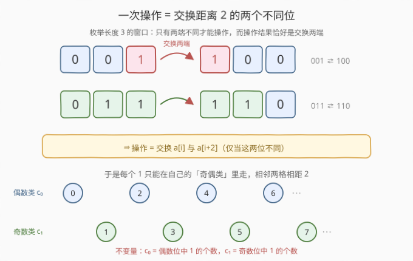
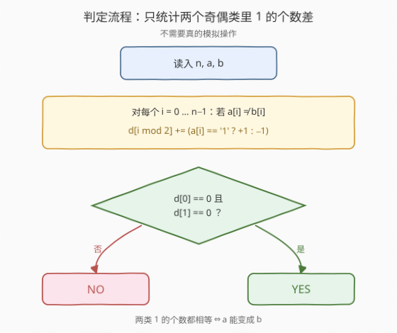
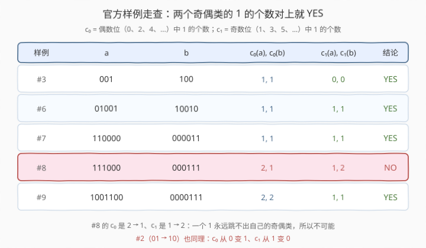

# Codeforces 2254C1 马雷诺（简单版） 题解

## 1. 题目概述

- **标题 / 题号**：马雷诺（简单版）（Codeforces 2254C1，英文名 Marenol (easy version)）
- **链接**：https://codeforces.com/problemset/problem/2254/C1
- **来源**：Codeforces Round 1114 (Div. 3) · Problem C1
- **难度**：1000
- **限制**：时间 2 s / 内存 256 MB
- **标签**：贪心（官方 tag：greedy；本质是「找不变量 + 距离 2 的交换」）

**题意**：给定两个长度同为 $n$ 的 01 串 $a$、$b$。一次操作可以挑出当前串的一个长度 3 的子串：若它是 $\texttt{001}$，可以换成 $\texttt{100}$（也可以反向 $\texttt{100}\to\texttt{001}$）；若它是 $\texttt{110}$，可以换成 $\texttt{011}$（也可以反向 $\texttt{011}\to\texttt{110}$）。问能否用**有限次**操作把 $a$ 变成 $b$。多测：第一行是测试组数 $t$，每组三行依次为 $n$、$a$、$b$，逐组输出 `YES` 或 `NO`。

本题是**简单版**，只问「能不能」；同场的困难版 [C2](https://codeforces.com/problemset/problem/2254/C2) 问「最少几步」，两题的判定内核完全一致，只是 C2 要把代价算出来。

**约束**：

- $1 \le t \le 10^4$，$1 \le n \le 2\times 10^5$，且 $\sum n \le 2\times 10^5$
- 串中只有字符 `0` 与 `1`，两串等长
- 操作可逆，所以「可达」是无向关系：$a\to b$ 可行当且仅当 $b\to a$ 可行
- 每组输出一行 `YES` / `NO`，大小写不敏感

## 2. 示例

官方样例（输入 / 输出原样）：

```text
输入
9
1
0
0
2
01
10
3
001
100
4
1010
0101
4
1100
1000
5
01001
10010
6
110000
000011
6
111000
000111
7
1001100
0000111

输出
YES
NO
YES
NO
NO
YES
YES
NO
YES
```

官方解释的要点：第 1 组已经相同；第 2 组 $n=2$ 时连长度 3 的子串都不存在，只能判等；第 3 组一次操作 `001 → 100`；第 5 组两串 1 的个数不同（$2$ 与 $1$），必然不可能；第 6 组把奇数类的 1 右移两格、偶数类的 1 左移四格；第 9 组 $a$ 与 $b$ 的 1 都落在「两个偶数位 + 一个奇数位」上，只是换了位置。

补一组自造数据（覆盖「远距离搬运」与「奇偶类被卡死」）：

```text
输入
2
7
1000000
0000001
7
1010101
0101010

输出
YES
NO
```

第一组唯一的 1 从下标 $0$ 挪到下标 $6$，两者同属偶数类，只需连续三次「交换距离 2 的两个不同位」；第二组的 1 全在偶数类，目标串的 1 全在奇数类，无论走多少步都换不过去。

## 3. 解题思路

### 3.1 暴力思路

最直白的做法是把**整个串当状态**做 BFS：每个状态枚举所有 $O(n)$ 个窗口，能操作就扩展。正确性没问题（操作可逆，BFS 求的就是连通性），但状态最多 $2^n$ 个，$n = 2\times 10^5$ 时连存状态都做不到。

更「贪心」一点的暴力是**只朝目标方向模拟**：从左往右找 $a$ 与 $b$ 不同的位置，试着用某个窗口把它修好。问题是操作可能把已经修好的位置破坏，也看不出该往哪边挪。所以暴力能提供的只有两条线索：

1. 操作**可逆**，因此可达性只需研究连通分量；
2. 随手跑几组 BFS 就会发现，1 的个数相同并不够——例如 $\texttt{01}$ 变 $\texttt{10}$ 就做不到。

真正的方向是**找不变量，并证明它恰好把状态空间分成若干连通块**。

### 3.2 核心观察：四种操作其实是同一句话



只看一次操作改动了哪两个位置。窗口是 $s_i s_{i+1} s_{i+2}$，把题面允许的四种形态列出来：

| 形态 | 操作后 | 改动的位 |
|------|--------|----------|
| $\texttt{001}$ | $\texttt{100}$ | $s_i \leftrightarrow s_{i+2}$ |
| $\texttt{100}$ | $\texttt{001}$ | $s_i \leftrightarrow s_{i+2}$ |
| $\texttt{011}$ | $\texttt{110}$ | $s_i \leftrightarrow s_{i+2}$ |
| $\texttt{110}$ | $\texttt{011}$ | $s_i \leftrightarrow s_{i+2}$ |

四种形态的共同点：**两端不同**（$s_i \ne s_{i+2}$），中间那位是 0 是 1 都不影响，而操作结果恰好是把两端互换。反过来，$s_i = s_{i+2}$ 的四种窗口（$\texttt{000}$、$\texttt{010}$、$\texttt{101}$、$\texttt{111}$）在题面里没有出现——因为互换两个相同的字符本来就不改变串。

于是操作集合被重新描述成一句话：

> 任选 $i \le n-3$，若 $s_i \ne s_{i+2}$，就交换 $s_i$ 与 $s_{i+2}$。

这一步把「四种字符重写规则」变成了「一种位置交换规则」，是本题的关键。

交换的两个下标 $i$ 与 $i+2$ **同奇偶**，所以每个 1 只在跟自己下标同奇偶的位置之间移动，整个串裂成两条互不干扰的链：

- 偶链：下标 $0, 2, 4, \dots$ 上的字符依次排成一列；
- 奇链：下标 $1, 3, 5, \dots$ 上的字符依次排成一列。

一次操作 = 在**某一条链上交换相邻的两个不同字符**。链内字符不可能跨链，链内 1 的个数自然守恒，于是得到不变量

$$c_0 = \#\{i : s_i = 1,\ i \text{ 为偶数}\},\qquad c_1 = \#\{i : s_i = 1,\ i \text{ 为奇数}\}.$$

而链上「相邻交换不同字符」可以生成链内任意一种 0/1 排列：冒泡排序的做法是把想要的 1 一路往左/往右换过去，每次换的都是相邻的 0 与 1，都是合法操作。所以**只要两条链里 1 的个数分别相同，就能互相到达**——不变量同时也是充分的。

### 3.3 算法流程



1. 逐位比较 $a_i$ 与 $b_i$，只在下标 $i$ 处两者不同时记账：
   - 若 $a_i = \texttt{1}$，说明这个位置「多」了一个 1，令 $d_{i \bmod 2} \mathrel{+}= 1$；
   - 否则说明「少」了一个 1，令 $d_{i \bmod 2} \mathrel{-}= 1$。
2. 全串扫完后，若 $d_0 = 0$ 且 $d_1 = 0$ 输出 `YES`，否则输出 `NO`。

也可以分别统计 $a$、$b$ 的 $c_0, c_1$ 再比较，两种写法等价，前者只需 $O(1)$ 额外空间。注意**必须扫完整个串再判定**，中途出现负差不代表失败（那只是说明这一位要从后面搬 1 过来）。

### 3.4 示例演算



以 1-indexed 的官方样例第 7 组为例，看「构造性」到底怎么走。$a = \texttt{110000}$、$b = \texttt{000011}$，两条链上 1 的个数都是 $1$，判 `YES`。题面给出的四步（下标按 1-indexed）：

| 步 | 操作窗口 | 结果 |
|----|----------|------|
| 1 | $a[2,4] = \texttt{100} \to \texttt{001}$ | `100100` |
| 2 | $a[4,6] = \texttt{100} \to \texttt{001}$ | `100001` |
| 3 | $a[1,3] = \texttt{100} \to \texttt{001}$ | `001001` |
| 4 | $a[3,5] = \texttt{100} \to \texttt{001}$ | `000011` |

每一步都只是把某个 1 沿自己那条链往右挪一格（全局下标 $+2$），链上共挪了 4 步，正好 4 次操作。这正好说明：**链上的相邻交换就是本题的操作**，判定与构造是同一件事。

## 4. 算法细节

1. **差分记账 vs 直接计数**：差分写法只维护 $d_0, d_1$，空间 $O(1)$，且天然回答「哪条链差多少个 1」；直接计数写法更好读。两种都是 $O(n)$，本文 C++ 用差分、Python 用计数，便于互相印证。
2. **奇偶基准必须统一**：统一用 0-indexed 的 `i & 1`（或统一 1-indexed）。若一边按 0-indexed 分、另一边按 1-indexed 分，$c_0$ 与 $c_1$ 会被对调，出现莫名其妙的 WA。
3. **中途负差不作数**：$d_r$ 只是「总个数之差」，扫描到一半为负完全正常，必须扫完再判。
4. **多测清空**：$d_0, d_1$ 定义在每组内部（或每组开头清零）。本题没有跨组累计量，但仍要小心不要把 `d` 写在循环外。
5. **复杂度不能退化**：不要写「反复找可操作窗口直到不动」的模拟，那是 $O(n^2)$；$\sum n = 2\times 10^5$ 只允许线性扫描。
6. **数据范围**：$c_0, c_1 \in [0, n]$，$d_r \in [-n, n]$，`int` 足够，无需 `long long`；这也和 C2 形成对比（C2 要 64 位）。
7. **I/O**：C++ 用 `ios::sync_with_stdio(false)` 并 `cin >> n >> a >> b`（题目保证串长为 $n$，分行或同行都能读）；Python 用 `sys.stdin.buffer.read().split()` 一次读完，把答案攒进列表最后 `join` 输出，避免 $10^4$ 次 `print` 的开销。
8. **不需要真的改串**：判定过程只读不写；也不要把 `n` 当作字符串长度去 `substr` 校验，题目已保证 $|a| = |b| = n$。

## 5. 正确性证明

**引理 1（操作等价性）**：对任意 $i \le n-3$，当 $s_i \ne s_{i+2}$ 时交换 $s_i, s_{i+2}$ 是一次合法操作；反之每个合法操作都必然是这样的交换。

**证明**：若 $s_i \ne s_{i+2}$，中间位 $s_{i+1}$ 只有两种取值。取 $s_{i+1} = 0$ 时窗口是 $\texttt{001}$ 或 $\texttt{100}$，取 $s_{i+1} = 1$ 时窗口是 $\texttt{011}$ 或 $\texttt{110}$，四种都在题面允许的操作表内，且操作结果恰好是两端互换。反过来，题面列出的四种形态两端都不同，且都只改动 $s_i, s_{i+2}$，故它们正是「两端不同时交换两端」的全部情形。∎

**引理 2（不变量）**：任一次操作都不改变 $c_0$ 与 $c_1$。

**证明**：被交换的两个下标 $i$ 与 $i+2$ 同奇偶，1 的个数在这两个位置之间只是互换，因而 $c_0, c_1$ 各自不变。∎

**引理 3（链内充分性）**：固定一条链（偶链或奇链）。若 $a$ 与 $b$ 在该链上 1 的个数相同，则存在一串合法操作把该链的 0/1 序列变成 $b$ 在该链上的序列。

**证明**：链上的格子依次相距 2，链内相邻两格的交换恰是引理 1 的合法操作。把链上 0/1 序列按「1 全部推到目标位置」做冒泡：从左往右扫描目标序列，若当前位置该放 1 而链上是 0，就把右侧最近的 1 一路左移过来；左移过程中每次交换的都是相邻的「1 与 0」，均合法。目标位置集合相同、1 的个数相同，故这个过程一定终止，且每次操作都让一个 1 落到最终位置。∎

**定理**：$a$ 能通过有限次操作变成 $b$，当且仅当 $c_0(a) = c_0(b)$ 且 $c_1(a) = c_1(b)$。

**证明**：

**必要性**：由引理 2，任何操作序列都不改变 $c_0, c_1$，若某类计数不同则不可能到达。

**充分性**：两类计数相同，由引理 3 分别对偶链、奇链给出把 $a$ 的该链变成 $b$ 的该链的操作序列。两条链的位置集合不相交，作用在偶链上的操作不会影响奇链的字符，反之亦然，因此可以先做偶链再做奇链，拼起来就是 $a \to b$ 的合法操作序列。∎

> 💡 顺带得到：判定不需要关心操作次数与顺序，只要两类 1 的个数对上，答案就是 `YES`；这个判据也是困难版 C2 中 `-1` 的判定条件。

## 6. 复杂度分析

- **时间**：每组只扫一遍 $a$、$b$，$O(n)$ 次字符比较；总计 $O(\sum n) \le 2\times 10^5$ 次基本操作，$t$ 组额外开销 $O(t)$。
- **空间**：除两个串本身外只需两个计数器，$O(1)$ 额外空间（直接计数写法要 4 个计数器，同样 $O(1)$）；Python 版把每个串解码成 `bytes`，空间 $O(n)$。
- **可行性对照**：2 s 时限下，$n = 2\times 10^5$ 的 C++ 实测约 32 ms（含 I/O），Python3 约 50 ms（单组最大）、105 ms（$t = 10^4$ 组），相对 2 s 分别有 60 倍与 19 倍以上余量；即使 $\sum n$ 与单组 $n$ 同时取到上限也毫无压力。

## 7. 参考代码

### C++17

```cpp
#include <bits/stdc++.h>
using namespace std;

int main() {
    ios::sync_with_stdio(false);
    cin.tie(nullptr);

    int t;
    if (!(cin >> t)) return 0;              // 空输入防御
    while (t--) {
        int n;
        string a, b;
        cin >> n >> a >> b;                 // 题目保证 |a| = |b| = n

        // 操作等价于「交换距离 2 的两个不同字符」，因此每个 1 只在
        // 与自己下标同奇偶的位置间移动：c0、c1 是仅有的两个不变量。
        long long d[2] = {0, 0};            // d[r] = a、b 在 r 类中 1 的个数之差
        for (int i = 0; i < n; ++i) {
            if (a[i] == b[i]) continue;
            d[i & 1] += (a[i] == '1' ? 1 : -1);
        }
        cout << (d[0] == 0 && d[1] == 0 ? "YES" : "NO") << '\n';
    }
    return 0;
}
```

### Python3

```python
import sys


def main() -> None:
    data = sys.stdin.buffer.read().split()
    if not data:                             # 空输入防御
        return
    t = int(data[0])
    pos = 1
    out = []
    for _ in range(t):
        n = int(data[pos])
        a = data[pos + 1]                    # bytes，b'1' == 49
        b = data[pos + 2]
        pos += 3

        # 直接统计两条链上 1 的个数，再逐类比较
        ca, cb = [0, 0], [0, 0]
        for i in range(n):
            if a[i] == 49:
                ca[i & 1] += 1
            if b[i] == 49:
                cb[i & 1] += 1
        out.append("YES" if ca == cb else "NO")

    sys.stdout.write("\n".join(out) + "\n")


if __name__ == "__main__":
    main()
```

## 8. 边界情况与易错点

1. **$n = 1, 2$ 无法操作**：不存在长度 3 的子串，只有 $a = b$ 才行；判据自动覆盖——$n \le 2$ 时每个奇偶类里最多只有一个位置，$(c_0, c_1)$ 完全确定了整个串，不同串的两类计数必有一项不同。
2. **只比较 1 的总数会错**：$a = \texttt{0100}$、$b = \texttt{0010}$ 的 1 总数都是 1，但 1 分别在奇类与偶类，答案应为 `NO`。
3. **奇偶基准混用**：一边 0-indexed 一边 1-indexed 会把 $c_0, c_1$ 对调，随机数据下极难自查；统一写 `i & 1` 最省心。
4. **中途负差就提前返回**：$d_r$ 的变化量允许为负，必须扫完整串。
5. **多测未清空**：$d_0, d_1$ 留在循环外会跨组污染，这是本题最常见的 WA 来源。
6. **误以为要输出操作次数**：简单版只输出 `YES`/`NO`；把困难版的答案格式抄过来会全错。
7. **误写 $O(n^2)$ 模拟**：反复找窗口并改写串的写法在 $\sum n = 2\times 10^5$ 下会 TLE，且容易死循环。
8. **输出格式**：`YES`/`yes`/`Yes` 都算对，但别夹杂多余的空格、标点或换行。
9. **字符与数字混淆**：C++ 里 `a[i] == '1'` 不要写成 `1`；Python 的 `bytes` 下标是整数，比较要用 `49` 或先 `decode()`。

## 相关题目与扩展

- [Codeforces 2254C2 Marenol (hard version)](https://codeforces.com/problemset/problem/2254/C2)：同场困难版，把「能否到达」升级为「最少几步」；判据不变，代价是两条链上按顺序配对后 $\lvert p_k - q_k\rvert / 2$ 之和。
- [LeetCode 777. 在 LR 字符串中交换相邻字符](https://leetcode.cn/problems/swap-adjacent-in-lr-string/)：同样是「只允许特定相邻交换，问能否到达」，核心也是找不变量（去掉 `X` 后的序列 + 每个字符的移动方向）。
- [LeetCode 2337. 移动片段得到字符串](https://leetcode.cn/problems/move-pieces-to-obtain-a-string/)：`L`/`R` 只能朝一个方向滑动，判定时既要看相对顺序也要看方向约束，可与本题「同类计数相等即充分」对照。
- [LeetCode 1864. 构成交替字符串需要的最小交换次数](https://leetcode.cn/problems/minimum-number-of-swaps-to-make-the-binary-string-alternating/)：按奇偶下标分类计数，体会「奇偶类各自守恒」这一视角。

**延伸思考**：

- **把 2 换成 $k$**：若操作是「$s_i \ne s_{i+k}$ 时交换 $s_i, s_{i+k}$」，串会裂成 $k$ 条链，可达性判据变成「每条链 1 的个数分别相等」。本题是 $k = 2$ 的特例，这类「按模 $k$ 分链」的视角可以直接迁移。
- **只保留一半操作**：若题面只允许 $\texttt{001} \leftrightarrow \texttt{100}$，1 就永远越不过另一个 1（窗口中间是 1 的形态被删掉了），$\texttt{011}$ 再也变不成 $\texttt{110}$，可达性会比本题严格得多。两种形态同时存在，正是「只数个数」这一极简判据成立的根本原因。
- **判定转构造**：按引理 3 的冒泡算法记录下来，就得到一组长度不超过 $\sum \lvert p_k - q_k \rvert / 2$ 的操作序列；对拍时可以用它验证「答案可达」这一半。
- **加权重写规则**：若 `001→100` 与 `110→011` 的代价不同，链上就不再是「每次相邻交换代价 1」，而要按每个 1 的左右净移动分别计费，是困难版的一个自然加强。
