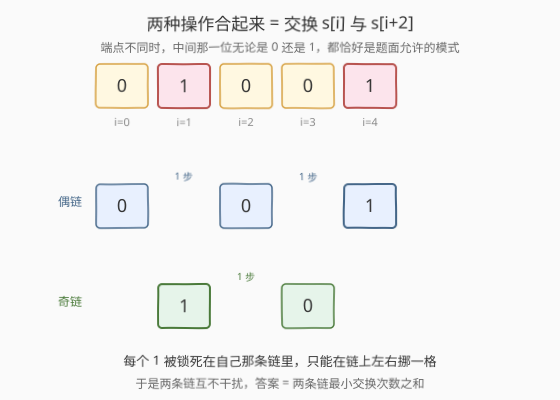
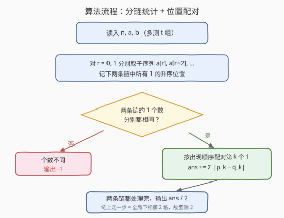
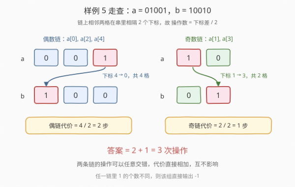

# Codeforces 2254C2 马雷诺（困难版） 题解

## 1. 题目概述

- **标题 / 题号**：马雷诺（困难版）（Codeforces 2254C2，英文名 Marenol (hard version)）
- **链接**：https://codeforces.com/problemset/problem/2254/C2
- **来源**：Codeforces Round 1114 (Div. 3) · Problem C2（UTC 2026-08-04）
- **难度**：1200
- **限制**：时间 2 s / 内存 256 MB
- **标签**：贪心、排序（官方 tag：greedy、sortings；本质是「奇偶两条链 + 二进制串上的相邻交换」）

**题意**：给定两个等长的 01 串 $a$、$b$。允许两种操作：把子串 $\texttt{001}$ 换成 $\texttt{100}$（或反向 $\texttt{100}\to\texttt{001}$）；把子串 $\texttt{110}$ 换成 $\texttt{011}$（或反向 $\texttt{011}\to\texttt{110}$）。求把 $a$ 变成 $b$ 的**最少操作数**，若不可达输出 $-1$。多测：第一行 $t$，每组依次给出 $n$、串 $a$、串 $b$，逐组输出一行答案。

**约束**：

- $1 \le t \le 10^4$，$1 \le n \le 2\times 10^5$，且 $\sum n \le 2\times 10^5$——总长度只有 $2\times10^5$，说明**每组都能做到 $O(n)$**；
- 操作可逆，因此「可达」是对称关系，$a\to b$ 与 $b\to a$ 答案相同；
- 答案上界：一条链最多 $10^5$ 个 1、每个 1 最多挪 $10^5$ 步，上界约 $10^{10}$（$n=2\times10^5$ 的极值是 $5\times10^9$），**必须用 64 位整数**（$2^{31}-1\approx 2.1\times10^9$ 不够）。

## 2. 示例与观察
官方样例（输入 / 输出原样）：

```text
输入
5
4
0100
0001
4
0100
0010
6
110000
000011
8
10101010
10101010
5
01001
10010

输出
1
-1
4
0
3
```

补一组自造数据（覆盖「链上长距离滑动」与「两条链各动一次」）：

```text
输入
2
8
10000000
00000010
5
01100
10010

输出
3
2
```

第 1 组唯一的 1 在下标 $0$、目标在下标 $6$，同在偶链上，需 $\frac{6-0}{2}=3$ 次；第 2 组偶链把 1 从下标 $2$ 挪到 $0$ 花 1 次，奇链把 1 从下标 $1$ 挪到 $3$ 花 1 次，共 2 次。

## 3. 解题思路

### 3.1 暴力思路

把串当状态做 BFS：每个状态有 $O(n)$ 条出边，状态总数 $2^n$，复杂度 $O(n2^n)$，只有 $n\le 20$ 左右能跑。它完全无法应付 $n=2\times10^5$，但能提供两条关键线索：一是**操作可逆**（图是无向的），二是随手跑几组会发现「下标奇偶性相同的 1 之间才可能互换」。所以正确方向不是搜索，而是**找不变量 + 把操作改写成更简单的形式**。

### 3.2 核心观察：两种操作其实是同一件事



逐个盯住两种操作**改变的到底是哪两个位置**：

- $\texttt{001}\to\texttt{100}$：把位置 $i$ 与 $i+2$ 的字符互换，前提是 $s_i=0,\ s_{i+2}=1$，此时中间 $s_{i+1}=0$；
- $\texttt{110}\to\texttt{011}$：同样把位置 $i$ 与 $i+2$ 互换，前提是 $s_i=1,\ s_{i+2}=0$，此时中间 $s_{i+1}=1$。

所以两种操作（含各自的反向共四种形态）恰好就是一句话：**任选 $i\le n-3$，若 $s_i\ne s_{i+2}$ 就交换 $s_i$ 与 $s_{i+2}$**。反过来也成立：任何一次这样的交换，两端取值组合必然落在 $\texttt{001}/\texttt{100}/\texttt{110}/\texttt{011}$ 四种形态之内——端点不同时，中间那位不管是 0 还是 1 都被覆盖。**中间字符的取值对能否操作毫无影响。**

既然只动 $i$ 与 $i+2$，而这两个下标**同奇偶**，整个串自然裂成两条互不干扰的链：偶链 $C_0=(s_0,s_2,s_4,\dots)$ 与奇链 $C_1=(s_1,s_3,s_5,\dots)$，各自把下标上的字符依次排成一列。

一次操作 = 在**某一条链上交换相邻的两个不同字符**。链内的 1 既不能跨到另一条链，也不能越过同链的另一个 1（越过就要落到已被占的格子上），于是：

1. 每条链中 1 的**个数**是不变量，两条链分别相等才可能可达；
2. 每条链内部，问题退化为「01 串每次交换相邻的不同字符，最少几步变成另一个 01 串」。

后者是经典结论：设链内 1 的位置（链上第几格）为 $p_1<\dots<p_m$ 与 $q_1<\dots<q_m$，最少交换次数为 $\sum_{k=1}^{m}\lvert p_k-q_k\rvert$。把链上位置换算回全局下标（同一条链相邻两项全局下标相差 2），每条链的代价就是

$$\text{cost}_r=\frac{1}{2}\sum_{k}\lvert P_k-Q_k\rvert,\qquad r\in\{0,1\},$$

其中 $P_k$、$Q_k$ 分别是 $a$、$b$ 在该奇偶类中第 $k$ 个 1 的**全局下标**。答案即 $\text{cost}_0+\text{cost}_1$，任何一条链 1 的个数不同就输出 $-1$。

> ⚠️ **最易错的一步**：$\lvert P_k-Q_k\rvert$ 是全局下标差，要除以 2 才是操作数。例如 $a=\texttt{001}$、$b=\texttt{100}$，差是 2，但只需 1 次操作。

### 3.3 算法流程



1. 读入 $n,a,b$，`ans = 0`，`ok = true`；
2. 对 $r=0,1$：从 $i=r$ 开始以步长 2 扫描，把 $a$ 中为 `1` 的下标压入 `pa`，$b$ 中为 `1` 的下标压入 `pb`（两者天然升序）；
3. 若 `pa.size() != pb.size()`：本组不可达，`ok = false`，跳出；
4. 否则 `ans += Σ |pa[k] - pb[k]|`；
5. 两条链都处理完：`ok` 为真输出 `ans / 2`，否则输出 `-1`。

实现上不需要真的取出子序列：奇偶两条链用「起点 $r$ + 步长 2」一次扫描即可收集位置，复杂度线性；也可以按第 4 节最后一条用双指针边扫边配对。

### 3.4 示例演算



官方五组样例的完整核对（位置均按全局下标 0-indexed 书写）：

| # | $a$ | $b$ | 偶链 $a\to b$ | 奇链 $a\to b$ | 下标差之和 | 答案 | 官方 |
|---|-----|-----|---------------|---------------|------------|------|------|
| 1 | `0100` | `0001` | $\varnothing\to\varnothing$ | $[1]\to[3]$ | $0+2=2$ | $2/2=1$ | 1 |
| 2 | `0100` | `0010` | $\varnothing\to[2]$ | $[1]\to\varnothing$ | 个数不等 | $-1$ | -1 |
| 3 | `110000` | `000011` | $[0]\to[4]$ | $[1]\to[5]$ | $4+4=8$ | $8/2=4$ | 4 |
| 4 | `10101010` | `10101010` | $[0,2,4,6]\to$ 自身 | $[1,3,5,7]\to$ 自身 | 0 | 0 | 0 |
| 5 | `01001` | `10010` | $[4]\to[0]$ | $[1]\to[3]$ | $4+2=6$ | $6/2=3$ | 3 |

第 5 组的具体三步：先把下标 1 的 1 右移两格（$a[1..3]=\texttt{100}\to\texttt{001}$）得 `00011`；再把下标 4 的 1 左移两格（$a[2..4]=\texttt{011}\to\texttt{110}$）得 `00110`；最后把下标 2 的 1 左移两格（$a[0..2]=\texttt{001}\to\texttt{100}$）得 `10010`，共 3 次。

## 4. 算法细节

1. **扫描方式**：外层 `r in {0,1}`，内层 `i = r; i < n; i += 2`，一遍同时收集 `a`、`b` 的 1 位置。不要真的去构造两个子串再做字符串拼接，常数大且易错。
2. **64 位**：`ans` 用 `long long`（C++）/ Python 天然大整数。最坏情形是「$n/2$ 个 1 接 $n/2$ 个 0」对「$n/2$ 个 0 接 $n/2$ 个 1」，答案正是 $5\times10^9$，超 `int`。
3. **除 2 的位置**：可以累加完再 `ans / 2`，也可以逐项 `diff / 2`——每个 $|P_k-Q_k|$ 都一定是偶数（同奇偶下标之差），两种写法结果相同；但绝不能漏掉这一除。
4. **`-1` 判定放在求和之前**：先比个数再求和，避免对长度不同的两个数组配对（Python 的 `zip` 会静默截断，是个隐蔽坑）。
5. **多测清空与 I/O**：`ans`、`ok`、`pa`、`pb` 都在每组内部重新定义；输入只是几十万字符，`sync_with_stdio(false)` 足够，Python 建议 `sys.stdin.buffer.read().split()` 一次读完、结果攒进列表最后 `join` 输出。
6. **可以做到 $O(1)$ 额外空间**：两条链各自按出现顺序配对第 $k$ 个 1，用两个指针边扫边加绝对值，只需额外记两个计数器判断个数是否相等。

## 5. 正确性证明

**引理 1（操作等价性）**：对任意 $i\le n-3$，$s_i\ne s_{i+2}$ 时交换 $s_i,s_{i+2}$ 是一次合法操作；反之每个合法操作都恰是这样一次交换。**证明**：若 $s_i=0,s_{i+2}=1$，中间位为 0 时是子串 $\texttt{001}\to\texttt{100}$，为 1 时是 $\texttt{011}\to\texttt{110}$；若 $s_i=1,s_{i+2}=0$，同理为 $\texttt{100}\to\texttt{001}$ 或 $\texttt{110}\to\texttt{011}$。四种情形都合法。反过来，题面四种形态的两端都不同，且都只改变 $s_i,s_{i+2}$。∎

**引理 2（链分解与不变量）**：令 $C_r=(s_r,s_{r+2},s_{r+4},\dots)$。一次操作只作用在**某一条** $C_r$ 上，且只交换其中相邻的两个字符；因此两条链中字符 `1` 的个数分别是不变量，且同一条链内两个 `1` 的相对顺序不会改变。**证明**：交换的下标 $i,i+2$ 同奇偶，它们在 $C_r$ 中相邻，故只影响一条链且是相邻交换。相邻交换不改变多重集合，故 `1` 的个数不变；两个 `1` 之间若交换，结果字符串不变，故不产生「顺序改变」的净效果。∎

**引理 3（链上的最小相邻交换数）**：设两条 01 链的 `1` 个数均为 $m$，`1` 在链中的位置为 $p_1<\dots<p_m$ 与 $q_1<\dots<q_m$，则把前者变成后者的最少相邻交换次数为 $\sum_k\lvert p_k-q_k\rvert$。**证明**：*下界*：一次交换只让一个 `1` 在链上移动一格，于是恰有一个 $p_k$ 变化 $\pm1$，$\sum_k\lvert p_k-q_k\rvert$ 至多减少 1，故至少需要该值次。*上界*：由引理 2 的顺序不变性，第 $k$ 个 `1` 只能去 $q_k$；从左到右贪心把每个 `1` 推到目标位置即可（向左推时其左邻必为 `0`，因为左侧的 `1` 已就位），每推一格代价 1，总代价恰为该值。∎

**定理**：$a$ 能变成 $b$ 当且仅当对 $r=0,1$，$a$ 与 $b$ 在 $C_r$ 中 `1` 的个数相等；若可达，最少操作数为 $\frac{1}{2}\big(\sum_k\lvert P_k-Q_k\rvert_{C_0}+\sum_k\lvert P_k-Q_k\rvert_{C_1}\big)$，否则为 $-1$。**证明**：必要性由引理 2。若个数分别相等，由引理 3 每条链都能在 $\sum_k\lvert p_k-q_k\rvert$ 次链内相邻交换内变成目标链，把这些操作依次执行，每次都是引理 1 的合法全局操作，故可达；又每次操作只改变一条链、且使该链的 $\sum_k\lvert p_k-q_k\rvert$ 恰好减 1，故总操作数不小于两条链代价之和，而上述构造恰好达到该值，即最优。全局下标差等于 2 倍的链内位置差，故除 2。若某条链个数不等，由引理 2 的不变性不可能到达，输出 $-1$。∎

## 6. 复杂度分析

- **时间**：每组两遍步长 2 的扫描共访问 $n$ 个字符，再做一次配对求和，$O(n)$；总计 $O(\sum n)\le 2\times10^5$ 次基本运算。**空间**：两个位置数组各不超过 $n/2$，$O(n)$；按第 4 节最后一条用双指针配对可压到 $O(1)$ 额外空间（不计输入串本身）。实测构造 $t=10^4$、$\sum n=2\times10^5$ 的极限输入，C++17 约 45 ms、Python3 约 50 ms（含进程启动，5 次取最好），相对 2 s 有 40 倍以上余量。

## 7. 参考代码

### C++17

```cpp
#include <iostream>
#include <string>
#include <vector>
#include <cstdlib>
using namespace std;

// 两种操作合起来恰为：若 s[i] != s[i+2]，交换 s[i] 与 s[i+2]。
// 于是偶数位子序列与奇数位子序列各自独立，每次操作 = 在一条链上
// 交换相邻的不同字符。链内 1 的个数不变，最少相邻交换次数 =
// sum |p_k - q_k| / 2（p、q 为两条链中 1 的全局升序位置：
// 链上走一步等于全局下标挪 2 格，故每个差值都是偶数）。
int main() {
    ios::sync_with_stdio(false);
    cin.tie(nullptr);

    int t;
    if (!(cin >> t)) return 0;          // 空输入防御
    while (t--) {
        int n;
        string a, b;
        cin >> n >> a >> b;

        long long ans = 0;              // 答案量级 5e9，必须 64 位
        bool ok = true;
        for (int r = 0; r < 2 && ok; ++r) {
            vector<int> pa, pb;
            pa.reserve(n / 2 + 1);
            pb.reserve(n / 2 + 1);
            for (int i = r; i < n; i += 2) {      // 同奇偶的一条链
                if (a[i] == '1') pa.push_back(i);
                if (b[i] == '1') pb.push_back(i);
            }
            if (pa.size() != pb.size()) {   // 该奇偶类 1 的个数不守恒
                ok = false;
                break;
            }
            for (size_t k = 0; k < pa.size(); ++k)
                ans += abs(pa[k] - pb[k]);
        }

        if (!ok) cout << -1 << '\n';
        else cout << ans / 2 << '\n';   // 全局下标差 / 2 = 链上步数
    }
    return 0;
}
```

### Python3

```python
import sys


def main() -> None:
    data = sys.stdin.buffer.read().split()
    if not data:                      # 空输入防御
        return
    t = int(data[0])
    pos = 1
    out = []
    for _ in range(t):
        n = int(data[pos])
        a = data[pos + 1].decode()
        b = data[pos + 2].decode()
        pos += 3

        ans = 0
        ok = True
        for r in (0, 1):              # 两条链分别处理
            pa = [i for i in range(r, n, 2) if a[i] == '1']
            pb = [i for i in range(r, n, 2) if b[i] == '1']
            if len(pa) != len(pb):    # 个数不等 -> 不可达
                ok = False
                break
            ans += sum(abs(x - y) for x, y in zip(pa, pb))

        out.append(str(ans // 2) if ok else "-1")

    sys.stdout.write("\n".join(out) + "\n")


main()
```

## 8. 边界情况与易错点

1. **忘记除以 2**：$a=\texttt{001}$、$b=\texttt{100}$ 全局差为 2，实际只需 1 次操作。这是本题最高频的 WA，样例第 1 组就能暴露。
2. **`int` 溢出**：答案最大 $5\times10^9$（$n=2\times10^5$、一半 1 从最左挪到最右），超过 `2^31-1`，必须 `long long`。
3. **只比较 1 的总数**：$a=\texttt{0100}$、$b=\texttt{0010}$ 的 1 总数都是 1，但 1 的奇偶类不同，答案应为 $-1$；必须**按奇偶两条链分别**比较个数。
4. **$n=1,2$ 没有合法窗口**：任何长度 3 的子串都不存在，此时只有 $a=b$ 才可达。公式自动覆盖：$n=2$、$a=\texttt{01}$、$b=\texttt{10}$ 时偶链个数 $0\ne1$，输出 $-1$。
5. **Python 的 `bytes`**：`split()` 得到的是 `bytes`，`x == '1'` 永远为假，要写 `x == b'1'` 或先 `decode()`（本文用 `decode()` 保持可读性）；同时 `-1` 判定要放在求和之前，否则 `zip` 会静默截断。
6. **多测状态残留**：`ans`、`ok`、`pa`、`pb` 必须每组新建；把 `ans` 提到循环外累加是典型错误。另外 $a=b$ 时答案 `0` 要正常输出，不要输出空行或 `-1`。

## 9. 验证记录

- **编译环境与命令**：`clang++ -std=c++17 -O2`（本机无 GNU g++，配 `codeforces/tools/include/bits/stdc++.h` 兼容头；正文代码只用标准库，可原样提交 GNU C++17）；Python 侧为 `Python 3.9.6`。
- **官方样例**：1 / 1 通过（按 Codeforces 标准 checker 的 token 比对，忽略空白与大小写）。
- **复核状态**：audited（2026-11-19 统一回归：编译 + 官方样例；写作期的随机对拍与暴力未重跑）。

## 相关题目与扩展

- [Codeforces 2254C1 Marenol (easy version)](https://codeforces.com/problemset/problem/2254/C1)：同题简单版，只问是否可达，判据正是本解中的「两条链 1 的个数分别相等」。
- [LeetCode 1864. 构成交替字符串需要的最小交换次数](https://leetcode.cn/problems/minimum-number-of-swaps-to-make-the-binary-string-alternating/)：同样按奇偶下标分类计数，可对照「奇偶类守恒」这一视角。
- [LeetCode 1151. 最少交换次数来组合所有的 1](https://leetcode.cn/problems/minimum-swaps-to-group-all-1s-together/)：用位置差度量移动代价，可与本题的位置配对公式互相印证。

**延伸思考**：

- **把 2 换成 $k$**：若操作为「$s_i\ne s_{i+k}$ 时交换 $s_i,s_{i+k}$」，串裂成 $k$ 条链，答案变成 $\frac{1}{k}\sum_{r=0}^{k-1}\sum_{j}\lvert P_j-Q_j\rvert$，可达性判据变成「每条链 1 的个数分别相等」，本题是 $k=2$ 的特例。
- **允许任意交换两个不同字符**：一次操作就能消掉两个错位，答案降到「错位位置数 $/2$」的量级，与本题「只能相邻挪动」形成鲜明对比，是理解「操作粒度决定代价」的好例子。
- **加权版本**：若两种操作代价不同（如 $\texttt{001}\to\texttt{100}$ 花 1、$\texttt{110}\to\texttt{011}$ 花 2），链上就不再是「相邻交换代价 1」，而要按每个 1 向左/向右的净移动量分别计费，可用前缀和统计两个方向的需求。
