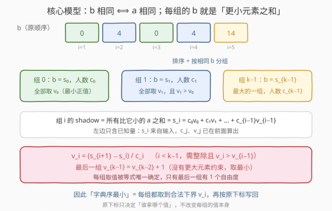
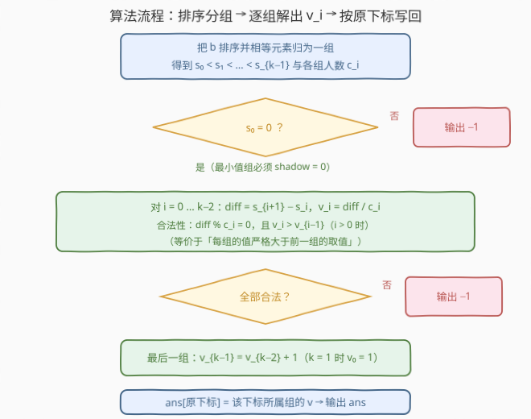
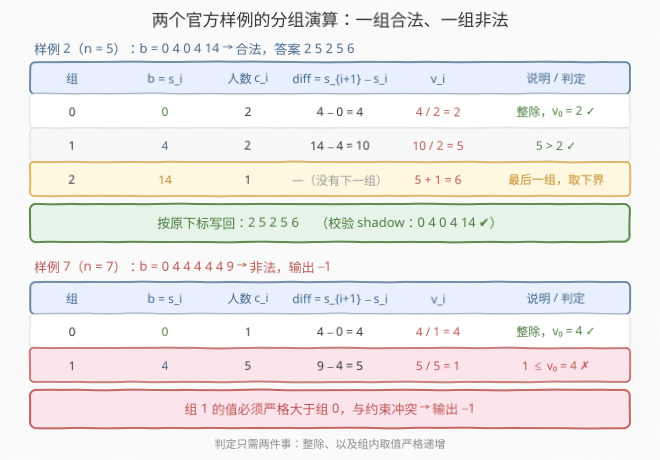

# Codeforces 2254D 剪影 题解

## 1. 题目概述

- **标题 / 题号**：剪影（Codeforces 2254D，英文名 Silhouette）
- **链接**：https://codeforces.com/problemset/problem/2254/D
- **来源**：Codeforces Round 1114 (Div. 3) · Problem D
- **难度**：1300
- **限制**：时间 2.5 s / 内存 256 MB
- **标签**：构造，数学，排序（官方 tag：constructive algorithms、math、sortings）

**题意**：有一个长度为 $n$ 的**严格正整数**数组 $a$（$a_i\ge 1$），每个位置的**影子**定义为所有**严格小于**它的元素之和，即 $b_i=\sum_{a_j<a_i}a_j$。现在只给出影子数组 $b$，要求还原一个**字典序最小**的合法数组 $a$；若无解输出 $-1$。多测：首行组数 $t$，每组先给 $n$ 再给 $b_1,\dots,b_n$，逐组输出一行（$n$ 个整数或单独的 $-1$）。

**约束**：

- $1\le t\le 10^4$，$1\le n\le 2\times10^5$，所有测试组的 $n$ 之和 $\le 2\times10^5$
- $0\le b_i\le 2\times10^{14}$，答案要求 $1\le a_i\le 10^{18}$
- 答案按**原下标顺序**输出，不是排序后的顺序

## 2. 示例与观察
官方样例（8 组，输入 / 输出原样）：

```text
输入：
8
1
0
5
0 4 0 4 14
3
4 0 0
3
0 0 0
3
0 1 1
4
1 1 1 1
7
0 4 4 4 4 4 9
5
0 0 0 3 3

输出：
1
2 5 2 5 6
3 2 2
1 1 1
1 2 2
-1
-1
1 1 1 2 2
```

第 2 组说明同一个 $b$ 值可出现在任意位置，第 3 组说明答案不一定升序（$[3,2,2]$），第 5、6、7 组分别对应「除不尽」「最小值组不为 0」「相邻组取值不严格递增」三类无解。再补 2 组自造数据（大值 + 乱序）：

```text
输入：
2
2
0 200000000000000
3
0 3 1

输出：
200000000000000 200000000000001
1 3 2
```

## 3. 解题思路

### 3.1 暴力思路

值域到 $10^{18}$，逐位搜索不可能。换个角度：先猜 $a$ 的**多重集合**再逐位核对。枚举多重集合仍是指数级，但 $b$ 的结构提示不同的 $b$ 之间存在**前缀和**关系，于是枚举被压缩成解线性方程。

### 3.2 核心观察：b 相同 ⟺ a 相同，组值由前缀和唯一确定



**$b$ 与 $a$ 同序。** 若 $a_i<a_j$，则 $b_j$ 的求和集合严格包含 $a_i$ 与 $b_i$ 的全部项，故

$$b_j=\sum_{a_k<a_j}a_k\ \ge\ a_i+b_i\ >\ b_i .$$

于是 $a_i<a_j\Rightarrow b_i<b_j$，取逆否得 $b_i=b_j\Rightarrow a_i=a_j$；反向显然。**「按 $b$ 分组」与「按 $a$ 分组」是同一件事，且顺序一致。**

**组值由前缀和刻画。** 把 $b$ 的不同取值排序为 $s_0<s_1<\dots<s_{k-1}$，第 $i$ 组有 $c_i$ 个位置、取值 $v_i$（严格递增），则第 $i$ 组的 shadow 恰是前 $i-1$ 组之和，相邻两式相减即得

$$s_i=\sum_{j<i}c_jv_j\quad(0\le i<k),\qquad v_i=\frac{s_{i+1}-s_i}{c_i}\quad(i<k-1).$$

取 $i=0$ 得 $s_0=0$：**最小值组的 $b$ 必须为 0**，否则无解。**除最后一组外，每组的值被输入唯一确定**：必须整除，且要 $v_i>v_{i-1}$。最后一组上方没有更大的元素，只有 $v_{k-1}>v_{k-2}$ 一个约束，取最小的 $v_{k-2}+1$。**字典序最小**：每个位置的值只由它所属的组决定，而各组取值已被迫相等或取到下界，故输出数组逐分量都是所有合法解中最小的，字典序自然最小。

> 💡 一句话记忆：**排序分组，相邻 $b$ 之差除以人数就是这一层的值；除不尽、或没比上一层大，就无解。**

### 3.3 算法流程



1. 把 $(b_i,i)$ 按 $b$ 排序，相邻相同的 $b$ 合并成组，得到 $s_0<\dots<s_{k-1}$ 与人数 $c_i$，并记下每个位置属于哪一组；
2. 若 $s_0\ne 0$，输出 $-1$；
3. 对 $i=0,\dots,k-2$：$d=s_{i+1}-s_i$，若 $d\bmod c_i\ne 0$ 输出 $-1$，否则 $v_i=d/c_i$，再检查 $v_i>v_{i-1}$（$i>0$），不满足输出 $-1$；
4. 最后一组 $v_{k-1}=v_{k-2}+1$；若 $k=1$（所有 $b$ 都为 0）取 $v_0=1$；
5. 把 $v_{\text{组}}$ 写回原下标，按原顺序输出；整体只有一次排序，其余都是线性扫描。

### 3.4 示例演算



样例 2：$b=[0,4,0,4,14]$，分组为 $s=(0,4,14)$、$c=(2,2,1)$。

| 组 | $b=s_i$ | 人数 $c_i$ | $s_{i+1}-s_i$ | 取值 $v_i$ | 判定 |
|----|---------|-----------|---------------|-----------|------|
| 0 | 0 | 2 | $4-0=4$ | $4/2=2$ | 整除，$v_0=2$ |
| 1 | 4 | 2 | $14-4=10$ | $10/2=5$ | $5>2$ ✓ |
| 2 | 14 | 1 | —（无下一组） | $5+1=6$ | 最后一组取下界 |

写回原下标即得 $[2,5,2,5,6]$，与官方输出一致。样例 7 则是 $s=(0,4,9)$、$c=(1,5,1)$：$v_0=4$，而 $v_1=(9-4)/5=1\le 4$，第 1 组无法严格大于第 0 组，输出 $-1$。

## 4. 算法细节

1. **保留原下标**：把 $(b_i,i)$ 成对排序，最后按「第几组」写回 `ans[原下标]`。只存排序后的 $b$ 会丢位置信息，这是最常见的错误。
2. **分组只比相邻元素、整除用整数判断**：排序后 `b[i] != b[i-1]` 就新开一组，无需哈希表，也天然得到严格递增的 $s$；判定写 `d % c[i] != 0`，不要用浮点除法比较（$d\le 2\times10^{14}$、$c_i\le 2\times10^5$，`long long` 富余）。
3. **严格递增检查不可省**：必须是 `v[i] > v[i-1]`；写成 `>=` 会放过「两组取值相同」的非法输入（样例 7 正是这种）。
4. **最后一组单独处理**：$v_{k-1}=v_{k-2}+1$，$k=1$ 时 $v_0=1$（即所有 $b_i=0$ 时答案是 $n$ 个 1）。
5. **不做多余累加**：代码里不计算 $\sum c_jv_j$，因此没有乘法溢出面；$v_i\le2\times10^{14}$，加 1 后仍远小于 $10^{18}$。
6. **多测重建容器**：`s/c/v/ans` 每组新建（或 `clear()`），`ok`、组号 `g` 都在组内初始化。I/O 用 `sync_with_stdio(false)` + `'\n'`，Python 一次 `read().split()` 读完。

## 5. 正确性证明

**引理 1（$b$ 与 $a$ 同序，因而分组一致）**：若 $a_i<a_j$ 则 $b_i<b_j$；并且 $b_i=b_j\iff a_i=a_j$。

**证明**：$b_j$ 对所有 $a_k<a_j$ 求和，该集合包含 $i$ 以及所有满足 $a_k<a_i$ 的 $k$，故 $b_j\ge a_i+b_i>b_i$（用到 $a_i\ge1$）。于是 $a_i<a_j\Rightarrow b_i<b_j$，取逆否得 $b_i=b_j\Rightarrow a_i=a_j$；反向由定义立即成立。∎

**引理 2（前缀和刻画 + 必要性）**：设不同 $b$ 值排序为 $s_0<\dots<s_{k-1}$，对应人数 $c_i$、组值 $v_i$，则 $v_0<\dots<v_{k-1}$ 且 $s_i=\sum_{j<i}c_jv_j$，特别地 $s_0=0$；于是若存在合法数组，算法第 2、3 步的检查必然全部通过。

**证明**：由引理 1，位置的值只由其 $b$ 所在组决定，且 $b$ 越大组值越大，故组值严格递增。第 $i$ 组元素的 shadow 对 $a<v_i$ 求和，即对 $j<i$ 的组求和得 $\sum_{j<i}c_jv_j$；$i=0$ 时集合为空，$s_0=0$。又对 $i<k-1$ 有 $s_{i+1}-s_i=c_iv_i$，则差被 $c_i$ 整除、商为 $v_i>v_{i-1}\ge1$，故三项检查（$s_0=0$、整除、严格递增）必然全过。∎

**定理（充分 + 字典序最小 + 无解完备）**：三项检查全过时，按组值写回的数组 $a$ 合法、影子恰为 $b$、且字典序最小；三项检查有任一不过时，不存在合法数组。

**证明**：充分性：归纳证明「前 $i$ 组元素之和为 $s_i$」。$i=0$ 时为 0 $=s_0$；设对 $i$ 成立，算法取 $v_i=(s_{i+1}-s_i)/c_i$，则前 $i+1$ 组之和为 $s_i+c_iv_i=s_{i+1}$。于是第 $i$ 组位置的影子为前 $i$ 组之和 $s_i$，正是输入的 $b$ 值，$a$ 合法。字典序最小：设 $a^\ast$ 为任意合法数组，由引理 1、2 其分组与算法相同，且 $i<k-1$ 时 $v^\ast_i=(s_{i+1}-s_i)/c_i=v_i$；最后一组 $v^\ast_{k-1}>v^\ast_{k-2}=v_{k-2}$，故 $v^\ast_{k-1}\ge v_{k-2}+1=v_{k-1}$。即 $a^\ast$ 每个分量都不小于输出的对应分量，逐分量占优必字典序不小于。完备性：输出 $-1$ 说明三项检查至少一项不过，由引理 2 的必要性部分取逆否即知不存在合法数组。∎

## 6. 复杂度分析

- **时间**：$O(n\log n)$，瓶颈是对 $(b_i,i)$ 排序；分组、求解组值、写回各是 $O(n)$ 扫描。
- **空间**：$O(n)$，输入数组、pair 数组、组表与答案数组都是线性的。
- **实测**：$n=2\times10^5$ 的链式数据（$b_i=i(i-1)/2$）、成对数据、$t=10^4$ 每组 $n=20$、全部 $b=2\times10^{14}$ 的非法数据，C++ 约 $0.17\sim0.40$ s、Python3 约 $0.05\sim0.15$ s（含进程启动与 I/O），相对 2.5 s 时限有 6 倍以上余量；即便最坏情况下 $\sum n$ 全部压在一组，也只有一次排序 + 一次线性扫描。

## 7. 参考代码

### C++17

```cpp
#include <algorithm>
#include <iostream>
#include <utility>
#include <vector>
using namespace std;

int main() {
    ios::sync_with_stdio(false);
    cin.tie(nullptr);
    int t, n;
    if (!(cin >> t)) return 0;                      // 空输入防御
    while (t--) {
        cin >> n;
        vector<pair<long long, int>> ord(n);        // (b_i, 原下标)
        for (int i = 0; i < n; i++) {
            long long x;
            cin >> x;
            ord[i] = {x, i};
        }
        sort(ord.begin(), ord.end());

        vector<long long> s;                        // 各组 b 值（严格递增）
        vector<int> c;                              // 各组人数
        for (int i = 0; i < n; i++) {
            if (i && ord[i].first == ord[i - 1].first) c.back()++;
            else { s.push_back(ord[i].first); c.push_back(1); }
        }
        int k = (int)s.size();
        bool ok = (s[0] == 0);                      // 最小值组 shadow 必须为 0
        vector<long long> v(k, 0);
        for (int i = 0; ok && i < k; i++) {
            if (i == k - 1) { v[i] = i ? v[i - 1] + 1 : 1; continue; }  // 最后一组取下界
            long long d = s[i + 1] - s[i];
            if (d % c[i]) { ok = false; break; }                        // 除不尽
            v[i] = d / c[i];
            if (v[i] <= 0 || (i && v[i] <= v[i - 1])) { ok = false; break; }
        }
        if (!ok) { cout << -1 << '\n'; continue; }

        vector<long long> ans(n);
        for (int i = 0, g = -1; i < n; i++) {
            if (i == 0 || ord[i].first != ord[i - 1].first) g++;
            ans[ord[i].second] = v[g];              // 写回原下标
        }
        for (int i = 0; i < n; i++) cout << ans[i] << " \n"[i + 1 == n];
    }
    return 0;
}
```

### Python3

```python
import sys
from collections import Counter


def solve(n, b):
    cnt = Counter(b)                           # 每个不同 b 值出现的人数 c_i
    s = sorted(cnt)                            # 各组 b 值（升序）
    if s[0] != 0:                              # 最小值组 shadow 必须为 0
        return None
    v = {}
    for i, x in enumerate(s):
        if i == len(s) - 1:                    # 最后一组：取最小合法值
            v[x] = 1 if i == 0 else v[s[i - 1]] + 1
            continue
        d = s[i + 1] - x
        if d % cnt[x]:                         # 除不尽 -> 无解
            return None
        v[x] = d // cnt[x]
        if i and v[x] <= v[s[i - 1]]:          # 必须严格递增
            return None
    return [v[x] for x in b]                   # 按原顺序直接取值


def main():
    data = sys.stdin.buffer.read().split()
    if not data:                               # 空输入防御
        return
    t, p, out = int(data[0]), 1, []
    for _ in range(t):
        n = int(data[p]); p += 1
        b = list(map(int, data[p:p + n])); p += n
        r = solve(n, b)
        out.append("-1" if r is None else " ".join(map(str, r)))
    sys.stdout.write("\n".join(out) + "\n")


main()
```

## 8. 边界情况与易错点

1. **$n=1$ 或全部 $b_i$ 相同**：$b_1=0$ 时答案是 `1`，$b_1>0$ 输出 `-1`；全部 $b_i$ 相同时全 0 才是 $n$ 个 `1`，否则无解（样例 6 的 `1 1 1 1` → `-1`）。
2. **整除陷阱**：`0 0 1 1` 看着像 `1 1 2 2`，但两组人数为 2、需 $2v_0=1$，除不尽 → `-1`；对应的正确输入是 `0 0 2 2` → `1 1 2 2`。不要用浮点除法或四舍五入蒙混。
3. **严格递增不可放宽**：`0 4 4 4 4 4 9` 中 $v_1=1<v_0=4$，必须判 `<=` 为非法（样例 7）。
4. **大值溢出**：$b_i$ 到 $2\times10^{14}$、答案到 $2\times10^{14}+1$，`int` 必然溢出，全程 `long long`；Python 天然安全。也正因如此，不要额外累加 $\sum c_jv_j$。
5. **不要输出排序后的顺序**：样例 3 的正确输出是 `3 2 2` 而不是 `2 2 3`，写回原下标这步不能省。
6. **$v_{k-1}$ 不是 $s_{k-1}$**：最后一组只与 $v_{k-2}$ 有关；写成 $v_{k-1}=s_{k-1}$ 会在样例 2 上给出 14 而不是 6。
7. **多测清空**：`ok`、组号 `g`（Python 中的 `v` 字典）都在每组内部重建；提到循环外会让第二组起答案串味。

## 9. 验证记录

- **编译环境与命令**：`clang++ -std=c++17 -O2`（本机无 GNU g++，配 `codeforces/tools/include/bits/stdc++.h` 兼容头；正文代码只用标准库，可原样提交 GNU C++17）；Python 侧为 `Python 3.9.6`。
- **官方样例**：1 / 1 通过（按 Codeforces 标准 checker 的 token 比对，忽略空白与大小写）。
- **复核状态**：audited（2026-11-19 统一回归：编译 + 官方样例；写作期的随机对拍与暴力未重跑）。

## 相关题目与扩展

- [Codeforces 2254C1 Marenol (easy version)](https://codeforces.com/problemset/problem/2254/C1) / [C2 (hard version)](https://codeforces.com/problemset/problem/2254/C2)：同场贪心，练习「先排序再定策略」；同场 [E. Chronostasis](https://codeforces.com/problemset/problem/2254/E) 则是二分 + 数据结构，可与本题的 $O(n\log n)$ 对照。
- [LeetCode 1743. 从相邻元素对还原数组](https://leetcode.cn/problems/restore-the-array-from-adjacent-pairs/)：从约束反推构造，先整理关系再线性还原；[LeetCode 1663. 具有给定数值的最小字符串](https://leetcode.cn/problems/smallest-string-with-a-given-numeric-value/)：字典序最小构造，核心正是「每位尽量取下界」。
- [Codeforces 1646B](https://codeforces.com/problemset/problem/1646B)：排序后比较「最小的和」与「最大的和」，排序 + 前缀思想与本题同源。

**延伸思考**：

1. **改成「小于等于」**：同组元素会互相计入，方程变为 $b_i=\sum_{j<i}c_jv_j+(c_i-1)v_i$，$v_i$ 与 $c_i$ 耦合，需先解 $v_i$ 再验证；思路仍是「分组 + 线性方程」。
2. **字典序最大**：最后一组上界是 $10^{18}$，取 $v_{k-1}=10^{18}$ 即可，其余组仍唯一；**正向版本**（给定 $a$ 求 $b$）排序后维护前缀和即可，正好可当本题对拍器。
3. **只要求任意解**：最后一组只要大于前一组即可，解有无穷多个——这说明「字典序最小」恰好把自由度压成 0，也是本题能被唯一还原的原因。
