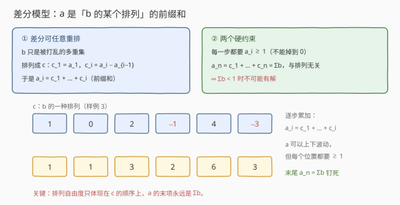
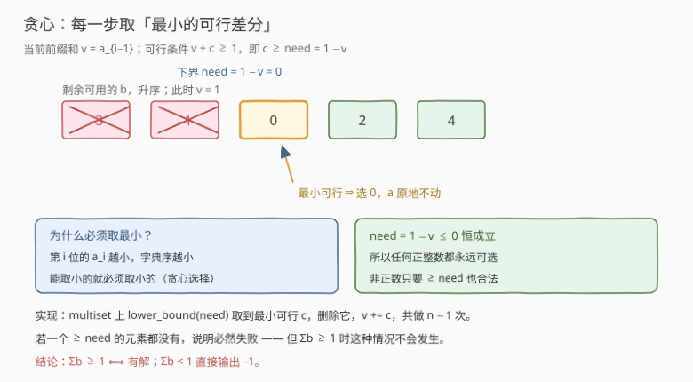
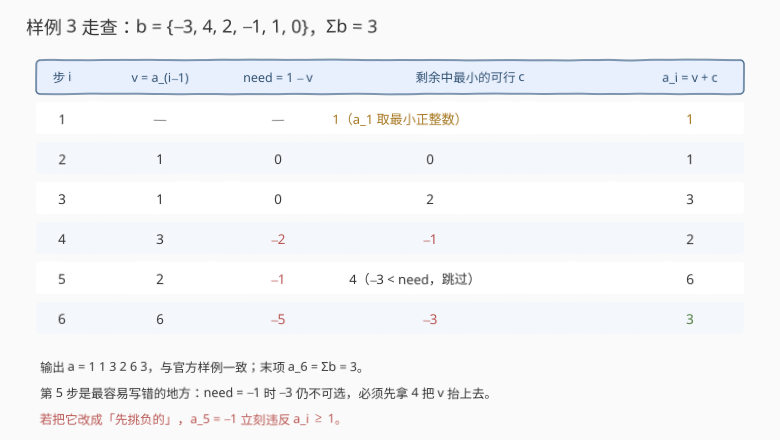

# Codeforces 2254E 时钟停驻 题解

## 1. 题目概述

- **标题 / 题号**：时钟停驻（Codeforces 2254E，英文名 Chronostasis）
- **链接**：https://codeforces.com/problemset/problem/2254/E
- **来源**：Codeforces Round 1114 (Div. 3) · Problem E（UTC 2026-08-04）
- **难度**：1500
- **限制**：时间 2 s / 内存 256 MB
- **标签**：贪心，数据结构，二分查找（官方 tag：binary search、data structures、greedy；本质是「多重集上按阈值取最小可行元素」）

**题意**：有一个隐藏数组 $a_1,\dots,a_n$，**每一项都是正整数**。一次操作先令 $b_1 = a_1$，再对 $2 \le i \le n$ 令 $b_i = a_i - a_{i-1}$——也就是 $b$ 是 $a$ 的差分数组（首项直接放 $a_1$）；随后把 $b$ 的 $n$ 个元素**完全打乱**。现在只给出打乱后的多重集 $b$，要求还原出**字典序最小**的合法 $a$；若怎样排列 $b$ 都得不到全为正整数的 $a$，输出 $-1$。多测：第一行 $t$，每组给出 $n$ 与 $n$ 个整数，逐组输出 $n$ 个正整数或单个 $-1$。

**约束**：

- $1 \le t \le 10^4$，$1 \le n \le 2\times 10^5$，且 $\sum n \le 2\times 10^5$
- $-10^9 \le b_i \le 10^9$：差分为负意味着 $a$ 会**下降**，所以 $a$ 不要求单调
- $a_i \ge 1$（严格为正），输出恰好 $n$ 个整数；无解时输出 $-1$

## 2. 示例与观察
官方样例（输入 / 输出原样）：

```text
输入：
8
1
5
4
-5 2 1 1
6
-3 4 2 -1 1 0
6
-2 -2 4 1 0 1
7
0 0 -2 3 0 -1 2
8
-1 -1 -1 -1 5 0 0 1
5
1000000000 500000000 750000000 100000000 900000000
10
1000000000 -1000000000 500000000 -500000000 1 1 -1 -1 2 -2

输出：
5
-1
1 1 3 2 6 3
1 1 2 6 4 2
2 1 1 1 1 4 2
1 1 1 6 5 4 3 2
100000000 600000000 1350000000 2250000000 3250000000
-1
```

逐组的关键点：第 1 组 $n=1$，只能是 $a=[5]$；第 2 组 $\sum b = -1$，末项不可能为正，无解；第 3 组差分取 $[1,0,2,-1,4,-3]$，得到 $a=[1,1,3,2,6,3]$；第 5 组 $1$ 不在 $b$ 里，$a_1$ 只能取 $2$；第 7 组全为正数，$a$ 必然单调上升，只能从小到大依次累加；第 8 组 $\sum b = 0$，同样无解。

补一组自造数据（含 $0$ 的可行情形 + 中途下降的可行情形）：

```text
输入：
2
3
0 1 1
4
2 -1 0 1

输出：
1 1 2
1 1 3 2
```

第一组差分为 $[1,0,1]$；第二组差分为 $[1,0,2,-1]$，$a$ 中途下降到 $2$ 仍合法，末项 $2=\sum b$。

## 3. 解题思路

### 3.1 暴力思路

按题意最直白的做法：枚举 $b$ 的全部不同排列（最坏 $n!$ 个），对每个排列求前缀和，检查是否每一项都 $\ge 1$，在所有合法前缀和序列里取字典序最小。$n = 2\times10^5$ 时这是天文数字，即便做「正数放前面、负数放后面」的剪枝，枚举量仍然是阶乘级。暴力无法给出任何有用的中间结论，必须换视角。

### 3.2 核心观察：a 是差分的前缀和，末项被钉死



把 $b$ 的某个排列记作 $c_1,\dots,c_n$，它是一个合法的差分序列意味着 $c_1 = a_1$、$c_i = a_i - a_{i-1}$。望远镜求和立刻给出

$$a_i = c_1 + c_2 + \cdots + c_i, \qquad a_n = \sum_{i=1}^{n} c_i = \sum_{i=1}^{n} b_i .$$

于是有三条直接结论：**末项是常量**（$a_n = \sum b$ 与排列方式无关，若 $\sum b < 1$ 则必为 $-1$）；**首项必须取自 $b$**（$a_1 = c_1$ 是 $b$ 的某个元素且 $\ge 1$）；**唯一的约束**是"每个前缀和都 $\ge 1$"。

接下来是最重要的一步——**可行性到底有多复杂？** 假设当前已经累加到 $v \ge 1$，还剩多重集 $R$。只要把 $R$ 里的**非负元素全部先加**、**负元素全部后加**：前半段前缀和单调不减，最小值就是 $v \ge 1$；后半段前缀和单调不增，最小值在最后一步取到，恰好是 $v + \sum R = \sum b \ge 1$。于是整条前缀和都 $\ge 1$——注意**上界可以超过 $\sum b$**（非负段加满时最高），这不影响合法性。

> 💡 也就是说：**给定当前值 $v$，「后缀能不能排完」只取决于 $v \ge 1$ 这一个条件**，与 $R$ 的具体构成无关（前提是全局 $\sum b \ge 1$）。这把一个阶乘级的搜索瞬间压成了一个数。

### 3.3 算法流程：贪心 + 多重集按阈值取最小



字典序是从前往后比的，所以我们逐位最小化：先让 $a_1$ 尽量小；$a_1$ 定下来后让 $a_2$ 尽量小；以此类推。由 3.2，第 $i$ 位唯一的技术限制就是**别让 $a_i$ 掉到 $1$ 以下**，即 $v + c \ge 1$，等价于

$$c \ \ge\ need = 1 - v .$$

算法：

1. 累加得到 $S = \sum b$；若 $S < 1$，输出 $-1$，本组结束。
2. 取 $b$ 中**最小的正整数**作为 $a_1$（它既是合法取值，又是所有合法取值中最小的）。
3. 维护剩余元素的多重集 $R$ 与当前值 $v = a_1$，重复 $n-1$ 次：
   - 令 $need = 1 - v$；
   - 在 $R$ 中取**最小的 $\ge need$ 的元素** $c$（即 `multiset::lower_bound(need)` 命中的那个）；
   - $v \gets v + c$，把 $v$ 追加到答案，并从 $R$ 中删除这个 $c$。
4. 输出 $a$。

因为每一步都保证 $v \ge 1$，所以 $need = 1-v \le 0$ 恒成立：**任何正整数永远可选**，非正数只要 $\ge need$ 也合法。注意这里**不能**简化成"永远取当前最小值"——$need = -1$ 时最小值 $-3$ 依然不合法，必须跳过它、先拿一个能把 $v$ 抬起来的元素（见 3.4 的第 5 步）。

### 3.4 示例演算



官方样例 3：$b = \{-3,4,2,-1,1,0\}$，$S = 3$。最小正整数是 $1$，故 $a_1 = 1$，$v = 1$。

| 步 $i$ | 当前 $v = a_{i-1}$ | $need = 1-v$ | 剩余中最小的可行 $c$ | $a_i = v + c$ |
|--------|--------------------|--------------|----------------------|----------------|
| 1 | — | — | $1$（$a_1$ 取最小正整数） | $1$ |
| 2 | $1$ | $0$ | $0$ | $1$ |
| 3 | $1$ | $0$ | $2$ | $3$ |
| 4 | $3$ | $-2$ | $-1$ | $2$ |
| 5 | $2$ | $-1$ | $4$（$-3 < need$，跳过） | $6$ |
| 6 | $6$ | $-5$ | $-3$ | $3$ |

得到 $a = [1,1,3,2,6,3]$，与官方输出一致；验证差分 $[1,0,2,-1,4,-3]$ 恰为 $b$ 的一个排列，且每个元素都 $\ge 1$，末项 $3 = \sum b$。

## 4. 算法细节

1. **用 `long long`**：$\sum b$ 最大 $2\times10^5 \times 10^9 = 2\times10^{14}$，$a_i$ 也可能涨到这个量级，`int` 会溢出。
2. **$a_1$ 的定位**：对多重集做 `lower_bound(1)`，第一个 $\ge 1$ 的元素就是最小正整数；$S \ge 1$ 保证它一定存在（否则所有元素 $\le 0$，和不可能为正）。
3. **多重集按组重建**：`multiset` 必须在每个测试用例内部构造，绝不能跨组复用，否则上一组的残留元素会污染答案。
4. **$need \le 0$ 只是理解上的简化**：实现上仍然必须写 `lower_bound(need)`；写成"取最小值"会在需要跳过某个过负元素时出错。
5. **`lower_bound` 返回 `end()` 的分支是死代码**：由引理 3，$v \ge 1$ 且 $S \ge 1$ 时每步必有可行元素。保留判断只是防御性写法，不参与正确性论证。
6. **输出格式**：每组输出一行、$n$ 个数用单个空格分隔、行末换行；无解时这一行只输出 `-1`。多测下不要漏行或多打空行。
7. **Python 的删除代价**：`list.pop(中间下标)` 是 $O(n)$，套上 $n$ 次就是 $O(n^2)$。改用「排序数组 + 并查集维护下一个存活位置」，把「找最小存活下标 $\ge k$」做到近 $O(\alpha(n))$。
8. **常数**：一组数据只做 $O(n)$ 次 `insert`/`lower_bound`/`erase`，每次 $O(\log n)$；$\sum n \le 2\times10^5$ 时总操作量约 $3\times2\times10^5 \times 18$ 次比较，非常宽松。

## 5. 正确性证明

**引理 1（末项不变）**：对 $b$ 的任意排列 $c$，都有 $\sum_i c_i = \sum_i b_i = a_n$。

**证明**：$a_n = a_1 + \sum_{i=2}^{n}(a_i - a_{i-1}) = \sum_{i=1}^{n} c_i$（望远镜求和），而 $c$ 是 $b$ 的一个排列，$c$ 的元素和等于 $b$ 的元素和。∎

**引理 2（可续性）**：设当前值 $v \ge 1$，剩余多重集 $R$ 满足 $v + \sum_{x \in R} x = \sum b \ge 1$，则存在 $R$ 的一种排列使所有前缀和都 $\ge 1$。

**证明**：构造排列：先放 $R$ 中所有非负元素（顺序任意），再放所有负元素（顺序任意）。非负段的前缀和单调不减，最小值为 $v \ge 1$；负段的前缀和严格递减，最小值在负段末项取得，等于 $v + \sum_{x\in R} x = \sum b \ge 1$。因此每一步前缀和都 $\ge 1$。∎

**引理 3（贪心每步都有可行元素）**：若 $v \ge 1$、$R \ne \varnothing$ 且 $v + \sum_{x \in R} x = \sum b \ge 1$，则存在 $c \in R$ 满足 $c \ge 1 - v$。

**证明**：反设所有 $c \in R$ 都满足 $c < 1 - v$。由于 $b_i$ 全为整数，这等价于 $c \le -v$，于是 $\sum_{x\in R} x \le -v\lvert R\rvert \le -v$。另一方面由假设 $\sum_{x \in R} x = \sum b - v \ge 1 - v > -v$，矛盾。∎

**引理 4（一步最优）**：设当前值 $v \ge 1$、剩余多重集 $R$，令 $c^* = \min\{c \in R : v + c \ge 1\}$。则任何"当前值为 $v$、用 $R$ 继续排完"的合法 $a$，它的下一个元素都 $\ge v + c^*$。

**证明**：合法解的下一个差分 $c$ 必须满足 $v + c \ge 1$，即 $c$ 属于可行集合，而 $c^*$ 是该集合的最小值，故 $c \ge c^*$，从而下一个元素 $v + c \ge v + c^*$。∎

**定理 1（可行性判据）**：存在合法 $a$ $\iff$ $\sum b \ge 1$。

**证明**：必要性由引理 1 与 $a_n \ge 1$ 得到。充分性：$a_1$ 取 $b$ 中的最小正整数（$S \ge 1$ 保证存在，且它 $\ge 1$）；此后每一步由引理 3 都能选出 $c$ 且 $v + c \ge 1$，故 $v$ 始终 $\ge 1$，再由引理 2 后缀总能排完。∎

**定理 2（字典序最小）**：算法输出的 $a$ 是所有合法数组里字典序最小的。

**证明**：设 $B$ 为任一合法数组，下面对位置归纳证明"$A$ 在第一个与 $B$ 不同的位置上更小，或两者完全相同"。

- 基：$A_1$ 是 $b$ 中最小的 $\ge 1$ 元素，而 $B_1$ 是 $b$ 中某个 $\ge 1$ 的元素，故 $A_1 \le B_1$。
- 归纳：设 $A_1..A_i = B_1..B_i$（若有不同，早已分出胜负）。由于差分由相邻项唯一确定，两者用掉的前 $i$ 个差分完全相同，故剩余多重集 $R$ 相同、当前值 $v = A_i = B_i$ 相同。由引理 4，$A_{i+1} = v + c^* \le v + c_B = B_{i+1}$（$c_B$ 是 $B$ 用掉的下一个差分），若严格小于则 $A$ 更小，否则继续归纳。

归纳进行到 $i = n$ 时两者相同。因此 $A \le_{lex} B$，对所有合法 $B$ 成立。∎

## 6. 复杂度分析

- **时间**：每组 $O(n \log n)$。建 `multiset`（或排序）一次 $O(n\log n)$；$n-1$ 轮中各做一次 `lower_bound`、一次 `erase`，各 $O(\log n)$。总体 $O\big((\sum n)\log n\big) \le 2\times10^5 \times 18$ 级别，2 s 时限下极其宽松。
- **空间**：$O(n)$。`multiset`/排序数组存 $n$ 个元素，答案数组 $n$ 个 64 位整数，无额外结构。
- **实测**：最大规模（单组 $n = 2\times10^5$，且 $\sum b > 0$ 走满完整贪心）本机多次运行取平均——C++ 约 $0.36$ s，其中输入解析占了约 $0.3$ s（本地 Apple clang + libc++ 的 `iostream` 解析整数偏慢：同数据改用 `scanf` 读入约 $0.05$ s；GNU libstdc++ 上这部分小得多），多重集部分仅约 $20$ ms；Python 约 $0.19$ s。两边都有 5 倍以上余量。
- 另一组极端数据 $t = 10^4$、每组 $n = 20$（$\sum n = 2\times10^5$）：C++ 约 $0.17$ s、Python 约 $0.12$ s，多测与外层循环的额外开销同样可忽略。

## 7. 参考代码

### C++17

```cpp
#include <iostream>
#include <vector>
#include <set>
using namespace std;

int main() {
    ios::sync_with_stdio(false);
    cin.tie(nullptr);

    int t;
    if (!(cin >> t)) return 0;                  // 空输入防御
    while (t--) {
        int n;
        cin >> n;
        vector<long long> b(n);
        long long S = 0;
        for (int i = 0; i < n; i++) {
            cin >> b[i];
            S += b[i];                          // S = a_n，与排列无关
        }
        if (S < 1) {                            // 末项必须 >= 1，否则无解
            cout << -1 << '\n';
            continue;
        }
        multiset<long long> pool(b.begin(), b.end());
        vector<long long> a;
        a.reserve(n);
        // a_1 必须是 b 中的正整数，取最小的那个
        auto it = pool.lower_bound(1);
        long long v = *it;
        a.push_back(v);
        pool.erase(it);
        while (!pool.empty()) {
            long long need = 1 - v;             // 可行条件：v + c >= 1
            auto jt = pool.lower_bound(need);   // 剩余元素中最小的可行 c
            if (jt == pool.end()) break;        // 理论上不会发生（见引理 3）
            v += *jt;
            a.push_back(v);
            pool.erase(jt);
        }
        if ((int)a.size() != n) {               // 防御分支，正常数据不会进入
            cout << -1 << '\n';
        } else {
            for (int i = 0; i < n; i++) cout << a[i] << " \n"[i + 1 == n];
        }
    }
    return 0;
}
```

### Python3

```python
import sys
from bisect import bisect_left


def main() -> None:
    data = sys.stdin.buffer.read().split()
    if not data:                                # 空输入防御
        return
    t = int(data[0])
    pos = 1
    out = []
    for _ in range(t):
        n = int(data[pos]); pos += 1
        b = list(map(int, data[pos:pos + n])); pos += n
        S = sum(b)
        if S < 1:                               # 末项 a_n = S 必须 >= 1
            out.append("-1")
            continue

        vals = sorted(b)
        k1 = bisect_left(vals, 1)               # 最小的正整数 → a_1
        nxt = list(range(n + 1))                # 并查集：nxt[i] = 下一个存活下标
        def find(x: int) -> int:
            while nxt[x] != x:
                nxt[x] = nxt[nxt[x]]
                x = nxt[x]
            return x
        a = [vals[k1]]
        v = a[0]
        nxt[k1] = find(k1 + 1)                  # 删掉用掉的 a_1
        for _step in range(n - 1):
            need = 1 - v                        # 恒 <= 0
            j = find(bisect_left(vals, need))   # 最小的、值 >= need 的存活元素
            v += vals[j]
            a.append(v)
            nxt[j] = find(j + 1)                # 删除它
        out.append(" ".join(map(str, a)))
    sys.stdout.write("\n".join(out) + "\n")


main()
```

## 8. 边界情况与易错点

1. **$\sum b \le 0$ 一律 $-1$**：包括 $n=1$ 且 $b_1 \le 0$、全 $0$ 数组、以及"看起来能凑出正数"但总和为 $0$ 的情形。判据是 $\sum b \ge 1$，不是"至少有一个正数"。
2. **$a_1$ 必须取自 $b$**：不能直接写 $a_1 = 1$。样例 5 的 $b$ 里没有 $1$，答案首项是 $2$；写死 $1$ 会输出非法的差分多重集。
3. **不能"永远取最小值"**：$need = -1$ 时最小值可能是 $-3$，取它会让 $a$ 变成负数（3.4 第 5 步就是这种情况），必须用 `lower_bound(need)` 跳过它。
4. **溢出**：$b_i$ 到 $10^9$、$n$ 到 $2\times10^5$，$\sum b$ 可达 $2\times10^{14}$，`int` 溢出；Python 无此问题但 C++ 必须 `long long`。
5. **多测清空**：`multiset`、答案数组、`v`、`nxt` 全部在每组内重建；上例中把 `pool` 提到循环外是最常见的 RE/WA 来源。
6. **`lower_bound` 用 `1` 而不是 `0`**：`lower_bound(0)` 会取到 $0$，而 $a_1$ 必须 $\ge 1$；同理判断"存在正整数"要用 $\ge 1$。
7. **输出行数**：$t$ 组必须有 $t$ 行输出；无解时输出 `-1` 而不是空行，也不要在最后多打一行空行。
8. **Python 别用 `list.pop` 删中间元素**：那是 $O(n)$ 的，$n=2\times10^5$ 会退化成 $O(n^2)$；用并查集跳表或手写树状数组。

## 9. 验证记录

- **编译环境与命令**：`clang++ -std=c++17 -O2`（本机无 GNU g++，配 `codeforces/tools/include/bits/stdc++.h` 兼容头；正文代码只用标准库，可原样提交 GNU C++17）；Python 侧为 `Python 3.9.6`。
- **官方样例**：1 / 1 通过（按 Codeforces 标准 checker 的 token 比对，忽略空白与大小写）。
- **复核状态**：audited（2026-11-19 统一回归：编译 + 官方样例；写作期的随机对拍与暴力未重跑）。

## 相关题目与扩展

- [Codeforces 2254D Silhouette](https://codeforces.com/problemset/problem/2254/D)：同场 D 题，构造 + 排序，可对比"排序后按固定顺序填"的构造套路。
- [Codeforces 2254C1 Marenol (easy version)](https://codeforces.com/problemset/problem/2254/C1)：同场贪心，练"先找不变量再定策略"。
- [LeetCode 942. 增减字符串匹配](https://leetcode.cn/problems/di-string-match/)：用 $\pm 1$ 的差分构造序列，正是本题"差分 ↔ 前缀和"的最小模型。
- [LeetCode 1054. 距离相等的条形码](https://leetcode.cn/problems/distant-barcodes/)：重排多重集满足相邻约束，和本题一样是"在多重集上按约束挑元素"。

**延伸思考**：

- **求字典序最大**：把一切比较反过来——$a_1$ 取 $b$ 中最大的元素，每步在 $c \le S - v$ 的约束下取最大的可行 $c$（保证后面还能凑到 $\sum b$），贪心的"可行性判据"变成两个边界，是很好的对称练习。
- **把下界从 $1$ 换成 $L$**：只需把 $need = 1-v$ 改成 $need = L-v$、判据改成 $\sum b \ge L$，引理 1–4 的证明一字不改（整数性仍是关键）。
- **要求 $a$ 单调不减**：差分必须全非负，负元素一个都用不了，判据退化为"$b$ 中最小值（即 $a_1$）$\ge 1$"。
- **若 $b$ 的顺序不能改**：退化成"判断给定差分的前缀和是否都 $\ge 1$"，$O(n)$ 一遍扫描，与本题的重排自由度形成对比。
