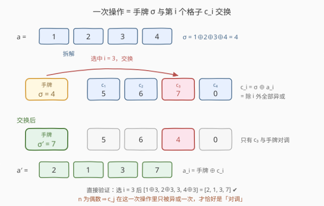
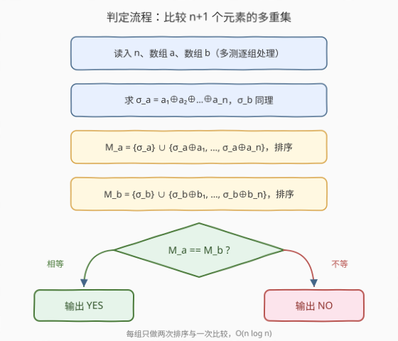
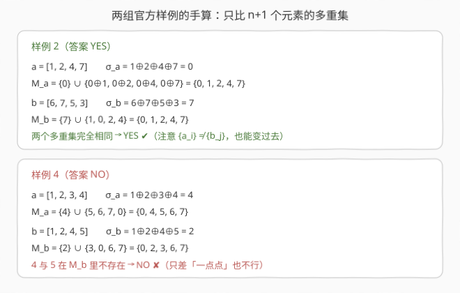
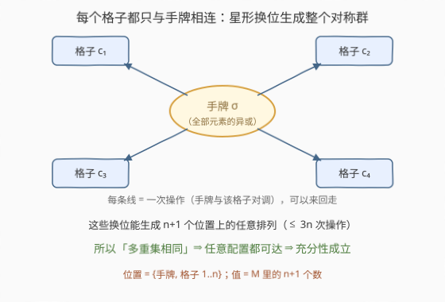

# Codeforces 2254F 甩鞭 题解

## 1. 题目概述

- **标题 / 题号**：甩鞭（Codeforces 2254F，英文名 Whiplash）
- **链接**：https://codeforces.com/problemset/problem/2254/F
- **来源**：Codeforces Round 1114 (Div. 3) · Problem F
- **难度**：1900
- **限制**：时间 2 s / 内存 256 MB
- **标签**：位运算（bitmasks）、构造、数学、排序（官方 tag：bitmasks、constructive algorithms、math、sortings）

**题意**：给定一个**偶数** $n$ 与两个长度均为 $n$ 的非负整数数组 $a$、$b$。允许执行任意多次（含 $0$ 次）如下操作：

- 选一个下标 $i$（$1 \le i \le n$）；
- 对所有 $j \ne i$，把 $a_j$ 换成 $a_j \oplus a_i$；
- $a_i$ 本身**不变**。

问能否把 $a$ 变成 $b$。多测：第一行 $t$，每组给 $n$、数组 $a$、数组 $b$，逐组输出 `YES` / `NO`。

**约束**：

- $2 \le n \le 2 \times 10^5$，且 **$n$ 一定是偶数**
- $0 \le a_i, b_i < 2^{30}$
- $t \le 10^4$，$\sum n \le 2 \times 10^5$（多测总量约束决定复杂度上限）
- 只问「是否存在」，**不要求**输出操作序列；操作次数不限

## 2. 示例

官方样例（输入 / 输出原样）：

```text
输入：
6
2
1 2
1 0
4
1 2 4 7
6 7 5 3
4
1 2 4 8
8 4 2 1
4
1 2 3 4
1 2 4 5
4
1 2 0 3
3 3 0 3
6
3 5 6 9 10 12
6 5 3 12 15 9

输出：
NO
YES
YES
NO
NO
YES
```

逐个对照：第 1 组 `[1,2]` 无法变成 `[1,0]`；第 2 组题面给了三步（选 $i=2,3,4$）；第 3 组给了六步（$i=1,2,3,2,4,1$）。注意第 2 组里 $a$ 与 $b$ 的**元素集合完全不同**却仍然可行，这是本题的关键信号——不要被「是否只差一个排列」误导。

补一组自造数据（覆盖 $n=2$ 的两种判定与一次真实操作；其中第 3 组就是把 `[1,2,4,7]` 执行一次 $i=1$ 得到的 `[1,3,5,6]`）：

```text
输入：
3
2
1 2
2 1
2
1 2
0 3
4
1 2 4 7
1 3 5 6

输出：
YES
NO
YES
```

## 3. 解题思路

### 3.1 暴力思路

最直接的想法是把「可达」看成一个图：节点是所有数组，边是一次操作，从 $a$ 出发 BFS 看能否到 $b$。由于异或只会把数值留在原值域的位宽内，状态数有限，BFS 一定终止；但状态数最多 $2^{30n}$；即使把值域压到 $2$ 位、$n=6$，也有 $4^6 = 4096$ 个状态（这正是后文对拍用的规模），稍一放大就爆炸。

也可以从线性代数看：对每个二进制位，一次操作都是一个固定的 $n \times n$ 的 $\mathbb{F}_2$ 矩阵 $M_i$；所有可达结果 = 群 $\langle M_1, \dots, M_n\rangle$ 作用在 $a$ 上的轨道。这个群最大可达 $(n+1)!$ 阶（下一节会看到为什么），枚举轨道同样不可行。

所以正解必须是「找一个轨道不变量，并证明它也是充分的」。

### 3.2 核心观察：把数组拆成「一张手牌 + n 个格子」



记

$$\sigma = a_1 \oplus a_2 \oplus \cdots \oplus a_n, \qquad c_i = \sigma \oplus a_i = \bigoplus_{j \ne i} a_j .$$

即 $\sigma$ 是**全体异或**，$c_i$ 是**去掉 $i$ 后剩下的异或**。于是数组可以被无损地还原：$a_i = \sigma \oplus c_i$。把 $\sigma$ 想成手上临时拿的一张牌，$c_1, \dots, c_n$ 想成 $n$ 个格子里的数。

**一次操作 $i$ 到底做了什么**？设操作后数组为 $a'$，新总异或为 $\sigma'$：

$$\sigma' = a_i \oplus \bigoplus_{j \ne i}\bigl(a_j \oplus a_i\bigr) = a_i \oplus \Bigl(\bigoplus_{j \ne i} a_j\Bigr) \oplus \bigl(\underbrace{a_i \oplus \cdots \oplus a_i}_{n-1 \text{ 个}}\bigr) .$$

因为 $n$ 是**偶数**，$n-1$ 是奇数，最后那串 $a_i$ 整体等于 $a_i$，与开头那个 $a_i$ 抵消：

$$\sigma' = \bigoplus_{j \ne i} a_j = c_i .$$

再算各格子：

$$c_i' = \sigma' \oplus a_i' = c_i \oplus a_i = \sigma, \qquad c_j' = \sigma' \oplus a_j' = c_i \oplus a_j \oplus a_i = \sigma \oplus a_j = c_j \quad (j \ne i).$$

结论非常干净：**操作 $i$ 就是把「手牌 $\sigma$」与「第 $i$ 个格子 $c_i$」对调**，其余格子一动不动。

于是 $n+1$ 个数组成的多重集

$$M(a) = \{\sigma\} \cup \{c_1, c_2, \dots, c_n\}$$

在每次操作下只是被重新排列，因此**绝不改变**。反之，只要两个数组的 $M$ 相同，就一定能把配置排成目标样子——因为「手牌与任一格子对调」这 $n$ 种换位生成整个对称群（第 5 节引理 4）。

> 💡 等价说法：$M(a)$ 就是把 $\{0, a_1, a_2, \dots, a_n\}$ 这 $n+1$ 个数**整体异或上 $\sigma$**。所以判定可以写成「$M(a)$ 与 $M(b)$ 作为多重集相等」。注意 $\sigma$ 本身也在里面，不能漏。

### 3.3 算法流程



1. 读入 $n$、$a$、$b$；
2. 求 $\sigma_a = a_1 \oplus \cdots \oplus a_n$，$\sigma_b$ 同理；
3. 构造 $M_a$：$\sigma_a$ 与每个 $\sigma_a \oplus a_i$，共 $n+1$ 个数；对 $b$ 构造 $M_b$；
4. 两者分别排序，逐位比较，相等输出 `YES`，否则 `NO`。

排序把多重集比较变成逐元素比较，$O(n \log n)$；用 $n+1$ 长度而不是 $n$，是本题唯一容易写错的规模细节。

### 3.4 示例演算



- **样例 2**：$a=[1,2,4,7]$，$\sigma_a = 0$，$M_a = \{0\} \cup \{1,2,4,7\}$；$b=[6,7,5,3]$，$\sigma_b = 7$，$M_b = \{7\} \cup \{1,0,2,4\}$。两个多重集都是 $\{0,1,2,4,7\}$ → `YES`。
- **样例 4**：$a=[1,2,3,4]$，$\sigma_a = 4$，$M_a = \{0,4,5,6,7\}$；$b=[1,2,4,5]$，$\sigma_b = 2$，$M_b = \{0,2,3,6,7\}$。$4,5 \notin M_b$ → `NO`。

$n=2$ 时有更漂亮的形式：$\sigma = a_1 \oplus a_2$，两个格子正好是 $a_2$ 与 $a_1$，因此

$$M(a) = \{a_1,\ a_2,\ a_1 \oplus a_2\},$$

即「两数本身 + 它们的异或」。用它能一眼看出第 1 组样例 $M_a=\{1,2,3\}$、$M_b=\{1,0,1\}$ 不同，答案为 `NO`。

## 4. 算法细节

1. **必须把 $\sigma$ 放进多重集**。$M$ 有 $n+1$ 个元素，数组要开 $n+1$；若只放 $n$ 个格子，由第 5 节推论，$n$ 为偶数时判定会退化成「比较 $\{a_i\}$ 与 $\{b_j\}$」——样例 2、6 会被误判成 `NO`。
2. **$n$ 为偶数是全题的支点**。$\sigma'$ 的推导里用了「$n-1$ 个 $a_i$ 异或起来仍是 $a_i$」；若 $n$ 为奇数，$\sigma' = \sigma$ 恒定，操作就不再是交换，整个分析作废。题目保证 $n$ 偶数，代码不必特判，但不要把它当成「无用条件」。
3. **值域只用 30 位**，`int` 足够，异或不会溢出；只有当你把结论推广到 $2^{60}$ 值域时才需要 `long long`。
4. **判定用排序，不用哈希**：排序是确定性做法；若想做到期望 $O(n)$，可给每个数值赋一个随机 64 位标签、把多重集映射成标签异或和，但那样正确性变成概率性的，本题 $O(n \log n)$ 完全够用，没必要。
5. **多测重置**：$\sigma_a, \sigma_b$ 必须在每组内重新求（用局部变量最省心）；$n$ 每次重新读，别沿用上一组。
6. **一次操作是自逆的**（同一 $i$ 做两次等于没做），所以「任意多次」等价于「任意多个不同下标的排列组合」，这保证搜索空间就是轨道本身。
7. **I/O**：输入规模 $\sum n \le 2 \times 10^5$，即最多 $4 \times 10^5$ 个整数，`cin` 配 `sync_with_stdio(false)` 在 Codeforces 的 GCC 上约几十毫秒；本文第 6 节记录了本机 iostream 偏慢的实测，若在慢 I/O 环境可换成 `fread` 手写读入。
8. **可选剪枝**：先判 `a == b` 直接 `YES`（$0$ 次操作），能省掉交换顺序完全相同时的排序，但正确性上没必要。

## 5. 正确性证明

**引理 1（单次操作 = 交换手牌与格子）**：设 $n$ 为偶数，$a$ 执行操作 $i$ 后得到 $a'$，$\sigma, c$ 与 $\sigma', c'$ 按 3.2 节定义，则 $\sigma' = c_i$，$c_i' = \sigma$，$c_j' = c_j\ (j \ne i)$。

**证明**：$a_i' = a_i$，$a_j' = a_j \oplus a_i$（$j \ne i$）。于是 $\sigma' = a_i \oplus \bigoplus_{j\ne i}(a_j \oplus a_i) = a_i \oplus \bigoplus_{j \ne i} a_j \oplus a_i = \bigoplus_{j\ne i} a_j = c_i$（第三个等号用到 $n-1$ 为奇数，那串 $a_i$ 整体仍是 $a_i$）；$c_i' = \sigma' \oplus a_i' = c_i \oplus a_i = \sigma$；$c_j' = \sigma' \oplus a_j' = c_i \oplus a_j \oplus a_i = \sigma \oplus a_j = c_j$。∎

**引理 2（$M$ 是不变量 / 必要性）**：对任意操作序列，$M(a)$ 作为多重集不变，故 $a$ 能变成 $b$ 蕴含 $M(a) = M(b)$。

**证明**：引理 1 说明一次操作只是把 $\{\sigma, c_1, \dots, c_n\}$ 中的两个元素互换，多重集不变；对操作次数归纳即得。∎

**引理 3（配置与数组的对应）**：称配置 $(h,\ s_1, \dots, s_n)$ **合法**，若 $h = s_1 \oplus \cdots \oplus s_n$（等价地：$n+1$ 个值的异或为 $0$）。则 $a_i = h \oplus s_i$ 给出「合法配置」与「数组」之间的双射，逆映射为 $h = \sigma(a)$、$s_i = \sigma(a) \oplus a_i$，且数组所对应配置的多重集恰为 $M(a)$。

**证明**：设配置合法，则 $a$ 的总异或 $\sigma(a) = \bigoplus_i (h \oplus s_i) = (n \bmod 2)\,h \oplus \bigoplus_i s_i = \bigoplus_i s_i = h$（$n$ 偶，再用合法性）。于是逆映射给出 $h' = \sigma(a) = h$ 与 $s_i' = \sigma(a) \oplus a_i = h \oplus h \oplus s_i = s_i$，两映射互逆；配置多重集是 $\{h\} \cup \{s_1,\dots,s_n\} = \{\sigma\} \cup \{\sigma \oplus a_i\} = M(a)$。∎

**引理 4（轨道就是全部赋值）**：操作可达的配置集合恰为「把 $M(a)$ 的 $n+1$ 个值任意分配给 $n+1$ 个位置」所得的全部配置，且任一目标配置可在 $\le 3n$ 步内到达。

**证明**：记位置集合 $P = \{\text{手牌}, 1, \dots, n\}$。一次操作 $i$ 就是把 $P$ 中「手牌」与「位置 $i$」两个位置上的值互换，即作用一个换位 $(\text{手牌}, i)$。这些换位生成整个对称群 $S_{n+1}$（任意换位 $(p,q) = (\text{手牌},p)(\text{手牌},q)(\text{手牌},p)$），而 $S_{n+1}$ 在「把固定多重集的 $n+1$ 个值分配到 $n+1$ 个位置」上传递（相同数值之间可任意对应），故一切赋值都可达。另一方面

$$\bigoplus_{x \in M(a)} x = \sigma \oplus \bigoplus_i (\sigma \oplus a_i) = \sigma \oplus \bigl((n \bmod 2)\,\sigma \oplus \sigma\bigr) = \sigma \oplus \sigma = 0 \quad (n \text{ 偶}),$$

所以 $M(a)$ 的**任意**分配都是引理 3 意义下的合法配置，都对应一个真实数组——中间状态不会掉出数组的世界。最后，任一排列是 $\le n$ 个换位的乘积，每个换位拆成 $3$ 个星形换位，故总步数 $\le 3n$。∎

**定理**：$a$ 能变成 $b$ 当且仅当 $M(a) = M(b)$（作为多重集）。

**证明**：必要性即引理 2。充分性：设 $M(a) = M(b)$。由引理 3，$a$ 对应配置 $X_a$（多重集 $M(a)$），$b$ 对应配置 $X_b$（多重集 $M(b)$）。既然两个多重集相等，$X_b$ 就是「把 $M(a)$ 的 $n+1$ 个值分配给 $n+1$ 个位置」的一种赋值，由引理 4 它可从 $X_a$ 出发在 $\le 3n$ 步内到达，每一步都是合法操作；又由引理 3 双射，走完这串操作后数组恰为 $b$。∎

**推论**：$n$ 为偶数时，$\{c^a_i\} = \{c^b_j\}$ 当且仅当 $\{a_i\} = \{b_j\}$。即「只比较 $n$ 个格子」是错误做法，它恰好退化成比较原数组的多重集。

**证明**：$c^a_i = \sigma_a \oplus a_i$，故 $\{c^a\} = \sigma_a \oplus \{a\}$。若 $\{c^a\} = \{c^b\}$，则 $b$ 是 $a$ 的整体异或平移：$b_j = a_j \oplus \delta$，其中 $\delta = \sigma_a \oplus \sigma_b$。取总异或得 $\sigma_b = \sigma_a \oplus (n \bmod 2)\delta = \sigma_a$（$n$ 偶），故 $\delta = 0$，$\{a\} = \{b\}$。反向显然。∎



## 6. 复杂度分析

- **时间**：每组求两次总异或 $O(n)$，构造 $M_a, M_b$ 各 $O(n)$，两次排序 $O(n \log n)$，比较 $O(n)$；单组 $O(n \log n)$，全部测试合计 $O\bigl(\sum n \log n\bigr) \le O(N \log N)$（$N = 2 \times 10^5$），常数约为 $2N\log N \approx 7 \times 10^6$ 次比较。
- **空间**：$O(n)$，只需两个长度为 $n+1$ 的 `int` 数组（C++ 约 $1.6$ MB，远低于 256 MB）；Python 侧是整数列表，同样只有 $O(n)$ 个对象。
- **实测**（本机，$\sum n = 2 \times 10^5$ 的两类极值输入）：单组 $n = 2 \times 10^5$ 时 C++（`iostream` 读入）约 $0.6$ s CPU、Python 约 $0.15$ s；$t = 10^4$、每组 $n = 20$ 时 C++ 约 $0.6$ s、Python 约 $0.10$ s。本机 `libc++` 的 `iostream` 解析 $4 \times 10^5$ 个整数就要约 $0.58$ s（`fread` 手写读入只需 $0.01$ s，排序与异或本身不到 $10$ ms），因此在 Codeforces 的 GCC 上同样代码是几十毫秒量级；即便按最慢的 iostream 计，相对 $2$ s 仍有 $3$ 倍以上余量。

## 7. 参考代码

### C++17

```cpp
#include <algorithm>
#include <iostream>
#include <vector>
using namespace std;

int main() {
    ios::sync_with_stdio(false);
    cin.tie(nullptr);

    int t;
    if (!(cin >> t)) return 0;                   // 空输入防御
    while (t--) {
        int n;
        cin >> n;
        vector<int> a(n), b(n);
        for (int i = 0; i < n; ++i) cin >> a[i];
        for (int i = 0; i < n; ++i) cin >> b[i];

        int sa = 0, sb = 0;                      // 每组重新求总异或
        for (int i = 0; i < n; ++i) { sa ^= a[i]; sb ^= b[i]; }

        // 不变量：{sigma} ∪ {sigma ^ a_i}，长度 n+1，别漏掉 sigma
        vector<int> ma(n + 1), mb(n + 1);
        ma[0] = sa;
        mb[0] = sb;
        for (int i = 0; i < n; ++i) {
            ma[i + 1] = sa ^ a[i];
            mb[i + 1] = sb ^ b[i];
        }

        sort(ma.begin(), ma.end());              // 多重集 -> 有序数组
        sort(mb.begin(), mb.end());
        cout << (ma == mb ? "YES" : "NO") << '\n';
    }
    return 0;
}
```

### Python3

```python
import sys


def main() -> None:
    data = sys.stdin.buffer.read().split()
    if not data:                                 # 空输入防御
        return
    t = int(data[0])
    pos = 1
    out = []
    for _ in range(t):
        n = int(data[pos]); pos += 1
        a = [int(x) for x in data[pos:pos + n]]; pos += n
        b = [int(x) for x in data[pos:pos + n]]; pos += n

        sa = sb = 0
        for x in a:
            sa ^= x
        for x in b:
            sb ^= x

        ma = [sa] + [sa ^ x for x in a]           # n+1 个元素，含 sa
        mb = [sb] + [sb ^ x for x in b]
        ma.sort()
        mb.sort()
        out.append("YES" if ma == mb else "NO")
    sys.stdout.write("\n".join(out) + "\n")


main()
```

## 8. 边界情况与易错点

1. **多重集少算一个元素**：写成 `ma[i] = sa ^ a[i]`（长度 $n$）是最常见的错法，它会退化成「比较 $\{a_i\}$」，样例 2、6 立刻 `WA`。
2. **$n = 2$ 的闭式**：$M = \{a_1, a_2, a_1 \oplus a_2\}$，用它可以手算校验小数据；例如 `[1,2]` 的三个数是 $\{1,2,3\}$，而 `[1,0]` 是 $\{1,0,1\}$，故第一组 `NO`。
3. **全 $0$ 数组**：$M$ 全是 $0$，只能到达全 $0$；从全 $5$ 出发也到不了「只有一个 $0$」的数组，别想当然认为可以「消元」。
4. **数组大小**：$n+1$，按 $n$ 开而多写一位会越界（UB 在本地可能不报错，交上去 `RE` 或答案错乱）。
5. **多测清零**：$sa, sb$ 用局部变量；若写成全局 `sum` 又在两组之间忘记归零，第 2 组起全错，而单组样例恰好能过。
6. **`a == b` 一定 `YES`**（$0$ 次操作）；因为 $M$ 是 $a$ 的函数，这一点由定理自动保证，不需要单独特判，但可以拿来自测。
7. **不要输出方案**：本题只问存在性，多打操作序列会 `WA`；每组恰好一行 `YES`/`NO`。
8. **溢出与位宽**：所有值 $< 2^{30}$，异或结果仍在 $[0, 2^{30})$，`int` 安全；但若把「值域推广到 $10^{18}$」则要换 `long long`（`int` 会截断，这是类型问题而非运算溢出）。

## 相关题目与扩展

- [Codeforces 2254E Chronostasis](https://codeforces.com/problemset/problem/2254/E)：同场 E 题，二分 + 数据结构，可与本题「先找不变量」的思路对照。
- [Codeforces 2254G Nightcrawler](https://codeforces.com/problemset/problem/2254/G)：同场压轴，树上的贪心 + 数据结构，本题的「操作 = 交换」技巧在那题里也有影子。
- [LeetCode 2433. 找出前缀异或的原始数组](https://leetcode.cn/problems/find-the-original-array-of-prefix-xor/)：前缀异或与还原，是本题 $a_i = \sigma \oplus c_i$ 式「双向还原」的一维版本。
- [LeetCode 1720. 解码异或后的数组](https://leetcode.cn/problems/decode-xored-array/)：由相邻异或还原整数组，训练「异或可逆」的直觉。

**延伸思考**：

- **$n$ 为奇数会怎样**？此时 $\sigma' = \sigma$（$n-1$ 为偶数，那串 $a_i$ 被消掉两次），总异或恒定，操作不再是交换，$c_j$ 会集体异或上 $a_i$。不变量需要重新找，本题的全部结论都建立在 $n$ 偶之上——这正说明「$n$ 是偶数」是实质条件。
- **要输出方案怎么办**？由引理 4 的构造：每次把需要的值换到手牌、再放到目标格子，至多 $3n$ 步，$O(n)$ 规模，可直接实现。
- **能否做到期望 $O(n)$**？给每个数值赋独立随机 $64$ 位标签，用「标签异或和 + 标签和」代替排序，期望 $O(n)$；代价是把确定性正确性换成概率正确性。
