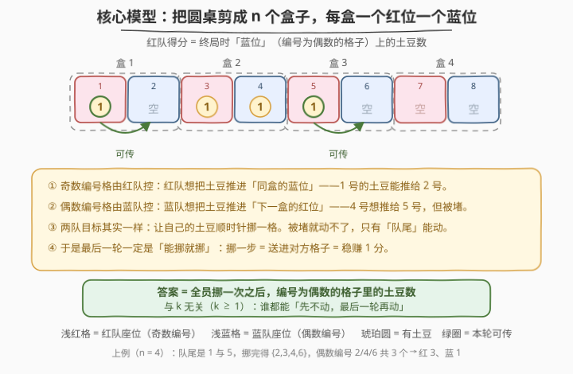
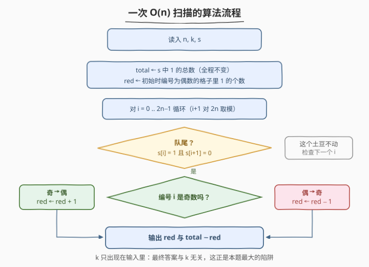
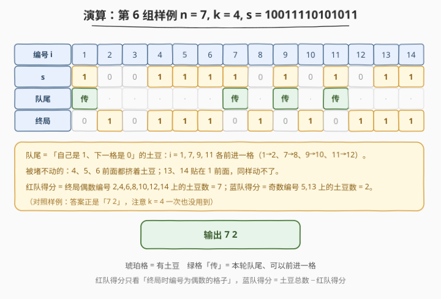

# Codeforces 2255A 妖精仓库的烫手山芋 题解

## 1. 题目概述

- **标题 / 题号**：妖精仓库的烫手山芋（Codeforces 2255A，英文名 Hot Potatoes at the Fairy Warehouse）
- **链接**：https://codeforces.com/problemset/problem/2255/A
- **来源**：Codeforces Round 1116 (Div. 1) · Problem A
- **难度**：1200（500 分）
- **限制**：时间 2 s / 内存 256 MB
- **标签**：博弈论，贪心，实现

**题意**：$2n$ 个妖精围成一圈坐在编号 $1 \sim 2n$ 的座位上，奇数编号属红队、偶数编号属蓝队。初始用一个长度 $2n$ 的 01 串给出谁手上有土豆（$s_i=1$ 表示 $i$ 号有）。游戏进行 $k$ 轮，每轮**所有持土豆者同时**决定：留着，或者把土豆递给顺时针的下一个妖精——前提是那一格在**本轮开始时**没有土豆（否则只能留着）。因此任意时刻每人至多一个土豆。

$k$ 轮结束后，仍拿着土豆的人被淘汰。**红队得分 = 被淘汰的蓝队人数**，即终局落在偶数编号上的土豆数；蓝队得分 = 落在奇数编号上的土豆数。两队都掌握全部信息、各自最大化本方得分，求双方得分（最优对局下的得分唯一确定）。多测。

**约束**：

- $1 \le t \le 10^4$，$1 \le n \le 10^5$，$1 \le k \le 10^9$
- $\sum n \le 10^5$，字符串总长度 $2\sum n \le 2\times 10^5$
- $s$ 只含 `0` / `1`，长度恰为 $2n$
- $k$ 高达 $10^9$，而总规模只有 $2\times 10^5$：正解必须是 $O(n)$ 且**不依赖 $k$ 的大小**
- 答案 $\le 2n \le 2\times 10^5$，`int` 足够

## 2. 示例

官方样例（输入 / 输出原样）：

```text
输入：
6
2 1
1000
2 1
0011
3 2
101110
5 100000
1111111111
5 100000
0000000000
7 4
10011110101011

输出：
1 0
0 2
3 1
5 5
0 0
7 2
```

逐组说明：

| 用例 | 关键现象 | 答案（红，蓝） |
|------|----------|----------------|
| `n=2, s=1000` | 1 号（红）把土豆推给 2 号（蓝），红队拿到 1 分 | `1 0` |
| `n=2, s=0011` | 4 号（蓝）推给 1 号；3 号想推给 4 号但 4 号本轮开始时有土豆，被堵 | `0 2` |
| `n=3, s=101110` | $k=2$：红队第一轮只推 1→2，第二轮（最后一轮）全员能推就推 | `3 1` |
| `n=5, s=1111111111` | 占满整圈，谁也动不了，红队恰好拿到全部 5 个偶数位 | `5 5` |
| `n=5, s=0000000000` | 没有土豆 | `0 0` |
| `n=7, s=10011110101011` | $k=4$，队尾是 $1,7,9,11$，各前进一格后偶数位有 7 个 | `7 2` |

再补一组自造数据（$n=2, k=1, s=$ `1010`）：1 号、3 号都是队尾，各推一格变成 `0101`，落在 2 号和 4 号上，红队得 2 分，输出 `2 0`。

## 3. 解题思路

### 3.1 暴力思路

最直接的做法是博弈搜索：状态是「土豆位置集合 + 剩余轮数」，每轮枚举双方所有动作组合（红队每个可动土豆动/不动、蓝队同理），再做极小极大。状态量与 $k$ 都极大——$k \le 10^9$、$2n \le 2\times 10^5$，连「把 $k$ 轮模拟一遍」都做不到，更不用说搜索；即使只想算单轮最优，动作组合也有 $\Theta(4^n)$ 种。突破口是找**不变量**：本题的答案其实与 $k$ 完全无关，$O(n)$ 扫一遍即可。

### 3.2 核心观察：最后一轮全员挪动，答案与 k 无关



先只看**最后一轮**。设这一轮开始时土豆集合为 $S$。注意此时「能传」的判据只取决于本轮开始时的局面，与其他人的选择无关，所以每个土豆的动与不动是**互相独立**的决策。而一个能从 $i$ 传到 $i+1$ 的土豆：

- 若 $i$ 是奇数编号（红队持有），传过去就落在偶数编号上，红队多得 1 分；
- 若 $i$ 是偶数编号（蓝队持有），传过去落在奇数编号上，蓝队多得 1 分。

也就是说，**传球永远是把自己的土豆送进对方的格子，因此对自己严格有利**；控制它的队一定会传。于是最后一轮的结果完全确定：**所有「下一格为空」的土豆都前进一格**。记这个「全员挪一次」之后的局面为 $T(S)$，并定义

$$f(S)=\#\{i\in S:\ i \text{ 为奇数且 } i+1\notin S\}+\#\{i\in S:\ i \text{ 为偶数且 } i+1\in S\},$$

即 $T(S)$ 中落在偶数编号上的土豆数。那么 $k$ 轮对局的得分就是 $f(S_{k-1})$，其中 $S_{k-1}$ 是最后一轮开始时的局面。

接下来是关键引理：**只要一方在某一轮全体按兵不动，局面「全员挪一次」的得分 $f$ 就不会朝这一方不利的方向变化**。据此两队都可以选择「先全体不动，把力量留到最后一轮」，于是任何 $k \ge 1$ 的最优值都恰好等于 $f(S_0)$。直觉上这条引理就是「**堵人不赚分**」：想堵住对手的土豆，必须把己方一个土豆塞到它正前方那一格，而那一格正是对手原本要占的、会给对手计分的位置，一进一出正好抵消。

### 3.3 算法流程



既然答案就是 $f(S_0)$，实现只需一次线性扫描：

1. `total` ← $s$ 中 `1` 的个数。它是**不变量**（传球不改变土豆总数），且 红队得分 + 蓝队得分 = `total`。
2. `red` ← 初始时**编号为偶数**的格子上的 `1` 的个数（下标从 0 开始时是奇数下标）。
3. 对每个 $i$ 判断它是不是**队尾**：$s_i=1$ 且 $s_{i+1}=0$（下标取模 $2n$）。若是，这个土豆会从 $i$ 挪到 $i+1$——$i$ 为奇数编号时 `red` 加 1，为偶数编号时 `red` 减 1。这些修正互不干扰：目标格在本轮开始时必为空，而另一个队尾自己占着 1，不可能成为目标。
4. 输出 `red` 与 `total - red`。

### 3.4 示例演算



以第 6 组 $n=7,\ k=4,\ s=$ `10011110101011` 为例：

- 队尾是 $1, 7, 9, 11$（自己是 1、下一格是 0），它们各前进一格：$1\to2,\ 7\to8,\ 9\to10,\ 11\to12$；
- 被堵的是 $4,5,6$（前面挤着土豆）以及 $13,14$（$14$ 的下一格正是有土豆的 $1$ 号）；
- 终局为 $\{2,4,5,6,8,10,12,13,14\}$，其中偶数编号 $2,4,6,8,10,12,14$ 共 $7$ 个 → 红队 7 分；
- 奇数编号只剩 $5,13$ 两个 → 蓝队 2 分，输出 `7 2`，与样例一致。

顺便对照第 3 组 $n=3,\ k=2,\ s=$ `101110`：$f(S_0)=3$（队尾 $1,5$ 各挪一格）。红队的实际走法正是「第一轮只推 $1\to2$、留着 5 不动」，第二轮 $5\to6$，终局 $\{2,3,4,6\}$ 仍是 3 个偶数位——无论 $k=1$ 还是 $k=2$ 都是 3 分，印证了「答案与 $k$ 无关」。

## 4. 算法细节

1. **多测清空**：只用局部变量，每组重新统计 `total` 与 `red`；$\sum n \le 10^5$ 保证总时间是线性的。
2. **环形下标**：$i+1$ 必须对 $2n$ 取模（`(i+1) % P`），否则最后一位的队尾会被漏判 / 越界。
3. **下标与编号错位**：编号 $=$ 下标 $+1$，所以「编号为偶数」等价于「下标为奇数」。这里写反会让红蓝得分整体互换，是最常见的一处 WA。
4. **$k$ 用 `long long` 读入但不参与运算**：$k \le 10^9$ 放进 `int` 也不会溢出，但读成 `long long` 更稳，也提醒自己「不要去模拟 $k$ 轮」。
5. **不要写无符号减法**：蓝队得分用 `total - red`，两个量都保持有符号 `int/long long`，避免 $0-1$ 回绕。
6. **I/O 与「别多做」**：总输入仅 $2\times 10^5$ 字符，`std::ios::sync_with_stdio(false)` + `cin` 足够（Python 用 `sys.stdin.buffer.read().split()`）；不必去做周期分析或矩阵快速幂——值是 $k$ 的常函数。

## 5. 正确性证明

**记号**：编号按模 $2n$ 理解（$2n$ 的下一格是 $1$）。$S$ 为当前有土豆的格子集合，$m=|S|$，传球不改变 $m$。对 $i\in S$，若 $i+1\notin S$ 则称 $i$ 为**队尾**（该土豆本轮可以选择前进）。$f(S)$ 如上定义，即 $T(S)$ 中偶数编号格子的土豆数。

**引理 1（最后一轮）**：若这是最后一轮，则每个队尾土豆都会前进，其余土豆不动；本轮结束时红队得分为 $f(S)$。

**证明**：能否前进只取决于本轮开始时的局面，与同桌其他人的选择无关。若 $i$ 是队尾：$i$ 为奇数时前进使该土豆落在偶数编号上，红队多得 1 分；$i$ 为偶数时前进使蓝队多得 1 分。总之「动」比「不动」对该土豆的控制方严格多 1 分，故必动。不是队尾的土豆根本不满足传球条件，只能不动。于是终局恰为 $T(S)$，红队得分即 $f(S)$。∎

**引理 2（红队全体不动时，$f$ 不减）**：设红队（控制奇数格土豆的一方）本轮一个土豆都不传，蓝队任选合法动作，得到 $S'$，则 $f(S')\ge f(S)$。

**证明**：蓝队能动的土豆都在偶数格上。把「本轮真的前进了」的偶数格按 $+2$ 连成极大链 $e,\,e+2,\,\dots,\,e+2(t-1)$（链内每个偶数格都有土豆，且它们的下一格在本轮开始时都是空的）；记链上偶数格集合为 $C$，它们的下一格（奇数格，本轮被填入）集合为 $C+1$。逐个比较各项对 $f$ 的贡献（$f$ 只与该格有无土豆、下一格有无土豆有关）：

- 链上的偶数格 $e+2j\in C$：动之前它在偶数格、下一格在 $C+1$ 中为空，贡献 $0$；动之后变空，贡献 $0$。差为 $0$。
- 链上的目标格 $e+2j+1\in C+1$：动之前为空，贡献 $0$；动之后有土豆。若 $j<t-1$，它的下一格 $e+2j+2\in C$ 已空，贡献 $1$；若 $j=t-1$，它的下一格是 $e+2t\notin C$，贡献为 $[e+2t\notin S']$。共 $(t-1)+[e+2t\notin S']$。
- 链头身后的奇数格 $e-1$：若 $e-1\in S$，动之前它被 $e$ 堵住、贡献 $0$，动之后 $e$ 已空、它成为队尾、贡献 $1$；若 $e-1\notin S$ 则差为 $0$。该项为 $[e-1\in S]$。

其余土豆的「自身与下一格是否有土豆」都没变，贡献不变。故

$$f(S')-f(S)=[e-1\in S]+(t-1)+[e+2t\notin S']\ \ge 0. \qquad\blacksquare$$

**引理 3（对称版）**：设蓝队全体不动、红队任选合法动作得到 $S'$，则 $f(S')\le f(S)$。

**证明**：把圆桌整体旋转一格（$i\mapsto i+1$），奇偶与红蓝角色互换、$f$ 变成 $m-f$；对旋转后的局面用引理 2 得 $m-f(S')\ge m-f(S)$，即 $f(S')\le f(S)$。∎

**定理**：对任意初始局面 $S_0$ 与任意 $k\ge 1$，双方最优对局下红队得分恰为 $f(S_0)$（蓝队为 $m-f(S_0)$）。

**证明**：对轮数 $k$ 归纳。$k=1$ 时由引理 1 直接得到 $f(S_0)$。设 $k>1$ 且结论对 $k-1$ 轮成立。

- 红队策略：第一轮全体不动（留土豆是合法动作），之后按 $k-1$ 轮的最优策略。由引理 2，无论蓝队第一轮怎么走，新局面的得分 $f(S_1)\ge f(S_0)$；再由归纳假设，红队能在剩余 $k-1$ 轮里保证 $f(S_1)$ 分。所以红队能保证得分 $\ge f(S_0)$。
- 蓝队策略：对称地，蓝队第一轮全体不动，由引理 3 得 $f(S_1)\le f(S_0)$，再由归纳假设保证红队得分 $\le f(S_0)$。

两边的保证把值夹在 $f(S_0)$ 上，故最优值为 $f(S_0)$，且双方各有一套保证它的策略。∎

## 6. 复杂度分析

- **时间**：每组数据两遍线性扫描，$O(n)$。总计 $O\!\left(\sum n\right)\le 10^5$ 次基本操作，与 $k$ 完全无关。
- **空间**：除输入字符串外只用 $O(1)$ 个计数变量（C++ 中是 `total`、`red`、循环下标）。
- **对照时限**：$2$ s 时限下，$2\times 10^5$ 字符的读入加扫描是微秒级工作。本地实测（Apple clang 编译、$t=10^4$ 且 $\sum n=10^5$ 的最大输入）耗时约 $40$ ms，余量在两个数量级以上；Python 版同样约 $60$ ms。

## 7. 参考代码

### C++17

```cpp
#include <bits/stdc++.h>
using namespace std;

int main() {
    ios::sync_with_stdio(false);
    cin.tie(nullptr);

    int T;
    if (!(cin >> T)) return 0;              // 空输入防护
    while (T--) {
        int n;
        long long k;                        // k 只读不用：答案与 k 无关
        cin >> n >> k;
        string s;
        cin >> s;
        int P = 2 * n;

        long long total = 0, red = 0;
        for (int i = 0; i < P; ++i) {
            if (s[i] == '1') {
                ++total;
                if (i & 1) ++red;           // 下标为奇 = 编号为偶 = 蓝队成员被淘汰
            }
        }
        // 队尾（自己是 1、下一格是 0）各前进一格，逐项修正 red
        for (int i = 0; i < P; ++i) {
            if (s[i] == '1' && s[(i + 1) % P] == '0') {
                if (i & 1) --red;           // 编号偶 -> 编号奇：红队少 1 分
                else       ++red;           // 编号奇 -> 编号偶：红队多 1 分
            }
        }
        cout << red << ' ' << (total - red) << '\n';
    }
    return 0;
}
```

### Python3

```python
import sys


def main() -> None:
    data = sys.stdin.buffer.read().split()
    if not data:
        return
    t = int(data[0])
    pos = 1
    out = []
    for _ in range(t):
        n = int(data[pos])
        pos += 1
        k = int(data[pos])          # 读入但不用：答案与 k 无关
        pos += 1
        s = data[pos].decode()
        pos += 1
        m = 2 * n

        total = s.count('1')
        red = sum(1 for i in range(m) if (i & 1) and s[i] == '1')
        for i in range(m):
            if s[i] == '1' and s[(i + 1) % m] == '0':
                if i & 1:
                    red -= 1
                else:
                    red += 1
        out.append("%d %d" % (red, total - red))
    sys.stdout.write("\n".join(out) + "\n")


main()
```

## 8. 边界情况与易错点

1. **占满整圈（全 `1`）**：没有任何队尾，第 3 步的循环一次也不触发，答案退化为「偶数编号上有几个 1」$=n$，红蓝各 $n$ 分——样例 4 正是这种情形，不要以为「全 1 就没法得分」。
2. **全 `0`**：`total = red = 0`，输出 `0 0`，不要因为取模或循环写错而越界。
3. **$n=1$（只有 2 个座位）**：`10` → 1 号推给 2 号，红队 1 分（`1 0`）；`01` → 蓝队 1 分（`0 1`）；`11` → 谁都不能动，红队 1 分（`1 1`）。环形取模在这里最容易出错：$2n=2$ 时 $i+1$ 必须回到 $0$。
4. **队尾正好在最后一位**：如 `s = 0111`（$n=2$），队尾是 $4$，它要传给 $1$ 号——环形取模 `(i+1) % P` 与「编号 = 下标 + 1」两处换算必须同时正确。
5. **把 $k$ 当成关键变量**：本题最大的陷阱。$k=1$ 与 $k=10^9$ 的答案完全相同；不要写模拟 $k$ 轮、也不要去找「周期」。
6. **输出顺序与多测换行**：先红队后蓝队，蓝队得分务必用 `total - red`；每组一行、组间不加空行，$\sum n$ 的限制也意味着不能写 $O(n^2)$ 的「对每个队尾重扫一遍」。

## 相关题目与扩展

- [Codeforces 2256C Hot Potatoes at the Fairy Warehouse](https://codeforces.com/problemset/problem/2256/C)：本题在 Div. 2 的同题版本，可用来确认自己没把队伍对应关系搞反。
- [Codeforces 2255E1 What Will Remain at the End? (Easy Version)](https://codeforces.com/problemset/problem/2255/E1)：同一场的后继题，继续研究这种「土豆往前挤」的演化过程。
- [Codeforces 2255E2 What Will Remain at the End? (Hard Version)](https://codeforces.com/problemset/problem/2255/E2)：把 E1 的暴力换成数据结构，适合在理解本题的「队尾 / 空洞」模型后继续做。
- [LeetCode 292. Nim 游戏](https://leetcode.cn/problems/nim-game/)：同样是「局数看起来很大，其实被奇偶 / 不变量直接吃掉」的博弈结论题。

**延伸思考**：

1. **如果每轮必须传（能传就不能留）**：局面就变成确定性演化 $S_{r+1}=T(S_r)$，$k$ 轮后的红队得分是 $f(T^{k-1}(S_0))$，此时 $k$ 真的会影响答案，需要利用 $T$ 的周期性（环上空洞后移，周期 $\le 2n$）来处理。
2. **如果 $k=0$ 被允许**：答案就退化为初始偶数编号上的土豆数，可用来检查自己的下标换算是否写反。
3. **改约定会怎样**：若得分改为「自己被淘汰的人数」，传球就从「赚分」变成「送分」，拖延策略全部反转，分析要重做；而把两队换成任意「奇偶交替」的分组，结论仍成立——证明只用到「相邻两格分属不同队伍」这一事实。
