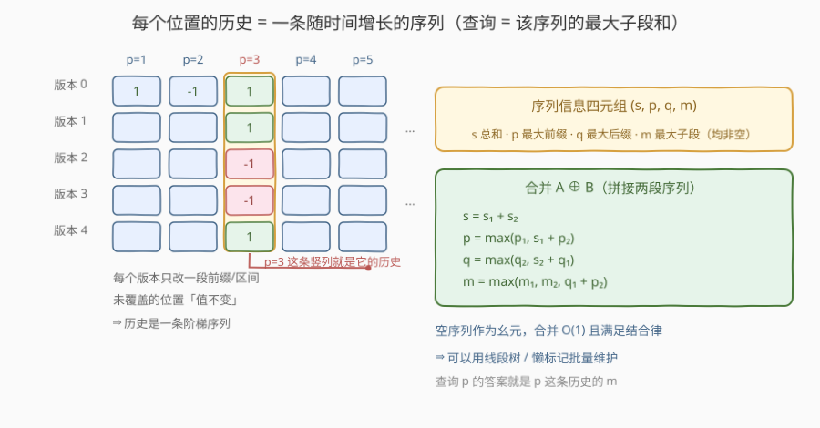
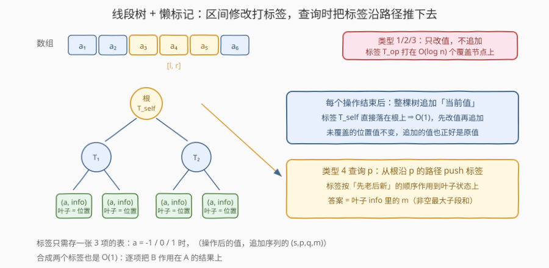
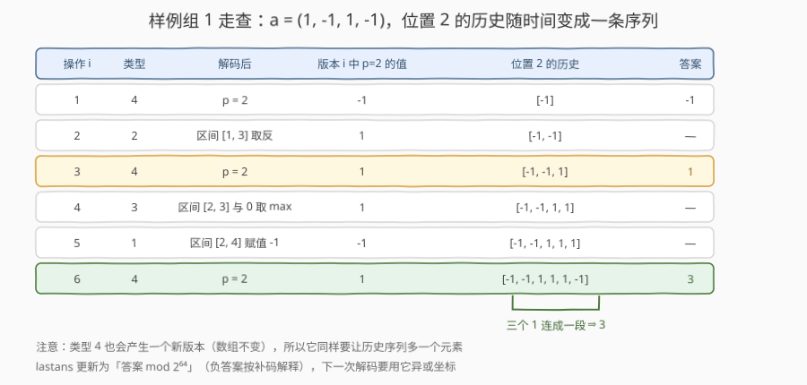

# Codeforces 2255E1 终末之时还剩下什么（简单版） 题解

## 1. 题目概述

- **标题 / 题号**：终末之时还剩下什么（简单版）（Codeforces 2255E1，英文名 What Will Remain at the End? (Easy Version)）
- **链接**：https://codeforces.com/problemset/problem/2255/E1
- **来源**：Codeforces Round 1116 (Div. 1) · Problem E1
- **难度**：2900
- **限制**：时间 3 s / 内存 256 MB
- **标签**：线段树、懒标记、区间修改与单点查询、最大子段和、序列幺半群、按值域分情况、强制在线解码

**题意**：维护长度为 $n$ 的数组，初始内容称为版本 $0$。之后 $q$ 次操作，第 $i$ 次由版本 $i-1$ 得到版本 $i$：

1. `1 l r x`：$a_k \gets x$，$l \le k \le r$；
2. `2 l r`：$a_k \gets -a_k$；
3. `3 l r`：$a_k \gets \max(a_k, 0)$；
4. `4 p`：取位置 $p$ 在版本 $0,1,\dots,i-1$ 中的值排成序列 $b_0,\dots,b_{i-1}$，输出其**非空**子段最大和。

类型 $1/2/3$ 改数组；类型 $4$ 不改数组，但**仍产生新版本**（版本 $i$ 与 $i-1$ 相同）。强制在线：$\mathrm{lastans}$ 初值 $0$，每次回答类型 $4$ 后令 $\mathrm{lastans} = (\text{答案} \bmod 2^{64})$，坐标 $y$ 按 $d(y) = ((y \oplus \mathrm{lastans}) \bmod n) + 1$ 解码，区间端点取解码值的 $\min$ 与 $\max$。

**约束**：

- $1 \le t \le 10^4$，$1 \le n, q \le 5\times 10^{5}$，$\sum n \le 5\times 10^{5}$，$\sum q \le 5\times 10^{5}$；
- 初始值 $a_i \in \{-1,0,1\}$，类型 $1$ 的 $x \in \{-1,0,1\}$（**与困难版的唯一区别**）；
- 编码坐标 $0 \le u, v < 2^{64}$，必须用 64 位无符号整数；
- 3 s 时限要求单次操作 $O(\log n)$ 且常数小。

## 2. 示例

```text
输入
2
4 8
1 -1 1 -1
4 1
2 18446744073709551615 18446744073709551613
4 18446744073709551614
3 0 3
1 0 2 -1
4 0
2 2 0
4 0
3 6
1 -1 1
4 0
1 0 3 -1
4 3
2 2 3
3 3 0
4 3

输出
-1
1
3
1
1
2
2
```

第一组数据全部围绕位置 $2$。首次查询时只有版本 $0$，历史 $[-1]$，答案 $-1$；随后 $\mathrm{lastans}=2^{64}-1$，后两行的坐标才解回合法区间。第三次查询前位置 $2$ 的历史是 $[-1,-1,1,1,1,-1]$，三个连续的 $1$ 给出答案 $3$。

## 3. 解题思路

### 3.1 暴力思路

把所有版本存下来：每次操作复制数组 $O(n)$，查询时扫位置 $p$ 的 $i$ 个历史值 $O(i)$，总 $O(nq+q^2)$，$n=q=5\times10^5$ 时是 $10^{11}$ 量级，不可行。只保存「每个位置的历史」也没用——逐位置维护仍是 $O(nq)$。

突破口是值域：$a_i$ 与 $x$ 只有 $\{-1,0,1\}$ 三种取值，于是任何一段操作对某个位置的影响只有三种情形，可以穷举成一张表。

### 3.2 核心观察：历史序列的四元组可以 $O(1)$ 合并



把操作拆成互不干扰的两件事：

- **改值**：只作用于 $[l,r]$（类型 $1/2/3$）；
- **追加**：每次操作结束后，所有位置把自己当前的值追加到历史末尾。

为什么是「所有位置」？版本 $i$ 是版本 $i-1$ 的副本：未被覆盖的位置值原地重复一次，被覆盖的位置追加修改后的新值。「先改值、再全局追加」恰好还原语义，类型 $4$ 也不例外（它不改值，但版本号加一，历史同样多一个元素）。

一条序列只需四元组 $(s,p,q,m)$：总和、最大非空前缀和、最大非空后缀和、最大非空子段和；空序列用哨兵表示（实现里是 $(0,-\infty,-\infty,-\infty)$，合并时先判空），它是幺元。首尾相接 $A \oplus B$：

$$
s = s_1+s_2,\quad p = \max(p_1,\ s_1+p_2),\quad q = \max(q_2,\ s_2+q_1),\quad m = \max(m_1,\ m_2,\ q_1+p_2)
$$

合并满足结合律、代价 $O(1)$——这就是「把一段操作压成信息、再塞进懒标记」的前提。

### 3.3 算法流程：把一段操作压成 3 项的表



**标签**描述连续若干步操作对某个位置的全部影响。位置状态是「当前值 $x$ + 历史信息 $I$」，而 $x$ 只有三种取值，所以标签就是长度 $3$ 的表：

$$
\mathrm{fin}[x] = \text{做完后的值},\qquad \mathrm{pre}[x] = \text{这段操作追加出的序列四元组}
$$

作用一次即 $(x, I) \mapsto (\mathrm{fin}[x],\ I \oplus \mathrm{pre}[x])$。标签 $A$（先）与 $B$（后）合成：

$$
R.\mathrm{fin}[x] = B.\mathrm{fin}\big[A.\mathrm{fin}[x]\big],\qquad R.\mathrm{pre}[x] = A.\mathrm{pre}[x] \oplus B.\mathrm{pre}\big[A.\mathrm{fin}[x]\big]
$$

即：先用 $A$ 把 $x$ 推到中间值，再让 $B$ 接着作用，追加序列按同样顺序拼接；合成 $O(1)$（三项各合并一次）。

于是只需一棵**只有懒标记、没有区间聚合**的线段树：

- 类型 $1/2/3$：把「纯改值」标签打在 $[l,r]$ 覆盖的 $O(\log n)$ 个节点上（**只改值，不追加**）；
- 每步收尾：把「追加当前值」标签打在整段上；把 $n$ 补到 $2$ 的幂后区间恰为 $[0,sz)$，即**根节点一次合成**，$O(1)$；
- 类型 $4$：从根沿 $p$ 的路径自上而下 push（先老后新），读叶子信息的 $m$。

四个基础标签（下标 $0,1,2$ 对应 $x=-1,0,1$）：

| 标签 | $\mathrm{fin}$ | $\mathrm{pre}$ |
|------|----------------|----------------|
| 取反 | $(1,0,-1)$ | 三个都为空 |
| $\max(\cdot,0)$ | $(0,0,1)$ | 三个都为空 |
| 赋值 $y$ | $(y,y,y)$ | 三个都为空 |
| 追加当前值 | $(-1,0,1)$ | $((-1,-1,-1,-1),\ (0,0,0,0),\ (1,1,1,1))$ |

### 3.4 示例演算



第一组数据 $a=(1,-1,1,-1)$，位置 $2$ 的历史演化：

| 操作 $i$ | 类型 | 解码结果 | 版本 $i$ 中 $p=2$ | 位置 $2$ 的历史 | 答案 |
|----------|------|----------|-------------------|------------------|------|
| 1 | 4 | $p=2$ | $-1$ | $[-1]$ | $-1$ |
| 2 | 2 | $[1,3]$ 取反 | $1$ | $[-1,-1]$ | — |
| 3 | 4 | $p=2$ | $1$ | $[-1,-1,1]$ | $1$ |
| 4 | 3 | $[2,3]$ 与 $0$ 取 $\max$ | $1$ | $[-1,-1,1,1]$ | — |
| 5 | 1 | $[2,4]$ 赋值 $-1$ | $-1$ | $[-1,-1,1,1,1]$ | — |
| 6 | 4 | $p=2$ | $1$ | $[-1,-1,1,1,1,-1]$ | $3$ |

第 $1$ 次查询后 $\mathrm{lastans}=2^{64}-1$，第 $2$ 行的 $2^{64}-1$、$2^{64}-3$ 才解回 $1$ 与 $3$；第 $3$ 次查询后又改成 $1$，后面所有解码随之变化。

## 4. 算法细节

1. **坐标一律无符号 64 位**：$u,v$ 与 $\mathrm{lastans}$ 都用 `unsigned long long`；答案为负时 `lastans = (unsigned long long)ans` 就是「$\bmod\ 2^{64}$ 的非负剩余」。
2. **类型 $4$ 也要追加**：它不改值，但版本号推进一格，历史必须多一个元素，否则后续查询整体错位。
3. **改值与追加拆成两个标签**：若把「改值 + 追加新值」塞进同一个区间标签，区间外的位置就没人追加；若把追加写进区间标签又会在全局追加时重复追加。正确顺序是「区间改值标签 → 根上全局追加标签」。
4. **合成顺序不能反**：$R.\mathrm{pre}[x] = A.\mathrm{pre}[x] \oplus B.\mathrm{pre}[A.\mathrm{fin}[x]]$；写反等于让较新的操作排到较老的位置。
5. **空序列哨兵**：没有追加时 `pre` 取 $(0,-\infty,-\infty,-\infty)$（实现里 $-\infty$ 用 `-(1<<29)`，因为答案绝对值不超过 $q$，不会混淆）；合并前先判空，避免哨兵参与加法。
6. **线段树形态**：$n$ 补到 $2$ 的幂 $sz$；迭代式线段树（ACL `lazy_segtree` 风格）在区间打标签前 push 两条边界路径，单点查询沿路径 push。叶子存「当前值 + 历史四元组」，内部节点只存标签。
7. **多测清空**：每组只重置 $[1,sz)$ 的标签（总代价 $O(\sum n)$），不要清整块数组。
8. **值域是前提**：`fin` 用 `signed char` 依赖 $x \in \{-1,0,1\}$；困难版值域到 $10^9$，必须换参数化标签。

## 5. 正确性证明

**引理 1（历史维护正确）**：处理完前 $i$ 次操作后，每个位置 $p$ 的叶子状态恰为「版本 $i$ 中 $p$ 的值」与「版本 $0..i$ 在 $p$ 上的值序列的四元组」。

**证明**：对 $i$ 归纳。$i=0$ 时初始化正确。设对 $i-1$ 成立。第 $i$ 次操作先在 $[l,r]$ 改值，这与版本 $i$ 的定义一致；随后全局追加当前值：$p \notin [l,r]$ 追加未变的值，$p \in [l,r]$ 追加改后的值，都等于版本 $i$ 中 $p$ 的值。故追加后四元组正是版本 $0..i$ 的序列信息。∎

**引理 2（合并公式正确）**：$A \oplus B$ 的四元组由 §3.2 公式给出，且 $m$ 等于拼接序列的非空最大子段和。

**证明**：拼接序列的子段分三类：整体在 $A$、整体在 $B$、跨越分界。前两类最大值是 $m_1,m_2$；跨界的子段必为「$A$ 的非空后缀 + $B$ 的非空前缀」，最大值为 $q_1+p_2$，故 $m=\max(m_1,m_2,q_1+p_2)$。前缀要么整体在 $A$，要么是 $A$ 全部接 $B$ 的前缀，故 $p=\max(p_1,s_1+p_2)$；后缀对称。∎

**引理 3（标签语义与合成正确）**：对任意标签所代表的连续操作段、任意初值 $x\in\{-1,0,1\}$ 与历史 $I$，作用结果为 $(\mathrm{fin}[x], I\oplus\mathrm{pre}[x])$；且 §3.3 的合成与「先做 $A$ 再做 $B$」等价。

**证明**：对段长归纳。单步时改值标签 $\mathrm{pre}$ 为空（幺元）只改值，追加标签 $\mathrm{fin}$ 为恒等只追加，均成立。合成时 $A$ 把 $x$ 变成 $A.\mathrm{fin}[x]$，$B$ 以此为初值追加 $B.\mathrm{pre}[A.\mathrm{fin}[x]]$；两段追加序列首尾相接，按引理 2 合并即得 $R.\mathrm{pre}[x]$，值为 $B.\mathrm{fin}[A.\mathrm{fin}[x]]$。∎

**引理 4（懒标记顺序）**：任一时刻某节点的标签代表「其子树内所有叶子共有的、时间上最新的若干步操作」，且父节点标签一定晚于子节点标签。

**证明**：区间打标签前先 push 边界路径，把较老的父标签下沉，再把新标签合成到覆盖节点上，故新标签总接在已有标签之后；查询沿路径自顶向下 push，恰好按时间顺序作用。∎

**定理**：每次类型 $4$ 的输出等于该位置在版本 $0..i-1$ 上取值序列的非空最大子段和。

**证明**：由引理 1、4，查询前叶子信息是版本 $0..i-1$ 的序列信息（本次追加发生在查询之后）；由引理 2，其 $m$ 分量即非空最大子段和；查询只读该分量。∎

## 6. 复杂度分析

- **时间**：初始化 $O(n)$；类型 $1/2/3$ 为一次区间打标签（$O(\log n)$ 个节点，每个 $O(1)$ 合成）加一次根合成；类型 $4$ 沿路径 push $O(\log n)$ 次。总计 $O\big((n+q)\log n\big)$。$n=q=5\times10^5$ 全随机数据（含 `scanf` 读入）实测约 $0.75$ s，3 s 限制下余量约 4 倍。
- **空间**：标签数组（只存内部节点）与叶子状态各 $O(n)$，实测峰值约 38 MB。

## 7. 参考代码

### C++17

```cpp
#include <cstdio>
#include <algorithm>
using namespace std;
typedef long long ll;
typedef unsigned long long ull;

const int NEG = -(1 << 29), MAXN = 500005;
struct Inf { int s, p, q, m; };                       // 非空约定；空 = {0,NEG,NEG,NEG}
Inf empI() { return Inf{0, NEG, NEG, NEG}; }
Inf oneI(int v) { return Inf{v, v, v, v}; }
bool emp(const Inf &A) { return A.p <= NEG / 2; }
Inf cat(const Inf &A, const Inf &B) {                 // A 在前，B 在后
    if (emp(A)) return B;
    if (emp(B)) return A;
    return Inf{A.s + B.s, max(A.p, A.s + B.p), max(B.q, B.s + A.q),
               max(max(A.m, B.m), A.q + B.p)};
}
struct Tag { signed char fin[3]; Inf pre[3]; };       // 对 a ∈ {-1,0,1} 分情况
bool isId(const Tag &T) {
    return T.fin[0] == -1 && T.fin[1] == 0 && T.fin[2] == 1 &&
           emp(T.pre[0]) && emp(T.pre[1]) && emp(T.pre[2]);
}
Tag idTag() { Tag T; for (int i = 0; i < 3; i++) { T.fin[i] = i - 1; T.pre[i] = empI(); } return T; }
Tag comp(const Tag &A, const Tag &B) {                // 先 A 后 B
    if (isId(A)) return B;
    if (isId(B)) return A;
    Tag R;
    for (int i = 0; i < 3; i++) { int j = A.fin[i] + 1; R.fin[i] = B.fin[j]; R.pre[i] = cat(A.pre[i], B.pre[j]); }
    return R;
}

int sz, lg;
Tag tag[1 << 20];
signed char av[MAXN];
Inf st[MAXN];

void applyTag(int k, const Tag &T) {
    if (k >= sz) {
        int i = k - sz, j = av[i] + 1;
        st[i] = cat(st[i], T.pre[j]);
        av[i] = T.fin[j];
    } else tag[k] = comp(tag[k], T);
}
void push(int k) {
    if (isId(tag[k])) return;
    applyTag(2 * k, tag[k]);
    applyTag(2 * k + 1, tag[k]);
    tag[k] = idTag();
}
void upd(int l, int r, const Tag &T) {                // [l, r)
    if (l >= r) return;
    if (l == 0 && r == sz) { applyTag(1, T); return; }
    l += sz; r += sz;
    for (int i = lg; i >= 1; i--) {
        if (((l >> i) << i) != l) push(l >> i);
        if (((r >> i) << i) != r) push((r - 1) >> i);
    }
    for (; l < r; l >>= 1, r >>= 1) {
        if (l & 1) applyTag(l++, T);
        if (r & 1) applyTag(--r, T);
    }
}
int query(int p) {
    for (int i = lg; i >= 1; i--) push((p + sz) >> i);
    return st[p].m;
}

int main() {
    Tag tagSelf, tagNeg, tagMax0, tagSet;
    for (int i = 0; i < 3; i++) {                     // 追加当前值 a
        tagSelf.fin[i] = i - 1;
        tagSelf.pre[i] = oneI(i - 1);
    }
    for (int i = 0; i < 3; i++) {                     // 取反
        tagNeg.fin[i] = -(i - 1);
        tagNeg.pre[i] = empI();
    }
    for (int i = 0; i < 3; i++) {                     // max(a, 0)
        tagMax0.fin[i] = (i - 1) > 0 ? (i - 1) : 0;
        tagMax0.pre[i] = empI();
    }
    for (int i = 0; i < 3; i++) {                     // 赋值，fin 稍后填
        tagSet.fin[i] = 0;
        tagSet.pre[i] = empI();
    }
    int T;
    scanf("%d", &T);
    while (T--) {
        int n, q;
        scanf("%d %d", &n, &q);
        for (int i = 0; i < n; i++) {
            int v;
            scanf("%d", &v);
            av[i] = v;
            st[i] = oneI(v);
        }
        sz = 1; lg = 0;
        while (sz < n) sz <<= 1, lg++;
        for (int k = 1; k < sz; k++) tag[k] = idTag();
        ull lastans = 0;
        for (int op = 0; op < q; op++) {
            int typ;
            scanf("%d", &typ);
            if (typ == 4) {
                ull u;
                scanf("%llu", &u);
                int p = (int)((u ^ lastans) % (ull)n);
                int ans = query(p);
                printf("%d\n", ans);
                lastans = (ull)(ll)ans;               // 负数按补码解释
            } else {
                ull u, v;
                scanf("%llu %llu", &u, &v);
                int d1 = (int)((u ^ lastans) % (ull)n), d2 = (int)((v ^ lastans) % (ull)n);
                int l = min(d1, d2), r = max(d1, d2);
                if (typ == 1) {
                    int x;
                    scanf("%d", &x);
                    Tag t = tagSet;
                    t.fin[0] = t.fin[1] = t.fin[2] = (signed char)x;
                    upd(l, r + 1, t);
                } else if (typ == 2) upd(l, r + 1, tagNeg);
                else upd(l, r + 1, tagMax0);
            }
            upd(0, sz, tagSelf);                      // 全局追加，落在根上
        }
    }
    return 0;
}
```

### Python3

```python
import sys

NEG = -(1 << 29)


def cat(A, B):
    """(和, 最大前缀, 最大后缀, 最大子段)；None 表示空序列（幺元）"""
    if A is None:
        return B
    if B is None:
        return A
    s1, p1, q1, m1 = A
    s2, p2, q2, m2 = B
    return (s1 + s2, max(p1, s1 + p2), max(q2, s2 + q1), max(m1, m2, q1 + p2))


ID_FIN, ID_PRE = (-1, 0, 1), (None, None, None)


def comp(fa, pa, fb, pb):
    """先 A 后 B：逐项把 B 作用在 A 的结果上"""
    rf, rp = [0, 0, 0], [None, None, None]
    for i in range(3):
        j = fa[i] + 1
        rf[i], rp[i] = fb[j], cat(pa[i], pb[j])
    return tuple(rf), tuple(rp)


def main():
    data = sys.stdin.buffer.read().split()
    ptr, t = 0, int(data[0])
    ptr = 1
    out = []
    for _ in range(t):
        n, q = int(data[ptr]), int(data[ptr + 1])
        ptr += 2
        a = [int(x) for x in data[ptr:ptr + n]]
        ptr += n
        sz, lg = 1, 0
        while sz < n:
            sz <<= 1
            lg += 1
        val = a + [0] * (sz - n)
        st = [(v, v, v, v) for v in a] + [None] * (sz - n)
        tfin, tpre = [ID_FIN] * sz, [ID_PRE] * sz
        self_pre = tuple((i - 1, i - 1, i - 1, i - 1) for i in range(3))
        neg_fin = tuple(-(i - 1) for i in range(3))
        m0_fin = tuple(max(i - 1, 0) for i in range(3))

        def apply_node(k, f, p):
            if k >= sz:
                i = k - sz
                j = val[i] + 1
                st[i], val[i] = cat(st[i], p[j]), f[j]
            else:
                tfin[k], tpre[k] = comp(tfin[k], tpre[k], f, p)

        def push(k):
            f, p = tfin[k], tpre[k]
            if f == ID_FIN and p == ID_PRE:
                return
            apply_node(2 * k, f, p)
            apply_node(2 * k + 1, f, p)
            tfin[k], tpre[k] = ID_FIN, ID_PRE

        def upd(l, r, f, p):                      # [l, r)
            if l >= r:
                return
            if l == 0 and r == sz:
                apply_node(1, f, p)
                return
            l += sz
            r += sz
            for i in range(lg, 0, -1):
                if ((l >> i) << i) != l:
                    push(l >> i)
                if ((r >> i) << i) != r:
                    push((r - 1) >> i)
            while l < r:
                if l & 1:
                    apply_node(l, f, p)
                    l += 1
                if r & 1:
                    r -= 1
                    apply_node(r, f, p)
                l >>= 1
                r >>= 1

        def query(p):
            k = p + sz
            for i in range(lg, 0, -1):
                push(k >> i)
            return st[p][3]

        lastans = 0
        for _ in range(q):
            typ = int(data[ptr])
            ptr += 1
            if typ == 4:
                u = int(data[ptr])
                ptr += 1
                ans = query((u ^ lastans) % n)
                out.append(str(ans))
                lastans = ans % (1 << 64)
            else:
                u, v = int(data[ptr]), int(data[ptr + 1])
                ptr += 2
                d1, d2 = (u ^ lastans) % n, (v ^ lastans) % n
                l, r = (d1, d2) if d1 <= d2 else (d2, d1)
                if typ == 1:
                    x = int(data[ptr])
                    ptr += 1
                    upd(l, r + 1, (x, x, x), ID_PRE)
                elif typ == 2:
                    upd(l, r + 1, neg_fin, ID_PRE)
                else:
                    upd(l, r + 1, m0_fin, ID_PRE)
            upd(0, sz, ID_FIN, self_pre)
    sys.stdout.write("\n".join(out) + ("\n" if out else ""))


main()
```

> Python 版是同一算法的直译，已用随机数据与 C++ 版逐点对拍。它的常数极大（每次操作 $O(\log n)$ 次元组拼接），在 $n=q=5\times10^5$ 的极限数据上会超时，仅适合理解算法或过小数据；要过题请使用 C++ 版。

## 8. 边界情况与易错点

1. **负答案的 $\mathrm{lastans}$**：答案是负数时必须按 `unsigned long long` 转换得到 $\bmod\ 2^{64}$ 的剩余；先取绝对值或转 `int` 都会让后续解码全错（样例第一个答案恰为 $-1$）。
2. **类型 $4$ 也产生新版本**：查询之后仍要照样追加，否则第 $i$ 次查询看到的是版本 $0..i-2$。
3. **$n=1$、$l=r$、$n$ 不是 $2$ 的幂**：统一把 $n$ 补到 $sz$，区间用 $[l,r+1)$，全局追加用 $[0,sz)$。
4. **全负历史**：必须非空约定，答案可能是单个负数（历史只有 $[-1]$ 时答案为 $-1$），不能对 $0$ 取 $\max$。
5. **哨兵参与加法**：`pre` 为空时四分量是 $-\infty$，合并前判空；否则 $-\infty$ 漂移甚至溢出。
6. **多测清空范围**：只重置 $[1,sz)$，整块清零会在 $t=10^4$ 时白白多花 $O(t\cdot 2^{20})$。
7. **合成与 push 的顺序**：后打的标签必须在右边，push 也只允许「父 → 子」；反过来会得到时间倒流的历史。
8. **值域假设**：`fin` 用 `signed char` 是对 $\{-1,0,1\}$ 的偷懒，困难版 $x$ 可达 $10^9$，必须换表示。

## 相关题目与扩展

- [Codeforces 2255E2. What Will Remain at the End? (Hard Version)](https://codeforces.com/problemset/problem/2255/E2)：值域放开到 $[-10^9,10^9]$，用「符号 + 绝对值」把标签参数化，见本仓库同场 E2 题解。
- [LeetCode 53. 最大子数组和](https://leetcode.cn/problems/maximum-subarray/)：叶子信息 $m=\max(m_1,m_2,q_1+p_2)$ 的经典来源。
- [洛谷 P2572 [SCOI2010] 序列操作](https://www.luogu.com.cn/problem/P2572)：区间赋值 + 区间取反 + 查询，同样是「多种区间操作与懒标记顺序」的练手题。
- [Codeforces 145E. Lucky Queries](https://codeforces.com/problemset/problem/145/E)：区间取反 + 查询 4/7 计数，展示「操作合成后仍是幺半群」。
- [SPOJ GSS 系列](https://www.spoj.com/problems/GSS1/)：线段树维护最大子段和及其变体，可直接当本题的信息合并模板。

**延伸思考**：本题可迁移的套路是「把一段连续操作压成幺半群元素塞进懒标记」——只要标签的合成与作用都是 $O(1)$ 且合成满足结合律，就能把「历史信息」这类看似要可持久化的问题降到 $O(\log n)$。若询问改成「位置 $p$ 在版本区间 $[L,R]$ 上的最大子段和」，标签就要升级成能按时间区间查询的结构（对每个位置维护操作序列的分块或可持久化线段树）；若把 $\max(\cdot,0)$ 换成一般的 $\mathrm{chmax}(c)$，简单版的「三项表」立刻失效，正是困难版要处理的情形。
