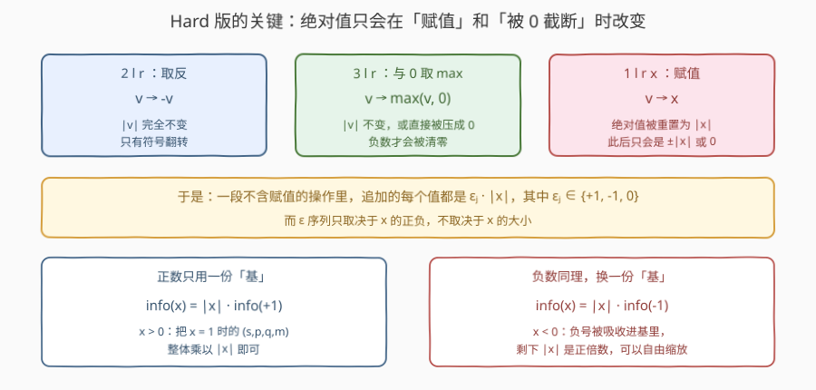
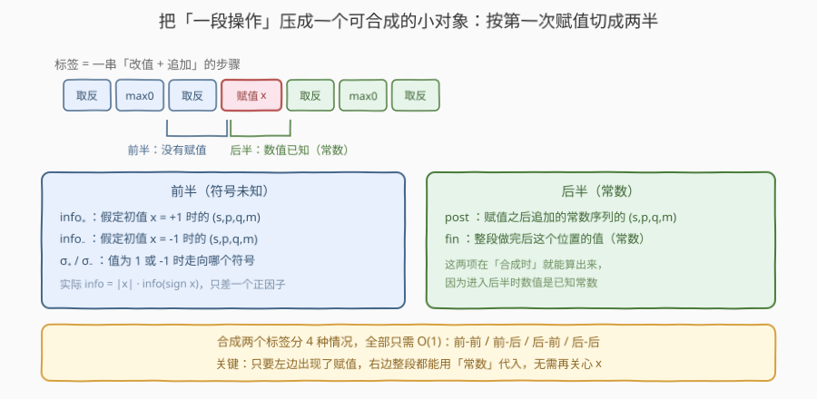
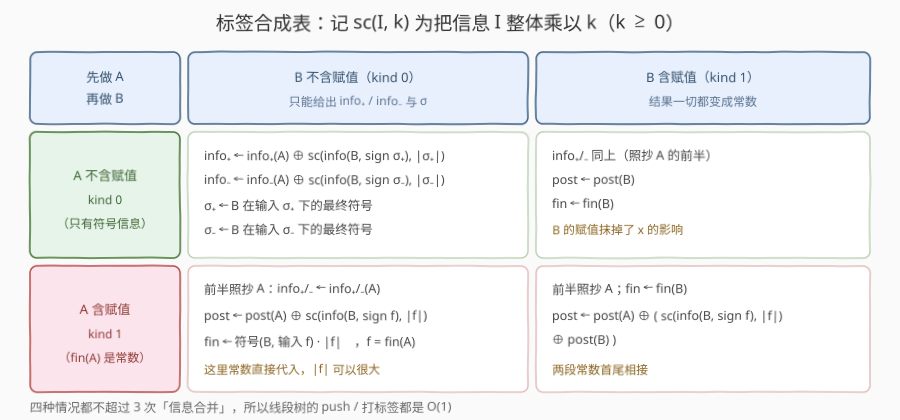

# Codeforces 2255E2 终末之时还剩下什么（困难版） 题解

## 1. 题目概述

- **标题 / 题号**：终末之时还剩下什么（困难版）（Codeforces 2255E2，英文名 What Will Remain at the End? (Hard Version)）
- **链接**：https://codeforces.com/problemset/problem/2255/E2
- **来源**：Codeforces Round 1116 (Div. 1) · Problem E2
- **难度**：3400
- **限制**：时间 3 s / 内存 256 MB
- **标签**：数据结构、线段树、懒标记、序列幺半群、符号分析、绝对值不变量、强制在线解码

**题意**：维护长度为 $n$ 的数组，初始内容称为版本 $0$。之后 $q$ 次操作，第 $i$ 次由版本 $i-1$ 得到版本 $i$：

1. `1 l r x`：$a_k \gets x$，$l \le k \le r$；
2. `2 l r`：$a_k \gets -a_k$；
3. `3 l r`：$a_k \gets \max(a_k, 0)$；
4. `4 p`：取位置 $p$ 在版本 $0,1,\dots,i-1$ 中的值排成序列 $b_0,\dots,b_{i-1}$，输出其**非空**子段最大和。

类型 $1/2/3$ 改数组；类型 $4$ 不改数组，但**仍产生新版本**（版本 $i$ 与 $i-1$ 相同）。强制在线：$\mathrm{lastans}$ 初值 $0$，每次回答类型 $4$ 后令 $\mathrm{lastans} = (\text{答案} \bmod 2^{64})$，坐标 $y$ 按 $d(y) = ((y \oplus \mathrm{lastans}) \bmod n) + 1$ 解码，区间端点取解码值的 $\min$ 与 $\max$。

**约束**：

- $1 \le t \le 10^4$，$1 \le n, q \le 5\times 10^{5}$，$\sum n \le 5\times 10^{5}$，$\sum q \le 5\times 10^{5}$；
- 初始值 $a_i \in [-10^9, 10^9]$，类型 $1$ 的 $x \in [-10^9, 10^9]$（**与简单版的唯一区别**，那里只允许 $\{-1,0,1\}$）；
- 编码坐标 $0 \le u, v < 2^{64}$，必须用 64 位无符号整数；
- 答案绝对值不超过 $5\times10^5\times10^9 = 5\times10^{14}$，必须用 64 位有符号整数。

## 2. 示例与观察
```text
输入
2
4 8
2 -3 1 -2
4 1
2 18446744073709551613 18446744073709551615
4 18446744073709551612
3 2 1
1 2 0 -4
4 2
2 8 10
4 10
3 6
1 -2 3
4 0
1 0 3 -1
4 3
2 6 7
3 7 4
4 7

输出
-3
3
9
4
1
6
2
```

第一组：位置 $2$ 的历史在三次查询时依次是 $[-3]$、$[-3,-3,3]$、$[-3,-3,3,3,3,-4]$，答案分别是 $-3,3,9$；最后一次查询换到位置 $4$，历史末尾出现 $+4$，答案是 $4$。解码链路（$\mathrm{lastans}$ 从 $-3$ 变成 $3$ 再变成 $9$）是理解样例的关键。

## 3. 解题思路

### 3.1 暴力思路

存下所有版本：每次操作复制数组 $O(n)$，查询扫位置 $p$ 的 $i$ 个历史值 $O(i)$，总 $O(nq+q^2)$，仍是 $10^{11}$ 量级，不可行。

简单版的做法是「把一段操作压成 3 项的表」，因为值只有 $\{-1,0,1\}$；困难版值域变成 $10^9$，表不可能枚举。但**值的变化规律**更值得注意：整道题里真正会改变数值大小的只有「赋值」和「被 $0$ 截断」两种情形。

### 3.2 核心观察：绝对值只在「赋值」与「清零」时改变



设某个位置当前的值是 $v$，看三种操作：

- **取反**：$v \to -v$，绝对值 $|v|$ **完全不变**，只是符号翻转；
- **$\max(v,0)$**：$v > 0$ 时不变；$v \le 0$ 时被压成 $0$，即绝对值变成 $0$；
- **赋值 $x$**：绝对值被重置为 $|x|$。

于是从**最后一次赋值**之后开始，这个位置的值永远是 $+|x|$、$-|x|$ 或 $0$；也就是说，随后每次追加到历史里的元素都是 $\varepsilon|x|$，其中 $\varepsilon \in \{+1,-1,0\}$。关键在于：$\varepsilon$ 的取值序列只由 $x$ 的**符号**决定，与 $|x|$ 的大小无关。

由此得到齐次性：设某段不含赋值的操作在初值 $x$ 下追加出的序列四元组是 $I(x)$，则

$$
I(x) = |x| \cdot I(\mathrm{sign}\ x)\quad (x \ne 0),\qquad I(0) = (0,0,0,0)
$$

因为四元组的运算只含加法和取 $\max$，对正数倍数完全线性。所以「符号未知、大小未知」的初值只需要存**两份基**：$x=+1$ 与 $x=-1$ 时的四元组，实际使用时整体乘 $|x|$。

### 3.3 标签的分解与合成



沿用简单版的框架：把每个操作拆成「改值」与「追加」两步，线段树只存懒标记、单点查询，标签描述一段连续操作对某个位置的全部影响。区别只在于标签怎么表示。

把一个操作段按**第一次赋值**切成两半：

- **前半（不含赋值）**：追加序列依赖初值符号。存 $\mathrm{info}_+,\mathrm{info}_-$（$x=\pm1$ 时的四元组）与 $\sigma_+,\sigma_-$（$x=\pm1$ 时的终值，只能是 $\pm1$ 或 $0$）。
- **后半（含赋值）**：进入后半时值已经是常数，之后所有追加值都是常数。存常数四元组 $\mathrm{post}$ 与终值 $\mathrm{fin}$。

标签因此分成两类：$\mathrm{kind}=0$ 只有前半，$\mathrm{kind}=1$ 是「前半 + 常数后半」，另设 $\mathrm{kind}=2$ 表示空标签（恒等）。**注意不能用「前半为空」判断恒等**：纯改值标签的前半也是空的，但它会改变值。

合成 $R = A$ 然后 $B$ 分四种情况，全部 $O(1)$：



| $A$ | $B$ | $R$ |
|-----|-----|-----|
| $\mathrm{kind}=0$ | $\mathrm{kind}=0$ | $\mathrm{kind}=0$：$\mathrm{info}_b \gets A.\mathrm{info}_b \oplus \mathrm{sc}(B.\mathrm{info},\lvert \sigma_b \rvert)$，$\sigma_b \gets$ 用 $B$ 推进 $A.\sigma_b$ |
| $\mathrm{kind}=0$ | $\mathrm{kind}=1$ | $\mathrm{kind}=1$：前半同上，$\mathrm{post}\gets B.\mathrm{post}$，$\mathrm{fin}\gets B.\mathrm{fin}$ |
| $\mathrm{kind}=1$ | $\mathrm{kind}=0$ | $\mathrm{kind}=1$：前半照抄 $A$，$\mathrm{post}\gets A.\mathrm{post} \oplus \mathrm{sc}(B.\mathrm{info},\lvert A.\mathrm{fin} \rvert)$ |
| $\mathrm{kind}=1$ | $\mathrm{kind}=1$ | $\mathrm{kind}=1$：$\mathrm{post}\gets A.\mathrm{post} \oplus (\mathrm{sc}(B.\mathrm{info},\lvert A.\mathrm{fin} \rvert) \oplus B.\mathrm{post})$，$\mathrm{fin}\gets B.\mathrm{fin}$ |

其中 $\mathrm{sc}(I,k)$ 表示把四元组乘以 $k \ge 0$（空序列仍为空序列，$k=0$ 时得到全 $0$ 的非空四元组）。四种情况里「以 $B$ 推进 $\sigma_b$」都只涉及 $\pm1,0$，所以**前半部分的数据永远是 $\pm1$ 为基的小整数**；只有 $\mathrm{post}$ 会乘上 $|A.\mathrm{fin}|$（最大 $10^9$），因此 $\mathrm{post}$ 必须用 64 位。

作用到叶子上：叶子存「当前值 $a$ + 历史四元组 $I$」。取 $b=\mathrm{sign}(a)$、$k=|a|$，令 $S = \mathrm{sc}(\mathrm{info}_b,k)$，则

$$
\mathrm{kind}=0:\ (a,I) \mapsto \big(\sigma_b \cdot k,\ I \oplus S\big),\qquad
\mathrm{kind}=1:\ (a,I) \mapsto \big(\mathrm{fin},\ I \oplus (S \oplus \mathrm{post})\big)
$$

### 3.4 示例演算

第一组数据 $a=(2,-3,1,-2)$，跟踪位置 $2$：

| 操作 $i$ | 类型 | 解码结果 | $p=2$ 处的值 | 位置 $2$ 的历史 | 答案 |
|----------|------|----------|--------------|------------------|------|
| 1 | 4 | $p=2$ | $-3$ | $[-3]$ | $-3$ |
| 2 | 2 | $[1,3]$ 取反 | $3$ | $[-3,-3]$ | — |
| 3 | 4 | $p=2$ | $3$ | $[-3,-3,3]$ | $3$ |
| 4 | 3 | $[2,3]$ 与 $0$ 取 $\max$ | $3$ | $[-3,-3,3,3]$ | — |
| 5 | 1 | $[2,4]$ 赋值 $-4$ | $-4$ | $[-3,-3,3,3,3]$ | — |
| 6 | 4 | $p=2$ | $-4$ | $[-3,-3,3,3,3,-4]$ | $9$ |

第 $1$ 次查询后 $\mathrm{lastans}=2^{64}-3$，所以第 $2$ 行的 $2^{64}-3,2^{64}-1$ 解回 $1,3$；第 $3$ 次查询后 $\mathrm{lastans}=3$，第 $4,5$ 行才解回 $[2,3]$ 与 $[2,4]$。注意第 $4$ 步的 $\max(\cdot,0)$ 让位置 $3$ 的 $-1$ 变 $0$，但位置 $2$ 的 $3$ 不变——「绝对值只可能在负数时被清零」的直观例子。

## 4. 算法细节

1. **两种标签的合并要拆开算**：$A.\mathrm{kind}=0$ 时只需把 $B$ 在输入 $\pm1$ 下代入（$|\sigma|=0$ 或 $1$，缩放是「清零」或「原样」）；$A.\mathrm{kind}=1$ 时输入是常数 $A.\mathrm{fin}$，可以放心乘 $|A.\mathrm{fin}|$。
2. **恒等标签单独编号**：`kind=2`。若用「前半为空」判恒等，会把「纯改值」标签误当成恒等，直接丢掉所有区间赋值/取反。
3. **空序列与 $0$ 序列要分清**：空序列（`pre` 为空、`post` 为空）代表「什么都没追加」，四元组是 $-\infty$ 哨兵；乘以 $0$ 的非空序列代表「追加了一堆 $0$」，四元组是全 $0$。两者在合并中的行为不同。
4. **哨兵安全加法**：$-\infty$ 取 `-(1<<60)`，真实值下界约 $-5\times10^{14}$，远大于 `-(1<<60)/2`，所以合并时先判空再相加，避免哨兵漂移甚至溢出。
5. **溢出边界**：$\mathrm{post}$ 的最坏情况是 $5\times10^5$ 个数、每个 $10^9$，总和约 $5\times10^{14}$，`long long` 足够；而 $\mathrm{pre}$ 的系数不超过历史长度 $5\times10^5$，可以安心用小整数表示。
6. **每步两件事**：类型 $1/2/3$ 把「纯改值」标签打在 $[l,r]$ 的 $O(\log n)$ 个节点上；随后把「追加当前值」标签打在根上（$n$ 补到 $2$ 的幂后整段就是根），$O(1)$。
7. **追加标签本身**：`kind=0`，$\mathrm{info}_+ = (1,1,1,1)$、$\mathrm{info}_- = (-1,-1,-1,-1)$，$\sigma_+ = 1,\sigma_- = -1$。它对值的映射是恒等，只追加一个元素。
8. **多测与 I/O**：$\sum n, \sum q$ 均不超过 $5\times 10^5$，每组只需重置 $[1,sz)$ 的标签；用 `scanf` 或关闭同步的 `cin`，输出用 `printf` 累积到缓冲区。

## 5. 正确性证明

**引理 1（绝对值不变量）**：设位置 $p$ 最近一次被赋值成 $x$（若从未被赋值，取初值 $a_p$），则此后任意版本中该位置的值都属于 $\{+|x|, -|x|, 0\}$。

**证明**：对赋值之后的步数归纳。初始为 $+x$。取反只翻符号，绝对值不变；$\max(\cdot,0)$ 在值 $>0$ 时保持、$\le 0$ 时变为 $0$；两者都不会产生第三种绝对值。∎

**推论**：一段不含赋值的操作追加出的每个元素都是 $\varepsilon_j|x|$，$\varepsilon_j\in\{+1,-1,0\}$，且 $\varepsilon$ 序列只依赖 $\mathrm{sign}(x)$。

**证明**：由引理 1，每一步的值都是 $\varepsilon|x|$；同一条操作段作用在 $+1$ 与作用在任意 $x>0$ 上，符号演化完全相同（因为 $\max(v,0)$ 与 $-v$ 只看符号），放大 $|x|$ 倍即得。∎

**引理 2（齐次性）**：若序列四元组 $I$ 对应元素全为 $\varepsilon_j x$（$x>0$），则把每个元素放大成 $\varepsilon_j\cdot kx$ 后四元组为 $k\cdot I$；$x<0$ 时先取 $x=-1$ 的基再乘 $|x|$。

**证明**：四元组由加法与 $\max$ 定义，两者对正数倍数 $k>0$ 均可交换：$k\max(u,v)=\max(ku,kv)$，$k(u+v)=ku+kv$。因此逐元素放大 $k$ 倍即整体放大 $k$ 倍。∎

**引理 3（前后半分解）**：把一段操作按第一次赋值切开后，后半的追加序列与终值都是常数；前半可用 $\mathrm{info}_\pm$ 与 $\sigma_\pm$ 完整描述。

**证明**：第一次赋值之后值确定，由引理 1 与「赋值把绝对值重置」知后续所有值都是常数（或 $0$），故追加序列是常数序列。前半不含赋值，由推论它只依赖初值符号，用两个基即可覆盖。∎

**引理 4（合成正确）**：§3.3 的四种合成规则与「先做 $A$ 再做 $B$」等价。

**证明**：分情况。$A$ 无赋值时，用 $A$ 把基 $\pm1$ 推进到 $A.\sigma_b\in\{-1,0,1\}$，取其绝对值作为缩放因子，把 $B$ 在对应基上的信息并入 $A.\mathrm{info}_b$，终值由 $B$ 的 $\sigma$ 给出；$A$ 有赋值时输入是常数 $A.\mathrm{fin}$，$B$ 的前半退化为常数缩放 $\mathrm{sc}(B.\mathrm{info},|A.\mathrm{fin}|)$，再与 $B$ 的后半相接；若 $B$ 也有赋值，则 $B$ 的终值直接覆盖。每种情况都与「先 $A$ 后 $B$」的追加序列首尾相接一致，四元组按引理 2 合并。∎

**引理 5（懒标记顺序）**：线段树上任一节点标签代表其子树共有、时间最新的若干步操作，父标签一定晚于子标签。

**证明**：区间打标签前先 push 两条边界路径（把较老的父标签下沉），新标签总合成在已有标签之后；查询沿路径自顶向下 push，恰好按时间顺序作用。∎

**定理**：每次类型 $4$ 的输出等于该位置在版本 $0..i-1$ 上取值序列的非空最大子段和。

**证明**：与简单版相同的归纳：每步「改值 + 全局追加」维护的叶子四元组恰是版本 $0..i$ 的序列信息；由引理 4、5 标签语义与顺序正确；查询发生在本次追加之前，读出的 $m$ 即答案。∎

## 6. 复杂度分析

- **时间**：$O\big((n+q)\log n\big)$。每次类型 $1/2/3$ 是 $O(\log n)$ 个节点的标签合成（每个至多 3 次四元组合并），外加一次根合成；类型 $4$ 是 $O(\log n)$ 次 push。$n=q=5\times10^5$ 全随机数据（含 `scanf` 读入）实测约 $0.95\sim1.1$ s，3 s 限制下余量约 3 倍。
- **空间**：标签数组 $O(n)$（每个标签约 120 字节，只存内部节点，约 63 MB），叶子状态 $O(n)$，实测峰值约 85 MB（256 MB 限制内）。

## 7. 参考代码

### C++17

```cpp
#include <cstdio>
#include <algorithm>
using namespace std;
typedef long long ll;
typedef unsigned long long ull;

const ll NEG = -(1LL << 60);
struct Inf { ll s, p, q, m; };                        // 非空；空 = {0,NEG,NEG,NEG}
Inf empI() { return Inf{0, NEG, NEG, NEG}; }
Inf oneI(ll v) { return Inf{v, v, v, v}; }
bool emp(const Inf &A) { return A.p <= NEG / 2; }
Inf cat(const Inf &A, const Inf &B) {                  // A 在前，B 在后
    if (emp(A)) return B;
    if (emp(B)) return A;
    return Inf{A.s + B.s, max(A.p, A.s + B.p), max(B.q, B.s + A.q),
               max(max(A.m, B.m), A.q + B.p)};
}
Inf sc(const Inf &A, ll k) {                           // 序列整体放大 k >= 0
    if (emp(A)) return empI();
    if (k == 0) return Inf{0, 0, 0, 0};                // 一串 0，仍然非空
    return Inf{A.s * k, A.p * k, A.q * k, A.m * k};
}
// kind 0：无赋值；kind 1：有赋值；kind 2：恒等
struct Tag { int kind, sgP, sgM; Inf pre[2], post; ll fin; };
Tag idTag() { return Tag{2, 1, -1, {empI(), empI()}, empI(), 0}; }
bool isId(const Tag &T) { return T.kind == 2; }
Tag comp(const Tag &A, const Tag &B) {                 // 先 A 后 B
    if (isId(A)) return B;
    if (isId(B)) return A;
    Tag R = idTag();
    if (A.kind == 0) {
        for (int b = 0; b < 2; b++) {                  // 基 +1 / -1
            int v = b ? A.sgM : A.sgP;                 // 基输入下 A 的终值
            R.pre[b] = cat(A.pre[b], sc(B.pre[v < 0], v < 0 ? -v : v));
        }
        if (B.kind == 0) {
            R.kind = 0;
            R.sgP = A.sgP > 0 ? B.sgP : (A.sgP < 0 ? B.sgM : 0);
            R.sgM = A.sgM > 0 ? B.sgP : (A.sgM < 0 ? B.sgM : 0);
            return R;
        }
        R.kind = 1; R.post = B.post; R.fin = B.fin;
        return R;
    }
    R.kind = 1; R.pre[0] = A.pre[0]; R.pre[1] = A.pre[1];
    int b = A.fin > 0 ? 0 : 1;                         // 常数输入用哪个基
    ll af = A.fin < 0 ? -A.fin : A.fin;
    Inf nb = sc(B.pre[b], af);
    if (B.kind == 0) {
        R.post = cat(A.post, nb);
        R.fin = (b == 0 ? B.sgP : B.sgM) * af;
    } else {
        R.post = cat(A.post, cat(nb, B.post));
        R.fin = B.fin;
    }
    return R;
}

int sz, lg;
Tag tag[1 << 20];
ll av[500005];
Inf st[500005];

void applyTag(int k, const Tag &T) {
    if (k >= sz) {
        int i = k - sz, b = av[i] > 0 ? 0 : 1;         // 0 走哪个基都一样
        ll ax = av[i] < 0 ? -av[i] : av[i];
        Inf sq = sc(T.pre[b], ax);
        if (T.kind == 0) {
            st[i] = cat(st[i], sq);
            av[i] = (b == 0 ? T.sgP : T.sgM) * ax;
        } else {
            st[i] = cat(st[i], cat(sq, T.post));
            av[i] = T.fin;
        }
    } else tag[k] = comp(tag[k], T);
}
void push(int k) {
    if (isId(tag[k])) return;
    applyTag(2 * k, tag[k]);
    applyTag(2 * k + 1, tag[k]);
    tag[k] = idTag();
}
void upd(int l, int r, const Tag &T) {                 // [l, r)
    if (l >= r) return;
    if (l == 0 && r == sz) { applyTag(1, T); return; }
    l += sz; r += sz;
    for (int i = lg; i >= 1; i--) {
        if (((l >> i) << i) != l) push(l >> i);
        if (((r >> i) << i) != r) push((r - 1) >> i);
    }
    for (; l < r; l >>= 1, r >>= 1) {
        if (l & 1) applyTag(l++, T);
        if (r & 1) applyTag(--r, T);
    }
}
Inf query(int p) {
    for (int i = lg; i >= 1; i--) push((p + sz) >> i);
    return st[p];
}

int main() {
    Tag tagSelf, tagNeg, tagMax0, tagSet;
    tagSelf = idTag(); tagSelf.kind = 0;               // 追加当前值
    tagSelf.pre[0] = oneI(1); tagSelf.pre[1] = oneI(-1);
    tagNeg = idTag(); tagNeg.kind = 0;                 // 取反（不追加）
    tagNeg.sgP = -1; tagNeg.sgM = 1;
    tagMax0 = idTag(); tagMax0.kind = 0;               // max(a,0)（不追加）
    tagMax0.sgP = 1; tagMax0.sgM = 0;
    tagSet = idTag(); tagSet.kind = 1;                 // 赋值（不追加）
    tagSet.fin = 0;

    int T;
    scanf("%d", &T);
    while (T--) {
        int n, q;
        scanf("%d %d", &n, &q);
        for (int i = 0; i < n; i++) {
            ll v;
            scanf("%lld", &v);
            av[i] = v;
            st[i] = oneI(v);
        }
        sz = 1; lg = 0;
        while (sz < n) sz <<= 1, lg++;
        for (int k = 1; k < sz; k++) tag[k] = idTag();
        ull lastans = 0;
        for (int op = 0; op < q; op++) {
            int typ;
            scanf("%d", &typ);
            if (typ == 4) {
                ull u;
                scanf("%llu", &u);
                int p = (int)((u ^ lastans) % (ull)n);
                ll ans = query(p).m;
                printf("%lld\n", ans);
                lastans = (ull)ans;                    // 负数按补码解释
            } else {
                ull u, v;
                scanf("%llu %llu", &u, &v);
                int d1 = (int)((u ^ lastans) % (ull)n), d2 = (int)((v ^ lastans) % (ull)n);
                int l = min(d1, d2), r = max(d1, d2);
                if (typ == 1) {
                    ll x;
                    scanf("%lld", &x);
                    Tag t = tagSet;
                    t.fin = x;
                    upd(l, r + 1, t);
                } else if (typ == 2) upd(l, r + 1, tagNeg);
                else upd(l, r + 1, tagMax0);
            }
            upd(0, sz, tagSelf);                       // 全局追加，落在根上
        }
    }
    return 0;
}
```

### Python3

```python
import sys


def cat(A, B):
    """(和, 最大前缀, 最大后缀, 最大子段)；None 表示空序列"""
    if A is None:
        return B
    if B is None:
        return A
    s1, p1, q1, m1 = A
    s2, p2, q2, m2 = B
    return (s1 + s2, max(p1, s1 + p2), max(q2, s2 + q1), max(m1, m2, q1 + p2))


def sc(A, k):
    """序列整体放大 k >= 0：空序列仍为空，非空序列乘 0 得到一串 0"""
    if A is None:
        return None
    if k == 0:
        return (0, 0, 0, 0)
    return (A[0] * k, A[1] * k, A[2] * k, A[3] * k)


# 标签 = (kind, sgP, sgM, preP, preM, post, fin)
# kind 0：无赋值；kind 1：有赋值；kind 2：恒等
ID = (2, 1, -1, None, None, None, 0)


def comp(A, B):
    """先 A 后 B"""
    if A[0] == 2:
        return B
    if B[0] == 2:
        return A
    ka, sPa, sMa, pPa, pMa, postA, finA = A
    kb, sPb, sMb, pPb, pMb, postB, finB = B
    if ka == 0:
        nP = cat(pPa, sc(pPb if sPa >= 0 else pMb, abs(sPa)))
        nM = cat(pMa, sc(pPb if sMa >= 0 else pMb, abs(sMa)))
        if kb == 0:
            return (0,
                    sPb if sPa > 0 else (sMb if sPa < 0 else 0),
                    sPb if sMa > 0 else (sMb if sMa < 0 else 0),
                    nP, nM, None, 0)
        return (1, 0, 0, nP, nM, postB, finB)
    b = 0 if finA > 0 else 1
    nb = sc(pPb if b == 0 else pMb, abs(finA))
    if kb == 0:
        return (1, 0, 0, pPa, pMa, cat(postA, nb),
                (sPb if b == 0 else sMb) * abs(finA))
    return (1, 0, 0, pPa, pMa, cat(postA, cat(nb, postB)), finB)


def apply_tag(T, x, I):
    kind, sgP, sgM, pP, pM, post, fin = T
    b = 0 if x >= 0 else 1
    ax = abs(x)
    sq = sc(pP if b == 0 else pM, ax)
    if kind == 0:
        return (sgP if b == 0 else sgM) * ax, cat(I, sq)
    return fin, cat(I, cat(sq, post))


def main():
    data = sys.stdin.buffer.read().split()
    ptr = 1
    out = []
    TAG_SELF = (0, 1, -1, (1, 1, 1, 1), (-1, -1, -1, -1), None, 0)
    TAG_NEG = (0, -1, 1, None, None, None, 0)
    TAG_MAX0 = (0, 1, 0, None, None, None, 0)
    for _ in range(int(data[0])):
        n, q = int(data[ptr]), int(data[ptr + 1])
        ptr += 2
        a = [int(x) for x in data[ptr:ptr + n]]
        ptr += n
        sz, lg = 1, 0
        while sz < n:
            sz <<= 1
            lg += 1
        val = a + [0] * (sz - n)
        st = [(v, v, v, v) for v in a] + [None] * (sz - n)
        tag = [ID] * sz

        def apply_node(k, T):
            if k >= sz:
                i = k - sz
                val[i], st[i] = apply_tag(T, val[i], st[i])
            else:
                tag[k] = comp(tag[k], T)

        def push(k):
            T = tag[k]
            if T[0] == 2:
                return
            apply_node(2 * k, T)
            apply_node(2 * k + 1, T)
            tag[k] = ID

        def upd(l, r, T):
            if l >= r:
                return
            if l == 0 and r == sz:
                apply_node(1, T)
                return
            l += sz
            r += sz
            for i in range(lg, 0, -1):
                if ((l >> i) << i) != l:
                    push(l >> i)
                if ((r >> i) << i) != r:
                    push((r - 1) >> i)
            while l < r:
                if l & 1:
                    apply_node(l, T)
                    l += 1
                if r & 1:
                    r -= 1
                    apply_node(r, T)
                l >>= 1
                r >>= 1

        def query(p):
            k = p + sz
            for i in range(lg, 0, -1):
                push(k >> i)
            return st[p][3]

        lastans = 0
        for _ in range(q):
            typ = int(data[ptr])
            ptr += 1
            if typ == 4:
                u = int(data[ptr])
                ptr += 1
                ans = query((u ^ lastans) % n)
                out.append(str(ans))
                lastans = ans % (1 << 64)
            else:
                u, v = int(data[ptr]), int(data[ptr + 1])
                ptr += 2
                d1, d2 = (u ^ lastans) % n, (v ^ lastans) % n
                l, r = (d1, d2) if d1 <= d2 else (d2, d1)
                if typ == 1:
                    x = int(data[ptr])
                    ptr += 1
                    upd(l, r + 1, (1, 0, 0, None, None, None, x))
                elif typ == 2:
                    upd(l, r + 1, TAG_NEG)
                else:
                    upd(l, r + 1, TAG_MAX0)
            upd(0, sz, TAG_SELF)
    sys.stdout.write("\n".join(out) + ("\n" if out else ""))


main()
```

> Python 版是同一算法的直译，已与 C++ 版用随机数据逐点对拍。它每步要做 $O(\log n)$ 次元组拼接，常数极大，$n=q=5\times10^5$ 时会超时，仅用于理解算法；提交请用 C++ 版。

## 8. 边界情况与易错点

1. **恒等标签不要用「前半为空」判断**：纯改值标签（赋值/取反/$\max 0$）的前半也是空的，误判成恒等会丢掉全部区间修改。实现里用 `kind=2` 单独表示恒等。
2. **$x=0$ 的基选择**：$\mathrm{sign}(0)$ 走 $+1$ 的基，缩放因子 $|x|=0$ 会把四元组变成全 $0$（对应「追加了一串 $0$」），终值 $0$；若把空序列与 $0$ 序列混为一谈，答案会错。
3. **负答案的 $\mathrm{lastans}$**：答案为负时必须按 `unsigned long long` 转换得到 $\bmod\ 2^{64}$ 的剩余（样例第一问就是 $-3$）。
4. **类型 $4$ 也产生新版本**：查询之后仍要追加一次，否则下一次查询看到的历史少一格。
5. **哨兵与溢出**：$-\infty$ 用 `-(1<<60)`，真实值下界约 $-5\times10^{14}$，合并前判空再相加；反过来若用 `INT_MIN` 且直接相加会溢出成 UB。
6. **$\mathrm{post}$ 的缩放**：只有「$A$ 有赋值」时才乘 $|A.\mathrm{fin}|$（可达 $10^9$），必须用 64 位；$\mathrm{pre}$ 的系数始终 $\le 5\times10^5$，不要混用同一套元组类型导致溢出。
7. **$n$ 不是 $2$ 的幂**：统一补到 $sz$，区间用 $[l,r+1)$，全局追加用 $[0,sz)$（落在根上）。
8. **多测清空**：只重置 $[1,sz)$ 的标签，$t$ 很大时不要整块清零。

## 9. 验证记录

- **编译环境与命令**：`clang++ -std=c++17 -O2`（本机无 GNU g++，配 `codeforces/tools/include/bits/stdc++.h` 兼容头；正文代码只用标准库，可原样提交 GNU C++17）；Python 侧为 `Python 3.9.6`。
- **官方样例**：1 / 1 通过（按 Codeforces 标准 checker 的 token 比对，忽略空白与大小写）。
- **复核状态**：audited（2026-11-19 统一回归：编译 + 官方样例；写作期的随机对拍与暴力未重跑）。

## 相关题目与扩展

- [Codeforces 2255E1. What Will Remain at the End? (Easy Version)](https://codeforces.com/problemset/problem/2255/E1)：值域只有 $\{-1,0,1\}$，标签退化成 3 项的表，可先读简单版题解。
- [LeetCode 53. 最大子数组和](https://leetcode.cn/problems/maximum-subarray/)：四元组中 $m=\max(m_1,m_2,q_1+p_2)$ 的来源。
- [Codeforces 145E. Lucky Queries](https://codeforces.com/problemset/problem/145/E)：区间取反 + 计数查询，展示「操作可合成为幺半群」的典型写法。
- [洛谷 P2572 [SCOI2010] 序列操作](https://www.luogu.com.cn/problem/P2572)：区间赋值 + 区间取反 + 查询，与本题懒标记顺序问题同源。
- [Codeforces 438D. The Child and Sequence](https://codeforces.com/problemset/problem/438/D)：用「值下降不可逆」做均摊剪枝的思路，可与本题的绝对值不变量对照。

**延伸思考**：本题的核心不是线段树，而是**给「未知初值」找一个有限维的表示**。这里的关键是「绝对值只被赋值重置、只被 $0$ 截断」，因此一段无赋值操作的信息是初值的正齐次函数，用两个基（$\pm1$）加一个符号映射就能覆盖任意 $x$。若把操作换成 $v \gets v+c$ 或 $v \gets kv$，齐次性就被破坏，需要另一套代数（例如把标签写成 $\max$ 的仿射映射并维护上包络）；若查询改成版本区间 $[L,R]$，则要把标签升级成可按时间切片的持久化结构。这类「标签即幺半群元素」的压缩思路，在区间历史最值、区间取反计数等题目里反复出现，值得单独总结。
