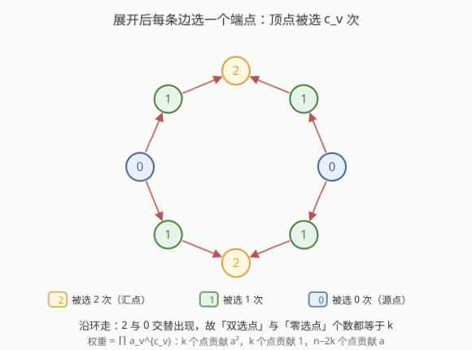
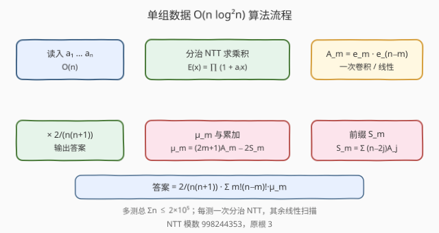
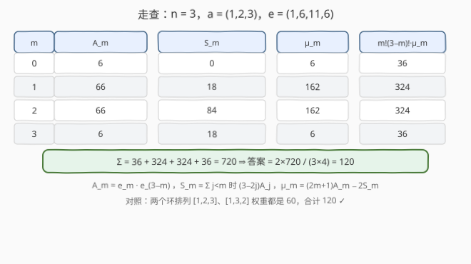

# Codeforces 2255F 谁将见证终末 题解

## 1. 题目概述

- **标题 / 题号**：谁将见证终末（Codeforces 2255F，英文名 Who Will Witness the End?）
- **链接**：https://codeforces.com/problemset/problem/2255/F
- **来源**：Codeforces Round 1116 (Div. 1) · Problem F（UTC 2026-08-09）
- **难度**：*3100（本题 3500 分）
- **限制**：时间 2 s / 内存 256 MB
- **标签**：组合数学、生成函数、NTT/FFT、多项式、数学

**题意**：给定 $n$ 个**带标号**的整数 $a_1,\dots,a_n$。取排列 $p_1,\dots,p_n$，按此顺序把对应的 $a$ 摆成一个环，环状排列的权值为 $\prod_{i=1}^{n}\left(a_{p_i}+a_{p_{i+1}}\right)$（下标循环，$p_{n+1}=p_1$）。循环移位视为同一个环状排列，翻转（镜像）**不**视为相同。求所有本质不同环状排列的权值之和，对 $998244353$ 取模。

**约束**：$1\le t\le10^4$ 组多测，$\sum n\le2\cdot10^5$；$3\le n\le2\cdot10^5$；$0\le a_i<998244353$（**可以为 $0$**，故不能出现 $1/a_i$）。环排列总数为 $(n-1)!$，枚举不可行。

## 2. 示例与观察
```text
输入
3
3
1 2 3
6
0 1 0 1 0 1
10
114514 1919810 350234 11831 314159265 271828182 123456789 998244352 5201314 23333333

输出
120
12
265885269
```

样例 1：本质不同环排列只有 $[1,2,3]$ 和 $[1,3,2]$，权重均为 $(1+2)(2+3)(3+1)=60$，答案 $120$。
样例 2：仅当 $0/1$ 交替时权重非零，共 $\frac{2\cdot3!\cdot3!}{6}=12$ 个，每个权重为 $1$。

## 3. 解题思路

### 3.1 暴力思路

固定首位元素、枚举其余 $n-1$ 个元素，共 $(n-1)!$ 个环排列，每个 $O(n)$ 算权值：$n=9$ 已是 $4\times10^4\cdot9$，$n=2\cdot10^5$ 不可能。根源在于权值是 $a$ 的 $n$ 次齐次多项式，枚举排列等于把 $n!$ 个单项式逐个写出；正确方向是**先按「每个 $a_i$ 被乘了几次」分类**，再用对称多项式合并同类项。

### 3.2 核心观察：每条边「选一个端点」



把每个因式 $a_{p_i}+a_{p_{i+1}}$ 展开，等价于让环上第 $i$ 条边 $(p_i,p_{i+1})$ **选择它的一个端点**。设顶点 $v$ 被 $c_v$ 条边选中，则 $c_v\in\{0,1,2\}$、$\sum_v c_v=n$，该项贡献为 $\prod_v a_v^{c_v}$。

用 $b_i\in\{0,1\}$ 记边 $i$ 是否选择了 $p_{i+1}$，则

$$c_i=[b_i=0]+[b_{i-1}=1],\qquad c_i=2\iff(b_{i-1},b_i)=(1,0),\quad c_i=0\iff(b_{i-1},b_i)=(0,1).$$

绕环一周，「$1\to0$」与「$0\to1$」次数相等，所以**被选 2 次（汇点）与被选 0 次（源点）的顶点数同为 $k$**、且交替出现，剩下 $n-2k$ 个点被选 1 次。于是指数向量被压缩成「挑 $k$ 个双选点、$k$ 个零选点」；更关键的是**给定指数向量后被实现的次数 $M_k$ 只与 $k$ 有关**（引理 2），故

$$X=\sum_{k=0}^{\lfloor n/2\rfloor}M_k\cdot m_{(2^k,1^{n-2k})}(a),\qquad M_k=\frac{2(n-1)!\,k!^2}{(2k)!},$$

其中 $m_{(2^k,1^{n-2k})}(a)$ 是单项对称多项式：对所有「$k$ 个位置取 $a_i^2$、$k$ 个位置不取、其余取 $a_i$」的乘积求和。

### 3.3 算法流程：生成函数 + Beta 积分



**第一步**：把 $m_{(2^k,1^{n-2k})}$ 写成系数 $H_k=[z^nu^k]\prod_i(z^2+a_iz+ua_i^2)$，即 $G(u)=\sum_kH_ku^k$。

**第二步**：把 $G$ 代数化。由 $z^2+a_iz+ua_i^2=(z-r_1a_i)(z-r_2a_i)$，$r_1+r_2=-1,\ r_1r_2=u$；取 $u=t(1-t)$ 时两根可取 $r_1=-t,\ r_2=-(1-t)$，展开两括号取 $z^n$ 项得

$$G\big(t(1-t)\big)=\sum_{i=0}^{n}e_ie_{n-i}\,t^{\,n-i}(1-t)^{\,i}=:A(t),\qquad e_j=[x^j]\prod_{i=1}^{n}(1+a_ix),$$

$e_0..e_n$ 用**分治 NTT** 一次求出（$O(n\log^2n)$）。

**第三步**：用 Beta 积分 $\frac{1}{\binom{2k}{k}}=(2k+1)\int_0^1s^k(1-s)^kds$ 把对 $k$ 的求和化成积分，再作 $t=\frac{y}{1+y}$、用 $\int_0^\infty\frac{y^m}{(1+y)^{n+2}}dy=\frac{m!(n-m)!}{(n+1)!}$ 收尾，得到只含 $e_j$ 与阶乘的闭式：

$$X=\frac{2}{n(n+1)}\sum_{m=0}^{n}m!\,(n-m)!\,\mu_m,\qquad
\mu_m=(2m+1)A_m-2\sum_{j=0}^{m-1}(n-2j)A_j,\quad A_j=e_je_{n-j}.$$

$\mu_m$ 中的和是前缀和 $S_m=\sum_{j<m}(n-2j)A_j$，边扫边维护即可，整段 $O(n)$。

### 3.4 示例演算



$n=3,a=(1,2,3)$：$e=(1,6,11,6)$，$A_m=e_me_{3-m}=(6,66,66,6)$，逐行得 $\mu=(6,162,162,6)$，乘 $m!(3-m)!$ 求和得 $720$，故 $X=\frac{2}{3\cdot4}\cdot720=120$，与暴力（两个环排列各 $60$）一致。

## 4. 算法细节

1. **一次乘积求出全部 $e_j$**：`build(l,r)` 返回 $\prod_{i\in[l,r)}(1+a_ix)$，长度 $\le32$ 时暴力乘、否则 NTT，总复杂度 $O(n\log^2n)$。
2. **$a_i=0$ 无需特判**：全程只出现 $e_j$，不含 $1/a_i$，零值天然正确（样例 2 即大量零的检验）。
3. **$m$ 要跑到 $n$**：$H_k$ 只对 $k\le\lfloor n/2\rfloor$ 非零，但 $A_m$ 的下标配对是 $m\leftrightarrow n-m$，闭式里 $m$ 必须取到 $n$。
4. **前缀和口径**：$\mu_m$ 用的是 $j<m$ 的前缀，必须「先算 $\mu_m$、再把 $(n-2m)A_m$ 加入 $S$」，写反会错一位。
5. **取模细节**：$m>n/2$ 时 $n-2m<0$，需先化成 $((n-2m)\bmod p+p)\bmod p$；$n,n+1<p$ 保证 $n(n+1)\not\equiv0$，先乘 $2$ 再乘逆元，阶乘全局只预处理一次。
6. **多测与 I/O**：`a`、`e` 均为局部变量，每组重新 `build`；$\sum n\le2\cdot10^5$，`scanf/printf` 足够，C++ 实测最大数据约 $0.24$ s。

## 5. 正确性证明

**引理 1（源汇交替）**：固定环排列与各边选取，令 $k=\#\{v:c_v=2\}$，则 $\#\{v:c_v=0\}=k$，且两类点在环上交替出现。

**证明**：由 $c_i=[b_i=0]+[b_{i-1}=1]$ 得 $c_i=2\iff(b_{i-1},b_i)=(1,0)$、$c_i=0\iff(b_{i-1},b_i)=(0,1)$。绕环一周，$b$ 的每次下降必配一次上升，故两类个数都等于下降次数 $k$；又 $c=2$ 与 $c=0$ 之间只能夹 $c=1$ 的点，故交替。∎

**引理 2（计数常数）**：对固定环排列，每个「$k$ 个 $2$、$k$ 个 $0$、$n-2k$ 个 $1$」的指数向量恰被 $M_k=\frac{2(n-1)!k!^2}{(2k)!}$ 个（环排列, 选取）对实现。

**证明**：模式由 $b$ 的变号位决定；环上任取 $2k$ 个位置作变号位，相容的 $b$ 恰两种（互补），共 $2\binom{n}{2k}$ 种选取。该模式的指数向量有 $\binom{n}{k}\binom{n-k}{k}=\frac{n!}{k!^2(n-2k)!}$ 个，由标号对称性它们被实现的次数相同，把总对数 $(n-1)!\cdot2\binom{n}{2k}$ 均分即得。∎

**引理 3（生成函数代数化）**：$G(u)=\sum_kH_ku^k$，且 $G\big(t(1-t)\big)=\sum_ie_ie_{n-i}t^{n-i}(1-t)^i$。

**证明**：$H_k=[z^nu^k]\prod_i(z^2+a_iz+ua_i^2)$ 即「取 $k$ 个平方项、$k$ 个 $z^2$、其余取一次项」。又 $z^2+a_iz+ua_i^2=(z-r_1a_i)(z-r_2a_i)$，故 $G(u)=\sum_i(-r_1)^{n-i}(-r_2)^ie_ie_{n-i}$，该式关于 $r_1,r_2$ 对称，任取一组根皆可；取 $r_1=-t,r_2=-(1-t)$ 即得 $(-r_1)^{n-i}(-r_2)^i=t^{n-i}(1-t)^i$。两边都是 $t$ 的多项式，故恒等成立。∎

**引理 4（积分表示）**：$X=2(n-1)!\int_0^1\big[G(s)+2sG'(s)\big]_{s=t(1-t)}dt$。

**证明**：由引理 2，$X=2(n-1)!\sum_kH_k/\binom{2k}{k}$；代入 $\frac{1}{\binom{2k}{k}}=(2k+1)\int_0^1s^k(1-s)^kds$ 并交换求和得 $X=2(n-1)!\int_0^1\sum_k(2k+1)H_k[t(1-t)]^kdt$，而 $\sum_k(2k+1)H_ks^k=G(s)+2sG'(s)$。∎

**引理 5（闭式）**：$X=\frac{2}{n(n+1)}\sum_{m=0}^nm!(n-m)!\mu_m$，其中 $\mu_m=(2m+1)A_m-2\sum_{j<m}(n-2j)A_j$。

**证明**：令 $t=\frac{y}{1+y}$（$y:0\to\infty$，$dt=\frac{dy}{(1+y)^2}$），则 $A(t)=\frac{E(y)}{(1+y)^n}$，$E(y)=\sum_ie_ie_{n-i}y^i$。代入引理 4 并通分，被积式化为 $\frac{\tilde N(y)}{(1-y)(1+y)^{n+2}}$，其中 $\tilde N=E(1-(2n+1)y)+2y(1+y)E'$。由配对 $i\leftrightarrow n-i$ 有 $E'(1)=\frac n2E(1)$，故 $\tilde N(1)=-2nE(1)+4E'(1)=0$，于是 $\tilde N=(1-y)\tilde M$ 且 $\deg\tilde M\le n$。逐项积分 $\int_0^\infty\frac{y^m}{(1+y)^{n+2}}dy=\frac{m!(n-m)!}{(n+1)!}$ 得 $X=2(n-1)!\sum_m\mu_m\frac{m!(n-m)!}{(n+1)!}=\frac{2}{n(n+1)}\sum_mm!(n-m)!\mu_m$；再由 $\tilde N_m=(2m+1)A_m+(2m-2n-3)A_{m-1}$ 与 $\mu_m=\tilde N_m+\mu_{m-1}$ 逐项相消即得 $\mu_m$ 的表达式。∎

**定理**：算法输出的 $X$ 等于题目答案。

**证明**：引理 1、2 说明按指数向量分组不重不漏且权重不变，故 $X=\sum_kM_kH_k$；引理 3–5 把它逐步化为只含 $e_j$ 与阶乘的闭式，每步都是恒等变形。故输出正确。∎

## 6. 复杂度分析

- **时间**：每组的分治 NTT 为 $O(n\log^2n)$，其余 $A_j,\mu_m$ 与累加为 $O(n)$；总时间 $O\big((\sum n)\log^2n\big)$。C++ 实测 $n=2\cdot10^5$ 约 $0.24$ s，留有 8 倍余量。
- **空间**：乘积临时数组 $O(n)$、递归深度 $O(\log n)$、阶乘表 $O(\max n)$，总计 $O(n)\ll256$ MB。

## 7. 参考代码

### C++17

```cpp
#include <cstdio>
#include <vector>
#include <algorithm>
using namespace std;
typedef long long ll;
const int P = 998244353, RT = 3;
int pw(ll b, ll e) { ll r = 1; for (b %= P; e; e >>= 1, b = b * b % P) if (e & 1) r = r * b % P; return (int)r; }
void ntt(vector<int> &a, bool iv) {
    int n = a.size();
    for (int i = 1, j = 0; i < n; i++) { int b = n >> 1; for (; j & b; b >>= 1) j ^= b; j ^= b; if (i < j) swap(a[i], a[j]); }
    for (int L = 2; L <= n; L <<= 1) {
        int w0 = pw(RT, (P - 1) / L); if (iv) w0 = pw(w0, P - 2);
        for (int i = 0; i < n; i += L) {
            ll w = 1;
            for (int j = 0; j < L / 2; j++, w = w * w0 % P) {
                int u = a[i + j], v = w * a[i + j + L / 2] % P;
                a[i + j] = u + v - (u + v >= P ? P : 0), a[i + j + L / 2] = u - v + (u < v ? P : 0);
            }
        }
    }
    if (iv) { int ni = pw(n, P - 2); for (int &x : a) x = (ll)x * ni % P; }
}
vector<int> mul(vector<int> a, vector<int> b) {
    if (a.empty() || b.empty()) return {};
    if (min(a.size(), b.size()) <= 32) {
        vector<int> c(a.size() + b.size() - 1);
        for (size_t i = 0; i < a.size(); i++) for (size_t j = 0; j < b.size(); j++) c[i + j] = (c[i + j] + (ll)a[i] * b[j]) % P;
        return c;
    }
    int nx = a.size() + b.size() - 1, n = 1; while (n < nx) n <<= 1;
    a.resize(n), b.resize(n); ntt(a, 0), ntt(b, 0);
    for (int i = 0; i < n; i++) a[i] = (ll)a[i] * b[i] % P;
    ntt(a, 1); a.resize(nx); return a;
}
vector<int> build(const vector<int> &v, int l, int r) {   // prod (1 + v[i] x)
    if (r - l == 1) return {1, v[l]};
    int m = (l + r) >> 1; return mul(build(v, l, m), build(v, m, r));
}
int fact[200005];
int main() {
    int T; scanf("%d", &T);
    fact[0] = 1; for (int i = 1; i <= 200004; i++) fact[i] = (ll)fact[i - 1] * i % P;
    while (T--) {
        int n; scanf("%d", &n);
        vector<int> a(n); for (auto &x : a) scanf("%d", &x);
        vector<int> e = build(a, 0, n);            // e[j] = e_j(a_1..a_n)
        ll s = 0, pre = 0;                        // pre = sum_{j<m} (n-2j) A_j
        for (int m = 0; m <= n; m++) {
            ll A = (ll)e[m] * e[n - m] % P;
            ll mu = ((ll)(2 * m + 1) * A - 2 * pre) % P; mu = (mu + P) % P;
            s = (s + mu * fact[m] % P * fact[n - m]) % P;
            pre = (pre + ((ll)(n - 2 * m) % P + P) % P * A) % P;
        }
        printf("%lld\n", s * 2 % P * pw((ll)n * (n + 1) % P, P - 2) % P);
    }
    return 0;
}
```

### Python3

```python
import sys
P = 998244353

def ntt(a, inv):
    n = len(a); j = 0
    for i in range(1, n):
        b = n >> 1
        while j & b: j ^= b; b >>= 1
        j ^= b
        if i < j: a[i], a[j] = a[j], a[i]
    L = 2
    while L <= n:
        w0 = pow(3, (P - 1) // L, P)
        if inv: w0 = pow(w0, P - 2, P)
        h = L >> 1
        for i in range(0, n, L):
            w = 1
            for k in range(h):
                u = a[i + k]; v = w * a[i + k + h] % P
                a[i + k], a[i + k + h] = (u + v) % P, (u - v) % P
                w = w * w0 % P
        L <<= 1
    if inv:
        ni = pow(n, P - 2, P)
        for i in range(n): a[i] = a[i] * ni % P

def mul(a, b):
    if not a or not b: return []
    if min(len(a), len(b)) <= 32:
        c = [0] * (len(a) + len(b) - 1)
        for i, x in enumerate(a):
            if x:
                for j, y in enumerate(b): c[i + j] = (c[i + j] + x * y) % P
        return c
    need = len(a) + len(b) - 1; n = 1
    while n < need: n <<= 1
    fa = a + [0] * (n - len(a)); fb = b + [0] * (n - len(b))
    ntt(fa, 0); ntt(fb, 0)
    for i in range(n): fa[i] = fa[i] * fb[i] % P
    ntt(fa, 1); return fa[:need]

def build(v, l, r):
    if r - l == 1: return [1, v[l]]
    m = (l + r) >> 1; return mul(build(v, l, m), build(v, m, r))

def main():
    d = list(map(int, sys.stdin.buffer.read().split())); p = 0
    t = d[p]; p += 1
    N = 200005; f = [1] * (N + 1)
    for i in range(1, N + 1): f[i] = f[i - 1] * i % P
    out = []
    for _ in range(t):
        n = d[p]; p += 1
        a = d[p:p + n]; p += n
        e = build(a, 0, n); tot = 0; pre = 0
        for m in range(n + 1):
            A = e[m] * e[n - m] % P
            mu = ((2 * m + 1) * A - 2 * pre) % P
            tot = (tot + mu * f[m] % P * f[n - m]) % P
            pre = (pre + (n - 2 * m) * A) % P
        out.append(tot * 2 % P * pow(n * (n + 1) % P, P - 2, P) % P)
    sys.stdout.write("\n".join(map(str, out)) + "\n")

sys.setrecursionlimit(1 << 20); main()
```

> ⚠️ Python 与 C++ 算法相同，但纯 Python 的 NTT 在 $n=2\cdot10^5$ 时约需 20 s，2 s 限制下必定 TLE；它适合对拍与小数据。正式提交请用 C++。

## 8. 边界情况与易错点

1. **「除以 $n$」的坑**：若先对全部 $n!$ 个排列求和，必须再除以 $n$；本文直接在 $(n-1)!$ 个环排列上计数，故闭式里没有额外的 $/n$，只有最后除以 $n(n+1)$。两种口径混用会差 $n$ 倍。
2. **$a_i=0$**：不要写 $1/a_i$；用 $e_k(1/a)$ 容斥的做法必须特判零，而本解法只用 $e_j$，零值天然正确。
3. **$n-2m$ 为负**：$m>n/2$ 时它小于 $0$，C++ 的 `%` 会给出负数，必须先补模。
4. **前缀和边界**：$S_0=0$ 且「先用后加」；$\mu_0=e_0e_n=\prod a_i$，但 $\mu_0=0$ 不代表答案必为 $0$（如 $n=4,a=(1,0,1,1)$），不要提前 `return`。
5. **$m$ 的上下界与 NTT 长度**：$m$ 要从 $0$ 到 $n$（别因 $k\le\lfloor n/2\rfloor$ 截断）；NTT 长度要补到 $2$ 的幂且不小于 $|a|+|b|-1$，本题最长卷积不超过 $2^{19}$。
6. **多测开销**：$t=10^4$ 且每组都小时，别把 $O(\max n)$ 清空放进每组；阶乘表只建一次。

## 9. 验证记录

- **编译环境与命令**：`clang++ -std=c++17 -O2`（本机无 GNU g++，配 `codeforces/tools/include/bits/stdc++.h` 兼容头；正文代码只用标准库，可原样提交 GNU C++17）；Python 侧为 `Python 3.9.6`。
- **官方样例**：1 / 1 通过（按 Codeforces 标准 checker 的 token 比对，忽略空白与大小写）。
- **复核状态**：audited（2026-11-19 统一回归：编译 + 官方样例；写作期的随机对拍与暴力未重跑）。

## 相关题目与扩展

- [2255E2 What Will Remain at the End? (Hard Version)](https://codeforces.com/problemset/problem/2255/E2)：同场压轴，另一类「反复消去」的结构统计，可对照体会「先分类再计数」的共性。
- [CF 960G Bandit Blues](https://codeforces.com/problemset/problem/960/G)：同样需要「分治 NTT 求 $\prod(1+a_ix)$ 型多项式系数」的套路，可作模板练习。
- [CF 2255F 官方题解（blog 155840）](https://codeforces.com/blog/entry/155840)

**延伸思考**：

1. 若等价关系换成「循环移位**或**翻转」，就要用 Burnside 引理处理二面体群（$2n$ 个元素）作用：答案为 $\frac{1}{2}\Big(X+\frac{1}{n}\sum_{r}\big(\text{被反射 }r\text{ 固定的环排列权重和}\big)\Big)$，后半部分需另算一条对称性更强的求和。
2. 若边权 $a_u+a_v$ 换成 $a_ua_v$，因环上每点度数恒为 $2$，权值化为 $(\prod_i a_i)^2$、与邻接无关，答案退化成 $(n-1)!\,(\prod_i a_i)^2$；把引理 5 的权重换成 $\lambda^k$ 是否仍有类似的 Beta 积分化简，也值得一试。
