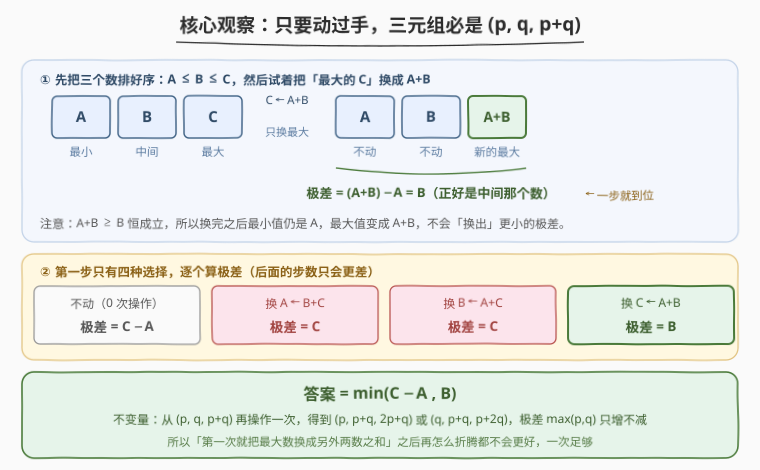
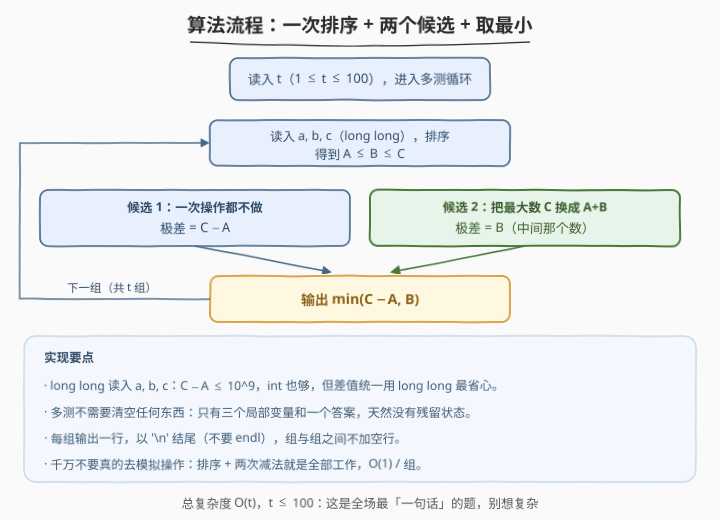
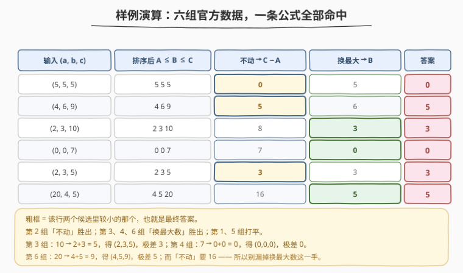

# Codeforces 2256A 黑板上的三个数 题解

## 1. 题目概述

- **标题 / 题号**：黑板上的三个数（Codeforces 2256A，英文名 Three Numbers on the Blackboard）
- **链接**：https://codeforces.com/problemset/problem/2256/A
- **来源**：Codeforces Round 1116 (Div. 2) · Problem A（UTC 2026-08-09）
- **难度**：800（500 分）
- **限制**：时间 1 s / 内存 256 MB
- **标签**：数学，排序

**题意**：黑板上写着三个**非负整数** $a, b, c$。允许做任意多次（可以是 $0$ 次）如下操作：挑出其中一个数，把它换成**另外两个数之和**，另外两个数保持不变。求所有可达局面中，三个数的**极差** $\max - \min$ 的最小值。多测：第一行给出数据组数 $t$，之后每组一行三个整数，对每组输出一行答案。

例如从 $(3,5,11)$ 出发，把 $11$ 换成 $3+5$，得到 $(3,5,8)$，极差从 $8$ 降到 $5$。

**约束**：

- $1 \le t \le 100$，$0 \le a, b, c \le 10^9$
- 三个数可以相等，也可以是 $0$；$0$ 是合法值且会大量出现
- 答案必在 $[0, 10^9]$ 内：极差不会超过初始的 $\max - \min \le 10^9$（我们总能选择「一次都不做」）
- 操作次数**没有上限**，所以任何「模拟 $k$ 步」或状态搜索的思路都不可能直接成立

## 2. 示例与观察
官方样例（输入 / 输出原样）：

```text
输入：
6
5 5 5
4 6 9
2 3 10
0 0 7
2 3 5
20 4 5

输出：
0
5
3
0
3
5
```

逐组对照（把每组先排序成 $A \le B \le C$）：

| 输入 | 排序后 | 不动（$C-A$） | 换最大数（$B$） | 答案 | 关键动作 |
|------|--------|---------------|-----------------|------|----------|
| `5 5 5` | $5,5,5$ | $0$ | $5$ | `0` | 已经全相等 |
| `4 6 9` | $4,6,9$ | $5$ | $6$ | `5` | 不动最好 |
| `2 3 10` | $2,3,10$ | $8$ | $3$ | `3` | $10 \to 2+3=5$，得 $(2,3,5)$ |
| `0 0 7` | $0,0,7$ | $7$ | $0$ | `0` | $7 \to 0+0=0$，三个数全 $0$ |
| `2 3 5` | $2,3,5$ | $3$ | $3$ | `3` | 两种做法打平 |
| `20 4 5` | $4,5,20$ | $16$ | $5$ | `5` | $20 \to 4+5=9$，得 $(4,5,9)$ |

再补一组自造数据（验证「不动更差、必须动手」的情形）：

```text
输入：
1
7 7 20

输出：
7
```

排序后 $(7,7,20)$：不动得 $20-7=13$，把 $20$ 换成 $7+7=14$ 得 $(7,7,14)$，极差 $14-7=7=B$，故答案为 $7$。

## 3. 解题思路

### 3.1 暴力思路

把「三个数的多重集」当作状态做 BFS / DFS：每次枚举替换哪一个，用 `set` 去重，直到搜不出新状态为止。问题是**状态空间无界**——从 $(1,1,1)$ 出发可以做 $(1,1,2)\to(1,2,3)\to(2,3,5)\to\cdots$，数值沿着类似斐波那契的方式增长，上限 $10^9$ 也只是把爆炸推迟几十步。所以暴力既不能枚举完，也给不出答案的规律；必须找到「操作到底改变了什么」的**不变量**。

### 3.2 核心观察：动过手之后，必有一个数等于另外两数之和



把当前三个数排好序记作 $A \le B \le C$。**只要做了一次操作，局面就必然形如 $(p, q, p+q)$**：因为第一次操作把某个数换成了另外两个数之和，此时「这个新数 = 剩下两个数之和」；而此后这条性质**永远保持**——对 $(x, y, x+y)$ 无论替换哪一个：

- 把 $x$ 换成 $y + (x+y) = x+2y$：新三元组 $(x+2y,\ y,\ x+y)$，且 $x+2y = y + (x+y)$；
- 把 $y$ 换成 $x + (x+y) = 2x+y$：新三元组 $(x,\ 2x+y,\ x+y)$，且 $2x+y = x + (x+y)$；
- 把 $x+y$ 换成 $x+y$：局面不变。

于是**任何一个「做过操作」的局面都可以写成 $(p, q, p+q)$（$p, q \ge 0$）**，它的极差是

$$\text{range}(p,q) = (p+q) - \min(p,q) = \max(p,q).$$

这就把「无穷多次操作」压缩成了一个两参数 $(p,q)$ 的表达式。

接下来只需看**第一次操作**给出的三个候选（对 $A \le B \le C$）：

| 第一步替换 | 得到的三元组 | 极差 |
|------------|--------------|------|
| 不替换（$0$ 次操作） | $(A, B, C)$ | $C - A$ |
| 替换 $A$ | $(B+C,\ B,\ C)$ | $C$ |
| 替换 $B$ | $(A,\ A+C,\ C)$ | $C$ |
| 替换 $C$ | $(A,\ B,\ A+B)$ | $B$ |

关键点是**换完 $C$ 之后最小值仍是 $A$**：因为 $A+B \ge B \ge A$ 恒成立（$A \ge 0$），所以新三元组排序后就是 $(A, B, A+B)$，极差 $=(A+B)-A=B$。这里**不需要讨论 $A+B$ 与 $C$ 谁大**，这正是很多人 WA 的地方。

再看「多步会不会更好」：对 $(p,q,p+q)$（$p,q \ge 0$）再做一步，只会得到 $(p,\ p+q,\ 2p+q)$（换 $q$）或 $(q,\ p+q,\ p+2q)$（换 $p$）这类形状——**新极差恰好是 $p+q \ge \max(p,q)$**；而把 $p+q$ 再换一次则局面不变。也就是说**极差从第一次操作之后就只增不减**，所以第一次操作选得最好的那个候选就是全局最优。

结论：设排序后为 $A \le B \le C$，答案就是

$$\operatorname{ans} = \min\bigl(C - A,\ B\bigr).$$

### 3.3 算法流程



1. 读入 $t$，进入多测循环；
2. 读入 $a, b, c$，排序得到 $A \le B \le C$；
3. 候选一：一次都不做，极差 $C - A$；
4. 候选二：把最大数换成另外两数之和，极差 $B$；
5. 输出 $\min(C-A,\ B)$，每组一行。

注意第 4 步**连 $A+B$ 都不用算**——极差直接就是中间那个数，这既省事又顺手避开了 $A+B$ 可能超过 `int` 的坑。

### 3.4 示例演算



以第 3 组 $(2,3,10)$ 为例：排序后 $A=2,\ B=3,\ C=10$，候选一 $C-A=8$，候选二 $B=3$，取 $3$。实际动作是把 $10$ 换成 $2+3=5$，得到 $(2,3,5)$，极差 $5-2=3$，与公式一致。

再以第 6 组 $(20,4,5)$ 为例：排序后 $(4,5,20)$，候选一 $16$，候选二 $5$；把 $20$ 换成 $4+5=9$ 得到 $(4,5,9)$，极差 $9-4=5$。若继续动手（例如把 $4$ 换成 $5+9=14$），只会得到 $(5,9,14)$ 这类极差更大的局面，印证「一次就够」。

## 4. 算法细节

1. **先排序再谈答案**：公式里的 $A,B,C$ 是**有序**的三个数（$A$ 最小、$B$ 中间、$C$ 最大）。直接拿输入顺序套 $c-a$ 与 $b$ 是最常见的 WA。
2. **不需要算 $A+B$**：极差就是 $B$。若为了「自证」去算 $A+B$，注意它最大到 $2\times 10^9$，用 `int` 已接近上界（$2^{31}-1 \approx 2.147\times10^9$），务必用 `long long`。
3. **统一用 `long long`**：$C - A \le 10^9$ 用 `int` 也放得下，但整道题没有任何性能压力，统一 `long long` 可以彻底消除符号/溢出顾虑。
4. **多测无残留状态**：每组只用到三个局部变量和一个答案，不需要 `memset`、不需要清空容器；循环体内定义变量即可。
5. **不要真的模拟**：操作次数无上限，且「不动」本身就是合法选择，模拟既没有终止条件也没有必要。
6. **I/O 细节**：`std::ios::sync_with_stdio(false)` + `cin.tie(nullptr)`，每组输出后用 `'\n'` 而不是 `endl`（后者每组 flush 一次，纯属浪费）；Python 用 `sys.stdin.buffer.read().split()` 一次读入。
7. **不要写 `while (t--)` 之外的花活**：本题 $t \le 100$，读入后 $O(1)$ 出答案，不需要任何预处理或缓存。

## 5. 正确性证明

**记号**：对三元组 $T=(x,y,z)$，记 $\mathrm{rng}(T)=\max T-\min T$。称 $T$ 是**规范形**的，若其中某个数等于另外两个数之和。

**引理 1（不变量）**：若 $T$ 是规范形的，则对 $T$ 做任意一次操作后得到的 $T'$ 仍是规范形的。

**证明**：设 $T=(x,\ y,\ x+y)$（其余两种写法只是命名不同）。三种替换方式：

- 替换 $x$：$T'=(x+2y,\ y,\ x+y)$，而 $x+2y = y+(x+y)$，故 $T'$ 规范；
- 替换 $y$：$T'=(x,\ 2x+y,\ x+y)$，而 $2x+y = x+(x+y)$，故 $T'$ 规范；
- 替换 $x+y$：$T'=T$，仍规范。∎

**引理 2（规范形的极差）**：若 $T=(p,\ q,\ p+q)$ 且 $p,q \ge 0$，则 $\mathrm{rng}(T)=\max(p,q)$。

**证明**：由 $p,q\ge 0$ 得 $p+q \ge p$ 且 $p+q \ge q$，故最大值为 $p+q$；又 $\min(p,q) = p+q-\max(p,q)$，于是 $\mathrm{rng}(T)=(p+q)-\min(p,q)=\max(p,q)$。∎

**引理 3（极差单调不减）**：设 $T=(p,q,p+q)$，$p,q\ge 0$，对 $T$ 操作一次得到 $T'$，则 $\mathrm{rng}(T')\ge \mathrm{rng}(T)$。

**证明**：由引理 1，$T'=(p',q',p'+q')$ 仍为规范形，由引理 2 只需比较 $\max(p',q')$ 与 $\max(p,q)$。三种情形：

- 替换 $p$：$T'=(q,\ p+q,\ 2q+p)$，参数对为 $(q,\ p+q)$，故 $\mathrm{rng}(T')=\max(q,p+q)=p+q\ge\max(p,q)$；
- 替换 $q$：$T'=(p,\ p+q,\ 2p+q)$，参数对为 $(p,\ p+q)$，故 $\mathrm{rng}(T')=p+q\ge\max(p,q)$；
- 替换 $p+q$：$T'=T$，等号成立。

三种情形均有 $\mathrm{rng}(T')\ge\mathrm{rng}(T)$。∎

**引理 4（一步可达的极差）**：设 $A\le B\le C$ 为初始三数。任选一个数替换，得到的一步局面 $T_1$ 的极差只可能取 $B$ 或 $C$ 两个值：替换 $C$ 得 $B$，替换 $B$ 得 $C$，替换 $A$ 得 $C$。特别地 $\mathrm{rng}(T_1)\ge B$。

**证明**：替换 $C$ 得 $(A,B,A+B)$，由 $A+B\ge B\ge A$ 排序后即为 $(A,B,A+B)$，极差 $(A+B)-A=B$。替换 $B$ 得 $(A,\,A+C,\,C)$，由 $A+C\ge C\ge A$ 排序后为 $(A,\,A+C,\,C)$，极差 $(A+C)-A=C$。替换 $A$ 得 $(B+C,\,B,\,C)$，由 $B+C\ge C\ge B$ 排序后为 $(B,\,C,\,B+C)$，极差 $(B+C)-B=C$。∎

**定理**：对任意初始三数，可达局面的最小极差等于 $\min(C-A,\ B)$，其中 $A\le B\le C$ 为排序后的三数。

**证明**：分两类比较。

*下界*。若一步都不做，极差为 $C-A$。若至少做一步，设第一步后局面为 $T_1$，由引理 4 得 $\mathrm{rng}(T_1)\in\{B,C\}$，故 $\mathrm{rng}(T_1)\ge\min(B,C)=B$（这里用到 $B\le C$）；此后每一步由引理 3 极差单调不减，所以最终极差 $\ge \mathrm{rng}(T_1)\ge B$。两类合起来，任何可达局面的极差都 $\ge\min(C-A,\ B)$。

*可达性*。$0$ 次操作给出极差 $C-A$；把 $C$ 换成 $A+B$ 的一次操作给出极差 $B$。两者都真实可达，故下界可以取到。

因此最小极差恰为 $\min(C-A,\ B)$。∎

## 6. 复杂度分析

- **时间**：每组数据一次三元素排序（$O(1)$）常数次加减，$O(1)$；总时间 $O(t)$，$t\le 100$。
- **空间**：$O(1)$，只有三个数与一个答案（Python 里额外有一个长度 $t$ 的输出列表，$O(t)$）。
- **对照时限**：$1$ s 时限下，$t=100$ 的输入量仅 $100$ 行。本地实测（Apple clang `-O2`，$t=100$、数值取 $10^9$ 量级）C++ 端到端耗时约 $3\sim4$ ms（几乎全是进程启动开销），Python 约 $20$ ms（含解释器启动），余量在三个数量级左右。

## 7. 参考代码

### C++17

```cpp
#include <bits/stdc++.h>
using namespace std;

int main() {
    ios::sync_with_stdio(false);
    cin.tie(nullptr);

    int t;
    if (!(cin >> t)) return 0;          // 空输入防护
    while (t--) {
        long long x[3];
        cin >> x[0] >> x[1] >> x[2];
        sort(x, x + 3);                 // 得到 x[0] <= x[1] <= x[2]

        long long keep    = x[2] - x[0]; // 候选一：一次操作都不做
        long long replace = x[1];        // 候选二：把最大数换成另外两数之和，极差恰为中间数
        cout << min(keep, replace) << '\n';
    }
    return 0;
}
```

### Python3

```python
import sys


def main() -> None:
    data = sys.stdin.buffer.read().split()
    if not data:                       # 空输入防护
        return
    t = int(data[0])
    out = []
    for i in range(t):
        a = int(data[1 + 3 * i])
        b = int(data[2 + 3 * i])
        c = int(data[3 + 3 * i])
        a, b, c = sorted((a, b, c))    # a <= b <= c
        out.append(str(min(c - a, b)))  # 不动 vs 换最大数
    sys.stdout.write("\n".join(out) + "\n")


if __name__ == "__main__":
    main()
```

## 8. 边界情况与易错点

1. **三个数全为 $0$**：排序后 $A=B=C=0$，两个候选都是 $0$，答案 $0$；此时「换最大数」只是把 $0$ 换成 $0+0=0$，是个空操作。
2. **三数全相等（如 $10^9,10^9,10^9$）**：$C-A=0$，答案 $0$，此时「换最大数」给出的 $B=10^9$ 更大，取 $\min$ 才不会错。
3. **含 $0$ 但不同**：$(0,0,7)$ 应输出 $0$（把 $7$ 换成 $0+0=0$）；$(0,5,100)$ 应输出 $5$。这类数据专治「候选二写成 $B-A$」或「以为答案不可能是 $0$」的错误理解。
4. **$C$ 远大于 $A+B$**：$(4,5,20)$ 中 $A+B=9<C$，换完之后最大值变成 $9$ 而不是 $C$，公式仍然只取 $B=5$；**不要**去分类讨论 $A+B$ 与 $C$ 的大小关系。
5. **顺序没排就套公式**：题目给的 $a,b,c$ 是任意顺序。若直接输出 $\min(c-a,\,b)$ 而不排序，样例第 6 组 `20 4 5` 就会算成 $\min(-15,4)=-15$，直接 WA。
6. **误以为「多操作几次更好」**：极差在第一次操作后只增不减（引理 3），所以写模拟、写搜索、写「迭代到收敛」都是错的方向；本题的答案是闭式。
7. **输出格式**：每组一行、组间不空行；用 `'\n'` 而不是 `endl`，避免不必要的 flush。
8. **溢出**：即使不用 $A+B$，也建议统一 `long long`；若真要算 $A+B$，其最大值为 $2\times10^9$，已逼近 `int` 上限，用 `int` 属于「侥幸能过」。

## 9. 验证记录

- **编译环境与命令**：`clang++ -std=c++17 -O2`（本机无 GNU g++，配 `codeforces/tools/include/bits/stdc++.h` 兼容头；正文代码只用标准库，可原样提交 GNU C++17）；Python 侧为 `Python 3.9.6`。
- **官方样例**：1 / 1 通过（按 Codeforces 标准 checker 的 token 比对，忽略空白与大小写）。
- **复核状态**：audited（2026-11-19 统一回归：编译 + 官方样例；写作期的随机对拍与暴力未重跑）。

## 相关题目与扩展

- [Codeforces 2256B Domino Tiles](https://codeforces.com/problemset/problem/2256/B)：同场下一题，做完这题可以直接接着练「小规模分类讨论 + 排序」的手感。
- [Codeforces 2255A Hot Potatoes at the Fairy Warehouse](https://codeforces.com/problemset/problem/2255/A)：同样是「表面过程很长、其实答案是一个不变量」的签到题，可与本题对照阅读。
- [LeetCode 1509. 三次操作后最大值与最小值的最小差](https://leetcode.cn/problems/minimum-difference-between-largest-and-smallest-value-in-three-moves/)：目标同样是「最小化极差」，但操作是任意改值，思路是排序后枚举改掉哪几个端点。
- [LeetCode 976. 三角形的最大周长](https://leetcode.cn/problems/largest-perimeter-triangle/)：只需要判断排序相邻三数的 $A+B$ 与 $C$ 的大小关系，与本节的候选表正好呼应。

**延伸思考**：

1. 若操作改成「把某个数换成另外两个数之差的绝对值」，局面会像欧几里得算法一样收缩，答案是否只与 $\gcd$ 有关？先在 $(4,6,9)$、$(2,3,10)$ 上手推几步，看看最小极差是多少。
2. 若把「三个数」推广到 $n$ 个数（每次把一个数换成其余 $n-1$ 个数之和），极差还可能有界吗？$n=3$ 时极差被 $B$ 锁死，$n \ge 4$ 时数值会指数增长，结论完全不同。
3. 本题的最优解**只用零次或一次操作**。若要求**恰好做 $k$ 次**，答案会怎么变？提示：把「那个等于另外两数之和的数」替换一次是**空操作**，所以到达 $(A,B,A+B)$ 之后可以无限次空转，答案仍然与 $k$ 无关；有意思的是再加上「每次必须真正改变数值」这条限制——此时结论会依赖 $A+B$ 与 $C$ 是否相等，值得自己分类讨论一遍。
