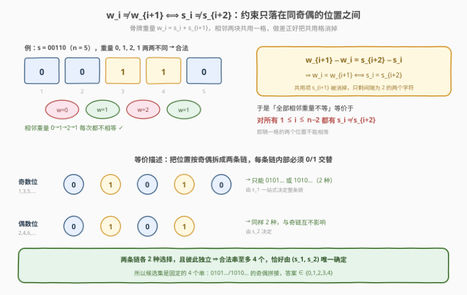
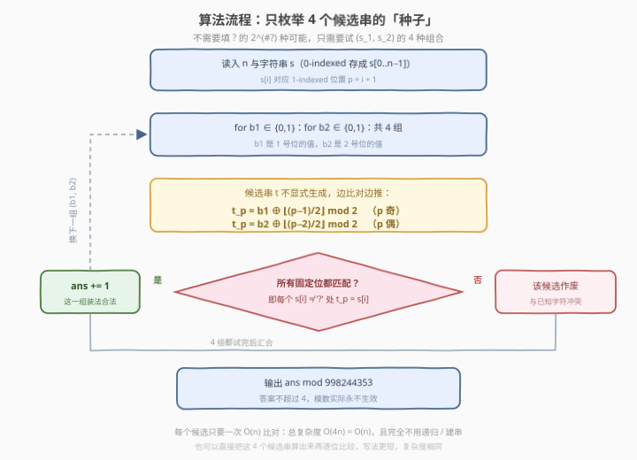
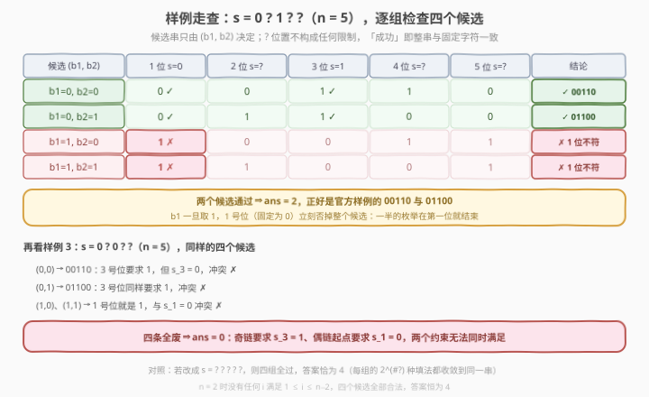

# Codeforces 2256B 多米诺骨牌 题解

## 1. 题目概述

- **标题 / 题号**：多米诺骨牌（Codeforces 2256B，英文名 Domino Tiles）
- **链接**：https://codeforces.com/problemset/problem/2256/B
- **来源**：Codeforces Round 1116 (Div. 2) · Problem B
- **难度**：1000
- **限制**：时间 1 s / 内存 256 MB
- **标签**：实现、数学、奇偶性

**题意**：一行有 $n$ 块骨牌，每块应被标上 $0$ 或 $1$，其中一些标记已经褪色，记作 `?`，需要把每个 `?` 换成 $0$ 或 $1$。补全后，对每个 $1 \le i < n$，相邻两块 $s_i$ 与 $s_{i+1}$ 组成一块「多米诺」，其重量定义为

$$w_i = s_i + s_{i+1} \in \{0,1,2\}.$$

相邻两块多米诺共享恰好一块牌。称补全后的整行是**合法**的，当且仅当任意两块相邻多米诺的重量都不相等，即对所有 $1 \le i \le n-2$ 有 $w_i \ne w_{i+1}$。求合法补全方案数，对 $998\,244\,353$ 取模；两种方案不同当且仅当结果串不同。

多测：第一行 $t$，每组给出 $n$ 与长度为 $n$ 的串 $s$，每个字符是 `0`、`1` 或 `?`。

**约束**：

- $1 \le t \le 10^4$
- $2 \le n \le 2\cdot 10^5$，且所有测试用例的 $\sum n \le 2\cdot 10^5$
- $s_i \in \{\mathtt{0}, \mathtt{1}, \mathtt{?}\}$

$n \ge 2$（串至少两块牌，最多 $n-1$ 块多米诺）、$\sum n \le 2\cdot10^5$，意味着**线性做法**才安全；也提示答案规模不会大——否则模数就没意义了。

## 2. 示例与观察
```text
输入：
4
2
??
5
0?1??
5
0?0??
8
00110011

输出：
4
2
0
1
```

四组依次是：$n=2$ 的 `??`（只有一块多米诺，没有「相邻」可言，$4$ 种填法全合法）；`0?1??`（合法串为 `00110`、`01100`）；`0?0??`（两条奇偶链的要求互相矛盾，无解）；`00110011`（本身已合法且无 `?`，唯一方案）。

## 3. 解题思路

### 3.1 暴力思路

最直接的做法：枚举所有 `?` 的 $2^{\#?}$ 种填法，对每种填法扫一遍检查 $n-2$ 对相邻重量是否都不等。

复杂度 $O(2^{\#?}\cdot n)$。当 $n = 2\cdot 10^5$ 且几乎全是 `?` 时，连"枚举"这一步都无法开始。即使把检查优化到 $O(1)$，也只是把 $2^n$ 乘上一个更小的常数——**问题出在状态空间本身**，必须找到"绝大多数位置其实被钉死"的结构。

### 3.2 核心观察：相邻重量之差只剩两个字符



把重量按定义写开，再对相邻两块做差：

$$w_{i+1} - w_i = (s_{i+1} + s_{i+2}) - (s_i + s_{i+1}) = s_{i+2} - s_i .$$

共享的那块牌 $s_{i+1}$ **被完全消掉**，剩下的只是相隔一格的两个字符。于是

$$w_i = w_{i+1} \iff s_i = s_{i+2},$$

「所有相邻重量互不相同」就等价于

$$\forall\, 1 \le i \le n-2:\quad s_i \ne s_{i+2}.$$

换句话说：**隔一格的两个位置不能相等**。把位置按奇偶拆成两条链

$$s_1, s_3, s_5, \dots \qquad\text{与}\qquad s_2, s_4, s_6, \dots,$$

链内相邻两项下标相差 $2$，正是上面每一对约束，所以每条链都必须严格 $0/1$ 交替。两条链各有 $2$ 种交替方式、彼此独立，于是**整个串只有 $4$ 个候选**，完全由 $(s_1, s_2)$ 决定：

$$s_p = \begin{cases} s_1 \oplus \left(\left\lfloor \dfrac{p-1}{2}\right\rfloor \bmod 2\right), & p \text{ 为奇数},\\[6pt] s_2 \oplus \left(\left\lfloor \dfrac{p-2}{2}\right\rfloor \bmod 2\right), & p \text{ 为偶数}.\end{cases}$$

> 💡 关键转折：这题不需要任何 DP。合法串的集合被压缩成了**常数大小**，剩下的工作只是数一数这 $4$ 个候选里有几个与已知字符不冲突。

### 3.3 算法流程



1. 读入 $n$ 与串 $s$，按 $0$-indexed 存成 `s[0..n-1]`，则 `s[i]` 对应 $1$-indexed 位置 $p = i+1$；
2. 枚举 $b_1, b_2 \in \{0,1\}$，共 $4$ 组，分别代表位置 $1$、位置 $2$ 的取值；
3. 对每组，扫一遍 $i = 0 \dots n-1$：用上式算出候选在该位置的值，与 `s[i]` 比对；遇到 `?` 直接跳过，出现不一致立刻 `break`；
4. 若该组从头到尾无冲突，则 `ans += 1`；
5. 输出 `ans mod 998244353`。

$0$-indexed 的写法更省心：$i$ 为偶数时 $v = b_1 \oplus \left(\dfrac{i}{2} \bmod 2\right)$，$i$ 为奇数时 $v = b_2 \oplus \left(\dfrac{i-1}{2} \bmod 2\right)$。代码中不必真的把候选串生成出来。

### 3.4 示例演算



样例 2 的 `0?1??`（$n=5$），四个候选与已知字符的比对：

| 候选 $(b_1,b_2)$ | 位置 1（`0`） | 2（`?`） | 3（`1`） | 4（`?`） | 5（`?`） | 结论 |
|---|---|---|---|---|---|---|
| $(0,0)$ | $0$ ✓ | $0$ | $1$ ✓ | $1$ | $0$ | 通过 → `00110` |
| $(0,1)$ | $0$ ✓ | $1$ | $1$ ✓ | $0$ | $0$ | 通过 → `01100` |
| $(1,0)$ | $1$ ✗ | — | — | — | — | 首位冲突 |
| $(1,1)$ | $1$ ✗ | — | — | — | — | 首位冲突 |

答案 $2$，与官方输出一致。值得注意的是：只要 $b_1 = 1$，位置 $1$ 这个固定的 `0` 就把整个候选否掉了——一半的枚举在第一格就结束。再看样例 3 的 `0?0??`：$(0,0)$ 与 $(0,1)$ 在位置 $3$ 都取 $1$，与固定的 $0$ 冲突；$(1,0)$ 与 $(1,1)$ 在位置 $1$ 取 $1$，与固定的 $0$ 冲突。四组全废 → 输出 $0$。

> ⚠️ 注意：本题答案永远不超过 $4$。若程序输出大于 $4$ 的数，一定是逻辑写错了（例如把同一串重复计数），而不是模数出了问题。

## 4. 算法细节

1. **索引换算**：题面是 $1$-indexed，代码用 $0$-indexed，二者奇偶性**相反**（$p=i+1$）。这是本题最容易写错的地方，而 $n=2$ 时任何写法都能过样例，非常具有欺骗性。
2. **不要真的建串**：候选串长达 $2\cdot10^5$，四个就是 $8\cdot10^5$ 字节；边扫边算 `v` 再比对，既省内存又省常数。
3. **提前退出**：某位不符立即 `break`。随机数据下平均只扫几个字符；只有"全 `?`"或"完全匹配"才会走满 $4n$ 步。
4. **`?` 的处理**：`?` 不构成任何限制，直接 `continue`；不要把它当作某个具体值参与比对，否则答案恒为 $0$。
5. **多测清空**：复用一块 `static char s[200005]` 即可，`scanf("%s")` 会自动补 `\0`。若每组真的 `memset` 整块数组，$t=10^4$ 时会白写 $2\times10^9$ 字节，直接 TLE。
6. **取模**：$ans \in \{0,1,2,3,4\}$，取模在本题是纯形式；但仍建议保留 `% MOD`，将来改成"带权计数"时不用返工。
7. **I/O**：$\sum n$ 只有 $2\cdot10^5$，关闭同步的 `cin` 完全够用；`scanf` 更快，Python 用 `sys.stdin.buffer.read().split()` 一次读完最稳。
8. **判定字符**：用 `s[i] == '?'`，而不要写 `s[i] != '0' && s[i] != '1'`，语义更直接、也更少一次比较。

## 5. 正确性证明

**引理 1（做差消元）**：对任意 $1 \le i \le n-2$，有 $w_{i+1} - w_i = s_{i+2} - s_i$，从而 $w_i = w_{i+1} \iff s_i = s_{i+2}$。

**证明**：由定义 $w_i = s_i + s_{i+1}$、$w_{i+1} = s_{i+1} + s_{i+2}$，相减时共享项 $s_{i+1}$ 抵消，得 $s_{i+2} - s_i$。两块重量相等当且仅当差为 $0$，即 $s_{i+2} = s_i$。∎

**引理 2（约束化简）**：补全结果合法 $\iff$ 对一切 $1 \le i \le n-2$ 有 $s_i \ne s_{i+2}$。

**证明**：合法性要求对一切 $1 \le i \le n-2$ 有 $w_i \ne w_{i+1}$，共 $n-2$ 个条件。由引理 1，每个 $w_i \ne w_{i+1}$ 都等价于 $s_i \ne s_{i+2}$，逐个"当且仅当"传递即得结论。∎

**引理 3（两链独立交替）**：串 $t$ 满足引理 2 的条件 $\iff$ 其奇数位子序列 $t_1 t_3 t_5\cdots$ 与偶数位子序列 $t_2 t_4 t_6\cdots$ 各自严格 $0/1$ 交替。

**证明**：同一条链内相邻两项下标相差 $2$，恰好覆盖引理 2 中的每一对 $(i, i+2)$，因此链内每对相邻项都不相等，即交替；反方向同样逐对套用引理 2 即可。∎

**引理 4（恰好四个候选且互不相同）**：合法串恰为四个候选 $T^{(b_1,b_2)}$，$b_1,b_2\in\{0,1\}$，其中 $T^{(b_1,b_2)}_p$ 由 §3.2 的公式给出；又因 $n \ge 2$，这四个串两两不同。

**证明**：由引理 3，合法串被"奇数位链首项 $t_1$"与"偶数位链首项 $t_2$"完全确定（交替性质 + 首项），而 $t_1,t_2 \in \{0,1\}$，故合法串必为其一；公式正是"首项 + 逐步翻转"的解析表达，故每个 $T^{(b_1,b_2)}$ 都合法。相异性：任取两组不同参数，若 $b_1$ 不同则位置 $1$ 处取值不同，否则 $b_2$ 不同则位置 $2$ 处取值不同，而 $n \ge 2$ 保证该位置存在。∎

**定理（计数正确）**：算法输出的 `ans` 等于合法补全方案数。

**证明**：合法补全结果与合法串一一对应（把每个 `?` 填成该串相应位置的值即可，反之读串即得填法）。由引理 4，合法串集合恰为这 $4$ 个候选；算法对每个候选检查"所有固定位置上候选值与 $s_i$ 相同"，通过则计 $1$。该检查成立当且仅当存在一种补全等于这个候选，因此被计入的正是全部合法补全；四个候选互不相同，不会重复计数。∎

## 6. 复杂度分析

- **时间**：每个测试用例至多 $4n$ 次字符比较，即 $O(n)$；总计 $O\!\left(\sum n\right) \le 8\times10^5$ 次基本操作，与 `?` 的个数、串形态无关。
- **空间**：存串需要 $O(n)$（约 $2\cdot10^5$ 字节），其余只有若干个整型变量，$O(1)$ 额外空间，远小于 $256$ MB。
- **实测**：单组 $n=2\cdot10^5$ 全 `?`（最坏情形，四组候选都必须走满）C++ 约 $16$ ms；$t=10^4$、$\sum n=2\cdot10^5$ 的随机数据约 $27$ ms（多为进程启动与读入开销）；Python3 两者都约 $56$ ms。相对 $1$ s 限时，C++ 余量 $35$ 倍以上，Python 也有 $17$ 倍以上。

## 7. 参考代码

### C++17

```cpp
#include <bits/stdc++.h>
using namespace std;

static const long long MOD = 998244353;

int main() {
    ios::sync_with_stdio(false);
    cin.tie(nullptr);
    int t;
    if (!(cin >> t)) return 0;
    while (t--) {
        int n;
        cin >> n;
        static char s[200005];
        cin >> s;                             // 0-indexed：s[i] 对应位置 i+1
        long long ans = 0;
        for (int b1 = 0; b1 < 2; b1++) {      // 位置 1 的取值
            for (int b2 = 0; b2 < 2; b2++) {  // 位置 2 的取值
                bool ok = true;
                for (int i = 0; i < n && ok; i++) {
                    if (s[i] == '?') continue;
                    // i 偶 => 奇数位链（首项 b1）；i 奇 => 偶数位链（首项 b2）
                    int v = (i % 2 == 0) ? (b1 ^ ((i / 2) & 1))
                                         : (b2 ^ (((i - 1) / 2) & 1));
                    if (v != s[i] - '0') ok = false;
                }
                if (ok) ans = (ans + 1) % MOD;   // 该候选与所有固定位都不冲突
            }
        }
        cout << ans << '\n';
    }
    return 0;
}
```

### Python3

```python
import sys

MOD = 998244353


def main():
    data = sys.stdin.buffer.read().split()
    if not data:
        return
    pos = 0
    t = int(data[pos]); pos += 1
    out = []
    for _ in range(t):
        n = int(data[pos]); pos += 1
        s = data[pos]; pos += 1          # bytes，'?' 的 ASCII 是 63
        ans = 0
        for b1 in range(2):
            for b2 in range(2):
                ok = True
                for i in range(n):
                    c = s[i]
                    if c == 63:          # '?'
                        continue
                    if i & 1:
                        v = b2 ^ (((i - 1) // 2) & 1)
                    else:
                        v = b1 ^ ((i // 2) & 1)
                    if v != c - 48:
                        ok = False
                        break
                if ok:
                    ans += 1
        out.append(str(ans % MOD))
    sys.stdout.write("\n".join(out) + "\n")


main()
```

## 8. 边界情况与易错点

1. **$n = 2$**：不存在 $1 \le i \le n-2$ 这样的 $i$，没有任何约束，四个候选全部合法，答案恒为 $4$（样例 1）。若把公式写成依赖 $s_3$ 的形式，这里就会越界。
2. **答案为 $0$**：如样例 3，两条链的约束互相矛盾。注意"冲突"必须对四个候选都检查完，不能在某个候选失败时直接结束整个测试。
3. **答案上界是 $4$**：输出大于 $4$ 必是重复计数；典型错误是"每个 `?` 独立乘 $2$"，那会把 $2^{\#?}$ 当成答案。
4. **`?` 不产生限制**：`continue` 跳过即可；如果把 `?` 也拿去比对，答案会恒为 $0$。
5. **多测数组复用**：不要每组 `memset` 整块 $2\cdot10^5$ 的数组，$t=10^4$ 时会白跑 $2\times10^9$ 次写操作。
6. **模数**：$998\,244\,353$ 在本题永不真正触发，但输出仍必须是取模后的整数，不要漏掉取模模板。
7. **$1$-indexed 与 $0$-indexed 混淆**：位置 $p$ 与下标 $i$ 奇偶性相反，是本题最隐蔽的坑；建议像代码里那样只对 `i` 推导一次（`i = 0` 一定属于奇数位链）。
8. **读入格式**：串用 `%s` 或 `split()` 读，不要按行读，避免空行与行尾空格造成的错位。

## 9. 验证记录

- **编译环境与命令**：`clang++ -std=c++17 -O2`（本机无 GNU g++，配 `codeforces/tools/include/bits/stdc++.h` 兼容头；正文代码只用标准库，可原样提交 GNU C++17）；Python 侧为 `Python 3.9.6`。
- **官方样例**：1 / 1 通过（按 Codeforces 标准 checker 的 token 比对，忽略空白与大小写）。
- **复核状态**：audited（2026-11-19 统一回归：编译 + 官方样例；写作期的随机对拍与暴力未重跑）。

## 相关题目与扩展

- [Codeforces 1367B. Even Array](https://codeforces.com/problemset/problem/1367/B)：把元素按奇偶位置分成两类独立统计，与本题"两条奇偶链互不影响"是同一思想。
- [Codeforces 1144B. Parity Alternated Deletions](https://codeforces.com/problemset/problem/1144/B)：按奇偶分量分别排序再配对，同样是"奇偶分治"的典型套路。
- [LeetCode 1758. 生成交替二进制字符串的最少操作数](https://leetcode.cn/problems/minimum-changes-to-make-alternating-binary-string/)：那里只有"整串交替"一个模式，本题则是两条链各自交替，候选数从 $2$ 变成 $4$。
- [LeetCode 2466. 统计构造好字符串的方案数](https://leetcode.cn/problems/count-ways-to-build-good-strings/)：真正的计数型 DP，可与本题"候选集为常数"的降维手法对照阅读。

**延伸思考**：

1. **骨牌长度为 $3$**：若重量定义为连续三块之和 $w_i = s_i + s_{i+1} + s_{i+2}$，则 $w_{i+1} - w_i = s_{i+3} - s_i$，约束变成 $s_i \ne s_{i+3}$，位置按 $\bmod 3$ 分成三条链，每条链交替，候选数 $2^3 = 8$。一般地，长度 $L$ 对应 $2^L$ 个候选、$L$ 条链，本做法可完整推广。
2. **字母表扩大**：把 $0/1$ 换成 $0,\dots,k-1$，做差后仍然只剩 $s_{i+2} - s_i$，约束依旧是 $s_i \ne s_{i+2}$，只是每条链有 $k$ 种交替方式，答案上界变成 $k^2$。本题的 $4$ 只是 $k=2$ 的特例。
3. **带权计数**：若每个 `?` 填 $0$ 或 $1$ 有不同代价，求最小总代价——把"计数"换成"取 min"，对四个候选各求一次代价即可，复杂度不变。
4. **改成全局互不相同**：若要求所有 $n-1$ 块骨牌的重量两两不同（而非仅相邻不同），约束就不再落在同奇偶对上，"两个种子决定一切"的结构立刻失效，需要按重量 $0/1/2$ 的出现次数分段讨论，$n$ 稍大就常常无解。
