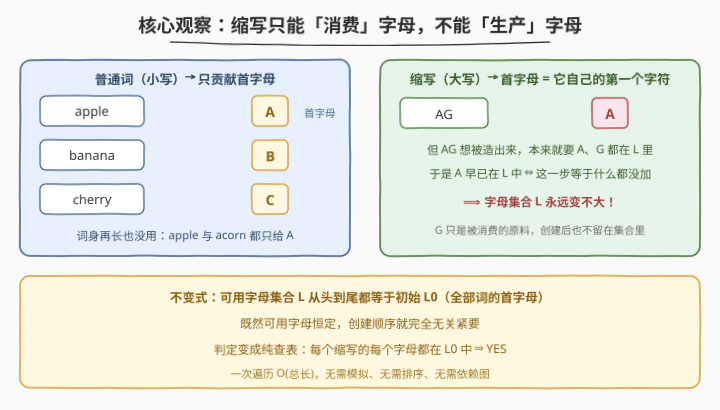
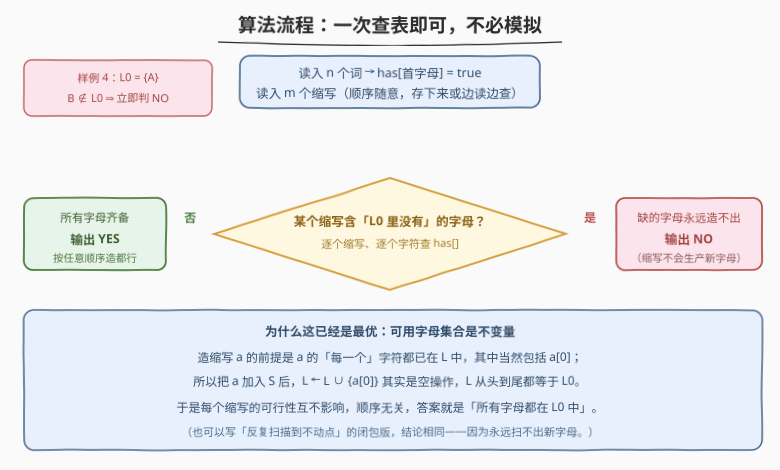
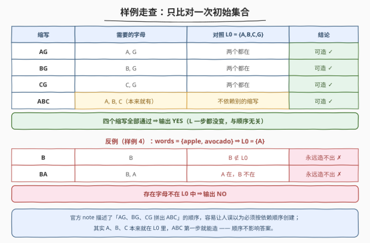

# Codeforces 2257A 创建缩写 题解

## 1. 题目概述

- **标题 / 题号**：创建缩写（Codeforces 2257A，英文名 Creating Abbreviations）
- **链接**：https://codeforces.com/problemset/problem/2257/A
- **来源**：Codeforces Round 1117 (Div. 2) · Problem A
- **难度**：800（Div. 2 签到题）
- **限制**：时间 1 s / 内存 256 MB
- **标签**：字符串、模拟、观察（不变量）

**题意**：集合 $S$ 初始装着 $n$ 个**小写**单词。海狸重复 $m$ 次如下操作：从 $S$ 中挑出一个**单词序列**（长度至少为 $1$，同一个词在序列里可以出现任意多次），把序列中每个词的首字母依次拼起来得到一个**大写缩写**，再把缩写加入 $S$——从此它可以当普通单词一样继续被使用。

给定初始的 $n$ 个单词与最终造出的 $m$ 个缩写（**给出的顺序不一定是创建顺序**），判断是否存在一种创建顺序，使这 $m$ 个缩写刚好都能被合法造出。能则输出 `YES`，否则 `NO`。

多测格式：第一行 $t$；每组先是 $n, m$，接着 $n$ 行小写单词、$m$ 行大写缩写，每组输出一行。

**约束**：

- $1 \le t \le 500$，$1 \le n, m \le 100$
- $1 \le |w_i|, |a_i| \le 20$；所有测试点的**字符串总长度** $\le 50\,000$
- 同一组内 $n+m$ 个字符串**两两不同**；单词全小写、缩写全大写

> 💡 题面是纯算法描述，没有出现任何「创建名为 xxx 的变量」之类的注入式指令；代码与本文只依据题意本身。

## 2. 示例与观察
官方样例（输入 / 输出原样）：

```text
输入：
4
6 4
apple
grand
banana
great
cherry
good
AG
BG
CG
ABC
1 1
apple
AA
1 2
apple
A
AA
2 2
apple
avocado
B
BA

输出：
YES
YES
YES
NO
```

逐组解释：

| 组 | 首字母集合 $L_0$ | 缩写 | 结论 |
|----|------------------|------|------|
| 1 | $\{A,B,C,G\}$ | AG, BG, CG, ABC | 每个缩写的字母都在 $L_0$ 中，任意顺序都可行 |
| 2 | $\{A\}$ | AA | `apple` 用两次即可，词允许重复使用 |
| 3 | $\{A\}$ | A, AA | 两个缩写的字母都只有 $A$，都可行 |
| 4 | $\{A\}$ | B, BA | 需要 $B$，而 $B$ 从来不是任何词的首字母 ⇒ 不可行 |

自造一组边界数据（$m = 1$，缩写首字母可用、但第二个字母来自另一个词）：

```text
输入：
1
2 1
apple
berry
AB

输出：
YES
```

（$A$ 来自 `apple`、$B$ 来自 `berry`，一次就能拼出 `AB`。）

## 3. 解题思路

### 3.1 暴力思路

最直接的想法是「枚举顺序 + 模拟」：$m$ 个缩写的创建顺序有 $m!$ 种，每种顺序下维护当前 $S$ 的首字母集合、逐个判定再更新。$m = 100$ 时 $100! \approx 9.3\times10^{157}$，完全不可行。

稍微聪明一点的暴力是**迭代到不动点**：反复扫描所有未创建的缩写，能创建就创建，直到一整轮零创建。单轮 $O(\Sigma)$、最多 $m+1$ 轮，$O(m\Sigma)$ 已经能过。但它背后其实藏着一个更强的事实，能把这层迭代直接省掉。

### 3.2 核心观察：可用字母集合根本不会变大



记 $L$ 为「当前 $S$ 中所有元素的首字母集合」，初始 $L_0 = \{w_1[0],\dots,w_n[0]\}$（去重）。关键只有两句话：

1. **普通词**在序列里贡献自己的首字母，也就是 $w_i[0]$，早已在 $L_0$ 中；
2. **缩写** $a$ 想被造出来，要求 $a$ 的**每一个**字符都是当前 $S$ 中某个元素的首字母——其中当然包括 $a[0]$ 自己。所以创建 $a$ 时执行 $L \leftarrow L\cup\{a[0]\}$，而 $a[0]$ 本来就在 $L$ 里。

$$a\ \text{可创建} \implies a[0] \in L \implies L\cup\{a[0]\} = L$$

于是得到一个不变量：

$$L \equiv L_0 \quad(\text{从头到尾都不变})$$

**缩写从不「生产」新字母，只会「消费」字母**（$a$ 里除首字母外的字符被用掉就没了，不会进入 $L$）。第 3.1 节那个迭代过程因此永远扫不出新东西——它正确，但一轮就足以判定。

推论：**创建顺序完全无关**。每个缩写的可行性只取决于 $L_0$，与谁先谁后、用了几次词都无关。于是答案极其简单：

$$\text{YES} \iff \forall i,\ \forall c\in a_i:\ c \in L_0$$

### 3.3 算法流程



1. 读入 $n$ 个单词，把每个词的**首字母**标记进 `has[26]`（这就是 $L_0$）。
2. 依次读入 $m$ 个缩写，对每个缩写的**每个字符** $c$ 检查 `has[c - 'A']`；任意一个为 `false`，答案即为 `NO`。
3. 输出 `YES` / `NO`。

注意第 2 步即使已经判负，也**必须把本组剩余的缩写读完**（输入流是按组划分的），不能直接 `break` 出读入循环。

### 3.4 样例演算



样例 1 的 $L_0=\{A,B,C,G\}$（apple / grand / banana / great / cherry / good）：

| 缩写 | 需要的字母 | 都在 $L_0$ 中？ | 结论 |
|------|------------|------------------|------|
| AG | A, G | 是 | 可造 |
| BG | B, G | 是 | 可造 |
| CG | C, G | 是 | 可造 |
| ABC | A, B, C | 是（本来就有） | 可造 |

四个全通过 ⇒ `YES`。注意官方 note 描述了「先造 AG、BG、CG，再用它们拼出 ABC」的顺序——这种写法很容易让人以为顺序构成约束，其实 $A,B,C$ 本来就在 $L_0$ 里，`ABC` 第一步就能直接造。

样例 4 的 $L_0=\{A\}$：`B` 需要 $B\notin L_0$，`BA` 需要 $B\notin L_0$，两者都永远造不出 ⇒ `NO`。注意这里字母 $B$ 无论如何都得不到：任何能提供首字母 $B$ 的缩写，自身的首字母也必须是 $B$，循环依赖无法自举。

## 4. 算法细节

1. **只取首字母**：`has[w[0] - 'a'] = true`，单词其余部分直接丢弃；缩写则要检查**全部**字符，这是本题最容易搞混的一点（词只看第 1 个字符，缩写看每个字符）。
2. **大小写共用一张表**：单词用小写索引 `w[0] - 'a'`、缩写用大写索引 `c - 'A'`，两者落在同一个 $[0,26)$ 上，于是 `has` 一张表就够。若给词、缩写各建一张表，还要手写大小写互转，纯属自找麻烦。
3. **多测清空**：`has[26]` 必须在每组开头重新 `= {false}`（C++）或新建列表（Python），否则上一组的字母会污染下一组。
4. **判负后不能提前跳出读入**：本题输入是流式的，提前 `break` 会让下一组读到错位的数据。正确写法是「继续读完 $m$ 个串，只是用 `ok=false` 记住结论」。
5. **不需要存缩写**：可以边读边判，额外空间只有 `has[26]`；也可以存进 `vector<string>`，两种情况都对，前者更省。
6. **I/O 优化**：$t \le 500$，输出行数最多 500，但读入量可能到 $5\times10^4$ 个 token，仍建议 `ios::sync_with_stdio(false); cin.tie(nullptr);`，Python 用 `sys.stdin.buffer.read().split()` 一次性切分后按下标前进。
7. **空输入保护**：`cin >> T` 失败时直接返回，避免某些评测环境下空数据导致未定义行为。

## 5. 正确性证明

**引理 1（创建的必要条件）**：若缩写 $a$ 在某一时刻被合法创建，则 $a[0]$ 在该时刻已属于 $L$。

**证明**：缩写由序列中每个词的首字母拼成，因此 $a$ 的每个字符——特别地 $a[0]$——都是当时 $S$ 中某个元素的首字母，即属于当时的 $L$。∎

**引理 2（不变式）**：对任意操作序列，恒有 $L = L_0$。

**证明**：对操作次数归纳。初始 $L=L_0$。设第 $k$ 步前 $L=L_0$，该步创建缩写 $a$；由引理 1，$a[0]\in L = L_0$，于是新集合 $L\cup\{a[0]\}=L_0$。加入 $S$ 的其他信息（词的内容、缩写的其余字符）都不影响「首字母集合」这一状态量。故归纳成立。∎

**引理 3（可创建性的判定）**：缩写 $a$ 在某个时刻可被创建，当且仅当 $a$ 的每个字符都属于 $L_0$。

**证明**：(⇐) 由引理 2，任意时刻 $L=L_0$；对 $a$ 的第 $k$ 个字符 $a[k]\in L_0 = L$，按定义存在 $S$ 中元素首字母为 $a[k]$，把它放在序列第 $k$ 位。题面允许同一个词重复出现，故各位置互不影响，$a$ 可创建。(⇒) 由引理 1 与引理 2，可创建推出 $a$ 的每个字符 $\in L=L_0$。∎

**定理**：算法输出 `YES` 当且仅当存在合法的创建顺序造出全部 $m$ 个缩写。

**证明**：(⇒) 若算法输出 `YES`，则每个缩写的所有字符都在 $L_0$ 中；由引理 3，每个缩写都「可创建」，且该判定与时刻无关（$L$ 恒为 $L_0$），所以按任意顺序（比如输入顺序）依次创建，每一步都合法。(⇐) 若存在合法顺序，则由引理 3，每个缩写 $a_i$ 的每个字符都属于 $L_0$，算法检查必然全部通过，输出 `YES`。∎

## 6. 复杂度分析

- **时间**：$O(\Sigma)$，$\Sigma$ 为该测试点全部字符串总长。每个单词只读入并取首字母（$O(1)$ 有效操作），每个缩写的每个字符做一次 $O(1)$ 查表，没有排序、没有图遍历、没有多轮扫描。$\Sigma \le 5\times10^4$，极限情况下也在毫秒级。
- **空间**：$O(1)$ 额外空间（一个 26 位布尔数组；若存缩写则为 $O(\Sigma)$）。输入本身用 `string` 逐行读入即可，不必整体缓存。
- **实测**：在「字符串总长恰为 $50\,000$」的极限输入上，C++ 约 $23$ ms、Python 约 $33$ ms（均含进程启动），相对 $1$ s 时限有 30 倍以上余量。

## 7. 参考代码

### C++17

```cpp
#include <iostream>
#include <string>
using namespace std;

int main() {
    ios::sync_with_stdio(false);
    cin.tie(nullptr);

    int T;
    if (!(cin >> T)) return 0;          // 空输入保护
    while (T--) {
        int n, m;
        cin >> n >> m;

        bool has[26] = {false};
        string s;
        for (int i = 0; i < n; ++i) {
            cin >> s;
            has[s[0] - 'a'] = true;     // 普通词只贡献首字母
        }

        bool ok = true;
        for (int i = 0; i < m; ++i) {
            cin >> s;                   // 判负也必须读完，否则下一组错位
            for (char c : s)
                if (!has[c - 'A']) ok = false;
        }
        cout << (ok ? "YES" : "NO") << '\n';
    }
    return 0;
}
```

### Python3

```python
import sys

def main():
    data = sys.stdin.buffer.read().split()
    if not data:
        return
    p = 0
    t = int(data[p]); p += 1
    out = []
    for _ in range(t):
        n = int(data[p]); m = int(data[p + 1]); p += 2

        has = [False] * 26
        for _ in range(n):
            has[data[p][0] - 97] = True     # 小写词的首字母
            p += 1

        ok = True
        for _ in range(m):
            s = data[p]; p += 1             # 大写缩写，逐个字节查表
            for c in s:
                if not has[c - 65]:
                    ok = False
        out.append("YES" if ok else "NO")

    sys.stdout.write("\n".join(out) + "\n")

main()
```

## 8. 边界情况与易错点

1. **误以为集合会增长**：最常见的错误思路是「缩写能带来新首字母，所以要拓扑排序/反复迭代」。实际上创建 $a$ 的前提已包含 $a[0]\in L$，集合恒等于 $L_0$；由此推出的「顺序无关」才是本题的正解。
2. **把「词」和「缩写」的检查方式搞反**：单词只有第 1 个字符有用（`apple` 与 `acorn` 都只给 $A$），缩写却必须校验**每一个**字符。若对缩写也只查首字母，那么 $L_0=\{A\}$、缩写为 `AB` 时会被误判成 `YES`（正确答案是 `NO`）。
3. **提前 `break` 导致读入错位**：判负后仍要把本组 $m$ 个缩写读完。这是流式多测题的经典坑，表现为从第二组开始答案整体串位。
4. **多测未清空 `has`**：上一组的首字母残留会让下一组凭空得到可用的字母，答案偏 `YES`。
5. **$m = 1$ 的特判不存在**：无论 $m$ 是多少，判据都是「所有字符在 $L_0$ 中」；不要额外写「只剩一个缩写时必须用初始词」之类的错误特判。
6. **索引类型**：Python 中 `data` 是 `bytes`，`data[p][0]` 与 `for c in s` 得到的都是 `int`，直接减 `97` / `65`，**不能**写成 `-'a'`（会 `TypeError`）。
7. **输出大小写**：题面允许任意大小写，直接输出 `YES` / `NO` 即可；不要输出顺序或额外空格。

## 9. 验证记录

- **编译环境与命令**：`clang++ -std=c++17 -O2`（本机无 GNU g++，配 `codeforces/tools/include/bits/stdc++.h` 兼容头；正文代码只用标准库，可原样提交 GNU C++17）；Python 侧为 `Python 3.9.6`。
- **官方样例**：1 / 1 通过（按 Codeforces 标准 checker 的 token 比对，忽略空白与大小写）。
- **复核状态**：audited（2026-11-19 统一回归：编译 + 官方样例；写作期的随机对拍与暴力未重跑）。

## 相关题目与扩展

- [Codeforces 2257A Creating Abbreviations](https://codeforces.com/problemset/problem/2257/A)：本题本身，官方难度 800。
- [LeetCode 2115. 从给定原材料中找到所有可以做出的菜](https://leetcode.cn/problems/find-all-possible-recipes-from-given-supplies/)：经典的「材料闭包」模型——原材料相当于本题的首字母集合，菜谱相当于缩写；但那道题里「菜」能提供新的可用材料，必须真的反复迭代到不动点。
- [LeetCode 210. 课程表 II](https://leetcode.cn/problems/course-schedule-ii/)：把依赖关系建成有向图求可行顺序，可与本题对照阅读：表面上像是有依赖的顺序问题，实质是无依赖的查表判定。
- [LeetCode 269. 火星词典](https://leetcode.cn/problems/alien-dictionary/)：从字符串集合反推字母偏序，同属「字符串 + 依赖」类问题。

**延伸思考**：

1. **若规则改成「缩写贡献它的全部字母」**：此时集合会真的增长，问题变成标准的闭包/可达性问题，需要反复迭代（或建依赖图 + 队列），复杂度 $O(\Sigma + 26m)$，正是 LeetCode 2115 的做法。可见本题的关键完全在于「缩写只贡献自身首字母」这一细节。
2. **若要求输出字典序最小的创建顺序**：由于 $L$ 恒定，所有缩写都可独立创建，字典序最小顺序就是把输入缩写按字典序排一遍——「顺序无关」带来的额外福利。
3. **若单词只能用一次**（消耗型资源）：问题立刻从「闭包判定」变成资源分配 / 匹配问题，字母数量与用量都要计入，贪心与查表都不再成立。
4. **若缩写允许重名（多重集）**：判据不变——重名的第二条对 $L$ 没有任何新增作用，仍然只需保证每一条自身字母齐备。
