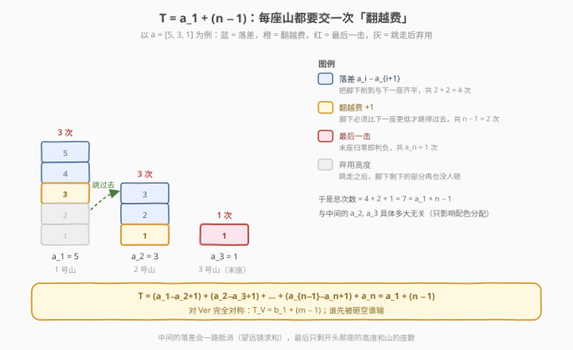
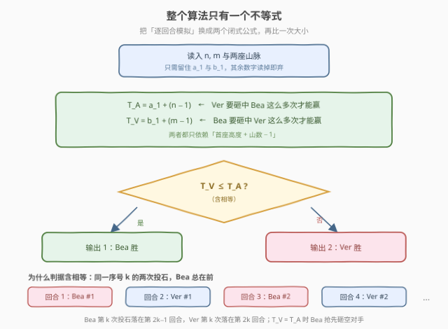
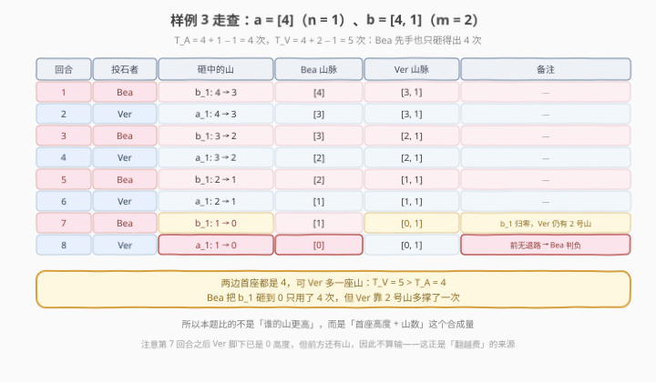

# Codeforces 2257B 巨人之战 题解

## 1. 题目概述

- **标题 / 题号**：巨人之战（Codeforces 2257B，英文名 Gigantomachy）
- **链接**：https://codeforces.com/problemset/problem/2257/B
- **来源**：Codeforces Round 1117 (Div. 2) · Problem B
- **难度**：800
- **限制**：时间 1 s / 内存 256 MB
- **标签**：数学、博弈、不变量、贪心

**题意**：巨人 Bea 与 Ver 各守一条山脉，Bea 的山高为 $a_1 \ge a_2 \ge \cdots \ge a_n$，Ver 的山高为 $b_1 \ge b_2 \ge \cdots \ge b_m$（Ver 的编号方向相反，两人隔空相对）。开局双方都站在 1 号山上。每回合轮到谁，谁就依次做三件事：

1. 朝**对手正站着的那座山**扔一块巨石，使其高度减 $1$；
2. 若自己**正前方**（编号 $+1$）那座山比脚下的山更高，就跳过去（只跳一座）；
3. 若发现自己站在高度为 $0$ 的碎石上、且前方已经**没有山**了，则认输。

Bea 先手，求胜者编号（$1$ 表示 Bea，$2$ 表示 Ver）。多测。

**约束**：

- $1 \le t \le 500$
- $1 \le n, m \le 100$
- $1 \le a_i, b_i \le 10^9$，且 $a_i \ge a_{i+1}$、$b_i \ge b_{i+1}$（输入保证非递增，无需自行检查）

高度最大 $10^9$ 而山数只有 $100$——这个「两极化」的约束组合就是本题的全部线索：**答案必然有闭式，绝不可能按回合模拟**。

## 2. 示例与观察
官方样例（输入 / 输出原样）：

```text
输入：
6
1 1
1
1
1 1
1
2
1 2
4
4 1
4 2
4 3 2 1
10 1
4 2
4 3 2 1
6 5
4 2
4 3 2 1
7 5

输出：
1
2
2
2
1
2
```

6 组数据依次是 $a=[1],b=[1]$；$a=[1],b=[2]$；$a=[4],b=[4,1]$；$a=[4,3,2,1],b=[10,1]$；$a=[4,3,2,1],b=[6,5]$；$a=[4,3,2,1],b=[7,5]$。第 3 组是理解本题的关键自洽性检查：双方首座高度都是 $4$，可 Ver 有两座山，结果反而是 Ver 赢。

## 3. 解题思路

### 3.1 暴力思路

照题面逐回合模拟：维护两人所在下标与两条山脉的当前高度，每回合执行「对手那座 $-1$ → 判断自己能否前跳 → 判断自己是否认输」，直到有人倒下。

复杂度是 $O(T_A + T_V) = O(a_1 + b_1)$，最坏 $2\times10^9$ 回合，单组就要按秒级以上的时间计，$t=500$ 时彻底不可行。更糟的是高度是 $10^9$ 级，连「压缩状态」都救不了——$\Theta(a_1)$ 个不同高度值本身就无法枚举。

所以必须换视角：**不去问「第几回合发生什么」，而问「某人一共能挨多少拳」**。

### 3.2 核心观察：每座山要交一次「翻越费」



先钉死一条结构性事实：**对手的石头永远只落在你脚下的那一座山上**。于是只要你还没跳到 $i+1$ 号山，$a_{i+1}$ 就一直是原始高度，完全没被碰过。

站在 $i$ 号山（高度从 $a_i$ 开始）时，挨第 $k$ 拳后脚下高度变为 $a_i - k$。跳跃条件是「下一座更高」，即前一座必须被砸到

$$a_i - k < a_{i+1} \iff k \ge a_i - a_{i+1} + 1 .$$

所以从 $i$ 号山挪到 $i+1$ 号山，对面恰好要砸 **$a_i - a_{i+1} + 1$** 拳；到达 $i+1$ 时它的高度仍是原始的 $a_{i+1}$。最后一座山没有下一座可跳，被砸 **$a_n$** 拳即倒下。合计

$$T = \sum_{i=1}^{n-1}\bigl(a_i - a_{i+1} + 1\bigr) + a_n = (a_1 - a_n) + (n-1) + a_n = a_1 + (n - 1).$$

中间的落差一路望远镜抵消，只剩「首座高度」与「山数」。直觉上：每翻过一座山都要多交一次「翻越费」（必须把脚下砸到比前一座更低才跳得过去），一共 $n-1$ 次；最后一座则要老老实实砸到 $0$，付 $a_n$ 拳。

> 💡 **特例校验**：$n = 1$ 时 $T = a_1$，退化成「就一座山，砸到 0 就完事」，与直觉一致。

对 Ver 完全对称：$T_V = b_1 + (m-1)$。于是胜负只取决于这两个数谁更小，以及**先手**。

### 3.3 算法流程



1. 读入 $n, m$；读 $a$ 时只保留 $a_1$，读 $b$ 时只保留 $b_1$（其余数字读掉即可，不影响结论）；
2. 算 $T_A = a_1 + n - 1$、$T_V = b_1 + m - 1$；
3. 若 $T_V \le T_A$ 输出 `1`（Bea 胜），否则输出 `2`（Ver 胜）。

判据里为什么含等号？把回合编号摊开看：Bea 的第 $k$ 次投石落在第 $2k-1$ 回合，Ver 的第 $k$ 次落在第 $2k$ 回合——**同序号的两次投石，Bea 永远早一步**。若 $T_V = T_A = T$，Bea 在第 $2T-1$ 回合就把 Ver 砸空，Ver 的第 $T$ 次投石（第 $2T$ 回合）压根没机会发生，所以平局归 Bea。

### 3.4 示例演算



以第 3 组 $a=[4]$、$b=[4,1]$ 为例，$T_A = 4 + 1 - 1 = 4$、$T_V = 4 + 2 - 1 = 5$：Bea 先手也只能砸出 $4$ 拳，差一拳，Ver 胜。

把官方 6 组样例全部代入公式：

| # | $n, m$ | $a_1, b_1$ | $T_A = a_1+n-1$ | $T_V = b_1+m-1$ | 比较 | 输出 |
|---|--------|-----------|-----------------|-----------------|------|------|
| 1 | 1, 1 | 1, 1 | 1 | 1 | $T_V = T_A$，平局归先手 | 1 |
| 2 | 1, 1 | 1, 2 | 1 | 2 | $T_V > T_A$ | 2 |
| 3 | 1, 2 | 4, 4 | 4 | 5 | $T_V > T_A$ | 2 |
| 4 | 4, 2 | 4, 10 | 7 | 11 | $T_V > T_A$ | 2 |
| 5 | 4, 2 | 4, 6 | 7 | 7 | $T_V = T_A$ | 1 |
| 6 | 4, 2 | 4, 7 | 7 | 8 | $T_V > T_A$ | 2 |

注意第 4、5、6 组：Bea 的山脉一模一样（$T_A$ 恒为 $7$），只有 $b_1$ 从 $10$ 变到 $6$、$7$，胜负就在 $T_V \le 7$ 这条线上翻转——这说明公式确实抓住了全部的判定信息，$a_2, a_3, a_4$ 的取值对胜负完全没有影响。

## 4. 算法细节

1. **只读首元素**：读 $a$ 的循环里用 `if (i == 0) a1 = x;` 留一手即可。不要只读一个数就跳行——后面的 $n-1$ 个数会错位成下一组的 $m$，直接 RE/WA。
2. **用 `long long`**：$a_1 \le 10^9$、$n \le 100$，和不超过 $10^9 + 99$，`int` 其实够，但公式里要写 `a1 + n`，养成用 `long long` 的习惯可避免以后推广到大范围时溢出。
3. **判据方向**：Bea 胜 $\iff T_V \le T_A \iff a_1 + n \ge b_1 + m$。反过来写（$<$ 与 $>$）是本题最常见的翻车点；记忆法是「$T$ 小的人先倒，$T$ 相等时先手赢」。
4. **多测无状态**：每组只存 `n, m, a1, b1` 四个变量，天然无需清空数组；`t=500` 且元素总量 $\le 10^5$，`scanf`/`cin`（关同步）都绰绰有余。
5. **输出格式**：每组一行，只输出 `1` 或 `2`，不要带 `Case #x:` 之类前缀。
6. **不要动输入的非递增性**：排序、去重、取最大值都会改变 $n$（也就是改变「翻越费」的次数），从而改变答案。
7. **Python 的读入**：一次 `sys.stdin.buffer.read().split()` 拿到全部 token 再切片最快，注意切片时 `a` 与 `b` 的长度分别由 $n$、$m$ 决定。

## 5. 正确性证明

**引理 1（前方未被触碰）**：在 Bea 站上 $i$ 号山之前，$a_{i+1}, \ldots, a_n$ 始终等于初始高度。

**证明**：Ver 的每块石头只砸 Bea 当前所站的那座山，而 Bea 的位置只会沿 $1,2,\ldots,n$ 单调前进（跳跃只在编号 $+1$ 方向发生）。故在 Bea 抵达 $i$ 之前，$i+1$ 及更后的山从未被任何石头击中。∎

**引理 2（跳跃时机）**：设 Bea 站在 $i$ 号山（$i<n$）、脚下高度从 $a_i$ 开始。则她恰在 Ver 投出第 $a_i - a_{i+1} + 1$ 块石头后、自己的下一个回合跳向 $i+1$，且跳过去时 $i+1$ 号山的高度为 $a_{i+1}$。

**证明**：由引理 1，$a_{i+1}$ 保持初始值。Ver 每投一块石头，Bea 脚下高度减 $1$；跳跃发生在 Bea 自己的回合（投石之后）且当且仅当「前方更高」成立。挨 $k$ 块石头后高度为 $a_i - k$，「前方更高」即 $a_{i+1} > a_i - k$，最小的满足者 $k^\star = a_i - a_{i+1} + 1$。由于 Ver 的投石逐次进行、Bea 每回合都会检查一次，故她恰在 $k = k^\star$ 这一次之后跳走，此时位置为 $i+1$，高度为未被触碰的 $a_{i+1}$。∎

**引理 3（总次数）**：Bea 从开局到被淘汰，Ver 恰好需要投出 $T_A = a_1 + (n-1)$ 块石头；中途不会出现「卡死」（既跳不动又没输）的状态。

**证明**：反复用引理 2：$1\to2$ 花 $a_1-a_2+1$ 拳，$2\to3$ 花 $a_2-a_3+1$ 拳……$n-1\to n$ 花 $a_{n-1}-a_n+1$ 拳，最后在 $n$ 号山从 $a_n$ 被砸到 $0$ 花 $a_n$ 拳。求和即 $a_1 + (n-1)$。不卡死：若在 $i<n$ 处高度已为 $0$，由 $a_{i+1} \ge 1 > 0$ 知「前方更高」成立，下一回合必能跳走；在 $i=n$ 处高度为 $0$ 即判负。∎

**引理 4（势能形式）**：对 Bea 定义 $R = h + (n - i)$（$h$ 为脚下当前高度）。则每次被砸 $R$ 减 $1$，每次跳跃 $R$ 不变，且 $R = 0 \iff$ Bea 被判负。

**证明**：被砸时 $h$ 减 $1$、$i$ 不变，故 $R$ 减 $1$。跳跃时由引理 2 有 $h = a_{i+1}-1$ 且 $i \to i+1$，于是新值 $a_{i+1} + (n-i-1)$ 与旧值 $(a_{i+1}-1) + (n-i)$ 相等，$R$ 不变。$R=0$ 需 $h=0$ 且 $i=n$，正是判负条件。初值 $R = a_1 + (n-1) = T_A$，与引理 3 一致。∎

**引理 5（先后手）**：Bea 的第 $k$ 次投石发生在第 $2k-1$ 回合，Ver 的第 $k$ 次发生在第 $2k$ 回合。

**证明**：Bea 先手，回合在两人之间严格交替，故第 $j$ 回合的执行者是 Bea 当且仅当 $j$ 为奇数。∎

**定理**：若 $T_V \le T_A$ 则 Bea 胜，否则 Ver 胜。

**证明**：由引理 3（及其对 Ver 的对称版本），Ver 恰在第 $2T_V - 1$ 回合之后倒下，Bea 恰在第 $2T_A$ 回合之后倒下。

若 $T_V \le T_A$，则 $2T_V - 1 \le 2T_A - 1 < 2T_A$：Ver 先被砸空，而此时 Ver 只投了 $T_V - 1 \le T_A - 1$ 块石头，Bea 尚未倒下，Bea 胜。

若 $T_V > T_A$，即 $T_V \ge T_A + 1$，则 Bea 在第 $2T_A$ 回合倒下，而 Bea 的第 $T_V$ 次投石要到第 $2T_V - 1 \ge 2T_A + 1$ 回合才发生，Ver 尚未倒下，Ver 胜。两种情形互斥且穷尽。∎

## 6. 复杂度分析

- **时间**：每个测试用例只需读入 $n + m$ 个整数并做 $O(1)$ 次加法与比较，$O(n + m)$；总计 $O\!\left(\sum (n+m)\right) \le 10^5$ 次基本操作，与高度 $10^9$ 完全无关。
- **空间**：$O(1)$，只存 `n, m, a1, b1` 四个整数，无数组无字符串，远小于 256 MB。
- **实测**：$t = 500$、$n = m = 100$、$a_i, b_i$ 在 $10^9$ 内随机的最大数据，整个进程（含启动）C++ 约 $12\ \text{ms}$、Python3 约 $30\ \text{ms}$；对 $1\ \text{s}$ 限时的余量在 $30$ 倍以上，真实计算部分只有微秒级。

## 7. 参考代码

### C++17

```cpp
#include <bits/stdc++.h>
using namespace std;

int main() {
    int t;
    if (scanf("%d", &t) != 1) return 0;
    while (t--) {
        int n, m;
        scanf("%d %d", &n, &m);
        long long a1 = 0, b1 = 0, x;
        for (int i = 0; i < n; i++) {        // 只留首座高度，其余读掉
            scanf("%lld", &x);
            if (i == 0) a1 = x;
        }
        for (int i = 0; i < m; i++) {
            scanf("%lld", &x);
            if (i == 0) b1 = x;
        }
        // T_A = a1 + n - 1，T_V = b1 + m - 1；Bea 先手，T_V <= T_A 即 Bea 胜
        printf("%d\n", (a1 + n >= b1 + m) ? 1 : 2);
    }
    return 0;
}
```

### Python3

```python
import sys


def main():
    data = sys.stdin.buffer.read().split()
    if not data:
        return
    p = 0
    t = int(data[p]); p += 1
    out = []
    for _ in range(t):
        n = int(data[p]); m = int(data[p + 1]); p += 2
        a = data[p:p + n]; p += n
        b = data[p:p + m]; p += m
        a1, b1 = int(a[0]), int(b[0])
        out.append("1" if a1 + n >= b1 + m else "2")
    sys.stdout.write("\n".join(out) + "\n")


main()
```

## 8. 边界情况与易错点

1. **$n = m = 1$ 且 $a_1 = b_1$**：$T_A = T_V$，平局归先手，答案是 `1`（样例 1）。把判据写成严格不等号就会在这里挂掉。
2. **首座高度相同、山数不同**：$a_1 = b_1 = 4$ 时，$n=1, m=2$ 是 Ver 胜（样例 3），$n=2,m=1$ 才是 Bea 胜。多出的那座山就是多一次翻越费，绝不能用「谁的首座更高」代替判据。
3. **$n = 1$**：$T = a_1 + 0 = a_1$，公式自然退化，不需要任何特判。若手写成 $a_1 - 1$ 就会在样例 1、2 上出错。
4. **高度全相同（平坦山脉）**：$a_i = a_{i+1}$ 时每次跳跃只需 $1$ 拳（砸到 $a_i-1$ 即可），$T = a_1 + (n-1)$ 依然成立，不用额外分支。
5. **$10^9$ 级高度**：只能走公式，任何逐回合模拟都会 TLE；同时注意别把「回合数」与「投石数」混淆——Ver 的第 $T$ 次投石在第 $2T$ 回合，数值会翻倍但结论不受影响。
6. **多测的读入边界**：$t=500$ 时要确保每组把 $n + m$ 个数全部读掉，提前 `break` 会造成所有后续用例错位。
7. **不要对输入排序/去重**：输入已经保证非递增，额外操作只会破坏 $n, m$，把「翻越费」的次数改错。

## 9. 验证记录

- **编译环境与命令**：`clang++ -std=c++17 -O2`（本机无 GNU g++，配 `codeforces/tools/include/bits/stdc++.h` 兼容头；正文代码只用标准库，可原样提交 GNU C++17）；Python 侧为 `Python 3.9.6`。
- **官方样例**：1 / 1 通过（按 Codeforces 标准 checker 的 token 比对，忽略空白与大小写）。
- **复核状态**：audited（2026-11-19 统一回归：编译 + 官方样例；写作期的随机对拍与暴力未重跑）。

## 相关题目与扩展

- [Codeforces 1382B. Sequential Nim](https://codeforces.com/problemset/problem/1382/B)：同样是「前缀结构 + 先手优势」的博弈，胜负由最前面那段 $1$ 的长度奇偶决定，与本题「只看首座高度与山数」气质相通。
- [Codeforces 832A. Sasha and Sticks](https://codeforces.com/problemset/problem/832/A)：回合奇偶直接决定胜负的极简模型，可作为本题 §3.3 奇偶论证的热身。
- [Codeforces 1370C. Number Game](https://codeforces.com/problemset/problem/1370/C)：分类讨论型博弈，比拼的是「把局面归约成若干可判定情形」的能力。
- [LeetCode 292. Nim 游戏](https://leetcode.cn/problems/nim-game/)：$n \bmod 4$ 的奇偶判定，与「$2k-1$ / $2k$ 谁先到」是同一类先手分析。

**延伸思考**：

1. **如果每回合可以砸对手的任意一座山**：结构立刻崩掉。你可以把对手前方的山预先砸成 $0$，他就再也跳不动；可失败条件是「站在末座上高度为 $0$」，他并不会输——对局甚至可能变成死循环。本题能被一个不等式一句话解决，靠的正是「石头只能落在脚下」这条限制。
2. **如果先手换成 Ver**：所有推导不变，只把判据改成 $T_V < T_A$（平局时归先手 Ver），说明这类题的答案永远是「$T$ 的比较 + 先手修正」。
3. **如果山按非递减排列**：跳跃条件在开局就成立，巨人会一路直接跳到末座，$T$ 塌缩成 $a_n$ 量级，题目失去意义——非递增这个输入保证是让「翻越费」有意义的前提。
4. **如果一次跳跃可以跨过多座**：只要 $a_j > h$ 就能一路跳到 $j$，总次数会变成 $a_1 - \max_j a_j + \cdots$ 的另一套望远镜求和，可用同样的势能 $R = h + (\text{剩余山数})$ 手法重推。
