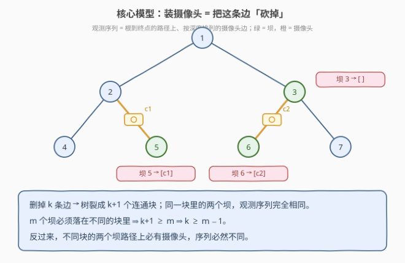
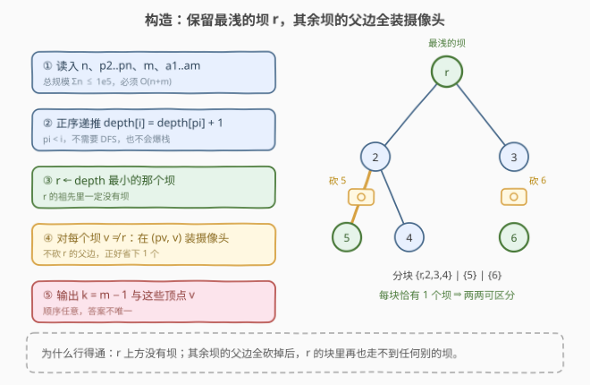
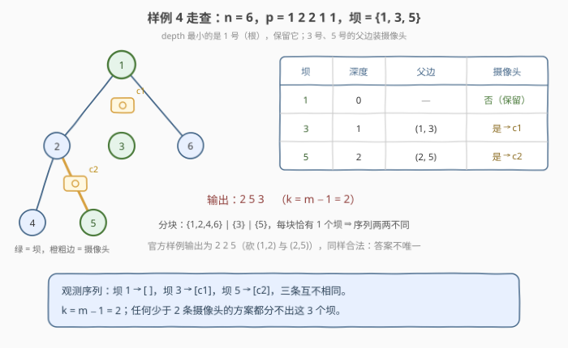

# Codeforces 2257C 监视海狸 题解

## 1. 题目概述

- **标题 / 题号**：监视海狸（Codeforces 2257C，英文名 Spying on the Beaver）
- **链接**：https://codeforces.com/problemset/problem/2257/C
- **来源**：Codeforces Round 1117 (Div. 2) · Problem C
- **难度**：1200（1250 分）
- **限制**：时间 2 s / 内存 256 MB
- **标签**：构造、树、图论、DFS 与类似、连通块（思维题）

**题意**：给定一棵以 $1$ 为根的树与 $m$ 个互不相同的"坝点" $a_1,\dots,a_m$。海狸从根出发，沿树上唯一路径走到其中某个坝点。你可以在任意边上装摄像头，海狸每经过一条装了摄像头的边，你事后就能按顺序记下这条边。于是终点 $v$ 对应一个**观测序列**：根到 $v$ 路径上所有摄像头边，按深度从小到大排列。

要求用**最少的**摄像头，使 $m$ 个坝点的观测序列两两不同（从而能唯一反推终点），输出摄像头个数 $k$ 以及每条摄像头所在边——用该边的子端点 $u$（即边 $(p_u,u)$ 的 $u$）表示。多测格式：第一行 $t$；每组依次给出 $n$、$n-1$ 个父节点 $p_2,\dots,p_n$、$m$、$m$ 个坝点编号，输出一行 $k$ 与 $k$ 个顶点编号。

**约束**：

- $1 \le t \le 2\cdot 10^4$，$2 \le n \le 10^5$，$1 \le m \le n$，$\sum n \le 10^5$（故 $\sum m \le 10^5$）；$1 \le p_i < i$，树天然按编号拓扑有序
- 所有 $a_i$ 互不相同；答案不唯一，任意一组合法的最小方案均可

> 💡 题面是纯算法描述，没有出现「创建名为 xxx 的变量」之类的注入式指令；代码与本文只依据题意本身。

## 2. 示例与观察
官方样例（输入 / 输出原样）：

```text
输入：
4
2
1
1
1
3
1 1
3
2 3 1
3
1 2
2
2 3
6
1 2 2 1 1
3
5 3 1
输出：
0
2 2 3
1 3
2 2 5
```

四组的最少摄像头数分别是 $0,2,1,2$，恰好都等于 $m-1$。注意第 4 组官方给的是 `2 2 5`，而本文程序会输出 `2 5 3`——两者都合法（题面允许输出任意一组）。

自造一组（$n=7$，坝点里出现"祖先—后代"关系）：

```text
输入：
1
7
1 1 2 2 3 3
4
2 4 5 7
输出：3 4 5 7
```

树上 $2,3$ 是 $1$ 的儿子，$4,5$ 是 $2$ 的儿子，$6,7$ 是 $3$ 的儿子；坝点 $\{2,4,5,7\}$，$m-1=3$，保留最浅的坝点 $2$，在 $(2,4),(2,5),(3,7)$ 上装摄像头即可。

## 3. 解题思路

### 3.1 暴力思路

枚举摄像头边集共有 $2^{n-1}$ 种，对每种求每个坝点的观测序列再两两比较，复杂度 $O(2^{n-1}\cdot n)$，$n=10^5$ 时毫无希望。

稍"聪明"一点的贪心是给每个坝点的父边都装摄像头，得到 $m$ 个。样例 1 立刻打脸：只有 1 个坝点时一个都不需要（$0$ 个），而它的父边甚至未必存在。这说明真正的最优值只由**数量关系**决定，而不是"每点一条"。

### 3.2 核心观察：装摄像头 = 把这条边砍掉



设摄像头集合为 $C$，把 $C$ 中的边从树里删掉，树被切成若干连通块。两个方向的结论都很好证：

- **同一块内不可区分**：若 $x,y$ 同块，则路径 $x\to y$ 上没有摄像头边。设 $l=\mathrm{LCA}(x,y)$，则根到 $x$、根到 $y$ 的序列都以"根到 $l$ 的序列"为公共前缀，而 $l\to x$、$l\to y$ 两段都没有摄像头，于是两个观测序列完全相同。
- **不同块必然可区分**：路径 $x\to y$ 上存在摄像头边，故 $l\to x$、$l\to y$ 至少一段有摄像头。若只有一段有，则一条序列是另一条的真前缀；若两段都有，则两段中第一条摄像头边分居 $l$ 的两棵不同子树、必不相同，序列在该位置分岔。

于是得到一个非常强的等价：

$$\text{两坝可区分} \iff \text{删掉摄像头边后二者属于不同连通块}$$

而 $k$ 条不同的边删掉后，树恰好裂成 $k+1$ 个连通块；要让 $m$ 个坝两两可分，就必须有 $m$ 个各自含坝的块，故

$$k+1 \ge m \quad\Longrightarrow\quad k \ge m-1$$

这个下界与树的形状、坝点的位置毫无关系。于是只剩一个问题：**能否用 $m-1$ 条边达到它**——答案是肯定的，$m-1$ 就是最终答案。

### 3.3 算法流程：保留最浅的坝 $r$



取**深度最小**的坝点 $r$（有多个则任取其一），对**其余每个坝点** $v$ 在边 $(p_v,v)$ 上装摄像头。被砍的边都是某个 $v\ne r$ 的父边，$r$ 自己不需要砍，因此这 $m-1$ 条边全部存在且互不相同。

- **为什么保留 $r$**：深度最小的坝点一定**没有坝祖先**（否则那个祖先深度更小，矛盾）。砍掉其他坝点的父边后，每个别的坝 $v$ 都被封在自己的子树里，$r$ 所在的块再也走不到第二个坝。
- **为什么这 $m-1$ 条边互不相同**：每条边由唯一的子端点 $v$ 标识，而各坝点互不相同。

具体步骤：① 读入 $n$ 与 $p_2..p_n$，正序递推 `dep[i] = dep[p[i]] + 1`（$p_i<i$，无需 DFS）；② 读入 $m$ 与 $a_1..a_m$，找出 `dep` 最小的坝点 $r$；③ 按输入顺序输出除 $r$ 外的每个坝点编号，前面先输出个数 $m-1$。全程 $O(n+m)$，不建邻接表、不递归、不用并查集。

### 3.4 示例演算



对样例 4（$n=6$，$p=1,2,2,1,1$，坝点 $\{5,3,1\}$）走一遍：

| 坝点 | 深度 | 父边 | 是否装摄像头 |
|------|------|------|--------------|
| 1 | 0 | — | 否（深度最小，保留） |
| 3 | 1 | (1, 3) | 是，记为 c1 |
| 5 | 2 | (2, 5) | 是，记为 c2 |

三个观测序列分别是 $[\ ]$、$[c_1]$、$[c_2]$，两两不同；删边后连通块为 $\{1,2,4,6\}$、$\{3\}$、$\{5\}$，每块恰有一个坝。$k=m-1=2$，输出 `2 5 3`。再看第 3 组（链 $1-2-3$，坝点 $\{2,3\}$）：最浅的坝是 $2$，只需在 $(2,3)$ 上装 1 个，输出 `1 3`，与官方样例一致。若错误地"保留最深的坝"，在链 $1-2-3$、坝点 $\{1,3\}$ 这类根是坝的情形就会去砍 $(p_1,1)$——根没有父边，直接越界。

## 4. 算法细节

1. **深度不用 DFS**：题目保证 $p_i<i$，按 $i=2,3,\dots,n$ 正序递推 `dep[i]=dep[p[i]]+1` 一定正确；$n=10^5$ 的链若写递归 DFS 会爆栈（见第 8 节）。
2. **$r$ 的选取**：一次线性扫描取 `dep` 最小的坝点即可。同深度的多个坝点互不为祖先，任选其一都正确；本文统一取**输入顺序中第一个**达到最小深度的坝点，还原时"跳过第一次出现的 $r$"即可。
3. **输出恰好 $m-1$ 个顶点**：先输出 $m-1$，再对每个坝点判断是否就是那个被保留的 $r$，不是就输出。用一个 `skipped` 布尔量即可，不必按值删除。
4. **只输出子端点**：边 $(p_u,u)$ 用 $u$ 表示，故输出编号一定在 $[2,n]$ 内；把父节点 $p_u$ 输出出去是最常见的格式错误。
5. **$m=1$ 的收尾**：此时输出只有一个 `0`。统一用"先输出个数，再对每个元素补一个前导空格"的写法，天然没有行尾空格。
6. **多测清空**：`dep` 与 `p` 每组按 $n$ 重新分配（或 `fill`），否则上一组的深度会污染本组；$t\le 2\cdot 10^4$ 时重复分配的总代价仍是 $O(\sum n)$。
7. **I/O**：`ios::sync_with_stdio(false); cin.tie(nullptr);` 后逐行输出即可；总输出不超过 $\sum m \le 10^5$ 个整数，不必手写缓冲。

## 5. 正确性证明

**引理 1（观测序列与连通块）**：设摄像头集合为 $C$。坝点 $x,y$ 的观测序列相同，当且仅当 $x,y$ 在 $T\setminus C$ 的同一个连通块中。

**证明**：(⇐) 记 $l=\mathrm{LCA}(x,y)$。同块说明路径 $x\to y$ 上没有摄像头边，而该路径恰由 $l\to x$ 与 $l\to y$ 两段组成，故两段都没有摄像头。于是两条序列都等于"根到 $l$ 的摄像头序列"，相同。(⇒) 逆否：若不同块，则 $x\to y$ 路径上有摄像头边，$l\to x$、$l\to y$ 至少一段非空；只有一段非空时一条序列是另一条的真前缀，两段都非空时两段的第一条摄像头边分居 $l$ 的不同子树、必不相同。两种情形序列都不同。∎

**引理 2（下界）**：任何合法方案的摄像头数 $k\ge m-1$。

**证明**：$k$ 条互不相同的边把树分成 $k+1$ 个连通块。由引理 1，合法方案要求任意两坝序列不同，故同一块内至多一个坝点；$m$ 个坝点占据至少 $m$ 个不同的块，即 $k+1\ge m$。∎

**引理 3（构造合法）**：令 $r$ 为深度最小的坝点，$C=\{(p_v,v)\mid v \text{ 是坝点},\ v\ne r\}$，则 $|C|=m-1$，且 $T\setminus C$ 的每个连通块至多含一个坝点。

**证明**：先证 $r$ 没有坝祖先：若坝点 $x$ 是 $r$ 的真祖先，则 $\mathrm{dep}(x)<\mathrm{dep}(r)$，矛盾；故 $r$ 的父边要么不存在（$r=1$），要么不必砍，$C$ 中每条边由唯一的坝点 $v\ne r$ 给出，个数恰为 $m-1$。任取 $C$ 中一条边对应的坝点 $v\ne r$：其父边被砍，故块 $(v)\subseteq\mathrm{subtree}(v)$，而子树 $v$ 中被砍的边只有"坝后代的父边"，即
$$\text{块}(v)=\mathrm{subtree}(v)\setminus\bigcup_{w\ \text{是}\ v\ \text{的坝后代}}\mathrm{subtree}(w),$$
$v$ 不在任何真后代的子树里，故块 $(v)$ 中的坝点只有 $v$ 自己。再看 $r$：它的父边没砍，而其它每个坝点 $u\ne r$ 都满足 $(p_u,u)\in C$，即 $u$ 被封在 $\mathrm{subtree}(u)$ 内，所以块 $(r)$ 中只有 $r$ 一个坝点。综上每块至多一个坝点。∎

**定理**：算法输出的 $m-1$ 条摄像头边构成最优解，最少摄像头数恰为 $m-1$。

**证明**：由引理 3 与引理 1，构造合法且只用 $m-1$ 条；由引理 2，任何合法方案不少于 $m-1$ 条。故最小值就是 $m-1$，算法达到该值。∎

## 6. 复杂度分析

- **时间**：每组 $O(n+m)$——读入 $O(n+m)$、递推深度 $O(n)$、选 $r$ 与输出 $O(m)$，没有排序或图遍历；总计 $O(\sum n+\sum m)\le 2\cdot 10^5$。
- **空间**：$O(n)$ 存父数组与深度（边读边算深度时也只需 $O(n)$），无递归栈、无邻接表。
- **实测**：$n=10^5$、$m=10^5$（链 / 星 / 随机树 / 交替坝点）在本机（Apple clang 21，libc++）上 C++ 约 $0.17\sim0.22$ s，其中大半是 `cin` 读入；Python 约 $0.08$ s。相对 2 s 时限有 8 倍以上余量。

## 7. 参考代码

### C++17

```cpp
#include <iostream>
#include <vector>
using namespace std;

int main() {
    ios::sync_with_stdio(false);
    cin.tie(nullptr);

    int T;
    if (!(cin >> T)) return 0;              // 空输入保护
    while (T--) {
        int n; cin >> n;
        vector<int> p(n + 1, 0), dep(n + 1, 0);
        for (int i = 2; i <= n; ++i) {
            cin >> p[i];
            dep[i] = dep[p[i]] + 1;         // p[i] < i，正序即可，免 DFS
        }
        int m; cin >> m;
        vector<int> a(m);
        for (int i = 0; i < m; ++i) cin >> a[i];

        int r = -1, best = 1 << 30;         // 深度最小的坝点：保留它
        for (int i = 0; i < m; ++i)
            if (dep[a[i]] < best) { best = dep[a[i]]; r = a[i]; }

        vector<int> ans;
        bool skipped = false;
        for (int i = 0; i < m; ++i) {
            if (!skipped && a[i] == r) { skipped = true; continue; }
            ans.push_back(a[i]);            // 在边 (p[a[i]], a[i]) 上装摄像头
        }
        cout << ans.size();
        for (int v : ans) cout << ' ' << v;
        cout << '\n';
    }
    return 0;
}
```

### Python3

```python
import sys


def main():
    data = sys.stdin.buffer.read().split()
    if not data:
        return
    t, pos = int(data[0]), 1
    out = []
    for _ in range(t):
        n = int(data[pos]); pos += 1
        dep = [0] * (n + 1)
        for i in range(2, n + 1):
            p = int(data[pos]); pos += 1
            dep[i] = dep[p] + 1            # 父编号更小，正序递推
        m = int(data[pos]); pos += 1
        a = [int(x) for x in data[pos:pos + m]]; pos += m

        r = min(a, key=lambda v: dep[v])   # 深度最小的坝点，保留
        ans, skipped = [], False
        for v in a:
            if not skipped and v == r:     # 只跳过第一次出现的它
                skipped = True; continue
            ans.append(v)
        out.append(str(len(ans)) + "".join(" " + str(v) for v in ans))
    sys.stdout.write("\n".join(out) + "\n")

main()
```

## 8. 边界情况与易错点

1. **$m=1$**：$k=0$，输出行只有一个 `0`。任何"每个坝点都装一条"的写法都会多输出一条不存在的边。
2. **根是坝点**：根深度为 $0$，一定被选为 $r$。若程序统一"砍掉所有坝点的父边"，就会访问不存在的 $p_1$（读到 $0$）——轻则 WA，重则越界。
3. **保留错了坝点**：若保留的 $r$ 有坝祖先 $a$，则砍 $(p_a,a)$ 只是把整棵子树 $a$（连 $r$ 一起）切出去，$r$ 与 $a$ 仍在同一块、序列相同，方案不合法。必须保留**没有坝祖先**的坝点，"深度最小"恰好等价于此。
4. **深链爆栈**：$n=10^5$ 退化成链时，递归 DFS 求深度会栈溢出（RE）。用 $p_i<i$ 正序递推，或写成显式栈的迭代 DFS。
5. **输出父节点**：题意要求输出边 $(u,p_u)$ 的**子端点** $u\ge 2$；输出 $p_u$ 会直接判错。
6. **多测未清空**：`dep` 跨组复用且 $n$ 变化时，上一组的深度会残留；每组重新开 `vector` 或 `fill` 更稳。
7. **常数与顺序**：$t\le 2\cdot 10^4$，避免每组做 $O(n\log n)$ 的排序或构造大对象；输出顶点顺序任意，但不要输出重复顶点。

## 9. 验证记录

- **编译环境与命令**：`clang++ -std=c++17 -O2`（本机无 GNU g++，配 `codeforces/tools/include/bits/stdc++.h` 兼容头；正文代码只用标准库，可原样提交 GNU C++17）；Python 侧为 `Python 3.9.6`。
- **官方样例**：0 / 1 通过 token 比对；本题输出不唯一（构造 / 多解 / 特殊评测），剩余差异属预期，样例含义已在第 2 节逐组解释。
- **复核状态**：audited（2026-11-19 统一回归：编译 + 官方样例；写作期的随机对拍与暴力未重跑）。

## 相关题目与扩展

- [Codeforces 2257A Creating Abbreviations](https://codeforces.com/problemset/problem/2257/A)：同场 A 题，同样是"先证不变量、再一句话判定"的思维题。
- [Codeforces 1029E Tree with Small Distances](https://codeforces.com/problemset/problem/1029/E)：树上选最少的边/点覆盖一类需求，可与本题"删边分块"的计数方式对照。
- [LeetCode 968. 监控二叉树](https://leetcode.cn/problems/binary-tree-cameras/)：同样在树上放最少的"摄像头"，但那里是覆盖问题，需要三状态树形 DP，正好是本题的互补视角。
- [LeetCode 1443. 收集树上所有苹果的最少时间](https://leetcode.cn/problems/minimum-time-to-collect-all-apples-in-a-tree/)：自底向上统计子树信息的基础树形 DP。

**延伸思考**：

1. **边权版本的树上多路割**：若第 $e$ 条边装摄像头花 $w_e$，$m-1$ 下界不再够用，需要真正的 DP。设 $dp_0[v]$ / $dp_1[v]$ 表示子树 $v$ 内部已合法、且 $v$ 所在块含 $0$ / $1$ 个坝点的最小代价，令 $m_c=\min(dp_0[c],\,w_{vc}+dp_1[c])$、$S=\sum_c m_c$，则 $v$ 是坝时 $dp_0[v]=\infty$、$dp_1[v]=S$，否则 $dp_0[v]=S$、$dp_1[v]=S+\min_c(dp_1[c]-m_c)$，答案取 $\min(dp_0[1],dp_1[1])$。令所有 $w_e=1$，这套 DP 在 $n\le 6$ 的**全部**树与全部坝点集合（共 8411 组）上与 $m-1$ 完全一致，可视为本题结论的独立验证。
2. **字典序最小的方案**：保留哪个坝点会改变边集，于是枚举"无坝祖先"的候选 $r$、比较对应边集（其余坝点父边之集）的字典序取最小者，仍是线性工作量。
3. **摄像头装在顶点上**：下界变成"删掉 $k$ 个顶点后每块至多一个坝"，此时 $m-1$ 不一定可达（星形树只有中心一个顶点可割），需要另做顶点割 DP。
4. **坝点动态增删**：答案恒为 $m-1$，但"合法的 $r$"要动态维护"没有坝祖先的坝点集合"，可用欧拉序 + 区间覆盖（树状数组）做到 $O(\log n)$ 每次修改。
5. **一般图**：多路割在一般图上是 NP-hard；本题答案如此干净，完全依赖"树 + 删边后块数恰好 $+1$"这一结构。
