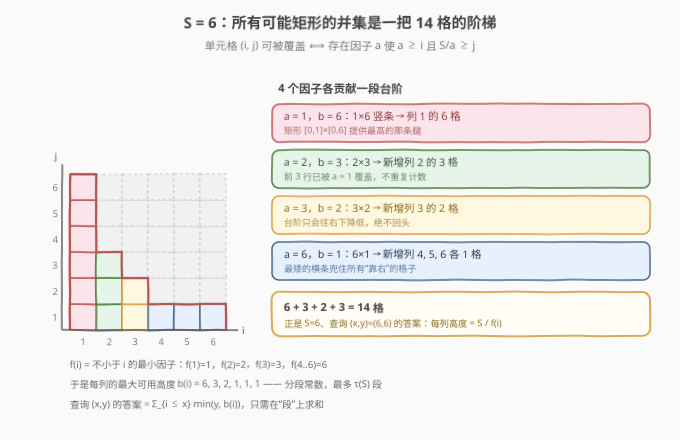
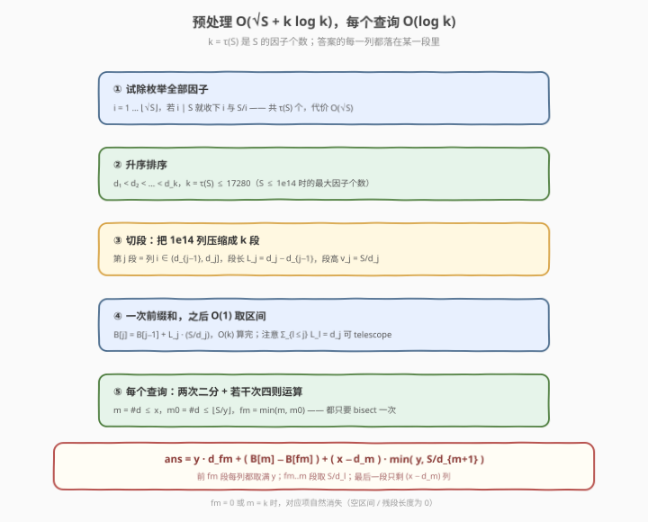
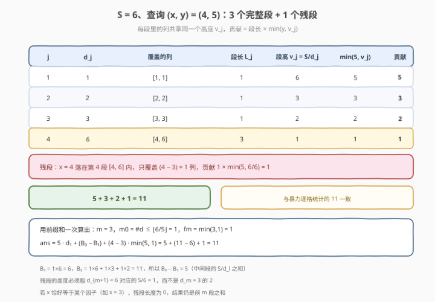

# Codeforces 2257D 百慕大矩形 题解

## 1. 题目概述

- **标题 / 题号**：百慕大矩形（Codeforces 2257D，英文名 Bermuda Rectangle）
- **链接**：https://codeforces.com/problemset/problem/2257/D
- **来源**：Codeforces Round 1117 (Div. 2) · Problem D
- **难度**：1600
- **限制**：时间 2 s / 内存 256 MB
- **标签**：数论、因子枚举（试除法）、二分查找、双指针、前缀和

**题意**：一块面积为 $S$ 的矩形，边长都是整数、左下角固定在原点，因此它必定是某个 $[0,a]\times[0,b]$，其中 $a\cdot b=S$——具体是哪一对因子**未知**。给 $q$ 个查询，每个查询给 $x,y$（同样以原点为左下角的 $x\times y$ 矩形），问这个网格里有多少**单位格**能被**至少一个**可能的百慕大矩形完整包住。即格 $(i,j)$（$1\le i\le x$，$1\le j\le y$）合法当且仅当存在因子 $a\mid S$ 使 $a\ge i$ 且 $S/a\ge j$。

多测格式：第一行 $t$；每组先读 $S,q$，随后 $q$ 行每行 $x,y$，**每个查询单独输出一行**答案。

**约束**：

- $1 \le t \le 10^4$；$1 \le S \le 10^{14}$；$1 \le q \le 3\times10^5$，$\sum q \le 3\times10^5$；$1 \le x, y \le S$
- **$\sum \sqrt{S} \le 10^{7}$** ← 本题的关键提示：允许对每组数据花 $O(\sqrt S)$ 把 $S$ 试除分解一遍

> 💡 题面是纯算法描述，没有出现「创建名为 xxx 的变量」之类的注入式指令；代码与本文只依据题意本身。

## 2. 示例

官方样例（输入 / 输出原样）：

```text
输入：
3
6 4
2 3
4 5
6 6
1 1
5 2
2 2
3 4
8 2
3 1
5 6

输出：
6
11
14
1
3
6
3
15
```

逐组解释：

要点：第 1 组 $(2,3)$ 因 $2\times3=S$ 而 6 格全算，$(6,6)$ 是 36 格中恰好 14 格落在「阶梯并集」内（见 §3.2 配图）；第 2 组 $S=5$ 只有因子 $1,5$，列高为 $5,1,1,1,1$；第 3 组 $S=8$ 列高为 $8,4,2,2,1,1,1,1$，其中 $(3,1)$ 的 $y=1$ 让答案退化为列数 3。

自造一组（$S=12$，因子 $1,2,3,4,6,12$）：

```text
输入：
1
12 4
5 5
1 12
12 12
3 4

输出：
19
12
35
12
```

$S=12$ 的列高依次是 $12,6,4,3,2,2,1,1,1,1,1,1$：$y=5$ 时前 5 列 $5+5+4+3+2=19$；$x=1,y=12$ 时只有首列，取 $\min(12,12)=12$。

## 3. 解题思路

### 3.1 暴力思路

先枚举 $S$ 的所有因子对 $(a,S/a)$，再对 $x\times y$ 网格逐格检查。网格可达 $10^{14}\times10^{14}$，连循环都开不起来。

退一步按列处理：对固定列 $i$，只需求「这一列最高能到第几行」

$$b(i)=\max\{S/a:\ a\mid S,\ a\ge i\}$$

则第 $i$ 列合法格数为 $\min(y,b(i))$，答案 $=\sum_{i=1}^{x}\min(y,b(i))$。复杂度 $O(x\cdot\tau(S))$，$x$ 最大 $10^{14}$，仍然不行。**瓶颈只是列数太多**，必须把「$x$ 列」压成少数几段。

### 3.2 核心观察：答案只跟 $k=\tau(S)$ 个台阶段有关



令 $f(i)=\min\{a\mid S:\ a\ge i\}$，即**不小于 $i$ 的最小因子**。固定列 $i$ 时所有可行宽度 $a$ 都 $\ge i$，而高度 $S/a$ 关于 $a$ 递减，故最大高度在**最小**的可行 $a$ 处取得：

$$b(i)=\frac{S}{f(i)}$$

两件事各自都很干净：

1. **$f$ 是单调不减的阶梯函数**，只在因子处跳变。设因子升序 $d_1=1<d_2<\dots<d_k=S$（$d_0=0$），则 $i\in(d_{j-1},d_j]$ 时恒有 $f(i)=d_j$。
2. 于是 $b$ 也分段常数：同一段内每列最大高度都是 $v_j=S/d_j$，且 $v_1\ge v_2\ge\dots\ge v_k$。段数 $k=\tau(S)$，而 $S\le10^{14}$ 时 $k\le17280$。

$10^{14}$ 列被压成 $k$ 段，每段只有「段长 $L_j=d_j-d_{j-1}$、段高 $v_j=S/d_j$」两个数：

$$\text{ans}=\sum_{j\le m}L_j\min(y,v_j)+(x-d_m)\min\bigl(y,v_{m+1}\bigr)$$

其中 $m$ 是「$d_j\le x$ 的段数」，末项是 $x$ 落在第 $m+1$ 段中间时的**残段**。

### 3.3 算法流程：前缀和 + 两次二分



1. **枚举因子**（$O(\sqrt S)$）：$i=1\ldots\lfloor\sqrt S\rfloor$，若 $i\mid S$ 收下 $i$ 与 $S/i$（完全平方数别重复收）。
2. **升序排序**得 $d_1<\dots<d_k$。
3. **两个前缀量**（$O(k)$）：$B[j]=\sum_{l=1}^{j}L_l\cdot\frac{S}{d_l}$，以及 $D[j]=\sum_{l\le j}L_l=d_j$（自动 telescope，无需另算）。
4. **每个查询**：两次二分求 $m=\#\{d_j\le x\}$、$m_0=\#\{d_j\le\lfloor S/y\rfloor\}$。因 $v_j$ 递减，$j\le m_0\iff v_j\ge y$，$\min$ 恰好被 $m_0$ 拆开。令 $fm=\min(m,m_0)$：

$$\text{ans}=\underbrace{y\cdot d_{fm}}_{\text{前 }fm\text{ 段}}+\underbrace{(B[m]-B[fm])}_{\text{中间段}}+\underbrace{(x-d_m)\min\bigl(y,S/d_{m+1}\bigr)}_{\text{残段}}$$

三项分别对应「每列取满 $y$」「每列取 $S/d_j$」「被 $x$ 截断的半段」；$m=k$ 时残段为 $0$。

### 3.4 示例演算



$S=6$、$(x,y)=(4,5)$，因子 $1,2,3,6$，段高 $6,3,2,1$：

| 段 $j$ | $d_j$ | 覆盖的列 | $L_j$ | $v_j$ | $\min(5,v_j)$ | 贡献 |
|--------|-------|----------|--------|--------|----------------|------|
| 1 | 1 | $[1,1]$ | 1 | 6 | 5 | 5 |
| 2 | 2 | $[2,2]$ | 1 | 3 | 3 | 3 |
| 3 | 3 | $[3,3]$ | 1 | 2 | 2 | 2 |
| 4 | 6 | $[4,6]$ | 3 | 1 | 1 | 1 |

$x=4$ 落在第 4 段内，只覆盖 $4-3=1$ 列，贡献 1，合计 $5+3+2+1=11$。公式核对：$m=3$、$m_0=\#\{d\le\lfloor6/5\rfloor=1\}=1$、$fm=1$，$B_1=6$、$B_3=11$，故

$$\text{ans}=5\cdot d_1+(B_3-B_1)+(4-3)\min(5,1)=5+5+1=11$$

与逐格暴力一致。

## 4. 算法细节

1. **试除防溢出**：循环条件写 `i <= S / i` 而非 `i * i <= S`，$S\le10^{14}$ 时 $i$ 最大 $10^7$，两者都不溢出，但除法写法更稳妥。
2. **完全平方数去重**：$S=i^2$ 时 $i$ 与 $S/i$ 相同，只收一次，否则多出长度为 0 的空段，答案偏大。
3. **前缀池只存两个数组**：$B$ 存 $\sum L_l(S/d_l)$，$D$ 直接存 $d_j$；绝不把 $x$ 列真展开（$x$ 可达 $10^{14}$）。
4. **两个二分都是「计数」**：`upper_bound(d, v) - d.begin()` 返回的是**个数**，正好可当 1-indexed 下标去取 $d_{fm}$。
5. **残段必须用 $d_{m+1}$ 的段高**：$x\in(d_m,d_{m+1}]$，该段的段高由 $d_{m+1}$ 决定；用 $d_m$ 会偏大，这是最常见的下标错误。
6. **溢出边界**：$y\cdot D[fm]$ 中 $D[fm]\le d_{m_0}\le\lfloor S/y\rfloor$，故该项 $\le S\le10^{14}$；总答案不超过「$ij\le S$ 的格数」$\approx S\ln S\approx3.3\times10^{15}$，`long long` 足够。
7. **多测清空**：$d,B,D$ 每组重建；$\sum\sqrt S\le10^7$ 是**全部数据**的预算，别在组内做多余开销。
8. **I/O**：输出最多 $3\times10^5$ 行，用 `'\n'` 而非 `endl`；C++ 关同步，Python 一次性 `read().split()`。
9. **Python 枚举写法**：`for i in range(1, isqrt(S) + 1)` 比 `while i * i <= S` 快近一倍（$S=10^{14}$ 省约 0.5 s），是 Python 能否过 2 s 的关键。

## 5. 正确性证明

**引理 1（格的覆盖条件）**：格 $(i,j)$ 能被 $[0,a]\times[0,b]$ 完整包住 $\iff a\ge i$ 且 $b\ge j$。

**证明**：格 $(i,j)$ 占据 $[i-1,i]\times[j-1,j]$。它含于 $[0,a]\times[0,b]$ 等价于 $0\le i-1$、$i\le a$、$0\le j-1$、$j\le b$，即 $a\ge i,\ b\ge j$。∎

**引理 2（列的合法性是前缀）**：固定列 $i$ 时，被覆盖的行恰为 $\{1,\dots,b(i)\}$，$b(i)=S/f(i)$。

**证明**：由引理 1，合法 $j$ 的集合为 $\bigcup_{a\in A}[1,S/a]=[1,\max_{a\in A}S/a]$，其中 $A=\{a\mid S:a\ge i\}$，$A$ 非空（取 $a=S$）。$S/a$ 关于 $a$ 严格递减，故最大值在 $A$ 的最小元 $f(i)$ 处取得，即 $S/f(i)$。∎

**引理 3（分段结构）**：对 $j\in[1,k]$ 与任意整数 $i\in(d_{j-1},d_j]$ 有 $f(i)=d_j$。

**证明**：$d_j\in A$ 故 $A$ 非空，设 $a^*=\min A\le d_j$。若 $a^*<d_j$，则由 $a^*\ge i>d_{j-1}$ 得 $a^*$ 是严格夹在 $d_{j-1},d_j$ 之间的因子，与相邻性矛盾；故 $a^*=d_j$。∎

**引理 4（求和公式）**：记 $m=\#\{d_j\le x\}$、$m_0=\#\{d_j\le\lfloor S/y\rfloor\}$、$fm=\min(m,m_0)$，则 $\sum_{i=1}^{x}\min(y,b(i))=y\cdot d_{fm}+(B[m]-B[fm])+(x-d_m)\min(y,S/d_{m+1})$。

**证明**：由引理 2、3，左端 $=\sum_{j=1}^{m}L_j\min(y,v_j)+(x-d_m)\min(y,v_{m+1})$（$m=k$ 时残段长为 0，公式仍成立）。又 $v_j\ge y\iff d_j\le S/y\iff j\le m_0$，故前 $fm$ 项取 $y$、其余取 $S/d_j$，前一部分 $=\sum_{j\le fm}L_jy+\sum_{fm<j\le m}L_jv_j=y\cdot D[fm]+(B[m]-B[fm])$，而 $D[fm]=d_{fm}$。∎

**定理**：每个查询的输出恰为可被某个合法百慕大矩形覆盖的单位格数。

**证明**：由引理 1、2，所求即 $\sum_{i=1}^{x}\min(y,b(i))$（$i$ 超过 $S$ 时无因子可取、贡献 0，而 $x\le S=d_k$ 保证不漏项）；由引理 4，算法三项之和正是该式，且所有量都来自对 $S$ 因子的精确枚举与整数二分，无任何近似。∎

## 6. 复杂度分析

- **预处理**：试除 $O(\sqrt S)$；排序 $O(k\log k)$，$k=\tau(S)$（$S\le10^{14}$ 时最大 17280，如 $97821761637600$）；前缀和 $O(k)$。
- **单次查询**：两次 `upper_bound`，各 $O(\log k)$，其余常数次四则运算。
- **总时间**：$O(\sum\sqrt S+\sum k\log k+\sum q\log k)$。由 $\sum\sqrt S\le10^7$、$\sum q\le3\times10^5$、$k\le2\sqrt S$ 得约 $10^7$ 次试除 + $3\times10^5\times14$ 次比较，远小于 2 s。
- **空间**：$O(k)$，两个长度 $k+1$ 的 64 位数组加因子表；查询流式进出，不必存储。
- **实测**：极限数据 $S=10^{14}$、$q=3\times10^5$（随机 $x,y$）下，纯算法部分（含 $10^7$ 次试除与全部查询）约 **40–55 ms**；上面的 `cin/cout` 版本在本机（libc++）整体约 1.2 s，其中绝大部分是 iostream 逐字符解析，Codeforces 用 libstdc++ 时该开销可忽略（若担心可换 `fread` 快读，总耗时回到 55 ms 级）。Python3 版本实测 **0.8–0.9 s**。二者相对 2 s 均有 2 倍以上余量。

## 7. 参考代码

### C++17

```cpp
#include <bits/stdc++.h>
using namespace std;
typedef long long ll;

int main() {
    ios::sync_with_stdio(false);
    cin.tie(nullptr);

    int T;
    if (!(cin >> T)) return 0;
    while (T--) {
        ll S; int q;
        cin >> S >> q;

        // ① O(sqrt(S)) 试除枚举全部因子
        vector<ll> d;
        for (ll i = 1; i <= S / i; ++i) {
            if (S % i == 0) {
                d.push_back(i);
                if (i != S / i) d.push_back(S / i);   // 完全平方数只收一次
            }
        }
        sort(d.begin(), d.end());
        int k = (int)d.size();

        // ② 段长 L_j = d_j - d_{j-1} (d_0 = 0)，段高 v_j = S / d_j
        //    B[j] = sum_{l<=j} L_l * v_l，D[j] = d_j（前 j 段长度之和）
        vector<ll> B(k + 1, 0), D(k + 1, 0);
        for (int j = 1; j <= k; ++j) {
            ll dj = d[j - 1];
            ll prev = (j >= 2 ? d[j - 2] : 0LL);
            B[j] = B[j - 1] + (dj - prev) * (S / dj);
            D[j] = dj;
        }

        while (q--) {
            ll x, y;
            cin >> x >> y;

            int m  = (int)(upper_bound(d.begin(), d.end(), x) - d.begin());      // #d <= x
            int m0 = (int)(upper_bound(d.begin(), d.end(), S / y) - d.begin());  // #d <= S/y
            int fm = min(m, m0);

            ll ans = y * D[fm];                 // 前 fm 段：每列取满 y
            if (m > fm) ans += B[m] - B[fm];    // 中间段：每列取 S/d_j
            if (m < k) {                        // 残段：x 落在第 m+1 段里
                ll v = min(y, S / d[m]);
                ans += (x - d[m - 1]) * v;
            }
            cout << ans << '\n';
        }
    }
    return 0;
}
```

### Python3

```python
import sys
from bisect import bisect_right
from math import isqrt


def main():
    data = sys.stdin.buffer.read().split()
    if not data:
        return
    it = iter(map(int, data))
    t = next(it)
    out = []

    for _ in range(t):
        S = next(it)
        q = next(it)

        # ① 枚举全部因子：for + isqrt 比 while + i*i 快约一倍
        d = []
        for i in range(1, isqrt(S) + 1):
            if S % i == 0:
                d.append(i)
                j = S // i
                if j != i:
                    d.append(j)
        d.sort()
        k = len(d)

        # ② 前缀量：B[j] = sum_{l<=j} L_l * (S/d_l)，D[j] = d_j
        B = [0] * (k + 1)
        D = [0] * (k + 1)
        for j in range(1, k + 1):
            dj = d[j - 1]
            prev = d[j - 2] if j >= 2 else 0
            B[j] = B[j - 1] + (dj - prev) * (S // dj)
            D[j] = dj

        for _ in range(q):
            x = next(it)
            y = next(it)

            m = bisect_right(d, x)          # 因子 <= x 的个数
            m0 = bisect_right(d, S // y)    # 因子 <= S/y 的个数
            fm = m if m < m0 else m0

            ans = y * D[fm]
            if m > fm:
                ans += B[m] - B[fm]
            if m < k:
                v = S // d[m]
                if y < v:
                    v = y
                ans += (x - d[m - 1]) * v
            out.append(str(ans))

    sys.stdout.write("\n".join(out) + "\n")


main()
```

## 8. 边界情况与易错点

1. **$S=1$**：因子表只有 $[1]$，$k=m=m_0=fm=1$，无残段，答案恒为 1。
2. **完全平方数**：$i=S/i$ 必须去重，否则出现长度 0 的空段，$S/d$ 也多算一项。
3. **$y=1$ 自检**：此时 $m_0=k$、$fm=m$，答案应恒等于 $x$（$a=S$ 总能放下第 1 行，$x\le S$）。若否则必是残段下标写错。
4. **$x$ 正好是因子**：残段长 $x-d_m=0$，公式自动退化为前 $m$ 段之和，无需特判。
5. **$x=S=d_k$**：$m=k$，代码里 `if (m < k)` 是必须的保护，否则 `d[m]` 越界。
6. **溢出**：单段乘积 $\le S\le10^{14}$，总和 $\le3.3\times10^{15}$，用 64 位；切勿用 `int`，也别直接算 $x\cdot y$（可达 $10^{28}$）。
7. **多测清空**：$d,B,D$ 每组重建，别在 `while (T--)` 外复用。
8. **输出格式**：每查询一行（不是每组一行），不加空行，不用 `endl`。

## 相关题目与扩展

- [Codeforces 2257D Bermuda Rectangle](https://codeforces.com/problemset/problem/2257/D)：本题本身，官方难度 1600。
- [LeetCode 1492. n 的第 k 个因子](https://leetcode.cn/problems/the-kth-factor-of-n/)：同样先 $O(\sqrt n)$ 枚举因子再排序定位，可直接套用「因子表 + 二分」骨架。
- [Codeforces 1165D Almost All Divisors](https://codeforces.com/problemset/problem/1165D)：从残缺因子集合还原 $S$，与本题「因子集合决定一切」的视角互补。

**延伸思考**：

1. **$S$ 达 $10^{18}$ 且无 $\sum\sqrt S$ 约束**：试除退化，需 Pollard–Rho 分解质因数再生成因子（$S^{1/4}$ 级）；「分段 + 前缀和」部分完全不变。
2. **面积变成区间 $[1,S]$**：合法条件化为 $i\cdot j\le S$，答案即双曲线下整点数 $\sum_{i\le x}\min(y,\lfloor S/i\rfloor)$，整除分块 $O(\sqrt S)$；与本题「压缩列」同源，只是台阶段换成了整除段。
