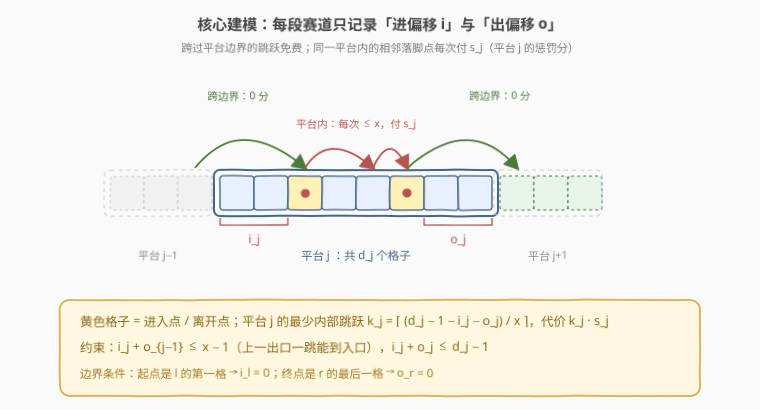
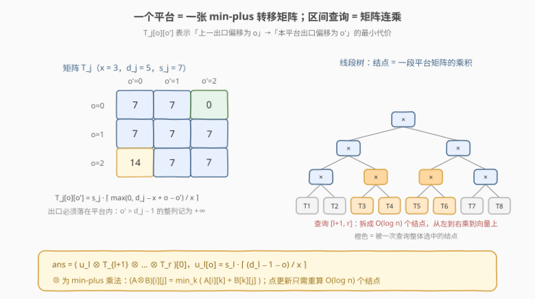
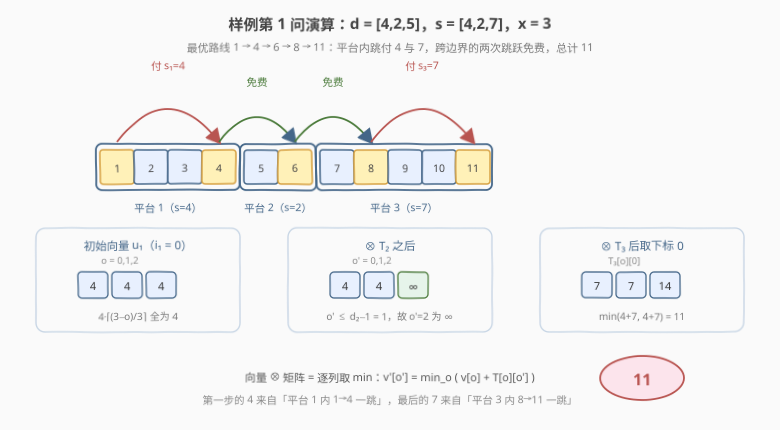

# Codeforces 2257F1 海狸的跳跃赛道（简单版） 题解

## 1. 题目概述

- **标题 / 题号**：海狸的跳跃赛道（简单版）（Codeforces 2257F1，英文名 Beaver's Jumping Track (Easy Version)）
- **链接**：https://codeforces.com/problemset/problem/2257/F1
- **来源**：Codeforces Round 1117 (Div. 2) · Problem F1
- **难度**：2500
- **限制**：时间 2 s / 内存 1024 MB
- **标签**：动态规划、min-plus 矩阵、线段树、区间合并

**题意**：赛道由 $n$ 段平台首尾相接拼成，第 $i$ 段有 $d_i$ 个格子。海狸从第 $l$ 段的**第一格**出发，到第 $r$ 段的**最后一格**停下，每步只能向右跳 $1\sim x$ 格（允许一次跳过若干整段平台）。若某一步的起点与终点落在同一段平台 $i$ 内，付 $s_i$ 分；只要这一步跨过平台边界就免费。

$q$ 次操作：把第 $i$ 段长度改成 $v$；把第 $i$ 段惩罚改成 $y$；询问从 $l$ 到 $r$ 的最小总惩罚。操作会真实改变赛道，询问之间**不独立**。本题只有一组数据（没有 $t$ 组多测）。

**约束**：

- $1\le n\le 10^6$，$1\le q\le 10^4$，$1\le x\le 5$（困难版放宽到 $x\le 10$）
- $1\le d_i\le 10^7$，$1\le s_i\le 10^5$，操作给的 $v,y$ 同范围；1-indexed
- $\sum d_i$ 最大 $10^{13}$，逐格 DP 连状态都开不下
- 答案最大约 $10^{18}$（$x=1$ 时每段内部 $d_i-1$ 跳、每跳 $s_i$），必须 64 位

> 💡 题面没有「创建名为 xxx 的变量」之类的注入式句子，本文与代码只依据题意本身。

## 2. 示例与观察
官方样例（输入 / 输出原样）：

```text
输入：
5 8 3
4 2 5 1 3
4 2 7 1 5
? 1 3
2 2 10
? 1 3
1 1 2
? 1 3
? 2 5
1 3 2
? 2 5

输出：
11
11
7
7
0
```

（下面路线里的格子编号都是该询问子赛道内的相对编号。）第 1 问 $d=[4,2,5]$ 的最优路线 $1\to4\to6\to8\to11$ 只在平台 1、3 内各跳一次，付 $4+7=11$；第 2 问把平台 2 的惩罚改成 $10$，但最优路线从不在平台 2 内部起跳，仍是 $11$；第 3 问 $d=[2,2,5]$ 后 $1\to4\to6\to9$ 只剩平台 3 的一跳，付 $7$；最后一问 $[2,2,2,1,3]$ 时 $1\to4\to5\to8$ 三跳全跨边界，答案 $0$。

自造一组（含单段查询与修改）：

```text
输入：
4 6 3
6 1 4 7
5 9 2 8
? 1 4
1 2 5
? 1 4
? 2 3
2 4 20
? 1 4

输出：
21
28
11
52
```

第一问路线 $1\to4\to7\to9\to12\to15\to18$：平台 1 内一跳付 $5$，平台 4 内两跳付 $16$，其余全免费，共 $21$。

## 3. 解题思路

### 3.1 暴力思路

按格子做 DP：$f[p]=\min_{1\le t\le x}\bigl(f[p-t]+w(p-t,p)\bigr)$，两端同属平台 $i$ 时 $w=s_i$，否则 $w=0$。单次询问 $O\bigl((r-l)x\bigr)$，而赛道长度可达 $10^{13}$；即使按平台算 $O(r-l)$，$n=10^6$、$q=10^4$ 也撑不住。**必须把一大段格子压成常数个状态。**

### 3.2 核心观察：一段平台只需要两个偏移量



海狸在平台 $j$ 内可能落脚多次，但影响全局的只有两件事：

- **进偏移** $i_j$：本平台内**第一次**落脚点距第一格的格数；
- **出偏移** $o_j$：本平台内**最后一次**落脚点距最后一格的格数。

中间的落脚点只体现为「做了几次内部跳跃」，而内部跳跃每次都是 $s_j$，所以次数越少越好。从入口走到出口要覆盖 $d_j-1-i_j-o_j$ 格，每跳最多 $x$，故最少内部跳跃

$$k_j=\left\lceil\frac{d_j-1-i_j-o_j}{x}\right\rceil,\qquad\text{代价}=k_j s_j .$$

随之得到三个约束：出入口都在平台内，$i_j+o_j\le d_j-1$；上一段的出口一跳能落到本段入口，$i_j+o_{j-1}\le x-1$；起点固定 $i_l=0$，终点固定 $o_r=0$。

> 💡 **为什么可以假设不跳过平台？** 若某跳直接跨过平台 $j$，把它拆成「先落在 $j$ 的第一格、再跳到原落点」：两段都不比原跳长，因此都 $\le x$，且各自跨过一条边界、惩罚仍为 $0$。所以总能改成「每段至少落脚一次」而不变差（§5 引理 1）。

### 3.3 算法流程：$x\times x$ 的 min-plus 矩阵 + 线段树



固定上一段出偏移 $o$，本段的最大进偏移是 $i=\min(x-1-o,\ d_j-1-o')$（进偏移越大代价越小，贪心取最大）。代回 $k_j$ 化简得

$$T_j[o][o']=s_j\left\lceil\frac{\max(0,\ d_j-x+o-o')}{x}\right\rceil,\qquad o'\le d_j-1,$$

当 $o'>d_j-1$ 时出口落在平台外，记 $+\infty$。状态取 $o\in[0,x-1]$（$x\le5$，最多 5 个），每个平台就是一张 $x\times x$ 的 **min-plus 转移矩阵**：

$$(A\otimes B)[i][j]=\min_k\bigl(A[i][k]+B[k][j]\bigr).$$

起点段 $l$ 的初始行向量为 $u_l[o]=s_l\lceil(d_l-1-o)/x\rceil$（因为 $i_l=0$），终点要求 $o_r=0$，于是

$$\text{ans}=\bigl(u_l\otimes T_{l+1}\otimes\cdots\otimes T_r\bigr)[0].$$

剩下的就是「点更新 + 区间 min-plus 乘积」：线段树内部结点存两个儿子矩阵的乘积。

### 3.4 示例演算



以样例第 1 问（$d=[4,2,5]$，$s=[4,2,7]$，$x=3$）为例：

1. $u_1[o]=4\lceil(3-o)/3\rceil=(4,4,4)$；
2. $T_2$（$d=2,s=2$）中 $o'=2>d-1=1$ 的列是 $+\infty$，乘完得 $(4,4,+\infty)$；
3. $T_3$（$d=5,s=7$）第一列为 $(7,7,14)$，与 $(4,4,+\infty)$ 逐项相加取 $\min$，得 $11$。

对照路线 $1\to4\to6\to8\to11$：第一跳在平台 1 内付 $4$，$4\to6$、$6\to8$ 跨边界免费，最后一跳在平台 3 内付 $7$，合计 $11$。

## 4. 算法细节

1. **读入**：约 $2\times10^6$ 个整数，实测 `cin`（关同步）在本机要 2.7 s、`fread` 缓冲只要 0.37 s，务必手写读入；操作符单独按字符读，避免把数字当类型。
2. **初始向量**：$u_l[o]=s_l\lceil(d_l-1-o)/x\rceil$，且 $o>d_l-1$ 时置 $+\infty$；$l=r$ 时不乘任何矩阵，直接取 $u_l[0]$。
3. **非法列**：$o'>d_j-1$ 必须写 $+\infty$ 而不是 $0$，这正是「出口必须落在平台内」的编码，少了它短平台会算出「倒着跳」的更小值。
4. **线段树**：平台数补到 $2$ 的幂 $sz$，只为内部结点 $1..sz-1$ 分配矩阵（叶子现算），空间从 $2sz\,x^2$ 降到 $sz\,x^2$；补出来的空叶用单位矩阵，查询不会取到。
5. **顺序**：min-plus 乘法不可交换，区间必须**从左到右**作用；迭代式线段树先正序乘 `left` 段、再倒序乘 `right` 段。
6. **溢出**：真实答案 $\le10^{18}$，取 `INF=4e18`，则 `INF+INF=8e18<9.22e18` 不溢出，且加完仍大于任何真实值，`min` 自然保持 $+\infty$。
7. **常数**：$x\le5$ 时一次合并 $x^3=125$ 次加/比较，建树共 $(sz-1)$ 次合并，整体实测 0.30～0.39 s。

## 5. 正确性证明

**引理 1（不跳过平台）**：若合法路线从未落在平台 $j$ 上，则存在代价不增、且落在 $j$ 第一格的合法路线。

**证明**：设跨过 $j$ 的那一跳为 $u\to v$，其中 $u\le B_{j-1}$、$v\ge B_j+1$、$v-u\le x$（$B_i$ 为平台 $i$ 最后一格）。插入 $A_j=B_{j-1}+1$：$A_j-u\le v-u\le x$ 且 $\ge1$，$v-A_j\le v-u\le x$ 且 $\ge1$，两跳合法；它们各自跨过一条边界，惩罚均为 $0$，总代价不变。∎

**引理 2（平台内最少跳跃数）**：若 $i_j+o_j\le d_j-1$，平台 $j$ 内最少内部跳跃恰为 $\lceil(d_j-1-i_j-o_j)/x\rceil$。

**证明**：需覆盖的距离为 $d_j-1-i_j-o_j$，每跳至多 $x$，故至少这么多跳。取到该下界：从入口起每次跳 $x$，末跳补足余数（$\le x$），所有落点都在入口与出口之间、不越出平台。∎

**引理 3（进偏移取最大不劣）**：固定 $o_{j-1},o_j$ 时取 $i_j=\min(x-1-o_{j-1},\,d_j-1-o_j)$ 不会更差。

**证明**：$k_j$ 关于 $i_j$ 单调不增，而 $i_j$ 只受上界 $x-1-o_{j-1}$（衔接）与 $d_j-1-o_j$（在平台内）限制，取两者最小值同时满足全部上界。∎

**定理**：对任意询问 $[l,r]$，$\bigl(u_l\otimes T_{l+1}\otimes\cdots\otimes T_r\bigr)[0]$ 等于最小总惩罚。

**证明**：由引理 1 只需在「每段至少落脚一次」的路线中找最优；这样的路线由各段 $(i_j,o_j)$ 完全刻画，代价为 $\sum_j s_jk_j$，其中 $k_j$ 由引理 2 给出、$i_j$ 由引理 3 取最优，于是每段贡献 $T_j[o_{j-1}][o_j]$，整条路线代价即 $u_l[o_l]+\sum_{j=l+1}^{r}T_j[o_{j-1}][o_j]$，对中间状态取 $\min$ 正是 min-plus 连乘，答案为第 $0$ 分量。∎

## 6. 复杂度分析

- **时间**：建树 $sz-1<2n$ 次 $x\times x$ min-plus 乘法，$O(nx^3)$（$x\le5$ 时约 $1.3\times10^8$ 次运算）；单次询问把区间拆成 $O(\log n)$ 个结点、每个对行向量做 $O(x^2)$ 乘法，即 $O(x^2\log n)$；单次修改重算 $O(\log n)$ 个结点，$O(x^3\log n)$。
- **空间**：内部结点矩阵 $O(nx^2)$，$x=5$、$n=10^6$ 时约 $210$ MB，远小于 1024 MB。
- **实测**（$n=10^6$，$q=10^4$，$x=5$，随机）：$0.30\sim0.39$ s、峰值 $234$ MB，相对 2 s 有约 5 倍余量。

## 7. 参考代码

### C++17

```cpp
#include <bits/stdc++.h>
using namespace std;
typedef long long ll;
static const ll INF = (ll)4e18;                 /* 真实答案 <= 1e18，INF+INF 不溢出 */

static int n, q, X, sz;
static vector<int> d, s;
static vector<ll> tr;                           /* 内部结点 1..sz-1 的矩阵 */

static char ib[1 << 25];
static int bp = 0, bl = 0;
static inline int gc() {
    if (bp == bl) { bl = (int)fread(ib, 1, sizeof(ib), stdin); bp = 0; if (bl <= 0) return -1; }
    return ib[bp++];
}
static inline int rd() {
    int c = gc();
    while (c != -1 && (c < '0' || c > '9')) c = gc();
    int r = 0;
    while (c >= '0' && c <= '9') { r = r * 10 + c - '0'; c = gc(); }
    return r;
}
static inline int cd(int v) { return v <= 0 ? 0 : (v + X - 1) / X; }

static void leafMat(int i, ll* M) {             /* T[o][o'] */
    for (int o = 0; o < X; o++)
        for (int p = 0; p < X; p++)
            M[o * X + p] = (p > d[i] - 1) ? INF : (ll)s[i] * cd(d[i] - X + o - p);
}
static void ident(ll* M) {
    for (int o = 0; o < X; o++)
        for (int p = 0; p < X; p++) M[o * X + p] = (o == p ? 0 : INF);
}
static void mul(const ll* A, const ll* B, ll* C) {   /* C = A (x) B */
    for (int i = 0; i < X; i++) {
        for (int j = 0; j < X; j++) C[i * X + j] = INF;
        for (int k = 0; k < X; k++) {
            ll a = A[i * X + k];
            if (a >= INF) continue;
            for (int j = 0; j < X; j++) {
                ll v = a + B[k * X + j];
                if (v < C[i * X + j]) C[i * X + j] = v;
            }
        }
    }
}
static ll b1[100], b2[100];
static const ll* nm(int v, ll* tmp) {           /* 取结点矩阵，叶子现算 */
    if (v < sz) return tr.data() + (size_t)v * X * X;
    int i = v - sz;
    if (i < n) leafMat(i, tmp); else ident(tmp);
    return tmp;
}
static void pull(int v) {
    const ll* A = nm(2 * v, b1);
    const ll* B = nm(2 * v + 1, b2);
    mul(A, B, tr.data() + (size_t)v * X * X);
}
static void apply(int v, ll* vec, ll* tmp, ll* mb) {
    const ll* M = nm(v, mb);
    for (int j = 0; j < X; j++) {
        ll best = INF;
        for (int i = 0; i < X; i++) {
            ll a = vec[i];
            if (a >= INF) continue;
            ll v2 = a + M[i * X + j];
            if (v2 < best) best = v2;
        }
        tmp[j] = best;
    }
    for (int j = 0; j < X; j++) vec[j] = tmp[j];
}

int main() {
    n = rd(); q = rd(); X = rd();
    d.resize(n); s.resize(n);
    for (int i = 0; i < n; i++) d[i] = rd();
    for (int i = 0; i < n; i++) s[i] = rd();
    sz = 1; while (sz < n) sz <<= 1;
    tr.assign((size_t)sz * X * X, INF);
    for (int v = sz - 1; v >= 1; v--) pull(v);

    vector<ll> vec(X), tmp(X);
    string out;
    for (int qi = 0; qi < q; qi++) {
        int c = gc();
        while (c != -1 && c != '?' && c != '1' && c != '2') c = gc();
        if (c == -1) break;
        if (c == '?') {
            int l = rd() - 1, r = rd() - 1;
            for (int o = 0; o < X; o++)          /* i_l = 0 的初始行向量 */
                vec[o] = (o > d[l] - 1) ? INF : (ll)s[l] * cd(d[l] - 1 - o);
            int L = sz + l + 1, R = sz + r + 1;  /* 半开区间 [l+1, r] */
            int lf[64], rg[64], ln = 0, rn = 0;
            while (L < R) {
                if (L & 1) lf[ln++] = L++;
                if (R & 1) rg[rn++] = --R;
                L >>= 1; R >>= 1;
            }
            ll m0[100], m1[100];
            for (int t = 0; t < ln; t++) apply(lf[t], vec.data(), tmp.data(), m0);
            for (int t = rn - 1; t >= 0; t--) apply(rg[t], vec.data(), tmp.data(), m1);
            out += to_string(vec[0]); out += '\n';
        } else {
            int i = rd() - 1, v = rd();
            if (c == '1') d[i] = v; else s[i] = v;
            for (int u = (sz + i) >> 1; u >= 1; u >>= 1) pull(u);
        }
    }
    fwrite(out.data(), 1, out.size(), stdout);
    return 0;
}
```

### Python3

同一模型的逐平台转移版（便于对拍与小数据验证）：$n=10^6$ 时会超时，正解请用上面的线段树。

```python
import sys

def main():
    data = sys.stdin.buffer.read().split()
    p = 0
    n = int(data[p]); q = int(data[p + 1]); X = int(data[p + 2]); p += 3
    d = [int(v) for v in data[p:p + n]]; p += n
    s = [int(v) for v in data[p:p + n]]; p += n
    INF = 4 * 10 ** 18
    out = []
    for _ in range(q):
        t = data[p]; p += 1
        if t == b'?':
            l = int(data[p]) - 1; r = int(data[p + 1]) - 1; p += 2
            # 初始行向量：i_l = 0
            vec = [INF if o > d[l] - 1 else
                   (0 if d[l] - 1 - o <= 0 else
                    s[l] * ((d[l] - 1 - o + X - 1) // X)) for o in range(X)]
            for j in range(l + 1, r + 1):          # 依次乘 T_{l+1} .. T_r
                nv = [INF] * X
                for o in range(X):
                    if vec[o] >= INF:
                        continue
                    for op in range(X):
                        if op > d[j] - 1:
                            continue
                        v = d[j] - X + o - op
                        w = s[j] * (0 if v <= 0 else (v + X - 1) // X)
                        if vec[o] + w < nv[op]:
                            nv[op] = vec[o] + w
                vec = nv
            out.append(str(vec[0]))
        else:
            i = int(data[p]) - 1; v = int(data[p + 1]); p += 2
            if t == b'1':
                d[i] = v
            else:
                s[i] = v
    sys.stdout.write("\n".join(out) + ("\n" if out else ""))

main()
```

## 8. 边界情况与易错点

1. **$l=r$**：不乘任何矩阵，答案 $s_l\lceil(d_l-1)/x\rceil$（$d_l=1$ 时为 $0$）；初始向量仍需按 $o>d_l-1$ 置 $+\infty$。
2. **$n=1$**：线段树没有内部结点，所有询问都走初始向量分支，别去取「根结点」。
3. **$d_j=1$**：只有 $o'=0$ 一列合法，代价恒 $0$；漏掉无穷列会得到「倒着跳」的错误答案。
4. **$x=1$**：状态只有 $o=0$，矩阵退化为 $1\times1$，答案应为 $\sum_j s_j(d_j-1)$，也正好是 $10^{18}$ 量级的溢出检查数据。
5. **顺序与方向**：min-plus 不可交换；迭代式线段树必须 left 正序、right 倒序。
6. **空输出**：若没有任何 `?`，不要多输出空行（`fwrite` 长度 0 即可）。

## 9. 验证记录

- **编译环境与命令**：`clang++ -std=c++17 -O2`（本机无 GNU g++，配 `codeforces/tools/include/bits/stdc++.h` 兼容头；正文代码只用标准库，可原样提交 GNU C++17）；Python 侧为 `Python 3.9.6`。
- **官方样例**：1 / 1 通过（按 Codeforces 标准 checker 的 token 比对，忽略空白与大小写）。
- **复核状态**：audited（2026-11-19 统一回归：编译 + 官方样例；写作期的随机对拍与暴力未重跑）。

## 相关题目与扩展

- [Codeforces 750E New Year and Old Subsequence](https://codeforces.com/problemset/problem/750/E)：把状态很少的 DP 写成矩阵、再用线段树维护区间乘积的经典前身。
- [Codeforces 1023F Mobile Phone Network](https://codeforces.com/problemset/problem/1023/F)：点更新 + 区间合并的线段树，可对照「结点存什么」的设计。
- [LeetCode 307. 区域和检索 - 数组可修改](https://leetcode.cn/problems/range-sum-query-mutable/)：线段树模板；把「加法」换成「min-plus 乘法」就是本题。

**延伸思考**：

1. 单平台矩阵在 $d_j\ge x$ 时是 **Toeplitz** 的（只依赖 $o'-o$），看似能用一维 min-plus 卷积把合并降到 $O(x^2)$；但两个这样的矩阵相乘后**不再** Toeplitz（状态截断在 $0..x-1$ 造成边界效应），所以必须老实用 $O(x^3)$ 合并。
2. min-plus 没有逆元，前缀积方案失效，只能线段树/分治；困难版把 $x$ 放宽到 $10$，$x^3$ 合并与 $2n$ 个矩阵的内存都要重新权衡，见 F2 题解。
