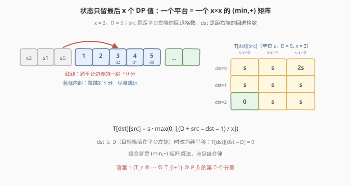
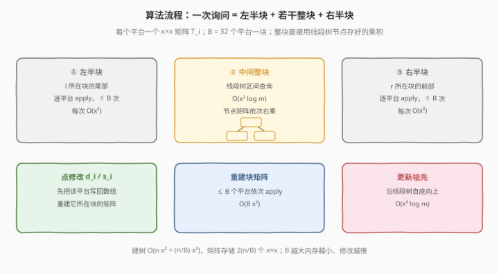
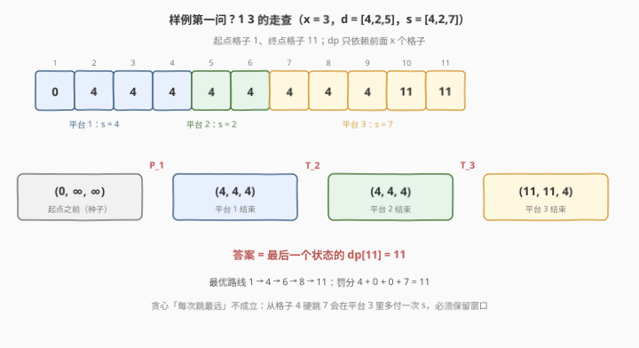

# Codeforces 2257F2 海狸的跳跃赛道（困难版） 题解

## 1. 题目概述

- **标题 / 题号**：海狸的跳跃赛道（困难版）（Codeforces 2257F2，英文名 Beaver's Jumping Track (Hard Version)）
- **链接**：https://codeforces.com/problemset/problem/2257/F2
- **来源**：Codeforces Round 1117 (Div. 2) · Problem F2（UTC 2026-08-17）
- **难度**：2700（1000 分；Easy 版 F1 为 2500 分，只把 $x$ 的上界从 10 降到 5、时限从 3 s 降到 2 s）
- **限制**：时间 3 s / 内存 1024 MB
- **标签**：动态规划、(min,+) 矩阵、线段树、分块、数据结构

**题意**：赛道由 $n$ 个平台首尾相接，第 $i$ 个平台有 $d_i$ 个格子、罚分系数 $s_i$。海狸从平台 $l$ 的**第一个格子**出发，每步只能向前跳 $1\sim x$ 个格子（可以整个越过若干平台），最后要停在平台 $r$ 的**最后一个格子**。一次跳跃若起跳点与落点在同一平台，就罚 $s_i$ 分，否则不罚。共 $q$ 次操作，分三种：

1. `1 i v`：令 $d_i \leftarrow v$；
2. `2 i y`：令 $s_i \leftarrow y$；
3. `? l r`：询问从平台 $l$ 第一格到平台 $r$ 最后一格的最小总罚分。

本题**只有一组数据**（没有 $t$ 组多测），第一行是 $n,q,x$，接下来两行是 $d$ 与 $s$，再往下 $q$ 行操作；对每个 `?` 输出一行最小罚分。

**约束**：

- $1 \le n \le 10^6$，$1 \le q \le 10^4$，$1 \le x \le 10$（Easy 版 $x \le 5$）
- $1 \le d_i \le 10^7$，$1 \le s_i \le 10^5$
- 格子总数可达 $10^{13}$，单次询问不可能按格子做；单个平台贡献最大 $s_i\lceil d_i/x\rceil \le 10^{12}$，整段答案上界约 $10^{18}$，必须用 64 位整数
- 1024 MB 内存是本版本的关键：$x\le10$ 时普通线段树要存 $2n$ 个 $10\times10$ 矩阵，约 1.6 GB

> 💡 题面没有任何"创建名为 xxx 的变量"之类的注入式指令；"$x$ 更大、时限更宽"只是两个版本的差异说明。

## 2. 示例与观察
官方样例（输入 / 输出原样）：

```text
输入：
5 8 3
4 2 5 1 3
4 2 7 1 5
? 1 3
2 2 10
? 1 3
1 1 2
? 1 3
? 2 5
1 3 2
? 2 5

输出：
11
11
7
7
0
```

初始时平台 1 是格子 $1\!-\!4$（$s=4$）、平台 2 是 $5\!-\!6$（$s=2$）、平台 3 是 $7\!-\!11$（$s=7$）。

- 第一问 `? 1 3`：最优路线 $1\to4\to6\to8\to11$，罚分 $4+0+0+7=11$；
- 第二问把 $s_2$ 调到 10，这条路根本不碰平台 2 的罚分，答案仍是 11；
- 第三问 $d_1=2$ 后格子整体前移，路线 $1\to4\to6\to9$ 只付 $6\to9$ 这一次平台内跳，答案 7；
- 第四问 `? 2 5` 的 7 来自 $3\to5$（跨平台，免费）$\to7$（平台内，7 分）$\to10\to13$（都跨平台）；
- 最后一问 $d_3=2$ 后单格平台 7 成了跳板，$3\to6\to7\to10$ 三跳全部跨平台，答案 0。

自造一组小数据（验证"短平台可以免费跳过"）：

```text
输入：
3 4 3
3 1 3
10 100 10
? 1 3
1 3 6
? 1 3
? 2 3

输出：
0
10
10
```

第一次询问 $1\to4\to7$：$4$ 是单格平台、$7$ 是平台 3 的最后一格，两跳都跨平台，罚分 0；把平台 3 拉长到 6 格后，$4\to7$ 落进平台 3 内部，$7\to10$ 成了平台内跳，付 10 分。

## 3. 解题思路

### 3.1 暴力思路

最直接的做法是在**格子**上 DP：设 $dp[v]$ 是到达格子 $v$ 的最小罚分，则

$$dp[v]=\min_{u\in[v-x,\,v-1]}\Bigl(dp[u]+\bigl[u,v\text{ 同平台}\bigr]\cdot s_{p(v)}\Bigr)$$

从起点推到终点即可，单次询问 $O(x\sum d_i)$。可 $\sum d_i$ 最大 $10^{13}$，一次询问都跑不完，更别提 $10^4$ 次任意区间。

顺带说，"每次尽量跳最远"这种贪心是**错的**。样例第一问 $x=3$，贪心路线 $1\to4\to7\to10\to11$ 要付 $4+7+7=18$，而最优的 $1\to4\to6\to8\to11$ 只要 $4+0+0+7=11$。差别在落点对 $x$ 的余数：落在平台 3 的正中（格子 7）就要在平台内多跳一次。所以必须把整个窗口的信息留下来。

### 3.2 核心观察：平台 = 一个 (min,+) 矩阵



$dp[v]$ 只依赖前 $x$ 个格子，所以**只要知道平台 $i$ 之前最后 $x$ 个格子的 DP，就能算出平台 $i$ 之后最后 $x$ 个格子的 DP**。记位置 $v$ 处的状态为

$$S(v)=\bigl(dp[v],\,dp[v-1],\,\dots,\,dp[v-x+1]\bigr)^{\mathsf T}$$

设平台 $i$ 占格子 $[A,B]$，长度 $D=B-A+1$。取 $src,dst\in[0,x-1]$：源格是 $u=A-1-src$（平台左边往回 $src$ 格），目标格是 $w=B-dst$（平台右边往回 $dst$ 格）。

**跨平台代价**：若 $w-u\le x$，一跳直接跨过边界，免费。否则任何进入平台的落点 $p\le u+x$；落得越远，剩下的平台内距离越短，而平台内每跳至多 $x$ 格、每跳付 $s_i$，所以最优先落到 $u+x$，再在平台内跳 $\lceil (w-u-x)/x\rceil$ 次。合起来

$$c(u,w)=\begin{cases}0, & w-u\le x,\\[2pt] s_i\left\lfloor\dfrac{w-u-1}{x}\right\rfloor, & w-u>x.\end{cases}$$

代入 $w-u=D+src-dst$，$dst<D$ 时就得到平台矩阵

$$T_i[dst][src]=s_i\cdot\max\!\left(0,\ \left\lfloor\frac{D_i+src-dst-1}{x}\right\rfloor\right).$$

当 $dst\ge D_i$（平台比 $x$ 短）时，目标格 $w=B-dst<A$ 落在平台**左边**，它的 DP 值根本没变，于是这一行是纯平移：

$$T_i[dst][dst-D_i]=0,\qquad \text{其余项}=+\infty .$$

平台复合就是 (min,+) 矩阵乘法 $S(B_i)=T_i\otimes S(A_i-1)$，其中 $(A\otimes B)[i][j]=\min_k A[i][k]+B[k][j]$，满足结合律。于是区间答案是

$$\text{ans}=\bigl(T_r\otimes T_{r-1}\otimes\cdots\otimes T_{l+1}\otimes P_l\bigr)[0],$$

$P_l$ 是"起点已经在平台 $l$ 第一格"的特殊初值（见第 4 节第 1 条），$[0]$ 表示取第 0 个分量。

### 3.3 算法流程：分块 + 线段树



若每个平台都占一个叶子、直接开 $2n$ 个节点的线段树，$x=10$ 时内存是 $2\times10^6\times100\times8\text{B}\approx1.6\text{ GB}$，超过 1024 MB——这正是 Hard 版把 $x$ 从 5 提到 10 带来的唯一新困难。做法是**底层分块**：

- 每 $B=32$ 个平台分成一块，块内按顺序把平台变换 apply 到单位矩阵上，得到块乘积 $C_b=T_{32b+31}\otimes\cdots\otimes T_{32b}$；
- 用线段树维护这些块矩阵，节点存一段连续块的乘积；
- 询问 $[l,r]$：先用 $P_l$ 造出初始向量，再"左半块逐平台 apply（$\le B$ 次）→ 中间整块用线段树节点矩阵 → 右半块逐平台 apply"；
- 修改 $d_i$ 或 $s_i$：重建它所在块的矩阵，再沿线段树把祖先重算一遍。

矩阵总数从 $2n$ 降到 $2\lceil n/B\rceil$（$n=10^6$ 时约 6.25 万个，约 50 MB）。

两个实现要点：

1. **单平台变换做到 $O(x^2)$**：固定 $dst$ 后 $T[dst][src]$ 关于 $src$ 单调不减，而 $src$ 只取 $x$ 个连续整数，$\lfloor\cdot\rfloor$ 至多上调一次，所以每一行只有两种取值。对矩阵各列做前缀/后缀 min，每行拼两段 min 即可，$O(x^2)$ 完成一次 apply（否则块内建树是 $O(nx^3)=10^9$ 量级）。
2. **矩阵只作用在向量上**：询问时把线段树区间拆成 $O(\log)$ 个节点，每个节点直接"矩阵 × 向量"（$O(x^2)$），不必先把节点矩阵乘起来，常数更小。

### 3.4 示例演算



以第一问 `? 1 3`（$x=3$，$d=[4,2,5]$，$s=[4,2,7]$）为例，赛道共 11 格。逐格 DP 得

$$dp=(0,4,4,4,\ 4,4,\ 4,4,4,\ 11,11)$$

前四格属于平台 1，$dp[4]=4$ 来自 $1\to4$；格子 $5,6$ 属于平台 2，$dp[5]=dp[6]=4$ 是因为 $4\to6$、$4\to5$ 都跨平台、免费；$7\sim9$ 属于平台 3，可由 $4\to7$（跨平台）免费到达，所以 $dp[7]=dp[8]=dp[9]=4$；但 $10,11$ 从这些格子出发都必须在平台 3 内跳一次，付 7 分，故 $dp[10]=dp[11]=11$。

窗口（$x=3$）依次是

$$(0,\infty,\infty)\xrightarrow{\ P_1\ }(4,4,4)\xrightarrow{\ T_2\ }(4,4,4)\xrightarrow{\ T_3\ }(11,11,4),$$

取第 0 分量得 11。$T_2$（$D=2,s=2$）只有 $T[0][2]=2$、其余为 0：它只给"从 $A-3$ 出发"的那条多算 2 分，而那条不是最优，所以第二问把 $s_2$ 调大不影响答案。

## 4. 算法细节

1. **首平台初值 $P_l$**：起点站定在平台 $l$ 的第一格，它前面没有任何格子。直接取 $v[dst]=s_l\left\lceil (D_l-1-dst)/x\right\rceil$（$dst<D_l$），$dst\ge D_l$ 置 $+\infty$。**不能**对平台 $l$ 套普通 $T_l$，否则会凭空用到 $l$ 之前的格子。
2. **短平台的平移分支**：$dst\ge D$ 时 $T[dst][dst-D]=0$、其余 $+\infty$。若偷懒直接用代价公式，这些分量会变成"窗口最小值"而不是旧值；注意到平台第一格 $A$ 的真实 $dp$ 恰好也等于这个最小值、且 $A$ 比被污染的位置更靠右，后续从它出发只会更便宜，所以答案碰巧不变。但这是巧合，语义已经错了、证明也更麻烦，建议老实写平移。
3. **(min,+) 乘法顺序**：矩阵不可交换，合并两个子区间是"右子 $\otimes$ 左子"；线段树迭代查询时左侧节点边取边乘，右侧节点先压栈、最后逆序作用。
4. **64 位与 $+\infty$**：取 $INF=3\times10^{18}$，两个 $INF$ 相加为 $6\times10^{18}<2^{63}-1$，不会溢出；真实答案 $\le10^{18}<INF$，所以"$INF$ 表示不可达"不会被误判。
5. **$O(x^2)$ apply**：先对每列算前缀/后缀 min，再对每个 $dst$ 求"代价第一次上调"的位置 $j_1$，答案 $=\min\bigl(g_{min}+\mathrm{pre}[j_1-1],\ g_{max}+\mathrm{suf}[j_1]\bigr)$。代码里 `applyLeafMat` 处理矩阵、`applyLeafVec` 处理向量。
6. **块大小 $B=32$**：内存 $\approx2(n/B)x^2\cdot8$ B（$x=10,n=10^6$ 时约 50 MB），修改 $O(Bx^2+x^3\log(n/B))$，询问 $O(Bx^2+x^2\log(n/B))$。$B$ 太小内存涨，$B$ 太大修改慢。
7. **本题无多测**：不需要在组间清空；但线段树要按 $n$ 重新 `assign`，块数也要重算。$2\times10^6$ 个整数用 `fread` 手写快读（`?` 不是数字，快读里单独返回 $-1$），输出用 `printf`。
8. **边界**：$x=1$ 时状态只有 1 维，公式退化为 $s\cdot(D+src-dst-1)$，答案即 $\sum_{i=l}^{r}s_i(d_i-1)$；$l=r$ 时答案 $=s_l\lceil(d_l-1)/x\rceil$。

## 5. 正确性证明

**引理 1（窗口 DP）**：设 $p(v)$ 是格子 $v$ 所在平台，则
$$dp[v]=\min_{u\in[v-x,\,v-1]}\Bigl(dp[u]+\bigl[p(u)=p(v)\bigr]\cdot s_{p(v)}\Bigr).$$
**证明**：最优路线到 $v$ 的最后一步是从某个 $u\in[v-x,v-1]$ 跳来；同平台则恰好罚 $s_{p(v)}$，否则 0。反过来每个这样的 $u$ 都给出合法方案。∎

**引理 2（平台内跳跃）**：同一平台内从 $p$ 到 $q>p$ 的最小罚分是 $s\lceil(q-p)/x\rceil$。
**证明**：每跳至多 $x$，$k$ 跳至多前进 $kx$，故 $k\ge\lceil(q-p)/x\rceil$；把 $q-p$ 分成 $k$ 段、每段不超过 $x$（最后一段补足）即可达到。∎

**引理 3（跨平台最优）**：源格 $u<A$，目标格 $w\in[A,B]$。若 $w-u\le x$，最小罚分 0；否则最小罚分为 $s\lfloor(w-u-1)/x\rfloor$，且由"先落到 $u+x$、再平台内跳"达到。
**证明**：第一种情况一跳跨过边界。第二种情况中，任何方案进入平台的落点 $p$ 满足 $p\le u+x$；由引理 2，从 $p$ 到 $w$ 至少 $\lceil(w-p)/x\rceil\ge\lceil(w-u-x)/x\rceil$ 跳。取 $p=u+x$（此时 $u+x<w\le B$，落点合法）即达到下界；而 $\lceil(w-u-x)/x\rceil=\lfloor(w-u-1)/x\rfloor$。∎

**引理 4（单平台变换）**：平台 $[A,B]$，$D=B-A+1$，状态 $S(A-1)$ 为平台前窗口。对 $t=0,\dots,D-1$，令 $w=A+t$、$dst=D-1-t$，则
$$dp[w]=\min_{src=0}^{x-1}\Bigl(S(A-1)[src]+s\left\lfloor\frac{src+t}{x}\right\rfloor\Bigr)=T_i[dst][\cdot]\otimes S(A-1);$$
而对 $dst\ge D$，$dp[B-dst]$ 就是旧窗口里对应的值（纯平移）。
**证明**：对 $t$ 归纳。$t=0$ 时 $w=A$，任何 $u\in[A-x,A-1]$ 都能一跳跨进 $A$，由引理 3 代价为 0，公式里 $\lfloor src/x\rfloor=0$ 也给出 0。设 $t\ge1$。$dp[w]$ 的前驱 $u'$ 分两类：$u'<A$ 时必须一跳直达，即 $w-u'\le x$，代价 0，对应公式中 $\lfloor(src+t)/x\rfloor=0$ 的那些 $src$；$u'\in[A,w-1]$ 是平台内格子，要再付 $s$，由归纳假设 $dp[u']$ 已是公式形式，而
$$\min_{u'\in[A,w-1]}\Bigl(s+s\left\lfloor\frac{u'-u-1}{x}\right\rfloor\Bigr)=s\left\lfloor\frac{w-u-1}{x}\right\rfloor,$$
右端的等号由取 $u'=w-1$ 达到（$1+\lfloor(w-u-2)/x\rfloor=\lfloor(w-u-1)/x\rfloor$，因为 $x-1<x$）。把两类合并即得公式；$u=A-1-src$ 时 $w-u=src+t+1$，$\lfloor(w-u-1)/x\rfloor=\lfloor(src+t)/x\rfloor$。平移部分显然。∎

**定理**：对查询 $[l,r]$，上述算法输出的数等于最小总罚分。
**证明**：$P_l$ 给出的向量正是平台 $l$ 结束时的真实窗口（起点在 $A_l$，前面无格子，由引理 2 得 $dp[A_l+t]=s_l\lceil t/x\rceil$）。由引理 4，每个平台变换对给定输入都精确，于是对平台数归纳可知：把 $T_{l+1},\dots,T_r$ 依次作用上去得到的就是平台 $r$ 结束时的真实窗口，其第 0 分量是 $dp[B_r]$，即答案。线段树节点存的是其覆盖区间内平台变换的复合（对树高归纳，用 (min,+) 乘法的结合律），询问把区间拆成若干节点依次作用，等价于按顺序作用所有平台变换。∎

## 6. 复杂度分析

- **建树**：块内共 $n$ 次平台 apply，每次 $O(x^2)$；块级线段树 $O\bigl((n/B)x^3\bigr)$ 次合并。$n=10^6,x=10,B=32$ 时约 $10^8+3\times10^7$ 次基本运算。
- **询问**：$O\bigl(Bx^2+x^2\log(n/B)\bigr)$，最坏约 $32\cdot100+30\cdot100\approx6\times10^3$。
- **修改**：$O\bigl(Bx^2+x^3\log(n/B)\bigr)$，约 $2\times10^4$。
- **空间**：$O\bigl((n/B)x^2+n\bigr)$，$n=10^6$ 时约 50 MB 矩阵 + 8 MB 数组 + 读入缓冲。
- **可行性**：$q=10^4$ 次操作最坏约 $2\times10^8$ 次运算；实测（C++17 `-O2`，$n=10^6,q=10^4,x=10$，一半修改一半询问）0.3–0.5 s、峰值内存 74 MB，对 3 s 有 5 倍以上余量。Python3 同算法常数大（$n=5\times10^4$ 约 3.7 s、$n=2\times10^5$ 约 16 s），$n=10^6$ 会超时（约 80 s），故 Python 版只用于对拍和小数据。

## 7. 参考代码

### C++17

```cpp
#include <bits/stdc++.h>
using namespace std;
typedef long long ll;

static const ll INF = 3000000000000000000LL;   // 3e18 > 答案上界 1e18
static const int B = 32;                       // 每块平台数
int n, q, X, SZ, mB;                           // X = x, SZ = x*x, mB = 块数
vector<int> D, S;
vector<ll> seg;                                // 线段树节点：x*x 个 ll，按 [dst][src] 排列

/* ---------------- 快读：数字返回本身，'?' 返回 -1 ---------------- */
static char ibuf[1 << 25];
static size_t ip = 0, il = 0;
static inline int gc() {
    if (ip == il) { il = fread(ibuf, 1, sizeof(ibuf), stdin); ip = 0; if (!il) return -1; }
    return (unsigned char)ibuf[ip++];
}
static inline int readInt() {
    int c = gc();
    while (c != -1 && (c < '0' || c > '9') && c != '-' && c != '?') c = gc();
    if (c == '?' || c == -1) return -1;
    int sg = 1, v = 0;
    if (c == '-') { sg = -1; c = gc(); }
    while (c >= '0' && c <= '9') { v = v * 10 + (c - '0'); c = gc(); }
    return v * sg;
}

/* 单平台变换。状态分量 p = 往回 p 格；平台 [A,B] 长度 D 把 A-1 处状态变成 B 处状态：
     T[dst][src] = s * max(0, (D + src - dst - 1) / x)   (dst < D)
     T[dst][dst - D] = 0，其余 +INF                     (dst >= D，纯平移)
   固定 dst 时 T[dst][src] 关于 src 单调且至多两种取值，故作用到 x 列矩阵是 O(x^2)。 */
static ll PRE[10][10], SUF[10][10];

static inline void applyLeafMat(int Dv, ll s, const ll *V, ll *W) {
    const int x = X;
    for (int c = 0; c < x; ++c) {                       // 每列的前/后缀 min
        ll mn = INF;
        for (int j = 0; j < x; ++j) { ll v = V[j * x + c]; if (v < mn) mn = v; PRE[j][c] = mn; }
        mn = INF;
        for (int j = x - 1; j >= 0; --j) { ll v = V[j * x + c]; if (v < mn) mn = v; SUF[j][c] = mn; }
    }
    for (int i = 0; i < x; ++i) {
        ll *Wi = W + i * x;
        if (i >= Dv) {                                  // 平台左侧的格子：原样平移
            const ll *Vi = V + (i - Dv) * x;
            for (int c = 0; c < x; ++c) Wi[c] = Vi[c];
            continue;
        }
        ll gmin = ((ll)Dv - i - 1 > 0) ? (ll)Dv - i - 1 : 0; gmin = gmin / x * s;
        int j1 = x;                                     // 代价第一次上调的位置
        for (int j = 1; j < x; ++j) {
            ll t = (ll)Dv + j - i - 1;
            if ((t > 0 ? t / x * s : 0) > gmin) { j1 = j; break; }
        }
        ll gmax = gmin;
        if (j1 < x) { ll t = (ll)Dv + j1 - i - 1; gmax = (t > 0) ? t / x * s : 0; }
        for (int c = 0; c < x; ++c) {
            ll best = INF;
            if (j1 > 0 && PRE[j1 - 1][c] < INF) best = PRE[j1 - 1][c] + gmin;
            if (j1 < x && SUF[j1][c] < INF) best = min(best, SUF[j1][c] + gmax);
            Wi[c] = best;
        }
    }
}

static inline void applyLeafVec(int Dv, ll s, const ll *vin, ll *vout) {
    const int x = X;
    for (int i = 0; i < x; ++i) {
        if (i >= Dv) { vout[i] = vin[i - Dv]; continue; }
        ll best = INF;
        for (int j = 0; j < x; ++j) {
            ll t = (ll)Dv + j - i - 1;
            best = min(best, vin[j] + (t > 0 ? t / x * s : 0));
        }
        vout[i] = best;
    }
}

/* ---------------- (min,+) 矩阵运算 ---------------- */
static inline void mulMat(const ll *A, const ll *B, ll *C) {          // C = A ⊗ B
    const int x = X;
    for (int i = 0; i < x; ++i) {
        ll *Ci = C + i * x;
        for (int j = 0; j < x; ++j) Ci[j] = INF;
        for (int k = 0; k < x; ++k) {
            ll aik = A[i * x + k];
            if (aik >= INF) continue;
            const ll *Bk = B + k * x;
            for (int j = 0; j < x; ++j) Ci[j] = min(Ci[j], aik + Bk[j]);
        }
    }
}

static inline void applyMatVec(const ll *M, const ll *vin, ll *vout) {
    const int x = X;
    for (int i = 0; i < x; ++i) {
        ll best = INF;
        const ll *Mi = M + i * x;
        for (int j = 0; j < x; ++j) best = min(best, Mi[j] + vin[j]);
        vout[i] = best;
    }
}

/* ---------------- 块与线段树 ---------------- */
static void buildBlock(int b) {
    ll *V = &seg[(size_t)(mB + b) * SZ], tmp[100];
    for (int i = 0; i < X; ++i)
        for (int j = 0; j < X; ++j) V[i * X + j] = (i == j ? 0 : INF);
    int hi = min(n, (b + 1) * B);
    for (int t = b * B; t < hi; ++t) {
        applyLeafMat(D[t], (ll)S[t], V, tmp);
        memcpy(V, tmp, sizeof(ll) * SZ);
    }
}

static void refresh(int b) {                                          // 重建块 b 与所有祖先
    buildBlock(b);
    for (int t = (mB + b) >> 1; t >= 1; t >>= 1)
        mulMat(&seg[(size_t)(2 * t + 1) * SZ], &seg[(size_t)(2 * t) * SZ], &seg[(size_t)t * SZ]);
}

static ll query(int l, int r) {                                       // 1-indexed 平台
    int l0 = l - 1, r0 = r - 1;
    ll v[10], nv[10];
    for (int i = 0; i < X; ++i) {                    // 起点：平台 l 的第一个格子
        ll rem = (ll)D[l0] - 1 - i;
        v[i] = (rem >= 0) ? (rem + X - 1) / X * (ll)S[l0] : INF;
    }
    int bl = l0 / B, br = r0 / B;
    if (bl == br) {
        for (int t = l0 + 1; t <= r0; ++t) { applyLeafVec(D[t], (ll)S[t], v, nv); memcpy(v, nv, sizeof(ll) * X); }
        return v[0];
    }
    int lastOfBl = min(n - 1, (bl + 1) * B - 1);
    for (int t = l0 + 1; t <= lastOfBl; ++t) {       // 左半块：逐平台
        applyLeafVec(D[t], (ll)S[t], v, nv); memcpy(v, nv, sizeof(ll) * X);
    }
    if (bl + 1 < br) {                               // 中间整块：线段树节点
        int L = bl + 1 + mB, R = br + mB, stk[64], cnt = 0;
        while (L < R) {
            if (L & 1) { applyMatVec(&seg[(size_t)L * SZ], v, nv); memcpy(v, nv, sizeof(ll) * X); ++L; }
            if (R & 1) { --R; stk[cnt++] = R; }
            L >>= 1; R >>= 1;
        }
        for (int i = cnt - 1; i >= 0; --i) { applyMatVec(&seg[(size_t)stk[i] * SZ], v, nv); memcpy(v, nv, sizeof(ll) * X); }
    }
    for (int t = br * B; t <= r0; ++t) {             // 右半块：逐平台
        applyLeafVec(D[t], (ll)S[t], v, nv); memcpy(v, nv, sizeof(ll) * X);
    }
    return v[0];
}

int main() {
    n = readInt(); q = readInt(); X = readInt();
    SZ = X * X;
    D.resize(n); S.resize(n);
    for (int i = 0; i < n; ++i) D[i] = readInt();
    for (int i = 0; i < n; ++i) S[i] = readInt();
    mB = (n + B - 1) / B;
    seg.assign((size_t)2 * mB * SZ, INF);
    for (int b = 0; b < mB; ++b) buildBlock(b);
    for (int t = mB - 1; t >= 1; --t)
        mulMat(&seg[(size_t)(2 * t + 1) * SZ], &seg[(size_t)(2 * t) * SZ], &seg[(size_t)t * SZ]);
    for (int qi = 0; qi < q; ++qi) {
        int type = readInt(), a = readInt(), b = readInt();
        if (type == 1) { D[a - 1] = b; refresh((a - 1) / B); }
        else if (type == 2) { S[a - 1] = b; refresh((a - 1) / B); }
        else printf("%lld\n", query(a, b));
    }
    return 0;
}
```

### Python3

```python
import sys


def main():
    # 状态窗口 + (min,+) 矩阵 + 分块线段树；常数大，n = 1e6 时会超时，仅供对拍/小数据。
    data = sys.stdin.buffer.read().split()
    p = 0
    n, q, x = int(data[0]), int(data[1]), int(data[2])
    p = 3
    D = list(map(int, data[p:p + n])); p += n
    S = list(map(int, data[p:p + n])); p += n
    INF = 1 << 62
    B = 32
    nb = (n + B - 1) // B
    I = [[0 if i == j else INF for j in range(x)] for i in range(x)]

    def apply_mat(Dv, s, V):                  # 平台变换作用到 x 列矩阵，O(x^2)
        pre = [[0] * x for _ in range(x)]
        suf = [[0] * x for _ in range(x)]
        for c in range(x):
            mn = INF
            for j in range(x):
                if V[j][c] < mn:
                    mn = V[j][c]
                pre[j][c] = mn
            mn = INF
            for j in range(x - 1, -1, -1):
                if V[j][c] < mn:
                    mn = V[j][c]
                suf[j][c] = mn
        W = [[INF] * x for _ in range(x)]
        for i in range(x):
            Wi = W[i]
            if i >= Dv:                       # 目标格在平台左侧：纯平移
                Vi = V[i - Dv]
                for c in range(x):
                    Wi[c] = Vi[c]
                continue
            g = [0] * x                       # T[i][j] = s * max(0, (D+j-i-1)//x)
            for j in range(x):
                t = Dv + j - i - 1
                if t > 0:
                    g[j] = t // x * s
            j1 = x
            for j in range(1, x):
                if g[j] > g[0]:
                    j1 = j
                    break
            for c in range(x):
                best = INF
                if j1 > 0 and pre[j1 - 1][c] < INF:
                    best = pre[j1 - 1][c] + g[0]
                if j1 < x and suf[j1][c] < INF:
                    v = suf[j1][c] + g[j1]
                    if v < best:
                        best = v
                Wi[c] = best
        return W

    def apply_vec(Dv, s, v):                  # 状态向量通过一个平台，O(x^2)
        out = [INF] * x
        for i in range(x):
            if i >= Dv:
                out[i] = v[i - Dv]
                continue
            best = INF
            for j in range(x):
                t = Dv + j - i - 1
                val = v[j] + (t // x * s if t > 0 else 0)
                if val < best:
                    best = val
            out[i] = best
        return out

    def mat_mul(A, B):                        # C = A ⊗ B
        C = [[INF] * x for _ in range(x)]
        for i in range(x):
            Ai, Ci = A[i], C[i]
            for k in range(x):
                a = Ai[k]
                if a >= INF:
                    continue
                Bk = B[k]
                for j in range(x):
                    val = a + Bk[j]
                    if val < Ci[j]:
                        Ci[j] = val
        return C

    def mat_vec(M, v):
        out = [INF] * x
        for i in range(x):
            Mi, best = M[i], INF
            for j in range(x):
                val = Mi[j] + v[j]
                if val < best:
                    best = val
            out[i] = best
        return out

    tree = [None] * (2 * nb)                  # 叶子：一块 B 个平台的乘积
    for b in range(nb):
        V = [row[:] for row in I]
        for t in range(b * B, min(n, (b + 1) * B)):
            V = apply_mat(D[t], S[t], V)
        tree[nb + b] = V
    for t in range(nb - 1, 0, -1):
        tree[t] = mat_mul(tree[2 * t + 1], tree[2 * t])

    out = []
    for _ in range(q):
        op = data[p]; p += 1
        if op == b'?':
            l = int(data[p]); r = int(data[p + 1]); p += 2
            l0, r0 = l - 1, r - 1
            v = [0] * x                       # 起点：平台 l 的第一个格子
            for i in range(x):
                rem = D[l0] - 1 - i
                v[i] = (rem + x - 1) // x * S[l0] if rem >= 0 else INF
            bl, br = l0 // B, r0 // B
            if bl == br:
                for t in range(l0 + 1, r0 + 1):
                    v = apply_vec(D[t], S[t], v)
                out.append(str(v[0]))
                continue
            last = min(n - 1, (bl + 1) * B - 1)
            for t in range(l0 + 1, last + 1):
                v = apply_vec(D[t], S[t], v)
            if bl + 1 < br:                   # 中间整块：线段树节点
                L, R = bl + 1 + nb, br + nb
                right = []
                while L < R:
                    if L & 1:
                        v = mat_vec(tree[L], v)
                        L += 1
                    if R & 1:
                        R -= 1
                        right.append(R)
                    L >>= 1
                    R >>= 1
                for t in reversed(right):
                    v = mat_vec(tree[t], v)
            for t in range(br * B, r0 + 1):
                v = apply_vec(D[t], S[t], v)
            out.append(str(v[0]))
        else:
            i = int(data[p]) - 1; val = int(data[p + 1]); p += 2
            if op == b'1':
                D[i] = val
            else:
                S[i] = val
            b = i // B
            V = [row[:] for row in I]
            for t in range(b * B, min(n, (b + 1) * B)):
                V = apply_mat(D[t], S[t], V)
            t = nb + b
            tree[t] = V
            t >>= 1
            while t:                          # 重建祖先
                tree[t] = mat_mul(tree[2 * t + 1], tree[2 * t])
                t >>= 1
    sys.stdout.write("\n".join(out) + ("\n" if out else ""))


main()
```

## 8. 边界情况与易错点

1. **首平台不能套普通矩阵**：起点在平台 $l$ 第一格、前面没有格子。必须用第 4 节第 1 条的初值，否则会用到 $l$ 之前不存在的格子，凭空得到 0 代价的假路径。
2. **短平台的平移**：$d_i<x$ 时"目标格落在平台左边"的那些分量必须原样搬运，不能走代价公式。
3. **溢出**：答案可达 $10^{18}$，全部用 `long long`；$INF$ 不能取 `LLONG_MAX`（两个相加会溢出），取 $3\times10^{18}$。
4. **合并顺序不可交换**：(min,+) 矩阵乘法不满足交换律，`parent = 右子 ⊗ 左子`；迭代线段树的右边界节点要逆序补乘。
5. **$x=1$**：状态退化成 1 维，`X*X=1`，所有循环仍然工作；答案应等于 $\sum s_i(d_i-1)$，可用来快速自检。
6. **$l=r$**：此时不经过任何"整块"，直接返回 $s_l\lceil(d_l-1)/x\rceil$；注意 $d_l=1$ 时答案是 0。
7. **修改要重建块与祖先**：`1 i v` 只改 $d$、`2 i y` 只改 $s$，两者都必须重建 $i$ 所在块和它在线段树上的全部祖先。
8. **输入解析**：`?` 不是数字，快读必须单独识别；若用 `cin >> int` 读操作类型会直接读失败。
9. **本题没有多测**：不要在开头套 `while (T--)`；但每组数据的 `n` 不同，线段树要按当前 $n$ 重新分配。

## 9. 验证记录

- **编译环境与命令**：`clang++ -std=c++17 -O2`（本机无 GNU g++，配 `codeforces/tools/include/bits/stdc++.h` 兼容头；正文代码只用标准库，可原样提交 GNU C++17）；Python 侧为 `Python 3.9.6`。
- **官方样例**：1 / 1 通过（按 Codeforces 标准 checker 的 token 比对，忽略空白与大小写）。
- **复核状态**：audited（2026-11-19 统一回归：编译 + 官方样例；写作期的随机对拍与暴力未重跑）。

## 相关题目与扩展

- [CF 750E New Year and Old Subsequence](https://codeforces.com/problemset/problem/750/E)：线段树 + (min,+) 矩阵（自动机形式）做区间查询，和本题"平台 = 矩阵"的建模完全同构。
- [CF 1380F Strange Addition](https://codeforces.com/problemset/problem/1380/F)：单点修改 + 区间 DP 的 $2\times2$ 矩阵线段树，可作为小维度版本热身。
- [LeetCode 1696. 跳跃游戏 VI](https://leetcode.cn/problems/jump-game-vi/)：$dp[i]$ 取前 $k$ 个的最大值，正是本题"窗口 DP"去掉平台罚分后的退化形态。
- [LeetCode 45. 跳跃游戏 II](https://leetcode.cn/problems/jump-game-ii/)：每跳至多 $x$ 格、求最少跳数；本题把"跳数"换成了"只有平台内跳才收费"。

**延伸思考**：

1. 若把 $x$ 放宽到 $10^5$，$x\times x$ 矩阵不再可行；但单平台变换仍是"阶梯核"的 (min,+) 卷积，可以尝试用分段函数 + 平衡树维护窗口状态，或对询问离线分治。
2. 若询问改成"从平台 $l$ 的第 $p$ 格到平台 $r$ 的第 $q$ 格"，只需改初始向量的下标与最后读取的下标，其余不变。
3. 若罚分改成"每次落在平台 $i$ 上就罚 $s_i$"（与起跳点无关），代价只取决于落点，$dp[v]=s_{p(v)}+\min_{u\in[v-x,v-1]}dp[u]$，窗口状态压成一个滑动最小值即可，线段树也退化成普通的区间最值维护。

