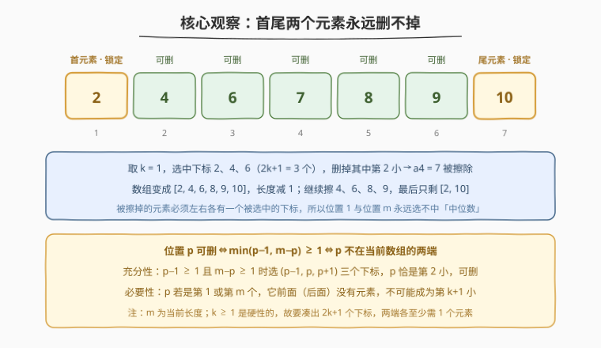
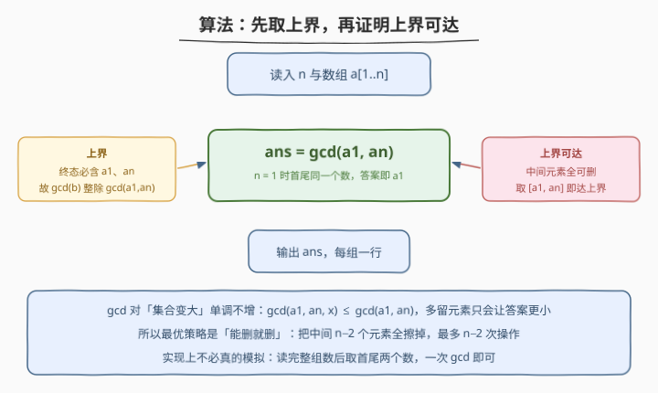
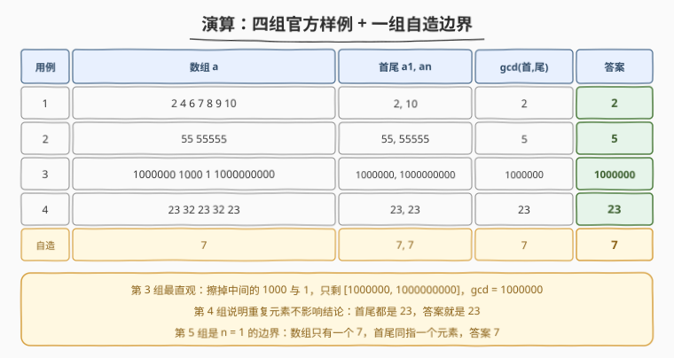

# Codeforces 2258A 奇数橡皮擦 题解

## 1. 题目概述

- **标题 / 题号**：奇数橡皮擦（Codeforces 2258A，英文名 Odd Eraser）
- **链接**：https://codeforces.com/problemset/problem/2258/A
- **来源**：Codeforces Round 1118 (Div. 2) · Problem A（UTC 2026-08-29）
- **难度**：800（Div. 2 签到题）
- **限制**：时间 1 s / 内存 256 MB
- **标签**：数学、贪心、不变量

**题意**：给定长度为 $m$ 的数组 $a$（初始 $m = n$），可以执行**任意次（含 $0$ 次）**如下操作：选一个整数 $k \ge 1$ 与 $2k+1$ 个严格递增的下标 $i_1 < i_2 < \dots < i_{2k+1}$（要求 $2k+1 \le m$），然后从数组中删掉**第 $i_{k+1}$ 个元素**。注意被删的不是最大也不是最小，而是被选中下标里**正中间**的那一个；删掉后长度减 $1$，其余元素顺次拼接。设最终数组为 $b$，问 $\gcd(b_1, \dots, b_{|b|})$ 的最大可能值，逐组输出。多测格式：第一行 $t$，每组第一行 $n$、第二行 $n$ 个整数。

**约束**：

- $1 \le t \le 500$，$1 \le n \le 100$
- $1 \le a_i \le 10^9$
- 题面**没有**限制 $\sum n$，最坏总读入量 $500 \times 100 = 5 \times 10^4$ 个数
- 操作次数可以为 $0$，但每次必然删掉**恰好一个**元素，长度不可能增加
- 所有 $a_i \ge 1$，故 $\gcd \ge 1$，答案落在 $[1, 10^9]$

## 2. 示例与观察
官方样例（输入 / 输出原样）：

```text
输入：
4
7
2 4 6 7 8 9 10
2
55 55555
4
1000000 1000 1 1000000000
5
23 32 23 32 23

输出：
2
5
1000000
23
```

逐组解释（关键看**首尾**两个数）：

| 用例 | 数组 | 首尾 $a_1, a_n$ | $\gcd(a_1, a_n)$ | 说明 |
|------|------|------------------|-------------------|------|
| 1 | `2 4 6 7 8 9 10` | $2,\ 10$ | $2$ | 删掉 4、6、7、8、9 后只剩 $[2,10]$ |
| 2 | `55 55555` | $55,\ 55555$ | $5$ | 长度已是 2，一步也删不动 |
| 3 | `1000000 1000 1 1000000000` | $1000000,\ 1000000000$ | $1000000$ | 删掉中间的 $1000$ 与 $1$，$10^6 \mid 10^9$ |
| 4 | `23 32 23 32 23` | $23,\ 23$ | $23$ | 首尾相等，答案就是 $23$ |

自造一组 $n = 1$ 的边界数据（说明「无操作可做」）：

```text
输入：
1
1
7

输出：
7
```

## 3. 解题思路

### 3.1 暴力思路

按题面直接搜索：状态是当前数组（原数组的一个子序列），转移是「选 $2k+1$ 个下标、删中间那个」。每一步的决策数是 $\sum_{k \ge 1} \binom{m}{2k+1}$；可达状态数是「保留哪些下标」的子序列个数，最坏 $2^{n-2}$ 种（含首尾的子序列，这里提前借用下文结论），$n = 100$ 时是 $2^{98}$，任何剪枝都救不回来。所以必须找到「哪些元素能被删」的**封闭刻画**，把搜索变成判定。

### 3.2 核心观察：可删性只取决于「是不是端点」



把「选 $2k+1$ 个下标、删第 $k+1$ 小」翻译成位置条件：位置 $p$ 能被删，当且仅当**它左边至少有一个被选中的下标、右边也至少有一个**（这样才能凑出 $k \ge 1$ 个在它前面、$k$ 个在它后面）。于是：

- **非端点都能删**：若 $2 \le p \le m-1$，取 $k = 1$，选中 $p-1,\ p,\ p+1$ 三个下标（$3 \le m$ 保证合法），$p$ 正是第 $2$ 小，一步删掉。
- **端点永远删不掉**：第 $1$ 个元素左边没有元素、第 $m$ 个元素右边没有元素，不可能成为「第 $k+1$ 小」（$k \ge 1$ 是硬性要求）。

> 💡 也就是说，这道题的操作自由度被压缩成一句话：**中间元素随便删，首尾两个元素被锁死**。$k$ 取多大都无所谓，$k = 1$ 就够了。

### 3.3 从可删性到答案：删得越多，$\gcd$ 越大



由 3.2 立刻得到终态的完整刻画：

1. 任何终态都是包含 $a_1$ 与 $a_n$ 的子序列（首尾删不掉）；
2. 反过来，任何包含 $a_1$ 与 $a_n$ 的子序列都能达到（把其余元素逐个删掉即可，它们始终夹在 $a_1$ 与 $a_n$ 之间）。

而 $\gcd$ 对「集合变大」单调不增：$\gcd(a_1, a_n, x) \mid \gcd(a_1, a_n)$。于是

$$\gcd(b) \mid \gcd(a_1, a_n)\quad \text{对一切终态 } b, \qquad \text{且 } b = [a_1, a_n] \text{ 可达}$$

上界与可达同时成立，答案就是

$$\text{ans} = \gcd(a_1, a_n)$$

$n = 1$ 时无法执行任何操作、终态就是 $[a_1]$，答案 $a_1$；而 $\gcd(a_1, a_1) = a_1$，所以同一个公式自动覆盖，**不需要特判**。

### 3.4 示例演算



以用例 1 的 $[2,4,6,7,8,9,10]$ 为例，逐步把中间元素擦干净：

| 步 | 操作（$k=1$，选 3 个下标） | 删掉的数 | 操作后数组 |
|----|---------------------------|----------|------------|
| 1 | 下标 $3,4,5$ | $7$ | $[2,4,6,8,9,10]$ |
| 2 | 下标 $3,4,5$ | $8$ | $[2,4,6,9,10]$ |
| 3 | 下标 $2,3,4$ | $6$ | $[2,4,9,10]$ |
| 4 | 下标 $2,3,4$ | $9$ | $[2,4,10]$ |
| 5 | 下标 $1,2,3$ | $4$ | $[2,10]$，$\gcd = 2$ |

任何一步若停下，$\gcd$ 只会更小（例如停在 $[2,4,6,8,9,10]$ 时 $\gcd = 1$），所以「能删就删」正是最优。

## 4. 算法细节

1. **只取首尾**：读入后取 `a.front()` 与 `a.back()`；也可以边读边只记第一个和最后一个（省掉数组），但**必须把本组 $n$ 个数全部读完**，否则下一组的读入位置会错位。
2. **$n = 1$ 不需要特判**：`std::gcd(a[0], a[n-1])` 在 $n=1$ 时退化为 $\gcd(a_1, a_1) = a_1$。若图省事写成 `gcd(a[0], a[1])`，$n=1$ 就会越界，这是最常见的 RE。
3. **数据类型**：$a_i \le 10^9$，$\gcd \le 10^9$，`int` 足够；本解仍用 `long long` 读入，防止题目日后把 $a_i$ 放大到 $10^{18}$，代价为零。
4. **多测无需清空**：没有全局数组、没有记忆化，`vector` 每组重新构造（$n \le 100$，开销可忽略），不存在「上一组残留」的问题。
5. **$\gcd$ 的实现**：用 C++17 的 `std::gcd`（头文件 `<numeric>`）；`__gcd` 是 GCC 扩展、非标准接口，换个编译器可能编不过。Python 直接用 `math.gcd`，对任意精度整数安全。
6. **不必真的模拟删除**：模拟也只要 $n-2$ 次删除、每次 $O(n)$，$O(n^2)$ 同样能过，但完全没有必要——一次 $\gcd$ 是 $O(\log A)$。
7. **I/O**：总数最多 $5 \times 10^4$ 个整数，`cin` 关同步后足够快；Python 用 `sys.stdin.buffer.read().split()` 一次读完，比逐行 `input()` 快一个量级。

## 5. 正确性证明

**引理 1（端点不可删）**：任何一次合法操作都不会删除当前数组的第 $1$ 个或第 $m$ 个元素。

**证明**：设操作选中下标 $i_1 < i_2 < \dots < i_{2k+1}$，删掉第 $i_{k+1}$ 个元素，题面要求 $k \ge 1$。若删掉的是第 $1$ 个元素，则 $i_{k+1} = 1$，但 $k+1 \ge 2$ 且 $1 \le i_1 < i_{k+1}$，矛盾；若删掉的是第 $m$ 个元素，则 $i_{k+1} = m$，但 $i_{k+1} < i_{2k+1} \le m$，同样矛盾。∎

**引理 2（非端点必可删）**：若当前长度 $m \ge 3$，则任意位置 $2 \le p \le m-1$ 的元素都能在一步内删掉。

**证明**：取 $k = 1$ 与下标 $i_1 = p-1,\ i_2 = p,\ i_3 = p+1$。由 $2 \le p \le m-1$ 知三个下标合法且严格递增，且 $2k+1 = 3 \le m$，满足题面要求；被删的恰是第 $i_2 = p$ 个元素，即目标元素。∎

**引理 3（终态刻画）**：可达的终态集合恰为「所有包含 $a_1$ 与 $a_n$ 的子序列」（$n = 1$ 时只有原数组本身）。

**证明**：必要性由引理 1 直接得到。充分性：设目标保留集合 $S \supseteq \{1, n\}$，把 $[1, n] \setminus S$ 中的下标按任意顺序逐个删除。删除任一目标元素时，$a_1$ 与 $a_n$ 都还在数组中，且分别严格位于它两侧，故它既不是当前数组的第 $1$ 个也不是最后一个，由引理 2 一步可删。整个过程合法，最终恰好剩下 $S$ 对应的子序列。∎

**引理 4（上界）**：对任意终态 $b$，$\gcd(b) \mid \gcd(a_1, a_n)$。

**证明**：由引理 3，$b$ 的元素取自 $a$ 且包含 $a_1$ 与 $a_n$。$\gcd(b)$ 整除 $b$ 的每个元素，特别地整除 $a_1$ 与 $a_n$，因此整除它们的最大公约数。∎

**定理**：算法输出的 $\gcd(a_1, a_n)$（$n = 1$ 时即 $a_1$）就是题目所求的最大值。

**证明**：一方面，由引理 4，任何终态的 $\gcd$ 都不超过 $\gcd(a_1, a_n)$。另一方面，由引理 3 取 $S = \{1, n\}$（$n \ge 2$）可知终态 $[a_1, a_n]$ 可达，其 $\gcd$ 恰为 $\gcd(a_1, a_n)$，故最大值不小于它。两者夹逼得到等号。$n = 1$ 时无操作可做，终态唯一、$\gcd$ 为 $a_1$。∎

## 6. 复杂度分析

- **时间**：每组 $O(n + \log A)$——读入 $n$ 个数、一次 $\gcd$（$A = \max a_i \le 10^9$，即最多约 $30$ 次取模）。整体 $O(\sum n + t \log A)$。实测最坏数据（$t = 500$、$n = 100$）单次运行的核心计算（含解析 $5 \times 10^4$ 个数）约 $0.9$ ms，C++ 进程总墙钟约 $78$ ms（进程启动与 I/O 占绝大部分），Python3 约 $24$ ms。
- **空间**：$O(n)$（存一组数）；若边读边只留首尾，可降到 $O(1)$；Python 版把全部输入切成 token 列表，约 $O(\sum n)$ 个短字符串。
- **对照时限**：$1$ s 的时限有三个数量级以上的余量，瓶颈完全在 I/O 而不在计算。

## 7. 参考代码

### C++17

```cpp
#include <bits/stdc++.h>
using namespace std;

int main() {
    ios::sync_with_stdio(false);
    cin.tie(nullptr);

    int t;
    if (!(cin >> t)) return 0;              // 空输入防护
    while (t--) {
        int n;
        cin >> n;
        vector<long long> a(n);
        for (auto &x : a) cin >> x;         // 必须读满 n 个数
        // 首尾删不掉，中间全可删；gcd 只会因多加元素而变小，
        // 故最优是把中间删光，答案为 gcd(a_1, a_n)（n = 1 时即 a_1）
        cout << std::gcd(a.front(), a.back()) << "\n";
    }
    return 0;
}
```

### Python3

```python
import sys
from math import gcd


def main() -> None:
    data = sys.stdin.buffer.read().split()
    if not data:
        return
    t = int(data[0])
    pos = 1
    out = []
    for _ in range(t):
        n = int(data[pos])
        pos += 1
        a = data[pos:pos + n]                # 一次切片读满本组
        pos += n
        out.append(str(gcd(int(a[0]), int(a[-1]))))
    sys.stdout.write("\n".join(out) + "\n")


main()
```

## 8. 边界情况与易错点

1. **$n = 1$**：一步操作都做不了，答案是 $a_1$。用 `gcd(a[0], a[n-1])` 自动正确；写成 `gcd(a[0], a[1])` 会越界。
2. **漏读中间元素**：只想拿首尾而跳过读入，会让流位置错乱，后续所有组全部错位——必须读满 $n$ 个数（Python 版用切片一次取走）。
3. **把「$k \ge 1$」误读成「$k \ge 0$」**：那样选 $1$ 个下标就能删它自己，端点也「可删」，可以一路删到只剩一个元素，答案会退化成 $\max a_i$；用例 1 会输出 $10$ 而不是 $2$。
4. **以为要多删到只剩 2 个才算合法**：题目允许停在任意长度，操作次数上限是 $n-2$；$n = 2$ 时一步也执行不了，答案就是 $\gcd(a_1,a_2)$。
5. **$a_i = 1$ 或大量重复**：$1$ 若落在首尾则答案必为 $1$，落在中间则完全不影响答案；全相同时答案就是该值（用例 4）。
6. **溢出**：本题 $\gcd \le 10^9$，`int` 都不会溢出；但若为了比较而把若干数连乘（例如拿乘积做判定）就会溢出，本解只用欧几里得取模，无此风险。
7. **多测输出**：每组恰好一行，组间不要空行，末尾换行可有可无；`t` 组循环里别把换行写成空格。
8. **空输入**：个别评测环境会喂空文件，C++ 用 `if (!(cin >> t)) return 0;`、Python 先判 `if not data: return`。

## 9. 验证记录

- **编译环境与命令**：`clang++ -std=c++17 -O2`（本机无 GNU g++，配 `codeforces/tools/include/bits/stdc++.h` 兼容头；正文代码只用标准库，可原样提交 GNU C++17）；Python 侧为 `Python 3.9.6`。
- **官方样例**：1 / 1 通过（按 Codeforces 标准 checker 的 token 比对，忽略空白与大小写）。
- **复核状态**：audited（2026-11-19 统一回归：编译 + 官方样例；写作期的随机对拍与暴力未重跑）。

## 相关题目与扩展

- [Codeforces 1370A Maximum GCD](https://codeforces.com/problemset/problem/1370/A)：$1 \le i < j \le n$ 最大化 $\gcd(i,j)$，同样是「先找上界、再证可达」的签到套路。
- [Codeforces 1542A Odd Set](https://codeforces.com/problemset/problem/1542/A)：围绕奇偶性与配对结构的签到题，可与本题「中位数下标」的组合味道对照。
- [Codeforces 1665A GCD vs LCM](https://codeforces.com/problemset/problem/1665/A)：构造四个数使 $\gcd$ 与 $\operatorname{lcm}$ 满足给定等式，$\gcd$ 性质构造的典型。
- [LeetCode 1979. 找出数组的最大公约数](https://leetcode.cn/problems/find-greatest-common-divisor-of-array/)：只取最小值与最大值求 $\gcd$，与本题「只保留两个特殊位置」的思路同源。

**延伸思考**：

1. **终态长度被固定为 $L$**（$2 \le L \le n$）：此时必须保留 $a_1, a_n$ 并再挑 $L-2$ 个中间元素。答案变成「最大的 $g$，满足 $g \mid \gcd(a_1,a_n)$ 且中间至少有 $L-2$ 个元素是 $g$ 的倍数」。枚举 $\gcd(a_1,a_n)$ 的因子（至多约 $1344$ 个）再扫一遍计数即可，复杂度 $O(\sqrt{G} + n \cdot d(G))$。
2. **改成删「选中奇数个下标里的最大值」**：位置 $p$ 要成为最大值，需在它前面凑出 $2k$ 个被选下标，故 $p \ge 3$ 才可删。于是前两个元素被锁死、其余全可删，答案变成 $\gcd(a_1, a_2)$；删最小值则对称，答案是 $\gcd(a_{n-1}, a_n)$。
3. **取消端点保护（任意元素都能删）**：可以删到只剩一个元素，答案就是 $\max a_i$；若再要求终态长度至少 $L$，则答案是「最大的 $g$，使至少 $L$ 个元素是 $g$ 的倍数」，同样是枚举因子计数。
4. **操作次数受限（最多 $q$ 次）**：只能删掉至多 $q$ 个中间元素，于是答案变成「最大的 $g$，满足 $g \mid \gcd(a_1,a_n)$ 且中间不被 $g$ 整除的元素不超过 $q$ 个（即至少 $n-2-q$ 个是 $g$ 的倍数）」。$q \ge n-2$ 时退化为 $\gcd(a_1,a_n)$，$q = 0$ 时退化为全体元素的 $\gcd$，同样枚举因子即可。
