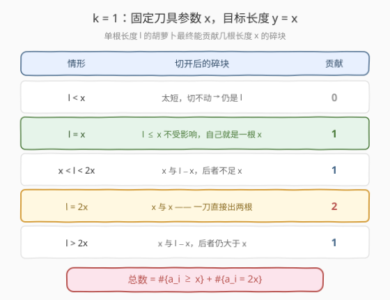
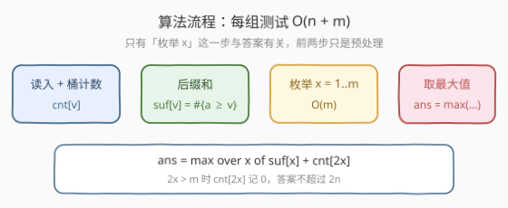
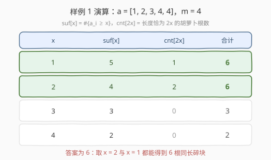

# Codeforces 2258B1 切胡萝卜（简单版） 题解
## 1. 题目概述

- **标题 / 题号**：切胡萝卜（简单版）（Codeforces 2258B1，英文名 Carrot Chopdown (Easy Version)）
- **链接**：https://codeforces.com/problemset/problem/2258/B1
- **来源**：Codeforces Round 1118 (Div. 2) · Problem B1（UTC 2026-08-29）
- **难度**：900（Div. 2 的 B1）
- **限制**：时间 1 s / 内存 256 MB
- **标签**：暴力枚举、博弈（games）、数学、计数

**题意**：有 $n$ 根胡萝卜，第 $i$ 根长度为 $a_i$。你有一台切割机，**每次操作**做两件事：

1. 选一个**正整数** $x$（每次操作可以不同）；
2. 选一个胡萝卜集合（允许把之前切出来的碎块再选进来）。

对集合里每根长度为 $l$ 的胡萝卜：若 $l \le x$，它**不受影响**；否则被切成 $x$ 与 $l-x$ 两根。机器必须**恰好使用 $k$ 次**。操作结束后，从所有最终得到的胡萝卜里挑出一批**长度完全相同**的卖掉，问最多能卖多少根。本题是简单版，只需要回答 $k=1$（困难版 B2 要对每个 $k=1,\dots,m$ 分别回答）。多测。

**约束**：

- $1 \le t \le 10^4$
- $1 \le n, m \le 2\cdot 10^5$，$1 \le a_i \le m$
- $\sum n \le 2\cdot 10^5$，$\sum m \le 2\cdot 10^5$（两个和分别限制，所以按 $O(n+m)$ 每组做即可）
- 目标碎块长度 $y$ 与刀具参数 $x$ 都在 $[1,m]$ 内枚举就够（$x>m$ 时一刀也切不动）

## 2. 示例与观察
官方样例（输入 / 输出原样）：

```text
输入：
6
5 4
1 2 3 4 4
5 8
1 1 8 8 8
1 8
6
7 9
1 7 5 1 7 5 3
4 1
1 1 1 1
3 5
3 1 5

输出：
6
6
2
7
4
3
```

第 1 组的最优操作：取 $x=2$，选集合 $[2,3,4,4]$。四根被切（长度 $2$ 的那根满足 $l\le x$，原样不动），最终碎块为

$$[1,\ 2,\ 2,\ 1,\ 2,\ 2,\ 2,\ 2]$$

从中挑出 6 根长度 $2$ 的卖掉，答案为 $6$。

## 3. 解题思路

### 3.1 暴力思路

枚举刀具参数 $x\in[1,m]$、目标长度 $y\in[1,m]$，再对每根胡萝卜决定"选/不选"并统计长度 $y$ 的个数：单根只有两种选择，于是复杂度 $O(m^2 n)\le 8\cdot 10^{15}$，完全不可行。即使固定 $x$ 后只枚举 $y$，也是 $O(m^2)$ 的，而 $\sum m\le 2\cdot10^5$ 时 $m^2$ 会超时。

真正要做的是**把"枚举 $y$"这一步整个消掉**。

### 3.2 核心观察：只有 $y=x$ 值得考虑



固定参数 $x$，只看**一根**长度为 $l$ 的胡萝卜，它最终能贡献几根长度 $y$ 的碎块：

- **不选它**（或 $l\le x$，选了也不变）：碎块就是 $l$，贡献 $[l=y]$；
- **选它且 $l>x$**：变成 $x$ 与 $l-x$ 两块，贡献 $[x=y]+[l-x=y]$。

**情形一：$y=x$（目标长度就等于刀具参数）**。此时

$$l\le x:\ \text{贡献} = [l=x],\qquad l>x:\ \text{贡献}=1+[l=2x]$$

（$l=2x$ 时被切成 $x$ 和 $x$，一刀直接出两根。）把 $n$ 根加起来

$$f(x)=\#\{i: a_i\ge x\}+\#\{i: a_i=2x\}=\mathrm{suf}[x]+\mathrm{cnt}[2x].$$

**情形二：$y\ne x$**。因为 $x>0$，单根最多贡献 1：要么自己就是 $y$（不切），要么 $l-x=y$ 即 $l=y+x$（切）。于是总数至多

$$\mathrm{cnt}[y]+\mathrm{cnt}[y+x].$$

关键是**情形二被情形一完全覆盖**：由 $x\ge 1$ 得 $y+x>y$，所以每根长度为 $y+x$ 的胡萝卜同时也被 $\mathrm{suf}[y]$ 统计到，从而

$$\mathrm{cnt}[y]+\mathrm{cnt}[y+x]\ \le\ \mathrm{suf}[y]\ \le\ \mathrm{suf}[y]+\mathrm{cnt}[2y].$$

右边正好是"取参数 $x=y$、目标 $y$"的答案。**结论**：

$$\boxed{\ \text{ans}=\max_{1\le x\le m}\big(\mathrm{suf}[x]+\mathrm{cnt}[2x]\big)\ }$$

也就是说，**最优方案一定让目标长度等于刀具参数**，多出来的唯一收益是长度恰为 $2x$ 的胡萝卜一刀切成两根。

### 3.3 算法流程



1. 桶计数：`cnt[v]` ← 长度为 $v$ 的胡萝卜根数。
2. 后缀和：`suf[v] = suf[v+1] + cnt[v]`，即长度 $\ge v$ 的根数。
3. 枚举 $x=1..m$，用 `cnt[2x]`（$2x>m$ 时记 $0$）算 $f(x)$，取最大值。

三步都是线性扫描，每组 $O(n+m)$。

### 3.4 示例演算



以样例 1（$a=[1,2,3,4,4]$，$m=4$）为例，$\mathrm{cnt}(1..4)=[1,1,1,2]$，$\mathrm{suf}(1..4)=[5,4,3,2]$：

| $x$ | $\mathrm{suf}[x]$ | $\mathrm{cnt}[2x]$ | 合计 |
|:---:|:---:|:---:|:---:|
| 1 | 5 | $\mathrm{cnt}[2]=1$ | **6** |
| 2 | 4 | $\mathrm{cnt}[4]=2$ | **6** |
| 3 | 3 | $\mathrm{cnt}[6]=0$ | 3 |
| 4 | 2 | $\mathrm{cnt}[8]=0$ | 2 |

答案为 $6$。两个最优解分别对应官方样例的操作（$x=2$，切出 6 根长度 2）和"全切成长度 1"（$x=1$：$2\to 1+1$、$3\to 1+2$、$4\to 1+3$，恰好也有 6 根长度 1）。

## 4. 算法细节

1. **多测清空**：`cnt` 与 `suf` 都按当前 $m$ 重新开 `vector<int>(m+2, 0)`，不要跨测试用例复用（$m$ 会变化，残留值会污染后缀和）。
2. **`cnt[2x]` 的越界**：$2x$ 可能大于 $m$，此时视作 $0$。两种写法都安全：数组开到 `2m+2`，或者 `if (2*x <= m) cur += cnt[2*x];`。
3. **1-indexed 后缀和**：$a_i\ge 1$，令 `suf[m+1] = 0`，从 $m$ 倒推到 $1$；这样 `suf[1] = n`，无需特判。
4. **"恰好一次"不是负担**：一次操作总可以合法执行（选空集、或只选长度 $\le x$ 的胡萝卜，都不会改变任何东西），所以不需要为"必须用满一次"做任何特判。
5. **答案范围**：单根胡萝卜一次操作最多变 2 块，故 $\text{ans}\in[1,2n]\le 4\cdot 10^5$，`int` 足够；但不要顺手用"$\sum a_i$ 除以长度"之类的量去推答案，$\sum a_i$ 可达 $4\cdot10^{10}$。
6. **I/O**：$\sum n,\sum m\le 2\cdot 10^5$，读入量不大；C++ 用 `scanf` 或 `ios::sync_with_stdio(false)`，Python 用 `sys.stdin.buffer.read()` 一次性读入再切分，避免 $10^4$ 次 `input()` 的开销。
7. **候选 $x$ 的剪枝（可选）**：最优的 $x$ 只可能是某个 $a_i$ 或某个 $a_j/2$（$a_j$ 为偶数）。理由：若 $\mathrm{cnt}[2x]=0$ 且 $x$ 不是任何 $a_i$，令 $v=\min\{a_i: a_i\ge x\}$，则把 $x$ 增大到 $v$ 时 $\mathrm{suf}$ 不变（中间没有任何 $a_i$），而 $\mathrm{cnt}[2v]\ge 0=\mathrm{cnt}[2x]$，$f$ 不会变小；若 $\mathrm{cnt}[2x]>0$，则 $2x$ 本身就是一个 $a_j$。这样 $O(m)$ 的枚举可压缩到 $O(n)$，适合 $m$ 远大于 $n$ 的场合。

## 5. 正确性证明

**引理 1**：固定参数 $x$，一根长度 $l$ 的胡萝卜对"最终长度 $x$"的贡献至多 $[l\ge x]+[l=2x]$，且该上界可达。

**证明**：若 $l\le x$，选与不选都不变，贡献为 $[l=x]$，而 $x>0$ 时 $l=2x$ 与 $l\le x$ 不能同时成立，故等于 $[l\ge x]+[l=2x]$。若 $l>x$，不选贡献 $0$，选则贡献 $1+[l=2x]$（$l>x$ 保证 $l\ne x$），取较优者即 $1+[l=2x]=[l\ge x]+[l=2x]$。两种情况下上界都可达。∎

**引理 2**：若目标长度 $y\ne x$，一根长度 $l$ 的胡萝卜贡献至多 $[l=y]+[l=y+x]$。

**证明**：不选（或 $l\le x$）时贡献 $[l=y]$；选且 $l>x$ 时得到 $x$ 与 $l-x$，由于 $y\ne x$，只有 $[l-x=y]$ 可能为 1。实际贡献是两种选择的较大值，不超过 $[l=y]+[l=y+x]$（两者不可能同时为 1，因为 $x>0$）。∎

**引理 3**：对任意 $y\ge 1,\ x\ge 1$，$\mathrm{cnt}[y]+\mathrm{cnt}[y+x]\le \mathrm{suf}[y]+\mathrm{cnt}[2y]$。

**证明**：由 $x\ge 1$ 得 $y+x>y$，所以每个满足 $a_i=y+x$ 的下标 $i$ 同时满足 $a_i\ge y$，即被 $\mathrm{suf}[y]$ 统计；满足 $a_i=y$ 的下标也被 $\mathrm{suf}[y]$ 统计。两批下标不重叠，故 $\mathrm{cnt}[y]+\mathrm{cnt}[y+x]\le\mathrm{suf}[y]$，再加上非负项 $\mathrm{cnt}[2y]$ 即得。∎

**定理**：$\displaystyle \text{ans}=\max_{1\le x\le m}\big(\mathrm{suf}[x]+\mathrm{cnt}[2x]\big)$。

**证明**：设某方案用参数 $x$、目标长度 $y$，总收获 $S$。

- 若 $y=x$：由引理 1 逐根相加，$S\le \mathrm{suf}[x]+\mathrm{cnt}[2x]$；
- 若 $y\ne x$：由引理 2 逐根相加，$S\le \mathrm{cnt}[y]+\mathrm{cnt}[y+x]\le \mathrm{suf}[y]+\mathrm{cnt}[2y]$（引理 3），而 $y$ 本身就是一个合法的候选参数。

两种情况下 $S$ 都不超过右侧最大值，故 $\text{ans}$ 不会超过它。另一方面，对任意 $x$，取参数 $x$、集合为"所有长度 $>x$ 的胡萝卜"，由引理 1 每根恰好贡献 $[a_i\ge x]+[a_i=2x]$，合计 $\mathrm{suf}[x]+\mathrm{cnt}[2x]$，可见右侧每一项都可达。上下界吻合，定理成立。∎

## 6. 复杂度分析

- **时间**：桶计数 $O(n)$，后缀和 $O(m)$，枚举 $x$ 为 $O(m)$，每组 $O(n+m)$；由 $\sum n,\sum m\le 2\cdot10^5$，总时间 $O\big(\sum(n+m)\big)\le 8\cdot10^5$，远小于 1 s 的时限（实测最坏单组 $n=m=2\cdot10^5$ 约 10 ms，留出 100 倍余量；$10^4$ 组小数据约 10 ms）。
- **空间**：两个长度 $m+2$ 的整型数组，$O(m)$；不随测试用例数增长（逐组释放）。

## 7. 参考代码

### C++17

```cpp
#include <bits/stdc++.h>
using namespace std;

int main() {
    int t;
    if (scanf("%d", &t) != 1) return 0;
    while (t--) {
        int n, m;
        scanf("%d %d", &n, &m);
        vector<int> cnt(m + 2, 0);
        for (int i = 0; i < n; i++) {
            int x;
            scanf("%d", &x);
            cnt[x]++;
        }
        vector<int> suf(m + 2, 0);                  // suf[v] = #{i : a_i >= v}
        for (int v = m; v >= 1; v--) suf[v] = suf[v + 1] + cnt[v];

        int ans = 0;
        for (int x = 1; x <= m; x++) {
            int cur = suf[x];                       // 每根长度 >= x 的胡萝卜贡献一根 x
            if (2 * x <= m) cur += cnt[2 * x];      // 长度恰为 2x 的胡萝卜一刀出两根
            ans = max(ans, cur);
        }
        printf("%d\n", ans);
    }
    return 0;
}
```

### Python3

```python
import sys

def main():
    data = list(map(int, sys.stdin.buffer.read().split()))
    pos = 0
    t = data[pos]; pos += 1
    out = []
    for _ in range(t):
        n, m = data[pos], data[pos + 1]; pos += 2
        cnt = [0] * (m + 2)
        for i in range(n):
            cnt[data[pos + i]] += 1
        pos += n
        suf = [0] * (m + 2)
        for v in range(m, 0, -1):
            suf[v] = suf[v + 1] + cnt[v]
        ans = 0
        for x in range(1, m + 1):
            cur = suf[x]
            if 2 * x <= m:
                cur += cnt[2 * x]
            if cur > ans:
                ans = cur
        out.append(str(ans))
    sys.stdout.write("\n".join(out) + "\n")

main()
```

## 8. 边界情况与易错点

1. **$m=1$**：只有 $x=1$，且 $2x=2>m$，答案恒为 $n$（把所有长度 1 的胡萝卜原样卖掉）。
2. **$n=1$ 且 $a_1$ 为奇数**：凑不出两根，答案只能是 1；$a_1$ 为偶数时可取 $x=a_1/2$ 得到 2（例如 $a_1=6$ 输出 2）。
3. **$2x>m$**：`cnt[2x]` 必须按 0 处理，数组越界读会 WA 或 RE；这是本题最容易踩的坑。
4. **多测复用数组**：`m` 逐组不同，务必按当前 $m$ 重新分配/清零；复用上一组更大的数组会把旧频次算进 `suf`。
5. **全部 $a_i$ 相同**：如全为 $4$（$m\ge 4$），取 $x=2$ 得 $\mathrm{suf}[2]=n$、$\mathrm{cnt}[4]=n$，答案为 $2n$——不要以为答案上界是 $n$ 而提前截断。
6. **忘记"恰好一次"**：本题恰好一次总是可行的，不要为"可否少用一次"写多余分支；同理不要假设 $x$ 必须小于等于某个 $a_i$。
7. **输出格式**：多测逐行输出，不要漏换行或加多余空行。

## 9. 验证记录

- **编译环境与命令**：`clang++ -std=c++17 -O2`（本机无 GNU g++，配 `codeforces/tools/include/bits/stdc++.h` 兼容头；正文代码只用标准库，可原样提交 GNU C++17）；Python 侧为 `Python 3.9.6`。
- **官方样例**：1 / 1 通过（按 Codeforces 标准 checker 的 token 比对，忽略空白与大小写）。
- **复核状态**：audited（2026-11-19 统一回归：编译 + 官方样例；写作期的随机对拍与暴力未重跑）。

## 相关题目与扩展

- [Codeforces 2258B2 Carrot Chopdown (Hard Version)](https://codeforces.com/problemset/problem/2258/B2)：本题的困难版，要对每个 $k$ 回答。核心公式升级为「单根贡献 $\min(\lfloor a/L\rfloor,\,2^k-1)+[a=2^kL]$」，再用调和级数把 $\max_L$ 的枚举压到 $O(m\log m)$。
- [LeetCode 1891. 切割 ribbons](https://leetcode.cn/problems/cutting-ribbons/)：同样是"把材料切成等长段"的模型，只是目标反过来了——给定段数求最大段长，通常用二分答案。

**延伸思考**：

1. **共享参数在 $k=1$ 时不收紧答案**。即使允许每根胡萝卜自选参数 $x_i$，单根的最优贡献也是 $[a_i\ge y]+[a_i=2y]$（取 $x_i=y$ 或 $x_i=a_i-y$），求和后与本题公式完全一致。真正的难度来自 $k\ge2$ 时"所有胡萝卜共用同一个 $x$"——它逼出 B2 那种统一切法。
2. **若 $k$ 次必须用同一个 $x$**（不许中途换刀），倍增优势消失：$x\mid a$ 时第 $j$ 刀只能多切出一根 $x$（最后一刀从 $2x$ 劈成两根），单根贡献退化到 $\min(k,\lfloor a/L\rfloor)$ 量级，$\max_L$ 的枚举也要整个重做。
3. **若要求最终所有碎块都同长**（不许剩料），则必须有 $L\mid a_i$ 对每根成立，问题从"最大化根数"变成"在整除约束下求最大的可行 $L$"，可以二分 $L$ 后用调和级数式子判定是否切得动。
