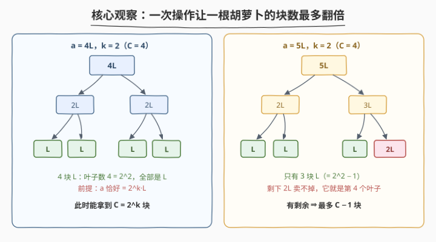
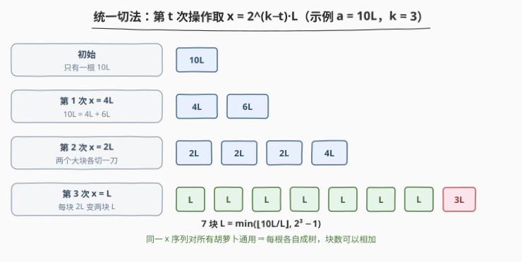
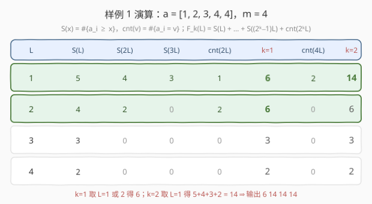

# Codeforces 2258B2 切胡萝卜（困难版） 题解

## 1. 题目概述

- **标题 / 题号**：切胡萝卜（困难版）（Codeforces 2258B2，英文名 Carrot Chopdown (Hard Version)）
- **链接**：https://codeforces.com/problemset/problem/2258/B2
- **来源**：Codeforces Round 1118 (Div. 2) · Problem B2
- **难度**：1600（1000 分，Div. 2 B2；Easy 版 B1 为 900 分，只问 $k=1$）
- **限制**：时间 1 s / 内存 256 MB
- **标签**：暴力枚举、贪心、实现、数学

**题意**：有 $n$ 根胡萝卜，长度分别为 $a_1,\dots,a_n$。有一台切割机，每次操作分两步：先选一个胡萝卜（段）的集合（已经切出来的段也能再选），再选一个正整数 $x$；对集合里每一段长度 $l$：若 $l \le x$ 则原封不动，否则这段裂成长度 $x$ 与 $l-x$ 的两段。恰好做 $k$ 次操作后，从所有段中挑出**长度相同**的若干段卖掉，问最多能卖多少段。本题要求对 $k=1,2,\dots,m$ **分别独立**回答（Easy 版只问 $k=1$）。

多测格式：第一行 $t$；每组先给 $n,m$，再给一行 $n$ 个整数 $a_i$；对每组输出 $m$ 个整数，第 $k$ 个是 $k$ 次操作的答案。

**约束**：

- $1 \le t \le 10^4$，$\sum n \le 2\cdot 10^5$，$\sum m \le 2\cdot 10^5$
- $1 \le n,m \le 2\cdot 10^5$，$1 \le a_i \le m$（注意 $m$ 同时是 $k$ 的上界和长度的上界）
- 单组答案上界为 $\sum a_i \le n\cdot m \le 4\cdot 10^{10}$，**必须用 64 位整数**
- 时限 1 s 且要同时处理 $m$ 个 $k$，单组需要 $O(n + m\log m)$ 量级

## 2. 示例与观察
官方样例（输入 / 输出原样）：

```text
输入：
6
5 4
1 2 3 4 4
5 8
1 1 8 8 8
1 8
6
7 9
1 7 5 1 7 5 3
4 1
1 1 1 1
3 5
3 1 5

输出：
6 14 14 14
6 12 26 26 26 26 26 26
2 3 6 6 6 6 6 6
7 17 29 29 29 29 29 29 29
4
3 7 9 9 9
```

官方样例 1 的解释：$a=[1,2,3,4,4]$。$k=1$ 时取 $x=2$、集合 $\{2,3,4,4\}$，得到长度为 $2$ 的段共 $6$ 个；$k=2$ 时再取 $x=1$ 切所有段，全变成 $1$，共 $14$ 段。

自造一组 $n=2$、$m=3$ 的小数据（两根等长胡萝卜）：

```text
输入：
1
2 3
3 3

输出：
2 6 6
```

$k=1$ 时两根各切成 $1+2$ 或保持 $3$，两种长度都只有 $2$ 段；$k=2$ 时两根各切成 $1+1+1$，共 $6$ 段；$k=3$ 时"多切一次空刀"不变，仍为 $6$。

## 3. 解题思路

### 3.1 暴力思路

最直接的想法：枚举目标长度 $L\in[1,m]$，再搜索 $k$ 次操作的方案（每次枚举 $x$ 与子集），最后统计长度等于 $L$ 的段数。单个胡萝卜切 $k$ 次的分法本身随 $k$ 指数增长，再乘上 $n$ 与 $m$ 个 $k$，完全不可行。所以必须先把"**一根胡萝卜在 $k$ 次操作后最多能产出多少段长度 $L$**"想清楚：记 $q=\lfloor a/L\rfloor$，$C=2^k$，下面四个观察逐步把它拆掉。

### 3.2 核心观察：二叉切分树与 $2^k$ 个叶子



**观察 1（"恰好 $k$ 次" = "至多 $k$ 次"）**：取 $x=m$，任何段长度都 $\le a_i \le m$，因此一起选中也一刀不切（题面规定 $l\le x$ 不变）。所以空操作永远合法，"恰好"不带来额外约束，答案对 $k$ 单调不减。

**观察 2（切分树）**：盯住一根胡萝卜，把切分过程画成二叉树——每次切开一个叶子，把它换成两个孩子。一次操作最多把**当前所有叶子**都切开，所以叶子数在一步内至多翻倍：$k$ 次操作后叶子数（也就是所有段数）$\le 2^k=C$。

**观察 3（单根上限）**：设这根胡萝卜最终贡献 $p$ 段长度 $L$。因为总长守恒，$pL\le a$，即 $p\le q$。若 $pL<a$，则除这 $p$ 段以外还剩至少一个叶子（总长至少 $1$），叶子数至少为 $p+1$，而叶子数不超过 $C$，故 $p\le C-1$。唯一可能取到 $p=C$ 的情形是所有叶子都恰好是 $L$，即 $a=C\cdot L$。合并两种情况：

$$p_k(a,L)=\min\!\Big(\Big\lfloor \frac{a}{L}\Big\rfloor,\ C-1\Big)+[\,a=C\cdot L\,],\qquad C=2^k$$

（$a=C\cdot L$ 时 $\min$ 给出 $C-1$，再补 $1$ 正好是 $C$；其余情形 $p$ 就是一个 $\min$。）

**观察 4（可达性：统一切法）**：第 $t$ 次操作取 $x_t=2^{k-t}L$，并把所有长度 $>x_t$ 的段都选上。所有胡萝卜共用同一个 $x$ 序列，因此各根互不干扰、块数可以直接相加，而且每根都恰好拿到上面的 $p_k(a,L)$。所以答案就是各根之和的最大值。

### 3.3 算法流程：把"枚举 $L$"变成前缀和



固定 $L$，记 $S(x)=\#\{i:a_i\ge x\}$（$x>m$ 时 $S(x)=0$），$\mathrm{cnt}(v)=\#\{i:a_i=v\}$。由 $\min(q_i,C-1)=\sum_{j=1}^{C-1}[q_i\ge j]$ 得

$$F_k(L)=\sum_i p_k(a_i,L)=\sum_{j=1}^{C-1}S(jL)+\mathrm{cnt}(C\cdot L)$$

第一项把"每根各算一次"改写成"对每个 $j$ 数一数长度够的根数"，第二项是 $a_i=C\cdot L$ 的特例计数。由于 $S(jL)=0$ 当 $jL>m$，每个 $L$ 只需处理 $j\le \min(C-1,\ \lfloor m/L\rfloor)$。

**对所有 $k$ 同时求值**：外层枚举 $L$，内层从 $j=1$ 往上累加前缀和 $\mathrm{pref}=\sum_{j'=1}^{j}S(j'L)$。当 $j+1$ 是 $2$ 的幂（即 $j+1=2^k$）时，用 $\mathrm{pref}+\mathrm{cnt}((j+1)L)$ 更新 $\mathrm{best}[k]$。最后

输出时：$k<K$ 取 $\mathrm{ans}[k]=\max_L \mathrm{best}[k]$；$k\ge K$ 直接给 $\sum a_i$，其中 $K$ 是最小的满足 $2^K\ge \max a_i$ 的整数。

后半段的理由：$2^K\ge\max a_i$ 时 $p_K(a,1)=\min(a,2^K-1)+0=a$，即每根都能被完整切成 $a$ 个长度 $1$ 的段，总和是显然的上界。此时 $K\le 18$（$\max a_i\le 2\cdot 10^5$），只有 $k<K$ 需要真正计算。

### 3.4 示例演算



以样例 1（$a=[1,2,3,4,4]$，$m=4$）为例，$S(1)=5,S(2)=4,S(3)=3,S(4)=2$。图中逐行列出 $L=1,2,3,4$ 的 $S(L),S(2L),S(3L)$ 与两个 $\mathrm{cnt}$：$L=1$ 给出 $5+1=6$ 与 $5+4+3+2=14$，$L=2$ 给出 $4+2=6$ 与 $4+2+0+0=6$，$L=3,4$ 只有 $3$ 和 $2$。于是 $k=1$ 最大值 $6$（$L=1,2$ 并列），$k=2$ 最大值 $14$（$L=1$），与官方输出 `6 14 14 14` 吻合；$k=2$ 时 $L=2$ 一列也印证了"两根 $4$ 各切两块、$2$ 与 $3$ 各切一块"的加法。

## 4. 算法细节

1. **多测清空**：`cnt`、`suf`、`best` 全部按本组的 $m$ 重新分配（不要复用上一组的大小）；`suf` 开到 $m+3$，保证 `suf[m+1]=0` 不越界。
2. **$K$ 的求法**：`while ((1 << K) < mx) ++K;`，其中 `mx = max a_i`。$mx=1$ 时 $K=0$，此时所有 $k\ge K$，输出全是总和 $\sum a_i=n$，内层循环因 `capJ=0` 自动跳过。
3. **64 位**：单组答案可达 $2\cdot 10^5\times 2\cdot 10^5=4\cdot 10^{10}$，`best`、`sum`、前缀和都必须 `long long`。
4. **下标保护**：$C\cdot L$ 可能远大于 $m$（最大约 $2^{18}\cdot 2\cdot 10^5$），必须先算 `long long ci = 1LL * C * L`，判断 `ci <= m` 再访问 `cnt[(int)ci]`。
5. **$j$ 的上界**：`jmax = min((1 << K) - 1, m / L)`。取 $2^K-1$ 而非 $2^K$ 是因为 $k<K$ 时 $C\le 2^{K-1}$，$j=C-1\le 2^{K-1}-1$ 已足够；取 $m/L$ 是因为更远的 $S(jL)$ 恒为 $0$。
6. **判断 $2$ 的幂**：`(C & (C - 1)) == 0`，再用 `__builtin_ctz(C)` 取 $k$，比循环快且不易错。
7. **I/O**：$t$ 可达 $10^4$、总输出 $2\cdot 10^5$ 个数，C++ 用 `scanf/printf`（或关闭同步的 `cin/cout`）；Python 必须用 `sys.stdin.buffer.read()` 一次性读入。
8. **Python 常数优化**：内层 $j$ 循环在 Python 里很贵，改为对每个 $L$ 用 `itertools.accumulate(suf[L::L])` 一次性算出整段前缀和，再只在 $2^k-1$ 处取值，实测 $2\cdot 10^5$ 规模约 $0.3$ s。

## 5. 正确性证明

**引理 1（叶子倍增）**：一根胡萝卜经过 $k$ 次操作后，来自它的段数不超过 $2^k$。

**证明**：对 $k$ 归纳。$k=0$ 时只有 $1$ 段。设第 $t$ 次操作前有 $s$ 段，本次至多选中其中 $s$ 段，每段裂成两段，故之后段数至多 $2s$。于是 $k$ 次后段数 $\le 2^k$。∎

**引理 2（单根上限）**：$p\le \min(\lfloor a/L\rfloor,2^k-1)+[a=2^kL]$。

**证明**：由总长守恒 $pL\le a$，故 $p\le q=\lfloor a/L\rfloor$。若 $pL<a$，则除 $p$ 段 $L$ 以外还有至少一段（长度 $a-pL\ge 1$），段数 $\ge p+1$，由引理 1 得 $p\le 2^k-1$，此时右端 $\ge\min(q,2^k-1)\ge p$。若 $pL=a$，则 $p=q$：当 $p\le 2^k-1$ 时右端 $=\min(q,2^k-1)=p$；当 $p=2^k$ 时 $a=2^kL$，右端 $=(2^k-1)+1=p$。综上成立。∎

**引理 3（统一切法可达）**：取 $x_t=2^{k-t}L$（$t=1,\dots,k$）、每次选上所有长度 $>x_t$ 的段，则一根长度 $a$ 的胡萝卜最终恰有 $\min(\lfloor a/L\rfloor,2^k-1)+[a=2^kL]$ 段长度 $L$。

**证明**：设剩余 $s$ 次操作（当前这一步取 $x=2^{s-1}L$），记为 $g_s(a)$，对 $s$ 归纳证明 $g_s(a)=\min(\lfloor a/L\rfloor,2^s-1)+[a=2^sL]$。$s=0$ 时 $g_0(a)=[a=L]$，右端 $=0+[a=L]$，成立。设 $s\ge 1$。若 $a\le 2^{s-1}L$ 则本步不切，$g_s(a)=g_{s-1}(a)$；此时 $\lfloor a/L\rfloor\le 2^{s-1}\le 2^s-1$，且 $a<2^sL$，右端 $=\lfloor a/L\rfloor$，而 $g_{s-1}(a)=\min(\lfloor a/L\rfloor,2^{s-1}-1)+[a=2^{s-1}L]=\lfloor a/L\rfloor$，归纳成立。若 $a>2^{s-1}L$，切成 $2^{s-1}L$ 与 $a-2^{s-1}L$，两者各剩 $s-1$ 次：前者恰好裂成 $2^{s-1}$ 段 $L$（每次对半，归纳可得），后者贡献 $\min(\lfloor a/L\rfloor-2^{s-1},2^{s-1}-1)+[a-2^{s-1}L=2^{s-1}L]$，于是总和为 $2^{s-1}+\min(\lfloor a/L\rfloor-2^{s-1},2^{s-1}-1)+[a=2^sL]=\min(\lfloor a/L\rfloor,2^s-1)+[a=2^sL]$，归纳完成。∎

**定理**：对每个 $k$，上述算法输出的数等于 $k$ 次操作后能卖出的最大段数。

**证明**：对任意目标长度 $L$，引理 2 给出每根胡萝卜的段数上界，求和即 $F_k(L)$ 是 $L$ 方案的上界；引理 3 说明这个上界对每根同时可达（$x$ 序列只依赖 $k$ 与 $L$，与具体 $a_i$ 无关），故 $F_k(L)$ 就是目标长度取 $L$ 时的最优值，答案 $=\max_L F_k(L)$。算法 3.3 按 $j$ 累加前缀和，正是逐项计算 $\sum_{j=1}^{C-1}S(jL)$，并在 $j+1=2^k$ 处加上 $\mathrm{cnt}(C\cdot L)$，故 `best[k]` 等于 $\max_L F_k(L)$；$k\ge K$ 时用总和，已证其为上界且被 $L=1$ 取到。∎

## 6. 复杂度分析

- **时间**：每组读入与离散化 $O(n+m)$；主循环对每个 $L$ 做 $\min(2^K-1,\lfloor m/L\rfloor)$ 次累加，总计 $\sum_{L=1}^{m} m/L=O(m\log m)$（$m=2\cdot 10^5$ 时约 $2.5\cdot 10^{6}$ 次），并且一次遍历同时得到所有 $k$ 的答案。总和 $O\big(\sum(n+m\log m)\big)$，在 $\sum m\le 2\cdot 10^5$ 下很轻。
- **空间**：`cnt`、`suf`、`best` 均为 $O(m)$（`best` 只有 $O(\log m)$），总计 $O(m)$。
- **实测**：$n=m=2\cdot 10^5$ 的最坏数据，C++17 `-O2` 运行约 $40$ ms，距离 1 s 时限有 20 倍以上余量；Python3 同数据约 $0.3$ s。

## 7. 参考代码

### C++17

```cpp
#include <bits/stdc++.h>
using namespace std;

int main() {
    int T;
    scanf("%d", &T);
    while (T--) {
        int n, m;
        scanf("%d %d", &n, &m);
        vector<int> cnt(m + 2, 0);
        int mx = 0;
        long long sum = 0;
        for (int i = 0; i < n; ++i) {
            int a;
            scanf("%d", &a);
            ++cnt[a], mx = max(mx, a), sum += a;
        }
        // suf[x] = #{i : a_i >= x}，suf[m+1] = 0
        vector<int> suf(m + 3, 0);
        for (int x = m; x >= 1; --x) suf[x] = suf[x + 1] + cnt[x];
        int K = 0;                        // 最小的 k 满足 2^k >= mx
        while ((1 << K) < mx) ++K;
        int capJ = (1 << K) - 1;          // j 只需到 2^K - 1
        vector<long long> best(K + 2, 0);
        for (int L = 1; L <= m; ++L) {
            int jmax = min(capJ, m / L);
            long long pref = 0;           // sum_{j'=1..j} S(j'L)
            for (int j = 1; j <= jmax; ++j) {
                pref += suf[j * L];
                int C = j + 1;            // 尝试 C = 2^k
                if ((C & (C - 1)) == 0) { // C 是 2 的幂
                    long long val = pref; // sum_{j'=1..C-1} S(j'L)
                    long long ci = 1LL * C * L;
                    if (ci <= m) val += cnt[(int)ci];
                    int k = __builtin_ctz(C);
                    if (val > best[k]) best[k] = val;
                }
            }
        }
        for (int k = 1; k <= m; ++k) {
            long long ans = (k >= K) ? sum : best[k];
            printf("%lld%c", ans, k == m ? '\n' : ' ');
        }
    }
    return 0;
}
```

### Python3

```python
import sys
from itertools import accumulate


def main():
    data = sys.stdin.buffer.read().split()
    t = int(data[0])
    pos = 1
    out = []
    for _ in range(t):
        n, m = int(data[pos]), int(data[pos + 1])
        pos += 2
        cnt = [0] * (m + 2)
        mx = 0
        total = 0
        for i in range(n):
            v = int(data[pos + i])
            cnt[v] += 1
            if v > mx:
                mx = v
            total += v
        pos += n
        suf = [0] * (m + 3)                    # suf[x] = #{a_i >= x}
        for x in range(m, 0, -1):
            suf[x] = suf[x + 1] + cnt[x]
        K = 0
        while (1 << K) < mx:
            K += 1
        capJ = (1 << K) - 1
        best = [0] * (K + 2)
        for L in range(1, m + 1):
            jmax = min(capJ, m // L)
            if jmax == 0:
                continue
            pref = list(accumulate(suf[L: L * (jmax + 1): L]))
            c = 2
            while c <= jmax + 1:               # c = 2^k
                val = pref[c - 2]              # sum_{j=1}^{c-1} S(jL)
                ci = c * L
                if ci <= m:
                    val += cnt[ci]
                k = c.bit_length() - 1
                if val > best[k]:
                    best[k] = val
                c <<= 1
        out.append(" ".join(str(total if k >= K else best[k]) for k in range(1, m + 1)))
    sys.stdout.write("\n".join(out) + "\n")


main()
```

## 8. 边界情况与易错点

1. **$a=C\cdot L$ 的额外 $+1$**：这是本题最隐蔽的一处。例如 $a=2,L=1,k=1$（$C=2$）：一刀把它切成两段 $1$，能卖 $2$ 段，而 $\min(q,C-1)=1$；漏掉这一项会少算。
2. **$K=0$ 的退化**：全部 $a_i=1$ 时 $K=0$，`capJ=0`，主循环啥也不做，所有 $k\ge 1$ 都走"总和"分支，输出全为 $n$，不要因为 `best` 为空而读越界。
3. **$n=1$ 或 $m=1$**：$n=1,m=1,a_1=1$ 输出 `1`；$n=4,m=1$ 输出 `4`（样例 5 即此情形），验证了"无操作也是一次合法操作"。
4. **int 溢出**：答案 $4\cdot 10^{10}$ 超 `int`；另外 $C\cdot L$ 也要用 `long long` 算完再判 $\le m$，否则 `int` 乘法先溢出会越界访问 `cnt`。
5. **循环上界取错**：$j$ 的上界是 $2^K-1$ 而不是 $2^K$，且还要与 $\lfloor m/L\rfloor$ 取小；写成 $2^m$ 或忘记 `m/L` 会把复杂度劣化成 $O(m\cdot 2^m)$。多测下更要靠 $\sum m\le 2\cdot 10^5$ 保证总量，不能对每组写 $O(m^2)$ 的枚举。
7. **"恰好 $k$ 次"**：不要在此基础上再加"必须真的切"的约束，空操作（取 $x=m$）是合法的，答案随 $k$ 单调不减。
8. **Python 性能**：逐 $j$ 的纯 Python 循环在 $m=2\cdot 10^5$ 时会到 $2.5\cdot 10^{6}$ 次迭代，实测约 $1.3$ s 容易被 1 s 卡掉；用 `accumulate` 切片版本可降到 $0.3$ s。

## 9. 验证记录

- **编译环境与命令**：`clang++ -std=c++17 -O2`（本机无 GNU g++，配 `codeforces/tools/include/bits/stdc++.h` 兼容头；正文代码只用标准库，可原样提交 GNU C++17）；Python 侧为 `Python 3.9.6`。
- **官方样例**：1 / 1 通过（按 Codeforces 标准 checker 的 token 比对，忽略空白与大小写）。
- **复核状态**：audited（2026-11-19 统一回归：编译 + 官方样例；写作期的随机对拍与暴力未重跑）。

## 相关题目与扩展

- [Codeforces 2258B1 Carrot Chopdown (Easy Version)](https://codeforces.com/problemset/problem/2258/B1)：同题的 $k=1$ 版本，只需取 $C=2$，即 $\mathrm{ans}=\max_L\big(S(L)+\mathrm{cnt}(2L)\big)$，可视为本篇的特例。
- [LeetCode 410. 分割数组的最大值](https://leetcode.cn/problems/split-array-largest-sum/)：同样是"把整段切成若干份"的建模，但目标是让最大份最小、用二分答案，可与本篇"份数由操作次数决定"的视角对照。

**延伸思考**：

1. 如果把"每次操作的 $x$ 对所有胡萝卜相同"改成"每根胡萝卜可以有自己的 $x$"，答案会变吗？本篇的构造说明**不会**——统一切法已经达到单根上界，这正说明该约束是"免费"的。
2. 若要求做完 $k$ 次操作后**所有**段都等长（不许剩下卖不掉的段），公式里的 $+[a=C\cdot L]$ 就要变成"必须 $L\mid a$ 且 $a/L$ 是 $2$ 的幂"，问题立刻变难；若再把 $m$ 放大到 $10^9$，$O(m\log m)$ 的调和级数枚举失效，需按"$L$ 只可能取 $\lfloor a_i/j\rfloor$"做整除分块，配合排序后的计数。
