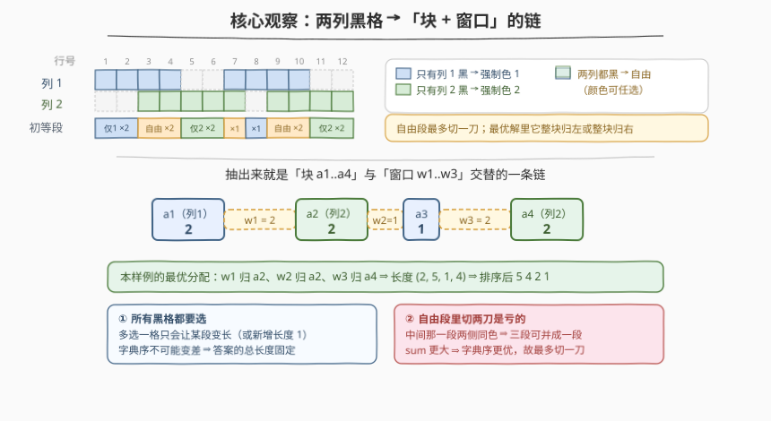
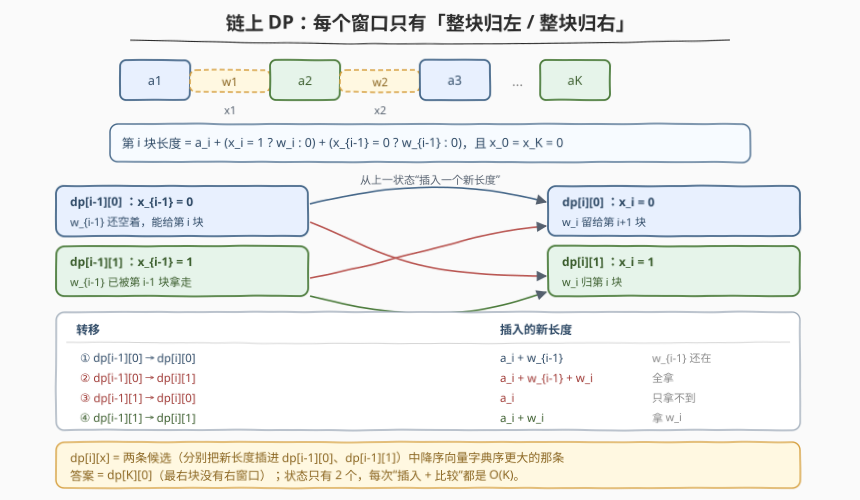
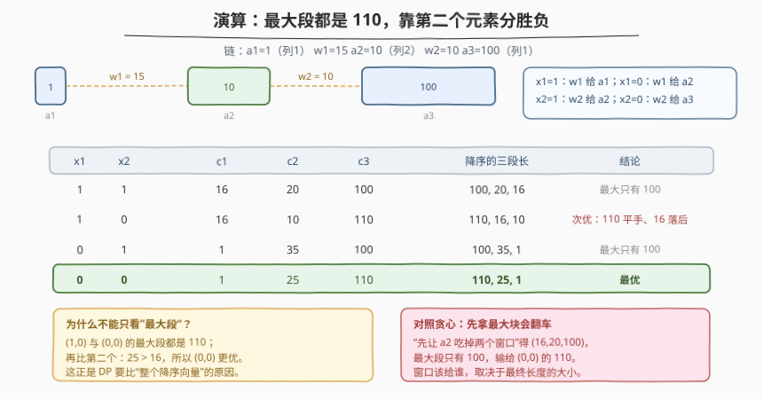

# Codeforces 2258D 魔法瓷砖 题解

## 1. 题目概述

- **标题 / 题号**：魔法瓷砖（Codeforces 2258D，英文名 Magic Tiles）
- **链接**：https://codeforces.com/problemset/problem/2258/D
- **来源**：Codeforces Round 1118 (Div. 2) · Problem D
- **难度**：2500（2000 分）
- **限制**：时间 4 s / 内存 512 MB
- **标签**：动态规划、贪心、实现、大数比较转字典序

**题意**：网格有 $10^{18}$ 行、$2$ 列，每格非黑即白。选若干黑格，要求**每行至多选一个**。单列得分为

$$\sum_{i=1}^{k} 100^{100^{x_i}},$$

$x_1,\dots,x_k$ 是该列所有极大连续段的长度；总得分为两列之和，求最大总得分对应的方案。格子太多，输入按“每列的极大黑段”压缩给出（列 1 有 $n$ 段、列 2 有 $m$ 段）；输出同样压缩：先输出段数 $c$，再按**不升序**输出这 $c$ 段的长度。

**约束**：

- $1 \le t \le 3000$，$1 \le n,m \le 3000$，$\sum n \le 3000$，$\sum m \le 3000$
- 同列内 $r_i + 1 < l_{i+1}$（互不相邻，至少隔一行）
- $1 \le l \le r \le 10^{18}$，$r+1$ 会到 $10^{18}+1$，要用 64 位
- 最终段数 $c \le n+m \le 6000$，每个长度都可能达到 $10^{18}$

## 2. 示例与观察
官方样例（输入 / 输出原样，共 4 组）：

```text
输入：
4
1 1
1 3
5 6
1 1
1 4
1 4
2 2
1 4
7 10
3 7
9 12
1 1
1 1000000000000000000
1 1
输出：
2
3 2
1
4
4
5 4 2 1
1
1000000000000000000
```

第 2 组两列完全重合，只能整列取成一段 $4$（拆成 $[a,4-a]$ 会让最大段变小）；第 3 组最优分配是 `2 | 5 | 1 | 4`；第 4 组若把第 1 行让给列 2，就会砍断 $10^{18}$ 长的一段，故整列取。

**自造示例**（覆盖“最大段打平、靠第二段决胜”，本实现实跑）：输入 `1` / `2 1` / `1 16`、`27 136` / `2 36`，输出 `3` 与 `110 25 1`——链条 $a=(1,10,100)$、$w=(15,10)$，两个窗口都给中间块只得 $[100,20,16]$，分别给左右两块才是 $[110,25,1]$。

## 3. 解题思路

### 3.1 暴力思路

先解决“分数怎么比”。$100^{100^x}$ 增长极快：任意有限个 $100^{100^{x-1}}$ 都顶不过一个 $100^{100^x}$，所以比分数就是比**段长降序序列的字典序**（引理 1），不必也不能真算大整数。但方案数仍爆炸：把行压成 $O(n+m)$ 个初等段后，每个“两列都黑”的行仍有 2 种选法，行长可达 $10^{18}$，枚举不可能，必须挖结构。

### 3.2 核心观察：全选 + 自由段整块归属



**观察 1：一个黑格都不放过。** 往方案里加一格，只会让某列那一段变长（或新增长度 1 的段），多重集的字典序不会变差（引理 2）。于是每个“连通区”（两列至少一列黑的一段连续行）里的行**全部**被选中，答案总长度固定。

**观察 2：按颜色格局切初等段。** 以所有 $l$ 与 $r+1$ 为断点，每段内部“哪些列黑”不变，共 $O(n+m)$ 段：只有一列黑的段是**强制段**（必须归那列），两列都黑的是**自由段**（颜色可选）。

**观察 3：自由段里最多切一刀。** 若自由段被切成“1、2、1”，中间那段两侧同色，改色即可把三段并成一段，长度之和更大、字典序严格更优——与最优矛盾。故自由段整块归一侧；只有其两侧强制段异色时，才允许（也必须）内部换一次色。

**观察 4：窗口不切开。** 两侧异色的自由段叫**窗口**。若窗口被分成两半，把边界行从较短那块挪给较长那块，两块变成 $c_1+1$ 与 $c_2-1$，向量第一元素变大，字典序更优（引理 4）。故窗口整块归左或整块归右。

于是问题塌缩成一条链 $a_1,\ w_1,\ a_2,\ w_2,\ \dots,\ w_{K-1},\ a_K$：$a_i$ 是第 $i$ 块的固定长度（同色强制段 + 夹在其中的同色自由段合并而成），$w_i$ 是第 $i$ 与第 $i+1$ 块之间的窗口。相邻块颜色必然交替；被“两列皆白”的行隔开的连通区互相独立，最后把各区段长并起来排序。

### 3.3 算法流程 / 状态转移



对每个连通区，令 $x_i \in \{0,1\}$ 表示窗口 $i$ 整体给左边第 $i$ 块（$1$）还是右边第 $i+1$ 块（$0$），约定 $x_0=x_K=0$，则

$$c_i = a_i + [x_i = 1]\,w_i + [x_{i-1} = 0]\,w_{i-1}.$$

$c_i$ 只依赖相邻两个决策，于是按块推进：状态就是 $x_{i-1}$（只有 2 个），转移 4 条，每条只往已有向量里**插入一个新长度**。DP 值是“前 $i$ 块的长度多重集”，比较按降序逐位比字典序（由引理 1 等价于比分数，故最优子结构成立）。

```text
对每个连通区:
  扫初等段 → a[1..K] 与 w[1..K-1]
  best0 ← {a1},  best1 ← {a1 + w1}
  for i = 2 … K:                                  # K = 1 时直接取 a1
      wR ← (i < K ? w_i : 0)                     # 最右块没有右窗口
      for x in {0,1}:
          base ← a_i + (x ? wR : 0)
          candA ← best0 插入 (base + w_{i-1})     # 上一块没拿 w_{i-1}
          candB ← best1 插入 (base)               # 上一块拿走了 w_{i-1}
          new[x] ← 字典序更大的那个
      best0, best1 ← new[0], new[1]
  并入 best0                                     # x_K = 0
各区答案合并，降序排序输出
```

### 3.4 示例演算



用 §2 的自造例子：$a=(1,10,100)$，$w=(15,10)$，两条窗口共 4 种分配。

| $x_1$ | $x_2$ | $c_1$ | $c_2$ | $c_3$ | 降序 | 说明 |
|---|---|---|---|---|---|---|
| 1 | 1 | 16 | 20 | 100 | 100, 20, 16 | 最大段只有 100 |
| 1 | 0 | 16 | 10 | 110 | 110, 16, 10 | 110 打平但第二位落后 |
| 0 | 1 | 1 | 35 | 100 | 100, 35, 1 | 最大段只有 100 |
| 0 | 0 | 1 | 25 | 110 | **110, 25, 1** | 最优 |

$(1,0)$ 与 $(0,0)$ 的最大段都是 110，必须比到第二个元素——这就是 DP 要比“整个降序向量”、不能只比最大段的原因。换成官方样例 3：$a=(2,2,1,2)$、$w=(2,1,2)$，最优 $x=(0,1,0)$ 给出长度 $(2,5,1,4)$，排序后正是 `5 4 2 1`。

## 4. 算法细节

1. **离散化**：收集所有 $l$ 与 $r+1$（$r=10^{18}$ 时是 $10^{18}+1$，用 `long long`）排序去重；相邻断点之间颜色格局恒定，段长写成 `pts[i+1] - pts[i]`。
2. **两指针定类型**：对每段起点 $s$，维护“最后一个 $l \le s$ 的区间下标”，判 $r \ge s$ 即知该列是否黑；类型编码 $b_1+2b_2$（0 无、1 仅列 1、2 仅列 2、3 双黑），相邻同类型顺手合并。
3. **首尾自由段**：连通区开头的自由段只能并进第一块（拆出去只会让最大段变小），结尾的并进最后一块；用 `lead`/`pend` 分别处理“区首”与“同色合并”。
4. **窗口长度可为 0**：两个异色强制段直接相邻时 $w_i=0$，公式照用；别漏建这个窗口，否则块数算少、答案偏小。
5. **权重向量的表示**：C++ 用保持降序的 `vector<long long>` 逐位比较；Python 用“取负后的升序 `tuple`”，比较即等价于降序字典序，且在 C 层完成，比手写循环快一个量级。
6. **插入而非重排**：每步只往有序向量插一个值（二分定位后切片拼接，$O(K)$）；若每步都 `sort` 会退化成 $O(K^2\log K)$。
7. **多测与输出**：`seg`、`a`、`w`、`ans`、DP 向量全是每组局部变量，天然清空；$t$ 可达 3000，别做与值域相关的 memset。输出先给 $c$（各区块数之和，$\ge 1$）再降序给数。

## 5. 正确性证明

**引理 1（分数序 = 字典序）**：设两方案段长多重集为 $A,B$，元素数都不超过 $K \le n+m \le 6000$。令 $v$ 为“出现次数不同”的最大长度，则“$A$ 中含 $v$ 的段更多”当且仅当 $S(A) > S(B)$。

**证明**：长度 $>v$ 的项两边计数相同，逐项抵消。记 $f(x)=100^{100^x}$，则 $S(A)-S(B) \ge f(v) - K\cdot f(v-1)$，而 $\dfrac{f(v)}{f(v-1)} = 100^{\,100^{v}-100^{v-1}} \ge 100^{99} > 6000 \ge K$（$v=1$ 时指数为 $100-1=99$，取到最小比值），故差为正；反向同理。∎

**引理 2（全选最优）**：向合法方案加入一个新黑格，段长多重集的字典序不变差。

**证明**：设新格在列 $c$。看该列与它相邻的行：都不选则新增一段长 1（旧降序向量是新向量的前缀，更长者更大）；选中一侧则把该段 $x$ 换成 $x+1$（尾部元素变大）；两侧都选中则把 $x,y$ 换成 $x+y+1>x,y$。其余段不变，故不变差。反复加格即得“所有黑格都该选”。∎

**引理 3（自由段的唯一形态）**：最优解中每个自由段要么整块一色，要么恰好在内部换色一次，且只可能发生在其两侧强制段异色的自由段里。

**证明**：若段内出现两次换色，则中间存在一段“两侧皆为另一色”（或一侧为连通区边界）的 run；把它改成两侧的颜色即可合并成一段，新元素等于各段长度之和、大于其中任何一个，由引理 1 字典序严格更优，矛盾。两侧强制段同色而段内换过色时，同理可并入同色段而变优。∎

**引理 4（窗口整块归属）**：最优解中窗口 $w_i$ 的所有行都归同一块。

**证明**：设窗口两侧块最终长 $c_1 \ge c_2$，若窗口有行给了 $c_2$ 一侧，把边界行挪给 $c_1$ 一侧得到 $c_1+1$ 与 $c_2-1$，其余段不变，排序后第一元素由 $c_1$ 变为 $c_1+1$，由引理 1 严格更优，矛盾。∎

**引理 5（DP 覆盖且最优）**：设连通区结构化为链 $a_1,w_1,\dots,w_{K-1},a_K$，则 DP 枚举了全部 $2^{K-1}$ 个 $x$ 向量，且 $\mathrm{dp}[i][x]$ 恰为“前 $i$ 块长度多重集”在字典序下最大者。

**证明**：$c_i$ 只依赖 $x_{i-1},x_i$，而 $x$ 向量与块长向量一一对应（引理 3、4 保证最优解必在这族中）。转移枚举 $x_{i-1}$ 的两种取值取更优者；由引理 1，字典序是分数的全序，总分数是各块 $f(c_i)$ 之和，前缀之间只通过状态 $x_i$ 耦合，故标准最优子结构成立。最后 $x_K=0$ 是定义（最右块无右窗口），取 $\mathrm{dp}[K][0]$。∎

**定理**：算法输出最优方案的段长降序序列。

**证明**：引理 2 保证最优解取满黑格；引理 3、4 保证最优解必为链上某组窗口分配；引理 5 保证 DP 在这族方案中取到分数最大者；连通区互相独立、分数可加，各区分别最优即全局最优，排序输出，由引理 1 即最大总得分。∎

## 6. 复杂度分析

- **时间**：离散化与扫描 $O((n+m)\log(n+m))$；每个连通区 DP 共 $K$ 步、每步 2 状态各 2 条转移，插入与比较均 $O(K)$，即 $O(K^2)$。因每个块只能落在一个原区间内，块数 $K \le n+m$，故 $\sum K^2 \le (n+m)^2 \le 3.6\times 10^{7}$ 次基本操作（每步常数约 4）。
- **空间**：只存初等段、链数组与两个长度 $K$ 的向量，$O(n+m)$。
- **实测**：$n=m=3000$、造出 6000 个块的最坏数据，C++17 约 $0.1$ s、Python3 约 $0.4$ s，$4$ s 时限余量在 10 倍以上；$t=3000$ 的多测小数据合计 $<0.1$ s。

## 7. 参考代码

### C++17

```cpp
#include <bits/stdc++.h>
using namespace std;
typedef long long ll;
typedef vector<ll> VL;                    // 降序存放的段长多重集

static VL ins(const VL &V, ll v) {        // 插入一个值，保持降序
    VL R; R.reserve(V.size() + 1);
    size_t i = 0;
    while (i < V.size() && V[i] >= v) R.push_back(V[i++]);
    R.push_back(v);
    while (i < V.size()) R.push_back(V[i++]);
    return R;
}
static bool better(const VL &A, const VL &B) {      // 降序字典序：A 是否更优
    for (size_t i = 0; i < A.size(); ++i) if (A[i] != B[i]) return A[i] > B[i];
    return false;
}

int main() {
    ios::sync_with_stdio(false); cin.tie(nullptr);
    int T; if (!(cin >> T)) return 0;
    while (T--) {
        int n, m; cin >> n >> m;
        vector<pair<ll, ll>> A(n), B(m);
        for (auto &p : A) cin >> p.first >> p.second;
        for (auto &p : B) cin >> p.first >> p.second;
        sort(A.begin(), A.end()); sort(B.begin(), B.end());
        vector<ll> pts;                        // 1. 端点离散化
        for (auto &p : A) { pts.push_back(p.first); pts.push_back(p.second + 1); }
        for (auto &p : B) { pts.push_back(p.first); pts.push_back(p.second + 1); }
        sort(pts.begin(), pts.end());
        pts.erase(unique(pts.begin(), pts.end()), pts.end());
        vector<pair<int, ll>> seg;             // 0 无 / 1 仅列1 / 2 仅列2 / 3 双黑
        size_t ia = 0, ib = 0;
        for (size_t i = 0; i + 1 < pts.size(); ++i) {
            ll s = pts[i], len = pts[i + 1] - pts[i];
            while (ia < A.size() && A[ia].first <= s) ++ia;
            while (ib < B.size() && B[ib].first <= s) ++ib;
            int tp = ((ia && A[ia - 1].second >= s) ? 1 : 0)
                   | ((ib && B[ib - 1].second >= s) ? 2 : 0);
            if (!seg.empty() && seg.back().first == tp) seg.back().second += len;
            else seg.push_back({tp, len});
        }
        vector<ll> ans;
        for (size_t p = 0; p < seg.size(); ) { // 2. 逐连通区建链 + DP
            if (seg[p].first == 0) { ++p; continue; }
            size_t q = p;
            while (q < seg.size() && seg[q].first != 0) ++q;
            VL a, w; ll cur = 0, lead = 0, pend = 0; int col = 0; bool have = false;
            for (size_t k = p; k < q; ++k) {
                int tp = seg[k].first; ll len = seg[k].second;
                if (tp == 3) { if (!have) lead += len; else pend += len; }
                else if (!have) { have = true; col = tp; cur = lead + len; pend = 0; }
                else if (tp == col) { cur += pend + len; pend = 0; }
                else { a.push_back(cur); w.push_back(pend); col = tp; cur = len; pend = 0; }
            }
            a.push_back(have ? cur + pend : lead);   // 末尾自由块并入末块
            size_t K = a.size(); p = q;
            if (K == 1) { ans.push_back(a[0]); continue; }
            /* x_i = 1：窗口 i 给左边第 i 块；0：给右边第 i+1 块 */
            VL best0(1, a[0]), best1(1, a[0] + w[0]);
            for (size_t i = 1; i < K; ++i) {
                ll wi = (i + 1 < K) ? w[i] : 0, wp = w[i - 1];
                VL nb[2];
                for (int x = 0; x < 2; ++x) {
                    ll base = a[i] + (x ? wi : 0);
                    VL c0 = ins(best0, base + wp), c1 = ins(best1, base);
                    nb[x] = better(c0, c1) ? c0 : c1;
                }
                best0.swap(nb[0]); best1.swap(nb[1]);
            }
            for (ll v : best0) ans.push_back(v);
        }
        sort(ans.begin(), ans.end(), greater<ll>());
        cout << ans.size() << "\n";
        for (size_t i = 0; i < ans.size(); ++i)
            cout << ans[i] << " \n"[i + 1 == ans.size()];
    }
    return 0;
}
```

### Python3

```python
import sys
from bisect import bisect_left


def solve_case(seg1, seg2):
    pts = set()
    for l, r in seg1: pts.add(l); pts.add(r + 1)
    for l, r in seg2: pts.add(l); pts.add(r + 1)
    pts = sorted(pts)
    seg = []                                  # 初等段 (类型, 长度)
    i1 = i2 = 0
    for x, y in zip(pts, pts[1:]):
        while i1 < len(seg1) and seg1[i1][0] <= x: i1 += 1
        while i2 < len(seg2) and seg2[i2][0] <= x: i2 += 1
        tp = (1 if i1 and seg1[i1 - 1][1] >= x else 0) | \
             (2 if i2 and seg2[i2 - 1][1] >= x else 0)
        if seg and seg[-1][0] == tp: seg[-1] = (tp, seg[-1][1] + y - x)
        else: seg.append((tp, y - x))
    ans, p, n = [], 0, len(seg)
    while p < n:
        if seg[p][0] == 0: p += 1; continue    # 两列皆白：连通区边界
        q = p
        while q < n and seg[q][0] != 0: q += 1
        a, w = [], []                          # 块 a[i] 与窗口 w[i]
        cur = lead = pend = 0; col = 0; have = False
        for k in range(p, q):
            tp, L = seg[k]
            if tp == 3:
                if have: pend += L
                else: lead += L
            elif not have: have, col, cur, pend = True, tp, lead + L, 0
            elif tp == col: cur += pend + L; pend = 0
            else: a.append(cur); w.append(pend); col, cur, pend = tp, L, 0
        a.append(cur + pend if have else lead)
        K = len(a); p = q
        if K == 1: ans.append(a[0]); continue
        # 向量存成“取负后的升序 tuple”：越小越优
        best0, best1 = (-a[0],), (-(a[0] + w[0]),)
        for i in range(1, K):
            wi = w[i] if i + 1 < K else 0
            wp = w[i - 1]
            nb = []
            for x in (0, 1):
                v = -(a[i] + (wi if x else 0) + wp)
                j = bisect_left(best0, v); c0 = best0[:j] + (v,) + best0[j:]
                v = -(a[i] + (wi if x else 0))
                j = bisect_left(best1, v); c1 = best1[:j] + (v,) + best1[j:]
                nb.append(c0 if c0 < c1 else c1)
            best0, best1 = nb
        ans.extend(-v for v in best0)
    return ans


def main():
    d = sys.stdin.buffer.read().split()
    t = int(d[0]); pos = 1; out = []
    for _ in range(t):
        n, m = int(d[pos]), int(d[pos + 1]); pos += 2
        s1 = [(int(d[pos + 2 * k]), int(d[pos + 2 * k + 1])) for k in range(n)]
        pos += 2 * n
        s2 = [(int(d[pos + 2 * k]), int(d[pos + 2 * k + 1])) for k in range(m)]
        pos += 2 * m
        res = solve_case(sorted(s1), sorted(s2)); res.sort(reverse=True)
        out.append(str(len(res))); out.append(' '.join(map(str, res)))
    sys.stdout.write('\n'.join(out) + '\n')


main()
```

## 8. 边界情况与易错点

1. **两列完全重合**：整个连通区都是自由段，最优是**一整段**（拆成 $[a,L-a]$ 会让最大段变小）。程序此时 `have=false`、$a=[\text{lead}]$，正好输出 1 段。
2. **强制段直接相邻（窗口长 0）**：列 1 区间止于 $i$、列 2 区间起于 $i+1$ 时中间没有自由行，$w_i=0$；漏建它会让块数变少、答案偏小。
3. **$r=10^{18}$ 的 $r+1$**：$10^{18}+1$ 超出 `int`，C++ 必须 `long long`；段长写 `pts[i+1] - pts[i]`，不要再多减 1。
4. **区间未必有序**：题面没保证同列区间按 $l$ 升序给出，读入后必须自己 `sort`，否则两指针扫描全错。
5. **不要真算分数**：$100^{100^{10^{18}}}$ 无法表示，比较只能走“降序段长字典序”（引理 1）；用浮点近似必错——相邻两档差了 $100^{99}$ 倍以上。
6. **只比最大段会错**：§3.4 中 $(1,0)$ 与 $(0,0)$ 最大段都是 110，必须比完整个向量。
7. **$n=m=1$ 且两段重合**：答案是 1 段而非 2 段（样例 2），不要按“每列各取一段”硬凑。
8. **输出自检**：$c$ 是最终向量长度，所有长度之和恒等于两列黑格覆盖的总行数，可用作构造题式的核对。

## 9. 验证记录

- **编译环境与命令**：`clang++ -std=c++17 -O2`（本机无 GNU g++，配 `codeforces/tools/include/bits/stdc++.h` 兼容头；正文代码只用标准库，可原样提交 GNU C++17）；Python 侧为 `Python 3.9.6`。
- **官方样例**：1 / 1 通过（按 Codeforces 标准 checker 的 token 比对，忽略空白与大小写）。
- **复核状态**：audited（2026-11-19 统一回归：编译 + 官方样例；写作期的随机对拍与暴力未重跑）。

## 相关题目与扩展

- [LeetCode 56. 合并区间](https://leetcode.cn/problems/merge-intervals/)：本题按 $l$ 与 $r+1$ 把两列黑段切成初等段，正是合并区间的离散化写法。
- [LeetCode 435. 无重叠区间](https://leetcode.cn/problems/non-overlapping-intervals/)：区间调度贪心，对应“一整段黑区只能整块当一段 run”的直觉。
- [Codeforces 2258C. 遥远城市](https://codeforces.com/problemset/problem/2258/C)：同场 C 题，交互求树的直径，同样是“信息受限下如何用最少的比较定出最优”。

**延伸思考**：

1. 若分数改成 $\sum B^{x_i}$（底数小、增长慢），字典序不再等价于分数序，需用“带进位的多重集”比较：把段长按 $B$ 进位压缩，DP 的向量换成“计数数组 + 进位”。
2. 若列数从 2 增到 $C$，“自由段”内部变成 $C$ 选 1 的分段问题，块与窗口的链模型不再成立；但“窗口整块归一侧”的局部交换论证仍可用，可先定结构再找 DP。
3. 若只有少数强制段而窗口极长，本做法时间只与段数有关、与长度无关；能否把 $O(K^2)$ 的比较压到 $O(K\log K)$？关键在于让“插入后的降序向量”可持久化并支持快速字典序比较。
