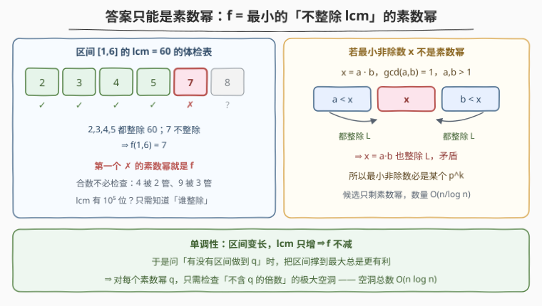
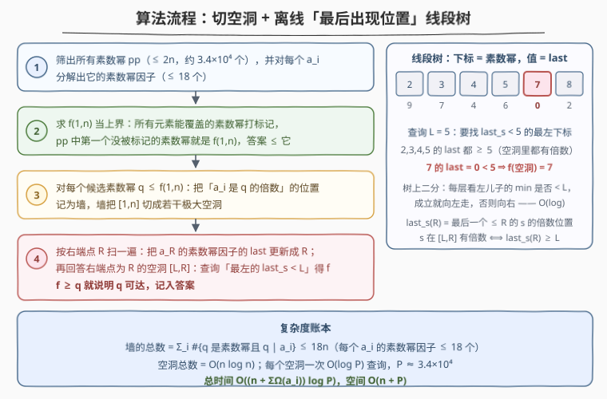
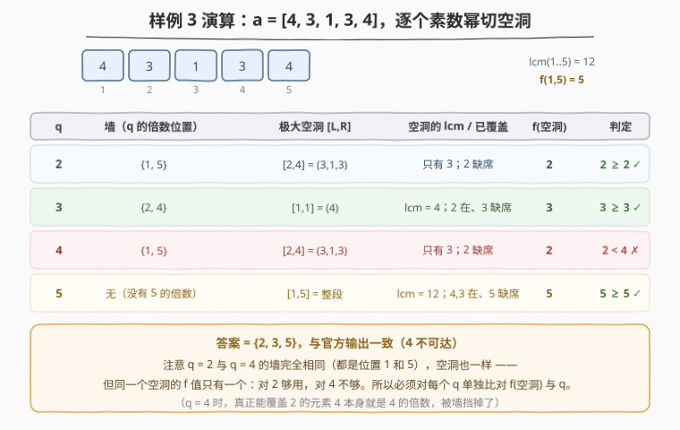

# Codeforces 2258E 除数MEX 题解

## 1. 题目概述

- **标题 / 题号**：除数MEX（Codeforces 2258E，英文名 DivMEX）
- **链接**：https://codeforces.com/problemset/problem/2258/E
- **来源**：Codeforces Round 1118 (Div. 2) · Problem E（UTC 2026-08-29）
- **难度**：2400（2250 分）
- **限制**：时间 3 s / 内存 256 MB
- **标签**：数据结构、数学、数论（素数幂、离线扫描、线段树上二分）

**题意**：给定长度 $n$ 的正整数数组 $a$。对每个区间 $1\le l\le r\le n$，令 $L=\operatorname{lcm}(a_l,a_{l+1},\ldots,a_r)$，定义 $f(l,r)$ 为**最小的不整除 $L$ 的正整数**。求所有可能出现的 $f(l,r)$，去重后升序输出（先输出个数 $k$，再输出这 $k$ 个数）。多测，$\sum n\le 2\times 10^5$。

**约束**：
- $1\le t\le 10^4$，$1\le n\le 2\times 10^5$，$\sum n\le 2\times 10^5$；
- $1\le a_i\le n$——值域与 $n$ 同级，所有数论剪枝都依赖这一点（$\operatorname{lcm}(1..n)$ 的素因子指数被 $n$ 卡住）；
- 输出要升序去重，答案个数最多约 $\pi(2n)+O(\sqrt n)\approx 3.5\times 10^4$，光输出就是 $O(n/\log n)$；
- $L$ 的真实值有 $10^5$ 位十进制长度，**绝不能直接算 lcm**，只能记录"哪些素数幂整除 $L$"。

## 2. 示例与观察
**官方样例**

```text
输入
3
1
1
3
2 3 1
5
4 3 1 3 4

输出
1
2
3
2 3 4
3
2 3 5
```

- 第 1 组：唯一区间 $[1,1]$，$\operatorname{lcm}=1$，最小非除数 $2$。
- 第 2 组：$f(1,1)=3$（$L=2$）、$f(1,2)=4$（$L=6$）、$f(2,2)=f(2,3)=2$（$L=3$），答案 $\{2,3,4\}$。
- 第 3 组：$f(2,2)=2$、$f(1,1)=3$、$f(1,5)=5$（$\operatorname{lcm}=12$），而 $4$ 取不到（详见 3.4 节）。

**自造样例**（多测 + 全偶 + 素数幂 $8$ 可达 + $4$ 与 $9$ 不可达）

```text
输入
4
2
2 2
4
2 4 2 4
6
1 4 3 6 5 1
9
9 4 3 1 9 5 7 1 1

输出
1
3
1
3
5
2 3 4 5 7
5
2 3 5 7 8
```

- `2 2`：全偶，任何区间 $\operatorname{lcm}$ 都是偶数，$2$ 恒整除，只有 $3$。
- `2 4 2 4`：$\operatorname{lcm}\in\{2,4\}$，$2$ 整除而 $3$ 不整除，$f$ 恒为 $3$。
- `1 4 3 6 5 1`：$\operatorname{lcm}(1..6)=60$ 覆盖 $2,3,4,5$，故 $f(1,6)=7$；$4$ 由空洞 $[3,6]$ 取到。
- 最后一组：$\operatorname{lcm}=1260$ 覆盖到 $7$ 却不含 $8$，所以 $8$ 可达；而 $4$ 与 $9$ 都不可达。

## 3. 解题思路

### 3.1 暴力思路

枚举 $O(n^2)$ 个区间，用"每个素因子的最大指数"维护 $\operatorname{lcm}$，再从小到大找第一个不整除的整数，单区间 $O(\log n)$，总计 $O(n^2\log n)$。$n=2\times10^5$ 时是 $2\times10^{10}$ 个区间，完全不可行；且 $\operatorname{lcm}$ 会迅速溢出 64 位，连存都存不下。

### 3.2 核心观察：答案只能是素数幂



**为什么只需看素数幂**：设 $x=f(l,r)$ 是最小非除数。若 $x$ 不是素数幂，则 $x=ab$ 且 $\gcd(a,b)=1,a,b>1$，于是 $a<x,b<x$ 都整除 $L$，推出 $x=ab\mid L$，矛盾。所以

$$f(l,r)=\min\{\,p^k:\ p^k\ \text{不整除}\ \operatorname{lcm}(a_l,\ldots,a_r)\,\}.$$

**固定 $q$**：设 $q=p^k$ 是素数幂，则

$$f(l,r)=q\iff \text{区间内没有 }q\text{ 的倍数，且每个 }<q\text{ 的素数幂都整除 }L.$$

必要性显然。充分性：没有元素被 $q$ 整除意味着每个元素里 $p$ 的指数 $\le k-1$，取 $\operatorname{lcm}$ 后仍 $\le k-1$，故 $q\nmid L$；再加上所有 $<q$ 的都整除，最小非除数正是 $q$。

**单调性**：区间变长，$\operatorname{lcm}$ 只增，故 $f$ 不减。于是判断"$q$ 能否被某个区间取到"时，把区间撑到极大总是更有利——只需检查**极大**的"不含 $q$ 的倍数"的空洞。

**上界**：由单调性 $f(l,r)\le f(1,n)$，且 $f(1,n)$ 不超过"最小的 $>n$ 的素数幂"（它不整除 $\operatorname{lcm}(1..n)$）。因此候选只有 $\le f(1,n)$ 的素数幂。

### 3.3 算法流程



1. 预先筛出所有素数幂（升序表 `PP`），并预处理 `pdiv[v]` = $v$ 的全部素数幂因子（$\le 18$ 个）。
2. **求上界**：把所有 $a_i$ 的素数幂因子标记为"被覆盖"，`PP` 中第一个未标记的就是 $f(1,n)$；候选集合为 `PP` 中 $\le f(1,n)$ 的前缀。
3. **切空洞**：对每个候选 $q$，收集所有 $q\mid a_i$ 的位置（墙）。墙把 $[1,n]$ 切成若干极大空洞。
4. **离线查询**：维护 `last[s]` = 当前右端点为止最后一个被 $s$ 整除的位置。按 $R=1..n$ 扫描：先把 $a_R$ 的素数幂因子的 `last` 更新为 $R$，再处理右端点恰为 $R$ 的空洞 $[L,R]$。由于
   $$s\text{ 在 }[L,R]\text{ 中有倍数}\iff \texttt{last}[s]\ge L,$$
   故 $f(\text{空洞})=\min\{s:\texttt{last}[s]<L\}$，即"线段树上下标为素数幂、值为 `last`，从根向左下走到最左的 $<L$ 的位置"，$O(\log P)$。
5. 若空洞的 $f\ge q$，则 $f=q$（3.2 节），把 $q$ 记入答案。

### 3.4 示例演算



$a=[4,3,1,3,4]$（$n=5$），$\operatorname{lcm}(1..5)=12$，$f(1,5)=5$，候选 $q\in\{2,3,4,5\}$：

| $q$ | 墙（$q$ 的倍数位置） | 极大空洞 | 空洞的覆盖情况 | $f(\text{空洞})$ | 判定 |
|-----|---------------------|----------|----------------|------------------|------|
| $2$ | $\{1,5\}$ | $[2,4]=(3,1,3)$ | 只有 $3$，$2$ 缺席 | $2$ | $2\ge 2$ ✓ |
| $3$ | $\{2,4\}$ | $[1,1]=(4)$ | $2$ 在、$3$ 缺席 | $3$ | $3\ge 3$ ✓ |
| $4$ | $\{1,5\}$ | $[2,4]=(3,1,3)$ | 只有 $3$，$2$ 缺席 | $2$ | $2<4$ ✗ |
| $5$ | $\varnothing$ | $[1,5]$ | $\operatorname{lcm}=12$，$4,3$ 在、$5$ 缺席 | $5$ | $5\ge 5$ ✓ |

答案 $\{2,3,5\}$。注意 $q=2$ 与 $q=4$ 的墙、空洞完全相同，但同一个空洞只有一个 $f$ 值：对 $2$ 够用、对 $4$ 不够，所以必须对每个 $q$ 单独比较 $f(\text{空洞})$ 与 $q$，不能把"墙结构相同"的 $q$ 合并。

## 4. 算法细节

1. **lcm 只以"素数幂覆盖"的形式存在**：$s\mid L\iff$ 某个 $a_i$ 是 $s$ 的倍数。这一步把巨大的 $\operatorname{lcm}$ 彻底消掉，也不需要任何大整数。
2. **线段树只维护 $\le f(1,n)$ 的素数幂**：更大的素数幂在空洞里永远不会成为"最小未覆盖"（$f(\text{空洞})\le f(1,n)$），让它们保持 $0$ 只会让查询结果偏大，而判定式是 $f\ge q$，结论不变；树高也从 $\log(2n)$ 降到 $\log f(1,n)$。
3. **离线按右端点分桶**：每个空洞的查询挂到右端点 $R$ 上，扫描时"先更新 $a_R$ 的因子，再回答查询"，保证区间含 $R$ 本身；用桶代替排序，省掉 $O(K\log K)$。
4. **空洞总数 $O(n\log n)$**：$\sum_q(\#\{i:q\mid a_i\}+1)=\sum_i\#\{\text{素数幂 }q:q\mid a_i\}+O(\#PP)\le 18n+O(\#PP)$，因为 $a_i\le 2\times10^5$ 的素数幂因子不超过 $18$ 个。
5. **两处廉价剪枝**：$q>2$ 且空洞无偶数 $\Rightarrow f=2<q$；$q>3$ 且空洞无 $3$ 的倍数 $\Rightarrow f\le 3<q$。用前缀和在 $O(1)$ 内判断，可砍掉大量无效查询。
6. **多测与 I/O**：`spf`、`PP`、`pdiv` 是全局的（只与值域有关），`cov/W/qs/seg` 每个测试点重新分配；C++ 关同步并用 `cin`，Python 用 `sys.stdin.buffer.read().split()` 一次读完。

## 5. 正确性证明

**引理 1**：对任意正整数 $L$，最小的不整除 $L$ 的正整数必定是素数幂。

**证明**：反设最小非除数 $x$ 不是素数幂，则 $x=ab$，$\gcd(a,b)=1$ 且 $a,b>1$，于是 $a,b<x$ 都整除 $L$；由 $\gcd(a,b)=1$ 得 $x=ab\mid L$，矛盾。∎

**引理 2**：设 $q=p^k$ 是素数幂，区间 $I$ 的 $\operatorname{lcm}$ 为 $L$。则 $f(I)=q$ 当且仅当（i）$I$ 中每个元素都不是 $q$ 的倍数；（ii）每个素数幂 $s<q$ 都整除 $L$。

**证明**：若（i）（ii）成立，则任一 $y<q$ 的每个素数幂因子都 $<q$ 且整除 $L$，故 $y\mid L$；而（i）说明每个元素中 $p$ 的指数 $\le k-1$，$\operatorname{lcm}$ 后仍 $\le k-1$，故 $q\nmid L$，于是 $f(I)=q$。反之若 $f(I)=q$，则 $q\nmid L$ 说明没有元素被 $q$ 整除（否则 $q\mid L$），且由 $q$ 的最小性所有 $<q$ 的整数（特别地所有 $<q$ 的素数幂）整除 $L$。∎

**引理 3**（单调性）：若区间 $I\subseteq J$，则 $f(I)\le f(J)$。

**证明**：$L(I)\mid L(J)$，整除 $L(I)$ 的整数都整除 $L(J)$，故 $J$ 的非除数集合包含于 $I$ 的非除数集合，最小值只会更大。∎

**引理 4**：对扫描位置 $R$ 与 $L\le R$，$f([L,R])$ 等于最小的满足 $\texttt{last}_s(R)<L$ 的素数幂 $s$。

**证明**：$s\mid \operatorname{lcm}(a_L,\ldots,a_R)$ 当且仅当存在 $i\in[L,R]$ 使 $s\mid a_i$，当且仅当 $\texttt{last}_s(R)\ge L$（$\texttt{last}_s(R)$ 是 $\le R$ 中最后一个 $s$ 的倍数的位置）。所以 $s$ 不整除该 $\operatorname{lcm}$ $\iff$ $\texttt{last}_s(R)<L$，取最小者即由引理 1 得到 $f$。∎

**定理**：算法输出的集合恰为 $\{\,f(l,r):1\le l\le r\le n\,\}$。

**证明**：（不多报）若算法记入 $q$，则存在 $q$ 的极大空洞 $[L,R]$ 满足 $f([L,R])\ge q$，该空洞内没有 $q$ 的倍数，由引理 2 得 $f([L,R])=q$，确是某个区间的 $f$ 值。（不漏报）若 $q=f(l,r)$，由引理 2，$[l,r]$ 内无 $q$ 的倍数，故含于某个极大空洞 $[L,R]$；由引理 3，$f([L,R])\ge q$，算法检查该空洞时会把 $q$ 记入；又 $[l,r]\subseteq[1,n]$ 与引理 3 给出 $q\le f(1,n)$，故 $q$ 必在候选集合中。∎

## 6. 复杂度分析

- **时间**：全局筛素数/素数幂/因子表 $O(V\log\log V)$（$V=4\times10^5$，只做一次）；每个测试点求 $f(1,n)$、建墙、扫描更新共 $O(\sum_i\Omega'(a_i))\le O(18n)$；空洞总数 $O(n\log n)$，每个一次 $O(\log P)$ 查询。总时间 $O\big((n+\sum_i\Omega'(a_i))\log P\big)$，即 $O(n\log^2 n)$ 量级。
- **空间**：$O(n+P)$，$P=\#\{\text{素数幂}\}\le 3.4\times10^4$；加上全局因子表约几 MB，远低于 256 MB。
- **实测**：$n=2\times10^5$ 的全排列、随机、全相同、高合成数、1 万个小测试等极端数据，C++ 最慢约 $0.3$ s（时限的 $1/10$）；Python 同算法最慢约 $2$ s，已贴时限，正式提交建议用 C++。

## 7. 参考代码

### C++17

```cpp
#include <bits/stdc++.h>
using namespace std;
const int MAXV = 400006, MAXA = 200001;
static int spf[MAXV], posPP[MAXV];
static vector<int> PP, pdiv[MAXA];          // PP: 素数幂表；pdiv[v]: v 的素数幂因子

int main() {
    ios::sync_with_stdio(false); cin.tie(nullptr);
    for (int i = 2; i < MAXV; i++)          // 最小素因子筛
        if (!spf[i]) { spf[i] = i; for (long long j = 1LL*i*i; j < MAXV; j += i) if (!spf[j]) spf[j] = i; }
    for (int p = 2; p < MAXV; p++)          // 所有素数幂（升序）
        if (spf[p] == p) for (long long v = p; v < MAXV; v *= p) PP.push_back((int)v);
    sort(PP.begin(), PP.end());
    for (int j = 0; j < (int)PP.size(); j++) posPP[PP[j]] = j;
    for (int s : PP) if (s < MAXA) for (int x = s; x < MAXA; x += s) pdiv[x].push_back(s);

    int T; cin >> T;
    const int INF = 1e9;
    while (T--) {
        int n; cin >> n;
        vector<int> a(n + 1);
        for (int i = 1; i <= n; i++) cin >> a[i];

        int m = (int)(upper_bound(PP.begin(), PP.end(), 2 * n + 5) - PP.begin());
        vector<char> cov(m, 0);                                  // f(1,n)
        for (int i = 1; i <= n; i++) for (int s : pdiv[a[i]]) cov[posPP[s]] = 1;
        int fAll = 1;
        for (int j = 0; j < m; j++) if (!cov[j]) { fAll = PP[j]; break; }
        int K = (int)(upper_bound(PP.begin(), PP.end(), fAll) - PP.begin());

        vector<vector<int>> W(K);                                // 墙表
        for (int i = 1; i <= n; i++)
            for (int s : pdiv[a[i]]) { if (s > fAll) break; W[posPP[s]].push_back(i); }
        vector<int> pre2(n + 1, 0), pre3(n + 1, 0);              // 剪枝前缀和
        for (int i = 1; i <= n; i++) {
            pre2[i] = pre2[i - 1] + (a[i] % 2 == 0);
            pre3[i] = pre3[i - 1] + (a[i] % 3 == 0);
        }

        vector<vector<pair<int,int>>> qs(n + 2);                  // 查询按右端点分桶
        for (int c = 0; c < K; c++) {
            int q = PP[c], L = 1;
            const vector<int>& w = W[c];
            for (size_t j = 0; j <= w.size(); j++) {
                int R = (j == w.size()) ? n : w[j] - 1;
                if (L <= R && (q <= 2 || pre2[R] > pre2[L-1]) && (q <= 3 || pre3[R] > pre3[L-1]))
                    qs[R].push_back(make_pair(L, c));
                if (j < w.size()) L = w[j] + 1;
            }
        }

        int sz = 1; while (sz < m) sz <<= 1;                      // 线段树：值 = 最后出现位置
        vector<int> seg(2 * sz, INF);
        for (int j = 0; j < m; j++) seg[sz + j] = 0;
        for (int j = sz - 1; j; j--) seg[j] = min(seg[2*j], seg[2*j+1]);

        vector<char> ans(K, 0);
        for (int R = 1; R <= n; R++) {
            for (int s : pdiv[a[R]]) {
                if (s > fAll) break;
                int p = sz + posPP[s]; seg[p] = R;
                while (p >>= 1) { int nv = min(seg[2*p], seg[2*p+1]); if (seg[p] == nv) break; seg[p] = nv; }
            }
            for (auto& pr : qs[R]) {
                int L = pr.first, c = pr.second;
                if (ans[c]) continue;
                if (seg[1] >= L) { ans[c] = 1; continue; }        // 全部覆盖
                int p = 1;
                while (p < sz) p = (seg[2*p] < L) ? 2*p : 2*p + 1;
                if (PP[p - sz] >= PP[c]) ans[c] = 1;              // f(空洞) >= q
            }
        }

        vector<int> out;
        for (int c = 0; c < K; c++) if (ans[c]) out.push_back(PP[c]);
        printf("%d\n", (int)out.size());
        for (size_t i = 0; i < out.size(); i++) printf("%d%c", out[i], i + 1 == out.size() ? '\n' : ' ');
        if (out.empty()) printf("\n");
    }
    return 0;
}
```

### Python3

```python
import sys
from bisect import bisect_right

def main():
    data = sys.stdin.buffer.read().split()
    ptr = 0
    t = int(data[ptr]); ptr += 1
    MAXV, MAXA = 400006, 200001
    spf = list(range(MAXV))                        # 最小素因子
    for i in range(2, int(MAXV ** 0.5) + 1):
        if spf[i] == i:
            for j in range(i * i, MAXV, i):
                if spf[j] == j:
                    spf[j] = i
    PP = []                                        # 所有素数幂（升序）
    for p in range(2, MAXV):
        if spf[p] == p:
            v = p
            while v < MAXV:
                PP.append(v); v *= p
    PP.sort()
    posPP = [0] * MAXV
    for j, s in enumerate(PP):
        posPP[s] = j
    pdiv = [[] for _ in range(MAXA)]               # pdiv[v]: v 的素数幂因子
    for s in PP:
        if s < MAXA:
            for x in range(s, MAXA, s):
                pdiv[x].append(s)

    out, INF, MASK = [], 1 << 30, (1 << 20) - 1
    for _ in range(t):
        n = int(data[ptr]); ptr += 1
        a = [0] + [int(x) for x in data[ptr:ptr + n]]; ptr += n
        m = bisect_right(PP, 2 * n + 5)            # 候选上界
        cov = bytearray(m)
        for i in range(1, n + 1):
            for s in pdiv[a[i]]:
                cov[posPP[s]] = 1
        for j in range(m):                         # f(1,n)：第一个未覆盖的素数幂
            if not cov[j]:
                fAll = PP[j]; break
        K = bisect_right(PP, fAll)

        W = [[] for _ in range(K)]                 # 墙表
        for i in range(1, n + 1):
            for s in pdiv[a[i]]:
                if s > fAll: break
                W[posPP[s]].append(i)
        pre2 = [0] * (n + 1); pre3 = [0] * (n + 1) # 剪枝前缀和
        for i in range(1, n + 1):
            pre2[i] = pre2[i - 1] + (a[i] % 2 == 0)
            pre3[i] = pre3[i - 1] + (a[i] % 3 == 0)

        qs = [None] * (n + 2)                      # 查询按右端点分桶
        for c in range(K):
            q, w, L = PP[c], W[c], 1
            n2, n3 = q > 2, q > 3
            for j in range(len(w) + 1):
                R = w[j] - 1 if j < len(w) else n
                if L <= R and (not n2 or pre2[R] > pre2[L - 1]) and (not n3 or pre3[R] > pre3[L - 1]):
                    pk = (L << 20) | c
                    if qs[R] is None: qs[R] = [pk]
                    else: qs[R].append(pk)
                if j < len(w): L = w[j] + 1

        sz = 1
        while sz < m: sz <<= 1
        seg = [INF] * (2 * sz)                     # 值 = 最后出现位置
        seg[sz:sz + m] = [0] * m
        for j in range(sz - 1, 0, -1):
            seg[j] = min(seg[j + j], seg[j + j + 1])

        ans = bytearray(K)
        for R in range(1, n + 1):
            for s in pdiv[a[R]]:
                if s > fAll: break
                ch = sz + posPP[s]; seg[ch] = R
                while ch > 1:
                    nv = min(seg[ch], seg[ch ^ 1]); ch >>= 1
                    if seg[ch] == nv: break
                    seg[ch] = nv
            ql = qs[R]
            if ql:
                for pk in ql:
                    L, c = pk >> 20, pk & MASK
                    if ans[c]: continue
                    if seg[1] >= L: ans[c] = 1; continue
                    p = 1
                    while p < sz:
                        lp = p + p
                        p = lp if seg[lp] < L else lp + 1
                    if PP[p - sz] >= PP[c]: ans[c] = 1

        res = [PP[c] for c in range(K) if ans[c]]
        out.append(str(len(res))); out.append(" ".join(map(str, res)))
    sys.stdout.write("\n".join(out) + "\n")

main()
```

## 8. 边界情况与易错点

1. **$n=1$**：答案必为 $\{2\}$（$\operatorname{lcm}=1$）。代码里候选前缀只到 $2$，空洞为 $[1,1]$，直接过。
2. **全偶数组**：如 `2 2`，$q=2$ 的墙占满所有位置，空洞全为空；空空洞必须跳过（$f(\varnothing)=2$），否则会误判 $2$ 可达。正确答案是 $\{3\}$。
3. **答案可能大于 $n$**：$n=2$ 时答案是 $3$、$n=3$ 时是 $4$。素数幂表要开到 $2n$（用"最小的 $>n$ 的素数幂"作上界），只开到 $n$ 会漏解甚至数组越界。
4. **候选只能是素数幂**：$4,8,9,25,27$ 这类 $p^k$ 必须枚举，$6,10,12$ 这类合数绝不能进候选，$q=1$ 也不行（$1$ 整除一切）。
5. **不要尝试存/算 $\operatorname{lcm}$**：$\operatorname{lcm}(1..2\times10^5)$ 有 $10^5$ 位十进制，`long long` 甚至 `__int128` 都不够；也不能用取模代替，取模会丢失整除信息。
6. **打包 $(L,c)$ 时注意位宽**：若把查询压成 `(L<<20)|c` 存进 32 位 `int`，$n\ge 2^{11}$ 就会溢出（$L\le 2\times10^5$ 时 `L<<20` 需要 64 位）。C++ 里直接用 `pair<int,int>`，Python 整数无此问题。
7. **线段树 padding 要置 `INF`**：`sz` 是 $\ge m$ 的最小 2 的幂，多出来的叶子若为 $0$，向下二分就会落到不存在的素数幂上。
8. **多测清空**：$\sum n\le2\times10^5$ 但 $t$ 可达 $10^4$，`W/qs/seg/cov` 必须每个测试点重建，全局表只建一次。

## 9. 验证记录

- **编译环境与命令**：`clang++ -std=c++17 -O2`（本机无 GNU g++，配 `codeforces/tools/include/bits/stdc++.h` 兼容头；正文代码只用标准库，可原样提交 GNU C++17）；Python 侧为 `Python 3.9.6`。
- **官方样例**：1 / 1 通过（按 Codeforces 标准 checker 的 token 比对，忽略空白与大小写）。
- **复核状态**：audited（2026-11-19 统一回归：编译 + 官方样例；写作期的随机对拍与暴力未重跑）。

## 相关题目与扩展

- [CF 1436E Complicated Computations](https://codeforces.com/problemset/problem/1436/E)：求所有子数组 mex 的集合，与本题"求所有子数组 $f$ 值的集合"同属"值域统计"框架，同样是离线 last 出现位置。
- [CF 522D Closest Equals](https://codeforces.com/problemset/problem/522/D)：按右端点离线扫描 + 线段树维护最近一次出现位置，与 3.3 节的扫描同源。
- [CF 1114C Trailing Loves](https://codeforces.com/problemset/problem/1114/C)：把整除问题拆成逐素数看指数，是本题"素数幂视角"的基础训练。
- [LeetCode 2470. 最小公倍数为 K 的子数组数目](https://leetcode.cn/problems/number-of-subarrays-with-lcm-equal-to-k/)：同样是子数组 $\operatorname{lcm}$，用 $K$ 的上界剪枝；本题则用 $\operatorname{lcm}(1..n)$ 的上界把候选压成素数幂。

**延伸思考**：
1. 若要求对每个可达的 $x$ 输出一个具体区间 $(l,r)$，能否保持同样的复杂度？（提示：在空洞内把 $L$ 右移、$R$ 左移。）
2. 如果把条件换成"最小的不整除 $\gcd$ 的数"，答案还只有素数幂吗？
3. 若 $a_i$ 的上界放宽到 $10^9$（$n$ 不变），哪些步骤失效？（墙的构造仍是 $O(n\log a_i)$，但"大素数幂无法覆盖"的剪枝会显著变弱。）
4. 若改成**计数**每个 $f$ 值对应多少个区间，能否借助"极大空洞 + $f$ 单调"做到 $O(n\log^2 n)$？
