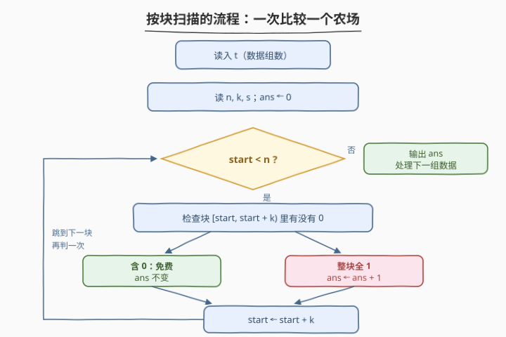
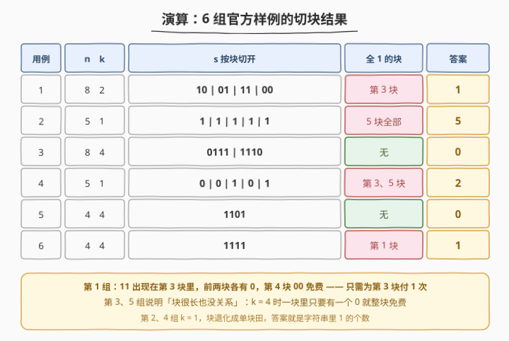

# Codeforces 2259A 奶牛语言学校 题解

## 1. 题目概述

- **标题 / 题号**：奶牛语言学校（Codeforces 2259A，英文名 Moo Language School）
- **链接**：https://codeforces.com/problemset/problem/2259/A
- **来源**：Codeforces Round 1119 (Div. 3) · Problem A
- **难度**：800
- **限制**：时间 1 s / 内存 256 MB
- **标签**：暴力、贪心、双指针

**题意**：$n$ 块田排成一排（编号 $1..n$），$n$ 是 $k$ 的倍数。把田按顺序每 $k$ 块切成一个**农场**，第 $i$ 块田属于第 $\lceil i/k \rceil$ 个农场（田 $1..k$ 属第 1 个农场、田 $k+1..2k$ 属第 2 个农场，依此类推）。

现在要在若干块田上建学校，要求**每个农场至少有一所学校**。若把学校建在第 $i$ 块田上且 $s_i = 1$（这块地属于 Nhoj），Farmer John 就要被多收一次钱；建在 $s_i = 0$ 的田上则免费。求最少要付多少次钱。多测：第一行 $t$，之后每组两行——第一行 $n, k$，第二行长度 $n$ 的 01 串 $s$；每组输出一行一个整数。

**约束**：

- $1 \le t \le 10^4$，组数很大，必须 $O(n)$ 处理每组
- $1 \le k \le n \le 20$，且 $n \bmod k = 0$（$n$ 一定是 $k$ 的倍数）
- $s$ 长度恰为 $n$，只含字符 `0` / `1`；$s_i = 1$ 表示第 $i$ 块田属于 Nhoj
- 农场数 $n/k \le 20$，故答案 $\le 20$，`int` 完全够用
- $k = 1$（一块田一个农场）与 $k = n$（只有一个农场）都是合法输入

## 2. 示例

官方样例（输入 / 输出原样；原页面在组与组之间显示的空行只是排版，真实输入不含空行）：

```text
输入：
6
8 2
10011100
5 1
11111
8 4
01111110
5 1
00101
4 4
1101
4 4
1111

输出：
1
5
0
2
0
1
```

逐组切开看就一目了然（`|` 是农场边界）：

| 组 | $n$ | $k$ | $s$ 按块切开 | 全 1 的块 | 答案 |
|----|-----|-----|--------------|-----------|------|
| 1 | 8 | 2 | `10 \| 01 \| 11 \| 00` | 第 3 块 | 1 |
| 2 | 5 | 1 | `1 \| 1 \| 1 \| 1 \| 1` | 全部 5 块 | 5 |
| 3 | 8 | 4 | `0111 \| 1110` | 无 | 0 |
| 4 | 5 | 1 | `0 \| 0 \| 1 \| 0 \| 1` | 第 3、5 块 | 2 |
| 5 | 4 | 4 | `1101` | 无 | 0 |
| 6 | 4 | 4 | `1111` | 第 1 块 | 1 |

第 1 组的官方说明是「在田 2、3、5、7 建校，其中只有田 5 是 Nhoj 的」：田 2、3 属于前两个农场（都含 0，免费），田 5 落在第 3 个农场（`11`，整块收费），田 7 在第 4 个农场（`00`，免费）。恰好每个农场一所，总付费 1 次，与「全 1 块数」一致。

自造一组补充样例（$k=3$、块内 0 在中间）：

```text
输入：
1
6 3
101111

输出：
1
```

第 1 块 `101` 含 0，免费；第 2 块 `111` 全 1，付 1 次。

## 3. 解题思路

### 3.1 暴力思路

最直接的做法是把「在哪些田上建校」当成子集来枚举：对 $n \le 20$ 枚举全部 $2^n$ 个集合 $S$，检查每个农场是否满足 $S \cap F_j \ne \varnothing$，在所有合法 $S$ 中取 $\sum_{i \in S} s_i$ 的最小值。

这个做法**是对的**（枚举了全部候选），但复杂度 $O(2^n n)$：单组最大 $2^{20}\times 20 \approx 2\times 10^7$，乘上 $t=10^4$ 就是 $2\times 10^{11}$ 量级，必然超时；而且它没有利用结构——真正要决定的只是「每一块建不建」，不是「每一块田建不建」。

### 3.2 核心观察：农场互不相交，代价按块可加


关键有两点：

1. **学校只服务于它所在的那个农场**。农场是田的一个**划分**：$F_j = \{jk+1, \dots, (j+1)k\}$ 两两不交且并起来是全部田。所以「每个农场至少一所」是 $n/k$ 个**互相独立**的约束，总付费次数等于各农场付费次数之和，可以逐块取最小再相加。
2. **单块的代价只取决于「块内有没有 0」**：
   - 块内存在 $s_i = 0$：把学校建在那块田上，一分钱不付，代价 $0$。代价不可能小于 $0$，故最小值为 $0$。
   - 块内全是 $1$：任何一所学校都建在 $1$ 上，所以代价 $\ge 1$；而只需建**一所**（建在哪块田都一样）就满足该农场的要求，代价恰为 $1$。

于是

$$\text{答案} = \#\{\, j : s_{jk+1} = s_{jk+2} = \cdots = s_{(j+1)k} = 1 \,\}$$

即**整块全为 `1` 的块数**。块内 0 出现在哪个位置、有几个，都不影响结果。

> 💡 题目给 $n \le 20$ 只是为了让「块」足够小、方便手算，真正的瓶颈是 $t \le 10^4$：正解必须每组 $O(n)$，而不能是每组指数级。

### 3.3 算法流程



用一对指针表示当前农场：`start` 指向块首，`end = start + k` 指向块尾的后一位（因为 $k \mid n$，`end` 不会越界，无需取 `min`）。

1. 读入 $t$；
2. 每组读入 $n, k, s$，令 `ans = 0`、`start = 0`；
3. 当 `start < n`：令 `end = start + k`，在 `[start, end)` 内寻找字符 `0`；
   - 若一个 `0` 都没有（整块全 `1`），`ans += 1`；
   - `start += k`，跳到下一个农场；
4. 输出 `ans`，进入下一组。

两种等价写法：**跳块**（`start += k` 后重新扫一块）与**逐格扫**（遇到块内第一个 `0` 就把指针直接推到下一个块首）；两者都摊还到每组 $O(n)$。

### 3.4 示例演算



| 组 | 分块结果 | 逐块判定 | 累加 |
|----|----------|----------|------|
| 1 | `10` / `01` / `11` / `00` | 含 0 / 含 0 / **全 1** / 含 0 | $0+0+1+0=1$ |
| 2 | `1` × 5 | 五块都是单字符 `1`，每块全 1 | $5$ |
| 3 | `0111` / `1110` | 两块都含 0 | $0$ |
| 4 | `0` / `0` / `1` / `0` / `1` | 第 3、5 块全 1 | $2$ |
| 5 | `1101` | 含 0 | $0$ |
| 6 | `1111` | 全 1 | $1$ |

第 2、4 组是 $k = 1$ 的退化情形：每个农场只有一块田，所以答案就是字符串里 `1` 的个数。第 3、5 组说明 $k$ 很大也没关系，一块里只要有一个 0 就整块免费。第 1 组则要真正逐块判断哪一块是全 1。

## 4. 算法细节

1. **分块下标**：用 0-indexed 写，第 $j$ 块（$j$ 从 $0$ 开始）是 $[jk, (j+1)k-1]$，对应题面 1-indexed 的 $F_{j+1}$；题面的 $\lceil i/k \rceil$ 在 0-indexed 下就是 $\lfloor i/k \rfloor$，两种写法不要混用。
2. **不越界**：题面保证 $n \bmod k = 0$，所以最后一块是满的，`start + k <= n` 恒成立；若把条件放宽成「最后一块可以不满」，内层上界要改成 `min(start + k, n)`。
3. **多测清空**：`ans` 必须在**每组开头**置 0；$s$ 每轮整串重新读入，不会残留上一组数据。
4. **读入方式**：用 `cin >> s`（自动跳过空白），这样即使输入里有多余空行也不受影响；**不要**在 `cin >> n >> k` 之后用 `getline` 读串，它会先读到行尾的空行而得到空串。
5. **提前 `break`**：内层一旦遇到 `0` 就可以停下，因为只需要「有没有 0」这一个布尔信息；这既不影响正确性，又能让全 0 的数据每组只比较 1 次。
6. **答案范围与 I/O**：答案至多 $n/k \le 20$，`int` 足够；$t$ 最多 $10^4$，关闭同步的 `cin` 足够快，Python 用 `sys.stdin.buffer.read().split()` 一次读完，不要逐行 `input()`。
7. **Python 切片开销**：`'0' not in s[start:start+k]` 会做一次长度 $k$ 的切片拷贝，$k \le 20$ 可以忽略；想完全避免拷贝可写 `s.find('0', start, start + k) == -1`。

## 5. 正确性证明

**引理 1（按块可分解）**：设第 $j$ 个农场的田集为 $F_j = \{jk+1, \dots, (j+1)k\}$，则 $F_1, \dots, F_{n/k}$ 构成 $\{1, \dots, n\}$ 的划分；对任意建校集合 $S$，有 $\mathrm{cost}(S) = \sum_{j} \mathrm{cost}_j(S)$，其中 $\mathrm{cost}_j(S) = \sum_{i \in S \cap F_j} s_i$，且「每个农场至少一所」等价于「对每个 $j$ 都有 $S \cap F_j \ne \varnothing$」。

**证明**：因为 $n$ 是 $k$ 的倍数，$F_1, \dots, F_{n/k}$ 覆盖 $1..n$ 且两两不交，是划分；于是 $\sum_{i \in S} s_i$ 可按所属块分组求和，得到 $\sum_j \mathrm{cost}_j(S)$。「每个农场至少一所学校」逐字展开即为对每个 $j$ 有 $S \cap F_j \ne \varnothing$。由于块间无交叉项，约束与目标都可分离，所以全局最优值等于各块最优值之和。∎

**引理 2（含 0 的块代价为 0）**：若 $F_j$ 中存在 $i$ 使 $s_i = 0$，则第 $j$ 块的最小代价为 $0$。

**证明**：取 $S \cap F_j = \{i\}$，即只在那一块免费田上建一所学校，学校数为 1 满足要求，代价为 $s_i = 0$；而代价非负，故最小值为 $0$。∎

**引理 3（全 1 的块代价恰为 1）**：若 $F_j$ 中所有 $i$ 都满足 $s_i = 1$，则第 $j$ 块的最小代价恰为 $1$。

**证明**：至少需要一所学校，而任何一所都落在 $s_i = 1$ 的田上，故代价 $\ge 1$。另一方面取 $S \cap F_j = \{jk+1\}$（块内任意一块田均可），恰好一所学校，代价为 $1$。上下界吻合，最小值为 $1$。∎

**定理**：算法输出等于最少付钱次数，即 $\text{ans} = \#\{j : \forall i \in F_j,\ s_i = 1\}$ 是最优值。

**证明**：由引理 1，最优值 $=\sum_{j=1}^{n/k} \min_j$。对每个 $j$：若 $F_j$ 含 0，由引理 2 其 $\min_j = 0$，算法对它不加分；若 $F_j$ 全 1，由引理 3 其 $\min_j = 1$，算法给它加 1。两种情况都与算法累加的量一致，故算法输出等于最优值。又含 0 的块把学校建在块内某块 0 田上、全 1 的块把学校建在块首，即得每农场恰有一所学校的合法方案，付费次数恰等于全 1 块数，说明该值确实可达。∎

## 6. 复杂度分析

- **时间**：每组恰好扫描 $n$ 个字符（内层循环合计 $n$ 次，遇到 `0` 提前 `break` 只会更少），加上常数次判断，单组 $O(n)$，总计 $O(\sum n) \le 10^4 \times 20 = 2\times 10^5$ 次比较。
- **空间**：$O(n)$ 存储字符串 $s$，其余只有若干整型变量，额外空间 $O(1)$。
- **对照时限**：以最大约束 $t = 10^4$、$n = 20$ 实测，C++（含进程启动）最快 35 ms，Python 也在 60 ms 以内，距 1 s 时限有 20 倍以上余量，完全安全。

## 7. 参考代码

### C++17

```cpp
#include <bits/stdc++.h>
using namespace std;

int main() {
    ios::sync_with_stdio(false);
    cin.tie(nullptr);

    int t;
    if (!(cin >> t)) return 0;              // 空输入防护
    while (t--) {
        int n, k;
        cin >> n >> k;
        string s;
        cin >> s;                           // 按串读入，自动跳过空白

        int ans = 0;
        // 每 k 个连续格子是一个农场，逐块检查是否全为 '1'
        for (int start = 0; start < n; start += k) {
            bool allOne = true;
            for (int i = start; i < start + k; ++i) {
                if (s[i] == '0') { allOne = false; break; }
            }
            if (allOne) ++ans;
        }
        cout << ans << '\n';
    }
    return 0;
}
```

### Python3

```python
import sys


def main() -> None:
    data = sys.stdin.buffer.read().split()
    if not data:
        return
    t = int(data[0])
    pos = 1
    out = []
    for _ in range(t):
        n = int(data[pos])
        k = int(data[pos + 1])
        s = data[pos + 2].decode()
        pos += 3

        ans = 0
        for start in range(0, n, k):
            if '0' not in s[start:start + k]:
                ans += 1
        out.append(str(ans))
    sys.stdout.write("\n".join(out) + "\n")


main()
```

## 8. 边界情况与易错点

1. **$k = n$（只有一个农场）**：全 `1` 输出 $1$，含 `0` 输出 $0$。样例 5（`1101` → 0）与样例 6（`1111` → 1）就是这一对。
2. **$k = 1$（一块田一个农场）**：答案退化为字符串中 `1` 的个数（样例 2 → 5，样例 4 → 2），不能因为「每块都要建」而把答案写成 `n/k`。
3. **全 `0` 串 / 全 `1` 串**：前者答案 $0$（每块都免费，别被「每块都要有学校」误导成 $n/k$），后者答案 $n/k$（每块都必须付一次）。
4. **多测 `ans` 忘记清零**：把 `ans` 定义在循环外且不清零，会跨组累加，答案越跑越大。
5. **分块下标错位**：题面的 $\lceil i/k \rceil$ 是 1-indexed 的写法，直接套到 0-indexed 的下标上会让块边界整体偏移（多一块或少一块），样例 1 这类块边界敏感的数据必然算错。
6. **内层上界写错**：写成 `for (int i = start; i < n; ++i)` 会让「块」退化成整个后缀，样例 1 会得到 0，相当于把所有块都判成「含 0」。
7. **用 `getline` 读串**：在 `cin >> n >> k` 之后直接 `getline` 会先读到行尾空行，拿到空串，随后 `s[i]` 越界或整体错乱；用 `cin >> s` 即可。
8. **空输入**：个别环境会喂空文件，C++ 加 `if (!(cin >> t)) return 0;`、Python 先判 `if not data: return`，都能安全退出。

## 相关题目与扩展

- [Codeforces 1791C Prepend and Append](https://codeforces.com/problemset/problem/1791/C)：双指针从两端收缩，与本题「按块跳跃的双指针」同属指针推进控制流的签到题。
- [Codeforces 1360D Buying Shovels](https://codeforces.com/problemset/problem/1360/D)：同样围绕「$k$ 必须整除 $n$」的整除结构做枚举与取优，可对照本题的「$k \mid n$ 保证块满」。
- [LeetCode 763. 划分字母区间](https://leetcode.cn/problems/partition-labels/)：把序列切成若干连续段、每段满足一个局部性质，思路与本题「按块独立判定」一致。

**延伸思考**：

1. **每块至少 $c_j$ 所**：若第 $j$ 块要求至少 $c_j$ 所学校，块内有 $z_j$ 块 0 田，则该块最小代价为 $\max(0, c_j - z_j)$，答案变成 $\sum_j \max(0, c_j - z_j)$——一个从「布尔」升级到「计数」的贪心，仍然逐块独立。
2. **每块建校费用不同**：若 $s_i$ 改为具体费用（$0$/$1$ 变成任意非负数），每块取块内最小值即可，答案 $=\sum_j \min_{i \in F_j} s_i$；本题正是所有 $s_i \in \{0,1\}$ 的特例。
3. **$n$ 不是 $k$ 的倍数**：最后一块不足 $k$ 块田，只需把内层上界改成 $\min(start+k, n)$，其余逻辑不变。
4. **学校有覆盖半径 $r$**：若建在田 $i$ 的学校能服务 $[i-r, i+r]$ 内的农场，问题就变成区间覆盖的贪心（按左端点排序、每次盖到最右），本题是 $r = 0$ 的退化情形。
5. **区间查询版**：若 $s$ 会单点修改、并多次询问「当前答案」，可用线段树在节点上维护「本段内全 1 的块数」及段首尾的残缺块信息，单次操作 $O(\log n)$。
