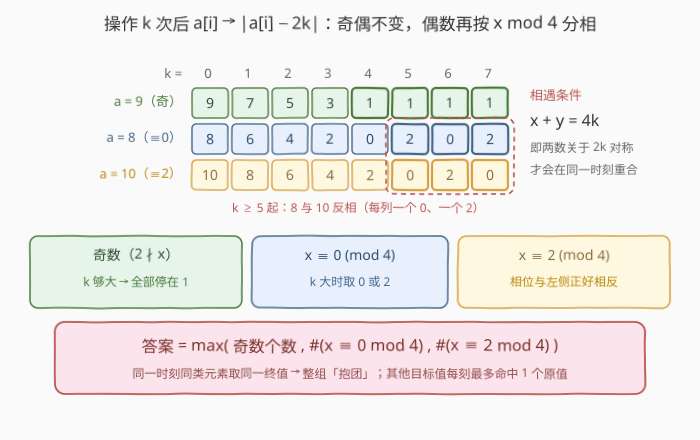
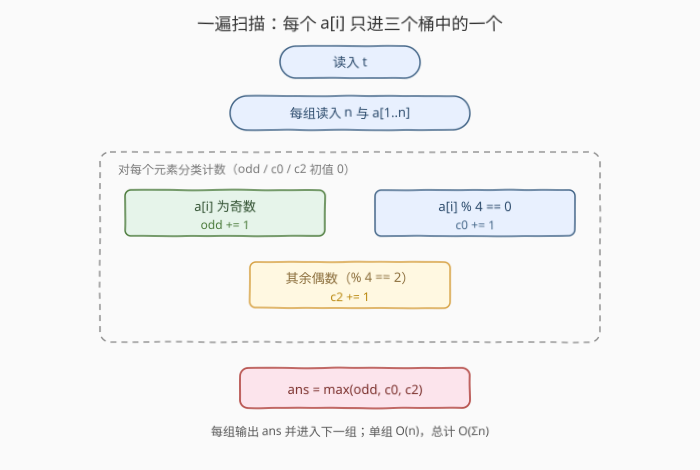
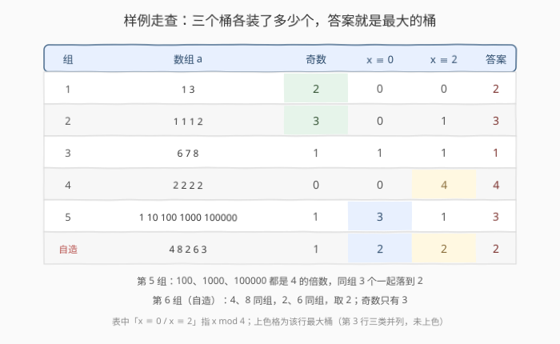

# Codeforces 2259B 减二 题解

## 1. 题目概述

- **标题 / 题号**：减二（Codeforces 2259B，英文名 Minus Two）
- **链接**：https://codeforces.com/problemset/problem/2259/B
- **来源**：Codeforces Round 1119 (Div. 3) · Problem B
- **难度**：800
- **限制**：时间 2 s / 内存 256 MB
- **标签**：数学、数论

**题意**：给定长度 $n$ 的数组 $a_1, a_2, \ldots, a_n$。一次**操作**指：对所有下标 $i$ **同时**执行 $a_i \leftarrow \lvert a_i - 2 \rvert$。操作可以执行任意次（包括 $0$ 次）。问操作结束后，**某个整数在数组中出现的最大次数**是多少。

注意是「所有元素一起被操作」：不能给不同元素选不同的操作次数。题目只问最大频数，不要求输出操作次数或最终数组。

多测：第一行 $t$，之后每组两行——第一行 $n$，第二行 $n$ 个整数；每组输出一行一个整数。

**约束**：

- $1 \le t \le 10^4$ 且 $\sum n \le 2 \times 10^5$：必须每组 $O(n)$，不能带 $\log$ 级别以外的额外开销
- $1 \le n \le 2 \times 10^5$
- $1 \le a_i \le 10^9$：值域极大，**不能**按值域开桶，也不能枚举操作次数
- 答案 $\le n \le 2 \times 10^5$，`int` 足够
- 允许 $0$ 次操作，也允许 $k$ 任意大，因此「先做很多次让所有元素进入终态」是合法策略

## 2. 示例

官方样例（输入 / 输出原样；原页面组间空行只是排版）：

```text
输入：
5
2
1 3
4
1 1 1 2
3
6 7 8
4
2 2 2 2
5
1 10 100 1000 100000

输出：
2
3
1
4
3
```

逐组核对：

| 组 | 数组 | 奇数 | $x\equiv 0 \pmod 4$ | $x\equiv 2 \pmod 4$ | 答案 | 说明 |
|----|------|------|------|------|------|------|
| 1 | `1 3` | 2 | 0 | 0 | 2 | 做一次：$\lvert 1-2\rvert=1,\ \lvert 3-2\rvert=1$ |
| 2 | `1 1 1 2` | 3 | 0 | 1 | 3 | 三个 1 永远是 1；2 只能在 0/2 间跳，凑不进去 |
| 3 | `6 7 8` | 1 | 1 | 1 | 1 | 三类各 1 个，$6+8=14\ne 4k$，任何时刻都撞不上 |
| 4 | `2 2 2 2` | 0 | 0 | 4 | 4 | 全在 $\equiv 2$ 桶，$k$ 取偶数时全变 2 |
| 5 | `1 10 100 1000 100000` | 1 | 3 | 1 | 3 | $100,1000,100000$ 都是 4 的倍数，整组抱团 |

自造一组补充样例（第 5 组之外的对照，验证「同桶才算一组」）：

```text
输入：
1
5
4 8 2 6 3

输出：
2
```

`4 8` 属于 $\equiv 0$ 桶、`2 6` 属于 $\equiv 2$ 桶、`3` 是奇数，取最大的桶得 2。答案不是 4，因为 `4` 与 `2` 永远不可能同时变成同一个值。

## 3. 解题思路

### 3.1 暴力思路

最直接的做法是枚举操作次数 $k=0,1,2,\ldots$，每次用 $O(n)$ 求出当前数组的频数最大值，再对所有 $k$ 取最大。

问题在于 $k$ 的有效范围：偶数在 $a_i/2$ 步后开始 0/2 循环，奇数在 $(a_i-1)/2$ 步后永远停在 1，所以要让所有元素都进入终态，必须枚举到 $k \approx \max a_i / 2 \le 5\times 10^{8}$。总复杂度 $O(n \cdot \max a_i)$，取满约束就是 $10^{14}$ 量级，必然超时；而且 $k$ 可以更大，暴力还得额外证明「再往后不会更好」。

所以关键不是优化模拟，而是**找出操作的结构**：哪些元素最终会落到同一个值上。

### 3.2 核心观察：奇偶不变，偶数再按 mod 4 分相



设 $f_k(x)$ 表示对 $x$ 连续做 $k$ 次操作的结果：$f_0(x)=x$，$f_{k+1}(x)=\lvert f_k(x)-2\rvert$。

**第一层结构：奇偶是不变量。** $x-2$ 与 $x$ 同奇偶，取绝对值不改奇偶，所以 $f_k(x) \equiv x \pmod 2$。奇数和偶数永远不会互相转化——这直接把数组拆成互不干扰的两半。

**第二层结构：两类元素各自的终态。**

- **奇数** $x=2m+1$：一路减去 2，减到 $1$ 就卡住（$\lvert 1-2\rvert=1$）。精确地，$f_k(x)=\max(1,\,x-2k)$。于是「$k$ 足够大 ⇒ 所有奇数同时变成 1」。
- **偶数** $x=2m$：在 $k \le m$ 时是 $f_k(x)=x-2k$；一旦到 $0$，就进入 $0 \to 2 \to 0 \to \cdots$ 的二周期。终值只看 $k-m$ 的奇偶：$k-m$ 偶则 $0$，奇则 $2$。

**第三层结构：相位由 $x \bmod 4$ 决定。** 关键的一句是：$m=x/2$ 的奇偶完全由 $x \bmod 4$ 决定——$x\equiv 0 \pmod 4$ 时 $m$ 偶，$x \equiv 2 \pmod 4$ 时 $m$ 奇。固定一个足够大的 $k$，同一桶里所有元素的 $m$ 奇偶相同，于是 $k-m$ 的奇偶也相同，**整桶元素同时落到同一个值**（0 或 2）；而两个桶的相位正好相反，一个全 0 时另一个全 2。

于是数组被分成三个**互不混合**的桶：

$$O\ (\text{odd}),\qquad C_0=\#\{i: a_i\equiv 0 \pmod 4\},\qquad C_2=\#\{i: a_i\equiv 2 \pmod 4\}$$

每个桶都能「整组同时变成同一个值」，答案至少是 $\max(O,C_0,C_2)$；反过来，任一时刻任一目标值能收进来的元素也全在同一个桶里，所以上界也是它。

> 💡 **为什么不可能靠「两两配对」刷出更大频数**：两个不同的原值 $x,y$ 在时刻 $k$ 相等，必须 $\lvert x-2k\rvert = \lvert y-2k\rvert$，即 $x+y=4k$——两数关于 $2k$ 对称。也就是说每个时刻每个非终态目标值最多只能「撞」进一对原值，真正能堆量的只有 $0/1/2$ 三个终态值，而它们按上面的桶划分归属。

### 3.3 算法流程



1. 读入 $t$；对每组读入 $n$ 与数组；
2. 三个计数器 `odd`、`c0`、`c2` 清零；
3. 对每个 $a_i$ 做一次分类：
   - $a_i$ 为奇数 ⇒ `odd += 1`；
   - 否则 $a_i \bmod 4 = 0$ ⇒ `c0 += 1`；
   - 否则（必为 $a_i \bmod 4 = 2$）⇒ `c2 += 1`；
4. 输出 `max(odd, c0, c2)`。

整组只有一次线性扫描，不需要模拟、不需要记录 $k$、也不需要构造操作序列。

### 3.4 示例演算



以第 5 组 $a=[1,10,100,1000,100000]$ 为例（$10$ 属 $\equiv 2$ 桶，其余三个偶数属 $\equiv 0$ 桶）：

| $k$ | 1 | 10 | 100 | 1000 | 100000 | 最大频数 |
|-----|---|----|-----|------|--------|----------|
| 0 | 1 | 10 | 100 | 1000 | 100000 | 1 |
| 1 | 1 | 8 | 98 | 998 | 99998 | 1 |
| 50001（奇） | 1 | 0 | 2 | 2 | 2 | 3 |
| 50002（偶） | 1 | 2 | 0 | 0 | 0 | 3 |

两种奇偶性下两个偶数桶交换 0/2，但各自都整桶同值：$k=50001$ 时 $100,1000,100000$ 同时是 2，答案 3。这也说明为什么不能只看前几步——必须先把元素「折到底」才看得到分组效果。

再看第 3 组 $[6,7,8]$：$6$ 与 $8$ 虽同为偶数，但 $6\equiv 2$、$8\equiv 0$，属于不同桶，任何时刻都一个在 0 一个在 2；奇数 $7$ 最终变 1。三个桶各 1 个，答案 1，与官方输出一致。

## 4. 算法细节

1. **判定顺序只做两次比较**：先 `x & 1`（奇数），再 `x % 4 == 0`；第二个分支不成立时必然是 $x \equiv 2 \pmod 4$，不需要再写一次 `x % 4 == 2`，既省常数又避免漏判。
2. **等价写法**：相位本质是 $m=x/2$ 的奇偶，也可以写成 `(x >> 1) & 1`——为 0 对应 $x\equiv 0 \pmod 4$，为 1 对应 $x\equiv 2 \pmod 4$。两种写法等价，取模版更直观。
3. **读入用 `long long`**：$a_i \le 10^9$ 在 `int` 范围内，但统一用 `long long` 读可避免以后把判断改成 `x - 2*k` 之类的表达式时溢出；本题只做取模与位运算，`int` 也不会错。
4. **多测必须清空**：三个计数器在每组开头重新置 $0$（放在 `while (t--)` 内部声明最省心）；Python 在 `for _ in range(t)` 内部重新赋值，不要用上一组的残留。
5. **不需要还原方案**：题目只要最大频数，因此可以完全跳过模拟。「能否让全数组相等」等价于三个桶中是否有一个大小为 $n$，这也是同一套判定的直接推论。
6. **I/O 加速**：C++ 用 `std::ios::sync_with_stdio(false)` + `cin.tie(nullptr)`；Python 用 `sys.stdin.buffer.read().split()` 一次读完再顺序取，$t=10^4$ 也不会被逐行 `input()` 拖慢。
7. **不要按值域开桶、也不要枚举 $k$**：$a_i$ 到 $10^9$、有效 $k$ 到 $5\times 10^8$，任何按值域或按操作次数展开的做法都会爆炸；本题的正确复杂度与值域无关。
8. **答案范围**：答案不超过 $n \le 2\times10^5$，输出用 `int` 即可；三个计数器用 `long long` 也无害。

## 5. 正确性证明

**引理 1（奇偶是不变量）**：对任意 $k \ge 0$，$f_k(x) \equiv x \pmod 2$。

**证明**：对 $k$ 归纳。$k=0$ 时 $f_0(x)=x$。设 $f_k(x)\equiv x \pmod 2$。因为 $f_k(x)-2 \equiv f_k(x) \pmod 2$，而 $\lvert y\rvert \equiv y \pmod 2$ 对任意整数 $y$ 成立，所以 $f_{k+1}(x)=\lvert f_k(x)-2\rvert \equiv f_k(x) \equiv x \pmod 2$。∎

**引理 2（奇数的终态）**：若 $x=2m+1$，则 $f_k(x)=\max(1,\,x-2k)$。

**证明**：若 $x-2k \ge 1$（即 $k \le m$），则 $f_{k+1}(x)=\lvert (x-2k)-2\rvert = x-2k-2 = x-2(k+1)$，与公式一致；当 $k=m+1$ 时 $x-2k=-1$，公式给 $\max(1,-1)=1$，而实际 $f_m(x)=1$、$f_{m+1}(x)=\lvert 1-2\rvert=1$，此后恒为 $\lvert 1-2\rvert=1$，公式也恒给 $1$。∎

**引理 3（偶数的终态）**：若 $x=2m$，则

$$f_k(x)=\begin{cases} x-2k, & k \le m,\\ 0, & k>m,\ k-m \text{ even},\\ 2, & k>m,\ k-m \text{ odd}. \end{cases}$$

**证明**：$k \le m$ 时 $x-2k \ge 0$，与引理 2 的线性段同理归纳。$k=m$ 时值为 $0$。之后每操作一次就在 $0$ 与 $2$ 之间互换（$\lvert 0-2\rvert=2$、$\lvert 2-2\rvert=0$），所以终值只由步数 $k-m$ 的奇偶决定。∎

**引理 4（三个桶都能整组取到同一个值）**：记 $O$、$C_0$、$C_2$ 为三个桶的大小，则存在 $k$，使某个整数在 $f_k$ 下的频数恰为 $O$；对 $C_0$、$C_2$ 同理。故答案 $\ge \max(O,C_0,C_2)$。

**证明**：取 $k > \max_i a_i / 2$。由引理 2，所有奇数都变成 $1$，值 $1$ 的频数恰为 $O$（偶数由引理 1 不可能是奇数 1，故没有别的元素贡献）。对偶数 $x=2m$，此时必有 $k>m$，由引理 3 其终值只由 $k-m$ 的奇偶决定；而同桶内所有 $m$ 的奇偶相同（$x\equiv0$ 时 $m$ 偶，$x\equiv2$ 时 $m$ 奇），所以 $k-m$ 的奇偶也相同，整桶元素同值。若想让 $C_0$ 桶全部变成 $2$，只需把 $k$ 换成 $k+1$（仍 $>\max a_i/2$，奇偶性翻转），此时 $C_0$ 桶全为 $2$；取 $k$ 的另一奇偶性则 $C_2$ 桶全为 $2$。∎

**引理 5（上界）**：任意时刻 $k$、任意整数 $v$，满足 $f_k(a_i)=v$ 的下标个数不超过 $\max(O,C_0,C_2)$。

**证明**：分三种情况。

1. $v \ge 3$。由引理 2、3，$f_k(a_i)\ge 3$ 只可能出现在线性段（奇数在 $k\le m$、偶数在 $k\le m$），此时 $f_k(a_i)=a_i-2k$，故 $a_i=2k+v$ 是**唯一**可能的原值，频数等于该值的重数 $c[2k+v]$。若 $v$ 为奇数则 $2k+v$ 为奇数，$c\le O$；若 $v$ 为偶数则 $2k+v$ 是某个偶数，它必落在 $C_0$ 或 $C_2$ 之一，$c\le \max(C_0,C_2)$。
2. $v=1$。由引理 1，能到 $1$ 的只有奇数，故频数 $\le O$。
3. $v\in\{0,2\}$。由引理 3，能映到 $0/2$ 的原值只有两部分：
   (i) 线性段的 $a_i=2k+v$，这是**一个**确定的数值（$2k+2$ 在 $k$ 偶时 $\equiv 2$、$k$ 奇时 $\equiv 0$；$2k$ 在 $k$ 偶时 $\equiv 0$、$k$ 奇时 $\equiv 2$），重数也不超过它所属桶的大小；
   (ii) 已经折到底的偶数，它们满足 $a_i/2<k$ 且 $k-a_i/2$ 的奇偶固定，于是 $a_i/2$ 的奇偶固定，即 $a_i \bmod 4$ 固定：$v=2$ 且 $k$ 偶时贡献者都 $\equiv 2 \pmod 4$（频数 $\le C_2$）；$v=2$ 且 $k$ 奇时都 $\equiv 0$（频数 $\le C_0$）；$v=0$ 时相位相反（$k$ 偶 $\Rightarrow \equiv 0$，$k$ 奇 $\Rightarrow \equiv 2$）。
   两种情形合并后，频数 $\le\max(C_0,C_2)$。

综上，任何时刻任何值的频数都不超过 $\max(O,C_0,C_2)$。∎

**定理**：本题答案为 $\max(O,\,C_0,\,C_2)$。

**证明**：引理 4 给出可达性（答案 $\ge \max$），引理 5 给出上界（答案 $\le \max$），两者夹逼即得。∎

## 6. 复杂度分析

- **时间**：每组恰好对 $n$ 个元素各做一次奇偶判断与一次取模，$O(n)$；总计 $O(\sum n) \le 2\times10^5$ 次基本运算，与 $a_i$ 的值域和操作次数无关。
- **空间**：额外空间 $O(1)$——只有三个计数器；若用 `read().split()` 读入，缓冲区为 $O(\sum n)$，可改为流式读取。
- **对照时限**：在本机（macOS，clang -O2）以最大约束实测，纯计算约 2–3 ms（$t=10^4$ 与 $n=2\times10^5$ 两种极端都是这个量级），Python 含解析约 35–40 ms；限时 2 s，余量 50 倍以上。

## 7. 参考代码

### C++17

```cpp
#include <bits/stdc++.h>
using namespace std;

int main() {
    ios::sync_with_stdio(false);
    cin.tie(nullptr);

    int t;
    if (!(cin >> t)) return 0;               // 空输入防护
    while (t--) {
        int n;
        cin >> n;
        // 三个不混合的桶：
        //   cnt[0] = 奇数            （k 足够大后全部变成 1）
        //   cnt[1] = 偶数且 x % 4 == 0
        //   cnt[2] = 偶数且 x % 4 == 2（与 cnt[1] 的相位相反）
        long long cnt[3] = {0, 0, 0};
        for (int i = 0; i < n; ++i) {
            long long x;
            cin >> x;
            if (x & 1LL)          ++cnt[0];
            else if (x % 4 == 0)  ++cnt[1];
            else                  ++cnt[2];
        }
        cout << max(cnt[0], max(cnt[1], cnt[2])) << '\n';
    }
    return 0;
}
```

### Python3

```python
import sys


def main() -> None:
    data = sys.stdin.buffer.read().split()
    if not data:                              # 空输入防护
        return
    t = int(data[0])
    pos = 1
    out = []
    for _ in range(t):
        n = int(data[pos])
        pos += 1
        odd = c0 = c2 = 0                     # 每组重新计数
        for i in range(pos, pos + n):
            x = int(data[i])
            if x & 1:
                odd += 1
            elif x % 4 == 0:
                c0 += 1
            else:                             # 必为 x % 4 == 2
                c2 += 1
        pos += n
        out.append(str(max(odd, c0, c2)))
    sys.stdout.write("\n".join(out) + "\n")


main()
```

## 8. 边界情况与易错点

1. **$n=1$**：三个桶中恰有一个为 $1$，答案恒为 $1$，与 $a_1$ 的大小、奇偶都无关。
2. **全奇数**（如 `1 3 5 7`）：答案 $n$。取 $k$ 足够大让全部变 $1$ 即可，不要误判成「值都不同所以答案是 1」。
3. **全为 $x\equiv 2 \pmod 4$ 的偶数**（如 `2 2 2 2`）：答案 $n$。$k$ 取任意偶数时全为 $2$；这类数据在 $k=0$ 就已经相等，容易掩盖错误。
4. **全为 $x \equiv 0 \pmod 4$ 的偶数**（如 `4 8 12`）：答案 $n$，但**不能**用 $k=0$ 或 $k=1$ 解释——$k=0$ 得 `4 8 12`、$k=1$ 得 `2 6 10` 都互不相同；必须取 $k>\max a_i/2$ 的合适奇偶性（此例 $k=7$ 时全为 $2$）。这是最容易漏想的边界。
5. **把偶数当成一类**：只用「奇数 / 偶数」两分类，会把 $C_0$ 与 $C_2$ 合并，样例 5 会输出 4 而不是 3，第 3 组会输出 2 而不是 1——必须按 $\bmod 4$ 分。
6. **多测忘记清空**：三个计数器若定义在循环外且不清零，会跨组累加，答案单调变大。
7. **输入不含 $0$，但过程会出现 $0$**：公式把 $0$ 归入 $x\equiv 0 \pmod 4$ 桶；即使把约束放宽到 $a_i\ge 0$，结论依然成立，不需要特判。
8. **大数不要做多余运算**：$a_i\le 10^9$ 时 `long long` 读取最稳；不要为了「模拟一步」写 `2 * (x + 2)` 这类可能溢出 `int` 的中间表达式。
9. **空输入**：部分环境会喂空文件，C++ 用 `if (!(cin >> t)) return 0;`、Python 用 `if not data: return` 兜底。

## 相关题目与扩展

- [Codeforces 1791C Prepend and Append](https://codeforces.com/problemset/problem/1791/C)：同样研究「反复施加同一个操作能到达哪些状态」，用不变量 / 双指针刻画终态。
- [LeetCode 202. 快乐数](https://leetcode.cn/problems/happy-number/)：反复做「各位平方和」，状态必然进入环，用哈希或快慢指针判环。
- [LeetCode 258. 各位相加](https://leetcode.cn/problems/add-digits/)：反复做各位求和，最终收敛到 $\bmod 9$ 的不动点，与本题「奇数收敛到 1」同型。
- [Codeforces 1360D Buying Shovels](https://codeforces.com/problemset/problem/1360/D)：同为「只在整除 / 同余结构上做一次枚举」的签到题，可对照本题「只看 $a_i \bmod 4$」。

**延伸思考**：

1. **把 $-2$ 换成 $-c$**：$f_k(x)=\lvert x-ck\rvert$ 仍只在「未折到底」时成立；到底后进入周期 2 的环（或不动点），需要先确定终态集合与到达它的相位，再按相位分桶。$c=2$ 时终态恰好是 $\{0,1,2\}$、相位只由 $x \bmod 4$ 决定，所以只分出 3 组——这是最简单的情形。
2. **不同元素减不同的数**（第 $i$ 个元素每次减 $c_i$）：每个元素独立演化，问题变成「对每个目标值统计能同时到达它的元素个数」，需要用同余类 + 区间统计，不再是 3 桶。
3. **改问「能否让全数组相等」**：由定理，当且仅当三个桶中有一个大小为 $n$；再由引理 4 的构造可以显式给出 $k$（取 $k>\max a_i/2$ 并选对奇偶性）。若要求输出最小 $k$，也只需在同一奇偶性内找最小可行值。
4. **改问「最少的操作次数使某值出现 $\ge m$ 次」**：对每个桶，同桶元素进入终态所需的步数是 $\max_i \lceil a_i/2 \rceil$ 级别的，可以对桶内元素排序后二分，复杂度 $O(n\log n)$。
