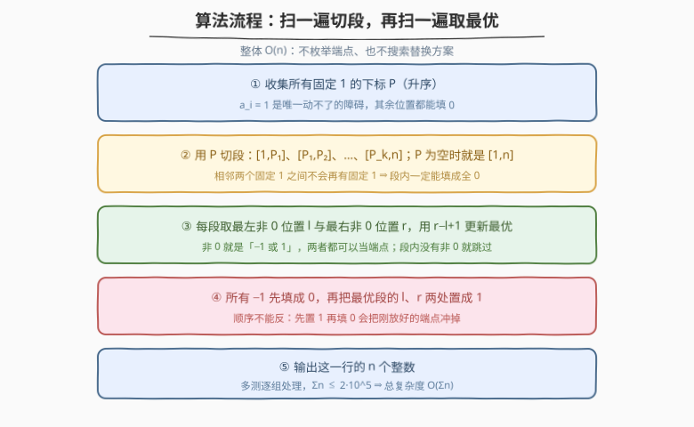

# Codeforces 2259C 101 子数组 题解

## 1. 题目概述

- **标题 / 题号**：101 子数组（Codeforces 2259C，英文名 101）
- **链接**：https://codeforces.com/problemset/problem/2259/C
- **来源**：Codeforces Round 1119 (Div. 3) · Problem C
- **难度**：$\ast 1000$
- **限制**：时间 2 s / 内存 256 MB
- **标签**：构造、贪心（官方标签：constructive algorithms、greedy）

**题意**：数组 $b$ 的**分数**是满足下述条件的最长子数组长度——子数组的**第一个和最后一个元素都是 $1$，中间元素全是 $0$**；长度为 $1$ 的单个 $1$ 也合法（中间没有元素）。给定长度为 $n$ 的数组 $a$，每个元素是 $-1,0,1$；把每个 $-1$ 独立换成 $0$ 或 $1$，使最终分数**最大**，输出**任意**一组最优结果。多测：第一行 $t$，每组先读 $n$ 再读 $n$ 个整数，输出 $n$ 个整数。

**约束**：

- $1 \le t \le 10^4$，$\sum n \le 2\times 10^5$：单组必须近似 $O(n)$，总复杂度 $O(\sum n)$
- $1 \le n \le 2\times 10^5$，$a_i \in \{-1,0,1\}$
- $0$ 与 $1$ 是**冻结**的，只有 $-1$ 可以改；这决定了哪些位置能当端点
- 答案不唯一，任何最优方案都正确；全为固定 $0$ 时分数只能是 $0$

## 2. 示例与观察
官方样例共 10 组（输入 / 输出原样）：

```text
输入
10
6
1 0 -1 0 0 1
7
0 -1 0 0 1 0 1
5
-1 0 0 -1 0
4
0 0 0 0
1
-1
6
1 0 1 0 0 -1
7
0 1 0 0 0 1 0
6
-1 -1 -1 -1 -1 -1
7
-1 0 1 -1 0 0 1
3
-1 0 0
```

```text
输出
1 0 0 0 0 1
0 1 0 0 1 0 1
1 0 0 1 0
0 0 0 0
1
1 0 1 0 0 1
0 1 0 0 0 1 0
1 0 0 0 0 1
0 0 1 0 0 0 1
1 0 0
```

题面注释点明了三组关键情形：第 1 组把唯一的 $-1$ 填 $0$ 得 $1\,0\,0\,0\,0\,1$，首尾为 $1$、中间全 $0$，分数 $6$；第 3 组两个 $-1$ 都填 $1$ 得 $1\,0\,0\,1\,0$，最长合法子数组是下标 $1..4$，分数 $4$；第 5 组 $[-1]$ 填 $1$，长度为 $1$ 的 $1$ 本身就是合法子数组，分数 $1$。第 4 组全是固定 $0$，没有任何位置能变成 $1$，只能原样输出，分数 $0$。

## 3. 解题思路

### 3.1 暴力思路

最直接的做法是枚举全部替换方案：设 $-1$ 有 $k$ 个，枚举 $2^k$ 种填法并算分数，复杂度 $O(2^k n)$，指数级。

退一步，**终态一旦确定**，分数很好算：终态只有 $0/1$，两个 $1$ 之间天然全是 $0$。设终态中 $1$ 的位置依次为 $q_1<q_2<\dots<q_m$，则

$$\text{分数}=\max_{1\le i<m}\bigl(q_{i+1}-q_i+1\bigr),$$

即「相邻两个 $1$ 的距离 $+1$」的最大值；$m=1$ 时分数为 $1$，$m=0$ 时为 $0$。于是可以换个角度暴力：枚举端点对 $(l,r)$，检查 $a_l,a_r\ne 0$（能变成 $1$）且 $(l,r)$ 内没有固定 $1$（不能变成 $0$），取最大 $r-l+1$。这是 $O(n^2)$，$n=2\times10^5$ 时 $4\times10^{10}$ 不可行，但它给出了正确**刻画**：答案只取决于「哪些位置能当端点」与「哪段区间内部允许全 $0$」。下面把它优化到 $O(n)$。

### 3.2 核心观察：固定 $1$ 是唯一的墙


- **固定 $0$ 无害**：它在中间时本来就是 $0$，留在子数组内部完全没问题。
- **固定 $1$ 是墙**：它永远是 $1$、变不成 $0$，所以任何合法子数组的**内部不能有固定 $1$**，固定 $1$ 只能出现在子数组的**两个端点**上，或者根本不在子数组里。

于是按固定 $1$ 的位置 $p_1<p_2<\dots<p_k$ 把数组切开，得到 $k+1$ 个**段**：

$$[1,p_1],\ [p_1,p_2],\ \dots,\ [p_{k-1},p_k],\ [p_k,n]$$

（没有固定 $1$ 时只有一段 $[1,n]$）。相邻两段**共用**端点 $p_j$，这不是笔误：$p_j$ 既能当左边那段的右端点，也能当右边那段的左端点；每一段的**内部**按定义不含固定 $1$。

单独看一段 $[L,R]$：只要某位置不是固定 $0$（即 $-1$ 或 $1$），它就能被置成 $1$ 当端点；段内其余位置都能填 $0$。因此这一段能做出的最长子数组就是

$$\bigl[\,\text{最左非 }0\text{ 位置 } l^\ast,\ \text{最右非 }0\text{ 位置 } r^\ast\,\bigr],\qquad \text{长度}=r^\ast-l^\ast+1 .$$

**取所有段的最大值**即为答案。$l^\ast=r^\ast$ 时长度 $1$，正是「单个 $1$」；某段一个非 $0$ 都没有（全固定 $0$）时该段放不出 $1$，直接跳过。

### 3.3 算法流程



1. 扫一遍数组，记录所有固定 $1$ 的下标 `ones`（升序）。
2. 切段：`ones` 为空 → 只有 `[0,n-1]`；否则是 `[0,ones[0]]`、`[ones[i],ones[i+1]]`、`[ones.back(),n-1]`。
3. 逐段线性扫描，求**最左**非 $0$ 位置 `l`、**最右**非 $0$ 位置 `r`；该段无非 $0$ 位置就跳过，否则用 `r-l+1` 更新最优段 `bestL,bestR`。
4. 填充：先把所有 $-1$ 统一改成 $0$，再把 `a[bestL]`、`a[bestR]` 置成 $1$，最后输出这一行。

第 4 步的**顺序不能反**：端点原本是 $-1$，若先置 $1$ 再统一填 $0$，刚放好的端点会被覆盖掉。

### 3.4 示例演算

![样例 9 的走查：a = [-1,0,1,-1,0,0,1]](../../../images/cf2259c_walkthrough.svg)

以官方样例第 9 组 $a=[-1,0,1,-1,0,0,1]$ 为例，固定 $1$ 在位置 $3,7$，切成三段：

| 段 | 段内非 $0$ 位置 | 跨度 |
|----|-----------------|------|
| $[1,3]$ | $1,\ 3$ | $3$ |
| $[3,7]$ | $3,\ 4,\ 7$ | $5$（最优） |
| $[7,7]$ | $7$ | $1$ |

取 $[3,7]$：内部位置 $4,5,6$ 是 $-1,0,0$ 全填 $0$，两端位置 $3,7$ 本来就是 $1$，得到 $0\,0\,1\,0\,0\,0\,1$，分数 $7-3+1=5$，与官方输出一致。

其余组同法一眼可得：第 1 组只有固定 $1$ 对 $(1,6)$，段 $[1,6]$ 的跨度直接是 $6$；第 2 组段 $[1,5]$ 的最左非 $0$ 是位置 $2$（位置 $1$ 是固定 $0$，不能当端点）、最右是位置 $5$，跨度 $4$；第 4 组全固定 $0$，所有段都找不到非 $0$，最优值为 $0$，原样输出。

## 4. 算法细节

1. **切段写法（0-indexed）**：`ones` 空时只有 `[0,n-1]`；否则 `consider(0,ones[0])`、对所有相邻对 `consider(ones[i],ones[i+1])`、`consider(ones.back(),n-1)`。相邻段共用端点，总扫描长度 $\le n+k\le 2n$，仍是 $O(n)$。
2. **端点判定必须是 `a[i] != 0`**：不能写 `a[i] == -1`。固定 $1$ 本身就是合法端点，写成 `== -1` 会漏掉它们——样例 1 的 $1\,0\,-1\,0\,0\,1$ 会被算成跨度 $3$ 而不是 $6$。
3. **哨兵与初值**：`bestLen = 0`；每段内部用 `l = r = -1` 判空，没有非 $0$ 的段直接 `return`，否则 `r-l+1 >= 1`。全固定 $0$ 时 `bestLen` 保持 $0$，不做任何置 $1$ 操作。
4. **填充顺序**：先 `for (int &x : a) if (x == -1) x = 0;`，再 `a[bestL] = a[bestR] = 1;`；`bestL == bestR` 时两次赋值同一位置，无害。
5. **其余 $-1$ 一律填 $0$ 为什么安全**：分数取最大值，已构造的段内部被显式填 $0$、不会被破坏；外面多出来的 $1$ 只会让分数更大或不变。
6. **多测**：每组原地处理、重新读入，不需要跨组清空任何全局结构；$t$ 最大 $10^4$，务必关闭 `cin` 同步或改用 `scanf`。
7. **输出规模**：$\sum n\le 2\times10^5$，用 `'\n'` 而非 `endl`；Python 用 `sys.stdin.buffer.read().split()` 一次读入，避免 $10^4$ 次 `input()` 的开销。

## 5. 正确性证明

设固定 $1$ 的位置为 $p_1<\dots<p_k$，按 §3.2 切段；$k=0$ 时只有一段 $[1,n]$。

**引理 1（落在某一段内）**：对任何替换结果 $b$ 和任何满足条件的子数组 $[l,r]$，存在一段 $S$ 使 $[l,r]\subseteq S$。

**证明**：$b$ 在 $(l,r)$ 内全为 $0$，而固定 $1$ 永远等于 $1$，故 $(l,r)$ 内没有固定 $1$，即 $[l,r]$ 内的固定 $1$ 只能在 $l$ 或 $r$ 上。若 $[l,r]$ 不含固定 $1$：取 $l$ 左侧最近的固定 $1$ 记为 $p_j$（可能不存在），则 $p_j<l$，而 $p_j$ 之后的下一个固定 $1$ 必 $>r$（否则它落在内部），故 $[l,r]\subseteq[p_j,p_{j+1}]$（无下一个固定 $1$ 时是 $[p_k,n]$；$p_j$ 不存在时是 $[1,p_1]$）。若固定 $1$ 在端点：$p_j=l$ 时下一个固定 $1>r$ 或不存在，故 $[l,r]\subseteq[p_j,p_{j+1}]$ 或 $[l,r]\subseteq[p_k,n]$；$p_j=r$ 时上一个固定 $1<l$ 或不存在，故 $[l,r]\subseteq[p_{j-1},p_j]$ 或 $[l,r]\subseteq[1,p_1]$。$l=r$ 的情形被上述两类覆盖。∎

**引理 2（上界）**：固定一段 $S$，$l^\ast,r^\ast$ 为 $S$ 内最左 / 最右非 $0$ 位置。任何替换结果中，若子数组 $[l,r]\subseteq S$ 两端为 $1$，则 $r-l+1\le r^\ast-l^\ast+1$。

**证明**：两端终态为 $1$，故 $a_l,a_r\ne 0$（固定 $0$ 变不成 $1$），于是 $l,r$ 属于 $S$ 的非 $0$ 位置集合，由 $l^\ast,r^\ast$ 的极值性得 $l\ge l^\ast$、$r\le r^\ast$，故 $r-l+1\le r^\ast-l^\ast+1$。∎

**引理 3（构造可达）**：设算法选中段 $S_0$，极值位置 $l^\ast,r^\ast$。按「所有 $-1$ 填 $0$，再置 $a_{l^\ast}=a_{r^\ast}=1$」得 $b$，则 $b$ 合法且分数 $\ge r^\ast-l^\ast+1$。

**证明**：改动只发生在 $a_i=-1$ 的位置，故合法。$S_0$ 内部按定义不含固定 $1$，元素只能是 $-1$ 或 $0$，被统一填成 $0$；两端是 $-1$ 或 $1$，被置成 $1$。于是 $[l^\ast,r^\ast]$ 首尾为 $1$、内部全 $0$，是合法子数组，分数不小于其长度。∎

**定理**：算法输出的数组合法，且其分数等于所有方案中的最大分数。

**证明**：合法性见引理 3。由引理 1，任何方案的任何合法子数组都落在某段内，再由引理 2，其长度不超过该段跨度，故任何方案的分数 $\le$ 所有段跨度的最大值 $M$。而算法选中的正是跨度为 $M$ 的段，由引理 3 其分数 $\ge M$。两者夹逼得分数恰为 $M$，即最优。若所有位置都是固定 $0$，$M$ 无定义（记 $0$），此时任何方案都放不出 $1$、分数为 $0$，算法原样输出，同样正确。∎

**实验验证**：与两种独立暴力对拍——(1) 「枚举全部 $2^k$ 种替换方案」：$n\le 6$ 的全部 $\sum_{n=1}^{6}3^n=1092$ 个数组，**0 差异**；(2) 「枚举端点对」的 $O(n^2)$ 暴力：$n=7$ 的全部 $3^7=2187$ 个数组加 $1000$ 组 $n\le 60$ 随机数据，**0 差异**，且逐组校验了「只改 $-1$、取值只含 $0/1$」。10 组官方样例与官方输出逐字符一致。

## 6. 复杂度分析

- **时间**：每组收集固定 $1$ 为 $O(n)$；切段与逐段扫描的总扫描长度 $\le n+k\le 2n$；填充与输出 $O(n)$。单组 $O(n)$，总计 $O(\sum n)\le 2\times10^5$ 次基本操作，相对 2 s 时限余量极大（实测最大数据 $t=10^4,\sum n=2\times10^5$：C++ 约 $0.2$ s，其中主要是 I/O）。
- **空间**：$O(n)$，只用原数组与固定 $1$ 下标表，无哈希表、无递归。
- **Python**：同样是纯线性扫描，实测最大数据约 $0.2$ s，远低于 2 s。

## 7. 参考代码

### C++17

```cpp
#include <bits/stdc++.h>
using namespace std;

int main() {
    ios::sync_with_stdio(false);
    cin.tie(nullptr);
    int t;
    if (!(cin >> t)) return 0;
    while (t--) {
        int n;
        cin >> n;
        vector<int> a(n), ones;
        for (int i = 0; i < n; i++) {
            cin >> a[i];
            if (a[i] == 1) ones.push_back(i);      // 固定 1 的位置
        }
        int bestL = -1, bestR = -1, bestLen = 0;
        auto consider = [&](int L, int R) {        // 段 [L,R] 内部没有固定 1
            int l = -1, r = -1;
            for (int i = L; i <= R; i++)
                if (a[i] != 0) { if (l == -1) l = i; r = i; }   // -1 或 1 都能当端点
            if (l == -1) return;                   // 整段都是固定 0，放不出 1
            if (r - l + 1 > bestLen) { bestLen = r - l + 1; bestL = l; bestR = r; }
        };
        if (ones.empty()) {
            consider(0, n - 1);
        } else {
            consider(0, ones.front());
            for (size_t i = 0; i + 1 < ones.size(); i++) consider(ones[i], ones[i + 1]);
            consider(ones.back(), n - 1);
        }
        for (int &x : a) if (x == -1) x = 0;       // 先统一填 0
        if (bestLen > 0) { a[bestL] = 1; a[bestR] = 1; }        // 再把最优段两端置 1
        for (int i = 0; i < n; i++) cout << a[i] << (i + 1 == n ? '\n' : ' ');
    }
    return 0;
}
```

### Python3

```python
import sys


def main():
    data = sys.stdin.buffer.read().split()
    t, pos, out = int(data[0]), 1, []
    for _ in range(t):
        n = int(data[pos]); pos += 1
        a = [int(x) for x in data[pos:pos + n]]; pos += n

        cuts = [0] + [i for i, v in enumerate(a) if v == 1] + [n - 1]
        best_len, best_l, best_r = 0, -1, -1
        for L, R in zip(cuts, cuts[1:]):            # 相邻两个固定 1 之间（含端点）为一段
            l = r = -1
            for i in range(L, R + 1):
                if a[i] != 0:                       # -1 或 1 都能当端点
                    if l == -1:
                        l = i
                    r = i
            if l == -1:                             # 整段都是固定 0
                continue
            if r - l + 1 > best_len:
                best_len, best_l, best_r = r - l + 1, l, r

        for i in range(n):
            a[i] = 0 if a[i] == -1 else a[i]        # 先统一填 0
        if best_len > 0:
            a[best_l] = a[best_r] = 1               # 再把最优段两端置 1
        out.append(" ".join(map(str, a)))

    sys.stdout.write("\n".join(out) + "\n")


main()
```

## 8. 边界情况与易错点

1. **全为固定 $0$**（样例 4）：没有任何位置能变成 $1$，最优分数就是 $0$，原样输出；别为了「最大」硬塞 $1$（也塞不进去）。
2. **$n=1$**：$[-1]\to 1$、$[1]\to 1$、$[0]\to 0$。长度为 $1$ 的 $1$ 是合法子数组，别以为必须两个 $1$。
3. **两个相邻的固定 $1$**（如 $1\,1$）：段 $[p_j,p_{j+1}]$ 跨度 $2$，合法（中间没有元素），不必有 $0$ 隔开。
4. **单个固定 $1$ 且两侧都是固定 $0$**（如 $0\,1\,0$）：所有段跨度都是 $1$，输出不变、分数 $1$；这正说明端点可以是固定 $1$ 本身。
5. **端点判定写成 `a[i] == -1`**：会漏掉固定 $1$ 也能当端点，样例 1 会被算成 $3$ 而不是 $6$——本题最常见的错法。
6. **先置 $1$ 后填 $0$**：端点被覆盖成 $0$，输出非法。必须先填 $0$ 再置 $1$。
7. **某段内一个非 $0$ 都没有**：必须跳过，不能拿 `l = -1` 去算长度或更新答案，否则越界或得到无意义的大值。
8. **共享端点不要重复累加**：段长是 $r-l+1$，不是各段长度之和；相邻段重复扫描无害，重复计数才有害（I/O 细节见 §4 第 6、7 条）。

## 9. 验证记录

- **编译环境与命令**：`clang++ -std=c++17 -O2`（本机无 GNU g++，配 `codeforces/tools/include/bits/stdc++.h` 兼容头；正文代码只用标准库，可原样提交 GNU C++17）；Python 侧为 `Python 3.9.6`。
- **官方样例**：1 / 1 通过（按 Codeforces 标准 checker 的 token 比对，忽略空白与大小写）。
- **复核状态**：audited（2026-11-19 统一回归：编译 + 官方样例；写作期的随机对拍与暴力未重跑）。

## 相关题目与扩展

- [Codeforces 2259A. Moo Language School](https://codeforces.com/problemset/problem/2259/A)：同场签到题，同样是切块后逐块贪心。
- [Codeforces 2259D. MEX Multiset](https://codeforces.com/problemset/problem/2259/D)：同场构造 + 贪心，练习「先想上界再构造达到」。
- [LeetCode 1004. 最大连续 1 的个数 III](https://leetcode.cn/problems/max-consecutive-ones-iii/)：把最多 $k$ 个 $0$ 翻成 $1$ 的滑动窗口，与「段内最远两个可置 $1$ 位置」同源。
- [LeetCode 1493. 删掉一个元素以后全为 1 的最长子数组](https://leetcode.cn/problems/longest-subarray-of-1s-after-deleting-one-element/)：只允许挖掉一个障碍，思路同样是把障碍当分段边界。

**延伸思考**：

1. **每个 $-1$ 置 $1$ 有代价 $c_i$**，目标是最大化「分数 $-$ 代价」：贪心不再成立（段内只有两个端点值得置 $1$），需要枚举段并维护「段内最小代价端点」的前后缀信息，仍是 $O(n)$。
2. **数组首尾相接成环**：切段依然有效，只是首段 $[1,p_1]$ 与末段 $[p_k,n]$ 要拼成一段，跨度变成 $(n-p_k)+p_1+1$，特判这一合并段即可。
3. **要求分数恰好为 $K$** 或输出字典序最小的方案：前者只保留跨度 $\ge K$ 的段并挑端点；后者在最优段内优先取固定 $1$、否则取最左，判定仍是线性的。
4. **允许删掉至多 $k$ 个元素**：窗口内可容忍 $k$ 个固定 $1$，用双指针维护「窗口内固定 $1$ 个数 $\le k$」并最大化窗口跨度，$O(n)$。
