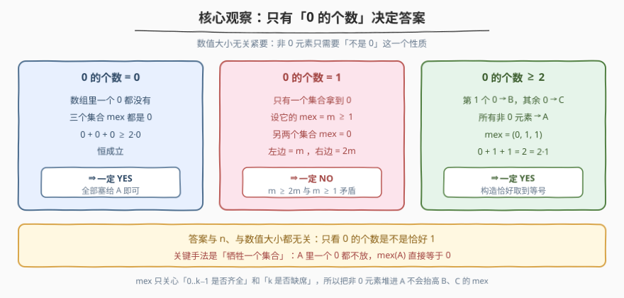
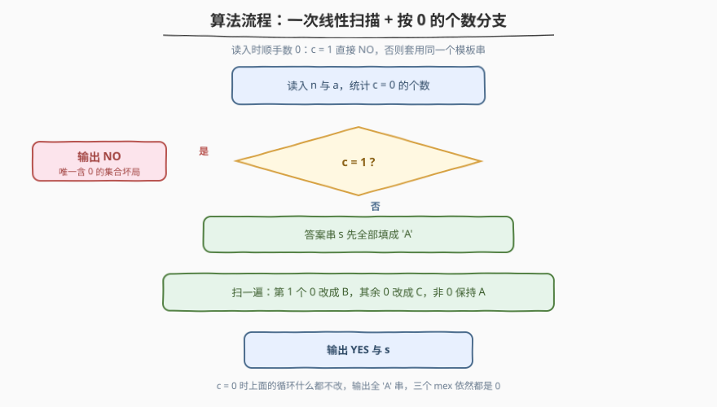
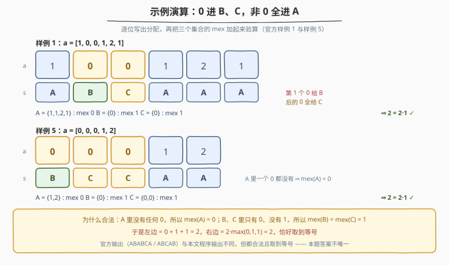

# Codeforces 2259D MEX 多重集 题解

## 1. 题目概述

- **标题 / 题号**：MEX 多重集（Codeforces 2259D，英文名 MEX Multiset）
- **链接**：https://codeforces.com/problemset/problem/2259/D
- **来源**：Codeforces Round 1119 (Div. 3) · Problem D（UTC 2026-09-05）
- **难度**：$\ast 1200$
- **限制**：时间 2 s / 内存 256 MB
- **标签**：构造、贪心（官方标签：constructive algorithms、greedy）

**题意**：给定长度为 $n$ 的数组 $a$，以及三个初始为空的多重集 $A,B,C$。要求把**每个** $a_i$ 放进且只放进其中一个集合，问是否存在分法使
$$\operatorname{MEX}(A)+\operatorname{MEX}(B)+\operatorname{MEX}(C)\ \ge\ 2\cdot\max\bigl(\operatorname{MEX}(A),\operatorname{MEX}(B),\operatorname{MEX}(C)\bigr),$$
其中 $\operatorname{MEX}(S)$ 是最小的**不属于** $S$ 的非负整数，空集为 $0$。存在则输出 `YES` 与长度 $n$ 的串 $s$（$s_i\in\{\texttt{A},\texttt{B},\texttt{C}\}$ 表示 $a_i$ 的去向），否则输出 `NO`。多测：首行 $t$，每组一行 $n$、一行 $n$ 个整数；大小写不敏感，多解输出任意一个。

**约束**：

- $1\le t\le 10^4$，$\sum n\le 2\times 10^5$：单组必须 $O(n)$，总计 $O(\sum n)$。
- $3\le n\le 2\times 10^5$：元素总能分完，难点只在 mex 这三个数，而不在"放得下"。
- $0\le a_i\le 10^9$：值域远大于 $n$，不能开值域桶真的去求 mex，也不必排序。
- 三个集合都允许为空，$\operatorname{MEX}(\varnothing)=0$——这正是下面构造的支点。
- 输出方案不唯一，只要合法即可。

## 2. 示例与观察
官方样例共 $5$ 组（输入 / 输出原样）：

```text
输入
5
6
1 0 0 1 2 1
4
0 0 0 0
3
0 2 2
4
6 7 6 7
5
0 0 0 1 2
```

```text
输出
YES
ABABCA
YES
ABAC
NO
YES
AAAB
YES
ABCAB
```

逐组对照题面注释：第 1 组 $A=\{0,1,1\},B=\{0,1\},C=\{2\}$ 得 mex $(2,2,0)$，$4=2\cdot2$；第 2 组四个 $0$ 均分得 $(1,1,1)$，$3\ge 2$；第 3 组只有一个 $0$，无论怎么放都凑不平，`NO`；第 4 组没有 $0$，三个 mex 都是 $0$，$0\ge0$；第 5 组 $A=\{0,1\},B=\{0,2\},C=\{0\}$ 得 $(2,1,1)$，$4=2\cdot2$。

补充一组自造示例（本文程序的实际输出，用于覆盖"全 0 之外的极端"）：

```text
输入
2
5
0 0 0 0 7
4
0 1 2 3
```

```text
输出
YES
BCCCA
NO
```

第 1 组 $A=\{7\},B=\{0\},C=\{0,0,0\}$ 得 mex $(0,1,1)$，$2=2\cdot1$；第 2 组只有一个 $0$，必败。注意官方样例给出的具体串与本程序不同，**本题答案不唯一**，下文的判定才是唯一的部分。

## 3. 解题思路

### 3.1 暴力思路

最直接的做法是枚举全部 $3^n$ 种分配，对每种用桶求出三个 mex 再验不等式，复杂度 $O(3^n\cdot n)$。$n$ 只有 $3$ 时还算得动，$n\le2\times10^5$ 时完全没有希望。

退一步，先把条件**改写**：把三个 mex 排序为 $p\le q\le m$，则 $\max=m$，条件等价于

$$p+q\ \ge\ m .$$

可见真正起作用的只有"三个集合各自把 $0,1,\dots$ 覆盖到哪里、以及有没有把某个值混进来"。由此得到第二种暴力：枚举目标三元组 $(p,q,m)$（满足 $p\le q\le m\le$ 全局 mex），检查 $0..p-1$ 是否有至少 $3$ 份、$p..q-1$ 是否至少 $2$ 份、$q..m-1$ 是否至少 $1$ 份。这是 $O(n^3)$ 的枚举，仍然太慢，但它点出了关键的不对称：

> **抬高 mex 很贵**（要把整个前缀配齐），**压低 mex 极便宜**（少给一个 $0$ 就够了）。

所以别想着把三个集合都做高，先想想能不能让某一个集合的 mex 直接归零。

### 3.2 核心观察：只数 0 的个数



设 $c$ 为数组中 $0$ 的个数，分三种情况讨论。

**(1) $c=0$**：任何集合都拿不到 $0$，三个 mex 全是 $0$，条件变成 $0\ge 2\cdot 0$，恒成立 ⇒ 一定 `YES`（全部塞给 $A$ 即可）。

**(2) $c=1$**：设唯一那个 $0$ 落在集合 $S$ 中。则 $S$ 含 $0$ ⇒ $\operatorname{MEX}(S)\ge 1$；另外两个集合不含 $0$ ⇒ 它们 mex 都是 $0$。于是 $m=\operatorname{MEX}(S)\ge1$，左边 $=m$，右边 $=2m$，要求 $m\ge 2m$，与 $m\ge1$ 矛盾 ⇒ 一定 `NO`。这是纯上界论证，不需要构造。

**(3) $c\ge2$**：把第 $1$ 个 $0$ 放进 $B$、其余所有 $0$ 放进 $C$、**所有非 $0$ 元素放进 $A$**。于是

- $A$ 里一个 $0$ 都没有 ⇒ $\operatorname{MEX}(A)=0$；
- $B,C$ 里的元素全部是 $0$ ⇒ 含 $0$、不含 $1$ ⇒ $\operatorname{MEX}(B)=\operatorname{MEX}(C)=1$。

代入得 $0+1+1=2$，而 $2\cdot\max(0,1,1)=2$，**恰好取等** ⇒ `YES`。

> 💡 让 $A$ 归零后，条件退化成 $\operatorname{MEX}(B)+\operatorname{MEX}(C)\ge 2\max(\operatorname{MEX}(B),\operatorname{MEX}(C))$，取 $(1,1)$ 正好凑平。牺牲一个集合比三个都做高划算得多，这就是本题的全部内容。

### 3.3 算法流程



1. 读入 $n$ 与数组，顺手数出 $c$（只判断 `a[i]==0`，不排序、不开桶）。
2. 若 $c=1$：输出 `NO`，本组结束。
3. 否则把答案串初始化为 $n$ 个 `A`。
4. 顺序扫描：遇到的第 $1$ 个 $0$ 标成 `B`，其后每个 $0$ 标成 `C`；非 $0$ 不动（保持 `A`）。
5. 输出 `YES` 与这个串。

第 3、4 步对 $c=0$ 自动退化：一个 $0$ 都没遇到，输出全 `A`，三个 mex 仍都是 $0$。整个过程只有一次线性扫描，且**从不需要真的计算 mex**。

### 3.4 示例演算



样例 1：$a=[1,0,0,1,2,1]$，$c=2$，按流程得 $s=\texttt{ABCAAA}$。

| 集合 | 元素 | MEX |
|------|------|-----|
| $A$ | $\{1,1,2,1\}$ | $0$ |
| $B$ | $\{0\}$ | $1$ |
| $C$ | $\{0\}$ | $1$ |

左边 $=0+1+1=2$，右边 $=2\cdot\max(0,1,1)=2$，取等 ✓。官方给的 `ABABCA` 对应 mex $(2,2,0)$，和也是 $4=2\cdot2$：两条完全不同的路都能取等，说明方案确实不唯一。

样例 5：$a=[0,0,0,1,2]$，$c=3$，得 $s=\texttt{BCCAA}$：$A=\{1,2\}\to0$，$B=\{0\}\to1$，$C=\{0,0\}\to1$，同样 $2=2\cdot1$ ✓。

## 4. 算法细节

1. **只判 `==0`**：$a_i$ 可达 $10^9$，但构造只关心"是不是 $0$"。`int` 足够（$10^9<2^{31}-1$），不必 `long long`；更不要开 $10^9$ 大小的桶去算 mex。
2. **不需要排序**："第 $1$ 个 $0$"直接取原数组顺序即可，$O(n\log n)$ 的排序纯属浪费（虽然也不会错）。
3. **多测重置**：`cnt0` 与"是否已经给过 `B`"的标志每组重新初始化；$t$ 最大 $10^4$，别用会跨组残留的静态变量。
4. **预填字符串**：`string s(n,'A')` 一次分配，避免 `+=` 反复扩容；$n\le2\times10^5$，每次扩容都是 $O(n)$ 的复制。
5. **`c=1` 只输出一行 `NO`**：不要再补一行空串，否则与下一组的输出错位，判题机按行读会全盘崩掉。
6. **输出用 `'\n'`**：`endl` 每次都 flush，$2\times10^4$ 行输出会明显变慢。
7. **Python 读入**：`sys.stdin.buffer.read().split()` 一次读完再按指针切分，避免 $10^4$ 次 `input()` 的函数调用开销；判 $0$ 用整数比较更直观。
8. **正确性无需事后验算**：$A$ 无 $0$、$B/C$ 只有 $0$ 是构造保证的，写完直接输出，不必再扫一遍求 mex。

## 5. 正确性证明

记 $c$ 为 $a$ 中 $0$ 的出现次数，$m=\max(\operatorname{MEX}(A),\operatorname{MEX}(B),\operatorname{MEX}(C))$。

**引理 1**：若 $c=0$，则任意分配都满足条件，算法输出的全 `A` 串是合法分配。

**证明**：所有 $a_i\ne0$，故三个集合都不含 $0$，三个 mex 都是 $0$。左边 $=0$，右边 $=2\cdot0=0$，$0\ge0$ 成立。全 `A` 串把每个元素恰好分给 $A$ 一次，是合法分配。∎

**引理 2**：若 $c=1$，则不存在合法分配。

**证明**：唯一含 $0$ 的集合 $S$ 满足 $\operatorname{MEX}(S)\ge1$；另外两个集合不含 $0$，mex 为 $0$。故 $m=\operatorname{MEX}(S)\ge1$，左边 $=0+0+m=m$，右边 $=2m$。由 $m\ge1$ 知 $m<2m$，不等式不成立，任意分配都失败。∎

**引理 3**：若 $c\ge2$，算法输出的串 $s$ 是合法分配，且三个 mex 恰为 $(0,1,1)$。

**证明**：$s$ 每位都是 `A`/`B`/`C` 之一且长度为 $n$，每个元素恰好被分到一处，故是合法分配。由 $c\ge2$，第 $1$ 个 $0$ 标成 `B`、其余 $0$ 标成 `C`，因此 $B$、$C$ 各至少含一个 $0$。又所有非 $0$ 元素一律标 `A`，故 $B,C$ 中元素全为 $0$：$0\in B,1\notin B\Rightarrow\operatorname{MEX}(B)=1$，同理 $\operatorname{MEX}(C)=1$。$A$ 中不含 $0$（$0$ 全部给了 $B,C$），故 $\operatorname{MEX}(A)=0$。∎

**定理**：算法输出 `YES` 当且仅当存在合法分配；输出 `YES` 时给出的串满足不等式。

**证明**：$c=0$ 由引理 1，$c\ge2$ 由引理 3（此时 $0+1+1=2\ge2\cdot1$），$c=1$ 由引理 2 排除。三种情况互斥且穷尽 $c\ge0$ 的全部可能，故判定与构造均正确。∎

**实验验证**：与独立暴力（枚举全部 $3^n$ 种分配 + 桶求三个 mex）对拍——

- $n=3,\dots,6$ 时值域 $\{0,1,2\}$ 的全部 $27+81+243+729=1080$ 个数组，加 $n=7$ 值域 $\{0,1\}$ 的 $128$ 个，共 **1208** 组；
- 加严补测值域 $\{0,1,2,3\}$、$\{0,1,4\}$、$\{0,3,7\}$ 的穷举共 **2775** 组；
- 随机 **609** 组（$n\le8$，值域含 $10^9$，另含 $c=0,1,2,3$ 的手工边界组）。

C++ 与 Python 两份实现全部 **0 差异**；每个 `YES` 都逐组校验了串长、字符集与不等式，5 组官方样例的 YES/NO 判定与构造合法性也全部通过（具体方案与官方不同，属正常）。

## 6. 复杂度分析

- **时间**：每组只扫一遍数组，$O(n)$；总计 $O(\sum n)\le2\times10^5$ 次取值比较与至多 $n$ 次字符赋值。判 `NO` 的组数完 $0$ 就返回，常数更小。
- **空间**：$O(n)$，只有原数组与答案串；没有任何与 $a_i$ 值域相关的结构，最坏 $10^9$ 的值域也不影响内存。
- **实测**（本机 Apple clang + libc++，$t=10^4$、$\sum n=2\times10^5$）：C++ 约 $0.13\sim0.30$ s，其中几乎全是 `cin` 解析（同一数据换 `scanf` 仅 $0.03$ s；Codeforces 上是 libstdc++，关闭同步的 `cin` 通常只需数十毫秒）；Python 约 $0.06\sim0.08$ s。相对 $2$ s 时限余量超过 $6$ 倍。

## 7. 参考代码

### C++17

```cpp
#include <bits/stdc++.h>
using namespace std;

int main() {
    ios::sync_with_stdio(false);
    cin.tie(nullptr);
    int t;
    if (!(cin >> t)) return 0;
    while (t--) {
        int n;
        cin >> n;
        vector<int> a(n);
        int cnt0 = 0;
        for (int i = 0; i < n; i++) {
            cin >> a[i];
            if (a[i] == 0) cnt0++;               // 只关心是不是 0
        }
        if (cnt0 == 1) {                         // 恰好一个 0：必败
            cout << "NO\n";
            continue;
        }
        string s(n, 'A');                        // 默认全部给 A
        bool firstZero = true;
        for (int i = 0; i < n; i++) {
            if (a[i] == 0) {                     // 0 分给 B、C，保证 A 里没有 0
                s[i] = firstZero ? 'B' : 'C';
                firstZero = false;
            }
        }
        cout << "YES\n" << s << "\n";
    }
    return 0;
}
```

### Python3

```python
import sys


def main():
    data = sys.stdin.buffer.read().split()
    if not data:
        return
    t, pos, out = int(data[0]), 1, []
    for _ in range(t):
        n = int(data[pos]); pos += 1
        a = list(map(int, data[pos:pos + n])); pos += n
        zeros = [i for i in range(n) if a[i] == 0]
        if len(zeros) == 1:                       # 恰好一个 0：必败
            out.append("NO")
            continue
        s = ['A'] * n                             # 默认全部给 A
        for k, i in enumerate(zeros):
            s[i] = 'B' if k == 0 else 'C'         # 第 1 个 0 给 B，其余给 C
        out.append("YES")
        out.append("".join(s))
    sys.stdout.write("\n".join(out) + "\n")


main()
```

## 8. 边界情况与易错点

1. **$c=1$ 是唯一必败情形**：判据是"$0$ 的个数恰好为 $1$"，既不是"有 $0$ 就 `NO`"，也不是"$0$ 不够多就 `NO`"。样例 3 的 $[0,2,2]$ 与样例 2 的 $[0,0,0,0]$ 正好卡在两侧。
2. **$c=0$ 必须输出 `YES`**：三个 mex 都是 $0$，$0\ge2\cdot0$ 成立；不要因为"没有任何集合含 $0$"就误判成 `NO`（样例 4）。
3. **$A$ 允许为空**：$\operatorname{MEX}(\varnothing)=0$ 正是想要的结果；全 $0$ 数组（$c=n$）时 $A$ 空、$B/C$ 只含 $0$，$(0,1,1)$ 依然成立。
4. **非 $0$ 元素一个都不能漏进 $B$ 或 $C$**：只要混进一个 $1$，$\operatorname{MEX}(B)$ 就 $\ge2$，$(0,1,1)$ 的证明失效（虽然结果可能仍合法）。按模板写最稳。
5. **输出长度必须是 $n$**：用 `string(n,'A')` 预填再逐位改，天然满足；别在循环里 `+=` 拼串而漏掉某些位置。
6. **$c=1$ 时不要多输出一行**：只打 `NO`，否则后续测试组的输出整体错位。
7. **多测清零**：`cnt0`、`firstZero` 必须每组重置；$t=10^4$ 时这类残留状态必然翻车。
8. **I/O 与常数**：$a_i$ 最多 $10$ 位、$\sum n=2\times10^5$，`cin` 必须关闭同步（或改 `scanf`）；Python 必须 `read().split()` 批量读入。

## 9. 验证记录

- **编译环境与命令**：`clang++ -std=c++17 -O2`（本机无 GNU g++，配 `codeforces/tools/include/bits/stdc++.h` 兼容头；正文代码只用标准库，可原样提交 GNU C++17）；Python 侧为 `Python 3.9.6`。
- **官方样例**：0 / 1 通过 token 比对；本题输出不唯一（构造 / 多解 / 特殊评测），剩余差异属预期，样例含义已在第 2 节逐组解释。
- **复核状态**：audited（2026-11-19 统一回归：编译 + 官方样例；写作期的随机对拍与暴力未重跑）。

## 相关题目与扩展

- [Codeforces 2259A. Moo Language School](https://codeforces.com/problemset/problem/2259/A)：同场签到题，切块后逐块贪心。
- [Codeforces 2259C. 101](https://codeforces.com/problemset/problem/2259/C)：同场 C，同样是"先想上界、再构造达到上界"的骨架。
- [Codeforces 2259E. Treasure Map Destruction (Constructive Version)](https://codeforces.com/problemset/problem/2259/E) 与 [Codeforces 2259H. Treasure Map Destruction (Counting Version)](https://codeforces.com/problemset/problem/2259/H)：同场的 easy/hard 配对，同一模型从"给方案"升级到"数方案"。
- [LeetCode 41. 缺失的第一个正数](https://leetcode.cn/problems/first-missing-positive/)：mex 的经典求法，$O(n)$ 原地哈希。
- [LeetCode 2598. 执行操作后的最大 MEX](https://leetcode.cn/problems/smallest-missing-non-negative-integer-after-operations/)：用取模把元素搬去补缺，和本题一样只关心"前缀配不配齐"。

**延伸思考**：

1. **集合个数改成 $k$**：仍留一个集合不放 $0$，其余 $k-1$ 个各拿 $0$ 得 mex $1$，左边 $=k-1$、$\max=1$，$k\ge3$ 时 $k-1\ge2$ 仍成立 ⇒ 结论依然是"恰好 $1$ 个 $0$ 才 `NO`"。$k=2$ 时条件退化成两边 mex 相等，判据彻底不同。
2. **系数 $2$ 改成 $\lambda$**：模板 $(0,1,1)$ 只能凑出 $2\ge\lambda$，所以 $\lambda>2$ 时"$c\ge2$"不再充分；此时改把 $0$ 分散到三个集合得 $(1,1,1)$，凑出 $3\ge\lambda$。一般地，$\lambda\le k$ 时"$0$ 尽量分散"就够。
3. **要求三个集合都非空**：$c=0$ 时把元素拆成三份，mex 仍全为 $0$，答案不变；$c\ge2$ 时要求 $A$ 至少含一个非 $0$ 元素，若数组全 $0$ 则无解——这类"非空"约束只需在构造末尾补一次检查。
4. **要求输出字典序最小的合法串**（按 `A<B<C`）：模板已经把尽量多的元素留在 `A`，但"第一个 $0$ 给 `B`"还是"给 `C`"需要在同分方案间比较，本质是在合法集合内做一次贪心交换。
