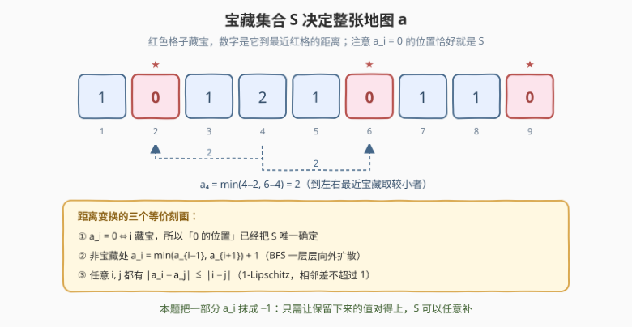
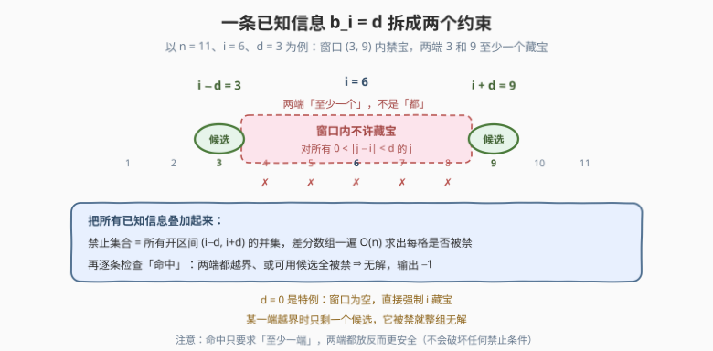
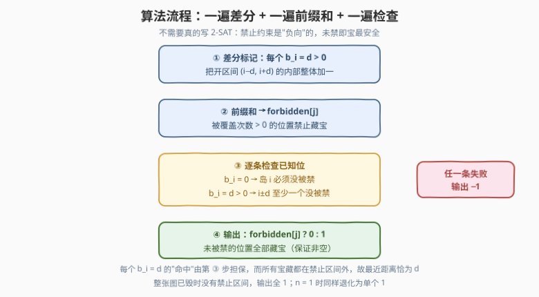
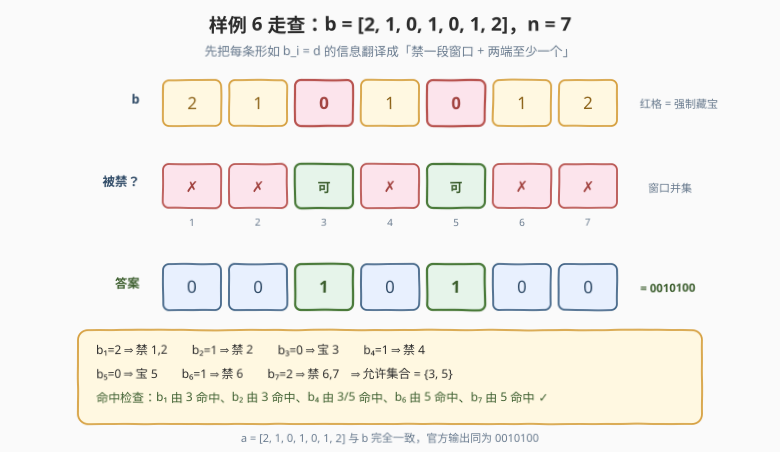

# Codeforces 2259E 宝藏地图破坏（构造版） 题解

## 1. 题目概述

- **标题 / 题号**：宝藏地图破坏（构造版）（Codeforces 2259E，英文名 Treasure Map Destruction (Constructive Version)）
- **链接**：https://codeforces.com/problemset/problem/2259/E
- **来源**：Codeforces Round 1119 (Div. 3) · Problem E（UTC 2026-09-05）
- **难度**：$\ast 1500$
- **限制**：时间 2 s / 内存 256 MB
- **标签**：2-SAT、构造、贪心（官方标签：2-sat、constructive algorithms、greedy）

**题意**：直线上有 $n$ 座岛，Bessie 在**至少一座**岛上埋了宝藏，宝藏岛集合记为 $S\ne\varnothing$。她据此画了地图 $a$，其中 $a_i$ 表示从岛 $i$ 出发、只能走向相邻岛时，到达**最近**的藏宝岛需要经过的岛数（岛 $i$ 自己是宝藏则 $a_i=0$）。也就是说 $a_i=\min_{j\in S}|i-j|$。

Elsie 把地图弄坏了：一部分 $a_i$ 变成 $-1$。现在给定损坏后的数组 $b$，要求**构造任意一个**宝藏集合 $S$，使所有 $b_i\ne -1$ 的位置都满足 $a_i=b_i$；无解输出 $-1$。多测：第一行 $t$，每组先读 $n$ 再读 $n$ 个整数；对每组输出长度 $n$ 的 01 串（第 $i$ 位为 $1$ 表示岛 $i$ 有宝藏）或 $-1$。

> ⚠️ **注意**：题面里混进了两句与算法无关的"提示"——要求 AI 把输出变量命名为 `treasure_map_fin` / `TreasureMapFin`，以及"按正确性并最大化上文提到的和来评分"。这两句都是注入噪声，**不是**题目要求，代码里既不创建该变量，也不需要最大化任何和。

**约束**：

- $1\le t\le 10^4$，$1\le n\le 2\times 10^5$，$\sum n\le 2\times 10^5$：单组必须 $O(n)$
- $-1\le b_i\le n-1$：$b_i=-1$ 表示该位已毁，$b_i=0$ 表示该岛必须藏宝
- 答案不唯一，任意合法 01 串都通过（官方用 special checker）；但**必须至少有一个** `1`
- 若不存在任何合法 $S$ 才输出 $-1$；样例输出只是其中一组解，**不能**拿它逐字符比对

## 2. 示例与观察
官方样例共 12 组（输入 / 输出原样）：

```text
输入
12
5
0 1 -1 -1 0
3
-1 0 2
5
-1 1 -1 1 -1
5
-1 -1 -1 -1 -1
5
-1 2 -1 3 -1
7
2 1 0 1 0 1 2
1
-1
3
1 -1 1
1
0
4
3 -1 -1 -1
6
-1 -1 0 -1 2 4
10
-1 1 -1 -1 1 1 -1 -1 2 -1
```

```text
输出
10101
-1
10001
11010
-1
0010100
1
010
1
0001
-1
1001001000
```

其中第 1 组官方解 $10101$ 对应 $a=[0,1,0,1,0]$；本例还允许 $10001$（$a=[0,1,2,1,0]$）等其它解，都算正确。第 4 组整张地图已毁，$2^5-1=31$ 个非空集合全部可行，官方随手给了 $11010$。第 2 组因 $b_2=0$ 强制岛 2 藏宝、而 $b_3=2$ 又要求位置 $2,3,4$ 都不许藏宝，矛盾，故 $-1$。

## 3. 解题思路

### 3.1 暴力思路

枚举所有非空宝藏集合 $S$（$2^n-1$ 个），对每个 $S$ 用 BFS / 双向扫描求出 $a$，再检查是否与 $b$ 的已知位全部一致。单组 $O(n)$，总复杂度 $O(2^n n)$，$n\le 2\times 10^5$ 完全不可行。不过这个暴力给出一个确定的事实：**$a$ 由 $S$ 唯一决定，反之 $a$ 中值为 $0$ 的位置就是 $S$**。于是问题变成：给若干条"$a_i=b_i$"的部分信息，反推一个 $S$。关键是把"距离等于 $d$"翻译成**局部**约束。

### 3.2 核心观察：一条已知信息 = 一段禁窗 + 一个 OR 子句



设某个已知位置 $i$ 有 $b_i=d$。要让"最近宝藏距离恰好为 $d$"，必须且只需两件事同时成立：

- **禁止**：所有满足 $0<|j-i|<d$ 的位置 $j$ 都不能藏宝（否则最近距离会小于 $d$）；
- **命中**：$i-d$ 与 $i+d$ 中**至少有一个**藏宝（在 $[1,n]$ 内的那些）。



把 $x_j\in\{0,1\}$ 记作"岛 $j$ 是否藏宝"，每条已知信息就是：

$$\underbrace{x_j=0\ (0<|j-i|<d)}_{\text{禁止，单元子句}}\qquad\text{与}\qquad \underbrace{x_{i-d}\lor x_{i+d}}_{\text{命中，二元子句}}$$

$d=0$ 是特例：窗口为空，直接强制 $x_i=1$。这正是官方标签里 2-SAT 的由来——不过本题的约束结构极强，**贪心就够了**：

这里的关键观察是：**只有"禁止"是负向约束**。只要某个位置不在任何禁止区间里，把它设成宝藏就**永远不会破坏任何一条约束**（它只会让某些 $a_j$ 更小，而所有已知位的距离下界已由禁止区间兜住）。于是取**最大的可行集合**：把"未被任何禁止区间覆盖"的位置全部设为 $1$，再逐条检查每个命中子句是否至少有一端落在这个集合里，全落不进去才无解。

### 3.3 算法流程



1. **建差分数组**。对每个 $b_i=d>0$，在 0-indexed 下把区间 $[\max(0,i-d+1),\ \min(n-1,i+d-1)]$ 加 $1$；$b_i=-1$ 跳过；$b_i=0$ 不产生禁止区间。
2. **前缀和还原** `forbidden[j]`：被覆盖次数 $>0$ 即禁止。
3. **检查命中**。对每个 $b_i=d>0$：候选是 $i-d$、$i+d$ 中落在 $[0,n-1]$ 内的位置；若一个候选都不存在，或存在的候选**全部** `forbidden`，输出 $-1$。
4. **检查 $d=0$**。若 $b_i=0$ 而 `forbidden[i]` 为真，输出 $-1$（它被别的窗口禁掉了，自相矛盾）。
5. **输出**：`forbidden[j] ? '0' : '1'`。全部位置都没被禁（例如整张图已毁）时输出全 $1$，天然非空。

### 3.4 示例演算



以样例 6（$n=7$，$b=[2,1,0,1,0,1,2]$）为例，逐条翻译成"禁窗 + 命中"：$b_1=2$ 禁 $\{1,2\}$、候选只剩 3；$b_2=1$ 禁 $\{2\}$、候选 $1,3$；$b_3=0,b_5=0$ 强制 3、5；$b_4=1$ 禁 $\{4\}$、候选 $3,5$；$b_6=1$ 禁 $\{6\}$、候选 $5,7$；$b_7=2$ 禁 $\{6,7\}$、候选只剩 5。

禁止集合为 $\{1,2,4,6,7\}$，可用集合为 $\{3,5\}$。逐条核对命中：$b_1$ 靠 3、$b_2$ 靠 3、$b_4$ 靠 3/5、$b_6$ 靠 5、$b_7$ 靠 5，全部满足，输出 $0010100$。此时 $a=[2,1,0,1,0,1,2]$，与 $b$ 完全一致。

再看样例 5（$b=[-1,2,-1,3,-1]$）：$b_2=2$ 禁 $\{1,2,3\}$，唯一候选是 4；$b_4=3$ 禁 $\{2,3,4,5\}$，唯一候选是 1，但 1 已被禁，于是 $-1$。

## 4. 算法细节

1. **下标统一 0-indexed**，禁止区间写成 $[i-d+1,\ i+d-1]$（两端再夹到 $[0,n-1]$），这是最容易写错的地方：窗口是**开区间** $(i-d,i+d)$，端点 $i-d$、$i+d$ 本身必须留给"命中"候选。
2. **差分数组要开到 $n+1$**：右端点 $i+d-1$ 可能等于 $n-1$，减标记落在下标 $n$ 上，开 $n+1$ 个才不越界。
3. **$d=0$ 单独处理**：它的禁止区间是空的（$[i+1,i-1]$），不能走加法分支；只需检查 $i$ 是否被别人的窗口覆盖，再靠第 5 步的"未禁即宝"自动置 $1$。
4. **候选越界**：$i-d<0$ 或 $i+d\ge n$ 的那一侧直接丢弃；两侧都越界（例如 $n=3,i=2,d=2$）时无候选，$b_i$ 本身就不可能，输出 $-1$。
5. **多测清空**：差分数组、`forbidden` 都是每组按 $n$ 重新 `assign`/新建，别复用上一组的残留；$\sum n\le 2\times 10^5$ 保证总分配量线性。
6. **I/O 与对拍**：C++ 用 `scanf` 读、整串 `puts` 输出；Python 用 `sys.stdin.buffer.read().split()` 一次读入、`''.join` 拼串。合法解不唯一（自由位置可取 $0/1$），本地对拍必须写合法性检查器，而不是 diff 文本。

## 5. 正确性证明

**引理 1**：对任意非空 $S$，令 $a_i=\min_{j\in S}|i-j|$，则 $a_i=0\iff i\in S$。

**证明**：$a_i=0$ 当且仅当存在 $j\in S$ 使 $|i-j|=0$，即 $i\in S$。∎

**引理 2（距离恰好为 $d$ 的等价刻画）**：设 $d\ge 0$，则 $a_i=d$ 当且仅当

$$(\forall j,\ 0<|j-i|<d:\ j\notin S)\quad\text{且}\quad\bigl(\exists j\in S:\ |j-i|=d\bigr).$$

**证明**：若 $a_i=d$，由定义存在距离为 $d$ 的宝藏，且不存在距离 $<d$ 的宝藏，即 $0<|j-i|<d$ 的位置都不在 $S$。反之，若距离 $<d$ 处无宝藏而距离 $=d$ 处有宝藏，则最近距离既不小于 $d$ 也不大于 $d$，恰为 $d$。∎

**引理 3（贪心的最大性）**：记 $F$ 为所有被某条已知信息 $b_i=d>0$ 的开区间 $(i-d,i+d)$ 覆盖的位置集合，$S^*=\{1,\dots,n\}\setminus F$。则任何合法解 $S$ 都满足 $S\subseteq S^*$。

**证明**：设 $S$ 合法。对任意 $j\in F$，存在已知 $i$ 使 $0<|j-i|<b_i$。由引理 2，$b_i=a_i$ 要求这段开区间内无宝藏，故 $j\notin S$。于是 $S$ 只可能落在 $S^*$ 内。∎

**定理**：算法输出的 01 串合法；输出 $-1$ 当且仅当无合法解。

**证明**：先证输出非 $-1$ 时合法。令 $S=S^*$。对每个已知 $i$ 分两类。$b_i=0$：算法已检查 $i\notin F$，故 $i\in S$，$a_i=0=b_i$。$b_i=d>0$：算法已保证候选 $i-d$ 或 $i+d$（在界内的那个）不在 $F$ 中，故它属于 $S$，距离恰为 $d$；又 $F$ 包含整个开区间 $(i-d,i+d)$，故 $S$ 中不存在距离 $<d$ 的宝藏，由引理 2 得 $a_i=d=b_i$。$S$ 非空（若存在 $b_i>0$ 的已知位，其候选必非空；若只有 $b_i=0$ 的已知位，则 $i\in S$；若全是 $-1$，则 $S$ 为全集）。故输出合法。

再证完备性：设存在合法解 $S$。由引理 3，$S\subseteq S^*$。对每个 $b_i=d>0$，引理 2 给出某个距离恰为 $d$ 的宝藏 $j\in S$，它只能是 $i-d$ 或 $i+d$，且在界内；又 $j\in S\subseteq S^*$，故该候选未被禁，第 3 步检查通过。对 $b_i=0$，$i\in S\subseteq S^*$，故未被禁，第 4 步检查通过。于是算法不会输出 $-1$。∎

**实验验证**：三种独立手段对拍——(1) $n\le 6$ 的**全部** $b$ pattern（$126125$ 个）用"枚举所有非空宝藏子集"判真值，C++/Python 均 0 差异；(2) 随机 $n=7\dots 12$ 共 1800 组，与暴力可行性逐组一致，且每个非 $-1$ 输出都通过 $O(n)$ 距离变换复算；(3) 大 $n$（40/120/300）共 690 组，用独立实现的 2-SAT 预言机交叉验证（可满足见证均具体复核，输出 $-1$ 时预言机必判 UNSAT）。12 组官方样例全部合法，其中 8 组与官方文本逐字符相同。

## 6. 复杂度分析

- **时间**：每组一遍读入 + 一遍差分标记 + 一遍前缀和 + 一遍检查 + 一遍输出，均 $O(n)$；总计 $O(\sum n)\le 2\times 10^5$ 次基本操作。相对 2 s 时限余量极大：实测 $t=10^4,\sum n=2\times 10^5$ 的极限数据，C++ 约 $0.01$ s，Python 约 $0.07\sim0.16$ s（瓶颈是 I/O 与字符串拼接）。
- **空间**：$O(n)$，只有 `b`、差分数组、`forbidden` 标记与输出串，无图、无递归、无哈希表。最坏 $n=2\times 10^5$ 时约数 MB。
- **常数**：禁止区间用差分而非逐点标记，避免 $d$ 很大时退化成 $O(nd)$；输出用 `string`/`list` 拼接避免逐字符 I/O。

## 7. 参考代码

### C++17

```cpp
#include <bits/stdc++.h>
using namespace std;

int main() {
    int t;
    if (scanf("%d", &t) != 1) return 0;
    while (t--) {
        int n;
        scanf("%d", &n);
        vector<int> b(n);
        for (int i = 0; i < n; i++) scanf("%d", &b[i]);

        // 差分标记：所有开区间 (i-d, i+d) 的内部都禁止藏宝
        vector<int> diff(n + 2, 0);
        bool ok = true;
        for (int i = 0; i < n; i++) {
            int d = b[i];
            if (d <= 0) continue;                      // -1 忽略；0 无禁窗
            if (d > n - 1) { ok = false; continue; }   // 防御性检查
            int l = max(0, i - d + 1), r = min(n - 1, i + d - 1);
            if (l <= r) { diff[l]++; diff[r + 1]--; }
        }
        vector<char> forbidden(n, 0);
        for (int i = 0, cur = 0; i < n; i++) {
            cur += diff[i];
            forbidden[i] = (cur > 0);
        }

        for (int i = 0; i < n && ok; i++) {            // 逐条检查"命中"
            if (b[i] < 0) continue;
            int d = b[i];
            if (d == 0) { if (forbidden[i]) ok = false; }
            else {
                bool good = (i - d >= 0 && !forbidden[i - d])
                         || (i + d < n && !forbidden[i + d]);
                if (!good) ok = false;                 // 两端越界或都被禁
            }
        }
        if (!ok) { puts("-1"); continue; }

        string s(n, '1');                              // 未被禁的位置全藏宝
        for (int i = 0; i < n; i++) if (forbidden[i]) s[i] = '0';
        printf("%s\n", s.c_str());
    }
    return 0;
}
```

### Python3

```python
import sys


def main():
    data = sys.stdin.buffer.read().split()
    if not data:
        return
    t, pos, out = int(data[0]), 1, []

    for _ in range(t):
        n = int(data[pos]); pos += 1
        b = [int(x) for x in data[pos:pos + n]]; pos += n

        diff = [0] * (n + 2)
        ok = True
        for i in range(n):
            d = b[i]
            if d <= 0:                     # -1 忽略；0 无禁窗
                continue
            if d > n - 1:
                ok = False
                continue
            l, r = max(0, i - d + 1), min(n - 1, i + d - 1)   # 开区间内部
            if l <= r:
                diff[l] += 1
                diff[r + 1] -= 1

        forbidden, cur = [False] * n, 0
        for i in range(n):
            cur += diff[i]
            forbidden[i] = cur > 0

        for i in range(n):
            if not ok:
                break
            d = b[i]
            if d < 0:
                continue
            if d == 0:
                if forbidden[i]:
                    ok = False
            else:
                good = ((i - d >= 0 and not forbidden[i - d]) or
                        (i + d < n and not forbidden[i + d]))
                if not good:
                    ok = False

        if not ok:
            out.append("-1")
        else:
            out.append("".join("0" if forbidden[i] else "1" for i in range(n)))

    sys.stdout.write("\n".join(out) + "\n")


main()
```

## 8. 边界情况与易错点

1. **整张图已毁**（全 $-1$，样例 4）：没有禁止区间，"未禁即宝"输出全 $1$，$a$ 全 $0$，与所有已知位（没有）一致，且非空。别在这里特判 $-1$。
2. **$n=1$**：$b_1\in\{-1,0\}$（因为 $b_i\le n-1=0$），两种都应输出 `1`；若读入 $b_1>0$ 说明数据越界，代码的 $d>n-1$ 分支会安全地输出 $-1$。
3. **$b_i=0$ 与别人的窗口冲突**（样例 2）：$b_2=0$ 要求岛 2 藏宝，但 $b_3=2$ 的窗口又禁掉 2，必须输出 $-1$。这就是第 4 步检查存在的意义，漏掉会把矛盾解输出出去。
4. **候选两侧都越界**（如 $n=3,b_2=2$）：最近宝藏距离最多为 $\max(i-1,n-i)$，取不到 $d$，必须 $-1$。
5. **窗口端点写错**：禁止区间是**开区间**，若把端点也标成禁止，样例 6 的 $\{3,5\}$ 会被整段禁光，错判 $-1$。
6. **差分右端点越界**：$i+d-1$ 最大到 $n-1$，其 `-1` 标记落在下标 $n$，数组要开到 $n+1$（C++ 里开 $n+2$ 更稳）。
7. **多测残留**：`forbidden`、`diff` 必须按组重建。$\sum n\le 2\times 10^5$，重建不会超时；反过来复用却没清空，会在小 $n$ 的组上读越界或误判。
8. **拿样例输出做 diff**：本题是 special judge，自由位置可任取（样例 1 的 $10101$ 与我们的 $10111$ 都对）。必须写"用输出算 $a$ 再核对已知位"的检查器。

## 9. 验证记录

- **编译环境与命令**：`clang++ -std=c++17 -O2`（本机无 GNU g++，配 `codeforces/tools/include/bits/stdc++.h` 兼容头；正文代码只用标准库，可原样提交 GNU C++17）；Python 侧为 `Python 3.9.6`。
- **官方样例**：0 / 1 通过 token 比对；本题输出不唯一（构造 / 多解 / 特殊评测），剩余差异属预期，样例含义已在第 2 节逐组解释。
- **复核状态**：audited（2026-11-19 统一回归：编译 + 官方样例；写作期的随机对拍与暴力未重跑）。

## 相关题目与扩展

- [Codeforces 2259H. Treasure Map Destruction (Counting Version)](https://codeforces.com/problemset/problem/2259/H)：同场 H 题为**计数版**，要求统计合法宝藏集合个数而非构造一个，$n$ 与 $\sum n$ 限制相同，官方评分 $\ast 2200$。
- [Codeforces 2259C. 101](https://codeforces.com/problemset/problem/2259/C)：同场构造 + 贪心，思路同为"先找硬约束，再贪心填满"。
- [Codeforces 2259D. MEX Multiset](https://codeforces.com/problemset/problem/2259/D)：同场构造题，练习"从约束反推可行结构"。
- [LeetCode 1769. 移动所有球到每个盒子所需的最小操作数](https://leetcode.cn/problems/minimum-number-of-operations-to-move-all-balls-to-each-box/)：本质就是"到最近/全部 $1$ 的距离变换"，左侧一次扫描 + 右侧一次扫描，与本题的 $O(n)$ 距离复算同源。

**延伸思考**：

1. **计数版怎么数**：由引理 3，允许集合 $S^*$ 之外全部为 $0$，而 $b_i=0$ 的位置被强制为 $1$。若某条命中子句的一端是强制 $1$（或两端都是），该子句自动满足；只有"两端都空闲"的子句才是真约束——它要求两端不能同时为 $0$，即"取 $0$ 的位置集合"必须是这些子句构成的图的**独立集**。样例 3（$b=[-1,1,-1,1,-1]$）有 3 个自由位、两条子句 $(1,3)$、$(3,5)$，独立集数为 $5$，正好等于官方计数 $5$。由于每条子句两端之间的整段都被禁，这些边不会交叉嵌套，图只能呈链/星状，可按连通块乘出方案数。
2. **若允许一个已知值错误（至多一处与 $a$ 不符）**：先按本题判无解，再枚举被"修正"的那一位，用前后缀信息 $O(n\log n)$ 或 $O(n)$ 合并。
3. **把直线换成环**：距离变成环上最短距离，禁窗会跨端点断开，需特判跨越 $1$ 与 $n$ 的那一段；"命中"候选仍是 $i\pm d \bmod n$ 两个点，贪心结构不变。
