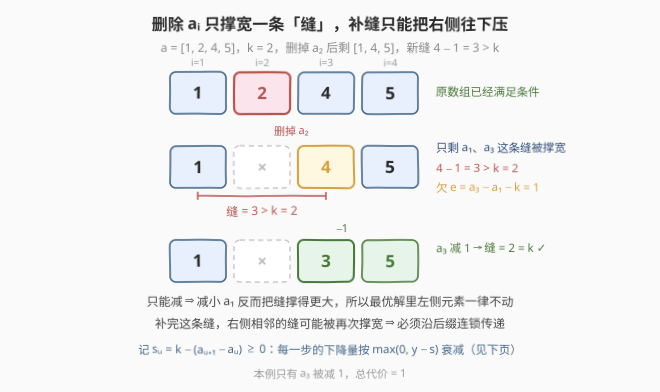
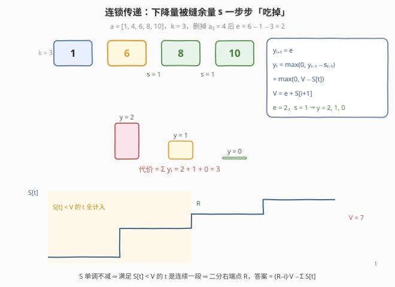
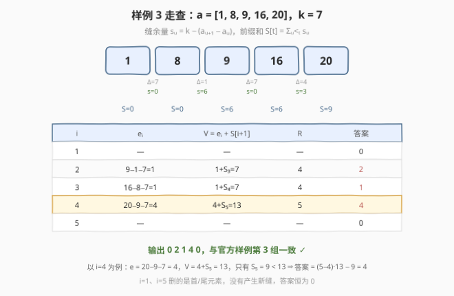

# Codeforces 2259G 删除下标 题解

## 1. 题目概述

- **标题 / 题号**：删除下标（Codeforces 2259G，英文名 Index Removal）
- **链接**：https://codeforces.com/problemset/problem/2259/G
- **来源**：Codeforces Round 1119 (Div. 3) · Problem G
- **难度**：1900
- **限制**：时间 2 s / 内存 256 MB
- **标签**：二分查找，数据结构，数学（单调前缀和上二分 + 后缀连锁传递）

**题意**：称数组 $b_1,\dots,b_m$ 是**好的**，若对每个 $1\le i<m$ 都有 $b_{i+1}\ge b_i$ 且 $b_{i+1}-b_i\le k$；长度为 1 的数组恒为好。给定一个初始就是好数组的 $a_1,\dots,a_n$。对每个 $i$ **独立**地问：先删掉 $a_i$，此后每次操作可以把任意一个元素减 $1$，至少要多少次操作才能让剩下的数组重新变好？多测输出 $n$ 个答案。

**约束**：

- $1\le t\le 10^4$，$\sum n\le 2\times 10^5$；
- $2\le n\le 2\times 10^5$，$1\le k\le 10^9$，$1\le a_i\le 10^9$；
- 保证 $a$ 已经是好数组，即每条缝 $a_{u+1}-a_u\in[0,k]$（这一条是后面所有推导的起点）；
- 答案上界 $n\cdot k\le 2\times 10^{14}$，必须用 64 位整数；中间前缀和会更大约 $2\times 10^{19}$，需 `__int128`。

## 2. 示例

```text
输入
7
4 2
1 2 4 5
4 1
1 2 3 4
5 7
1 8 9 16 20
5 1000000000
1 6 7 67 6767
6 1
1 1 2 2 3 4
4 1
1 2 3 3
4 2
1 2 4 6
输出
0 1 1 0
0 2 1 0
0 2 1 4 0
0 0 0 0 0
0 0 0 0 1 0
0 1 0 0
0 2 2 0
```

以第 1 组为例：删掉 $a_2=2$ 得 $[1,4,5]$，缝 $4-1=3>k=2$，把 $4$ 减成 $3$ 即好，代价 1；删掉 $a_4$ 后 $[1,2,4]$ 本来就满足 $4-2\le 2$，代价 0。第 7 组 $i=2$ 需要把 $4\to3$、$6\to5$ 连续压两次，代价 2，正是「连锁传递」的最小例子。

## 3. 解题思路

### 3.1 暴力思路

固定 $i$ 后，这是「只减不增、相邻差 $\le k$」的最小代价问题，可以做值域 DP：$f_j[v]$ 表示把 $b_j$ 减到 $v$ 时前 $j$ 个元素的最小代价，转移

$$f_j[v]=(b_j-v)+\min_{u\in[v-k,\,v]}f_{j-1}[u],\qquad 0\le v\le b_j .$$

单次 $O(m\cdot A)$（$A=\max a_i\le10^9$），对 $n$ 个 $i$ 全做一遍是 $O(n^2A)$，完全不可行。另一个「看起来能过」的做法是：先承认只有一条缝要补，再对每个 $i$ 从 $i+1$ 开始向后贪心地传递下降量，$O(n)$ 一次，总共 $O(n^2)$；$n=2\times10^5$ 时约 $4\times10^{10}$ 次，仍然过不去。正解把这一次 $O(n)$ 的传递用**前缀和 + 二分**压成 $O(\log n)$。

### 3.2 核心观察：删除只撑宽一条缝，补缝只能压右侧



三个事实把问题压扁：

1. **只有一条缝会坏**。删掉 $a_i$ 只让 $a_{i-1}$ 与 $a_{i+1}$ 变成邻居，其余相邻对原封不动；$a$ 本来就好，所以只有 $(i-1,i+1)$ 可能违规，且只在 $1<i<n$ 时出现。$i=1$、$i=n$ 删的是首/尾元素，剩下的数组直接是好的，答案恒为 0。
2. **只能往下压右侧**。操作只有「减」，要让 $b_{i+1}'-b_{i-1}'\le k$ 只能把右边变小；减小 $a_{i-1}$ 反而把缝撑得更宽（并强迫右边多降），所以最优解里 $a_{i-1}$ 及其左侧的元素一律不动。
3. **下压会连锁**。把 $a_{i+1}$ 压低后，$(a_{i+1},a_{i+2})$ 这条缝被撑宽，可能再次超过 $k$，于是 $a_{i+2}$ 也要跟着降，直到某个缝的余量把下降量「吃掉」为止。

于是只对 $j\ge i+1$ 设 $y_j\ge 0$ 为 $a_j$ 被减掉的总量；记 $e_i=a_{i+1}-a_{i-1}-k$ 为这条新缝超出的部分（$\le 0$ 时不用补），$s_u=k-(a_{u+1}-a_u)\ge 0$ 为第 $u$ 条缝还能再「吞掉」多少下降量。

### 3.3 算法流程：链式下界 → 前缀和 → 一次二分



把相邻约束写成 $y$ 的下界。对 $(i-1,i+1)$：

$$(a_{i+1}-y_{i+1})-(a_{i-1}-y_{i-1})\le k\ \Longrightarrow\ y_{i+1}-y_{i-1}\ge e_i .$$

取 $y_{i-1}=0$ 得 $y_{i+1}\ge e_i$。对 $j\ge i+2$：

$$(a_j-y_j)-(a_{j-1}-y_{j-1})\le k\ \Longrightarrow\ y_j\ge y_{j-1}-s_{j-1}.$$

所有下界都取等号即得**最优**压法（§5 说明它确实可行）：

$$y_{i+1}=e_i,\qquad y_j=\max\bigl(0,\ y_{j-1}-s_{j-1}\bigr)\quad(j\ge i+2).$$

由于 $s\ge0$，这个嵌套 $\max$ 可以展开：

$$y_j=\max\bigl(0,\ e_i-(S_j-S_{i+1})\bigr),\qquad S_t=\sum_{u=1}^{t-1}s_u .$$

令 $V=e_i+S_{i+1}$，则

$$\text{ans}_i=\sum_{j=i+1}^{n}y_j=\sum_{j=i+1}^{n}\max\bigl(0,\ V-S_j\bigr).$$

**关键**：$s_u\ge0\Rightarrow S$ **单调不减**，所以满足 $S_j<V$ 的 $j$ 恰好是 $[i+1,R]$ 一段连续下标。二分出「最后一个 $S_j<V$ 的 $R$」，再用 $S$ 的前缀和 $PS_t=\sum_{j=1}^{t}S_j$ 把和式压成 $O(1)$：$\text{ans}_i=(R-i)\cdot V-(PS_R-PS_i)$。

算法流程：

1. 预处理 $S_1..S_n$（$S_1=0$，$S_t=S_{t-1}+k-(a_t-a_{t-1})$）与 $PS_1..PS_n$，$O(n)$。
2. 对 $i\in[2,n-1]$：算 $e_i=a_{i+1}-a_{i-1}-k$；$e_i\le0$ 直接记 0。
3. 令 $V=e_i+S_{i+1}$，在 $S[i+1..n]$（有序）上二分最后一个 $<V$ 的下标 $R$。
4. $\text{ans}_i=(R-i)V-(PS_R-PS_i)$，$R<i+1$ 时为 0；$i=1,n$ 输出 0。

### 3.4 示例演算



取样例 3：$a=[1,8,9,16,20]$，$k=7$。缝宽 $7,1,7,4$，故 $s=[0,6,0,3]$，$S=[0,0,6,6,9]$，$PS=[0,0,6,12,18,27]$。

| $i$ | $e_i=a_{i+1}-a_{i-1}-k$ | $V=e_i+S_{i+1}$ | $R$ | 答案 |
|----|----|----|----|----|
| 1 | — | — | — | 0 |
| 2 | $9-1-7=1$ | $1+S_3=7$ | 4 | $2\cdot 7-12=2$ |
| 3 | $16-8-7=1$ | $1+S_4=7$ | 4 | $1\cdot 7-6=1$ |
| 4 | $20-9-7=4$ | $4+S_5=13$ | 5 | $1\cdot 13-9=4$ |
| 5 | — | — | — | 0 |

输出 `0 2 1 4 0`，与样例一致。以 $i=2$ 为例：删掉 $8$ 得 $[1,9,16,20]$，新缝 $9-1=8>7$，先把 $9$ 压到 $8$（代价 1）；此时 $16-8=8>7$，$16$ 也要减到 $15$（代价 1）；$20-15=5\le7$ 停手，总代价 $2$。

## 4. 算法细节

1. **统一 1-indexed**：$a_i$、$S_t$、$PS_t$ 都从 1 开始，则 $S_{i+1}$、$PS_i$ 的下标天然对齐；改成 0-indexed 时 $S$ 表示「前 $t$ 条缝的余量和」，极易差 1。
2. **只处理 $2\le i\le n-1$ 且 $e_i>0$**：$i=1$、$i=n$ 没有新缝，$e_i\le0$ 时缝本来就 $\le k$（如 $a_{i+1}=a_{i-1}$ 或 $k$ 很大），两种情形答案都是 0；显式判掉既稳又快（否则 $V\le S_{i+1}$ 会让二分区间为空）。
4. **二分必须是「最后一个 $<V$」**：$S$ 存在相等段（$s_u=0$ 时下一项不减），要用 `S[mid] < V` 或 `upper_bound(V-1)`；用 `lower_bound(V)` 会漏掉 $S_j=V-1$ 那一整段。取到的 $R<i+1$ 说明没有项，答案为 0。
5. **溢出**：$S_t\le(n-1)k\le2\times10^{14}$ 用 `long long` 够；但 $PS_n$ 可达 $\sum_t (t-1)k\approx n^2k/2\approx2\times10^{19}$，超过 64 位，所以 $PS$ 与 $(R-i)V$ 都用 `__int128`（最终答案 $\le nk\le2\times10^{14}$，输出时转回 `long long`）。$e_i$ 也先算 $a_{i+1}-a_{i-1}$ 再减 $k$，别用 `int`。
6. **多测**：$\sum n\le2\times10^5$，每组重新 `resize` 即可，总体线性；$t$ 可达 $10^4$，读入用 `scanf` 或 `sys.stdin.buffer`，输出用 `putchar` / 列表 `join`，不要 `endl` 或逐行 `flush`。
7. **输出格式**：每组 $n$ 个数空格分隔、末尾换行；不要行末多余空格（CF 一般忽略，但养成习惯）。

## 5. 正确性证明

**引理 1（只有一条缝可能坏）**：删除 $a_i$ 后，$1<i<n$ 时只有相邻对 $(a_{i-1},a_{i+1})$ 可能违反「非降且差 $\le k$」，其余相邻对都满足；$i=1$ 或 $i=n$ 时所有相邻对都满足。

**证明**：删除后剩下的相邻对，要么是原数组的相邻对 $(a_{u},a_{u+1})$（$u\ne i-1$），要么是新出现的 $(a_{i-1},a_{i+1})$。前者满足 $0\le a_{u+1}-a_u\le k$ 因为 $a$ 是好数组；后者只在 $i-1\ge1$ 且 $i+1\le n$ 时存在。∎

**引理 2（下界）**：任取一组合法方案 $y_j\ge0$，都有 $y_{i+1}\ge y_{i-1}+e_i$，且对 $j\ge i+2$ 有 $y_j\ge y_{j-1}-s_{j-1}$；从而对一切 $j\ge i+1$ 有 $y_j\ge\max\bigl(0,e_i-(S_j-S_{i+1})\bigr)$。

**证明**：前两条由 §3.3 的推导直接得到（分别是 $(i-1,i+1)$ 与 $(j-1,j)$ 的差约束）。对第三条归纳：$j=i+1$ 时 $y_{i+1}\ge y_{i-1}+e_i\ge e_i=\max(0,e_i-0)$；若 $y_j\ge\max(0,e_i-(S_j-S_{i+1}))$，则

$$y_{j+1}\ge y_j-s_j\ge \max\bigl(0,e_i-(S_j-S_{i+1})\bigr)-s_j\ge\max\bigl(0,e_i-(S_{j+1}-S_{i+1})\bigr),$$

最后一步用了 $s_j\ge0$ 与「$\max(0,x)-s\ge\max(0,x-s)$」。∎

**引理 3（下界可同时取到）**：取 $y_{i-1}=y_{i-2}=\dots=0$，$y_j$ 按 $y_{i+1}=e_i$、$y_j=\max(0,y_{j-1}-s_{j-1})$ 定义，则调整后的数组是好的，代价恰为 $\sum_{j\ge i+1}y_j$。

**证明**：$(i-1,i+1)$：$y_{i+1}-y_{i-1}=e_i$，故差恰为 $k$；又 $y_{i+1}=e_i\le a_{i+1}-a_{i-1}$（因 $k\ge1$），非降也成立。$(j-1,j)$（$j\ge i+2$）：差为 $k-s_{j-1}+y_{j-1}-y_j$，由 $y_j\ge y_{j-1}-s_{j-1}$ 得 $\le k$；非降由 $y_j\le y_{j-1}\le y_{j-1}+(a_j-a_{j-1})$ 得证。其余相邻对两边都没动或被等量下压，差不变，仍 $\in[0,k]$。∎

**引理 4（二分区间）**：$S$ 单调不减，故 $\{j\in[i+1,n]:S_j<V\}$ 是连续区间 $[i+1,R]$，二分求得 $R$ 后 $\sum_{j=i+1}^{R}(V-S_j)=(R-i)V-(PS_R-PS_i)$。

**证明**：单调性由 $s_u\ge0$ 得，$S_j<V$ 在有序序列上取到一段前缀；求和按定义展开即得（$PS_R-PS_i$ 恰好是 $S_{i+1}+\dots+S_R$）。∎

**定理**：算法对每个 $i$ 输出的 $\text{ans}_i$ 就是最小操作数。

**证明**：由引理 2，任意合法方案的代价 $\sum_j y_j\ge\sum_{j\ge i+1}y_j\ge\sum_{j=i+1}^n\max(0,V-S_j)=\text{ans}_i$；由引理 3 该下界被一组可行方案取到（且引理 4 给出它的 $O(1)$ 计算）。$i=1,n$ 由引理 1 答案为 0，与算法一致。∎

## 6. 复杂度分析

- **时间**：每组先 $O(n)$ 预处理 $S,PS$，再对 $n-2$ 个下标各做一次 $O(\log n)$ 二分，合计 $O(n\log n)$。$\sum n\le2\times10^5$ 时约 $3.6\times10^6$ 次比较。
- **空间**：$O(n)$，三个长度 $n$ 的数组（$a,S,PS$，其中 $PS$ 用 `__int128` 占 16 字节/项，约 3.2 MB）。
- **可行性**：时限 2 s / 256 MB。实测 C++（`g++ -std=c++17 -O2`）在 $n=2\times10^5$ 的极值数据上 **0.03–0.05 s**，与 2 s 有 40 倍以上余量；Python3 约 0.2–0.45 s，仍有 4 倍以上余量。

## 7. 参考代码

### C++17

```cpp
#include <cstdio>
#include <vector>
using namespace std;
typedef long long ll;
typedef __int128 lll;

int main() {
    int T;
    if (scanf("%d", &T) != 1) return 0;
    while (T--) {
        int n;
        ll k;
        scanf("%d %lld", &n, &k);
        vector<ll> a(n + 1);
        for (int i = 1; i <= n; i++) scanf("%lld", &a[i]);
        // s[u] = k - (a[u+1]-a[u]) >= 0 ; S[t] = sum_{u=1}^{t-1} s[u]
        vector<ll> S(n + 1, 0);
        for (int t = 2; t <= n; t++) S[t] = S[t - 1] + (k - (a[t] - a[t - 1]));
        vector<lll> pref(n + 1, 0);
        for (int t = 1; t <= n; t++) pref[t] = pref[t - 1] + (lll)S[t];
        for (int i = 1; i <= n; i++) {
            ll ans = 0;
            if (i >= 2 && i <= n - 1) {
                ll e = a[i + 1] - a[i - 1] - k;
                if (e > 0) {
                    ll V = e + S[i + 1];
                    int lo = i + 1, hi = n, R = i;   // R: 最后一个 S[R] < V
                    while (lo <= hi) {
                        int mid = (lo + hi) >> 1;
                        if (S[mid] < V) { R = mid; lo = mid + 1; }
                        else hi = mid - 1;
                    }
                    if (R >= i + 1) {
                        lll cnt = (lll)(R - i);
                        lll sumS = pref[R] - pref[i];
                        ans = (ll)(cnt * (lll)V - sumS);
                    }
                }
            }
            printf("%lld%c", ans, i == n ? '\n' : ' ');
        }
    }
    return 0;
}
```

### Python3

```python
import sys
from bisect import bisect_left


def main():
    data = sys.stdin.buffer.read().split()
    p = 0
    t = int(data[p]); p += 1
    out = []
    for _ in range(t):
        n = int(data[p]); k = int(data[p + 1]); p += 2
        a = [int(x) for x in data[p:p + n]]; p += n
        # S[j] = sum_{u=0}^{j-1} (k - (a[u+1]-a[u]))，0-indexed 后移一位
        S = [0] * n
        for j in range(1, n):
            S[j] = S[j - 1] + (k - (a[j] - a[j - 1]))
        pref = [0] * (n + 1)
        for j in range(n):
            pref[j + 1] = pref[j] + S[j]
        res = [0] * n
        for i in range(1, n - 1):
            e = a[i + 1] - a[i - 1] - k
            if e > 0:
                V = e + S[i + 1]
                R = bisect_left(S, V, i + 1, n) - 1   # 最后一个 S[R] < V
                if R >= i + 1:
                    res[i] = (R - i) * V - (pref[R + 1] - pref[i + 1])
        out.append(' '.join(map(str, res)))
    sys.stdout.write('\n'.join(out) + '\n')


main()
```

## 8. 边界情况与易错点

1. **$n=2$**：删掉任一个都只剩长度 1 的数组，恒好，答案 `0 0`；公式里 $i\in[2,n-1]$ 为空，自然输出两个 0。
2. **$i=1$ / $i=n$**：删首/尾不产生新缝，答案恒 0；若漏判就会读到 $a_0$ 或 $a_{n+1}$ 造成越界。
3. **$k$ 很大或 $e_i\le0$**：此时所有答案都是 0（样例 4）；注意二分区间为空时不要访问 `pref[R]` 造成越界。
4. **$s_u=0$ 的长平台**：缝刚好等于 $k$ 时 $s_u=0$，$S$ 出现相等段，二分必须取「最后一个 $<V$」（严格小于）；取「第一个 $\ge V$ 再减 1」也行，但用 `lower_bound(V)` 直接当答案会少算一段。
5. **$PS$ 溢出**：$PS_n$ 能到 $2\times10^{19}$，用 `long long` 会溢出（$n^2k/2$ 级别），必须 `__int128` 或 Python 大整数。
6. **多测清空**：$PS$ 是 `__int128` 向量，每组都重新构造；不要跨组复用旧值，否则残留项会污染答案。

## 相关题目与扩展

- [LeetCode 665. 非递减数列](https://leetcode.cn/problems/non-decreasing-array/)：允许修改一个元素使数组非降，本质是检查「删掉一个元素后相邻约束是否还成立」，与本题引理 1 同一视角。
- [LeetCode 2289. 使数组按非递减顺序排列](https://leetcode.cn/problems/steps-to-make-array-non-decreasing/)：把逆序元素降到不超过前一个，用的正是「沿后缀把下降量传递下去」的技巧，可用单调栈做到 $O(n)$。
- [Codeforces 1455D. Sequence and Swaps](https://codeforces.com/problemset/problem/1455/D)：只有一种受限操作、目标是把数组变有序，可与本题对照「操作的单调性决定贪心方向」。
- **延伸思考**：
  1. 若操作改成只能**加** 1，把数组取负即可完全对称地复用本解；若一次操作能把元素减**任意多**（代价仍为 1），答案退化成「要改动的元素个数」$R-i$，连求和都不必。
  2. 若询问改成「删除区间 $[l,r]$」，两侧的传递会争夺同一段后缀，需要线段树维护函数 $y\mapsto\max(0,y-s)$ 的复合，单次 $O(\log^2 n)$。
  3. 若 $k$ 逐询问变化且 $k\ge$ 最大缝宽，由 $S_t=(t-1)k-(a_t-a_1)$ 知 $PS$ 对 $k$ 线性，可 $O(1)$ 求值后照旧二分；一旦 $k$ 小于某条缝宽，$S$ 不再单调，就要换成线段树上二分。
