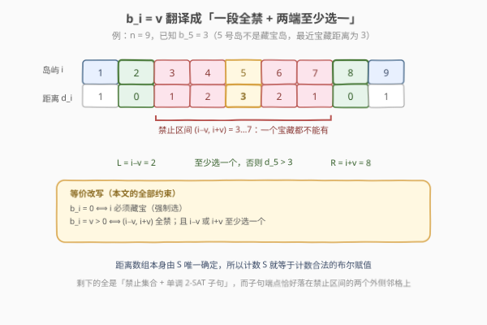
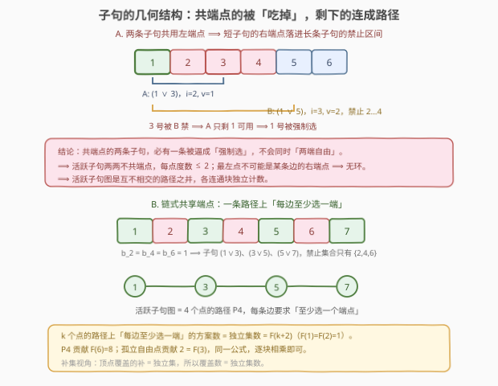
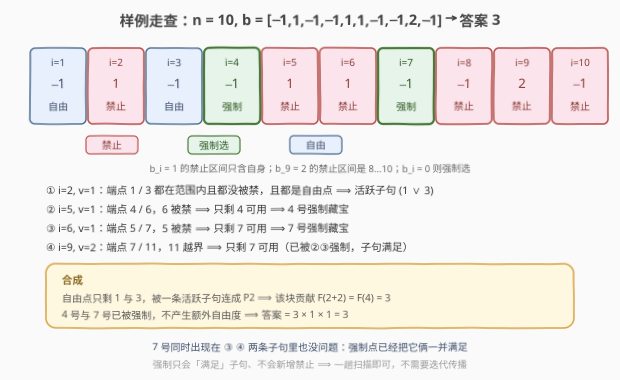

# Codeforces 2259H 宝藏地图破坏（计数版） 题解
## 1. 题目概述

- **标题 / 题号**：宝藏地图破坏（计数版）（Codeforces 2259H，英文名 Treasure Map Destruction (Counting Version)）
- **链接**：https://codeforces.com/problemset/problem/2259/H
- **来源**：Codeforces Round 1119 (Div. 3) · Problem H
- **难度**：2200
- **限制**：时间 2 s / 内存 256 MB
- **标签**：图论、并查集、动态规划、DFS、数学、计数

**题意**：$n$ 座岛屿排成一排，Bessie 在**非空**集合 $S$ 上埋了宝藏。$a_i$ 表示从岛 $i$ 出发、每次只走向相邻岛、抵达任意藏宝岛所需的最少步数（自身藏宝则 $a_i = 0$）。地图被撕毁，只剩数组 $b$：$b_i = -1$ 表示该位丢失，否则 $b_i$ 就是原来的 $a_i$。求与 $b$ 相容的**不同集合 $S$** 的个数，对 $10^9+7$ 取模；无解输出 $0$。

**约束**：

- $1 \le t \le 10^4$，$\sum n \le 2 \times 10^5$
- $1 \le n \le 2 \times 10^5$，$-1 \le b_i \le n-1$

> 💡 **第一把钥匙**：$a_i = 0 \iff i \in S$，完整的 $a$ 唯一确定 $S$（即所有 $a_i = 0$ 的位置），于是「数 $S$」等价于「数有多少个完整距离数组与 $b$ 相容」。

## 2. 示例与观察
官方 12 组样例（原样）：

```text
输入
12
5
0 1 -1 -1 0
3
-1 0 2
5
-1 1 -1 1 -1
5
-1 -1 -1 -1 -1
5
-1 2 -1 3 -1
7
2 1 0 1 0 1 2
1
-1
3
1 -1 1
1
0
4
3 -1 -1 -1
6
-1 -1 0 -1 2 4
10
-1 1 -1 -1 1 1 -1 -1 2 -1

输出
4
0
5
31
0
1
1
1
1
1
0
3
```

第 1 组：3、4 号岛「都藏 / 只藏 3 / 只藏 4 / 都不藏」共 4 种，均与 $-1$ 相容；第 4 组：全毁，任意非空集合都行，$2^5 - 1 = 31$。

## 3. 解题思路

### 3.1 暴力思路

把每个 $-1$ 试成「藏 / 不藏」，枚举 $2^k$ 种补全逐一验证，复杂度 $O(2^k n)$，$k$ 可达 $2\times10^5$，不可行。根源是约束长程：$b_i = v$ 同时封锁左右各 $v-1$ 格，并强制距离 $v$ 处的两格，逐格填数无法局部判定。

### 3.2 核心观察：距离约束 = 禁止区间 + 两端择一



对 $b_i = v > 0$（该位本身一定不藏宝），「最近宝藏距离恰为 $v$」拆成上界与下界：

$$a_i = v \iff \Big(\forall j,\ |j-i| < v \Rightarrow j \notin S\Big) \ \wedge\ \Big(\exists j,\ |j-i| = v,\ j \in S\Big)$$

- **上界**：$j \in [i-v+1,\, i+v-1]$ 一律禁止藏宝，否则 $a_i < v$；**下界**：距离恰为 $v$ 的格子只有 $L = i-v$ 与 $R = i+v$（越界不算），即子句 $(L \lor R)$。

于是整图只剩三类约束：**强制选**（$b_i = 0$）、**强制不选**（落在某禁止区间）、**子句**（$L$ 或 $R$ 至少一个）。没有第四类——自由格 $b_i = -1$，怎么选都不破坏已知位。

### 3.3 子句结构：共端点的被吃掉，剩下的是路径



> 两条子句共用左端点 $L$、中心 $i_1 < i_2$ 时，$R_1 = 2i_1 - L < 2i_2 - L = R_2$，且 $L < R_1 < R_2$。于是 $R_1$ 落在**第二条**子句的禁止区间 $(L, R_2)$ 内，必被禁。

第一条子句于是只剩 $L$ 可用、$L$ 被强制；$L$ 一旦被强制，第二条也自动满足。共右端点对称。由此可得（证明见 §5）：活跃子句两两不共端点，每个自由点度数 $\le 2$；若成环，环上最左点会是两条边的左端点，矛盾；故活跃子句图是**互不相交的路径之并**，各块独立计数。

$k$ 个点的路径上「每条边至少选一个端点」的方案数，等于 $k$ 点独立集数（取补即顶点覆盖），即 $F(k+2)$，$F(1) = F(2) = 1$。孤立自由点无约束，贡献 $2 = F(3)$，并入同一公式。

### 3.4 示例演算



以第 12 组为例，$n = 10$，$b = [-1,1,-1,-1,1,1,-1,-1,2,-1]$：

| $i$ | 1 | 2 | 3 | 4 | 5 | 6 | 7 | 8 | 9 | 10 |
|-----|---|---|---|---|---|---|---|---|---|----|
| $b_i$ | -1 | 1 | -1 | -1 | 1 | 1 | -1 | -1 | 2 | -1 |
| 状态 | 自由 | 禁止 | 自由 | 强制 | 禁止 | 禁止 | 强制 | 禁止 | 禁止 | 禁止 |

1. $i=2, v=1$：端点 $1, 3$ 都可用且都自由 $\Rightarrow$ 活跃边 $(1 \lor 3)$。
2. $i=5, v=1$：端点 $4, 6$，$6$ 被禁 $\Rightarrow$ **强制** $4$ 号藏宝。
3. $i=6, v=1$：端点 $5, 7$，$5$ 被禁 $\Rightarrow$ **强制** $7$ 号藏宝；$i=9, v=2$：端点 $7, 11$，$11$ 越界 $\Rightarrow$ 只剩 $7$（已被强制，子句满足）。

自由点只剩 $1, 3$，被一条活跃边连成 $P_2$，贡献 $F(4) = 3$，其余全被定死，答案 $3$。第 3 组 $b = [-1,1,-1,1,-1]$ 是链：$(1 \lor 3)$、$(3 \lor 5)$ 连成 $P_3$，贡献 $F(5) = 5$。第 5 组 $b = [-1,2,-1,3,-1]$：$b_2 = 2$ 强制 $4$、$b_4 = 3$ 强制 $1$，但 $1$ 已在 $b_2$ 的禁止区间内，矛盾，输出 $0$。

## 4. 算法细节


1. **差分标记禁止集合**：对每个 $b_i = v > 0$ 给 $[\max(1,i-v+1), \min(n,i+v-1)]$ 加一，前缀和还原 `forb`；区间总长可达 $O(n^2)$，必须差分。
2. **处理 $b_i = 0$**：先判是否被禁（被禁即无解），再打 `fin[i] = 1`。这一步最易漏——漏了会把必须选的格子当自由格，答案凭空乘 $2$。
3. **端点可用性**：$L = i-v$ 可用 $\iff L \ge 1$ 且 `!forb[L]`；$R = i+v$ 同理要求 $R \le n$。三种情形：都不可用 $\Rightarrow 0$；恰一个可用 $\Rightarrow$ 该点强制选；都可用 $\Rightarrow$ 建待定边。
4. **丢弃被满足的边 + 并查集**：端点是强制点的边直接扔掉（强制标记只增不减，一趟扫描后统一处理即可，无需迭代传播）；合并剩余活跃边，块大小即路径点数 $k$，累乘 $F(k+2)$，无边的自由点贡献 $F(3) = 2$。
5. **按测开数组**：斐波那契表递推到 $n+2$，每个测试按当前 $n$ 重开，总代价 $O(\sum n)$，不会被 $t = 10^4$ 拖慢。
6. **空集修正**：乘积含「一个都不选」，而题目要求非空；空集只在既无强制点又无子句（即所有 $b_i = -1$）时被计入，此时答案减一。

## 5. 正确性证明

**引理 1（等价性）**：$a$ 与 $b$ 相容 $\iff$ 每个 $b_i = 0$ 处 $i \in S$；每个 $b_i = v > 0$ 处 $S \cap [i-v+1, i+v-1] = \varnothing$ 且 $i-v \in S$ 或 $i+v \in S$（只计 $[1,n]$ 内端点）。

**证明**：$a_i = 0 \iff i \in S$。对 $v > 0$，$a_i = v$ 等价于「所有 $s$ 满足 $|s-i| \ge v$」且「某个 $s$ 满足 $|s-i| = v$」；前者即禁止区间内无点，后者即两候选中至少一个被选。反之三类条件成立时逐位还原出 $a_i = b_i$。∎

**引理 2（共端点必被吃掉）**：若两条子句共用左端点 $L$、中心 $i_1 < i_2$，则第一条子句不可能「两端都可用且都自由」。

**证明**：$R_1 = 2i_1 - L < 2i_2 - L = R_2$ 且 $R_1 > L$，故 $R_1 \in (L, R_2)$，落在第二条子句的禁止区间内被禁。于是第一条只剩 $L$ 可用、$L$ 被强制，不再活跃；$L$ 是强制点，第二条也被满足。∎ 共右端点对称。

**引理 3（活跃图是路径之并）**：丢弃被强制点满足的边后，剩余边端点都自由；任意两条剩余边不共端点；每点度数 $\le 2$；无环。

**证明**：若两条剩余边共端点，由引理 2（或对称情形）其中一条有端点被禁，矛盾。自由点作为左端点至多属一条剩余边、作为右端点至多属一条，故度数 $\le 2$。若有环，取环上最左点 $a$，两条环边都向右、都以 $a$ 为左端点，与不共端点矛盾。∎

**引理 4（路径计数）**：$k$ 点路径上「每边至少一端被选」的方案数为 $F(k+2)$，$F(1) = F(2) = 1$。

**证明**：方案集与顶点覆盖一一对应，取补得独立集，故等于 $P_k$ 的独立集数 $g(k)$。按最右点选或不选得 $g(k) = g(k-1) + g(k-2)$，$g(1) = 2 = F(3)$，$g(2) = 3 = F(4)$，递推相同故 $g(k) = F(k+2)$。∎

**定理**：算法输出恰为与 $b$ 相容的非空集合数（模 $10^9+7$）。

**证明**：由引理 1 相容性等价于三类约束；冲突检查（$b_i = 0$ 被禁、端点全不可用）返回 $0$ 正确。剩余约束由引理 3 分解为互不相交的路径块与孤立自由点，各块变量不重叠，方案数相乘（引理 4）。乘积中每个赋值给出唯一 $S$（选中点集），故不重不漏；空集仅当全部 $b_i = -1$ 时被计入，减一即得非空方案数。∎

## 6. 复杂度分析

- **时间**：每个测试 $O(n)$——差分、前缀和、子句枚举、斐波那契表、并查集（近似）均线性，总计 $O(\sum n) \le 2\times10^5$ 次基本操作；**空间** $O(n)$，各数组长度均为 $n+2$。
- **对照限制**：$n = 2\times10^5$ 本机实测 C++17 约 $0.14$ s（含读入 $2\times10^5$ 个整数），Python3 约 $0.24$ s，距 2 s 有 8 倍以上余量。

## 7. 参考代码

### C++17

```cpp
#include <bits/stdc++.h>
using namespace std;
const int MOD = 1000000007;
int main() {
    ios::sync_with_stdio(false);
    cin.tie(nullptr);
    int T;
    cin >> T;
    while (T--) {
        int n;
        cin >> n;
        vector<int> b(n + 2), diff(n + 3), fib(n + 3), par(n + 2), sz(n + 2, 1);
        vector<char> forb(n + 2), fin(n + 2);
        for (int i = 1; i <= n; i++) cin >> b[i];
        for (int i = 1; i <= n; i++) if (b[i] > 0) {           // 1) 禁止区间
            int lo = max(1, i - b[i] + 1), hi = min(n, i + b[i] - 1);
            if (lo <= hi) { diff[lo]++; diff[hi + 1]--; }
        }
        int cur = 0;
        for (int i = 1; i <= n; i++) forb[i] = ((cur += diff[i]) > 0);
        bool bad = false;                                     // 2) b=0 强制选
        for (int i = 1; i <= n; i++) if (b[i] == 0) {
            if (forb[i]) bad = true;
            fin[i] = 1;
        }
        vector<pair<int, int>> edges;                         // 3) 子句
        for (int i = 1; i <= n && !bad; i++) if (b[i] > 0) {
            int v = b[i], e1 = i - v, e2 = i + v;
            bool ok1 = e1 >= 1 && !forb[e1], ok2 = e2 <= n && !forb[e2];
            if (!ok1 && !ok2) bad = true;
            else if (ok1 && ok2) edges.push_back({e1, e2});
            else fin[ok1 ? e1 : e2] = 1;
        }
        if (bad) { cout << 0 << '\n'; continue; }
        fib[1] = 1;                                           // 4) F(k+2)
        for (int i = 2; i <= n + 2; i++) fib[i] = (fib[i - 1] + fib[i - 2]) % MOD;
        for (int i = 1; i <= n; i++) par[i] = i;
        auto findRoot = [&](int x) {
            while (par[x] != x) { par[x] = par[par[x]]; x = par[x]; }
            return x;
        };
        for (auto &e : edges) {
            if (fin[e.first] || fin[e.second]) continue;      // 已被强制点满足
            int a = findRoot(e.first), c = findRoot(e.second);
            if (a != c) { par[a] = c; sz[c] += sz[a]; }
        }
        long long ans = 1;
        for (int i = 1; i <= n; i++)
            if (!forb[i] && !fin[i] && findRoot(i) == i) ans = ans * fib[sz[i] + 2] % MOD;
        bool allUnknown = true;                               // 5) 排除空集
        for (int i = 1; i <= n; i++) if (b[i] != -1) allUnknown = false;
        if (allUnknown) ans = (ans - 1 + MOD) % MOD;
        cout << ans << '\n';
    }
    return 0;
}
```

### Python3

```python
import sys
MOD = 1000000007
def main():
    it = iter(map(int, sys.stdin.buffer.read().split()))
    t = next(it)
    out = []
    for _ in range(t):
        n = next(it)
        b = [0] + [next(it) for _ in range(n)]
        diff = [0] * (n + 3)                     # 1) 差分标记禁止区间
        for i in range(1, n + 1):
            v = b[i]
            if v > 0:
                lo, hi = max(1, i - v + 1), min(n, i + v - 1)
                if lo <= hi:
                    diff[lo] += 1
                    diff[hi + 1] -= 1
        forb, cur = bytearray(n + 2), 0
        for i in range(1, n + 1):
            cur += diff[i]
            forb[i] = cur > 0
        fin, bad = bytearray(n + 2), False       # 2) b=0 强制藏宝
        for i in range(1, n + 1):
            if b[i] == 0:
                bad = bad or bool(forb[i])
                fin[i] = 1
        edges = []                               # 3) 子句：两端至少选一
        for i in range(1, n + 1):
            v = b[i]
            if bad or v <= 0:
                continue
            e1, e2 = i - v, i + v
            ok1, ok2 = e1 >= 1 and not forb[e1], e2 <= n and not forb[e2]
            if not ok1 and not ok2:
                bad = True
            elif ok1 and ok2:
                edges.append((e1, e2))
            else:
                fin[e1 if ok1 else e2] = 1
        if bad:
            out.append(0)
            continue
        fib = [0, 1] + [0] * (n + 1)             # 4) F(k+2)：路径覆盖数
        for i in range(2, n + 3):
            fib[i] = (fib[i - 1] + fib[i - 2]) % MOD
        par, sz = list(range(n + 2)), [1] * (n + 2)
        def find(x):
            while par[x] != x:
                par[x] = par[par[x]]
                x = par[x]
            return x
        for a, c in edges:
            if fin[a] or fin[c]:
                continue
            ra, rc = find(a), find(c)
            if ra != rc:
                par[ra] = rc
                sz[rc] += sz[ra]
        ans = 1
        for i in range(1, n + 1):
            if not forb[i] and not fin[i] and find(i) == i:
                ans = ans * fib[sz[i] + 2] % MOD
        if all(x == -1 for x in b[1:]):          # 5) 排除空集
            ans = (ans - 1) % MOD
        out.append(ans)
    print("\n".join(map(str, out)))
main()
```

## 8. 边界情况与易错点

1. **空集**：全 $-1$ 时答案是 $2^n - 1$；其余情形乘积天然不含空集，别画蛇添足再减一。
2. **$n = 1$**：$b = [0]$ 与 $b = [-1]$ 都应输出 $1$。
3. **$b_i = 0$ 落在别人的禁止区间**：如 $b = [-1,0,2]$，$b_3 = 2$ 禁掉 $2..3$，答案 $0$。
4. **$b_i = v$ 太大**：$v > \max(i-1, n-i)$ 时两端都越界，必须输出 $0$；$b_i \le n-1$ 并不保证可行。
5. **判「两端都不可用」用 `&&`**：一端越界、一端被禁时要立刻返回 $0$；**别忘打 $b_i = 0$ 的强制标记**，这是最隐蔽的 bug（$n=1, b=[0]$ 会错输出 $2$ 而不是 $1$）。
6. **多测重开数组**：按当前 $n$ 重开，并查集父指针重新初始化 $1..n$；不要把被强制点满足的边也合并进去，否则两个独立块会被错误相乘。

## 9. 验证记录

- **编译环境与命令**：`clang++ -std=c++17 -O2`（本机无 GNU g++，配 `codeforces/tools/include/bits/stdc++.h` 兼容头；正文代码只用标准库，可原样提交 GNU C++17）；Python 侧为 `Python 3.9.6`。
- **官方样例**：1 / 1 通过（按 Codeforces 标准 checker 的 token 比对，忽略空白与大小写）。
- **复核状态**：audited（2026-11-19 统一回归：编译 + 官方样例；写作期的随机对拍与暴力未重跑）。

## 相关题目与扩展

- [Codeforces 2259E. Treasure Map Destruction (Constructive Version)](https://codeforces.com/problemset/problem/2259/E)：同场构造版，共用本文的「禁止区间 + 两端择一」模型，只要求输出任意可行方案（2-SAT / 贪心）。
- [Codeforces 2259G. Index Removal](https://codeforces.com/problemset/problem/2259/G)：同场 G 题，同样把局部决策整理成可二分 / 可扫描的结构，适合对照练习。
- [LeetCode 198. 打家劫舍](https://leetcode.cn/problems/house-robber/)：路径上的独立集 DP，与引理 4 的 $F(k+2)$ 是同一递推。

**延伸思考**：一般的单调 2-CNF（只有 $x \lor y$）计数等价于数顶点覆盖，是 #P 难的；本题能做，全靠禁止区间把子句「卡」成了路径。若子句改成「恰好一个端点被选」（异或约束），路径上每条边独立传 0/1，块贡献恒为 $2$；若改成「恰好 $m$ 座岛藏宝」，则要在路径块上做选中点数的生成函数卷积，复杂度退化为 $O(n^2)$，乘积技巧失效。
