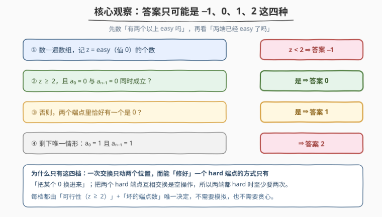
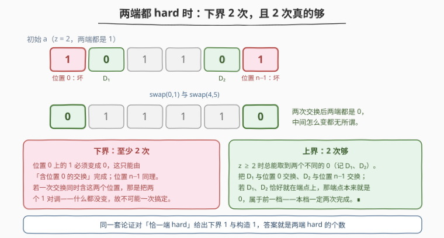
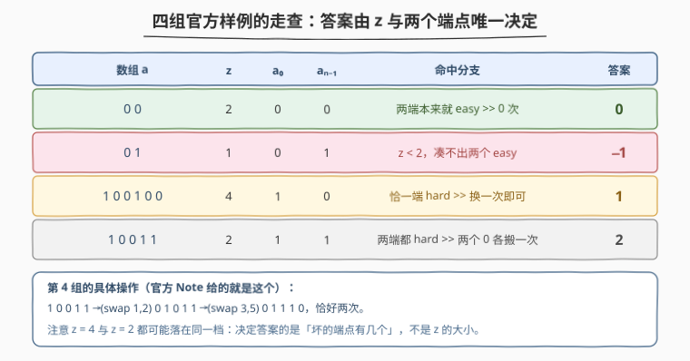

# Codeforces 2260A 莫诺卡普的比赛 题解

## 1. 题目概述

- **标题 / 题号**：莫诺卡普的比赛（Codeforces 2260A，英文名 Monocarp's Contest）
- **链接**：https://codeforces.com/problemset/problem/2260/A
- **来源**：Educational Codeforces Round 194 (Rated for Div. 2) · Problem A
- **难度**：800 分（Div. 2 的签到题）
- **限制**：时间 2 s / 内存 512 MB
- **标签**：实现（implementation）

**题意**：一场比赛有 $n$ 道题，每题要么是简单题、要么是难题，用数组 $a$ 给出：$a_i = 0$ 表示第 $i$ 题简单，$a_i = 1$ 表示它是难题。Monocarp 希望**第一题和最后一题都是简单题**。一次操作可以任选两个下标 $i, j$ 并交换 $a_i, a_j$（不必相邻，可以交换同一个位置——那就等于没动）。

求把两端都变成简单题所需的**最少操作数**；若无论怎么交换都做不到，输出 $-1$。**多测**：第一行 $t$，每组先给 $n$ 再给长度 $n$ 的 01 数组，逐组输出一个整数。

**约束**：

- $1 \le t \le 10^3$ 组测试数据；
- $2 \le n \le 50$，因此总输入规模 $\sum n \le 5 \times 10^4$；
- $a_i \in \{0, 1\}$，**$0$ 才是简单题**，全题的下标与取值语义都依赖这一点；
- 操作是「任意两位置交换」，它保持 $0$ 的总个数不变，这是可行性的判定入口；
- 单组 $n$ 很小，正解应是 $O(n)$ 的一遍扫描，而不是搜索或贪心模拟。

## 2. 示例

**官方样例**

```text
输入
4
2
0 0
2
0 1
6
1 0 0 1 0 0
5
1 0 0 1 1

输出
0
-1
1
2
```

四组分别对应四个分支：两端本来就简单（$0$ 次）；只有一道简单题（无解）；左端是难题、别处还有简单题（$1$ 次）；两端都是难题但简单题够两个（$2$ 次）。

**自造样例**（把四个分支与两种无解情形都覆盖一遍）

```text
输入
4
4
1 0 0 1
4
0 1 0 1
3
0 1 1
3
1 1 1

输出
2
1
-1
-1
```

第 3 组 $a = \mathtt{0\,1\,1}$ 只有一个简单题，虽然左端已经满足也仍然无解——这正是最容易漏判的一组；第 4 组一个简单题都没有。

## 3. 解题思路

### 3.1 暴力思路

最直白的做法是把「当前数组」当状态做 BFS：每个状态向外连"交换任意两个下标"产生的邻居，找到第一个两端皆 $0$ 的状态。由于数组只有两种取值，状态可以用 $0$ 的下标集合（一个 $n$ 位掩码）表示，最多 $2^n$ 个状态——$n = 50$ 时是 $10^{15}$ 量级，完全不可行。

另一个方向是"枚举交换序列的长度 $k$，检查 $k$ 次交换能否修好两端"。这条路本身没错，但如果不先想清楚 $k$ 的上界，就会写成指数级搜索；而本题的关键恰恰是：**$k$ 永远不超过 $2$**。一旦看清这一点，暴力里的搜索就整个塌缩成一次计数。

### 3.2 核心观察：答案只有四档

记 $z$ 为数组中 $0$ 的个数。三条事实串起全部推理：

1. **交换不改个数**。任意交换只是重排位置，$z$ 是常量；要让两个不同位置同时是 $0$，必须 $z \ge 2$，否则直接无解。
2. **每个"坏端点"各需一次交换**。设 $k$ 为两个端点中值为 $1$ 的个数（$k \in \{0,1,2\}$）。位置 $1$ 上的 $1$ 想变成 $0$，只能通过一次**包含位置 $1$** 的交换把某个 $0$ 换进来；位置 $n$ 同理。所以 $k \ge 1$ 时至少要 $k$ 次……但 $k=2$ 时不能再省：唯一能"一次动两个端点"的交换就是交换这两个位置本身，而它们此时都是 $1$，交换后什么都没变。
3. **$k$ 次也总能做到**。$z \ge 2$ 时取两个不同的 $0$（记 $D_1, D_2$），把 $D_1$ 与位置 $1$ 交换、$D_2$ 与位置 $n$ 交换即可；若某个 $D$ 已经正好落在端点上，说明该端点本来就是 $0$，$k$ 会相应减少一档，不会产生冲突。

于是答案由 $(z, a_1, a_n)$ 唯一决定，只有 $-1, 0, 1, 2$ 四种取值。



### 3.3 算法流程

一遍扫描即可，不需要数组，也不需要任何数据结构：

1. 边读入边统计 $z$，同时记下 $a_1$ 与 $a_n$（用两个布尔量或两个 `int`）。
2. 按**固定顺序**判四档：$z < 2$ → $-1$；$a_1 = a_n = 0$ → $0$；$a_1, a_n$ 中恰有一个 $0$ → $1$；否则 → $2$。
3. 每组测试数据独立重算，组间不共享任何状态。

判定顺序不能乱：必须先判 $z < 2$。若先判端点，像 $\mathtt{0\,1\,1}$ 这样的数据（$z = 1$，恰有一端是 $0$）会被误判成 $1$，而它其实无解。



### 3.4 示例演算

对四组官方样例逐条走查：

| 数组 $a$ | $z$ | $a_1$ | $a_n$ | 命中分支 | 答案 |
|:--|:--|:--|:--|:--|:--|
| $\mathtt{0\,0}$ | 2 | 0 | 0 | 两端已 easy，无需操作 | 0 |
| $\mathtt{0\,1}$ | 1 | 0 | 1 | $z < 2$，凑不出两个 easy | -1 |
| $\mathtt{1\,0\,0\,1\,0\,0}$ | 4 | 1 | 0 | 恰一端 hard，换一次 | 1 |
| $\mathtt{1\,0\,0\,1\,1}$ | 2 | 1 | 1 | 两端都 hard，各搬一个 $0$ | 2 |

第 3 组的一种最优操作：交换第 $1$、$2$ 题，数组变成 $\mathtt{0\,1\,0\,1\,0\,0}$。
第 4 组的官方 Note 给的操作：先交换第 $1$、$2$ 题得 $\mathtt{0\,1\,0\,1\,1}$，再交换第 $3$、$5$ 题得 $\mathtt{0\,1\,1\,1\,0}$，两次完成，与下界 $2$ 相等。

注意第 3 组的 $z = 4$ 与第 4 组的 $z = 2$ 分属不同答案档：决定答案是**坏的端点有几个**，而不是简单题的总数（$z$ 只负责回答"够不够两个"）。



## 4. 算法细节

1. **多测清空**：`zeros / leftEasy / rightEasy` 全部声明在每组循环体内，不用全局数组，天然不会跨组残留。$t \le 10^3$ 时这是最省心的写法。
2. **边读边判**：只需在循环里判断 `i == 0` 与 `i == n - 1`，不必真的把数组存下来；空间从 $O(n)$ 降到 $O(1)$。
3. **固定判定顺序**：先 $z < 2$，再"两端都 easy"，再"恰一端 easy"，最后落到 $2$。四档互斥且完备，写成 `if / else if / else` 链即可，不需要第四种判断。
4. **语义不要写反**：题面里 $0$ = easy、$1$ = hard，恰与"真值 1 表示成立"的直觉相反。读入后建议立刻在心里过一遍 `0 是简单题`，否则四个分支会全部镜像。
5. **答案上界 $2$，`int` 足够**：不要模拟交换，也不要开 `long long`；$n \le 50$ 时任何数值都不会溢出。
6. **I/O**：$t$ 最大 $10^3$、每组至多 $50$ 个数，总计约 $5 \times 10^4$ 个整数。C++ 加 `std::ios::sync_with_stdio(false)` 后 `cin/cout` 绰绰有余；Python 用 `sys.stdin.buffer.read().split()` 一次切分，比逐行 `input()` 快一个量级。
7. **Python 里比较 `bytes`**：切分出来的是 `b'0'` / `b'1'`，既可以 `.count(b'0')` 一次统计，也可以 `int(x)` 转成整数；两种写法都只扫一遍，别混着用导致多扫。

## 5. 正确性证明

**引理 1（交换保持 $0$ 的个数）**：任意一次交换后数组仍是原数组的一个排列，因此 $z$ 不变。

**证明**：交换只改变两个位置上的取值，且是把这两个取值对调，多重集合 $\{a_i\}$ 不变，故其中 $0$ 的个数不变。∎

**引理 2（$z < 2$ 时无解）**：若 $z \le 1$，则不存在任何交换序列使 $a_1 = a_n = 0$。

**证明**：由引理 1，任何可达局面的 $z$ 都等于初始值 $\le 1$；而 $a_1 = a_n = 0$ 要求这两个不同位置都是 $0$，即 $z \ge 2$，矛盾。∎

**引理 3（下界）**：设 $z \ge 2$，$k = [a_1 = 1] + [a_n = 1] \in \{0,1,2\}$，则任何合法操作序列的长度至少为 $k$。

**证明**：$k = 0$ 时下界 $0$ 显然。$k = 1$ 时不妨 $a_1 = 1$：终局要求 $a_1 = 0$，故必有一次交换包含位置 $1$（不包含位置 $1$ 的交换不改变 $a_1$），长度 $\ge 1$。$k = 2$ 时两端都需改变，若只用一次交换，这一次必须同时包含位置 $1$ 与位置 $n$，即交换这两个位置；但它们此刻都是 $1$，交换后仍都是 $1$，未达成目标，故长度 $\ge 2$。∎

**引理 4（构造达到下界）**：$z \ge 2$ 时存在长度恰为 $k$ 的合法操作序列。

**证明**：$z \ge 2$ 时至少有两个不同位置的取值为 $0$，取其中两个记 $D_1, D_2$。$k = 2$ 时，端点位置都不是 $0$，故 $D_1, D_2$ 都在非端点处；分别与位置 $1$、位置 $n$ 交换即可，两次后两端皆 $0$。$k = 1$ 时不妨 $a_n = 0$，则由 $z \ge 2$ 知除位置 $n$ 外还有一个 $0$，记为 $D$，它不在位置 $1$（因为 $a_1 = 1$），把它与位置 $1$ 交换，一次后 $a_1 = 0$ 且 $a_n$ 未被触及仍为 $0$。$k = 0$ 时无需操作。三种情形都恰用 $k$ 次。∎

**定理**：设 $z$ 为简单题个数，$k$ 为两端中难题的个数，则最少操作数为

$$\text{ans}=\begin{cases}-1, & z < 2,\\ k, & z \ge 2.\end{cases}$$

**证明**：$z < 2$ 时由引理 2 输出 $-1$ 正确。$z \ge 2$ 时引理 3 给出下界 $k$、引理 4 给出达到下界的序列，故最小值恰为 $k$。而 $k$ 的取值 $0/1/2$ 与算法中"两端都 easy / 恰一端 easy / 两端都 hard"三个分支一一对应，算法输出即为 $k$。∎

## 6. 复杂度分析

- **时间**：每组只扫一遍长度 $n$ 的数组，$O(n)$；总计 $O\!\left(\sum n\right) \le 5 \times 10^4$ 次读入与常数次比较。
- **空间**：不存数组，只有 $z$、两个端点标记与答案共 4 个整型变量，额外空间 $O(1)$（不计输入缓冲）。
- **可行性**：时限 2 s、内存 512 MB。实测最大数据（$t = 10^3$、$n = 50$）C++ 纯计算约 $0.05$ ms（含进程启动约 35 ms），Python3 含进程启动约 25 ms，余量都在两个数量级以上；即便 $n$ 放大到 $10^6$，本做法仍是线性。

## 7. 参考代码

### C++17

```cpp
#include <iostream>
using namespace std;

int main() {
    ios::sync_with_stdio(false);
    cin.tie(nullptr);

    int t;
    if (!(cin >> t)) return 0;
    while (t--) {
        int n;
        cin >> n;
        int zeros = 0, leftEasy = 0, rightEasy = 0;
        for (int i = 0; i < n; ++i) {
            int x;
            cin >> x;                       // 0 = easy, 1 = hard
            if (x == 0) {
                ++zeros;
                if (i == 0) leftEasy = 1;
                if (i == n - 1) rightEasy = 1;
            }
        }
        int ans;
        if (zeros < 2) ans = -1;                       // 凑不出两个 easy
        else if (leftEasy && rightEasy) ans = 0;       // 两端已经是 easy
        else if (leftEasy || rightEasy) ans = 1;       // 恰有一端是 hard
        else ans = 2;                                  // 两端都是 hard
        cout << ans << '\n';
    }
    return 0;
}
```

### Python3

```python
import sys


def main():
    data = sys.stdin.buffer.read().split()
    t = int(data[0])
    pos = 1
    out = []
    for _ in range(t):
        n = int(data[pos]); pos += 1
        a = data[pos:pos + n]; pos += n

        zeros = a.count(b'0')          # 0 才是简单题
        if zeros < 2:
            ans = -1
        elif a[0] == b'0' and a[-1] == b'0':
            ans = 0
        elif a[0] == b'0' or a[-1] == b'0':
            ans = 1
        else:
            ans = 2
        out.append(ans)

    sys.stdout.write('\n'.join(map(str, out)) + '\n')


main()
```

## 8. 边界情况与易错点

1. **只有一道简单题，但恰好占了一个端点**：如 $\mathtt{0\,1\,1}$、$\mathtt{1\,1\,0}$。直觉容易答 $0$ 或 $1$，正确答案是 $-1$。务必先判 $z < 2$。
2. **$n = 2$ 的全部四种情形**：$\mathtt{0\,0} \to 0$；$\mathtt{0\,1}$ 与 $\mathtt{1\,0} \to -1$；$\mathtt{1\,1} \to -1$。$n = 2$ 时两个端点就是全部元素，不存在"别处的简单题"，别把 $z \ge 2$ 的构造套到 $z = 1$ 上。
3. **全 $0$**：答案 $0$，不要因为"一次也不交换"而走进任何构造分支。
4. **全 $1$**：$z = 0$，答案 $-1$；不要因为"交换多少次都没用"就直接输出 $0$。
5. **两端都是难题时不要答 $1$**：交换两端本身是空操作（两个都是 $1$），必须把两个 $0$ 分别搬进来，答案 $2$。
6. **语义写反**：把 $0$ 当成 hard 会让四个分支全部镜像，样例第 3 组的答案会从 $1$ 变成 $2$，属于一眼看不出的错。
7. **多测不重置**：`zeros` 与两个端点标记若提到循环外，第二组开始就会累加；`t` 组输出必须一一对应、每组一行，组间不留空行。
8. **输入格式**：数组可能跨多行，也可能全部挤在一行，所以 Python 用 `split()` 全量切分、C++ 用 `cin >>` 逐个读，不要按行处理。

## 相关题目与扩展

- [Codeforces 2260B Monocarp and Projects](https://codeforces.com/problemset/problem/2260/B)：同场第二题，从"数一数"升级到需要一点数论枚举，可对照本题的计数式思考。
- [LeetCode 2134. 最少交换次数来组合所有的 1 II](https://leetcode.cn/problems/minimum-swaps-to-group-all-1s-together-ii/)：同样用"交换次数 = 需要被修正的位置数"，但环形数组上要用滑动窗口。
- [LeetCode 1151. 最少交换次数来组合所有的 1](https://leetcode.cn/problems/minimum-swaps-to-group-all-1s-together/)：上题的非环形版本，适合先建立"交换计数"的直觉。
- [Codeforces 1367B Even Array](https://codeforces.com/problemset/problem/1367/B)：同为"统计位置错配数 → 直接得答案"的签到题套路。

**延伸思考**：

1. 若要求**前 $m$ 题与后 $m$ 题都是简单题**（$m$ 给定，$2m \le n$），答案是"这 $2m$ 个位置里难题的个数"，可行性条件是 $z \ge 2m$；若 $2m \ge n$，两个区间已覆盖整个数组，条件退化为 $z = n$，答案就是 $n - z$，需要单独讨论。
2. 若操作改成"只能交换**相邻**两题"，答案就变成搬运距离：把离两端最近的 $0$ 分别移到两端（若只有一个 $0$ 则无解），代价是 $\text{pos} + (n-1-\text{pos}')$，属于"最小代价匹配"的雏形。
3. 若把要求弱化成"两端必须是**同一种**题"，答案变为：两端已相同 → $0$；两端不同且 $n \ge 3$ → $1$（两种题里必有一种出现至少两次，把多出来的那个换到另一端即可）；$n = 2$ 且两端不同 → $-1$。本题相当于把"同一种"钉死成"都等于 $0$"。
