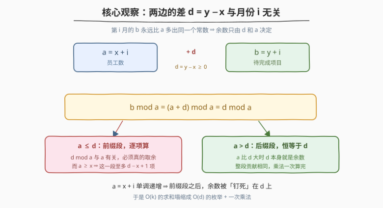
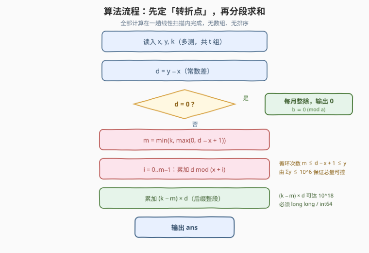
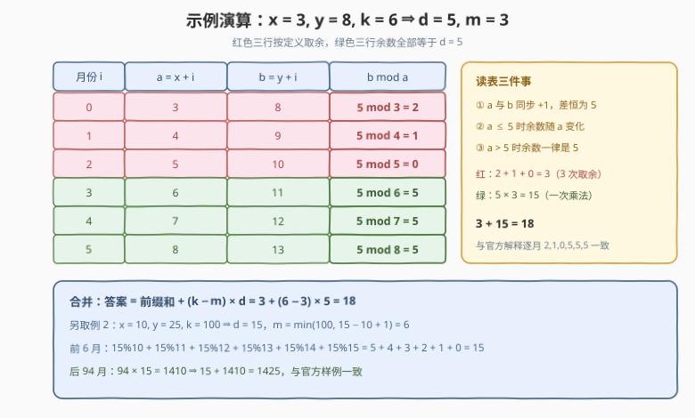

# Codeforces 2260B 莫诺卡普与项目 题解

## 1. 题目概述

- **标题 / 题号**：莫诺卡普与项目（Codeforces 2260B，英文名 Monocarp and Projects）
- **链接**：https://codeforces.com/problemset/problem/2260/B
- **来源**：Educational Codeforces Round 194 (Rated for Div. 2) · Problem B
- **难度**：$\ast 900$
- **限制**：时间 2 s / 内存 512 MB
- **标签**：暴力枚举、数学、数论、整除与余数

**题意**：公司要连续运转 $k$ 个月，月份从 $0$ 开始编号。第 $i$ 个月有 $x+i$ 名员工（不含老板 Monocarp）与 $y+i$ 个项目，两者每月**同时**增加 1。每个月老板把项目尽量均分：每名员工拿 $\left\lfloor \frac{b}{a} \right\rfloor$ 个，剩下的 $b \bmod a$ 个由他自己完成。求 $k$ 个月里老板**一共**要亲手完成多少个项目。多测：第一行组数 $t$，每组一行 $x,y,k$，逐组输出答案。

**约束**：

- $1 \le t \le 10^4$
- $1 \le x \le y \le 10^6$
- $1 \le k \le 10^{12}$ —— 这正是不能逐月模拟的原因
- **所有测试的 $y$ 之和 $\le 10^6$** —— 这一条才是解法可行的根源

## 2. 示例与观察
官方样例（输入 / 输出原样）：

```text
输入
7
1 1 1
3 10 2
3 8 6
7 20 1
10 25 100
8 36 17
1 999900 1000000000000

输出
0
4
18
6
1425
110
999898177699820694
```

自造补充（非官方，覆盖 $x=y$、$d<x$、$k$ 落在前缀段内三种形态）：

```text
输入
3
2 4 5
1 6 3
1000000 1000000 1000000000000

输出
8
3
0
```

第 1 组逐月余数是 $4\%2,5\%3,6\%4,7\%5,8\%6 = 0,2,2,2,2$，和 $8$；第 2 组是 $6\%1,7\%2,8\%3 = 0,1,2$，和 $3$；第 3 组 $x=y$，每月都整除，和 $0$。

## 3. 解题思路

### 3.1 暴力思路

按定义逐月算 $(y+i) \bmod (x+i)$ 并累加，每组 $O(k)$，总计 $O(tk)$。最坏 $10^4 \times 10^{12} = 10^{16}$ 次除法，而 2 秒内大致只能做 $10^9$ 量级的基本运算 —— 差七个数量级，必然 TLE。

### 3.2 核心观察：差值 d = y − x 恒定，余数被它接管



第 $i$ 个月的两个数是 $a = x+i$ 与 $b = y+i$，它们**同时**加 1，所以差值恒定：

$$ d = y - x \ge 0, \qquad b = y+i = (x+i) + d = a + d $$

对任意模数 $a$ 都有 $(a+d) \bmod a = d \bmod a$，于是

$$ (y+i) \bmod (x+i) = d \bmod (x+i) $$

这一步把「两个都在变」降成「一个常数 $d$ 对一个在变的模数取余」。接着看模数 $a = x+i$ 与 $d$ 的相对大小：

- $a \le d$：$d \bmod a$ 与 $a$ 有关，只能逐项真算；
- $a > d$：因为 $0 \le d < a$，商为 $0$，余数就是 $d$ —— **整段贡献完全相同**。

而 $a = x+i$ 关于 $i$ 单调递增，所以「$a \le d$」只可能发生在最前面一小段：$i = 0,1,\dots,d-x$，**至多 $d-x+1 \le y$ 个**。配合 $\sum y \le 10^6$，全部测试的前缀枚举总量不超过 $10^6$。

### 3.3 算法流程与求和公式



定义转折点

$$ m = \min\bigl(k,\ \max(0,\ d-x+1)\bigr) $$

则

$$ \text{ans} = \sum_{i=0}^{m-1}\bigl(d \bmod (x+i)\bigr) \;+\; (k-m)\cdot d $$

两个钳位各有分工：

- $\max(0,\cdot)$：当 $d \le x-1$ 时，第 $0$ 个月就已有 $a > d$，前缀段为空，$m = 0$，答案恰为 $k\cdot d$；
- $\min(k,\cdot)$：当 $k$ 比转折点更小时，$k$ 个月全部落在前缀段，此时 $k-m = 0$，乘法项自动消失。

### 3.4 示例演算



以 $x=3, y=8, k=6$ 为例：$d = 5$，$m = \min(6,\ 5-3+1) = 3$。

| $i$ | $a = x+i$ | $b = y+i$ | $b \bmod a$ |
|-----|-----------|-----------|-------------|
| 0 | 3 | 8 | 2 |
| 1 | 4 | 9 | 1 |
| 2 | 5 | 10 | 0 |
| 3 | 6 | 11 | 5 |
| 4 | 7 | 12 | 5 |
| 5 | 8 | 13 | 5 |

前 3 项逐项取余得 $2+1+0 = 3$；后 3 项都满足 $a > d$，每项贡献 $d = 5$，共 $(6-3)\times 5 = 15$。合计 $18$，与官方解释给出的逐月 $2,1,0,5,5,5$ 完全一致。

## 4. 算法细节

1. **$d = 0$ 直接输出 0**：此时每月都整除，余数恒为 0。虽然公式在钳位后也会得到 $0$，但显式特判能避免依赖「$m$ 为负时循环自然不执行」这种隐式行为。
2. **$m$ 必须钳到非负**：$d - x + 1$ 在 $d < x-1$ 时是负数，例如 $x = 10, d = 2$ 得 $-7$；若不钳位，`(k - m) * d` 会多算 $7d$。
3. **溢出**：$(k-m)\cdot d \le 10^{12} \times 10^6 = 10^{18}$，加法后的总量也是同一量级，`int` 必爆，必须 `long long`（Python 无此问题）。官方样例最后一组答案 $999898177699820694 \approx 10^{18}$ 就是天然的溢出检测器。
4. **循环边界用严格小于**：$i$ 取 $0 \le i < m$，对应 $a = x+i \le x+m-1 \le d$，正好覆盖全部「余数不等于 $d$」的月份；写成 `i <= m` 会多算一项。
5. **`(k - m)` 的类型**：$k$ 是 `long long`，若把 $m$ 声明成 `int`，务必先转成 64 位再减；本实现统一用 `long long` 存 $m$，不做隐式窄化。
6. **I/O**：$t \le 10^4$，用 `std::ios::sync_with_stdio(false)` + `cin.tie(nullptr)`，换行用 `'\n'` 而不是 `endl`；Python 一次性 `read().split()` 读入全部 token 最快。
7. **不会除零**：模数 $x+i \ge x \ge 1$，恒正；$d \bmod a$ 无需任何防御。
8. **不建数组**：全程只有 4 个标量，多测之间天然「清空」，无需 `memset`。

## 5. 正确性证明

**引理 1（平移不变）**：对任意 $i \ge 0$，$(y+i) \bmod (x+i) = d \bmod (x+i)$，其中 $d = y-x$。

**证明**：令 $a = x+i$，则 $y+i = a+d$。把 $d$ 写成 $d = qa + r$，其中 $q \ge 0$、$0 \le r < a$ 且 $r = d \bmod a$。于是 $(a+d) = (q+1)a + r$，其中 $0 \le r < a$，由带余除法的唯一性，$(a+d) \bmod a = r = d \bmod a$。∎

**引理 2（尾部常值）**：若 $x+i > d$，则 $d \bmod (x+i) = d$。

**证明**：此时 $0 \le d < x+i$，被除数小于除数，商为 $0$、余数为 $d$。∎

**引理 3（转折点计数）**：满足 $0 \le i < k$ 且 $x+i \le d$ 的下标个数恰为 $m = \min\bigl(k, \max(0, d-x+1)\bigr)$。

**证明**：$x+i \le d \iff i \le d-x$，故合法下标恰是 $[0, k) \cap [0, d-x]$ 中的整数。若 $d-x < 0$，该交集为空、个数为 $0$，而 $\max(0, d-x+1) = 0$ 也给出 $0$；若 $d-x \ge 0$，个数为 $\min(k-1, d-x)+1 = \min(k, d-x+1)$。两种情形合并即得 $m$。∎

**定理**：算法输出的数值等于 $\sum_{i=0}^{k-1}\bigl((y+i) \bmod (x+i)\bigr)$。

**证明**：由引理 3，下标 $0,\dots,m-1$ 恰好是全部满足 $x+i \le d$ 的月份（且 $m \le k$），循环对它们逐项按引理 1 算出精确余数。余下的 $k-m$ 个月份都满足 $x+i > d$，由引理 2 每项贡献恰为 $d$，合计 $(k-m)d$。两部分互不重叠、并为全部 $k$ 个月，故总和精确。∎

## 6. 复杂度分析

- **时间**：每组为 $O(1)$ 的计算外加 $m$ 次取余，故单组 $O\bigl(\min(k, d-x+1)\bigr)$；由于 $d-x+1 \le y$，全部测试合计 $O\bigl(t + \sum y\bigr) \le O(10^4 + 10^6)$ 次取余。实测最坏构造（单组 $x=1, y=10^6, k=10^{12}$）约 $4$ ms，$10^4$ 组、$\sum y = 10^6$ 的构造约 $38$ ms，相对 2 s 时限留有 $50$ 倍以上余量。
- **空间**：$O(1)$ 额外空间（C++ 只用若干标量；Python 的输入 token 列表为 $O(t)$）。

## 7. 参考代码

### C++17

```cpp
#include <iostream>
#include <algorithm>
using namespace std;

int main() {
    ios::sync_with_stdio(false);
    cin.tie(nullptr);

    int t;
    cin >> t;
    while (t--) {
        long long x, y, k;
        cin >> x >> y >> k;
        long long d = y - x;                 // y + i = (x + i) + d
        if (d == 0) { cout << 0 << '\n'; continue; }

        // 只有 x + i <= d 的月份需要逐项取余，这样的 i 至多 d - x + 1 个
        long long m = min(k, d - x + 1);
        if (m < 0) m = 0;

        long long ans = 0;
        for (long long i = 0; i < m; ++i) ans += d % (x + i);
        ans += (k - m) * d;                  // 其余月份 x + i > d，余数恒为 d
        cout << ans << '\n';
    }
    return 0;
}
```

### Python3

```python
import sys


def main() -> None:
    data = list(map(int, sys.stdin.buffer.read().split()))
    if not data:
        return
    t = data[0]
    pos = 1
    out = []
    for _ in range(t):
        x, y, k = data[pos], data[pos + 1], data[pos + 2]
        pos += 3
        d = y - x                       # y + i = (x + i) + d
        if d == 0:
            out.append("0")
            continue
        m = min(k, d - x + 1)           # x + i <= d 的月份数
        if m < 0:
            m = 0
        total = 0
        for i in range(m):
            total += d % (x + i)
        total += (k - m) * d            # 后缀段每项都是 d
        out.append(str(total))
    sys.stdout.write("\n".join(out) + "\n")


main()
```

## 8. 边界情况与易错点

1. **$x = y$（即 $d = 0$）**：每月项目数是员工数的整数倍，答案 $0$。注意此时 $d-x+1 = 1-x \le 0$，若不钳位就会得到负的 $m$。
2. **$d < x$**：第一个月就有 $a > d$，$m = 0$，答案是 $k \cdot d$；例如 $x = 10, y = 12, k = 5$ 输出 $10$。这类数据最容易暴露「漏掉 $\max(0,\cdot)$」的 bug。
3. **$k$ 落在前缀段内**：如 $x = 8, y = 36, k = 17$，$d-x+1 = 21 > k$，此时 $m = k$、乘法项为 $0$，必须完全靠枚举，答案 $110$。把 $m$ 写成 $d-x+1$ 而漏掉 $\min(k,\cdot)$ 会直接 WA。
4. **溢出**：$(k-m)\cdot d$ 最坏 $10^{18}$，`int` 溢出、`long long` 安全；官方样例最后一组就是 $999898177699820694$，可用作自检。
5. **多测**：$t \le 10^4$，每个测试都要重新读入 $x,y,k$；不要用 `endl`，也不要每组重建大数组。
6. **下标语义**：题目月份从 $0$ 开始，$i = 0$ 对应 $(x, y)$。若误以为从 1 开始，会少算首月、整体偏移。
7. **负数余数**：本题 $d \ge 0$ 且模数为正，`%` 结果恒非负；但若把结论推广到 $x > y$（$d < 0$），C++ 的 `%` 会给出负值，必须写 `(d % a + a) % a`。
8. **$\sum y$ 而非 $\sum k$**：复杂度只受 $y$ 之和约束，别因为 $k$ 很大就放弃枚举前缀；也别反过来对每组循环到 $y$ 而不管转折点，那在 $t = 10^4$ 时同样会浪费。

## 9. 验证记录

- **编译环境与命令**：`clang++ -std=c++17 -O2`（本机无 GNU g++，配 `codeforces/tools/include/bits/stdc++.h` 兼容头；正文代码只用标准库，可原样提交 GNU C++17）；Python 侧为 `Python 3.9.6`。
- **官方样例**：1 / 1 通过（按 Codeforces 标准 checker 的 token 比对，忽略空白与大小写）。
- **复核状态**：audited（2026-11-19 统一回归：编译 + 官方样例；写作期的随机对拍与暴力未重跑）。

## 相关题目与扩展

- [Codeforces 616E. Sum of Remainders](https://codeforces.com/problemset/problem/616/E)：求 $\sum_{i=1}^{m} (n \bmod i)$，正是本题「余数求和」的完整版，需要**数论分块**（按商相同分段）。
- [Codeforces 1485C. Floor and Mod](https://codeforces.com/problemset/problem/1485/C)：把 $a \bmod b = \lfloor a/b \rfloor$ 改写成对商分块计数，与本题「余数 = 常数 − 商 × 模数」是同一视角。
- [Codeforces 2260A. Monocarp's Contest](https://codeforces.com/problemset/problem/2260/A)：同场签到题，可对照本场难度梯度。
- [LeetCode 1837. 进制转换后的各位数字之和](https://leetcode.cn/problems/sum-of-digits-in-base-k/)：反复「取余 + 整除」提取数位，和本题一样要留意 0 与整除边界。

**延伸思考**：本题之所以能「枚举前缀」，全靠附加约束 $\sum y \le 10^6$。若把该约束去掉（$y$ 也到 $10^{12}$），就要回到数论分块：把 $\sum_{i=0}^{k-1} d \bmod (x+i)$ 按 $\left\lfloor d/(x+i) \right\rfloor$ 的取值切成 $O(\sqrt{d})$ 段，每段内是等差数列求和，总复杂度 $O(\sqrt{d})$ 每组。再进一步，若允许 $x > y$（$d < 0$），平移论证仍然成立，但要让余数落回 $[0, a)$，并且此时 $d \bmod a$ 永远非零，最优策略与答案结构都会改变。
