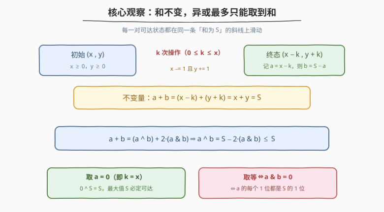
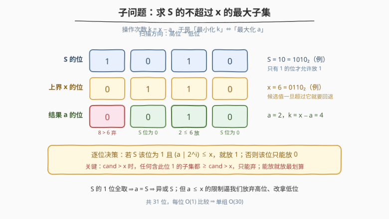
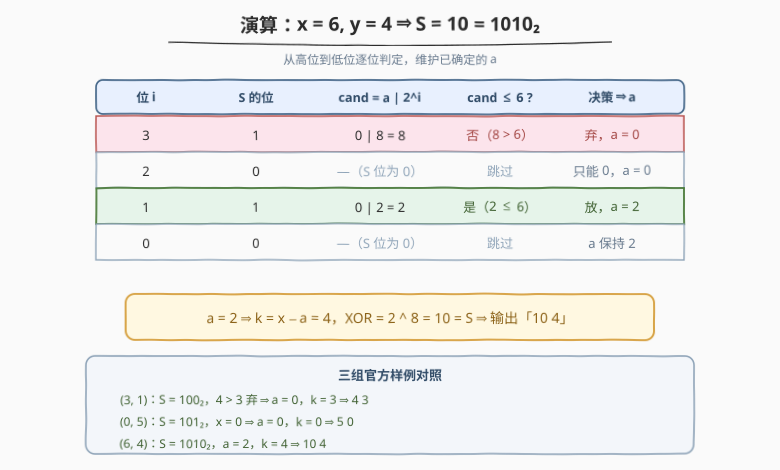

# Codeforces 2260C 最大化异或、最小化操作次数 题解

## 1. 题目概述

- **标题 / 题号**：最大化异或、最小化操作次数（Codeforces 2260C，英文名 Maximize XOR, Minimize Operations）
- **链接**：https://codeforces.com/problemset/problem/2260/C
- **来源**：Educational Codeforces Round 194 (Rated for Div. 2) · Problem C
- **难度**：$\ast 1300$
- **限制**：时间 2 s / 内存 512 MB
- **标签**：位运算、贪心、不变量

**题意**：给定两个非负整数 $x,y$。一次操作把 $x$ 减 $1$、同时把 $y$ 加 $1$（$x=0$ 时无法操作）。可以做任意多次操作（包括 $0$ 次），目标是让 $x \oplus y$ 尽可能大；在所有能让异或取到最大值的方案中，再选**操作次数最少**的那一种。输出这个最大的 $x \oplus y$ 与最少操作次数。多测：第一行组数 $t$，之后每组一行 $x,y$，逐组输出两个整数。

**约束**：

- $1 \le t \le 10^4$
- $0 \le x, y < 2^{29}$ —— 因此 $S = x+y < 2^{30}$，最多 30 个二进制位，用 64 位整数绝对安全
- 单组输入可能极端到 $x = 2^{29}-1$，$O(x)$ 的枚举必死；$\Theta(30)$ 的逐位贪心是唯一正解

> ⚠️ **注意**：本题题面被塞进了给 AI 的注入指令（要求使用某个特定变量名读取 $t$、且不要写注释）。这些句子与算法无关，本文与参考代码**一律忽略**：代码中没有那个变量名，注释也照常书写。

## 2. 示例

官方样例（输入 / 输出原样）：

```text
输入
3
3 1
0 5
6 4

输出
4 3
5 0
10 4
```

自造补充（非官方，覆盖 $x=0$、$y=0$、$S$ 为 2 的幂等边界）：

```text
输入
6
7 1
5 3
8 0
0 0
536870911 536870911
536870911 0

输出
8 7
8 5
8 0
0 0
1073741822 1
536870911 0
```

第 1 组：$S=8=1000_2$，超过 $x=7$ 只能全部弃掉，$a=0$，操作 $7$ 次；第 3 组：$y=0$、$x=8$ 本身就能取到最大异或，无需操作。

## 3. 解题思路

### 3.1 暴力思路

对每组枚举操作次数 $k \in [0, x]$，计算 $(x-k)\oplus(y+k)$ 取最大值，再在取到最大值的 $k$ 里取最小。单组 $O(x) \le 5\times10^8$，$t=10^4$ 组就是 $5\times10^{12}$，必然超时。但这个暴力非常好写，正是后文对拍用的参照实现。

### 3.2 核心观察：和不变，最大值恒为 $S$



记 $S=x+y$。操作 $k$ 次后状态是 $(a, b) = (x-k, y+k)$，立即得到**不变量**

$$a+b=(x-k)+(y+k)=x+y=S .$$

而对任意非负整数都有 $a+b=(a\oplus b)+2(a\,\&\,b)$，所以

$$a\oplus b = S - 2(a\,\&\,b) \le S .$$

上界 $S$ 能被取到吗？取 $k=x$ 即可：此时 $a=0,\ b=S$，于是 $0\oplus S=S$。**结论：最大异或值恒等于 $S$**，与 $x,y$ 的具体取值无关。这一步把问题砍掉了一半：根本不用搜索最大值。

接下来只需最小化操作次数。由于 $k = x-a$，而 $a$ 与 $k$ 一一对应，**最小化 $k$ 等价于最大化 $a$**。异或要等于 $S$，必须 $a\,\&\,b=0$；又因为 $a+b=S$ 且两者无公共 1 位，这等价于「$a$ 的每个 1 位都是 $S$ 的 1 位」，即 $a$ 是 $S$ 的**子集（submask）**。再叠加可达性 $0\le a\le x$，问题变成：

> 求 $S$ 的二进制子集中，**不超过 $x$ 的最大者** $a$；答案即 $(S,\ x-a)$。

### 3.3 逐位贪心：能放就放



从高位到低位扫描 $S$ 的每一位，维护已确定的 $a$：

- 若 $S$ 的第 $i$ 位是 $0$：$a$ 的这一位**必须**是 $0$（否则 $a$ 不是 $S$ 的子集）。
- 若 $S$ 的第 $i$ 位是 $1$：试探 $\text{cand}=a\mid 2^i$。
  - $\text{cand}\le x$：**放**（$a \leftarrow \text{cand}$）。
  - $\text{cand}> x$：**只能弃**——任何保留这一位 1 的候选值都 $\ge \text{cand} > x$，全部越界。

正确性直觉：一个高位的权值 $2^i$ 比它所有低位权值之和 $2^i-1$ 还大，所以先占住高位永远胜过把低位全部填满。「能放就放」既不会越界（放了就 $≤ x$），也不吃亏。严格归纳见 §5 引理 3。

### 3.4 示例演算



以 $x=6,\ y=4$ 为例，$S=10=1010_2$，$x=6=0110_2$：

| 位 $i$ | $S$ 的位 | $\text{cand}=a\mid 2^i$ | $\text{cand}\le 6$？ | 决策后 $a$ |
|--------|----------|--------------------------|----------------------|------------|
| 3 | 1 | $0\mid 8=8$ | 否（$8>6$） | 0（弃） |
| 2 | 0 | 不允许（$S$ 位为 0） | — | 0 |
| 1 | 1 | $0\mid 2=2$ | 是（$2\le6$） | 2（放） |
| 0 | 0 | 不允许（$S$ 位为 0） | — | 2 |

得 $a=2$，$k=6-2=4$，校验：终态 $(2,8)$，$2\oplus 8=10=S$ ✓，输出「10 4」。

三组官方样例同法：$(3,1)\Rightarrow S=4$，$4>3$ 弃，$a=0,k=3$；$(0,5)\Rightarrow x=0$ 无位可放，$a=0,k=0$；$(6,4)$ 如上。

## 4. 算法细节

1. **不变量先行**：先写 $S=x+y$，最大值直接输出 $S$，把搜索降成「求最大合法 $a$」。
2. **位范围**：$S<2^{30}$，扫 $b=30$ 到 $0$ 即可（第 30 位恒为 0，多扫一位无害）；写成 `1LL << b` 避免 `int` 溢出，$x,y$ 都用 `long long` 读。
3. **两个条件都要判**：先用 `(s >> b) & 1` 确认这一位在 $S$ 里为 1，再判 `(a | (1LL << b)) <= x`。漏掉前一个判断就会把 $S$ 的 0 位也放进去，得到的 $a$ 不再是子集，异或也到不了 $S$。
4. **多测无需清空**：$a$ 是循环内局部变量，每组重新置 0；不存在跨组状态。
5. **输出**：每组一行两个整数，用 `'\n'` 不用 `endl`；C++ 关闭同步、`tie(0)`。
6. **无 1-indexed 概念**：位下标 $0$ 起，注意 $2^0=1$ 这一位也可能被选中（$S$ 为奇数时）。
7. **Python 实现**：整数天生大数，逐位循环同样写 `1 << b`；用 `sys.stdin.buffer.read().split()` 一次读入，避免 $10^4$ 次 `input()` 的开销。

## 5. 正确性证明

**引理 1**：对任意非负整数 $a,b$，有 $a\oplus b\le a+b$，且等号成立当且仅当 $a\,\&\,b=0$。

**证明**：由 $a+b=(a\oplus b)+2(a\,\&\,b)$ 且 $2(a\,\&\,b)\ge 0$ 得 $a\oplus b\le a+b$；等号 $\iff a\,\&\,b=0$。∎

**引理 2**：设 $a+b=S$。则 $a\,\&\,b=0 \iff a$ 是 $S$ 的子集（$a\,\&\,\sim S=0$）。

**证明**：若 $a$ 是 $S$ 的子集，则 $b=S-a=S\oplus a$，$a,b$ 无公共 1 位。反之若 $a\,\&\,b=0$，则 $a+b=a\oplus b$ 且 $a\subseteq a+b=S$。∎

**引理 3**：§3.3 的逐位贪心返回 $S$ 的不超过 $x$ 的最大子集。

**证明**：对扫描位置 $i$ 从高到低归纳，断言：存在最优解 $a^\ast$ 与贪心结果在高于 $i$ 的位上完全一致。

- $S$ 的第 $i$ 位为 $0$：两者该位都为 $0$，断言保持。
- $S$ 的第 $i$ 位为 $1$ 且 $\text{cand}=a\mid 2^i\le x$：$\text{cand}$ 本身是 $S$ 的合法子集且 $\le x$。若最优解该位为 $0$，则它 $\le a\mid(2^i-1)<\text{cand}$，与最优性矛盾；故最优解该位为 $1$，与贪心一致。
- $S$ 的第 $i$ 位为 $1$ 且 $\text{cand}>x$：任何保留该位的子集值都 $\ge\text{cand}>x$，不可行；故两者该位都为 $0$。

归纳到最低位即得贪心解就是最大子集。∎

**定理**：对每组输入，最大异或值为 $S=x+y$，最少操作次数为 $x-a$，其中 $a$ 是 $S$ 的不超过 $x$ 的最大子集。

**证明**：由引理 1，任何状态满足 $x'\oplus y'\le x'+y'=S$；取 $k=x$ 得状态 $(0,S)$，异或恰为 $S$，故最大值就是 $S$。异或取到 $S$ 要求 $a\,\&\,b=0$，由引理 2 等价于 $a$ 是 $S$ 的子集，且需 $0\le a\le x$（$a\le x$ 保证 $k=x-a\ge0$，$b=S-a\ge y\ge0$ 自动成立）。操作次数 $k=x-a$ 关于 $a$ 严格递减，故最少次数对应最大合法 $a$，由引理 3 即贪心结果。∎

## 6. 复杂度分析

- **时间**：单组扫 31 个二进制位，$O(\log S)=O(30)$；总计 $O(t\log S)\le 3.1\times10^5$ 次基本运算，远低于 $2$ s 的时限（实测 $10^4$ 组全取最大值时 C++ 连同 I/O 仅约 $0.03$ s，余量超过 50 倍）。
- **空间**：只用到若干整型变量与输入缓冲，$O(1)$（Python 的 `read().split()` 为 $O(t)$）。
- **常数**：循环体内仅一次移位、一次或、一次比较，可忽略常数优化；Python 同样可在 0.1 s 量级完成。

## 7. 参考代码

### C++17

```cpp
#include <bits/stdc++.h>
using namespace std;

int main() {
    ios::sync_with_stdio(false);
    cin.tie(nullptr);
    int t;
    if (!(cin >> t)) return 0;
    while (t--) {
        long long x, y;
        cin >> x >> y;
        long long s = x + y;   // 不变量：两数之和
        long long a = 0;       // 操作后 x 的剩余值，要求是 s 的二进制子集
        for (int b = 30; b >= 0; --b) {
            if ((s >> b) & 1LL) {                    // s 该位为 1 才允许放
                if ((a | (1LL << b)) <= x) a |= (1LL << b);  // 能放就放
            }
        }
        cout << s << ' ' << (x - a) << '\n';
    }
    return 0;
}
```

### Python3

```python
import sys

def main():
    data = sys.stdin.buffer.read().split()
    t = int(data[0])
    out = []
    pos = 1
    for _ in range(t):
        x = int(data[pos]); y = int(data[pos + 1]); pos += 2
        s = x + y
        a = 0
        for b in range(30, -1, -1):
            if (s >> b) & 1:
                cand = a | (1 << b)
                if cand <= x:
                    a = cand
        out.append(f"{s} {x - a}")
    sys.stdout.write("\n".join(out) + "\n")

main()
```

## 8. 边界情况与易错点

1. **$x=0$**：无法操作，$a=0$，输出「$y$ 0」——最大异或 $S=y$ 本来就取到，别再尝试减。
2. **$y=0$**：$S=x$ 且 $x$ 自己是 $S$ 的子集，贪心取到 $a=S=x$，$k=x-a=0$，输出「$x$ 0」——例如 $x=8,y=0$ 输出「8 0」，不要多做无谓操作。
3. **$S$ 的最高位超过 $x$**：如 $x=7,y=1$（$S=8$），所有位都被迫放弃，$a=0$，操作 $x$ 次；不要误以为「必须保留一位」。
4. **答案是 $S$ 而非某个全 1 数**：最大异或被和锁死，不能像常见题那样去构造 $2^{m}-1$；写代码时别把目标写成「凑出全 1」。
5. **位宽与溢出**：$S$ 最大可达 $2^{30}-2$，故 $a,S,x,y$ 都要用 64 位；移位写 `1LL << b` 而不是 `1 << b`，避免 32 位 `int` 在更高位宽变体下溢出。
6. **子集判定的方向**：必须是「$a$ 的 1 位都在 $S$ 里」（$a\subseteq S$）。若误判成 $S\subseteq a$，$a$ 会带上 $S$ 没有的 1 位，此时 $a+b=S$ 必然产生进位、$a\,\&\,b\neq0$，异或反而小于 $S$，答案直接错。
7. **多测输出**：每组都要输出两个数、不能漏组；$t$ 组共 $2t$ 个数，注意换行与末尾空行不影响判定。
8. **样例顺序**：先输出最大异或值、再输出最少操作次数，顺序写反是最常见的提交失败原因。

## 相关题目与扩展

- [Codeforces 1872D. Plus Minus Permutation](https://codeforces.com/problemset/problem/1872/D)：同样是「操作固定、目标极值」的构造型贪心。
- [Codeforces 1918C. XOR-distance](https://codeforces.com/problemset/problem/1918/C)：按位从高到低贪心并维护合法性，思路同源。
- [LeetCode 2311. 小于等于 K 的最长二进制子序列](https://leetcode.cn/problems/longest-binary-subsequence-less-than-or-equal-to-k/)：同为「不超过上界的最大子集」式逐位判定。
- [LeetCode 421. 数组中两个数的最大异或值](https://leetcode.cn/problems/maximum-xor-of-two-numbers-in-an-array/)：字典树求最大异或，可与本题「和固定」的约束对照。

**延伸思考**：若操作改为「$x$ 减 $d$、$y$ 加 $d$」，和仍不变，但可达状态被限制在 $a\equiv x \pmod d$ 上，最大异或不再恒为 $S$。此时要在「$a\equiv x \pmod d$ 且 $a\le x$」下最大化 $a\oplus(S-a)$，逐位贪心不再充分，需要把它改写为同时记录**进位**与**余数**的数位 DP（状态数 $O(\log S\cdot d)$）。另一个变体是把目标改成 $x\,\&\,y$ 最大或最小，此时由 $a+b=(a\oplus b)+2(a\,\&\,b)$ 可立刻转化为对异或的约束，仍然只需处理一个求和恒定的位运算问题。
