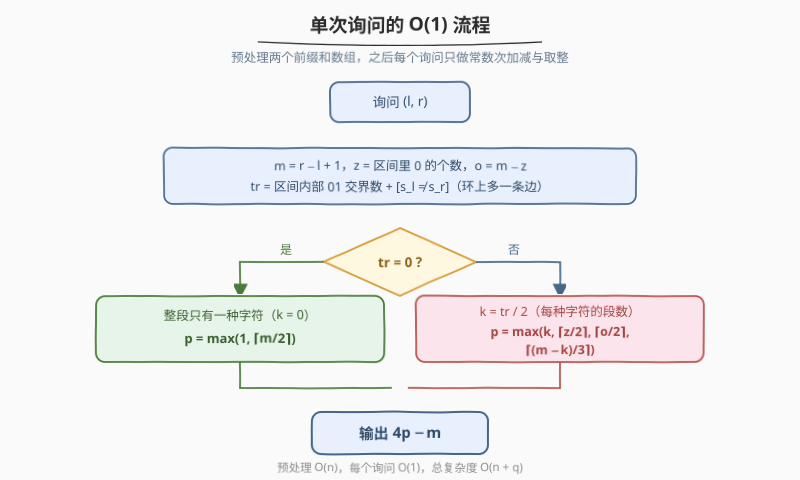

# Codeforces 2260E 循环平衡 题解

## 1. 题目概述

- **标题 / 题号**：循环平衡（Codeforces 2260E，英文名 Cyclic Balance）
- **链接**：https://codeforces.com/problemset/problem/2260/E
- **来源**：Educational Codeforces Round 194 (Rated for Div. 2) · Problem E（UTC 2026-09-08）
- **难度**：2000 分
- **限制**：时间 2 s / 内存 512 MB
- **标签**：二分查找、构造、动态规划、数学

**题意**：对 01 串 $t=t_1t_2\ldots t_m$，把 $t_1t_2,\ t_2t_3,\ \ldots,\ t_{m-1}t_m$ **以及首尾相接的** $t_mt_1$ 都算作「相邻对」，共 $m$ 对（$m=1$ 时只有一对 $t_1t_1$）。若 00、01、10、11 四种相邻对出现的次数**全都相等**，就称 $t$ 是**循环平衡**的。

字符串的**代价**是：至少要插入多少个字符，才能把它变成循环平衡的串。字符可以插在任意位置（包括第一个字符之前、最后一个字符之后），**不允许删除或替换**原有字符。

给定长度 $n$ 的 01 串 $s$ 与 $q$ 次询问，每次给出 $l,r$，输出子串 $s_l s_{l+1}\ldots s_r$ 的代价。

> ⚠️ 本题**只有一组数据**：第一行就是 $n$ 和 $q$，没有多测组数。照搬「多测模板」去写 `while (T--)` 会直接读错。

**约束**：

- $1 \le n, q \le 3\times 10^5$；
- $1 \le l_i \le r_i \le n$，子串长度 $m=r-l+1\le 3\times 10^5$；
- 时限 2 s，要求单次询问 $O(1)$（至多 $O(\log n)$），总复杂度控制在 $O(n+q)$ 量级；
- 答案最大可达 $3\times 10^5$ 量级（例如长度 $3\times10^5$ 的单色串），`int` 够用，但代码里统一用 `long long` 更稳妥。

## 2. 示例与观察
**官方样例**

```text
输入
11 7
00111100000
1 8
1 1
1 2
1 4
3 6
2 7
7 11

输出
4
3
2
0
4
2
7
```

**自造样例**（覆盖「本来平衡」「单字符」「环上首尾相接」三种情况）

```text
输入
8 5
01001011
1 8
2 5
1 3
6 6
3 8

输出
4
0
1
3
2
```

第 2 组子串 `1001` 的四种相邻对恰好各 1 个，本来就平衡，代价为 $0$；第 4 组子串只有一个字符 `0`，必须补 3 个字符才可能凑成 $4$ 个相邻对，代价为 $3$；第 5 组子串 `001011` 在环上是 `00 | 1 | 0 | 11`，两种字符各有 2 段、各 3 个，把 $p$ 抬到 2 即可，代价为 $2$。

## 3. 解题思路

### 3.1 暴力思路

最直接的做法是严格按定义搜索：从子串出发，每一步在任意位置插入 0 或 1，BFS 到第一次出现循环平衡串为止。状态空间爆炸，而且最终长度没有先验上界——单次询问都跑不完，$q=3\times10^5$ 更无从谈起。换成「枚举最终长度 $4p$，再枚举所有长度为 $4p$ 的平衡串，看子串能否作为循环子序列嵌入」也一样：$p$ 可到 $3\times10^5$ 量级，平衡串数量是天文数字。

所以必须先把「代价」化简成只依赖少数几个统计量的**闭式**，再用前缀和把它压到 $O(1)$。

### 3.2 核心观察：把「平衡」翻译成「段」的计数


把环上**极大同色连续块**称为**段**（注意首尾相接：$t_m$ 与 $t_1$ 同色时它们属于同一段）。记 $z,o$ 为 0、1 的个数，$k$ 为 0 段数、也为 1 段数——环上这两种段数**必然相等**，因为绕环走一圈，每进入一个 1 段都要经过一次 $0\to1$，每离开一个 1 段都要经过一次 $1\to0$。

于是得到三条恒等式：

$$\#01=\#10=k,\qquad \#00=z-k,\qquad \#11=o-k .$$

其中 $\#00=z-k$ 是因为长度为 $L$ 的 0 段内部恰好贡献 $L-1$ 个 00 相邻对，各段求和即得。由此，「四种相邻对一样多」等价于：存在 $p$ 使 $k=p$ 且 $z-k=o-k=p$，即

$$\text{循环平衡}\iff \text{长度}=4p,\quad \text{两种字符各 }2p\text{ 个},\quad \text{两种字符各 }p\text{ 段}.$$

最终长度是 $m$ 加上插入数，所以**代价就是 $4p-m$**。问题立刻变成：对每个子串，求**最小可行的 $p$**。

### 3.3 算法流程：四条下界 + 单调性


先看一次插入对段数的影响。在相邻对 $uv$ 之间插入 $x$：

- 若 $x$ 与某一侧同色（$x=u$ 或 $x=v$），或 $u=v=x$：**段数不变**，只是某个段变长；
- 若 $u=v\ne x$：这一对被劈成 $ux,xv$，即**一个段变两个段**，两种字符的段数**同时 $+1$**。称之为一次**分裂**，它恰好消耗 1 个插入字符。

设最终参数为 $p$，插入总数为 $4p-m$。于是有四条必要条件：

1. 段数只增不减 $\Rightarrow p\ge k$；
2. 字符不能删除 $\Rightarrow 2p\ge z$；
3. 同理 $2p\ge o$；
4. 段数要从 $k$ 涨到 $p$，需要 $p-k$ 次分裂，每次分裂消耗一个插入字符 $\Rightarrow p-k\le 4p-m$，即 $p\ge\left\lceil\dfrac{m-k}{3}\right\rceil$。

**单调性**：可行集是向上封闭的。若 $p$ 已经可行，就在某个 0 段内部插两个 0、某个 1 段内部插两个 1——段数不变，两种字符各多 2 个，仍是长度 $4(p+1)$ 的平衡串。

既然可行集是一个后缀，且四条下界都是必要条件，取最大即可（这也是官方标签「二分查找」的来源：对 $p$ 二分可行性同样正确，这里直接取闭式）：

$$p_{\min}=\max\left(k,\ \left\lceil\frac{z}{2}\right\rceil,\ \left\lceil\frac{o}{2}\right\rceil,\ \left\lceil\frac{m-k}{3}\right\rceil\right),\qquad \text{ans}=4p_{\min}-m .$$

可达性（为什么这个 $p$ 一定做得到）见 §5 引理 6。

**单段特判**：若 $z=0$ 或 $o=0$，整段只有一种字符，此时 $k=0$ 且该字符只有 **1** 段，上述「各 $k$ 段」的记账退化。正确下界是 $2p\ge m$ 与 $p\ge1$，故 $p=\max(1,\lceil m/2\rceil)$。（顺带一提，把它代回上式恰好得到同一个值，因为 $m\ge1$ 时 $\lceil m/2\rceil\ge\lceil m/3\rceil$；本文为清晰起见在代码里保留分支。）



**单次询问怎么算**：$m,z,o$ 用两个前缀和 $O(1)$ 得到；关键是 $k$，它等于环上「相邻不等的对数」的一半：

$$\mathrm{tr}=\sum_{i=l}^{r-1}[s_i\ne s_{i+1}]+[s_l\ne s_r],\qquad k=\mathrm{tr}/2 .$$

前一项用差分（转移数）前缀和作差，后一项是**首尾相接的那条边**，漏掉它就会把 `011110` 这类子串的 $k$ 算成 2（正确是 1）。

### 3.4 示例演算


以官方样例 $s=\mathtt{00111100000}$ 为例：

- 询问 $(1,8)$：子串 `00111100`，环上是 `0 段长 4` 与 `1 段长 4`，$z=o=4$、$k=1$，只有两条下界同时在起作用：$\lceil z/2\rceil=2$ 与 $\lceil(m-k)/3\rceil=\lceil7/3\rceil=3$，故 $p=3$、代价 $12-8=4$。
- 询问 $(2,7)$：子串 `011110`，首尾两个 0 在环上相接成一段，所以 $k=1$ 而非 2，$z=2,o=4$，$p=\max(1,1,2,\lceil5/3\rceil)=2$，代价 $8-6=2$。
- 询问 $(1,4)$：子串 `0011` 的四种相邻对已经是各 1 个，$p=k=1$，代价 $0$。

## 4. 算法细节

1. **统一 1-indexed**：把串存成 `s = " " + s`，`prefZero[i]` 表示 $s_1..s_i$ 中 0 的个数，`prefDiff[i]` 表示 $j<i$ 中 $s_j\ne s_{j+1}$ 的个数，两者都从下标 1 开始递推。
2. **环上转移数别漏 wrap**：内部转移数 $=$ `prefDiff[r] - prefDiff[l]`，再补上 `s[l] != s[r]` 这一条。$m=1$ 时内部为空、wrap 为假，$\mathrm{tr}=0$，自动落到单段分支。
3. **整除写法**：$\lceil x/2\rceil$ 写成 `(x+1)/2`，$\lceil x/3\rceil$ 写成 `(x+2)/3`，全程整数运算，不要引入浮点。
4. **单段必须单独判**：判据是 `tr == 0`（等价于 $z=0$ 或 $o=0$）。若直接套用一般公式，$k=0$ 会让「段数下界」失效。
5. **类型与溢出**：$4p-m\le 3m\le 9\times10^5$，`int` 足够；但 `4 * p` 在极端数据下仍建议用 `long long`，前缀和数组则用 `int` 省内存（$2\times(3\times10^5+1)\times4\text{B}\approx2.4$ MB）。
6. **I/O**：C++ 关同步 + `'\n'`；Python 用 `sys.stdin.buffer.read().split()` 一次性解析 $2q+3$ 个 token，比逐行 `input()` 快一个量级。
5. **整份输入只有一组数据**：不要写多测循环，也不存在需要清空的跨组状态。

## 5. 正确性证明

**引理 1（段数相等）**：设 $t$ 同时含 0 和 1，则 $\#01=\#10=$ 0 段数 $=$ 1 段数。

**证明**：绕环走一圈，$0\to1$ 的边与 $1\to0$ 的边交替出现，数量相等；每条 $0\to1$ 的边恰好进入一个 1 段，每条 $1\to0$ 的边恰好离开一个 1 段，故三者都等于 1 段数；对 0 段同理。∎

**引理 2（边计数）**：$\#00=z-k$，$\#11=o-k$。**证明**：一段长为 $L$ 的 0 段内部有 $L-1$ 条 00 边，且所有 00 边都在某个 0 段内部，求和得 $z-k$；对 1 同理。∎

**引理 3（平衡的充要结构）**：$t$ 循环平衡当且仅当存在 $p$，使 $t$ 的长度为 $4p$、两种字符各 $2p$ 个、两种字符各 $p$ 段。**证明**：设平衡且共同值为 $p$。由引理 1、2 得 $k=\#01=p$、$z=k+\#00=2p$、$o=k+\#11=2p$，长度 $=z+o=4p$。反之若长度 $4p$、各 $2p$ 个、各 $p$ 段（即 $k=p$），则由引理 1、2 四种边各为 $p$。∎

**引理 4（插入的影响）**：一次插入要么不改变两种字符的段数，要么使它们**同时**增加 1；后者（分裂）当且仅当插入发生在同色相邻对之间且插入异色字符。**证明**：逐情况检查相邻对 $uv$ 插入 $x$ 后变成 $ux,xv$。$x$ 与 $u,v$ 之一同色时，只是让某个段变长，段数不变；$u=v\ne x$ 时原来的一段被切成两段，且新插入的单个字符自成另一字符的一段，故两种段数各 $+1$。∎

**引理 5（四条下界）**：若能把 $t$ 补成参数为 $p$ 的平衡串，则 $p\ge k$、$2p\ge z$、$2p\ge o$、$p-k\le 4p-m$。**证明**：前两条显然（段数不减、字符不删）。由引理 4，段数从 $k$ 增到 $p$ 只能靠分裂，需要 $p-k$ 次分裂，而每次分裂至少消耗一个插入字符，插入总数为 $4p-m$，故 $p-k\le 4p-m$。∎

**引理 6（可达性）**：设 $t$ 不是单段（$z,o\ge1$，$k\ge1$），且 $p$ 满足引理 5 的四条下界，则用恰好 $4p-m$ 次插入就能把 $t$ 变成参数为 $p$ 的平衡串。**证明**：记 $Z=2p-z$、$O=2p-o$、$S=p-k$，即需插入 $Z$ 个 0、$O$ 个 1，并做 $S$ 次分裂。在 0 段内部插入 1 是分裂，消耗 1 个待插入的 1，且在 0 段上的总容量为 $\sum(L_i-1)=z-k$；在 1 段内部插入 0 同理，消耗待插入的 0、容量 $o-k$。

于是只需取 $S_0+S_1=S$ 且 $S_0\le\min(z-k,\,O)$、$S_1\le\min(o-k,\,Z)$。这样的 $(S_0,S_1)$ 存在，因为 $\min(z-k,O)+\min(o-k,Z)$ 必为下面四值之一：

$$(z-k)+(o-k)=m-2k,\quad (z-k)+Z=2p-k,\quad O+(o-k)=2p-k,\quad O+Z=4p-m .$$

它们都不小于 $S=p-k$：第二、三式显然；第四式由 $p\ge\lceil(m-k)/3\rceil$ 得到；第一式等价于 $p\le m-k$。而 $p_{\min}\le m-k$ 成立：四条下界都不超过 $m-k$——$2k\le m$（共 $2k$ 段、每段至少 1 个字符），$k\le z$ 与 $k\le o$（段数不超过该字符的个数，故 $\lceil z/2\rceil\le z\le m-k$、$\lceil o/2\rceil\le m-k$），以及 $m-k\ge1$ 时 $\lceil(m-k)/3\rceil\le m-k$。

做完 $S$ 次分裂后两种段数都恰为 $p$；再把剩余的 $Z-S_1$ 个 0 直接贴进某个 0 段内部（同色相邻，段数不变），$O-S_0$ 个 1 贴进某个 1 段内部（同理；此时必有 0 段与 1 段可贴）。最终 0 有 $z+Z=2p$ 个、1 有 $o+O=2p$ 个、两种段数都是 $p$，由引理 3 平衡，且插入总数恰为 $Z+O=4p-m$。∎

**引理 7（单调性）**：若参数 $p$ 可行，则 $p+1$ 也可行。**证明**：在已平衡的串 $T$ 中，取一个 0 段，在其内部插入 `00`；再取一个 1 段，插入 `11`。两次插入都发生在同色相邻对且插入同色字符，由引理 4 段数不变；于是新串长度 $4p+4=4(p+1)$、两种字符各 $2p+2$ 个、各 $p$ 段，由引理 3 平衡。∎

**引理 8（单段情形）**：若 $t$ 只含一种字符、长度 $m$，则最小 $p=\max(1,\lceil m/2\rceil)$。**证明**：下界：$2p\ge m$ 且需 $p\ge1$（平衡串必含两种字符）。构造：把这段切成 $p$ 份（每份至少 1 个，因 $\lceil m/2\rceil\le m$），在每个切口插入 1 个异色字符，得到 $p$ 段本字符与 $p$ 段异色字符；再往某一段异色字符里补 $p$ 个异色字符、往本字符的段里补 $2p-m$ 个本字符。最终两种字符各 $2p$ 个、各 $p$ 段，插入数为 $p+p+(2p-m)=4p-m$。∎

**定理**：$t$ 的代价为

$$\text{ans}=\begin{cases}4\max(1,\lceil m/2\rceil)-m, & z=0\text{ 或 }o=0,\\[2pt] 4\max\!\left(k,\left\lceil\frac z2\right\rceil,\left\lceil\frac o2\right\rceil,\left\lceil\frac{m-k}{3}\right\rceil\right)-m, & \text{否则}.\end{cases}$$

**证明**：非单段时，引理 5 说明任何可行 $p$ 满足四条下界，故 $p\ge p_{\min}$，代价至少 $4p_{\min}-m$；引理 6 说明 $p_{\min}$ 本身可达，再由单调性知取最小可行 $p$ 即为最优，代价恰为 $4p_{\min}-m$。单段时由引理 8 直接得到。算法正是按这两条式子输出，故正确。∎

## 6. 复杂度分析

- **预处理**：扫一遍串，同时填 `prefZero` 与 `prefDiff`，$O(n)$。
- **单次询问**：两次前缀和相减 + 常数次取整、比较，$O(1)$。
- **总时间**：$O(n+q)$，$n,q\le3\times10^5$，核心运算约 $10^6$ 次，远小于 2 s。
- **空间**：两个长度为 $n+1$ 的 `int` 数组，约 $2.4$ MB；其余为常数，内存 512 MB 绰绰有余。
- **实测**：$n=q=3\times10^5$ 的随机数据，C++17（`-O2`，含 I/O 与进程启动）约 $0.75\sim0.80$ s，Python3 约 $0.51$ s；相对 2 s 时限仍有 2.5 倍以上余量，且 Codeforces 上 GCC 的 `cin` 比本机 libc++ 更快，实际用时会更低。

## 7. 参考代码

### C++17

```cpp
#include <bits/stdc++.h>
using namespace std;

int main() {
    ios::sync_with_stdio(false);
    cin.tie(nullptr);

    int n, q;
    if (!(cin >> n >> q)) return 0;
    string s;
    cin >> s;
    s = " " + s;  // 1-indexed

    // prefZero[i] = s[1..i] 中 0 的个数
    // prefDiff[i] = j < i 中 s[j] != s[j+1] 的个数
    vector<int> prefZero(n + 1, 0), prefDiff(n + 1, 0);
    for (int i = 1; i <= n; i++) {
        prefZero[i] = prefZero[i - 1] + (s[i] == '0');
        if (i >= 2) prefDiff[i] = prefDiff[i - 1] + (s[i - 1] != s[i]);
    }

    while (q--) {
        int l, r;
        cin >> l >> r;
        long long m = r - l + 1;
        long long z = prefZero[r] - prefZero[l - 1];
        long long o = m - z;

        // 环上转移数：内部相邻 + 首尾相接的那一条边
        long long tr = prefDiff[r] - prefDiff[l];
        if (s[l] != s[r]) tr++;

        long long p;  // 目标：两种字符各 2p 个、各 p 段，长度 4p
        if (tr == 0) {
            // 整段只有一种字符
            p = max(1LL, (m + 1) / 2);
        } else {
            long long k = tr / 2;
            p = max(max(k, (z + 1) / 2), max((o + 1) / 2, (m - k + 2) / 3));
        }
        cout << 4 * p - m << '\n';
    }
    return 0;
}
```

### Python3

```python
import sys


def main():
    data = sys.stdin.buffer.read().split()
    if not data:
        return
    pos = 0
    n = int(data[pos]); pos += 1
    q = int(data[pos]); pos += 1
    s = data[pos].decode(); pos += 1

    # pref_zero[i] = s[0..i-1] 中 '0' 的个数
    # pref_diff[i] = j < i-1 中 s[j] != s[j+1] 的个数
    pref_zero = [0] * (n + 1)
    pref_diff = [0] * (n + 1)
    for i in range(1, n + 1):
        pref_zero[i] = pref_zero[i - 1] + (1 if s[i - 1] == '0' else 0)
        if i >= 2:
            pref_diff[i] = pref_diff[i - 1] + (1 if s[i - 2] != s[i - 1] else 0)

    out = []
    for _ in range(q):
        l = int(data[pos]); r = int(data[pos + 1]); pos += 2
        m = r - l + 1
        z = pref_zero[r] - pref_zero[l - 1]
        o = m - z
        tr = pref_diff[r] - pref_diff[l]          # 内部相邻不等的对数
        if s[l - 1] != s[r - 1]:
            tr += 1                               # 首尾相接的那一条边
        if tr == 0:
            p = max(1, (m + 1) // 2)
        else:
            k = tr // 2
            p = max(k, (z + 1) // 2, (o + 1) // 2, (m - k + 2) // 3)
        out.append(str(4 * p - m))

    sys.stdout.write("\n".join(out) + "\n")


main()
```

## 8. 边界情况与易错点

1. **单段必须单独判（含 $m=1$）**：$z=0$ 或 $o=0$ 时 $k=0$，若硬套一般公式，「段数下界」这项等于 0，容易算出偏小甚至为 0 的 $p$。典型是 $m=1$：答案应为 $4\cdot1-1=3$，既不是 0 也不是 1——必须插 3 个字符才能凑出 4 个相邻对。
2. **漏掉首尾相接的边**：只统计 `[l, r-1]` 内部的转移会漏掉 $s_l$ 与 $s_r$ 这条环边，`011110`、`00111100` 这类子串的 $k$ 会被高估（2 与 2，正确分别是 1 与 1），答案随之偏大。
3. **上取整写成浮点**：`ceil(m / 3.0)` 在 $m$ 极大时会丢精度；统一用 `(x+2)/3`、`(x+1)/2` 的整数写法。
4. **把代价当成最终长度**：代价是 $4p-m$（插入数）而不是 $4p$；同时它是**可以等于 0** 的（子串本来就平衡），示例里 `0011` 就是 0，不要画蛇添足地加 1。
5. **多测误读**：本题输入只有一组数据。若写了 `while (T--)`，会把 $n$ 当成组数，第一组就读崩。
6. **下标混用**：C++ 里 `s = " " + s` 之后所有下标是 1-based，但 Python 版没有补前导字符，`s[l-1]`、`s[r-1]` 别写错；前缀和数组长度取 $n+1$。

## 9. 验证记录

- **编译环境与命令**：`clang++ -std=c++17 -O2`（本机无 GNU g++，配 `codeforces/tools/include/bits/stdc++.h` 兼容头；正文代码只用标准库，可原样提交 GNU C++17）；Python 侧为 `Python 3.9.6`。
- **官方样例**：1 / 1 通过（按 Codeforces 标准 checker 的 token 比对，忽略空白与大小写）。
- **复核状态**：audited（2026-11-19 统一回归：编译 + 官方样例；写作期的随机对拍与暴力未重跑）。

## 相关题目与扩展

- [Codeforces 1437B Reverse Binary Strings](https://codeforces.com/problemset/problem/1437/B)：同样把 01 串按「段」来数，用最少区间反转把串变成交替串，是「段数决定操作数」的经典套路。
- [Codeforces 1606A AB Balance](https://codeforces.com/problemset/problem/1606A)：统计相邻对 `ab` 与 `ba` 的个数并修正，与本题「相邻对计数 + 只改一处」的思路同源。
- [LeetCode 1888. 使二进制字符串字符交替的最少反转次数](https://leetcode.cn/problems/minimum-number-of-flips-to-make-the-binary-string-alternating/)：环形 01 串上的最少修改，需要处理首尾相接的边界，和本题「环边单独算」的陷阱一致。
- [LeetCode 560. 和为 K 的子数组](https://leetcode.cn/problems/subarray-sum-equals-k/)：前缀和 + 作差回答区间询问的母题，本题两个前缀和数组的用法与之一致。

**延伸思考**：

1. 若把「四种相邻对各占 $\frac14$」换成比例：$00,11$ 各占 $a$、$01,10$ 各占 $b$。由于 $\#01=\#10$、$\#00=\#11$ 恒成立，仍可推出两种字符各占一半，问题依旧是「段数 + 字符数」两条下界，只是 $p$ 与最终长度的换算从 $4p$ 变成 $p/b$。
2. 若字符集推广到 $c$ 种并要求 $c^2$ 种相邻对各占 $\frac1{c^2}$：$c\ge3$ 时「各种字符段数相等」不再成立（例如环上 `0102` 的 0 段有 2 个、1 段与 2 段各 1 个），但「$\#xy=\#yx$」对每对字符仍成立，可以沿「段数 + 字符数 + 分裂预算」三条线重新推导。
3. 若允许**删除**字符（代价按删除次数计），段数就可以减少，四条下界里的 $p\ge k$、$2p\ge z$ 都失效，问题会退化成「最少编辑距离到某个平衡串」，需要完全不同的 DP。
4. 若要输出**具体构造**（而不只是代价），可以按 §5 引理 6 的证明直接实现：先算出 $(S_0,S_1)$，把分裂插入按段长贪心分配，多余的字符贴在同色段内，最后用一次线性扫描拼出答案串。
