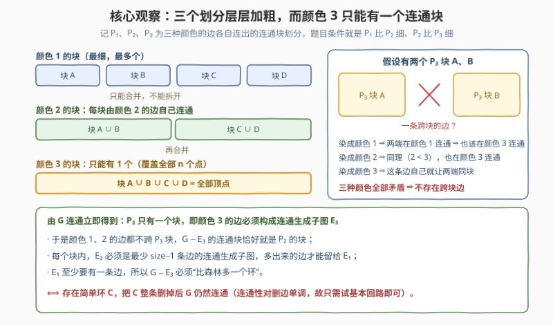
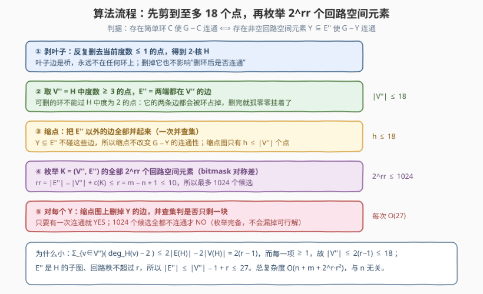
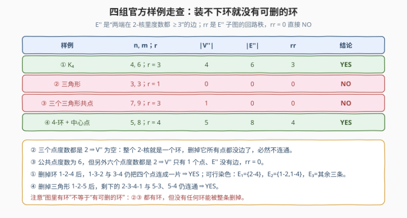

# Codeforces 2260F 边上三染色 题解

## 1. 题目概述

- **标题 / 题号**：边上三染色（Codeforces 2260F，英文名 Edge Three-Coloring）
- **链接**：https://codeforces.com/problemset/problem/2260/F
- **来源**：Educational Codeforces Round 194 (Rated for Div. 2) · Problem F
- **难度**：2500
- **限制**：时间 4 s / 内存 512 MB
- **标签**：暴力，DFS，并查集，图论，树

**题意**：给定 $n$ 点 $m$ 边的连通无向简单图，$m\le n+9$。把每条边染成 $1,2,3$ 之一，要求：

1. 三种颜色都至少用一次；
2. 对任意 $i<j$ 与任意两点 $u,v$：若 $u,v$ 在颜色 $i$ 下连通（只走颜色 $i$ 的边，长度 $0$ 的路径也算，故每点与自己连通），则它们在颜色 $j$ 下也连通。

只需回答 `YES` / `NO`，不要求方案。共 $t$ 组数据。

**约束**：

- $1\le t\le 1000$，$2\le n\le 3000$，$n-1\le m\le n+9$，$\sum n\le 3000$（故 $\sum m\le 12000$）；
- 每组数据内图连通、无自环、无重边；
- **关键量**：$r=m-n+1\le 10$，即回路空间维数至多 $10$（「树 $+\,10$ 条多余边」）；
- 时限 4 s，内存 512 MB。

## 2. 示例与观察
**官方样例**（4 组）

```text
输入
4
4 6
1 2
2 3
3 1
1 4
2 4
3 4
3 3
1 2
2 3
3 1
7 9
1 2
2 3
3 1
1 4
4 5
5 1
1 6
6 7
7 1
5 8
1 2
2 3
3 4
4 1
5 1
5 2
5 3
5 4

输出
YES
NO
NO
YES
```

① $K_4$：把 $2\text{-}4$ 染 1，$1\text{-}2,1\text{-}4$ 染 2，其余染 3 即可。② 三条边三种颜色，颜色 1 的块 $\{1,2\}$ 必在颜色 2 里被拆开。③ 三个三角形共点，除公共点外度数都是 2，删任何环都留孤点。④ 删掉三角形 $1\text{-}2\text{-}5$ 后其余边仍把 5 个点连成一片。

**自造样例**（「有环却没有可删环」「K4 全细分」各测一遍）

```text
输入
3
6 6
1 2
2 3
3 1
1 4
2 5
3 6
6 11
1 2
1 3
1 4
2 3
2 4
3 4
1 5
1 6
2 5
2 6
5 6
10 12
1 5
5 2
2 6
6 3
3 7
7 1
1 8
8 4
4 9
9 2
3 10
10 4

输出
NO
YES
NO
```

① 三角形加三条悬挂边；② 两个 $K_4$ 共用边 $1\text{-}2$；③ 把 $K_4$ 的六条边各插一个点，所有环都要过 2 度点。

## 3. 解题思路

### 3.1 暴力思路

直接枚举 $3^m$ 种染色再按定义检查，$m$ 可达 $3009$，完全不可行。即使用上 $m=n-1+r$、只在 $r$ 条非树边上枚举（$3^r=59049$），生成树的 $n-1$ 条边怎么染仍无判定标准——**必须先把条件翻译成结构**。

另一条路是枚举简单环 $C$ 并检查 $G-C$ 是否连通。环可以指数多，但本题回路空间只有 $2^r\le 1024$ 个元素，而「删掉 $Y$ 后是否连通」对 $Y$ 单调（删得越少越易连通），所以**枚举回路空间元素**就够了。

### 3.2 核心观察：三个划分层层加粗，颜色 3 只能有一块

记 $P_c$ 为「只走颜色 $c$ 的边」得到的连通块划分（含长度 0 的路径，故是等价关系，块即颜色 $c$ 的连通块）。条件 2 恰好是

$$P_1\preceq P_2\preceq P_3,\qquad P\preceq Q \text{ 表示 } P \text{ 的每块都含在 } Q \text{ 的某块里。}$$

**$P_3$ 只能有一个块。** 若有边 $e$ 连接两个不同的 $P_3$ 块：染 1 则两端在颜色 1 连通，按条件也该在颜色 3 连通，矛盾；染 2 同理（$2<3$）；染 3 则 $e$ 自己让两端同块。三种颜色全矛盾，故**没有跨块边**；又 $G$ 连通且 $n\ge2$，只能有一块。于是 $E_3$（颜色 3 的边）必须是**连通生成子图**。

再由 $P_1,P_2\preceq P_3$：颜色 1、2 的边都不跨 $P_3$ 块，故 $G-E_3$ 的连通块恰是 $P_2$ 的块；每块内 $E_2$ 必须连通生成，余边归 $E_1$ 且必须非空。反过来，只要 $G-E_3$ 的总边数多于它的生成森林（即至少多出一条边），把多出的边给 $E_1$、每块取生成树给 $E_2$ 即可。即

$$\textbf{YES}\iff \exists\ \text{简单环 } C,\ \text{使 } G-C \text{ 仍连通（覆盖全部 } n \text{ 个点）。}$$

「$\Rightarrow$」：$G-E_3$ 边数严格多于生成森林，必含环 $C\subseteq E\setminus E_3$，删 $C$ 比删 $E\setminus E_3$ 宽松，故 $G-C$ 连通。「$\Leftarrow$」：取 $E_3=E\setminus C$。



### 3.3 算法流程：先剪到不超过 18 个点，再枚举回路空间

取一棵生成树，$r$ 条非树边各给一条基本回路，它们是回路空间的基，所有元素恰为这 $r$ 条回路的 $2^r$ 种对称差。逐 $Y$ 用并查集判连通是 $O(2^r(n+m))$，C++ 已够快；再剪一刀可以让它**与 $n$ 无关**：

1. **剥叶子**：叶子边是桥，不在环上，删它也不会改变「删环后是否连通」。反复删度数 $\le1$ 的点得 2-核 $H$。
2. **只留高顶点**：$V''=\{v\in H:\deg_H(v)\ge3\}$，$E''=\{e\in H:e\text{ 两端都在 }V''\}$。可删环不能过 $H$ 中度 2 的点：它两条 $H$ 边都被环占掉，删环后只剩挂着的树，必成孤立块。
3. **缩点**：把 $E\setminus E''$ 并起来（一次并查集）。$Y\subseteq E''$ 不碰这些边，故不改变连通性；缩点图只剩 $h\le|V''|$ 个点。
4. **枚举**：$|V''|\le2(r-1)\le18$，$|E''|\le|V''|-1+r\le27$，$K=(V'',E'')$ 的回路秩 $r''\le r\le10$。枚举 $2^{r''}$ 个非空 $Y$，在缩点图上删掉 $Y$ 的边并查集判连通；有一种连通就 `YES`，全不行才 `NO`。

复杂度 $O\!\left(n+m+2^{r}r^{2}\right)$，$2^r$ 部分完全不看 $n$。



### 3.4 示例演算

| 样例 | $n,m$；$r$ | 2-核 $H$ | $\lvert V''\rvert$ / $\lvert E''\rvert$ | $r''$ | 结论 |
|:--|:--|:--|:--|:--|:--|
| ① $K_4$ | $4,6$；$r=3$ | 整个 $K_4$ | $4/6$ | 3 | YES（可删环 $1\text{-}2\text{-}4$） |
| ② 三角形 | $3,3$；$r=1$ | 三角形 | $0/0$ | 0 | NO |
| ③ 三三角形共点 | $7,9$；$r=3$ | 整个图 | $1/0$ | 0 | NO |
| ④ 4 环 + 中心 | $5,8$；$r=4$ | 整个图 | $5/8$ | 4 | YES（可删环 $1\text{-}2\text{-}5$） |

② 三点度数都是 2，$V''$ 为空：2-核整个就是一个环，删掉它所有点都没边了。③ 公共点度数 6，但其余点度数都是 2，$V''$ 只剩 1 个点、装不下环。① 的可行染色就是题面 Note 那组，对应删环 $1\text{-}2\text{-}4$。



注意「图里有环」不等于「有可删的环」：②③ 都有环，却没有任何环能被整条删掉。

## 4. 算法细节

1. **两份度数**：`deg[]` 是原图度数，剥叶子用副本 `d[]`；剥完后 `d[]` 就是 2-核度数，$V''$ 按 `aliveV[v] && d[v] >= 3` 判定。
2. **剥叶子**：栈里存度数 $\le1$ 的点，配 `aliveV / aliveE`；取另一端用 `U[e] ^ V[e] ^ v`（无自环保证正确），删边后邻居度数减一并按需入栈。
3. **$E''$ 只看端点**：`aliveE[e] && id[U[e]] >= 0 && id[V[e]] >= 0`，`id` 只给 $V''$ 的点编号；顺手记录 `inE2[e]`，缩点用它的补集。
4. **$K$ 上建生成森林**：按连通块分别 DFS，每条非树边生成一条基本回路，用 `unsigned int` 位掩码（$|E''|\le27<32$）按深度上跳收集树边。
5. **缩点与枚举**：对 $E\setminus E''$ 做一次并查集，只给 $V''$ 的点重新编号，$h$ 即连通块数；枚举从 `mask = 1` 起步（$Y=\varnothing$ 恒连通，会误判 `YES`），$c_u=c_v$ 的自环跳过即可。
6. **多测与 I/O**：数组都声明在每组循环体内（$\sum m\le1.2\times10^4$，反复分配比手工清空安全）；C++ 关同步 `cin`，Python 一次 `read().split()`。

## 5. 正确性证明

**引理 1（$P_3$ 一块）**：不存在连接两个不同 $P_3$ 块的边，故 $P_3$ 只有一块。

**证明**：设边 $e$ 连接两个不同 $P_3$ 块。$e$ 染 1 则两端在颜色 1 连通，由条件（$1<3$）也该在颜色 3 连通，矛盾；染 2 同理；染 3 则 $e$ 自身让两端同块，矛盾。$G$ 连通且 $n\ge2$，两块之间无边不可能。∎

**引理 2（结构刻画）**：合法染色与「$E_3$ 连通生成、$G-E_3$ 每个连通块内 $E_2$ 连通生成、$E_1$ 非空」的分解一一对应。

**证明**：由引理 1 得 $E_3$ 连通生成。颜色 1、2 的边不跨 $P_3$ 块，故 $G-E_3$ 的每个连通块含于一个 $P_2$ 块；而 $P_2$ 块在颜色 2 下连通，故它就是 $G-E_3$ 的连通块。于是 $E_2$ 在每块内连通生成，$E_1$ 为余边且非空。反向构造显然满足两个条件。∎

**引理 3（判据）**：存在合法染色 $\iff$ 存在简单环 $C$ 使 $G-C$ 连通。

**证明**：若合法，设 $G-E_3$ 有 $k$ 块，$E_1\neq\varnothing$ 给出 $|E\setminus E_3|>n-k$，即比生成森林多边，故含简单环 $C\subseteq E\setminus E_3$；删 $C$ 比删 $E\setminus E_3$ 保留更多边，$G-C$ 仍连通。反之若 $G-C$ 连通，取 $E_3=E\setminus C$，则 $G-E_3$ 只剩环 $C$：它有 $n-|C|+1$ 个连通块，边数 $|C|$ 比生成森林的 $|C|-1$ 多 $1$，按引理 2 可取 $E_2$ 为 $C$ 的生成树、$E_1$ 为剩下的那条环边，得到合法染色。∎

**引理 4（可删环避开的点）**：可删环不含叶子边，且其每个顶点在 2-核中度数 $\ge3$，从而 $C\subseteq E''$。

**证明**：叶子边是桥、不在任何环上；每棵被剥掉的树只挂在 2-核的一个点上（否则连接两个 2-核顶点的路径内部点度数 $\ge2$，永远不会被剥掉），故剥叶子不改变环与连通性。设 $v\in C$ 且 $\deg_H(v)=2$，$C$ 用掉 $v$ 的两条 $H$ 边，$H-C$ 中 $v$ 孤立；$G-C$ 中 $v$ 只连着挂在它身上的树，不含 $H$ 的其他点，与 $G-C$ 连通、$|V(H)|\ge3$ 矛盾。∎

**引理 5（规模与缩点）**：$|V''|\le2(r-1)\le18$，$|E''|\le|V''|-1+r\le27$；$Y\subseteq E''$ 时 $G-Y$ 连通 $\iff$ 缩点图减 $Y$ 连通，且枚举 $K$ 的回路空间即可找到任何可删环。

**证明**：$\sum_{v\in V''}(\deg_H(v)-2)\le2|E_H|-2|V_H|=2(r-1)$，每项 $\ge1$，得 $|V''|\le2(r-1)$；$E''$ 是 $H$ 的子图、回路秩不超过 $r$，得 $|E''|\le|V''|-1+r$。缩掉的边都在 $E\setminus E''$、始终保留，故连通性不变。可删环 $C\subseteq E''$ 是 $K$ 的欧拉子图，属于其回路空间，必被某个掩码枚举到；反之任一非空 $Y$ 都含简单环 $C'\subseteq Y$ 且 $G-C'\supseteq G-Y$ 连通。∎

**定理**：算法输出 `YES` 当且仅当存在合法染色。

**证明**：引理 3 把问题化为「找可删环」，引理 4、5 说明被剪掉的边与点不可能参与可删环、且 $K$ 的回路空间枚举是完备的，引理 5 又保证缩点后的判定与原图等价。故算法恰在所有可行情形返回 `YES`，其余返回 `NO`。∎

## 6. 复杂度分析

- **时间**：剥叶子 $O(n+m)$；建 $K$ 与生成森林 $O(|V''|+|E''|)$；缩点 $O((n+m)\alpha)$；枚举 $2^{r''}\cdot|E''|\le1024\times27$ 次并查集。合计 $O\!\left(n+m+2^rr^2\right)$ 每组，$\sum n\le3000$ 时总量约 $3\times10^6$ 次基本操作。
- **空间**：邻接表与边表 $O(n+m)$，小图与掩码 $O(r^2)$，没有 $2^r$ 规模数组。
- **对照时限**：实测最坏数据（单组 $n=3000,m=3009$；$t=1000$ 的稠密小图；$t=1000$ 的三角形）C++ 约 $10\sim30$ ms、Python3 约 $25\sim100$ ms（含进程启动与 I/O），时限 4 s，余量仍在 $40$ 倍以上。

## 7. 参考代码

### C++17

```cpp
#include <bits/stdc++.h>
using namespace std;

struct DSU {
    vector<int> p;
    explicit DSU(int n) : p(n) { for (int i = 0; i < n; i++) p[i] = i; }
    int find(int x) { while (p[x] != x) { p[x] = p[p[x]]; x = p[x]; } return x; }
    bool unite(int a, int b) {
        a = find(a); b = find(b);
        if (a == b) return false;
        p[a] = b; return true;
    }
};

int main() {
    ios::sync_with_stdio(false);
    cin.tie(nullptr);
    int t;
    if (!(cin >> t)) return 0;
    while (t--) {
        int n, m;
        cin >> n >> m;
        vector<int> U(m), V(m), deg(n, 0);
        vector<vector<int>> adj(n);
        for (int i = 0; i < m; i++) {
            cin >> U[i] >> V[i];
            --U[i]; --V[i];
            deg[U[i]]++; deg[V[i]]++;
            adj[U[i]].push_back(i);
            adj[V[i]].push_back(i);
        }
        if (m < 3) { cout << "NO\n"; continue; }

        /* 1. 剥掉叶子, 得到 2-核心(d[] 变成 2-核度数) */
        vector<char> aliveV(n, 1), aliveE(m, 1);
        vector<int> d = deg, q;
        for (int v = 0; v < n; v++) if (d[v] <= 1) q.push_back(v);
        while (!q.empty()) {
            int v = q.back(); q.pop_back();
            if (!aliveV[v] || d[v] > 1) continue;
            aliveV[v] = 0;
            for (int e : adj[v]) if (aliveE[e]) {
                aliveE[e] = 0;
                int w = U[e] ^ V[e] ^ v;              // 无自环: 另一端
                if (--d[w] <= 1 && aliveV[w]) q.push_back(w);
            }
            d[v] = 0;
        }

        /* 2. 可删的环只能经过 2-核中度数 >=3 的点 */
        vector<int> id(n, -1);
        int k = 0;
        for (int v = 0; v < n; v++) if (aliveV[v] && d[v] >= 3) id[v] = k++;
        if (k == 0) { cout << "NO\n"; continue; }     // 2-核心为空或纯环

        vector<int> e2id;
        vector<char> inE2(m, 0);
        for (int e = 0; e < m; e++)
            if (aliveE[e] && id[U[e]] >= 0 && id[V[e]] >= 0) { inE2[e] = 1; e2id.push_back(e); }
        int M = (int)e2id.size();

        /* 3. 小图 K=(V'',E'') 的生成森林 + 基本回路(位掩码) */
        vector<int> eu(M), ev(M);
        for (int i = 0; i < M; i++) { eu[i] = id[U[e2id[i]]]; ev[i] = id[V[e2id[i]]]; }
        vector<vector<pair<int, int>>> kadj(k);
        for (int i = 0; i < M; i++) {
            kadj[eu[i]].push_back({ev[i], i});
            kadj[ev[i]].push_back({eu[i], i});
        }
        vector<int> kpar(k, -1), kpe(k, -1), kdep(k, 0);
        vector<char> kvis(k, 0), ktree(M, 0);
        for (int s = 0; s < k; s++) if (!kvis[s]) {
            kvis[s] = 1;
            vector<int> st{s};
            while (!st.empty()) {
                int u = st.back(); st.pop_back();
                for (auto& pr : kadj[u]) {
                    int v = pr.first, e = pr.second;
                    if (!kvis[v]) {
                        kvis[v] = 1; kpar[v] = u; kpe[v] = e;
                        kdep[v] = kdep[u] + 1; ktree[e] = 1; st.push_back(v);
                    }
                }
            }
        }
        vector<unsigned int> cyc;
        for (int i = 0; i < M; i++) if (!ktree[i]) {
            unsigned int msk = 1u << i;
            int u = eu[i], v = ev[i];
            while (u != v) {
                if (kdep[u] < kdep[v]) swap(u, v);
                msk |= 1u << kpe[u]; u = kpar[u];
            }
            cyc.push_back(msk);
        }
        int rr = (int)cyc.size();                     // K 的回路秩 <= 10
        if (rr == 0) { cout << "NO\n"; continue; }

        /* 4. 把 E'' 之外的边全部缩掉 */
        DSU cc(n);
        for (int e = 0; e < m; e++) if (!inE2[e]) cc.unite(U[e], V[e]);
        vector<int> rid(n, -1);
        int h = 0;
        for (int v = 0; v < n; v++) if (id[v] >= 0) {
            int rt = cc.find(v);
            if (rid[rt] < 0) rid[rt] = h++;
        }
        vector<int> cu(M), cv(M);
        for (int i = 0; i < M; i++) {
            cu[i] = rid[cc.find(U[e2id[i]])];
            cv[i] = rid[cc.find(V[e2id[i]])];
        }

        /* 5. 枚举 K 的 2^rr 个非空回路空间元素 */
        bool yes = false;
        for (int mask = 1; mask < (1 << rr) && !yes; mask++) {
            unsigned int Y = 0u;
            for (int b = 0; b < rr; b++) if (mask >> b & 1) Y ^= cyc[b];
            DSU dd(h);
            int comp = h;
            for (int i = 0; i < M; i++) {
                if ((Y >> i) & 1u) continue;
                if (cu[i] == cv[i]) continue;
                if (dd.unite(cu[i], cv[i])) comp--;
            }
            if (comp == 1) yes = true;
        }
        cout << (yes ? "YES" : "NO") << '\n';
    }
    return 0;
}
```

### Python3

```python
import sys


def solve_case(n, m, U, V):
    if m < 3:
        return False
    adj = [[] for _ in range(n)]
    d = [0] * n
    for i in range(m):
        a, b = U[i], V[i]
        d[a] += 1
        d[b] += 1
        adj[a].append(i)
        adj[b].append(i)

    # 1. 剥掉叶子, 得到 2-核心（d 变成 2-核度数）
    alive_v, alive_e = bytearray([1]) * n, bytearray([1]) * m
    st = [v for v in range(n) if d[v] <= 1]
    while st:
        v = st.pop()
        if not alive_v[v] or d[v] > 1:
            continue
        alive_v[v] = 0
        for e in adj[v]:
            if alive_e[e]:
                alive_e[e] = 0
                w = U[e] ^ V[e] ^ v
                d[w] -= 1
                if d[w] <= 1 and alive_v[w]:
                    st.append(w)
        d[v] = 0

    # 2. 可删的环只能经过 2-核中度数 >=3 的点
    ident = [-1] * n
    k = 0
    for v in range(n):
        if alive_v[v] and d[v] >= 3:
            ident[v] = k
            k += 1
    if k == 0:
        return False
    in_e2 = bytearray(m)
    e2, eu, ev = [], [], []
    kadj = [[] for _ in range(k)]
    for e in range(m):
        a, b = ident[U[e]], ident[V[e]]
        if alive_e[e] and a >= 0 and b >= 0:
            in_e2[e] = 1
            i = len(e2)
            e2.append(e)
            eu.append(a)
            ev.append(b)
            kadj[a].append((b, i))
            kadj[b].append((a, i))
    M = len(e2)

    # 3. 小图 K=(V'',E'') 的生成森林 + 基本回路
    kpar, kpe, kdep = [-1] * k, [-1] * k, [0] * k
    kvis, ktree = bytearray(k), bytearray(M)
    for s in range(k):
        if kvis[s]:
            continue
        kvis[s] = 1
        st = [s]
        while st:
            u = st.pop()
            for v, e in kadj[u]:
                if not kvis[v]:
                    kvis[v] = 1
                    kpar[v], kpe[v], kdep[v] = u, e, kdep[u] + 1
                    ktree[e] = 1
                    st.append(v)
    cyc = []
    for i in range(M):
        if ktree[i]:
            continue
        msk = 1 << i
        u, v = eu[i], ev[i]
        while u != v:
            if kdep[u] < kdep[v]:
                u, v = v, u
            msk |= 1 << kpe[u]
            u = kpar[u]
        cyc.append(msk)
    rr = len(cyc)
    if rr == 0:
        return False

    # 4. 缩掉 E'' 之外的边
    p = list(range(n))

    def find(x):
        while p[x] != x:
            p[x] = p[p[x]]
            x = p[x]
        return x

    for e in range(m):
        if not in_e2[e]:
            a, b = find(U[e]), find(V[e])
            if a != b:
                p[a] = b
    rid = {}
    for v in range(n):
        if ident[v] >= 0:
            rid.setdefault(find(v), len(rid))
    h = len(rid)
    cu = [rid[find(U[e])] for e in e2]
    cv = [rid[find(V[e])] for e in e2]

    # 5. 枚举 K 的 2^rr 个非空回路空间元素
    for mask in range(1, 1 << rr):
        Y = 0
        for b in range(rr):
            if mask >> b & 1:
                Y ^= cyc[b]
        q = list(range(h))
        comp = h
        for i in range(M):
            if (Y >> i) & 1:
                continue
            a, b = cu[i], cv[i]
            if a == b:
                continue
            while q[a] != a:
                q[a] = q[q[a]]
                a = q[a]
            while q[b] != b:
                q[b] = q[q[b]]
                b = q[b]
            if a != b:
                q[a] = b
                comp -= 1
        if comp == 1:
            return True
    return False


def main():
    data = sys.stdin.buffer.read().split()
    pos = 0
    t = int(data[pos]); pos += 1
    out = []
    for _ in range(t):
        n = int(data[pos]); m = int(data[pos + 1]); pos += 2
        U = [int(x) - 1 for x in data[pos:pos + 2 * m:2]]
        V = [int(x) - 1 for x in data[pos + 1:pos + 2 * m:2]]
        pos += 2 * m
        out.append("YES" if solve_case(n, m, U, V) else "NO")
    sys.stdout.write("\n".join(out) + "\n")


if __name__ == "__main__":
    main()
```

## 8. 边界情况与易错点

1. **树（$r=0$）**：没有任何环，2-核被剥空，$k=0$ 自动 `NO`。
2. **整图就是一个环 $C_n$**：$r=1$ 看似「有环」，但所有点度数为 2、$V''=\varnothing$，答案 `NO`；别只判 $r>0$。
3. **$n=2,m=1$**：三种颜色用不上，`m < 3` 直接 `NO`。
4. **空集不是候选**：`mask` 必须从 1 开始，$Y=\varnothing$ 恒连通，会把所有输入判成 `YES`。
5. **位宽**：$|E''|\le27$，`unsigned int` 足够；若改成不剪枝、直接在 $r$ 条非树边上枚举，掩码是 $m$ 位（可达 3009），必须换 `bitset`/大整数。
6. **多测重置**：`aliveV/aliveE/id/inE2/d` 都在每组内重建，别跨组残留。
7. **$h=1$ 合法**：$V''$ 的点被 $E\setminus E''$ 连成一块时缩点图只有 1 个点，任何非空 $Y$ 都该判 `YES`；缩点自环（$c_u=c_v$）跳过，不要算成一次成功合并。
8. **`deg` 与 `d` 混用**：$V''$ 的度数必须看剥完之后的 `d`（2-核度数），不是原图 `deg`。

## 9. 验证记录

- **编译环境与命令**：`clang++ -std=c++17 -O2`（本机无 GNU g++，配 `codeforces/tools/include/bits/stdc++.h` 兼容头；正文代码只用标准库，可原样提交 GNU C++17）；Python 侧为 `Python 3.9.6`。
- **官方样例**：1 / 1 通过（按 Codeforces 标准 checker 的 token 比对，忽略空白与大小写）。
- **复核状态**：audited（2026-11-19 统一回归：编译 + 官方样例；写作期的随机对拍与暴力未重跑）。

## 相关题目与扩展

- [Codeforces 2260D Signs of Prefix Sums](https://codeforces.com/problemset/problem/2260/D)：同场题，同样要先把条件翻译成结构再枚举。
- [Codeforces 11D A Simple Task](https://codeforces.com/problemset/problem/11/D)：状压数简单环，与本题「回路空间只有 $2^r$ 个元素」互补。
- [Codeforces 962F Simple Cycles Edges](https://codeforces.com/problemset/problem/962/F)：用 DFS 树与基本回路判定「边是否恰在一个简单环上」。
- [LeetCode 684. 冗余连接](https://leetcode.cn/problems/redundant-connection/)：并查集找环的入门版，正是本题「剥叶子 + 并查集判连通」的零件。

**延伸思考**：

1. **只染两种颜色**：同样推出 $P_2$ 必须整块、$E_2$ 连通生成、$E_1$ 非空，于是答案 $\iff m\ge n$（生成树染 2，剩下的边染 1），连枚举都不用。
2. **把 $m\le n+9$ 放宽到 $m\le n+k$**：剪枝后复杂度 $O(n+m+2^kk^2)$，$k\le20$ 时约 $4\times10^8$ 已危险，需要更强的判据。
3. **输出方案**：找到可行的 $Y$ 后取 $E_3=E\setminus Y$，对 $G-Y$ 每个连通块取生成树当 $E_2$、余边当 $E_1$，一次 DFS 即可。
4. **多环版本**：问最多能同时删多少个点不相交的环而图仍连通，就变成在回路空间上做集合覆盖式 DP，$r\le10$ 时仍可 $2^r$ 枚举。
