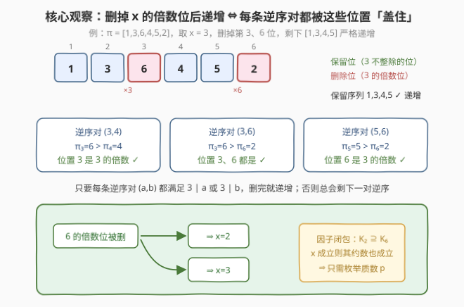
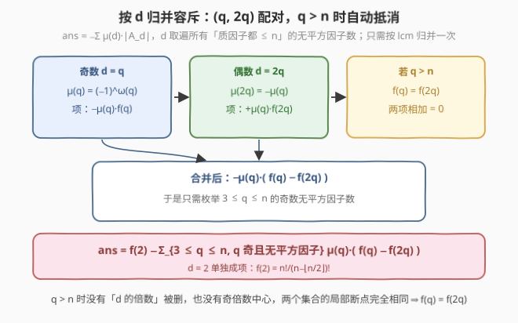
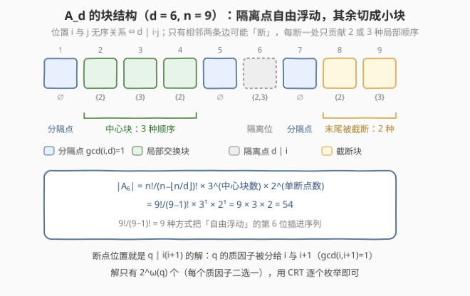
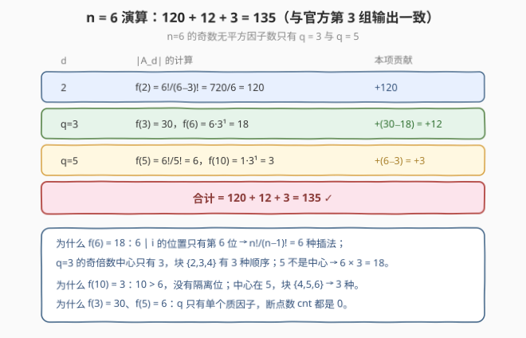

# Codeforces 2260G 可排序排列 题解

## 1. 题目概述

- **标题 / 题号**：可排序排列（Codeforces 2260G，英文名 Sortable Permutations）
- **链接**：https://codeforces.com/problemset/problem/2260/G
- **来源**：Educational Codeforces Round 194 (Rated for Div. 2) · Problem G（UTC 2026-09-08）
- **难度**：2900 分
- **限制**：时间 8 s / 内存 1024 MB
- **标签**：暴力枚举，组合数学，数学，数论（无平方因子 + 莫比乌斯容斥 + CRT）

**题意**：称排列 $\pi=(\pi_1,\dots,\pi_n)$ 是**可排序的**，若存在整数 $x\ge 2$，使得把所有位置为 $x$ 的倍数的元素删掉之后，剩下的数组（保持原顺序）**严格递增**。统计大小为 $n$ 的可排序排列个数，对 $998244353$ 取模。输入只有一个整数 $n$。

**约束**：

- $1\le n\le 2\times 10^5$，模数 $998244353$（质数），单组数据、无 $t$；
- 时限 8 s、内存 1024 MB，正解可以做到 $O(n\log n)$；
- 合法排列极稀疏（$n=9$ 只有 $3486/9!$，$n=10$ 只有 $30937/10!$），可见约束极强。

## 2. 示例与观察
**样例 1**

```text
输入
1
输出
1
```

解释：唯一的排列是 $[1]$，取 $x=2$ 时什么都删不掉，序列本身递增。

**样例 2**

```text
输入
3
输出
4
```

解释：可排序的是 $[1,2,3],[1,3,2],[2,1,3],[2,3,1]$。例如 $[2,1,3]$ 取 $x=2$：删掉第 $2$ 位后剩 $[2,3]$，递增。

**样例 3**

```text
输入
6
输出
135
```

解释：$[1,3,6,4,5,2]$ 取 $x=3$：删掉第 $3,6$ 位，剩 $[1,3,4,5]$ 递增。

## 3. 解题思路

### 3.1 暴力思路

枚举全部 $n!$ 个排列，再对每个排列试 $x=2,\dots,n$（$x>n$ 时什么也删不掉，只有恒等排列），每次 $O(n)$ 检查：总复杂度 $O(n!\,n^2)$，$n\le 2\times 10^5$ 完全不可行。

若改成「对每个 $x$ 数合法排列再相加」，单个 $x$ 是好数的：保留位（$x\nmid i$ 的位置）上的值必须递增，所以只需选出 $k=\lfloor n/x\rfloor$ 个值丢给删除位任意排列，其余按顺序填回保留位，得到 $|P(x)|=n!/(n-k)!$。但不同 $x$ 之间的合法集合大量重叠（例如 $x=6$ 的每个解都被 $x=2$、$x=3$ 覆盖），直接相加会重复计数，必须容斥。

### 3.2 核心观察：逆序对覆盖 ⇒ 只需枚举质数



记 $M_x=\{x,2x,\dots\}\cap[1,n]$ 为「删除位」，$K_x=[1,n]\setminus M_x$ 为「保留位」。把排列看成点集 $1..n$，逆序对 $(a,b)$（$a<b$、$\pi_a>\pi_b$）是边，则

$$P(x):\quad \text{每条逆序对 }(a,b)\text{ 都满足 } a\in M_x \text{ 或 } b\in M_x .$$

因为只要存在一条两端都在保留位里的逆序对，删完就剩下它，不可能递增；反之所有逆序对都被 $M_x$ 盖住，保留位之间就没有逆序。

- 若 $y\mid x$，则 $M_x\subseteq M_y$、$K_y\subseteq K_x$，「$K_x$ 上递增」⇒「$K_y$ 上递增」，故 $P(x)\subseteq P(y)$。
- 于是任意 $x\ge 2$ 取一个质因子 $p\mid x$，有 $P(x)\subseteq P(p)$；而 $x>n$ 时 $M_x=\varnothing$，只有恒等排列合法。

**结论**：$n\ge 2$ 时「可排序」$\iff$「存在质数 $p\le n$ 使 $P(p)$ 成立」，答案 $=\bigl|\bigcup_{p\le n}P(p)\bigr|$；$n=1$ 单独返回 $1$。

### 3.3 容斥：按无平方因子 $d$ 归并



设 $S$ 是质数集合，$A(S)=\bigcap_{p\in S}P(p)$。检查「位置对 $(i,j)$（$i<j$）在 $A(S)$ 里有没有约束」：只要存在 $p\in S$ 使 $p\nmid i$ 且 $p\nmid j$，就要求 $\pi_i<\pi_j$；所以**无约束**当且仅当

$$\forall p\in S:\ p\mid i \ \text{或}\ p\mid j \iff d\mid ij,\qquad d=\prod_{p\in S}p .$$

即 $A(S)$ 只依赖无平方因子的 $d$，记作 $A_d$；又因为「质数子集 $\leftrightarrow$ 无平方因子 $d$」是双射（$S$ 必须是 $d$ 的全部质因子），容斥化为

$$\text{ans}=-\sum_{\substack{d\ge 2\\ d\ \text{无平方因子}}}\mu(d)\,|A_d| ,$$

其中 $d$ 的质因子都 $\le n$（否则对应的 $S$ 不存在）。当 $d>n(n-1)$ 时任意 $i,j\le n$ 都有 $d\nmid ij$，故 $A_d=\{\text{恒等排列}\}$，$|A_d|=1$；而 $\sum_d\mu(d)=\prod_{p\le n}(1-1)=0$（含 $d=1$），故 $\sum_{d\ge2}\mu(d)=-1$，于是

$$\text{ans}=1-\sum_{d\ge2}\mu(d)\bigl(|A_d|-1\bigr).$$

再把 $d$ 按「奇数 $q$」与「$d=2q$」配对：$\mu(2q)=-\mu(q)$，两项合并为 $-\mu(q)\bigl(f(q)-f(2q)\bigr)$。当 $q>n$ 时 $f(q)=f(2q)$（见 §3.4 的两个公式：没有 $d$ 的倍数位、也没有「中心」，两边只剩同一批断点），配对项全部抵消。只剩 $d=2$ 与 $3\le q\le n$：

$$\boxed{\ \text{ans}=f(2)-\sum_{\substack{3\le q\le n\\ q\ \text{奇数且无平方因子}}}\mu(q)\bigl(f(q)-f(2q)\bigr)\ }$$

### 3.4 $A_d$ 的结构：隔离点、分隔点与局部块



以 $d=6,n=9$ 为例：$|A_6|=9!/(9-1)!\times 3\times 2=54$。下面把结论一般化。设 $d$ 无平方因子，$S$ 为其质因子集。

1. **隔离点**：$d\mid i$ 时对任意 $j$ 都有 $d\mid ij$，所以位置 $i$ 与所有位置都不可比，随便放；$[1,n]$ 中有 $\lfloor n/d\rfloor$ 个这样的位置，插入方式贡献 $B_d=n!\,/\,(n-\lfloor n/d\rfloor)!$。
2. **分隔点**：$\gcd(i,d)=1$ 时 $d\nmid ij$ 对一切非隔离 $j$ 成立，故 $i$ 与所有非隔离位置都可比，顺序由下标决定——它把序列切成互不影响的段。
3. **断点（局部块）**：相邻对 $(i,i+1)$ 无约束 $\iff d\mid i(i+1)$。由于 $\gcd(i,i+1)=1$，这等价于「$d$ 的质因子被分成两组，分别整除 $i$ 与 $i+1$」。
4. **$d$ 为奇数**：若 $(i,i+1)$ 与 $(i+1,i+2)$ 同时断裂，则两式相乘可知 $d\mid i+1$，中间位是隔离点，已按第 1 条处理。所以断点互不相邻，每处都是独立 2 元块（$2$ 种顺序）。
5. **$d=2q$（$q$ 奇）**：$2\mid i(i+1)$ 恒成立，断点条件退化为 $q\mid i(i+1)$。
   - **真分裂** $q\nmid i$ 且 $q\nmid i+1$：$i-1$ 与 $d$ 互质、$i+2$ 也是，块恰为 $\{i,i+1\}$，$2$ 种；
   - **中心**：$q\mid i$ 或 $q\mid i+1$。此时那个 $q$ 的倍数 $m$ 必须为奇数（偶数倍是 $d$ 的倍数 ⇒ 隔离点），它使 $(m-1,m)$、$(m,m+1)$ 双断，而 $q\nmid m^2-1$ 保证 $(m-1,m+1)$ 仍有约束，且 $m\pm2$ 与 $d$ 互质，块恰为 $\{m-1,m,m+1\}$，$3$ 种；若 $m=n$ 则右邻缺失，退化成 $2$ 种；
   - 真分裂断点不可能与中心相邻（否则推出 $q\mid 2$，矛盾）。

记 $\mathrm{cnt}(d)$ 为真分裂断点数、$\mathrm{ctr}(d)$ 为中心数，合并上面各块（各块位置不同、互不干扰，贡献相乘）：

$$f(q)=B_q\cdot 2^{\mathrm{cnt}(q)},\qquad
f(2q)=B_{2q}\cdot 2^{\mathrm{cnt}(q)+[q\mid n\ \wedge\ n/q\ \text{奇}]}\cdot 3^{\mathrm{ctr}(q)},$$

$$\mathrm{cnt}(q)=\#\{1\le i<n:\ q\mid i(i+1),\ q\nmid i,\ q\nmid i+1\},\qquad
\mathrm{ctr}(q)=\#\{k\ \text{奇}:\ kq\le n-1\}.$$

### 3.5 算法流程

1. 筛出最小质因子 $\mathrm{spf}$；预处理 $k!$、逆阶乘、$2^k$、$3^k$（$k\le n$）。
2. $\text{ans}\leftarrow B_2=n!/(n-\lfloor n/2\rfloor)!$。
3. 枚举奇数 $q\in[3,n]$：用 $\mathrm{spf}$ 分解，若出现平方因子则 $\mu(q)=0$ 跳过；否则 $\mu(q)=(-1)^{\omega(q)}$。
4. 用 CRT 求出 $q\mid i(i+1)$ 在 $[0,q)$ 内的**全部**解：每个质因子 $p\mid q$ 独立二选一（$i\equiv 0$ 或 $i\equiv -1 \pmod p$），共 $2^{\omega(q)}$ 个解。
5. 统计 $\mathrm{cnt}(q)=\sum_{\text{合法解}r}\bigl(\lfloor (n-1-r)/q\rfloor+1\bigr)$（跳过 $r=0$ 与 $r=q-1$，它们对应 $q\mid i$ 或 $q\mid i+1$），再算 $\mathrm{ctr}(q)=\lceil\lfloor (n-1)/q\rfloor/2\rceil$ 与截断标记 $[q\mid n\wedge n/q\text{ 奇}]$。
6. 按公式累加 $-\mu(q)\bigl(f(q)-f(2q)\bigr)$，输出 $\text{ans}$。

### 3.6 示例演算



$n=6$ 时奇数无平方因子数只有 $q=3,5$，直接套公式：

| 项 | 计算 | 贡献 |
|----|------|------|
| $d=2$ | $6!/(6-3)!=120$ | $+120$ |
| $q=3$ | $f(3)=6!/4!=30$，$f(6)=6!/5!\cdot 3^{1}=18$ | $+1\cdot(30-18)=+12$ |
| $q=5$ | $f(5)=6!/5!=6$，$f(10)=1\cdot 3^{1}=3$ | $+1\cdot(6-3)=+3$ |

合计 $120+12+3=135$，与官方样例一致。可手算校验这些 $f$ 值：$d=3$ 时 $3$ 的倍数位只有第 $3,6$ 位，$6!/4!=30$；$d=6$ 时只有第 $6$ 位是 $d$ 的倍数（$6$ 种插法），而 $q=3$ 的奇倍数中心只有 $3$，块 $\{2,3,4\}$ 给 $3$ 种，故 $6\times 3=18$。

## 4. 算法细节

1. **逆元要按小质数取模**：CRT 里求的是 $\mathrm{mod}^{-1}\bmod p$（$p$ 是 $q$ 的小质因子），必须用扩展欧几里得；若误用 $998244353$ 下的快速幂取逆，$q$ 有多个质因子时解会算错。
2. **无平方因子过滤**：$\mu(q)=0$ 的 $q$ 直接跳过；否则 $q\mid i(i+1)$ 的解数才恰好是 $2^{\omega(q)}$（有重因子时解数更多，不能套公式）。
3. **指数范围**：$\mathrm{cnt}(q)\le n-1$、$\mathrm{ctr}(q)\le (n-1)/2$，所以 $2^k,3^k$ 表开到 $n+1$ 就够，别越界。
4. **阶乘比值**：$B_d=n!\cdot (n-\lfloor n/d\rfloor)!^{-1}$，全部在模 $998244353$ 下做；$d>n$ 时 $k=0$，$B_d=1$。
5. **常数优化**：$2^{\omega(q)}$ 的解用增量 CRT 边分解边生成，避免暴力枚举 $i\in[1,n]$；$\sum_{q\le n}2^{\omega(q)}=O(n\log n)$。
6. **I/O 与多测**：本题只有一组输入，代码仍写成 `while (scanf)` 读到 EOF，多组也能跑；`std::ios` 无关（用 `scanf/printf`）。
7. **取模**：所有减法先 `+MOD` 再 `%MOD`；答案输出前再取一次模。

## 5. 正确性证明

**引理 1（约数闭包）**：若 $y\mid x$，则 $P(x)\subseteq P(y)$，从而任一 $x\ge2$ 的 $P(x)$ 都含于某个质数 $p\mid x$ 的 $P(p)$ 中。
**证明**：$y\mid x\Rightarrow M_x\subseteq M_y\Rightarrow K_y\subseteq K_x$，在更大集合上递增当然在子集上递增。$x>n$ 时 $M_x=\varnothing$，只有恒等排列，$n\ge2$ 时它属于 $P(2)$。∎

**引理 2（$A_d$ 只依赖 $d$）**：对质数集 $S$，$A(S)=\{\pi:\forall i<j,\ d\nmid ij\Rightarrow\pi_i<\pi_j\}$，其中 $d=\prod_{p\in S}p$。
**证明**：位置对 $(i,j)$ 无约束 $\iff\forall p\in S$ 有 $p\mid i$ 或 $p\mid j$ $\iff$ 每个质因子 $p$ 至少整除 $i,j$ 之一 $\iff d\mid ij$（$d$ 无平方因子）。∎

**引理 3（块分解）**：$|A_d|=B_d\cdot 2^{\mathrm{cnt}(d)}\cdot 3^{\mathrm{ctr}(d)}$，其中 $B_d=n!/(n-\lfloor n/d\rfloor)!$。
**证明**：由引理 2，$P_d$ 的限制只由「$d\mid ij$ 是否成立」决定。$d\mid i$ 的位置与所有位置不可比（隔离），可任意插入，贡献 $B_d$；$\gcd(i,d)=1$ 的位置与所有非隔离位置可比，按位置切开使各段独立；相邻对断裂当且仅当 $d\mid i(i+1)$，且由 $\gcd(i,i+1)=1$ 知这是「质因子分家」。奇数 $d$ 时两处断点相邻会迫使中间位被 $d$ 整除（退化为隔离点），故每个断点是独立 2 元块；$d=2q$ 时同一讨论给出 2 元块或 3 元块（中心），且块之间互不干扰，乘起来即得。∎

**引理 4（$q>n$ 的配对抵消）**：奇数无平方因子 $q>n$ 时 $f(q)=f(2q)$。
**证明**：$q>n$ 时没有 $q$ 的倍数位，$2q>n$ 也没有 $2q$ 的倍数位，故两者 $B_d=1$；中心要求位置是 $q$ 的倍数，同样不存在。剩下断点集合都等于 $\{i<n:q\mid i(i+1),\ q\nmid i,\ q\nmid i+1\}$（因 $2\mid i(i+1)$ 恒成立），由引理 3 两个公式相同。∎

**定理**：$\text{ans}=f(2)-\sum_{3\le q\le n,\ q\ \text{奇无平方}}\mu(q)\bigl(f(q)-f(2q)\bigr)$。
**证明**：由引理 1 只需容斥质数集合；由引理 2 按 $d=\mathrm{lcm}(S)$ 归并，系数为 $\mu(d)$ 的相反数；把 $d$ 分成 $2$、奇数 $q$、偶数 $2q$ 三类，$2q$ 的系数是奇数 $q$ 的相反数，合并得 $-\mu(q)(f(q)-f(2q))$；$q>n$ 的项由引理 4 抵消；$d=2$ 的项系数为 $-\mu(2)=1$。∎

## 6. 复杂度分析

- **枚举与容斥**：奇数 $q\le n$ 逐个分解（$O(\log q)$），CRT 生成 $2^{\omega(q)}$ 个解；总代价 $\sum_{q\le n}2^{\omega(q)}=O(n\log n)$，$n=2\times10^5$ 时约 $1.5\times10^6$ 次。
- **预处理**：$\mathrm{spf}$、阶乘、逆阶乘、$2^k/3^k$ 均 $O(n)$。
- **空间**：$O(n)$（几个长度 $n$ 的数组）。
- **实测**：C++ 在 $n=2\times10^5$ 时约 $0.02$ s（含读入），远低于 8 s；Python 约 $0.7$ s，留有余量。

## 7. 参考代码

### C++17

```cpp
#include <cstdio>
#include <vector>
using namespace std;
typedef long long ll;
const ll MOD = 998244353;
const int N = 200005;
int spf[N], pr[8];
ll fac[N], ifac[N], p2[N], p3[N];
vector<ll> rt, nrt;
ll pw(ll b, ll e) { ll r = 1; b %= MOD; for (; e; e >>= 1, b = b * b % MOD) if (e & 1) r = r * b % MOD; return r; }
ll invmod(ll a, ll m) {                       // 小质数模下的逆元：必须用扩欧
    ll b = m, x = 1, y = 0;
    while (b) { ll q = a / b, t = a - q * b; a = b; b = t; t = x - q * y; x = y; y = t; }
    return (x % m + m) % m;
}
ll solve(int n) {
    if (n == 1) return 1;
    for (int i = 0; i <= n; i++) spf[i] = i;
    for (int i = 2; (ll)i * i <= n; i++) if (spf[i] == i)
        for (int j = i * i; j <= n; j += i) if (spf[j] == j) spf[j] = i;
    fac[0] = 1;
    for (int i = 1; i <= n; i++) fac[i] = fac[i - 1] * i % MOD;
    ifac[n] = pw(fac[n], MOD - 2);
    for (int i = n; i; i--) ifac[i - 1] = ifac[i] * i % MOD;
    p2[0] = p3[0] = 1;
    for (int i = 1; i <= n; i++) p2[i] = p2[i - 1] * 2 % MOD, p3[i] = p3[i - 1] * 3 % MOD;
    auto B = [&](ll d) { int k = (int)(n / d); return fac[n] * ifac[n - k] % MOD; }; // n!/(n-k)!
    ll ans = B(2);                                   // d = 2
    for (int q = 3; q <= n; q += 2) {
        int t = q, k = 0; bool sq = true;
        while (t > 1) {
            int p = spf[t]; pr[k++] = p; int c = 0;
            while (t % p == 0) t /= p, c++;
            if (c > 1) { sq = false; break; }
        }
        if (!sq) continue;                           // mu(q) = 0
        int mu = (k & 1) ? -1 : 1;
        rt.assign(1, 0); ll mod = 1;                 // CRT：q | r(r+1) 的全部解
        for (int i = 0; i < k; i++) {
            ll p = pr[i], iv = invmod(mod % p, p);
            nrt.clear();
            for (ll r : rt) {
                ll rp = r % p;
                nrt.push_back(r + mod * (((p - rp) % p) * iv % p));      // i ≡ 0  (mod p)
                nrt.push_back(r + mod * (((p - rp - 1) % p) * iv % p));  // i ≡ -1 (mod p)
            }
            mod *= p; rt.swap(nrt);
        }
        ll cnt = 0;                                  // 真分裂断点数
        for (ll r : rt) if (r && r != mod - 1 && r <= n - 1) cnt += (n - 1 - r) / mod + 1;
        ll ctr = ((n - 1) / q + 1) / 2;              // 奇倍数中心数
        ll tr = (n % q == 0 && (n / q) % 2) ? 1 : 0; // 中心恰在 n，退化成 2 种
        ll fq = B(q) * p2[cnt] % MOD;
        ll f2q = B(2LL * q) * p2[cnt + tr] % MOD * p3[ctr] % MOD;
        ll dif = (fq - f2q + MOD) % MOD;
        ans = mu == 1 ? (ans - dif + MOD) % MOD : (ans + dif) % MOD;
    }
    return ans;
}
int main() { int n; while (scanf("%d", &n) == 1) printf("%lld\n", solve(n)); return 0; }
```

### Python3

```python
import sys
MOD = 998244353
def solve(n):
    if n == 1:
        return 1
    spf = list(range(n + 1))
    i = 2
    while i * i <= n:
        if spf[i] == i:
            for j in range(i * i, n + 1, i):
                if spf[j] == j:
                    spf[j] = i
        i += 1
    fac = [1] * (n + 1)
    for i in range(1, n + 1):
        fac[i] = fac[i - 1] * i % MOD
    ifac = [1] * (n + 1)
    ifac[n] = pow(fac[n], MOD - 2, MOD)
    for i in range(n, 0, -1):
        ifac[i - 1] = ifac[i] * i % MOD
    p2 = [1] * (n + 1); p3 = [1] * (n + 1)
    for i in range(1, n + 1):
        p2[i] = p2[i - 1] * 2 % MOD
        p3[i] = p3[i - 1] * 3 % MOD
    def B(d):
        k = n // d
        return fac[n] * ifac[n - k] % MOD
    ans = B(2)
    for q in range(3, n + 1, 2):
        t, primes, sq = q, [], True
        while t > 1:
            p = spf[t]; primes.append(p); c = 0
            while t % p == 0:
                t //= p; c += 1
            if c > 1:
                sq = False; break
        if not sq:
            continue
        mu = -1 if len(primes) % 2 else 1
        roots, mod = [0], 1
        for p in primes:                     # 增量 CRT
            iv = pow(mod % p, -1, p)
            nr = []
            for r in roots:
                rp = r % p
                nr.append(r + mod * (((p - rp) % p) * iv % p))
                nr.append(r + mod * (((p - rp - 1) % p) * iv % p))
            mod *= p; roots = nr
        cnt = 0
        for r in roots:
            if r == 0 or r == mod - 1 or r > n - 1:
                continue
            cnt += (n - 1 - r) // mod + 1
        ctr = ((n - 1) // q + 1) // 2
        tr = 1 if (n % q == 0 and (n // q) & 1) else 0
        fq = B(q) * p2[cnt] % MOD
        f2q = B(2 * q) * p2[cnt + tr] % MOD * p3[ctr] % MOD
        d = (fq - f2q) % MOD
        ans = (ans - d) % MOD if mu == 1 else (ans + d) % MOD
    return ans % MOD
def main():
    out = [str(solve(int(x))) for x in sys.stdin.read().split()]
    sys.stdout.write("\n".join(out) + "\n")
main()
```

## 8. 边界情况与易错点

1. **$n=1$**：唯一排列 $[1]$ 合法，答案是 $1$，不能因为「没有质数 $\le n$」就输出 $0$。
2. **$x>n$ 的排列**：这时什么也不删，只有恒等排列合法；$n\ge2$ 时它已经在 $P(2)$ 里，千万别再额外 $+1$。
3. **$n=2$**：答案 $2$（$[1,2]$ 与 $[2,1]$），公式只算 $f(2)=2!/1!=2$，可见 $d=2$ 项必须保留。
4. **CRT 逆元用错模数**：求的是 $\mathrm{mod}^{-1}\bmod p$，用 $998244353$ 下的逆元会得到错误解（多质因子 $q$ 必错）。
5. **无平方因子过滤**：$\mu(q)=0$ 的 $q$ 若参与计算，解数不再是 $2^{\omega(q)}$，会导致答案偏移。
6. **中心恰在末尾**：$q\mid n$ 且 $n/q$ 为奇数时，中心 $m=n$ 的右邻缺失，$3$ 要退化为 $2$（代码里的 `tr`）。
7. **负数取模**：$f(q)-f(2q)$ 与累加都要 `+MOD` 后再取模；Python 的 `%` 天然返回非负，C++ 要手动处理。
8. **数组越界**：$2^{\mathrm{cnt}}$ 的指数可达 $n-1$，$3$ 的指数可达 $(n-1)/2$，表长开到 $n+1$ 而不是 $n/2$。

## 9. 验证记录

- **编译环境与命令**：`clang++ -std=c++17 -O2`（本机无 GNU g++，配 `codeforces/tools/include/bits/stdc++.h` 兼容头；正文代码只用标准库，可原样提交 GNU C++17）；Python 侧为 `Python 3.9.6`。
- **官方样例**：3 / 3 通过（按 Codeforces 标准 checker 的 token 比对，忽略空白与大小写）。
- **复核状态**：audited（2026-11-19 统一回归：编译 + 官方样例；写作期的随机对拍与暴力未重跑）。

## 相关题目与扩展

- [LeetCode 903. DI 序列的有效排列](https://leetcode.cn/problems/valid-permutations-for-di-sequence/)：只给相邻位的大小关系，用「按相对大小插入」DP 计数，与本题 §3.4 把排列切成局部块的思路同源。
- [Codeforces 839D. Winter is here](https://codeforces.com/problemset/problem/839/D)：按 $\gcd$ 归并后用莫比乌斯反演，和本题「按 $d=\mathrm{lcm}(S)$ 归并容斥」是同一手法。
- [Codeforces 585E. Present for Vitalik the Philatelist](https://codeforces.com/problemset/problem/585/E)：无平方因子计数 + 莫比乌斯，可作为本题容斥部分的练手题。

**延伸思考**：本题的关键是「删除位固定为某数的倍数」，因此坏位置集合极小、局部块结构才会出现。若把删除集合换成「模 $m$ 的某个同余类」或「一段区间」，局部块结构会完全不同（甚至需要线性扩展数的一般 DP）。另外，若问题改成「统计每个 $x$ 作为**最小**可行解的排列数」，则由 $\S3.3$ 的容斥直接得到 $\bigl|\bigcup_{p<x}P(p)\bigr|$ 的差分，同样可以 $O(n\log n)$ 解决——本质是同一套因子闭包结构。
