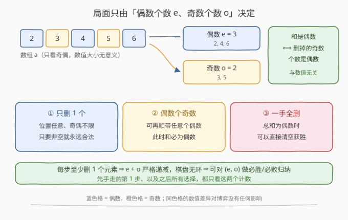
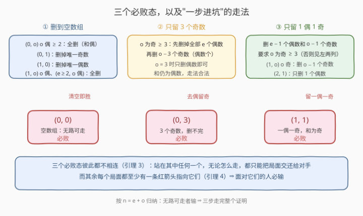
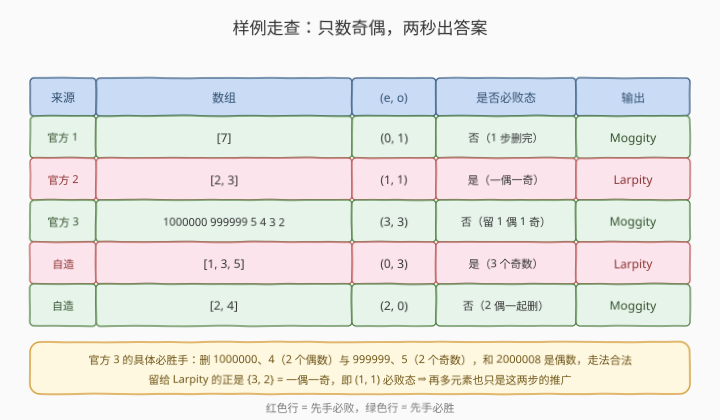

# Codeforces 2261C 我知道一百万件事 题解

## 1. 题目概述

- **标题 / 题号**：我知道一百万件事（Codeforces 2261C，英文名 I Know About a Million Things）
- **链接**：https://codeforces.com/problemset/problem/2261/C
- **来源**：WorldQuant Round 1 (Codeforces Round 1128, Div. 1 + Div. 2) · Problem C
- **难度**：1000 分（Div. 1 + Div. 2 的 C 题）
- **限制**：时间 2 s / 内存 256 MB
- **标签**：博弈，数学

**题意**：给定长度 $n$ 的正整数数组 $a$。Moggity 先手，两人轮流行动；每回合玩家选一个**非空**的位置集合，把对应元素从数组中删除，走法合法当且仅当满足至少一条：

- 恰好删掉 $1$ 个元素（不论奇偶、不论位置）；
- 删掉的所有元素之和是**偶数**（个数不限，但至少 $1$ 个）。

无法行动者输——等价于**面对空数组的人输**（正常博弈规则）。两人都最优，问谁有必胜策略。**多测**：第一行 $t$，每组给出 $n$ 与 $a_1..a_n$，逐组输出 `Moggity` 或 `Larpity`（大小写不敏感）。

**约束**：

- $1 \le t \le 10^4$；$1 \le n \le 10^6$，且所有测试的 $n$ 之和 $\le 10^6$；$1 \le a_i \le 10^6$；
- 单组 $n$ 可达百万、总元素可达百万 ⇒ 只允许 $O(n)$ 扫描，不允许搜索局面；
- 答案只有两个字符串，判定式必须是 $O(1)$ 的。

## 2. 示例与观察
**官方样例**

```text
输入
3
1
7
2
2 3
6
1000000 999999 5 4 3 2

输出
Moggity
Larpity
Moggity
```

第 1 组：只有一个元素，Moggity 删掉它，Larpity 面对空数组，输。第 2 组：$2+3=5$ 是奇数，不能一次删完；无论先删哪个，对手都能删掉剩下那个，于是 Moggity 先面对空数组。第 3 组见 §3.4。

**自造样例**（覆盖 $(0,3)$、$(2,0)$ 与五元素全奇）

```text
输入
3
3
1 3 5
2
2 4
5
1 1 1 1 1

输出
Larpity
Moggity
Moggity
```

`1 3 5`：全删的和 $9$ 是奇数、不合法，只能删 $1$ 个或 $2$ 个，两种都留对手一个"能一次删完"的局面 ⇒ 先手必败。`2 4`：两个偶数、和 $6$ 为偶，一手清空 ⇒ 先手胜。`1 1 1 1 1`：删掉 $2$ 个奇数（和偶）留下 $3$ 个奇数，把必败态丢给对手 ⇒ 先手胜。

## 3. 解题思路

### 3.1 暴力思路

最直白的做法是把"剩余数组"当状态做极小极大搜索：一个状态就有 $2^n-1$ 种走法，$n$ 最大 $10^6$，状态数更是天文数字。即使先按"奇偶计数"压缩（下节说明为什么可以），二元组 $(e,o)$ 仍有 $O(n^2)$ 个，依旧不可行。所以本题不是"搜索 + 剪枝"，而是要把必胜/必败态**刻成一个闭式条件**。

### 3.2 核心观察：胜负只由「偶数个数 e 与奇数个数 o」决定



第一，**合法性只看奇偶**。"和是偶数"等价于"删掉的奇数个数是偶数"——偶数元素对和的奇偶没有贡献。于是合法走法恰好是两类：删 $1$ 个元素（任意奇偶，永远可用），或者删 $2k$ 个奇数（$k \ge 1$）再顺带删任意多个偶数（总数 $\ge 2$）。记 $e$ = 偶数个数、$o$ = 奇数个数，则**后继局面的 $(e,o)$ 完全由当前 $(e,o)$ 决定**，胜负同理（引理 1）。

第二，**每步至少删 $1$ 个元素**，所以 $e+o$ 严格递减、游戏必在有穷步内结束、棋盘无环——这正是对 $(e,o)$ 归纳做 P/N 态分析的前提。

把 $n$ 很小的局面逐个手算（或写几行暴力打表），得到这张表（W = 当前行动方必胜，L = 必败）：

| 行 = $e$，列 = $o$ | 0 | 1 | 2 | 3 | 4 | 5 | 6 |
|:--|:--|:--|:--|:--|:--|:--|:--|
| 0 | L | W | W | **L** | W | W | W |
| 1 | W | **L** | W | W | W | W | W |
| 2 | W | W | W | W | W | W | W |
| 3 | W | W | W | W | W | W | W |

规律极其干净：**必败态只有 $(0,0)$、$(0,3)$、$(1,1)$ 三个**。$(0,0)$ 就是空数组（无路可走，本来就输），真正有内容的是另外两个：$(0,3)$（三个奇数）删 $1$ 个剩 $2$ 个奇数、删 $2$ 个剩 $1$ 个奇数，对手都能一次清空，删 $3$ 个和是奇数不合法；$(1,1)$（一偶一奇）删其一对手删掉剩下那个，一起删和是奇数不合法。而**其它任何局面都能一步走进这三个坑**（§3.3 的构造表），于是胜负就此定死。

### 3.3 算法流程：三个必败态 + 一步进坑



对每个不属于 $\{(0,0),(0,3),(1,1)\}$ 的 $(e,o)$，下表给出**一条**合法走法，直接落到某个必败态：

| 当前状态 | 走法 | 到达 |
|:--|:--|:--|
| $(0,1)$ 或 $(1,0)$ | 删掉身上唯一的那个元素 | $(0,0)$ |
| $o$ 为偶、$o \ge 2$，且 $e \le 1$ | 全删（偶数个奇数，和偶） | $(0,0)$ |
| $(0,o)$，$o$ 奇且 $o \ge 5$ | 删 $o-3$ 个奇数（偶数个） | $(0,3)$ |
| $(1,o)$，$o$ 奇且 $o \ge 3$ | 删 $o-1$ 个奇数 | $(1,1)$ |
| $e \ge 2$ 且 $o$ 为偶 | 全删 | $(0,0)$ |
| $e \ge 2$、$o$ 为奇、$e+o \ge 4$ | 删 $e-1$ 个偶数与 $o-1$ 个奇数 | $(1,1)$ |
| $(2,1)$ | 删 $1$ 个偶数 | $(1,1)$ |

每行都合法：要么恰好删 $1$ 个，要么删掉偶数个奇数（和偶）且总数 $\ge 2$。表里覆盖了全部 $e+o \ge 1$ 的非必败态，所以"一步进坑"永远做得到。

于是整个算法只有三行算术：

1. 一遍扫描统计奇数个数 $o$（`odd += x & 1`），顺手得 $e = n - o$；
2. 若 $(e,o)=(0,3)$ 或 $(1,1)$，先手必败，输出 `Larpity`；
3. 否则输出 `Moggity`。

换回原始数组的语言：**Larpity 赢 $\iff$ （$n=2$ 且一奇一偶）或（$n=3$ 且三个数全为奇数）**。

### 3.4 示例演算



| 样例 | 数组 | $(e,o)$ | 是否必败态 | 输出 |
|:--|:--|:--|:--|:--|
| 官方 1 | `[7]` | $(0,1)$ | 否，删 $1$ 个即清空 | `Moggity` |
| 官方 2 | `[2, 3]` | $(1,1)$ | 是 | `Larpity` |
| 官方 3 | `1000000 999999 5 4 3 2` | $(3,3)$ | 否 | `Moggity` |
| 自造 1 | `[1, 3, 5]` | $(0,3)$ | 是 | `Larpity` |
| 自造 2 | `[2, 4]` | $(2,0)$ | 否，两个偶数一起删 | `Moggity` |

官方第 3 组的具体必胜手：$e=3$、$o=3$，按表删 $e-1=2$ 个偶数（$1000000$、$4$）与 $o-1=2$ 个奇数（$999999$、$5$），删掉之和 $1000000+4+999999+5=2000008$ 是偶数、个数 $4 \ge 2$，走法合法；留给 Larpity 的正是 $\{3,2\}$，即 $(1,1)$ 必败态。

## 4. 算法细节

1. **流式统计，不存数组**：只要求 $o$，边读边 `odd += (x & 1)` 即可，额外空间 $O(1)$。
2. **多测清空**：`odd` 每组开头重新置 $0$、`n` 每组重新读；把计数变量声明在循环体内最稳（本题最常见的 WA）。
3. **用 `n - odd` 得到偶数个数**：不必再数一遍偶数，也避免两个计数器不同步；判定式 `(e == 1 && o == 1) || (e == 0 && o == 3)` 也可写成 `(n == 2 && odd == 1) || (n == 3 && odd == 3)`。
4. **I/O 必须带缓冲**：输入最多约 $10^6$ 个整数（$7$ MB 上下）。本机（Apple clang + libc++）实测 `ios::sync_with_stdio(false)` 之后 `cin` 读 $10^6$ 个整数仍要 $1.7$ s 以上，几乎吃满时限；故参考代码用 `fread` 手写 64 KB 缓冲读入，同样数据约 10–20 ms，输出用已解绑 stdio 的 `cout`。Codeforces 的 GNU libstdc++ 上 `cin` 快得多，两种写法都能过，手写读入更保险。
5. **不需要 `long long`**：$a_i \le 10^6$、$n \le 10^6$，全在 `int` 内；而且连"和"都不算，只取最低位 `& 1`，不存在溢出。
6. **输出拼写**：两个名字都以 `ity` 结尾，中间分别是 `ogg` 与 `arp`；题面允许任意大小写，建议照抄首字母大写、每组一行。

## 5. 正确性证明

**引理 1（状态压缩）**：若两个局面的 $(e,o)$ 相同，则它们的胜负相同。

**证明**：任一合法走法删掉的奇数个数 $j$ 与偶数个数 $k$ 只取决于"选了哪些位置"，而"和是偶数"等价于 $j$ 是偶数，故合法性只由 $(j,k)$ 决定；走后局面为 $(e-k,\,o-j)$，只依赖原 $(e,o)$ 与 $(j,k)$。于是 $(e,o)$ 相同的两个局面的后继集合（按 $(e,o)$ 计）完全一致，胜败相同。∎

**引理 2（游戏有穷）**：每步至少删 $1$ 个元素，故 $e+o$ 严格递减，游戏在不超过初始 $n$ 步内结束，不存在循环。

**证明**：合法走法要求所选位置集合非空，故 $k+j \ge 1$，$e+o$ 每步至少减 $1$。∎

**引理 3（三个必败态封闭）**：$(0,0)$、$(0,3)$、$(1,1)$ 的任意合法走法，后继都不属于这三个状态。

**证明**：$(0,0)$ 无走法，空真。$(0,3)$ 时 $e=0$，只能删奇数且 $j$ 为偶、$j \le 3$，故 $j \in \{0,2\}$；$j=0$ 没删任何元素、不合法，只剩 $j=2$，后继 $(0,1)$ 不在集合内。$(1,1)$ 的可行删法只有 $j=1$（删奇元素）与 $j=0,k=1$（删偶元素），后继分别为 $(1,0)$、$(0,1)$，都不在集合内；而 $j=k=1$ 的和是奇数、不合法。∎

**引理 4（一步进坑）**：任意 $(e,o) \notin \{(0,0),(0,3),(1,1)\}$ 都存在合法走法落到某个必败态。

**证明**：逐情形验证 §3.3 的表，每行只须检查"走法合法"与"目标正确"。

- $e \le 1$：$o$ 偶且 $o \ge 2$ 时全删（$j=o$ 为偶、总数 $\ge 2$）到 $(0,0)$；$(0,1)$、$(1,0)$ 删掉唯一元素到 $(0,0)$；$(1,o)$（$o$ 奇 $\ge 3$）删 $o-1$ 个奇数（$o-1$ 为偶且 $\ge 2$）到 $(1,1)$；$(0,o)$（$o$ 奇 $\ge 5$）删 $o-3$ 个奇数（偶且 $\ge 2$）到 $(0,3)$。
- $e \ge 2$、$o$ 偶：全删，$j=o$ 为偶、总数 $e+o \ge 2$，到 $(0,0)$。
- $e \ge 2$、$o$ 奇：删 $e-1$ 个偶数与 $o-1$ 个奇数，$j=o-1$ 为偶、总数 $(e-1)+(o-1)=e+o-2$；$e+o \ge 4$ 时该总数 $\ge 2$，到 $(1,1)$；$e+o=3$ 只能是 $(2,1)$，删 $1$ 个偶数即到 $(1,1)$。

由此穷尽所有非必败态。∎

**定理**：设 $e$ 为偶数个数、$o$ 为奇数个数，则先手必败当且仅当 $(e,o) \in \{(0,3),(1,1)\}$。

**证明**：对 $n=e+o$ 归纳，命题：规模不超过 $n$ 的局面中，必败集恰为 $\{(0,0),(0,3),(1,1)\}$ 里规模不超过 $n$ 的那些。$n=0$ 只有 $(0,0)$、无走法、必败，成立。设命题对 $n-1$ 成立，考察 $e+o=n$：由引理 2，所有后继规模 $<n$，可交给归纳假设。若 $(e,o)$ 属于三态之一，引理 3 保证后继全在必败集外，即后继全是必胜态，故它必败；否则引理 4 给出一步落到必败态，故它必胜。∎

把 $(e,o)=(0,3)$ 译回原数组即"$n=3$ 且三数全奇"，$(1,1)$ 即"$n=2$ 且一奇一偶"，正是代码的判定条件。

## 6. 复杂度分析

- **时间**：每组只扫一遍数组，$O(n)$；总时间 $O\!\left(\sum n\right) \le 10^6$ 次读入与位运算，判定 $O(1)$。
- **空间**：不存数组，仅两个计数器加 $64$ KB 读入缓冲，额外空间 $O(1)$；即使存下整组数组也只有 $O(n)$。
- **可行性对照时限**：时限 $2$ s。实测（Apple M2，Apple clang 21，`-O2`）单组 $n=10^6$ 约 10–20 ms，$t=10^4$ 且 $\sum n=10^6$ 约 20–40 ms，余量两个数量级以上。Python3 用 `sys.stdin.buffer.read().split()` 处理同样数据约 $0.5$ s（与机器负载有关），也在时限内；逐行 `input()` 则要 $1$ s 以上，务必一次读完再切分。

## 7. 参考代码

### C++17

```cpp
#include <cstdio>
#include <iostream>
using namespace std;

// 手写缓冲读入：libc++ 上 cin 读 1e6 个整数会接近时限
static char ibuf[1 << 16];
static int ilen = 0, ipos = 0;

static inline int gc() {
    if (ipos == ilen) {
        ilen = (int)fread(ibuf, 1, 1 << 16, stdin);
        ipos = 0;
        if (ilen <= 0) return -1;
    }
    return (unsigned char)ibuf[ipos++];
}

static inline int ni() {
    int c = gc(), x = 0;
    while (c != -1 && (c < '0' || c > '9')) c = gc();
    while (c >= '0' && c <= '9') { x = x * 10 + (c - '0'); c = gc(); }
    return x;
}

int main() {
    ios::sync_with_stdio(false);   // cout 与 stdio 解绑，输出不再逐次同步
    cin.tie(nullptr);

    int t = ni();
    while (t-- > 0) {
        int n = ni(), odd = 0;             // 每组重新计数
        for (int i = 0; i < n; ++i) odd += (ni() & 1);
        int even = n - odd;
        bool larpityWins = (even == 1 && odd == 1) || (even == 0 && odd == 3);
        cout << (larpityWins ? "Larpity" : "Moggity") << '\n';
    }
    return 0;
}
```

### Python3

```python
import sys


def main():
    data = sys.stdin.buffer.read().split()   # 一次读完，避免逐行 input()
    t = int(data[0])
    pos = 1
    out = []
    for _ in range(t):
        n = int(data[pos])
        pos += 1
        odd = 0
        for i in range(n):
            odd += int(data[pos + i]) & 1
        pos += n
        even = n - odd
        out.append("Larpity" if (even == 1 and odd == 1) or (even == 0 and odd == 3)
                   else "Moggity")
    sys.stdout.write("\n".join(out) + "\n")


main()
```

## 8. 边界情况与易错点

1. **$n=1$**：唯一元素直接删，先手必胜。此时 $(e,o)$ 是 $(1,0)$ 或 $(0,1)$，不在必败集里，判定式自动正确，不要额外特判。
2. **$n=2$ 的两条分支**：同奇偶（都偶或都奇）时和为偶数、可一次删完 ⇒ 先手胜；一奇一偶时和为奇数、只能单个删 ⇒ 先手败。把判定写成"$n=2$ 且和为偶数"结论正好相反。
3. **$n=3$ 必须"全奇"才必败**：`1 2 3`、`2 3 4`、`2 4 6` 都是先手胜，别推广成"$n$ 为奇数且奇数很多"。
4. **多测累加**：`odd` 忘记在每组开头清零，会出现"第 2 组起答案全错"的诡异现象。
5. **大输入的读入方式**：$10^6$ 个整数用不带缓冲的 `cin >>` 或 Python 逐行 `input()` 都可能 TLE；用 `fread` 缓冲读入或 `sys.stdin.buffer.read().split()`。
6. **不要试图求和**：$\sum a_i$ 可达 $10^{12}$，`long long` 虽能存，但本题只需奇偶，`& 1` 既快又不会溢出。

## 9. 验证记录

- **编译环境与命令**：`clang++ -std=c++17 -O2`（本机无 GNU g++，配 `codeforces/tools/include/bits/stdc++.h` 兼容头；正文代码只用标准库，可原样提交 GNU C++17）；Python 侧为 `Python 3.9.6`。
- **官方样例**：1 / 1 通过（按 Codeforces 标准 checker 的 token 比对，忽略空白与大小写）。
- **复核状态**：audited（2026-11-19 统一回归：编译 + 官方样例；写作期的随机对拍与暴力未重跑）。

## 相关题目与扩展

- [Codeforces 2261A Hey, It's Me, Souvlakity](https://codeforces.com/problemset/problem/2261/A)：同场的另一道博弈题，套路是"找不变量 + 只用回合数的奇偶性"。
- [Codeforces 1382B Sequential Nim](https://codeforces.com/problemset/problem/1382/B)：从前往后扫首个非 $1$ 堆的经典博弈，同为"结构决定胜负"。
- [Codeforces 1191D Tokitsukaze, CSL and Stone Game](https://codeforces.com/problemset/problem/1191/D)：把局面的 P/N 性归约成对某个总量的奇偶判定。
- [LeetCode 877. 石子游戏](https://leetcode.cn/problems/stone-game/)：与本题对照，说明什么时候**不能**偷懒、必须老老实实做区间 DP。

**延伸思考**：

1. 若把规则换成"删奇数个元素，或删掉元素之和为偶数"，必败态集合会变成什么？可写 $O(2^n)$ 暴力对 $n \le 12$ 打表找规律，再仿照引理 3、4 做"封闭性 + 进坑"的双向验证。
2. 若要输出"先手第一步有多少种合法的必胜删法"，就在 §3.3 的构造表上分类计数——删 $j$ 个奇数、$k$ 个偶数的方案数是 $\binom{o}{j}\binom{e}{k}$，仍是 $O(n)$，但要小心别重复计数。
