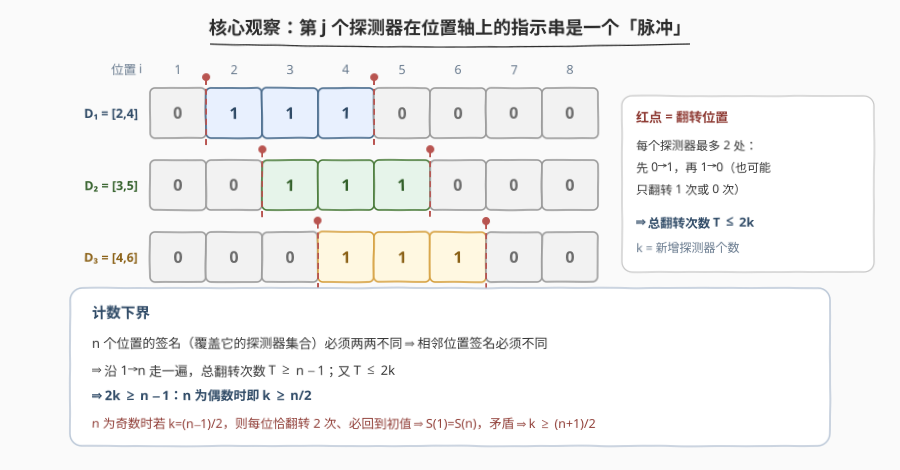
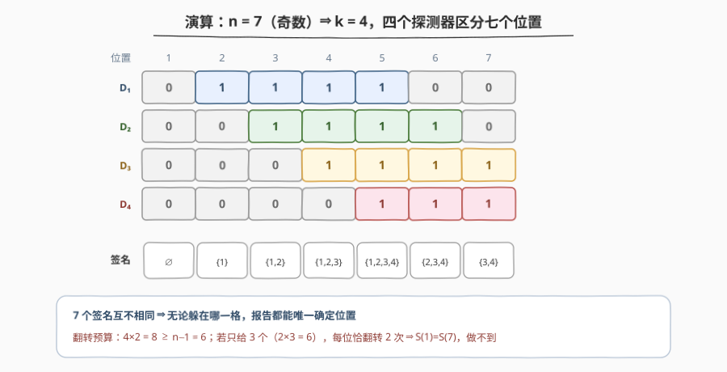

# Codeforces 2261D1 来吧朋友，别这么害怕（简单版） 题解
## 1. 题目概述

- **标题 / 题号**：来吧朋友，别这么害怕（简单版）（Codeforces 2261D1，英文名 Come Be My Friend, Don't Be So Scared (Easy Version)）
- **链接**：https://codeforces.com/problemset/problem/2261/D1
- **来源**：WorldQuant Round 1 (Codeforces Round 1128, Div. 1 + Div. 2) · Problem D1
- **难度**：1300
- **限制**：时间 2 s / 内存 256 MB
- **标签**：构造，贪心，数学

**题意**：一排 $n$ 个藏身点，编号 $1..n$，人恰好躲在其中一个。威瑞提勋爵可以安装探测器，每个探测器覆盖一段**连续**的区间 $[u,v]$，事后一次性上报「人是否在这段区间里」。所有探测器都必须在看到任何报告之前一次性选定，之后不能再追加、也不能根据报告换方案。

场上已有 $m$ 个探测器 $[l_i,r_i]$，**简单版保证 $m=0$**（困难版才有 $m\ge 0$）。要求新增**最少**的探测器个数 $k$，并给出这 $k$ 个区间，使得无论人躲在哪一个点，$n$ 个点对应的 $0/1$ 报告向量两两不同——这样报告集合就能唯一反推出位置。

多测：首行 $t$，每组给出 $n$ 与 $m$（本版本 $m=0$，故其后没有探测器行），先输出 $k$，再输出 $k$ 行 $u_j\ v_j$。若有多解，输出任意一组（**special judge**，不与样例逐字比对）。

**约束**：

- $1 \le t \le 10^4$，$1 \le n \le 2\cdot 10^5$，$m=0$，$\sum n \le 2\cdot 10^5$；
- 新增端点满足 $1 \le u_j \le v_j \le n$；
- 答案 $k=\lceil n/2\rceil$，**输出规模本身就是 $\Theta(n)$**，所以「每组 $O(n)$ 边算边输出」就是正解量级，不需要任何数据结构；
- 总输出约 $t+\sum k \le 10^4+10^5$ 行，必须快速输出。

## 2. 示例与观察
**官方样例**

```text
输入
3
1 0
2 0
3 0

输出
0
1
1 1
2
1 1
2 2
```

$n=1$ 时位置本来就唯一，$k=0$；$n=2$ 只需一个探测器 $[1,1]$：报告 $1$ 就在 $1$，报告 $0$ 就在 $2$；$n=3$ 官方给的是 $[1,1],[2,2]$，三个报告向量为 $(1,0),(0,1),(0,0)$，两两不同。

> 💡 本题是 special judge：$n=3$ 也可以答 $[2,3],[3,3]$，此时三个报告向量是 $(0,0),(1,0),(1,1)$，同样合法。**只要 $k$ 最小、向量互不相同即可，不要照抄样例。**

**自造样例**（本文构造程序的真实输出，覆盖 $n=1$、偶数、奇数）

```text
输入
3
1 0
4 0
7 0

输出
0
2
2 3
3 4
4
2 5
3 6
4 7
5 7
```

$n=4$ 时四个签名是 $\varnothing,\{1\},\{1,2\},\{2\}$；$n=7$ 的逐个签名见 §3.4，七个集合互不相同。

## 3. 解题思路

### 3.1 暴力思路

最直白的做法是枚举 $k=0,1,2,\dots$，对每个 $k$ 枚举所有 $\binom{n(n+1)/2}{k}$ 种区间组合，再逐个位置算出报告向量判重。$n=2\cdot10^5$ 时候选区间有约 $2\times10^{10}$ 个，连「存下来」都做不到，更别说枚举子集。另一种常见错觉是「信息论下界」：$k$ 个探测器只有 $2^k$ 种报告向量，所以 $k\ge\lceil\log_2 n\rceil$ 就够了。但探测器被限制成**区间**，它产生的不是任意 01 编码，而是一条"脉冲"，能表达的信息远少于 $k$ 个自由比特——真正的下界是 $\lceil n/2\rceil$，比 $\log_2 n$ 大得多。

### 3.2 核心观察：每个探测器是一条"脉冲"，用翻转次数记账



把第 $j$ 个探测器在位置轴上的指示函数写开：

$$\mathbf 1_j(i)=[\,u_j\le i\le v_j\,],\qquad S(i)=\{\,j:\mathbf 1_j(i)=1\,\}$$

$S(i)$ 就是「人躲在 $i$ 时收到的报告向量」中被置 1 的下标集合（等价于报告向量本身）。沿 $i=1,2,\dots,n$ 看，$\mathbf 1_j$ 的形状必然是

$$0\cdots0\;\underbrace{1\cdots1}_{[u_j,v_j]}\;0\cdots0$$

也就是一次 $0\to1$、至多一次 $1\to0$：**每个探测器的比特最多翻转 2 次**（若 $u_j=1$ 或 $v_j=n$ 则更少）。

「$n$ 个签名两两不同」意味着相邻位置 $i$ 与 $i+1$ 的签名必须不同，于是 $i$ 与 $i+1$ 之间至少有一个探测器翻转。记所有探测器的总翻转次数为 $T$：

$$T\ \ge\ n-1,\qquad T\ \le\ 2k\quad\Longrightarrow\quad k\ \ge\ \Big\lceil\frac{n-1}{2}\Big\rceil .$$

$n$ 为偶数时这个下界正好是 $n/2=\lceil n/2\rceil$；$n=2m+1$ 为奇数时只得到 $k\ge m$，还差一步：若真的取 $k=m$，则 $T\ge n-1=2m$ 且 $T\le 2m$ 必须同时取等，于是**每个探测器恰好翻转 2 次**，即每个比特最后都回到它的初始值，导致 $S(n)=S(1)$，与两两不同矛盾。所以奇数时 $k\ge m+1=\lceil n/2\rceil$。

合起来（$n=1$ 时位置唯一，$k=0$）：

$$k=\begin{cases}0,& n=1\\[2pt] \lceil n/2\rceil,& n\ge 2\end{cases}$$

### 3.3 算法流程：阶梯构造

![阶梯构造：第 j 个探测器取 [j+1, k+j]](../../../images/cf2261d1_staircase.svg)

取 $k=\lceil n/2\rceil$，第 $j$ 个新增探测器取

$$[\,j+1,\ \min(k+j,\,n)\,],\qquad j=1,2,\dots,k .$$

它确实是一段合法区间：$k\ge1$ 给出 $j+1\le k+j$，而 $n\ge2$ 时 $j+1\le k+1\le n$。位置 $i$ 的签名可以写成闭式：

$$S(i)=\begin{cases}\varnothing,& i=1\\[2pt] \{1,2,\dots,i-1\},& 2\le i\le k+1\\[2pt] \{i-k,\ i-k+1,\ \dots,\ k\},& k+2\le i\le n\end{cases}$$

前半段是**前缀集合**，从 $\varnothing$ 一路加到 $\{1,\dots,k\}$；后半段是**后缀集合**，从 $\{2,\dots,k\}$ 一路缩到 $\{k\}$（奇数 $n$ 时最后一两格被 $n$ 截断，集合族相应变短）。两族集合各自互不相同、且不可能相等（引理 4），所以 $n$ 个签名两两不同，构造合法。

**流程**（每组测试数据）：

1. 读 $n,m$，把紧随其后的 $m$ 行探测器读掉（本版本 $m=0$，循环体一次也不执行）；
2. 若 $n=1$，输出 $0$ 并结束本组；
3. 否则 $k=(n+1)/2$，输出 $k$；
4. 对 $j=1..k$ 输出 $j+1$ 与 $\min(k+j,n)$；
5. 全程 $O(n)$ 时间、$O(1)$ 额外空间。

### 3.4 示例演算



$n=7$（奇数）$\Rightarrow k=4$，四个探测器为 $[2,5],[3,6],[4,7],[5,7]$：

| 位置 $i$ | 1 | 2 | 3 | 4 | 5 | 6 | 7 |
|---|---|---|---|---|---|---|---|
| $D_1=[2,5]$ | 0 | 1 | 1 | 1 | 1 | 0 | 0 |
| $D_2=[3,6]$ | 0 | 0 | 1 | 1 | 1 | 1 | 0 |
| $D_3=[4,7]$ | 0 | 0 | 0 | 1 | 1 | 1 | 1 |
| $D_4=[5,7]$ | 0 | 0 | 0 | 0 | 1 | 1 | 1 |
| 签名 $S(i)$ | $\varnothing$ | $\{1\}$ | $\{1,2\}$ | $\{1,2,3\}$ | $\{1,2,3,4\}$ | $\{2,3,4\}$ | $\{3,4\}$ |

七个签名互不相同，任意一格都能被唯一确定。翻转预算也正好说得通：$4$ 个探测器共 $8$ 次翻转，而 $n-1=6$ 次就够；若只给 $3$ 个（翻转预算 $2\times3=6$ 恰好等于 $n-1$），则每个探测器的两次翻转都必须用满、比特最终回到初值，$S(1)$ 与 $S(7)$ 必然相同——所以 $k=3$ 不可能，$k=4$ 最优。

## 4. 算法细节

1. **$n=1$ 必须特判**：$(n+1)/2$ 在 $n=1$ 时等于 $1$，但位置本来就唯一，$k$ 应为 $0$。若不特判，还会输出 $l=2>n$ 的非法区间。
2. **右端点必须与 $n$ 取 $\min$**：奇数 $n$ 时 $k+j$ 会超过 $n$（例如 $n=7,k=4,j=4$ 时 $k+j=8$），写成 $\min(k+j,n)$ 就自动把最后一个探测器截断成 $[k+1,n]$，阶梯结构不受影响。
3. **读掉 $m$ 行**：本版本 $m\equiv0$，但仍保留 `for (i<m) read(l,r)` 的循环——同一份代码稍改就能处理困难版，且不会因为漏读而让下一个测试数据错位。
4. **输出量 $\Theta(n)$**：C++ 用 `printf`，Python 用 `sys.stdout.write("\n".join(out))` 一次性写出，禁止逐行 `endl` 或逐行 `print` 刷缓冲（$10^5$ 行会明显变慢）。
5. **多测清空**：本题不需要任何数组，全部变量都在 `while (t--)` 内部定义即可；不要写成全局累加器。
6. **1-indexed 与整型**：区间端点、$n$ 全是 $1$ 基；$n\le2\cdot10^5$，$k\le10^5$，`int` 足够，不需要 `long long`。
7. **构造与下界一致**：输出前不必验证，但可以本地用 $O(nk)$ 的小检查确认 $n$ 个签名互不相同（$n\le 300$ 全枚举已在本地验证过）。

## 5. 正确性证明

**引理 1（单比特翻转次数 ≤ 2）**：对任意探测器 $j$，序列 $\mathbf 1_j(1),\mathbf 1_j(2),\dots,\mathbf 1_j(n)$ 发生相邻变化的次数至多 $2$。

**证明**：$\mathbf 1_j(i)$ 只在 $i\in[u_j,v_j]$ 时为 $1$，即该序列形如 $0^{u_j-1}1^{v_j-u_j+1}0^{n-v_j}$，最多出现一次 $0\to1$ 与一次 $1\to0$。∎

**引理 2（翻转下界）**：若 $n$ 个签名两两不同，则总翻转次数 $T\ge n-1$，从而 $2k\ge T\ge n-1$。

**证明**：相邻位置 $i,i+1$ 的签名不同，故存在 $j$ 使 $\mathbf 1_j(i)\ne\mathbf 1_j(i+1)$，即 $i$ 与 $i+1$ 之间发生了一次翻转。$n-1$ 个相邻间隙各贡献至少一次不同探测器的翻转，累加得 $T\ge n-1$；又由引理 1，$T\le 2k$。∎

**引理 3（奇数情形的加强下界）**：设 $n=2m+1\ge3$，则 $k\ge m+1$。

**证明**：反设 $k\le m$。由引理 2 有 $T\ge n-1=2m$，而引理 1 给出 $T\le 2k\le 2m$，两个不等式夹出 $k=m$ 且 $T=2m$，即所有估计都取等。$T=2m$ 说明每个探测器的翻转次数之和恰为 $2m=2k$，由引理 1 每个探测器都恰好翻转 $2$ 次，于是 $\mathbf 1_j(n)=\mathbf 1_j(1)$ 对每个 $j$ 成立，推出 $S(n)=S(1)$，与「两两不同」矛盾。故 $k\ge m+1$。∎

**引理 4（构造的签名与互异性）**：设 $k=\lceil n/2\rceil$，探测器取 $[j+1,\min(k+j,n)]$，则 $S(i)$ 恰为 §3.3 中的闭式；且这些集合两两不同。

**证明**：$j\in S(i)$ 当且仅当 $j+1\le i$ 且 $i\le\min(k+j,n)$，即 $j+1\le i\le k+j$（注意 $i\le n$ 已成立）。$i=1$ 时无 $j$ 满足 $j+1\le1$，得 $\varnothing$。$2\le i\le k+1$ 时，$j\le i-1$ 的 $j$ 都满足 $i\le k+1\le k+j$，故 $S(i)=\{1,\dots,i-1\}$。$k+2\le i\le n$ 时所有 $j\le k\le i-2$ 自动满足 $j+1\le i$，只剩 $i\le k+j\iff j\ge i-k$，故 $S(i)=\{i-k,\dots,k\}$。

互异性：前半段是前缀族 $P_a=\{1,\dots,a\}$（$a=0,\dots,k$，$P_0=\varnothing$），两两不同；后半段是后缀族 $Q_b=\{k-b+1,\dots,k\}$（$1\le b\le k-1$），也两两不同。若 $P_a=Q_b$，则两者大小相同给出 $a=b$，再由 $Q_b$ 的最小元 $k-b+1$ 必须等于 $1$ 得 $b=k$，与 $b\le k-1$ 矛盾。故两族不相交且内部互异。∎

**定理**：上述构造用 $k=0$（$n=1$）或 $k=\lceil n/2\rceil$（$n\ge2$）个探测器即可唯一确定位置，且这是最小数量。

**证明**：存在性由引理 4（$n\ge2$）；$n=1$ 无探测器也已唯一，$k=0$ 显然最优。最优性：$n$ 为偶数时由引理 2 得 $2k\ge n-1$，即 $k\ge n/2=\lceil n/2\rceil$；$n\ge3$ 奇数时由引理 3 得 $k\ge m+1=\lceil n/2\rceil$。故输出个数等于下界，最小。∎

## 6. 复杂度分析

- **时间**：每组 $O(n)$——循环 $k=\lceil n/2\rceil\le n$ 次，每次常数次整数运算与一次输出；总 $O(\sum n)\le2\cdot10^5$ 次基本操作，另有 $\Theta(\sum n)$ 的输出量（这部分无法避免，因为必须打印所有区间）。本地实测 $t=10^4$、$\sum n=2\cdot10^5$：C++ 约 24 ms，Python 约 95 ms；单组 $n=2\cdot10^5$ 与 $t=10^4$ 两种极端都在 2 s 内，余量充足。
- **空间**：$O(1)$ 额外空间（不存任何数组）；若采用"先收集再一次写出"的写法，则是 $O(\sum n)$ 的输出缓冲。

## 7. 参考代码

### C++17

```cpp
#include <bits/stdc++.h>
using namespace std;

int main() {
    int t;
    if (scanf("%d", &t) != 1) return 0;
    while (t--) {
        int n, m;
        scanf("%d %d", &n, &m);
        for (int i = 0; i < m; i++) {   // 本版本 m = 0，循环体不执行；保留以便复用
            int l, r;
            scanf("%d %d", &l, &r);
        }
        if (n == 1) {                   // 只有一个位置，无需探测器
            printf("0\n");
            continue;
        }
        int k = (n + 1) / 2;            // ceil(n/2)，n >= 2
        printf("%d\n", k);
        for (int j = 1; j <= k; j++) {
            int l = j + 1;
            int r = min(k + j, n);      // 奇数 n 时截断，保证 r <= n
            printf("%d %d\n", l, r);
        }
    }
    return 0;
}
```

### Python3

```python
import sys

def main():
    data = sys.stdin.buffer.read().split()
    if not data:
        return
    pos = 0
    t = int(data[pos]); pos += 1
    out = []
    for _ in range(t):
        n = int(data[pos]); m = int(data[pos + 1]); pos += 2
        pos += 2 * m                      # 本版本 m = 0，直接跳过
        if n == 1:
            out.append("0")
            continue
        k = (n + 1) // 2                  # ceil(n/2)，n >= 2
        out.append(str(k))
        for j in range(1, k + 1):
            l = j + 1
            r = min(k + j, n)             # 奇数 n 时截断
            out.append(f"{l} {r}")
    sys.stdout.write("\n".join(out) + "\n")

main()
```

## 8. 边界情况与易错点

1. **$n=1$**：答案 $0$，不能输出任何区间。若直接用 $(n+1)/2$，会得到 $k=1$ 并输出 $l=2>n$ 的非法区间，被 special judge 判 WA。
2. **$n=2$**：$k=1$，$[2,2]$ 或 $[1,1]$ 都行；但绝不能输出 $[1,2]$——它报告恒为 $1$，两个位置仍然无法区分。
3. **奇数 $n$ 的右端点截断**：$k+j$ 可能等于 $n+1$，必须 `min(k+j, n)`；忘记截断会输出 $v>n$ 的区间。
4. **special judge，不要照抄样例**：样例给 $n=3$ 的是 $[1,1],[2,2]$，本文构造给的是 $[2,3],[3,3]$，两者都正确；关键是 $k$ 最小且报告向量互不相同。
5. **多测输出格式**：每组先 $k$ 再 $k$ 行，组与组之间不要空行，行末不要多余空格；$m$ 行输入即使为空也要"读过去"（本版本没有这些行，循环自然不执行）。
6. **大输出与整型**：$\sum k$ 可达 $10^5$ 行，Python 逐行 `print` 在 $10^4$ 组时会明显变慢，应拼成一个字符串一次写出，C++ 用 `printf`/`'\n'` 而非 `endl`；全部 1-indexed，$n\le2\cdot10^5$ 时 `int` 足够。

## 9. 验证记录

- **编译环境与命令**：`clang++ -std=c++17 -O2`（本机无 GNU g++，配 `codeforces/tools/include/bits/stdc++.h` 兼容头；正文代码只用标准库，可原样提交 GNU C++17）；Python 侧为 `Python 3.9.6`。
- **官方样例**：0 / 1 通过 token 比对；本题输出不唯一（构造 / 多解 / 特殊评测），剩余差异属预期，样例含义已在第 2 节逐组解释。
- **复核状态**：audited（2026-11-19 统一回归：编译 + 官方样例；写作期的随机对拍与暴力未重跑）。

## 相关题目与扩展

- [Codeforces 2261D2. Come Be My Friend, Don't Be So Scared (Hard Version)](https://codeforces.com/problemset/problem/2261/D2)：同一场的困难版，$m$ 可以任意大，需要先把已有探测器切出的"等价块"算清楚。
- [Codeforces 1486C1. Guessing the Greatest (easy version)](https://codeforces.com/problemset/problem/1486/C1)：交互题，每次询问一个区间并得到区间次大值的位置，靠**自适应**二分定位。
- [Codeforces 1520F1. Guess the K-th Zero (easy version)](https://codeforces.com/problemset/problem/1520/F1)：同样是自适应区间询问（问区间和），$\lceil\log_2 n\rceil$ 级别即可确定下标。
- [LeetCode 374. 猜数字大小](https://leetcode.cn/problems/guess-number-higher-or-lower/)：自适应二分的极简版，$O(\log n)$ 次询问。

**延伸思考**：

1. **允许自适应会快多少？** 若探测器可以「先看上次报告再决定下一个区间」，每次询问把候选集切成"在内/在外"两半，$k=\lceil\log_2 n\rceil$ 就够（$n=10^5$ 只要 17 个）。本题的非自适应 + 每个探测器只能覆盖一段连续区间，把答案从 $17$ 抬到了 $\lceil n/2\rceil$——**"一次问完"的代价就是线性**。反过来，若探测器可以是任意位置集合（不再是区间），问题就退化成用 $k$ 个集合给 $n$ 个点做二进制编码，答案正是 $\lceil\log_2 n\rceil$，可见全部难度都来自"区间"这一形状约束。
2. **困难版的结构**：$m>0$ 时，已有探测器先把 $1..n$ 切成若干等价块（相邻位置若被某个已有探测器分开就不同块）。新探测器在每一块内的作用仍是"一段连续区间"，即块内的一次脉冲；块内规模为 $c$ 时需要 $\lceil c/2\rceil$ 量级的翻转，但一个探测器**可以同时作用在多块上**（把中间整块完全覆盖时，该块内不产生任何翻转），于是翻转预算在块间共享，答案不能简单地对各块求和——这正是 D2 需要并查集 + 双指针去合并块的原因。
