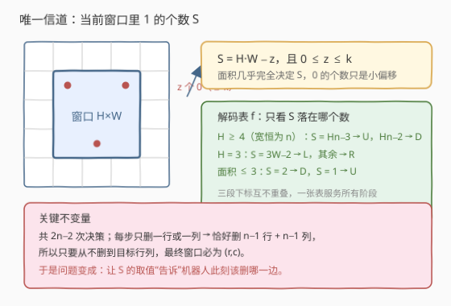
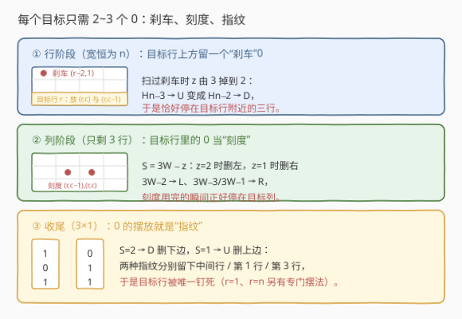
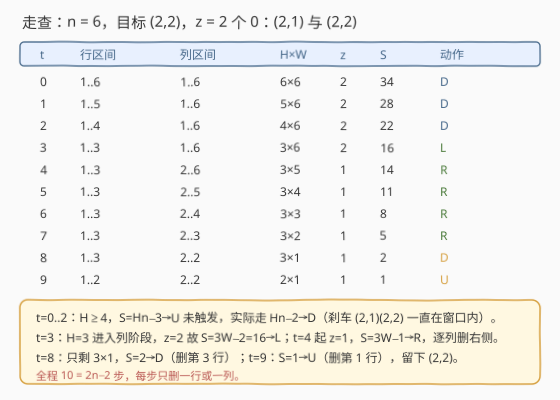

# Codeforces 2261F1 Plegma II：问我任意格（简单版） 题解

## 1. 题目概述

- **标题 / 题号**：Plegma II：问我任意格（简单版）（Codeforces 2261F1，英文名 Plegma II: Ask Me Any Cell (Easy Version)）
- **链接**：https://codeforces.com/problemset/problem/2261/F1
- **来源**：WorldQuant Round 1 (Codeforces Round 1128, Div. 1 + Div. 2) · Problem F1
- **难度**：2500（2500 分）
- **限制**：时间 2 s / 内存 256 MB
- **标签**：构造，贪心，数学，输出型

**题意**：这是一道「输出型」构造题，要求选手同时给出**编码器**和**一张解码表**。

- **编码阶段**：对每个目标格 $(r,c)$（共 $n^2$ 个，按先行后列输出：第 $i$ 块对应 $r=\lfloor(i-1)/n\rfloor+1$、$c=((i-1)\bmod n)+1$）输出一个 $n\times n$ 的 01 网格，其中 $0$ 的个数不能超过 $k$。可以理解为「用 $1$（信号灯）铺满棋盘，只在少数格子上挖洞」。
- **解码阶段**：输出长度 $n^2+1$ 的字符串 $a_0a_1\cdots a_{n^2}$，字符取自 `U/D/L/R`。机器人 Circuity 从整个棋盘 $[(1,1),(n,n)]$ 出发，做 $2n-2$ 次决策：设当前子矩形内 $1$ 的个数为 $S$，它就执行动作 $a_S$——`U` 让上边界下移一行、`D` 让下边界上移一行、`L` 让左边界右移一列、`R` 让右边界左移一列。要求边界任何时刻都不交叉（$x_0\le x_1$、$y_0\le y_1$），且 $2n-2$ 次之后子矩形恰好收缩成 $(r,c)$。

题眼：**机器人每步只看当前的 $S$**，既没有记忆，也读不到坐标。因此同一个 $S$ 在所有目标、所有时刻都必须被解释成同一个动作——解码表只有一张。

**约束**：

- 输入只有一个整数 $n$；官方只有两组测试：$n=3$（$k=9$）与 $n=20$（$k=24$）。
- 每个网格 $0$ 的个数 $\le k$；解码串长度恰为 $n^2+1$。
- 输出规模 $\Theta(n^4)$：$n=20$ 时约 $1.7\times10^5$ 字符。
- hacks 已关闭，special judge 只校验合法性（网格数、每块 $n\times n$、$0$ 的个数、轨迹终点），不逐字比对。

## 2. 示例

**官方样例（$n=3$，$k=9$）**

```text
输入
3

输出
111
111
001

011
111
100

110
110
110

010
111
111

111
111
111

010
111
101

111
111
110

111
011
111

011
010
111

DURLDULRUU
```

九块网格依次对应 $(1,1),(1,2),\dots,(3,3)$，解码串长度为 $10=3^2+1$。以目标 $(1,3)$（第三块 `110/110/110`）为例，机器人做 $4=2\cdot3-2$ 步：$S=6\to a_6=\mathtt L$、$S=3\to a_3=\mathtt L$、$S=0\to a_0=\mathtt D$、$S=0\to a_0=\mathtt D$，窗口依次收缩为 $[(1,2),(3,3)]\to[(1,3),(3,3)]\to[(1,3),(2,3)]\to[(1,3),(1,3)]$，终点正是 $(1,3)$。

> 💡 本题 $k$ 给得很松（$n=20$ 时 $k=24$），但下面给出的构造每块**至多用 3 个 0**——它同时满足困难版 $f(n)=3$ 的约束，所以简单版的余量完全用不上，我们反而要利用「$z\le3$」这一点来设计解码表。

## 3. 解题思路

### 3.1 暴力思路

解码表是一张 $n^2+1$ 项、每项 4 种取值的表，编码端每个目标又可以从 $2^{n^2}$ 个网格里挑一个——直接搜是 $4^{n^2+1}\cdot 2^{n^4}$ 量级，$n=3$ 时都跑不完。必须反过来想：**先定解码表（即先定「$S$ 落在哪个数就干什么」），再为每个目标配一个网格**。由于解码表一旦定死、每个目标的网格就互不影响，问题被拆成 $n^2$ 个互不相关的构造。

### 3.2 核心观察：$S=\text{面积}-\text{窗口内 0 的个数}$

设当前窗口是 $H\times W$、内部有 $z$ 个 $0$，则

$$S = HW - z,\qquad 0\le z\le k .$$

若每块网格只放不超过 $3$ 个 $0$，就有 $z\le3$：**$S$ 几乎就是窗口面积，只带一个不超过 3 的偏移**。面积由窗口形状 $H\times W$ 唯一决定，而 $z$ 是编码者可以自由摆放的「旋钮」。于是只要把解码表按 $S$ 的取值切成互不重叠的几段，就能让 $S$ 说明「现在处于哪个阶段、该删哪一边」。

同时注意一个**硬性不变量**：一共只有 $2n-2$ 次决策，而若每步只删一行或一列，则删满 $n-1$ 行与 $n-1$ 列恰好用掉 $2n-2$ 步。因此整个过程必须**恰好**删 $n-1$ 行、$n-1$ 列，不能多也不能少；只要从未删到目标的第 $r$ 行、第 $c$ 列，终点就必然是 $(r,c)$。



把过程分成三段（下标区间互不重叠，一张表就能服务所有阶段）：

- **行阶段**（宽度保持 $n$、$H\ge4$）：$S\in\{Hn-3,Hn-2\}$。令 $a_{Hn-3}=\mathtt U$、$a_{Hn-2}=\mathtt D$，等价于「窗口里有 3 个 0 就删上边，有 2 个 0 就删下边」。
- **列阶段**（$H=3$）：$S=3W-z$，故 $S\bmod3=(-z)\bmod3$。令 $a_{3W-2}=\mathtt L$、其余置 $\mathtt R$，等价于「窗口里有 2 个 0 就删左边，否则删右边」。
- **收尾**（面积 $\le3$）：只剩 $S\in\{0,1,2\}$。令 $a_2=\mathtt D$、$a_1=a_0=\mathtt U$，即「有 0 就删下边，全 1 就删上边」。

三段用到的下标是 $[0,2]\cup[3,3n-1]\cup[4n-3,n^2-2]$，其中 $[3,3n-1]$ 与 $[4n-3,n^2-2]$ 不相交要求 $n\ge4$；$n=3$ 直接输出题面样例即可。

### 3.3 算法流程：0 的三种角色

每个目标只放 2~3 个 $0$（其余全 $1$，坐标为 1-indexed），按 $r$ 分成三类：

- **类 A（$r=1$）**：放 $(3,c)$；若 $c\ge2$ 再放 $(1,c-1)$，否则放 $(4,1)$。共 2 个。
- **类 B（$r=n$）**：放 $(n-1,c)$、$(n,c)$；若 $c\le n-1$ 再放 $(n,c+1)$，否则放 $(n-3,1)$。共 3 个。
- **类 C（$2\le r\le n-1$）**：若 $r\ge3$ 放 $(r-2,1)$；放 $(r,c)$；若 $c\ge2$ 再放 $(r,c-1)$，否则（$c=1$）当 $r=n-1$ 放 $(r-2,2)$、不然放 $(r+2,1)$。共 2~3 个。

三个 $0$ 各司其职：

| 角色 | 位置 | 作用 |
|------|------|------|
| 刹车 | 目标行上方那一个 $0$（不一定存在） | 行阶段扫过它时 $z$ 由 3 掉到 2，动作从 $\mathtt U$ 切到 $\mathtt D$，恰好停在三行 |
| 刻度 | 目标行里的 1~2 个 $0$ | 列阶段按 $z$ 由 2 掉到 1 的跳变，先删左、再删右，精确停在目标列 |
| 指纹 | 最后 $3\times1$ 中 $0$ 的摆法 | 配合 $S\in\{0,1,2\}$ 的收尾表，把目标行钉死 |



解码表的构造（长度 $n^2+1$，初值全 $\mathtt U$）：$a_2\leftarrow\mathtt D$；对 $H=4..n$ 置 $a_{Hn-3}\leftarrow\mathtt U$、$a_{Hn-2}\leftarrow\mathtt D$；对 $W=2..n$ 置 $a_{3W-3}\leftarrow\mathtt R$、$a_{3W-2}\leftarrow\mathtt L$、$a_{3W-1}\leftarrow\mathtt R$。三段下标互不覆盖，所以填表顺序无关紧要。

### 3.4 示例演算

取 $n=6$、目标 $(2,2)$（类 C）：$r=2<3$，放 $(2,2)$ 与 $(2,1)$ 两个 $0$（共 2 个）。逐帧走查：

| 步 $t$ | 行区间 | 列区间 | $H\times W$ | $z$ | $S$ | 动作 |
|----|--------|--------|-------------|-----|-----|------|
| 0 | 1..6 | 1..6 | $6\times6$ | 2 | 34 | D |
| 1 | 1..5 | 1..6 | $5\times6$ | 2 | 28 | D |
| 2 | 1..4 | 1..6 | $4\times6$ | 2 | 22 | D |
| 3 | 1..3 | 1..6 | $3\times6$ | 2 | 16 | L |
| 4 | 1..3 | 2..6 | $3\times5$ | 1 | 14 | R |
| 5 | 1..3 | 2..5 | $3\times4$ | 1 | 11 | R |
| 6 | 1..3 | 2..4 | $3\times3$ | 1 | 8 | R |
| 7 | 1..3 | 2..3 | $3\times2$ | 1 | 5 | R |
| 8 | 1..3 | 2..2 | $3\times1$ | 1 | 2 | D |
| 9 | 1..2 | 2..2 | $2\times1$ | 1 | 1 | U |

第 0~2 步 $H\ge4$、$z=2$，读到的都是 $Hn-2$，连续删下边；第 3 步 $H=3$ 进入列阶段，$z=2$ 使 $S=3W-2$，删左边一次；此后 $z$ 掉到 1，$S=3W-1$，一律删右边；第 8、9 步在 $3\times1$ 里按 $S=2\to\mathtt D$、$S=1\to\mathtt U$ 收尾，留下 $(2,2)$。



## 4. 算法细节

1. **先定表再配格**：解码表只与 $n$ 有关，编码端逐目标独立，这是把 $n^2$ 个构造解耦的关键；千万不要反过来「先造网格再找表」。
2. **$n=3$ 特判**：类 A 在 $c=1$ 时要写 $(4,1)$、类 B 要写 $(n-3,1)$，$n=3$ 会越界；而且 $[3,3n-1]$ 与 $[4n-3,n^2-2]$ 的不相交也要求 $n\ge4$。直接输出题面样例（它就是 $n=3,k=9$ 的合法答案）。
3. **写格前先整块置 1**：每块网格重新初始化，再把 $2\sim3$ 个位置置 $0$；坐标换算用 1-indexed 最省心，输出先行后列。
4. **越界保护**：类 A/B/C 的少数分支（$n=3$、$c=1$、$r=n-1$）会写出范围外的坐标，统一用 `put(i,j)` 判断 $1\le i,j\le n$ 后再落笔，越界即忽略。
5. **不要真模拟**：按公式 $O(n^2)$ 填一块，总复杂度 $O(n^4)$ 即输出规模；若对每块逐步数 $1$，会退化到 $O(n^6)$。
6. **大输出**：$n=20$ 约 $1.7\times10^5$ 字符，C++ 关闭同步并用 `'\n'`，Python 用列表拼接后一次写出；本题输入只有一组，但读成 `while (cin >> n)` / `data[0]` 都不出错。

## 5. 正确性证明

**引理 1（步数与边界不变量）**：若每次决策只删一行或一列且从不越界，则经过 $2n-2$ 步后窗口必为单格；并且此时删掉的行数恰为 $n-1$、列数恰为 $n-1$。

**证明**：每步把 $H+W$ 减少 1，初值 $2n$，终值 2，所以 $2n-2$ 步后 $H+W=2$，即 $H=W=1$。行数减少 $n-H$、列数减少 $n-W$，二者之和为 $2n-(H+W)=2n-2$，且各自不超过 $n-1$，故都恰为 $n-1$。∎

**引理 2（不删目标行/列 $\Rightarrow$ 终点正确）**：若整条轨迹从未删除第 $r$ 行与第 $c$ 列，则终点必为 $(r,c)$。

**证明**：行边界只从两端收缩、且第 $r$ 行始终在窗口内，故最终留下的唯一行就是 $r$；列同理。由引理 1，终点是单格，于是为 $(r,c)$。∎

**引理 3（行阶段始终安全）**：对类 A/B/C 的任意目标，行阶段（$H\ge4$、窗口含第 $r$ 行）里 $z\in\{2,3\}$，且 $z=3$ 时第 $1$ 行（或第 $n$ 行）尚未越过目标行，$z=2$ 时删下边也安全。

**证明**：类 C 的「刹车」$0$ 位于 $(r-2,1)$（$r\ge3$ 时）或不存在；它随上边界下移而离窗，使 $z$ 从 3 掉到 2，而这一跳发生在 $H=4\to3$ 之前，于是 $\mathtt U$ 一直删到第 $r-2$ 行、$\mathtt D$ 从第 $r+1$ 行往下删。类 A 的刹车在 $(3,c)$ 保证 $r=1$ 时只走 $\mathtt D$ 分支；类 B 的 $0$ 全在第 $n-1,n$ 行，保证 $r=n$ 时只走 $\mathtt U$ 分支。三种情形都不会删到第 $r$ 行。∎

**引理 4（列阶段与收尾始终安全）**：$H=3$ 后 $z\in\{1,2\}$，$z=2$ 时删左边、$z=1$ 时删右边，恰好停在目标列；最后 $3\times1$ 中 $0$ 的摆法使 $S\in\{1,2\}$ 分别对应删上边、删下边，留下第 $r$ 行。

**证明**：列阶段窗口只含目标行里的刻度 $0$，它们随左边界右移而离窗，$z$ 的 2→1 跳变发生在左边界越过 $c-1$ 时，此后 $S=3W-1$ 恒取 $\mathtt R$，右边界一路收到第 $c$ 列。收尾时 $S=2$ 说明 $3\times1$ 中间格是 $0$，删下边留下 $r$；$S=1$ 说明首格是 $0$，删上边留下 $r$；两种指纹分别覆盖 $r=1$、$r=n$ 与 $2\le r\le n-1$ 的摆放。∎

**定理**：按本构造输出的 $n^2$ 块网格（每块 $0$ 数 $\le3$）与解码表，使每个目标 $(r,c)$ 都在 $2n-2$ 步后停在 $(r,c)$，且全程不越界；$n=3$ 时输出的题面样例同样合法。

**证明**：引理 3、4 给出三个阶段的动作合法且不删目标行列，引理 1、2 给出终点必为 $(r,c)$；每块网格的 $0$ 数由类 A/B/C 的列举可知 $\le3\le k$（$k=24$、$n=3$ 时 $k=9$）。样例的合法性可逐步模拟验证。∎

## 6. 复杂度分析

- **时间**：填表 $O(n^2)$；编码端每个目标 $O(n^2)$ 初始化为全 $1$，共 $n^2$ 个目标，总计 $O(n^4)$，与输出规模同阶。$n=20$ 实测 C++ 约 $8$ ms、Python 约 $30$ ms（含输出），远低于 2 s。
- **空间**：网格 $O(n^2)$，解码表 $O(n^2)$；若边生成边输出则只需 $O(n^2)$。
- **输出规模**：$n^4+n^2$ 字符量级，$n=20$ 约 $1.7\times10^5$ 字节，I/O 用缓冲写即可。

## 7. 参考代码

### C++17

```cpp
#include <cstdio>
#include <cstring>
#include <vector>
#include <string>
using namespace std;

int n;
static const int MAXN = 45;

int main() {
    if (scanf("%d", &n) != 1) return 0;

    // 解码表：长度 n*n+1，初值全 U
    vector<char> a(n * n + 1, 'U');
    if (n >= 4) {
        a[2] = 'D';
        for (int H = 4; H <= n; H++) { a[H * n - 3] = 'U'; a[H * n - 2] = 'D'; }
        for (int W = 2; W <= n; W++) { a[3 * W - 3] = 'R'; a[3 * W - 2] = 'L'; a[3 * W - 1] = 'R'; }
    }

    if (n == 3) {                       // 官方样例即合法答案
        const char* s =
            "111\n111\n001\n\n011\n111\n100\n\n110\n110\n110\n\n010\n111\n111\n\n"
            "111\n111\n111\n\n010\n111\n101\n\n111\n111\n110\n\n111\n011\n111\n\n"
            "011\n010\n111\n";
        fputs(s, stdout);
        fputs("DURLDULRUU\n", stdout);
        return 0;
    }

    vector<string> out;
    out.reserve((size_t)n * n * n + n * n);
    static char g[MAXN][MAXN];
    for (int r = 1; r <= n; r++) {
        for (int c = 1; c <= n; c++) {
            for (int i = 1; i <= n; i++)
                for (int j = 1; j <= n; j++) g[i][j] = '1';
            auto put = [&](int i, int j) {
                if (i >= 1 && i <= n && j >= 1 && j <= n) g[i][j] = '0';
            };
            if (r == 1) {
                put(3, c);
                if (c >= 2) put(1, c - 1); else put(4, 1);
            } else if (r == n) {
                put(n - 1, c); put(n, c);
                if (c <= n - 1) put(n, c + 1); else put(n - 3, 1);
            } else {
                if (r >= 3) put(r - 2, 1);
                put(r, c);
                if (c >= 2) put(r, c - 1);
                else { if (r == n - 1) put(r - 2, 2); else put(r + 2, 1); }
            }
            for (int i = 1; i <= n; i++) { g[i][n + 1] = '\0'; out.push_back(string(g[i] + 1)); }
            out.push_back(string());
        }
    }
    for (auto& s : out) { fputs(s.c_str(), stdout); fputc('\n', stdout); }
    for (int i = 0; i <= n * n; i++) fputc(a[i], stdout);
    fputc('\n', stdout);
    return 0;
}
```

### Python3

```python
import sys

def main():
    data = sys.stdin.read().split()
    if not data:
        return
    n = int(data[0])

    if n == 3:                                  # 官方样例即合法答案
        sys.stdout.write(
            "111\n111\n001\n\n011\n111\n100\n\n110\n110\n110\n\n010\n111\n111\n\n"
            "111\n111\n111\n\n010\n111\n101\n\n111\n111\n110\n\n111\n011\n111\n\n"
            "011\n010\n111\n\nDURLDULRUU\n")
        return

    a = ['U'] * (n * n + 1)                     # 解码表
    a[2] = 'D'
    for H in range(4, n + 1):
        a[H * n - 3] = 'U'
        a[H * n - 2] = 'D'
    for W in range(2, n + 1):
        a[3 * W - 3] = 'R'
        a[3 * W - 2] = 'L'
        a[3 * W - 1] = 'R'

    out = []
    for r in range(1, n + 1):
        for c in range(1, n + 1):
            g = [['1'] * n for _ in range(n)]   # g[i-1][j-1] 表示 (i,j)

            def put(i, j):
                if 1 <= i <= n and 1 <= j <= n:
                    g[i - 1][j - 1] = '0'

            if r == 1:
                put(3, c)
                if c >= 2:
                    put(1, c - 1)
                else:
                    put(4, 1)
            elif r == n:
                put(n - 1, c)
                put(n, c)
                if c <= n - 1:
                    put(n, c + 1)
                else:
                    put(n - 3, 1)
            else:
                if r >= 3:
                    put(r - 2, 1)
                put(r, c)
                if c >= 2:
                    put(r, c - 1)
                elif r == n - 1:
                    put(r - 2, 2)
                else:
                    put(r + 2, 1)

            out.append('\n'.join(''.join(row) for row in g))
            out.append('')
    out.append(''.join(a))
    sys.stdout.write('\n'.join(out) + '\n')

main()
```

## 8. 边界情况与易错点

1. **$n=3$ 必须特判**：类 A/B 的兜底坐标 $(4,1)$、$(n-3,1)$ 在 $n=3$ 时越界；解码表三段下标不重叠也需要 $n\ge4$。直接用题面样例最稳。
2. **$c=1$ 与 $r=n-1$ 的分支**：类 C 在 $c=1$ 时没有 $(r,c-1)$ 可放，需要改用 $(r+2,1)$（$r=n-1$ 时用 $(r-2,2)$）——这是让「指纹」落在合法行上的关键，漏掉就会写出越界坐标。
3. **表的下标边界**：$a_{Hn-3}$ 在 $H=4$ 时是 $4n-3$，$a_{3W-1}$ 在 $W=n$ 时是 $3n-1$，都要求 $n\ge4$；$a_2=\mathtt D$ 不能被列阶段覆盖（$3W-3=2$ 无正整数解，安全）。
4. **每块网格必须重新初始化**：$0$ 的位置逐目标不同，忘记重置会把上一块的洞带进来，$0$ 的个数也会超标。
5. **不要用模拟代替公式**：按「公式填格」是 $O(n^4)$；若对每块逐步数 $1$ 再决定输出，复杂度退化到 $O(n^6)$。
6. **输出格式**：$n^2$ 块、每块 $n$ 行、每行 $n$ 个 01 字符，最后一行是长度 $n^2+1$ 的解码串；块之间允许空行，但别把解码串混进网格里。

## 相关题目与扩展

- [Codeforces 2261F2 Plegma II: Ask Me Any Cell (Hard Version)](https://codeforces.com/problemset/problem/2261/F2)：同一构造的困难版，$k=f(n)=3$ 取到下界；本篇的「刹车/刻度/指纹」三段表正是它的核心，简单版 $k=24$ 只是把这个紧约束放宽。
- [Codeforces 2261D1 Come Be My Friend, Don't Be So Scared (Easy Version)](https://codeforces.com/problemset/problem/2261/D1)：同场另一道「输出型构造 + special judge」，同样要「先设计判据、再配数据」。
- [Codeforces 1352G Special Permutation](https://codeforces.com/problemset/problem/1352/G)：构造题里「按位置分类讨论」的常见套路，可对照本篇的三类目标。

**延伸思考**：

1. 本篇每块至多 3 个 $0$，而 $n=20,k=24$ 允许 24 个。如果只要求通过简单版，能不能给出更短、更好证的构造（例如用 $n+4$ 个 $0$ 做两段「倒计时」，让解码表退化成「余数决定动作」）？代价是表要按 $\bmod n$ 设计，且两段的 $S$ 值域不能相交。
2. 若把「至多 $k$ 个 $0$」换成「至少 $k$ 个 $1$」、或允许每步删两行，$2n-2$ 这个步数就不够用了——此时需要重新论证「每步恰好删一行或一列」的不变量还成不成立。
3. 解码表只有 4 个字符、却要服务 $n^2$ 个目标：本质上是把「面积」当作 $O(n^2)$ 个可用信道，再让 $z\le3$ 的小偏移负责「阶段切换」。凡是「只能看到计数」的交互/输出题，都可以先问一句：这个计数里有没有一个可自由摆放的小量？
