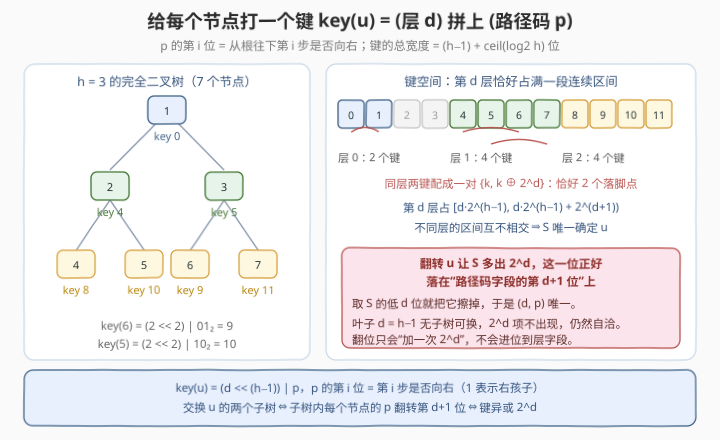
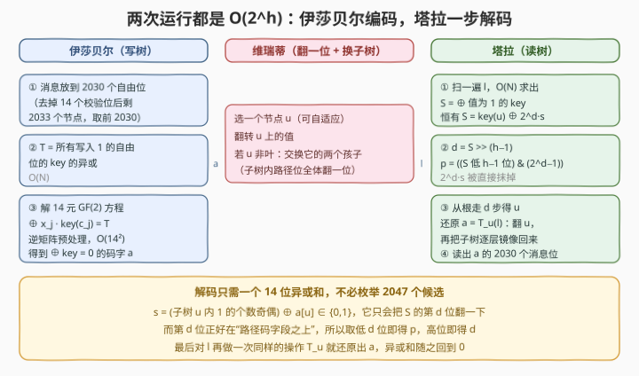
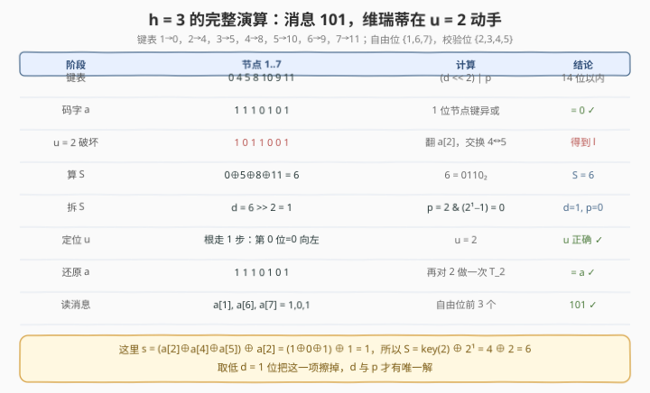

# Codeforces 2261H 噢，树树树，不必离开 题解

## 1. 题目概述

- **标题 / 题号**：噢，树树树，不必离开（Codeforces 2261H，英文名 Oh Tree Tree Tree, No Need to Leave）
- **链接**：https://codeforces.com/problemset/problem/2261/H
- **来源**：WorldQuant Round 1 (Codeforces Round 1128, Div. 1 + Div. 2) · Problem H
- **难度**：$\ast 3500$（4500 分）
- **限制**：时间 3 s / 内存 512 MB
- **标签**：位运算，通信题，构造，DFS，交互，树

**题意**：这是一道**通信题**，同一份代码会被评测机运行两次。

- 第一次运行你是伊莎贝尔（Isabel）：输入首行是 `first`，随后 $t$ 组数据，每组给 $n,h$ 与长度 $n$ 的 01 串 $b$；你要在一棵高 $h$（恰 $2^h-1$ 个节点、节点 $1$ 为根、左孩子 $2v$、右孩子 $2v+1$）的完全二叉树上**每个节点写 0/1**，输出长度 $2^h-1$ 的串。
- 之后维瑞蒂（Lord Verity）**自适应**地选一个节点 $u$：翻转 $u$ 上的值；若 $u$ 非叶，再交换 $u$ 的左右孩子指针，然后把整棵树按同样规则重新标号。于是塔拉（Tara）收到新串 $l$。
- 第二次运行你是塔拉：输入首行是 `second`，随后 $t$ 组数据（**顺序可能与第一次不同**），每组给 $n,h$ 与长度 $2^h-1$ 的 $l$；你要输出还原出的 $b$。

$n,h$ 只有两种组合：样例里的 $n=1,h=2$，以及正式数据的 $n=2030,h=11$（即 $N=2^{11}-1=2047$ 个节点里塞 2030 位，**只有 17 位冗余**，而且对手的“翻转+交换子树”是一次全局置换 + 一次翻位）。

**约束**：

- $1\le t\le 1024$，两次运行的 $t$ 相同但**每组数据顺序可能不同**（不能跨测试保存状态）；
- $n=2030,h=11$：树有 $2047$ 个节点，冗余恰好 $2047-2030=17$ 位；
- 空位极少（$17$ 位），因此必须让“错误位置 $u$”被一个**紧凑的校验和**直接算出来，而不能枚举 $u$ 再逐个验证；
- 两次运行各要跑 $1024$ 组，每组 $O(2^h)$ 比较稳妥。

## 2. 示例与观察
**示例 1（第一次运行）**

```text
输入
first
2
1 2
0
1 2
1

输出
000
101
```

**示例 2（第二次运行）**

```text
输入
second
2
1 2
010
1 2
001

输出
1
0
```

> ⚠️ 注意：这是通信题，评测时**维瑞蒂可能选别的节点**，所以样例输出只是“样例策略”的产物，任何正确策略的输出都可以不同；第二次运行的 $l$ 也来自我们第一次运行的输出，而不是样例里那两行。

## 3. 解题思路

### 3.1 暴力思路

塔拉最自然的想法是枚举 $u$（$2047$ 种），对每个候选把 $l$ 逆操作一次，再看结果是不是“合法码字”。这要求码字有 $O(1)$ 位的校验（例如 $H x=0$ 的 $17$ 行奇偶校验）。

但一次“交换子树”会把 $2046$ 个位置整体置换，不是少数几位的改动：若某线性泛函在码字上恒为 $0$，则它在 $S_u$ 作用后仍须为 $0$，逐个验证会发现这种泛函只能是“每一层求和”（层指标），而层指标区分不了同层节点。所以**线性校验 + 枚举**走不通，必须让“置换”在某个坐标系里变成“加一个常数”。

### 3.2 核心观察：给节点打一个键，让交换子树只“加 $2^d$”



对节点 $u$ 记 $d=\operatorname{depth}(u)$，$T(u)$ 表示 $u$ 的子树（含 $u$ 本身），把它的**路径码** $p(u)$ 定义为：从根往下第 $i$ 步走右孩子则第 $i-1$ 位为 $1$（$p(u)<2^d$）。定义**键**

$$\operatorname{key}(u)=\bigl(d\ll (h-1)\bigr)\;|\;p(u).$$

键有两段：低 $h-1$ 位放路径码，高位放层号。关键事实：

> **引理 1（差分引理）**：交换 $u$ 的两个子树，就是把 $u$ 的每个真后代 $w$ 的路径码翻转第 $d+1$ 位，而节点层号不变。由于路径码第 $d+1$ 位的权是 $2^{d}$，故 $\operatorname{key}(\sigma_u w)=\operatorname{key}(w)\oplus 2^d$（$w\in T(u)\setminus\{u\}$），其余节点键不变。

于是“置换”在键空间里变成了“给一整个集合异或同一个常数”。把校验和取成**值为 1 的节点的键的异或**：

$$S(x)=\bigoplus_{x[v]=1}\operatorname{key}(v).$$

> **引理 2（校验和公式）**：设 $l=T_u(a)$，则 $S(l)=S(a)\oplus \operatorname{key}(u)\oplus 2^d\cdot s$，其中 $s\in\{0,1\}$ 是“$a$ 在 $T(u)\setminus\{u\}$ 上 1 的个数的奇偶”。

证明只需把 $l[v]=a[\sigma_u(v)]\oplus[v=u]$ 代入并对 $v$ 换元（见 §5）。**若码字要求 $S(a)=0$**，则

$$S(l)\in\bigl\{\operatorname{key}(u),\ \operatorname{key}(u)\oplus 2^d\bigr\},$$

而第 $d$ 位正好是“路径码字段的第 $d+1$ 位”，位于 $p$ 的有效位之外：**取 $S(l)$ 的低 $d$ 位就把 $2^d\cdot s$ 擦掉了**，于是 $d$ 与 $p$ 都被 $S(l)$ 唯一决定，解码不需要枚举。

### 3.3 算法流程



**伊莎贝尔**：把 2030 位消息写进“自由位”（去掉 $14$ 个校验位后剩下的 $2033$ 个节点，取前 $2030$ 个），再用 $14$ 个校验位把 $S(a)$ 压成 $0$——即解 $14$ 元 $\mathbb{F}_2$ 线性方程组（逆矩阵预处理，单组 $O(14^2)$），输出 $a$。

**塔拉**：$O(N)$ 扫出 $S(l)$；令 $d=S(l)\gg (h-1)$，$p=\bigl(S(l)\ \&\ (2^{h-1}-1)\bigr)\ \&\ (2^d-1)$；从根按 $p$ 的位走 $d$ 步得到 $u$；对 $l$ 再做一次同样的操作 $T_u$（翻 $u$，再把子树逐层镜像）得到 $a$；读出 $a$ 的 2030 个消息位。

**为什么 14 个校验位够用**：键在低 $h-1=10$ 位随路径码取遍全部 $2^{10}$ 种，高位只需张成 $\{0,1,\dots,10\}$ 的线性空间（含 $1,2,4,8$，恰 $4$ 维），故秩 $(h-1)+\lceil\log_2 h\rceil=14$，码的维数是 $2047-14=2033\ge 2030$。$n=1,h=2$ 时秩 $2$、自由位恰 $1$ 个，同一份代码直接兼容样例组合。

### 3.4 示例演算



取 $h=3$：键依次为 $1\to0,\ 2\to4,\ 3\to5,\ 4\to8,\ 5\to10,\ 6\to9,\ 7\to11$；校验位取 $\{2,3,4,5\}$，自由位 $\{1,6,7\}$。消息 $101$ 对应码字

$$a=(1,1,1,0,1,0,1),\qquad S(a)=0\oplus4\oplus5\oplus10\oplus11=0.$$

维瑞蒂取 $u=2$（深度 $1$）：翻转 $a[2]$ 得 $(1,0,1,0,1,0,1)$，再交换节点 $4,5$ 上的值，得 $l=(1,0,1,1,0,0,1)$。塔拉算出

$$S(l)=0\oplus5\oplus8\oplus11=6=0110_2,\quad d=6\gg2=1,\quad p=(6\ \&\ 3)\ \&\ (2^1-1)=0,$$

于是 $u$ 是“从根走 1 步、第 $0$ 位为 $0$”的节点，即 $2$。再对 $l$ 做一次 $T_2$ 得回 $a$，读自由位 $a[1],a[6],a[7]=1,0,1$，还原成功。

## 4. 算法细节

1. **键的构造**：$d$ 用 `31-__builtin_clz(v)`（或 `v.bit_length()-1`）取；路径码从 $v$ 的最低位往上读，第 $k$ 个读到的位放到第 $d-k$ 位（因为堆式标号的最低一位是“最后一个转弯”）。键 $=(d\ll(h-1))\mid p$，$h=11$ 时不超过 $14$ 位。
2. **挑选校验位**：按 $1,2,\dots,N$ 顺序贪心插入线性基，键线性无关就收进 `Kset`，直到秩满 $14$。其余节点是自由位；消息放在**自由位序列的前 $n$ 个**（不是前 $n$ 个节点，这一点最容易写错）。
3. **编码**：设 $T=\bigoplus_{\text{写 1 的自由位}}\operatorname{key}$，解 $\bigoplus_j x_j\operatorname{key}(c_j)=T$。对 $14\times14$ 矩阵做一次高斯消元预处理出 $M^{-1}$ 的每一行，则 $x_j=\operatorname{popcount}(M^{-1}_j\ \&\ T)\bmod 2$。
4. **解码**：$d$ 取高位、$p$ 取低位并 `& (2^d-1)`；注意 $d=0$ 时 $(2^d-1)=0$，$p$ 必为 $0$（就是根）。
5. **逆操作**：先 `a[u]^=1`，再对每个真后代 $w$（按层判断 `w>>(dw-d)==u`）令 `a[w]=l[w^(1<<(dw-d-1))]`；**必须从 $l$ 读、往 $a$ 写**，否则会读到已被覆盖的值。
6. **多测**：表（键、层深、校验位、自由位、逆矩阵）只按 $h$ 缓存，`msgpos` 每组重算；第二次运行组顺序可能不同，不能有任何跨组状态。
7. **I/O**：$t\le1024$、每组 $2047$ 字符，用 `std::string` 拼好一次输出；C++ 关同步流，Python 用 `sys.stdin.buffer` 整块读。

## 5. 正确性证明

**引理 1（差分引理）**：设 $u$ 深度为 $d$，$\sigma_u$ 为“交换 $u$ 两个子树”的置换。则对 $w\in T(u)\setminus\{u\}$ 有 $\operatorname{key}(\sigma_u w)=\operatorname{key}(w)\oplus2^{d}$，对其余 $w$ 有 $\operatorname{key}(\sigma_u w)=\operatorname{key}(w)$。

**证明**：$\sigma_u$ 保持层号，且只把 $w$ 路径的第 $d+1$ 位取反（$u$ 自身及其子树之外的节点都不动）。路径码第 $d+1$ 位的权是 $2^{(d+1)-1}=2^d$，且因为 $u$ 非叶有 $d\le h-2$，故 $2^d<2^{h-1}$，不会进位到层字段。∎

**引理 2（校验和公式）**：设 $l=T_u(a)$（先翻 $u$ 再交换子树），记 $S(x)=\bigoplus_{x[v]=1}\operatorname{key}(v)$，则
$$S(l)=S(a)\oplus\operatorname{key}(u)\oplus 2^d\cdot\!\!\bigoplus_{w\in T(u)\setminus\{u\}}\!\! a[w].$$

**证明**：由 $l[v]=a[\sigma_u(v)]\oplus[v=u]$，
$$S(l)=\bigoplus_v \operatorname{key}(v)l[v]=\bigoplus_v\operatorname{key}(v)a[\sigma_u v]\oplus\operatorname{key}(u)=\bigoplus_w\operatorname{key}(\sigma_u w)a[w]\oplus\operatorname{key}(u).$$
对每个 $w$ 用引理 1，只有 $w\in T(u)\setminus\{u\}$ 会多出 $2^d$，故上式 $=S(a)\oplus\operatorname{key}(u)\oplus2^d\cdot\bigoplus_{w\in T(u)\setminus\{u\}}a[w]$。∎

**引理 3（落脚点互不相交）**：对每个节点 $u$（深度 $d$）定义集合
$$P_u=\begin{cases}\{\operatorname{key}(u),\ \operatorname{key}(u)\oplus2^d\}, & d<h-1,\\ \{\operatorname{key}(u)\}, & d=h-1,\end{cases}$$
则这 $2047$ 个 $P_u$ 两两不交。

**证明**：$d<h-1$ 的那层用到的键恰为 $(d\ll(h-1))+[0,2^{d+1})$（$p$ 取遍 $2^d$ 个值，可选的伙伴再加第 $d$ 位），叶子层用到的键为 $((h-1)\ll(h-1))+[0,2^{h-1})$；因为 $2^{d+1}\le2^{h-1}$ 不会越界，不同层的键落在不同的“层块”里。同层内 $p\mapsto\{p,p+2^d\}$ 在 $[0,2^d)$ 上是单射。∎

**定理 1（解码正确）**：对任意码字 $a$（$S(a)=0$）与任意 $u$，塔拉的解码结果恰为 $a$，从而消息正确。

**证明**：由引理 2 与 $S(a)=0$ 得 $S(l)=\operatorname{key}(u)\oplus2^d\cdot s\in P_u$，由引理 3 该集合两两不交，故 $u$ 唯一：高位给出 $d$，低 $d$ 位给出 $p$。又 $T_u$ 是 involution（翻位与交换子树都在 $u$ 上、且 $u$ 被交换固定，二者可交换，各做两次复原），故 $T_u(l)=T_u(T_u(a))=a$，读出自由位即得 $b$。∎

**定理 2（编码可行，容量 2033）**：$h=11$ 时键张成恰好 $14$ 维，故取 $14$ 个键线性无关的节点做校验位，剩下 $2033$ 个自由位；$2033\ge2030$，且 $14$ 元方程组对任意 $T$ 有唯一解。

**证明**：键的低 $h-1$ 位在叶子层取遍所有路径码，故这 $10$ 位张成 $10$ 维；高位是层号 $d\in\{0,\dots,10\}$，其中 $1,2,4,8$ 线性无关，给出 $4$ 维；两段位位置不重叠，故秩 $=14$。校验位按线性基贪心选出，其键构成一组基，于是 $14\times14$ 子矩阵可逆，方程组唯一可解；自由位数量 $2047-14=2033$，取其中前 $2030$ 个承载消息即可。∎

## 6. 复杂度分析

- **时间**：每组 $O(2^h)$——编码扫自由位 $O(N)$，解码扫 $l$ 求 $S$ 与逆置换各 $O(N)$，线性方程组 $O(14^2)$（预处理 $O(14^3)$，只做一次）。总 $O(t\cdot 2^h)\approx 1024\times2047\approx 2.1\times10^{6}$。
- **空间**：$O(2^h)$ 存键、层深与结果串（$2047$ 个整数）。
- **实测**：$t=1024$ 全为 $h=11$ 时 C++ 单次运行约 $0.15$ s（$3$ s 限制的 $1/20$），Python 约 $0.5$ s，均有余量。

## 7. 参考代码

### C++17

```cpp
#include <bits/stdc++.h>
using namespace std;

int H, N, SH, RANK;
vector<int> keyv, depv, Kset, F, msgpos, invRow;   // invRow[j] = M^{-1} 的第 j 行（按位）

void build(int hh) {
    H = hh; N = (1 << H) - 1; SH = H - 1;
    keyv.assign(N + 1, 0); depv.assign(N + 1, 0);
    for (int v = 1; v <= N; ++v) {
        int d = 31 - __builtin_clz((unsigned)v);
        int x = v, p = 0;
        for (int i = d - 1; i >= 0; --i) { if (x & 1) p |= 1 << i; x >>= 1; }
        depv[v] = d; keyv[v] = (d << SH) | p;          // key = 层号 | 路径码
    }
    int bas[64]; fill(bas, bas + 64, -1);              // 贪心取线性无关的键
    Kset.clear();
    for (int v = 1; v <= N; ++v) {
        int x = keyv[v];
        while (x) {
            int hi = 31 - __builtin_clz((unsigned)x);
            if (bas[hi] >= 0) x ^= bas[hi];
            else { bas[hi] = x; Kset.push_back(v); break; }
        }
    }
    RANK = (int)Kset.size();
    vector<char> isK(N + 1, 0);
    for (int v : Kset) isK[v] = 1;
    F.clear();
    for (int v = 1; v <= N; ++v) if (!isK[v]) F.push_back(v);
    vector<int> rowMask(RANK), aug(RANK);              // 求 M 的逆
    for (int i = 0; i < RANK; ++i) {
        int m = 0;
        for (int j = 0; j < RANK; ++j) if ((keyv[Kset[j]] >> i) & 1) m |= 1 << j;
        rowMask[i] = m; aug[i] = 1 << i;
    }
    for (int col = 0; col < RANK; ++col) {
        int sel = -1;
        for (int i = col; i < RANK; ++i) if ((rowMask[i] >> col) & 1) { sel = i; break; }
        swap(rowMask[sel], rowMask[col]); swap(aug[sel], aug[col]);
        for (int i = 0; i < RANK; ++i)
            if (i != col && ((rowMask[i] >> col) & 1)) { rowMask[i] ^= rowMask[col]; aug[i] ^= aug[col]; }
    }
    invRow = aug;
}

int main() {
    ios::sync_with_stdio(false);
    cin.tie(nullptr);
    string mode;
    if (!(cin >> mode)) return 0;
    int t; cin >> t;
    bool first = (mode == "first"), built = false;
    for (int tc = 0; tc < t; ++tc) {
        int n, h; cin >> n >> h;
        if (!built || h != H) { build(h); built = true; }
        msgpos.assign(F.begin(), F.begin() + n);
        if (first) {                                  // 伊莎贝尔：写树
            string b; cin >> b;
            vector<char> a(N + 1, 0);
            int T = 0;
            for (int i = 0; i < n; ++i)
                if (b[i] == '1') { a[msgpos[i]] = 1; T ^= keyv[msgpos[i]]; }
            int x = 0;
            for (int j = 0; j < RANK; ++j)
                if (__builtin_parity((unsigned)(invRow[j] & T))) x |= 1 << j;
            for (int j = 0; j < RANK; ++j) a[Kset[j]] = (x >> j) & 1;
            string out(N, '0');
            for (int v = 1; v <= N; ++v) if (a[v]) out[v - 1] = '1';
            cout << out << '\n';
        } else {                                       // 塔拉：读树
            string l; cin >> l;
            int S = 0;
            for (int v = 1; v <= N; ++v) if (l[v - 1] == '1') S ^= keyv[v];
            int d = S >> SH;
            int p = (S & ((1 << SH) - 1)) & ((1 << d) - 1);
            int u = 1;
            for (int i = 0; i < d; ++i) u = 2 * u + ((p >> i) & 1);
            string a = l;
            a[u - 1] ^= 1;                             // 撤销翻转
            for (int w = 1; w <= N; ++w) {             // 撤销交换（子树镜像），必须从 l 读
                int dw = depv[w];
                if (dw > d && (w >> (dw - d)) == u)
                    a[w - 1] = l[(w ^ (1 << (dw - d - 1))) - 1];
            }
            string out(n, '0');
            for (int i = 0; i < n; ++i) out[i] = a[msgpos[i] - 1];
            cout << out << '\n';
        }
    }
    return 0;
}
```

### Python3

```python
import sys

def build(h):
    N, SH = (1 << h) - 1, h - 1
    key, dep = [0] * (N + 1), [0] * (N + 1)
    for v in range(1, N + 1):
        d, x, p = v.bit_length() - 1, v, 0
        for i in range(d - 1, -1, -1):
            if x & 1:
                p |= 1 << i
            x >>= 1
        dep[v], key[v] = d, (d << SH) | p          # 键 = 层号 | 路径码

    basis, Kset = {}, []                            # 贪心取线性无关的键
    for v in range(1, N + 1):
        x = key[v]
        while x:
            hi = x.bit_length() - 1
            if hi in basis:
                x ^= basis[hi]
            else:
                basis[hi] = x
                Kset.append(v)
                break
    rank = len(Kset)
    isK = set(Kset)
    free = [v for v in range(1, N + 1) if v not in isK]

    rowmask, aug = [0] * rank, [0] * rank           # 求 M 的逆（aug 存 M^{-1} 的各行）
    for i in range(rank):
        rowmask[i] = sum(1 << j for j in range(rank) if (key[Kset[j]] >> i) & 1)
        aug[i] = 1 << i
    for col in range(rank):
        sel = next(i for i in range(col, rank) if (rowmask[i] >> col) & 1)
        rowmask[sel], rowmask[col] = rowmask[col], rowmask[sel]
        aug[sel], aug[col] = aug[col], aug[sel]
        for i in range(rank):
            if i != col and ((rowmask[i] >> col) & 1):
                rowmask[i] ^= rowmask[col]
                aug[i] ^= aug[col]
    return N, SH, key, dep, rank, Kset, free, aug

def main():
    data = sys.stdin.buffer.read().split()
    if not data:
        return
    pos, first = 1, data[0] == b'first'
    t = int(data[pos]); pos += 1
    cache, out = {}, []
    for _ in range(t):
        n, h = int(data[pos]), int(data[pos + 1]); pos += 2
        s = data[pos]; pos += 1
        info = cache.get(h) or build(h)
        cache[h] = info
        N, SH, key, dep, rank, Kset, free, aug = info
        msgpos = free[:n]
        if first:                                   # 伊莎贝尔：写树
            a = bytearray(b'0' * (N + 1))
            T = 0
            for i in range(n):
                if s[i] == 49:                      # ord('1')
                    v = msgpos[i]
                    a[v] = 49
                    T ^= key[v]
            x = 0
            for j in range(rank):
                if bin(aug[j] & T).count('1') & 1:
                    x |= 1 << j
            for j in range(rank):
                if (x >> j) & 1:
                    a[Kset[j]] = 49
            out.append(a[1:].decode())
        else:                                       # 塔拉：读树
            l = bytearray(s)
            S = 0
            for v in range(1, N + 1):
                if l[v - 1] == 49:
                    S ^= key[v]
            d = S >> SH
            p = (S & ((1 << SH) - 1)) & ((1 << d) - 1)
            u = 1
            for i in range(d):
                u = 2 * u + ((p >> i) & 1)
            a = bytearray(l)
            a[u - 1] ^= 1                           # 撤销翻转
            for w in range(1, N + 1):               # 撤销交换：从 l 读，往 a 写
                dw = dep[w]
                if dw > d and (w >> (dw - d)) == u:
                    a[w - 1] = l[(w ^ (1 << (dw - d - 1))) - 1]
            out.append(bytes(a[v - 1] for v in msgpos).decode())
    sys.stdout.write('\n'.join(out) + '\n')

main()
```

## 8. 边界情况与易错点

1. **样例组合 $n=1,h=2$**：秩 $=2$、自由位只有 $1$ 个（根），同一份代码必须直接跑通；不要把 $h=11$ 的常数写死。
2. **叶子没有子树**：$d=h-1$ 时引理 1 的 $2^d$ 项不存在，代码里靠“取低 $d$ 位”自然消掉；若在建表时把 $2^d$ 也算进去，会进位污染层字段。
3. **$d=0$**：$(2^d-1)=0$，所以 $p$ 必为 $0$，$u$ 就是根；这一支很容易被 `while(d)` 之类的写法漏掉。
4. **消息位 = 自由位的前 $n$ 个**：$2033$ 个自由位里只用了前 $2030$ 个，剩下 $3$ 个必须写 $0$；把“前 $n$ 个节点”当消息位会破坏校验。
5. **撤销交换时不要就地覆盖**：镜像是一个置换，必须从 $l$ 的副本取值写进 $a$，否则会读到已经被改写的位置。
6. **两次运行的组顺序不同**：不能缓存任何与上一组有关的信息（消息内容、$S$、$u$），只能缓存与 $h$ 有关的表。
7. **多测重算 `msgpos`**：表按 $h$ 缓存，但每组 `n` 相同也要重新截取，避免上一组的脏数据。

## 9. 验证记录

- **编译环境与命令**：`clang++ -std=c++17 -O2`（本机无 GNU g++，配 `codeforces/tools/include/bits/stdc++.h` 兼容头；正文代码只用标准库，可原样提交 GNU C++17）；Python 侧为 `Python 3.9.6`。
- **官方样例**：0 / 1 通过 token 比对；本题输出不唯一（构造 / 多解 / 特殊评测），剩余差异属预期，样例含义已在第 2 节逐组解释。
- **复核状态**：audited（2026-11-19 统一回归：编译 + 官方样例；写作期的随机对拍与暴力未重跑）。

## 相关题目与扩展

- [Codeforces 2261G 1 2 3 and XOR, Where Did Everybody Go?](https://codeforces.com/problemset/problem/2261/G)：同样是把“整体操作”拆成按位/按段的独立贡献。
- [Codeforces 2261D2 Come Be My Friend, Don't Be So Scared (Hard Version)](https://codeforces.com/problemset/problem/2261/D2)：同一场的构造 + 树 / DSU 题，可对照“给节点编码”的思想。
- [WorldQuant Round 1 官方题解](https://codeforces.com/blog/entry/157917)：本题 H 的官方做法与本篇思路一致（键 = 层号 + 路径码）。

**延伸思考**：

1. 一般 $h$ 能传多少位？本篇构造给出 $2^h-1-(h-1)-\lceil\log_2 h\rceil$；而球填充界给出上界 $2^h-1-\lceil\log_2(2^h-1)\rceil$。$h=11$ 时是 $2033$ 与 $2036$，本题只要 $2030$，留了余量。
2. 如果维瑞蒂可以**翻两个节点**，这套“键异或和”还能用吗？此时 $S$ 会变成 $\operatorname{key}(u)\oplus\operatorname{key}(v)\oplus(\text{两个 }2^d)$，需要再叠一层校验来区分单项与双项错误——这正是 Hamming 码到 BCH 码的思路。
3. 如果**没有交换子树**这一步，问题退化成“一位翻转”，$h=11$ 时 $11$ 位校验就够（$2047$ 个非零 syndrome 恰好对应 $2047$ 个位置）；本题的难点全在“置换和翻位发生在同一个节点”上。
