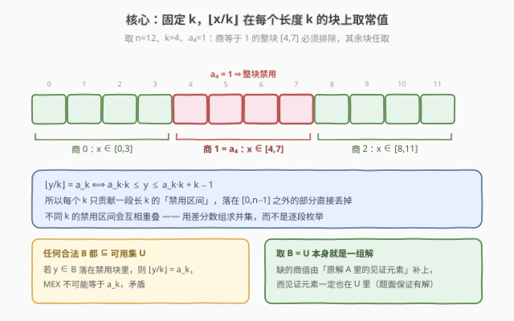
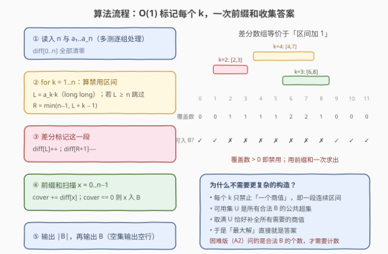
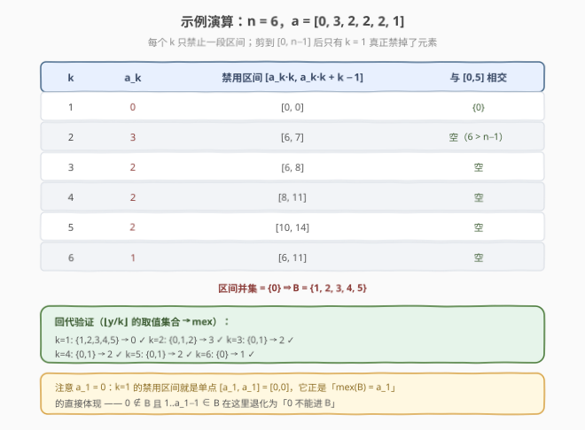

# Codeforces 2262A1 MEX 的下取整（简单版） 题解

## 1. 题目概述

- **标题 / 题号**：MEX 的下取整（简单版）（Codeforces 2262A1，英文名 Floor of MEX (Easy Version)）
- **链接**：https://codeforces.com/problemset/problem/2262/A1
- **来源**：Codeforces Round 1120 (Div. 1) · Problem A1（UTC 2026-09-12）
- **难度**：1200（`*1200`，500 分）
- **限制**：时间 2 s / 内存 256 MB
- **标签**：构造，贪心

**题意**：对非负整数集合 $S$ 与正整数 $x$，定义

$$f(S,x)=\operatorname{mex}\left(\left\{\left\lfloor \frac{y}{x}\right\rfloor : y\in S\right\}\right),$$

其中 $\operatorname{mex}$ 是「最小未出现的非负整数」。Farmer John 先选一个（可空的）集合 $A\subseteq\{0,1,\ldots,n-1\}$，再令 $a_k=f(A,k)$（$1\le k\le n$）。Bessie 把 $A$ 藏起来，只把数组 $a_1,\ldots,a_n$ 交给 Farmer John。

要求你**构造任意一个**（可空的）集合 $B\subseteq\{0,1,\ldots,n-1\}$，使 $f(B,k)=a_k$ 对每个 $1\le k\le n$ 都成立；输入保证这样的 $B$ 一定存在。输出：每组先输出 $m=|B|$，第二行输出 $m$ 个**互不相同**的整数（$m=0$ 时第二行留空）。多测，元素顺序任意，多解输出任意一个（**special judge**，不与样例逐字比对）。

**约束**：

- $1\le t\le 10^4$，$1\le n\le 10^5$，$\sum n\le 10^5$；
- $0\le a_i\le n$——上界是 $n$ 而不是 $n-1$（$a_1=n$ 时 $B$ 必须取满整个值域）；
- 关键量 $a_k\cdot k$ 最大可达 $10^5\times 10^5=10^{10}$，必须用 64 位整数；
- 输入保证合法，因此「无解」分支不需要写；
- 总规模 $10^5$，正解应为每组 $O(n)$，不能出现 $O(n^2)$ 的逐元素检查。

## 2. 示例与观察
**官方样例**

```text
输入
3
6
0 3 2 2 2 1
5
2 1 1 1 1
6
1 2 1 1 1 1

输出
5
1 2 3 4 5 
2
0 1 
2
0 2 
```

第 1 组取 $B=\{1,2,3,4,5\}$：$\lfloor y/1\rfloor$ 给出 $\{1,\dots,5\}$，mex 为 $0$；$k=2$ 时商为 $\{0,1,2\}$，mex 为 $3$；$k\ge 3$ 时商只有 $\{0,1\}$ 或 $\{0\}$，mex 分别是 $2,2,2,1$。第 2 组 $B=\{0,1\}$，$k=1$ 得 $2$，$k\ge2$ 时商恒为 $\{0\}$ 故全是 $1$。

**自造样例**（$n=1$ 的两个极端 + 中间被「掏空」的情形）

```text
输入
3
1
0
1
1
6
1 1 2 2 2 1

输出
0

1
0 
3
0 4 5 
```

第 2 组 $n=1,a_1=1$ 只能取 $B=\{0\}$；第 3 组来自 $A=\{0,5\}$，正确输出可以是 $\{0,4,5\}$（也可以输出 $\{0,4\}$ 或 $\{0,5\}$，判题只看 $f(B,k)$ 是否逐项相等）。第 1 组 $a_1=0$ 表示 $0\notin B$，唯一可行解是空集，第二行必须为空。

## 3. 解题思路

### 3.1 暴力思路

最直接的做法是枚举所有 $2^n$ 个 $B\subseteq\{0,\ldots,n-1\}$，逐个验证：验证一次要枚举 $n$ 个 $k$，每个 $k$ 还要扫 $|B|$ 个元素求商集，单次代价 $O(n^2)$，总体 $O(2^n n^2)$，$n=20$ 就已经不可行。

换个方向「边验证边修」也不行：一个自然贪心是「对每个 $k$ 不够的商值 $a_k-1$，就加入 $y=a_k\cdot k-1$」，因为 $\lfloor(a_k k-1)/k\rfloor=a_k-1$。但同一个 $y$ 会被所有 $k$ 同时「解读」，为 $k$ 补的量可能在另一个 $k'$ 上恰好把商值撑到 $a_{k'}$，直接破坏答案。**多出来的元素会坏事，这才是本题的难点**，所以要反过来想：先确定哪些元素「绝对不能进」，再看剩下的能不能自己长成一组解。

### 3.2 核心观察：每个 $k$ 只禁掉一段连续区间

固定一个元素 $y$ 与一个 $k$。条件「$B$ 的商集里不能出现 $a_k$」等价于

$$\left\lfloor \frac{y}{k}\right\rfloor\neq a_k\quad(\forall y\in B)
\;\Longleftrightarrow\;
y\notin\left[a_k\cdot k,\;a_k\cdot k+k-1\right].$$

也就是说，第 $k$ 个位置只贡献**一段长度为 $k$ 的禁止区间** $I_k=[a_k k,\,a_k k+k-1]$：在这段区间里，商恰好恒等于 $a_k$。下图把这个「块上取常值」的结构画了出来。



记可用集

$$U=\{0,1,\ldots,n-1\}\setminus\bigcup_{k=1}^{n}I_k .$$

**两条关键事实**：

1. **任何合法解都是 $U$ 的子集**。若 $y\in B$ 落进某个 $I_k$，则 $a_k$ 已经在商集里，mex 不可能等于 $a_k$，矛盾。
2. **$U$ 自己就是一组合法解**。上界方向（$a_k$ 不出现）由 $U$ 的定义直接成立；下界方向（$0,1,\ldots,a_k-1$ 都要出现）则由题面的合法性保证：既然存在某个合法 $A$，它对每个 $k$、每个 $j<a_k$ 都有一个见证元素 $y$ 满足 $\lfloor y/k\rfloor=j$；而这个 $y$ 对**每个** $k'$ 都满足 $\lfloor y/k'\rfloor\ne a_{k'}$（否则 $A$ 本身就非法），所以 $y\in U$。把 $U$ 整个取进来，绝不比 $A$ 少任何见证元素。

于是「求任意一组解」简化成「求 $U$」：不需要任何搜索，甚至不需要考虑覆盖关系。顺带得到一个漂亮结论——$U$ 是所有合法解中**唯一的极大解**，其他解都是它的子集（困难版 A2 数的正是 $U$ 的这些子集里能覆盖住全部商值的那些，见文末）。

### 3.3 算法流程：差分数组求区间并

$n$ 段区间直接标记会退化成 $O(n^2)$（例如 $a_k$ 全为 $0$ 时，$I_k=[0,k-1]$ 总长度 $\Theta(n^2)$）。但因为每段都是**连续区间**，用差分数组就能 $O(1)$ 打标记、$O(n)$ 一次前缀和求出并集。



1. 读入 $n$ 与 $a_1..a_n$，开 `diff[0..n]` 并清零；
2. 对 $k=1..n$：令 $L=a_k\cdot k$，若 $L\ge n$ 说明整段越界（$a_k$ 在值域内根本取不到），直接跳过；否则 $R=\min(n-1,\,L+k-1)$，执行 `diff[L]++`、`diff[R+1]--`；
3. 从 $x=0$ 扫到 $n-1$ 累加前缀和 `cover`；`cover == 0` 的 $x$ 就是可用元素，收进答案；
4. 输出 $|B|$，再输出 $B$（空集时输出一个空行）。

### 3.4 示例演算

以官方样例第 1 组 $n=6,\ a=[0,3,2,2,2,1]$ 为例，逐行算出 $I_k$ 并裁到值域 $[0,5]$：



只有 $k=1$ 贡献了非空的 $I_1=[0,0]$（正是 $\operatorname{mex}(B)=a_1$ 的直接体现：$a_1$ 不能进 $B$），其余 $k$ 的 $a_k\cdot k\ge 6$ 全部越界。并集为 $\{0\}$，因此 $B=\{1,2,3,4,5\}$，与官方输出一致。第 2 组 $n=5,a=[2,1,1,1,1]$ 则得到 $I_1=\{2\},I_2=[2,3],I_3=[3,4],I_4=\{4\}$，并集 $\{2,3,4\}$，于是 $B=\{0,1\}$。

## 4. 算法细节

1. **64 位乘法**：$a_k\cdot k$ 最坏 $10^{10}$，C++ 里必须 `1LL * a[k] * k`；写 `int` 会直接溢出成负数，然后 `diff[负数]` 越界崩溃。
2. **越界剪枝**：直接用 $L\ge n$ 判空（此时值域内没有元素能满足 $\lfloor y/k\rfloor=a_k$，约束自动作废）；右端点必须写成 $R=\min(n-1,L+k-1)$，漏掉 `min` 会把标记写到下标 $\ge n$ 的位置。
3. **差分数组大小**：`diff` 开 `n+2`，因为要写 `diff[R+1]`（$R+1\le n$）；前缀和只扫 $x\in[0,n-1]$，不要把下标 $n$ 计入答案。
4. **多测清空**：每组重新构造 `vector<int> diff(n+2, 0)`；由于 $\sum n\le 10^5$，总分配量是 $O(\sum n)$，不需要复用全局数组。
5. **输出格式**：先输出 $m$ 再换行；$m>0$ 时同一行输出全部元素（末尾空格无害），$m=0$ 时必须**补一个换行**，否则下一组的数据会串到这一行。
6. **无需特判 + I/O**：题面保证有解，不必写 `-1` 分支；输出天然无重复（每个 $x$ 只入队一次）且都在 $[0,n-1]$。$t\le 10^4$、总 token 量约 $10^5$，`cin` 关同步足够，Python 用 `sys.stdin.buffer.read()` 一次性读入，避免逐行 `input()` 的开销。

## 5. 正确性证明

**引理 1（块的刻画）**：对任意整数 $y\ge 0$ 与正整数 $k$，$\left\lfloor y/k\right\rfloor = a_k$ 当且仅当 $a_k\cdot k\le y\le a_k\cdot k+k-1$。

**证明**：设 $y=qk+r$，$0\le r<k$，则 $\lfloor y/k\rfloor=q$，于是 $q=a_k\iff a_k k\le y\le a_k k+k-1$。∎

**引理 2（上界约束给出禁用集）**：若 $B$ 满足 $f(B,k)=a_k$，则 $B\cap I_k=\varnothing$，从而 $B\subseteq U$。

**证明**：若存在 $y\in B\cap I_k$，由引理 1 得 $\lfloor y/k\rfloor=a_k$，即 $a_k$ 属于商集，与 $f(B,k)=\operatorname{mex}(\cdot)=a_k$ 矛盾。对每个 $k$ 都如此，故 $B$ 与所有 $I_k$ 不交。∎

**引理 3（取满可用集可行）**：在题面「输入保证有解」的前提下，$U$ 本身满足 $f(U,k)=a_k$。

**证明**：设 $A$ 是一组合法原像。

*上界*：$U$ 中任何元素都不属于任何 $I_k$，由引理 1 得 $\lfloor y/k\rfloor\ne a_k$，故 $a_k$ 不在商集中，$\operatorname{mex}\le a_k$。

*下界*：任取 $k$ 与 $0\le j<a_k$。因 $f(A,k)=a_k$，存在 $y\in A$ 使 $\lfloor y/k\rfloor=j$。同一元素的 $y$ 对每个 $k'$ 都满足 $\lfloor y/k'\rfloor\ne a_{k'}$（否则 $a_{k'}$ 会出现在 $A$ 的商集里，与 $f(A,k')=a_{k'}$ 矛盾），所以 $y\notin I_{k'}$ 对所有 $k'$ 成立，即 $y\in U$。因此商值 $j$ 在 $U$ 的商集中出现，$\operatorname{mex}\ge a_k$。

两方面合并得 $f(U,k)=a_k$。∎

**定理**：算法输出的 $B=U$ 是合法解；且 $U$ 是所有合法解的公共超集（即唯一极大解）。

**证明**：合法性即引理 3；极大性即引理 2：任何合法解都被包含在 $U$ 中。∎

## 6. 复杂度分析

- **时间**：每组一次 $O(n)$ 的标记循环 + 一次 $O(n)$ 的前缀扫描，合计 $O(n)$；多测总计 $O(\sum n)\le 10^5$。
- **空间**：`a`、`diff`、答案各 $O(n)$，峰值约 $3n$ 个 32 位整数，$n=10^5$ 时不到 1.5 MB。
- **常数**：全是最简单的数组读写，无哈希无排序。实测 $n=10^5$ 的三类极限数据（$a_k$ 递增、全 $0$、$t=10^4$ 小数据）C++ 约 $0.07\sim0.09$ s、Python3 约 $0.06\sim0.07$ s（均含进程启动开销），相对 2 s 时限有 20 倍以上余量。

## 7. 参考代码

### C++17

```cpp
#include <bits/stdc++.h>
using namespace std;

int main() {
    ios::sync_with_stdio(false);
    cin.tie(nullptr);

    int T;
    if (!(cin >> T)) return 0;
    while (T--) {
        int n;
        cin >> n;
        vector<int> a(n + 1);
        for (int k = 1; k <= n; k++) cin >> a[k];

        // diff 差分数组：把 [a_k*k, a_k*k+k-1] 这一段（值域 0..n-1 内）标记为禁用
        vector<int> diff(n + 2, 0);
        for (int k = 1; k <= n; k++) {
            long long L = 1LL * a[k] * k;          // 可能到 1e10，必须 long long
            if (L >= n) continue;                  // 整段越界，直接跳过
            long long R = min<long long>(n - 1, L + k - 1);
            diff[(int)L]++;
            diff[(int)R + 1]--;
        }

        vector<int> ans;
        int cover = 0;
        for (int x = 0; x < n; x++) {
            cover += diff[x];
            if (cover == 0) ans.push_back(x);       // 未被任何禁用段覆盖 => 可用
        }

        cout << ans.size() << '\n';
        for (size_t i = 0; i < ans.size(); i++)
            cout << ans[i] << " \n"[i + 1 == ans.size()];
        if (ans.empty()) cout << '\n';
    }
    return 0;
}
```

### Python3

```python
import sys

def main():
    data = list(map(int, sys.stdin.buffer.read().split()))
    if not data:
        return
    pos = 0
    t = data[pos]
    pos += 1
    out = []
    for _ in range(t):
        n = data[pos]
        pos += 1
        a = data[pos:pos + n]
        pos += n

        diff = [0] * (n + 2)
        for k in range(1, n + 1):
            left = a[k - 1] * k          # 禁用区间左端点
            if left >= n:
                continue
            right = min(n - 1, left + k - 1)
            diff[left] += 1
            diff[right + 1] -= 1

        ans = []
        cover = 0
        for x in range(n):
            cover += diff[x]
            if cover == 0:
                ans.append(x)

        out.append(str(len(ans)))
        out.append(" ".join(map(str, ans)))
    sys.stdout.write("\n".join(out) + "\n")

main()
```

## 8. 边界情况与易错点

1. **$a_1=n$**：此时 $L=n\ge n$ 被跳过，$B$ 取满 $0..n-1$，$f(B,1)=\operatorname{mex}\{0,\ldots,n-1\}=n$，正确；若把 $L$ 强行截断成 $n-1$，就会错误地把元素 $n-1$ 判成禁用，$f(B,1)$ 变成 $n-1$。
2. **$m=0$**：当所有 $x$ 都被覆盖（如 $a$ 全 $0$、$A=\varnothing$）时必须输出 `0` 加一个空行；漏掉换行会让下一组输出接在同一行导致 WA/格式错误。
3. **`int` 溢出与数组越界**：$a_k\cdot k$ 最大 $10^{10}$，C++ 必须 `long long`（Python 天然安全）；`diff` 要开到 `n+2`，因为要写 `diff[R+1]`，而 $R+1$ 最大等于 $n$。这两处是本题最容易 RE/WA 的地方。
5. **多测累计规模**：$\sum n\le 10^5$ 但 $t$ 可达 $10^4$，不要写「每组清空 $10^5$ 长度的全局数组」，否则 $10^9$ 次清空必 TLE；按 $n$ 重新分配即可。
6. **不要输出重复元素**：前缀扫描天然保证互不相同；若改成「对每个 $k$ 补一个 $a_k k-1$」的贪心，就会既超时又重复，还可能破坏别的 $k$。
7. **值域是 $[0,n-1]$ 而不是 $[1,n]$**：下标从 $0$ 开始，$0$ 也是一个合法元素（见样例 2 的 $B=\{0,1\}$）。

## 9. 验证记录

- **编译环境与命令**：`clang++ -std=c++17 -O2`（本机无 GNU g++，配 `codeforces/tools/include/bits/stdc++.h` 兼容头；正文代码只用标准库，可原样提交 GNU C++17）；Python 侧为 `Python 3.9.6`。
- **官方样例**：1 / 1 通过（按 Codeforces 标准 checker 的 token 比对，忽略空白与大小写）。
- **复核状态**：audited（2026-11-19 统一回归：编译 + 官方样例；写作期的随机对拍与暴力未重跑）。

## 相关题目与扩展

- [Codeforces 2262A2 Floor of MEX (Hard Version)](https://codeforces.com/problemset/problem/2262/A2)：同一题面的计数版，问合法 $B$ 的个数。
- [Codeforces 1263C Everyone is a Winner!](https://codeforces.com/problemset/problem/1263/C)：$\lfloor n/i\rfloor$ 的取值分块，与本图「块上取常值」是同一套刻画。
- [Codeforces 1436E Complicated Computations](https://codeforces.com/problemset/problem/1436/E)：所有子段 mex 的 mex，同样用「禁止出现」的视角把 mex 条件翻译成区间条件。
- [LeetCode 41. 缺失的第一个正数](https://leetcode.cn/problems/first-missing-positive/)：mex 的定义与「$0..a-1$ 全出现、$a$ 不出现」这一等价形式的入门题。

**延伸思考**：

1. 本题的答案本质是「可用集 $U$」，它同时是最大解。若题目改成「输出字典序最小 / 元素最少的解」，问题立刻变难：需要为每个 $k$、每个 $j<a_k$ 的区间 $[jk, jk+k-1]$ 至少选一个元素，变成一个高度重叠的区间覆盖问题。
2. 困难版（A2）正是这条思路的延续：合法解 $=U$ 的一个子集，且对每个 $k$ 与每个 $j<a_k$ 都命中区间 $[jk,jk+k-1]$。以样例 1 为例，$U=\{1,2,3,4,5\}$，约束化成「$1$ 必选（$k=2,j=0$）、$5$ 必选（$k=5,j=1$）、$\{2,3\}$ 至少选一个、$4$ 任取」，于是方案数 $1\times1\times(2^2-1)\times 2=6$，与官方答案吻合。
3. 若把可选值域放宽到 $[0,2n]$，每个 $k$ 的禁用区间只是被裁到更大的范围上，结论「取满可用集即可」不变，差分数组开到 $2n$ 就行；但困难版的计数会随之改变（可选元素变多）。
4. **可迁移模板**：当「mex 等于某值」的条件逐个 $k$ 出现时，先把 mex 拆成「值 $a$ 不出现 + 更小的值全出现」，再把「不出现」翻译成区间并（差分数组 $O(1)$ 标记）；而「全出现」在合法输入下常常被最大解自动满足，这正是 A1 只需要 $O(n)$ 的原因。
