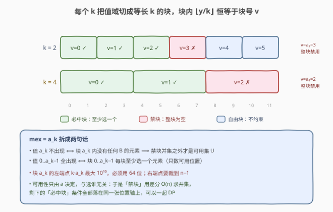
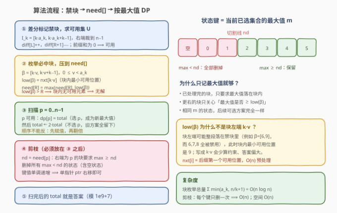
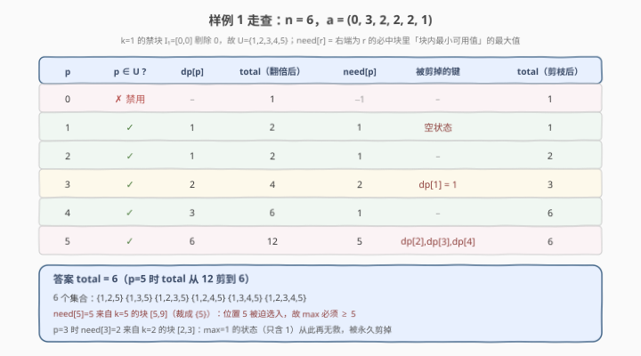

# Codeforces 2262A2 MEX 的下取整（困难版） 题解

## 1. 题目概述

- **标题 / 题号**：MEX 的下取整（困难版）（Codeforces 2262A2，英文名 Floor of MEX (Hard Version)）
- **链接**：https://codeforces.com/problemset/problem/2262/A2
- **来源**：Codeforces Round 1120 (Div. 1) · Problem A2
- **难度**：1800（`*1800`，1000 分）
- **限制**：时间 2 s / 内存 256 MB
- **标签**：动态规划，实现，数学

**题意**：对非负整数集合 $S$ 与正整数 $x$，定义 $f(S,x)=\operatorname{mex}\left(\left\{\left\lfloor y/x\right\rfloor : y\in S\right\}\right)$，其中 $\operatorname{mex}$ 是最小未出现的非负整数。Farmer John 先选一个（可空的）集合 $A\subseteq\{0,1,\ldots,n-1\}$，再令 $a_k=f(A,k)$（$1\le k\le n$）。Bessie 把 $A$ 藏起来，只留下数组 $a_1,\ldots,a_n$。现在要**数出**有多少个（可空的）集合 $B\subseteq\{0,1,\ldots,n-1\}$ 使 $f(B,k)=a_k$ 对每个 $1\le k\le n$ 都成立，答案对 $10^9+7$ 取模。多测，输入保证至少存在一个合法 $B$。

**约束**：

- $1\le t\le 10^4$，$1\le n\le 10^5$，$\sum n\le 10^5$；
- $0\le a_i\le n$：上界是 $n$ 而非 $n-1$，如 $a_1=n$ 表示 $B$ 必须取满 $0..n-1$；
- 关键乘积 $k\cdot a_k$ 最大 $10^5\times 10^5=10^{10}$，必须 64 位整数；
- 必中块总数 $\sum_k O(n/k)=O(n\log n)$，正解应为每组 $O(n\log n)$，不能是 $O(n^2)$；
- 与简单版（2262A1「构造任意一组解」）共用"禁块 + 必中块"刻画，本版多出来的正是**计数**。

## 2. 示例与观察
**官方样例**

```text
输入
3
6
0 3 2 2 2 1
5
2 1 1 1 1
6
1 2 1 1 1 1

输出
6
1
1
```

第 1 组的 6 个解为 $\{1,2,5\},\{1,3,5\},\{1,2,3,5\},\{1,2,4,5\},\{1,3,4,5\},\{1,2,3,4,5\}$：位置 $0$ 被 $k=1$ 禁掉（$a_1=0$ 即 $\operatorname{mex}(B)=0$）；$1$ 被迫选入（$k=2$ 的必中块 $[0,1]$ 里只有 $1$ 可用）；$5$ 被迫选入（$k=5$ 的必中块 $[5,9]$ 裁到值域后只剩 $\{5\}$）；$\{2,3\}$ 至少选一个、$4$ 随意，故 $1\times3\times2=6$。第 2 组只剩 $B=\{0,1\}$：$a_1=2$ 要求 $0,1\in B$ 且 $2\notin B$，而 $k=2,3$ 的禁块把 $2,3,4$ 全封死；第 3 组同理只剩 $B=\{0,2\}$。

**自造样例**（$n=1$ 的两个极端、全零数组、一组长一点的）

```text
输入
4
1
0
1
1
4
0 0 0 0
7
0 4 3 2 2 2 1

输出
1
1
1
9
```

第 1 组 $a_1=0$ 表示 $0\notin B$，值域只有 $\{0\}$，故 $B=\varnothing$ 唯一；第 2 组只能取 $B=\{0\}$；第 3 组所有 $a_k=0$，$k=n$ 的禁块就是整个值域，只能是空集；第 4 组共 9 个解。

## 3. 解题思路

### 3.1 暴力思路

枚举 $2^n$ 个 $B$ 逐一验证：$n$ 个 $k$、每个 $k$ 扫 $|B|$ 个元素求商集，单次 $O(n^2)$，总计 $O(2^n n^2)$，$n=20$ 就废了。"边验证边补"的贪心也不行：取一个 $y$ 能同时为很多 $k$ 补上商值，却也把某个 $k'$ 的商值顶到 $a_{k'}$ 上，破坏"$a_{k'}$ 不许出现"。**元素是共享资源，不能逐 $k$ 独立补**，必须把"绝对不能要的位置"与"必须被覆盖的位置"分开。

### 3.2 核心观察：禁块 + 必中块

固定 $k$，把值域按长度 $k$ 切成块 $B_{k,v}=\{y:\lfloor y/k\rfloor=v\}=[kv,\;kv+k-1]\cap[0,n-1]$，块内商恒等于块号 $v$。于是 $f(B,k)=a_k$ 等价于：

1. **禁**：$B\cap B_{k,a_k}=\varnothing$，即没有任何元素的商等于 $a_k$；
2. **必中**：对每个 $0\le v<a_k$，$B\cap B_{k,v}\ne\varnothing$，即商 $0..a_k-1$ 都出现过。

第 1 条只与"位置"有关、与 $B$ 内部怎么选无关：把 $I_k=B_{k,a_k}=[ka_k,ka_k+k-1]$ 裁到值域，所有 $I_k$ 的并集记为禁区，剩下的是**可用集** $U=\{0,\ldots,n-1\}\setminus\bigcup_k I_k$。任何合法解必然 $B\subseteq U$，而这件事用一次差分就能标记完。第 2 条在 $B\subseteq U$ 下变成"每个必中块都要撞上 $U$ 里的元素"（若 $U\cap B_{k,v}$ 为空则永远填不上，直接无解）。



> 💡 一句话：**禁块用差分一次求出 $U$；"必中"是一堆「区间至少选一个」的约束**。原问题化成：数 $U$ 的子集，使它命中给定的所有必中块。

两个易漏的细节：块可能被右端裁断，裁断后**仍是**必中块，只是右端点变成 $n-1$（第 1 组里 $k=5$ 的 $[5,9]$ 就被裁成 $\{5\}$，这正是 $5$ 被迫选入的原因）；块内最小可用位置未必是块左端 $kv$，因为左端可能整段被禁，要用后缀第一个可用位置 $\mathrm{nxt}[kv]$。

### 3.3 算法流程 / 状态转移



1. **求可用集**：对每个 $k$ 令 $L=ka_k$，若 $L>n-1$ 跳过；否则 $R=\min(n-1,L+k-1)$，做 `diff[L]++, diff[R+1]--`，前缀和为 $0$ 的位置属于 $U$。
2. **后缀可用位置**：$\mathrm{nxt}[i]$ 表示 $\ge i$ 的第一个可用位置，倒序扫一遍 $O(n)$。
3. **压成 need[]**：枚举每个 $k$ 与每个 $0\le v<a_k$ 且 $kv\le n-1$，令 $\beta=[kv,\min(n-1,kv+k-1)]$、$R$ 为右端、$\mathrm{low}(\beta)=\mathrm{nxt}[kv]$；若 $\mathrm{low}(\beta)>R$ 则块内无可用元素（无解），否则 `need[R] = max(need[R], low(β))`。
4. **DP 扫描**：$dp[m]$ 表示"已处理位置上选出的集合最大值恰为 $m$"的方案数，$total$ 是所有仍存活方案数（含"还什么都没选"的空状态）。对 $p=0..n-1$：若 $p\in U$ 则 $dp[p]\leftarrow total$（选 $p$，它成为新最大值），再 $total\leftarrow 2\,total$（不选 $p$）；随后剪枝：$nd=\mathrm{need}[p]\ge0$ 时把所有键 $<nd$ 的方案永久删除并从 $total$ 扣掉（空状态此时也必须删）。
5. **答案**就是扫完后的 $total$。

**为什么只记最大值就够**：扫到 $p$ 时，右端点为 $p$ 的必中块只能由 $\le p$ 的元素命中（更右的元素进不了这个块），所以"能否命中"只取决于当前最大值 $m$ 是否 $\ge\mathrm{low}(\beta)$；而 $m\ge\mathrm{low}(\beta)$ 时必有 $m\le p=R$、$m\ge L$ 且 $m\in U$，即 $m$ 本身就落在块里。右端点相同的多个块取最强的那个，就得到 $\mathrm{need}[p]$。

**为什么能单指针**：被删的键永远是一段前缀，而键按 $p$ 递增产生；维护 $ptr$ 表示"$<ptr$ 的键都已死"，每次只需把 $[ptr,nd)$ 扣掉。$\mathrm{need}[]$ 本身不单调（可能 $2\to1\to5$），但指针只前进，故总代价 $O(n)$。块枚举量被 $v\le(n-1)/k$ 卡住，故 $\sum_k\min\!\left(a_k,\lfloor\frac{n-1}{k}\rfloor+1\right)\le\sum_k(\frac{n}{k}+1)=O(n\log n)$。

### 3.4 示例演算

官方样例第 1 组 $n=6,\ a=(0,3,2,2,2,1)$：$k=1$ 的禁块 $I_1=[0,0]$ 排除位置 $0$，故 $U=\{1,2,3,4,5\}$；必中块把约束压成 $\mathrm{need}=[-1,1,1,2,1,5]$。



- $p=1$：$dp[1]=1$（$\{1\}$），$total=2$；$\mathrm{need}[1]=1\ge0$，空状态被删，$total=1$。
- $p=2$：$dp[2]=1$（$\{1,2\}$），$total=2$；$\mathrm{need}[2]=1$，已有 $ptr=1$，无需再删。
- $p=3$：$dp[3]=2$（$\{1,3\},\{1,2,3\}$），$total=4$；$\mathrm{need}[3]=2$ 来自 $k=2$ 的块 $[2,3]$，删掉 $dp[1]$，$total=3$。
- $p=4$：$dp[4]=3$，$total=6$；$\mathrm{need}[4]=1$，无操作。
- $p=5$：$dp[5]=6$，$total=12$；$\mathrm{need}[5]=5$ 来自被裁断的块 $[5,9]\to\{5\}$，删掉 $dp[2],dp[3],dp[4]$，$total=12-6=6$。

最终 $total=6$，与官方输出一致，恰好对应题面列出的 6 个集合。

## 4. 算法细节

1. **64 位乘法**：$L=ka_k$ 最大 $10^{10}$，C++ 必须写 `1LL * k * a[k]`；用 `int` 会溢出成负数，随后 `diff[负数]` 越界崩溃。
2. **禁块标记**：右端写 $R=\min(n-1,L+k-1)$，`diff` 开 $n+2$（要写 `diff[R+1]`，$R+1\le n$）；前缀和只扫 $[0,n-1]$，别把下标 $n$ 算进可用集。
3. **枚举顺序**：先用 $kv\le n-1$ 卡死 $v$ 的上界再累加，否则 $a_k$ 可能等于 $n$，枚举量退化成 $O(\sum a_k)$；卡死后总量 $O(n\log n)$。
4. **运算顺序**：`dp[p] = total` 必须在 `total *= 2` **之前**，剪枝必须在 `dp[p]` 赋值**之后**——最大值为 $p$ 的方案恰好能命中所有以 $p$ 结尾的必中块。
5. **空状态**：它没有键（记 $m=-1$）。一旦遇到 $\mathrm{need}[p]\ge0$ 就必须从 $total$ 里减掉，否则它会一直被当成"还没开始"的状态参与扩展，样例 1 的答案会从 $6$ 变成 $15$。
6. **阈值用 $\mathrm{low}(\beta)$ 而非 $kv$**：块左端可能整段在禁区里，只有 $\mathrm{nxt}[kv]\le R$ 时块才真的可填；用 $\mathrm{nxt}$ 才能对上"$m\ge$ 块内最小可用位置 $\iff$ 命中"的充要条件。
7. **取模**：减法写 `(total - dp[ptr] + MOD) % MOD`；翻倍写 `(total + total) % MOD`，都不会溢出。
8. **多测与 I/O**：按 $n$ 重新分配数组，别对 $10^5$ 的全局数组做 $t=10^4$ 次清零；C++ 关同步，Python 用 `sys.stdin.buffer.read()` 一次读入。

## 5. 正确性证明

**引理 1（块的刻画）**：对整数 $y\ge0$ 与正整数 $k$，$\lfloor y/k\rfloor=a_k$ 当且仅当 $ka_k\le y\le ka_k+k-1$。

**证明**：写 $y=qk+r$（$0\le r<k$），则 $\lfloor y/k\rfloor=q$，于是 $q=a_k\iff ka_k\le y\le ka_k+k-1$。∎

**引理 2（约束的等价形式）**：$f(B,k)=a_k$ 对每个 $k$ 成立，当且仅当 $B\subseteq U$ 且每个必中块 $\beta=B_{k,v}$（$0\le v<a_k$）满足 $B\cap\beta\ne\varnothing$。

**证明**：$f(B,k)=a_k$ 等价于"$a_k$ 不在商集中"且"$0,\ldots,a_k-1$ 都在商集中"。由引理 1，前者等价于 $B\cap I_k=\varnothing$，对每个 $k$ 成立即 $B\subseteq U$；后者等价于每个 $B_{k,v}$（$v<a_k$）与 $B$ 相交。∎

**引理 3（剪枝的充要性）**：设扫描到 $p$，必中块 $\beta=[L,R]$ 满足 $R=p$，方案当前最大值为 $m$（$m\le p$，空状态记 $m=-1$）。该方案有可能满足 $B\cap\beta\ne\varnothing$，当且仅当 $m\ge\mathrm{low}(\beta)$。

**证明**：$\beta$ 内所有位置都 $\le R=p$，之后只会再选 $>p$ 的位置，故 $\beta$ 只能由已选元素命中，而已选元素都 $\le m$。若 $m<\mathrm{low}(\beta)$，则已选元素全部 $\le m<\mathrm{low}(\beta)$，而 $\mathrm{low}(\beta)$ 已是块内最小的可用位置，故这些元素都不在 $\beta\cap U$ 中，之后再无机会。若 $m\ge\mathrm{low}(\beta)$，由 $m\le p=R$ 与 $\mathrm{low}(\beta)\ge L$ 得 $m\in[L,R]=\beta$，又 $m$ 是被选中元素故 $m\in U$，即 $m\in\beta\cap U$，已经命中。∎

**引理 4（按最大值聚合合法）**：同一最大值 $m$ 的不同方案，之后每一步的存活判定与可扩展方案数完全相同。

**证明**：剪枝只比较 $m$ 与 $\mathrm{need}[p]$（引理 3），与方案其他元素无关；扩展时每个可用位置至多选一次，候选集合只与当前位置有关，与已选内容无关。故按 $m$ 分组后组内方案数可合并相加。∎

**定理**：算法结束时输出的 $total$ 恰为合法集合 $B$ 的个数。

**证明**：归纳证明"扫到 $p$ 并剪枝后，$total$ 等于 $U\cap[0,p]$ 的子集 $S$ 中满足所有右端点 $\le p$ 的必中块、且未被删的方案数"。$p=-1$ 时只有空集，成立。转移时 $p\notin U$ 只能不选；$p\in U$ 分"选"与"不选"，前者新增 $dp[p]=total$，后者保留旧方案，恰好枚举完所有子集。剪枝由引理 3 恰好删掉必不合法者且不误删任何可能合法者。扫完 $p=n-1$ 时所有必中块（含裁断块）都已判定，由引理 2 存活方案全合法，而每个合法 $B$ 对应唯一一条选择路径且从未被误删。∎

## 6. 复杂度分析

- **时间**：每组一次 $O(n)$ 差分、一次 $O(n)$ 后缀可用位置、$O(n\log n)$ 的必中块枚举、一次 $O(n)$ 的 DP 扫描（指针总移动不超过 $n$），合计 $O(n\log n)$；多测总计 $O(\sum n\log n)$。
- **空间**：`a`、`diff`、`ok`、`nxt`、`need`、`dp` 各 $O(n)$，约 $5n$ 个 `int` 加 $n$ 个 `long long`，$n=10^5$ 时不到 4 MB。
- **实测**：$n=10^5$ 的三类极限（随机 $B$、$B$ 为全体偶数、$B$ 为全体即块数最多）C++ 约 $0.06\sim0.07$ s，Python3 约 $0.12\sim0.45$ s；$t=10^4$ 组小数据 C++ 约 $0.07$ s、Python3 约 $0.14$ s。最慢的 Python 也有约 4 倍余量。

## 7. 参考代码

### C++17

```cpp
#include <algorithm>
#include <iostream>
#include <vector>
using namespace std;
const long long MOD = 1000000007LL;

int main() {
    ios::sync_with_stdio(false);
    cin.tie(nullptr);
    int T; cin >> T;
    while (T--) {
        int n; cin >> n;
        vector<long long> a(n + 1);
        for (int k = 1; k <= n; k++) cin >> a[k];

        // 1) 禁块 [k*a_k, k*a_k+k-1] 差分标记，裁到值域 [0,n-1]
        vector<int> diff(n + 2, 0);
        for (int k = 1; k <= n; k++) {
            long long L = (long long)k * a[k];          // 最大 1e10，必须 64 位
            if (L > n - 1) continue;
            long long R = min((long long)n - 1, L + k - 1);
            diff[(int)L]++; diff[(int)R + 1]--;
        }
        vector<char> ok(n, 0);
        for (int i = 0, cover = 0; i < n; i++) { cover += diff[i]; ok[i] = (cover == 0); }

        // 2) nxt[i] = >= i 的最小可用位置
        vector<int> nxt(n + 1); nxt[n] = n;
        for (int i = n - 1; i >= 0; i--) nxt[i] = ok[i] ? i : nxt[i + 1];

        // 3) need[r] = 右端点为 r 的必中块里「块内最小可用位置」的最大值
        vector<int> need(n, -1);
        bool bad = false;
        for (int k = 1; k <= n && !bad; k++)
            for (long long v = 0; v < a[k]; v++) {
                long long L = (long long)k * v;
                if (L > n - 1) break;
                long long R = min((long long)n - 1, L + k - 1);
                int lp = nxt[(int)L];
                if (lp > R) { bad = true; break; }      // 块内无可用元素 => 无解
                if (lp > need[(int)R]) need[(int)R] = lp;
            }
        if (bad) { cout << 0 << '\n'; continue; }

        // 4) dp[m] = 最大值恰为 m 的方案数；total = 全部存活方案（含空状态）
        vector<long long> dp(n, 0);
        long long total = 1; bool alive = true; int ptr = 0;
        for (int p = 0; p < n; p++) {
            if (ok[p]) { dp[p] = total; total = (total + total) % MOD; }
            int nd = need[p];
            if (nd >= 0) {
                if (alive) { alive = false; total = (total - 1 + MOD) % MOD; }
                while (ptr < nd) { total = (total - dp[ptr] + MOD) % MOD; dp[ptr] = 0; ptr++; }
            }
        }
        cout << total % MOD << '\n';
    }
    return 0;
}
```

### Python3

```python
import sys

MOD = 10 ** 9 + 7


def main():
    data = list(map(int, sys.stdin.buffer.read().split()))
    if not data:
        return
    pos, t, out = 1, data[0], []
    for _ in range(t):
        n = data[pos]; pos += 1
        a = [0] + data[pos:pos + n]; pos += n

        # 1) 差分标记禁块 [k*a_k, k*a_k+k-1]，裁到值域 [0,n-1]
        diff = [0] * (n + 2)
        for k in range(1, n + 1):
            left = k * a[k]
            if left > n - 1:
                continue
            right = min(n - 1, left + k - 1)
            diff[left] += 1
            diff[right + 1] -= 1
        ok, cover = bytearray(n), 0
        for i in range(n):
            cover += diff[i]
            if cover == 0:
                ok[i] = 1

        # 2) nxt[i] = >= i 的最小可用位置
        nxt = [n] * (n + 1)
        for i in range(n - 1, -1, -1):
            nxt[i] = i if ok[i] else nxt[i + 1]

        # 3) need[r]：右端点为 r 的必中块里「块内最小可用位置」的最大值
        need, bad = [-1] * n, False
        for k in range(1, n + 1):
            for v in range(a[k]):
                left = k * v
                if left > n - 1:
                    break
                right = min(n - 1, left + k - 1)
                lp = nxt[left]
                if lp > right:
                    bad = True
                    break
                if lp > need[right]:
                    need[right] = lp
            if bad:
                break
        if bad:
            out.append("0")
            continue

        # 4) dp[m] = 最大值恰为 m 的方案数；total 含「还什么都没选」的空状态
        dp, total, alive, ptr = [0] * n, 1, True, 0
        for p in range(n):
            if ok[p]:
                dp[p] = total
                total = total * 2 % MOD
            nd = need[p]
            if nd >= 0:
                if alive:
                    alive = False
                    total = (total - 1) % MOD
                while ptr < nd:
                    total = (total - dp[ptr]) % MOD
                    dp[ptr] = 0
                    ptr += 1
        out.append(str(total % MOD))
    sys.stdout.write("\n".join(out) + "\n")


main()
```

## 8. 边界情况与易错点

1. **`int` 溢出**：$ka_k$ 可达 $10^{10}$，C++ 里任何写成 `int` 的地方都会溢出成负数并导致下标越界；Python 天然安全。
2. **漏掉被裁断的必中块**：$kv+k-1>n-1$ 的块仍要算（如样例 1 中 $k=5$ 的 $[5,9]$ 裁成 $\{5\}$），右端一律写 $\min(n-1,kv+k-1)$，否则答案偏大。
3. **空状态没被剪**：$\mathrm{need}[p]\ge0$ 时"什么都没选"的空状态必须删除，否则它会持续参与扩展（样例 1 会从 $6$ 变 $15$）；注意全零数组没有必中块，答案本来就是 $1$，别把它当成判据。
4. **赋值顺序**：`dp[p] = total` 在 `total *= 2` 之前、剪枝在 `dp[p]` 之后；顺序错了会漏算"最大值为 $p$ 的新方案"或多算已死方案。
5. **$a_i$ 可以等于 $n$**：$a_1=n$ 时 $B$ 取满 $0..n-1$、答案 $1$；此时 $L=n>n-1$ 必须跳过标记，不能强行截到 $n-1$。
6. **指针不要回退**：$\mathrm{need}[]$ 不单调（可能 $2\to1\to5$），但被删的键始终是一段前缀，`ptr` 只增不减，`while (ptr < nd)` 自动处理 $nd$ 变小的情况。
7. **多测清空**：$t$ 可达 $10^4$，别对长度 $10^5$ 的全局数组逐组清零；按 $n$ 重新分配，总分配量 $O(\sum n)$。

## 9. 验证记录

- **编译环境与命令**：`clang++ -std=c++17 -O2`（本机无 GNU g++，配 `codeforces/tools/include/bits/stdc++.h` 兼容头；正文代码只用标准库，可原样提交 GNU C++17）；Python 侧为 `Python 3.9.6`。
- **官方样例**：1 / 1 通过（按 Codeforces 标准 checker 的 token 比对，忽略空白与大小写）。
- **复核状态**：audited（2026-11-19 统一回归：编译 + 官方样例；写作期的随机对拍与暴力未重跑）。

## 相关题目与扩展

- [Codeforces 2262A1 Floor of MEX (Easy Version)](https://codeforces.com/problemset/problem/2262/A1)：同一套"禁块 + 必中块"刻画，只要求构造任意一组解，正解是"取满可用集 $U$"。
- [Codeforces 2263C2 Floor of MEX (Hard Version)](https://codeforces.com/problemset/problem/2263/C2)：本题在 Div. 2 的镜像题号，题面与做法相同。
- [Codeforces 1263C Everyone is a Winner!](https://codeforces.com/problemset/problem/1263/C)：$\lfloor n/i\rfloor$ 的取值分块，与"块上商恒为块号"是同一套整除分块视角。
- [Codeforces 1436E Complicated Computations](https://codeforces.com/problemset/problem/1436/E)：把"某值出现/不出现"翻译成区间条件再合并，思路与引理 2 同源。
- [LeetCode 41. 缺失的第一个正数](https://leetcode.cn/problems/first-missing-positive/)：mex 定义与"$0..a-1$ 全出现、$a$ 不出现"等价形式的入门题。

**延伸思考**：

1. **命中所有区间的计数模板**：本文 DP（状态 = 当前最大值，按右端点剪枝，单指针维护前缀）适用于任意区间族，既不要求区间互不相交，也不要求互不包含；复杂度 $O(n+Q)$，可直接迁移到"给 $Q$ 个区间，数 $\{1..n\}$ 的子集使每个区间至少选一个"的裸题。
2. **若只求最少元素个数**：条件退化成"每个必中块至少选一个"，按右端点贪心选点即可，DP 是杀鸡用牛刀；本题因为要计数才必须上 DP。
3. **若把值域放宽到 $[0,2n]$**：禁块与必中块的裁剪位置改变、$U$ 变大、答案随之改变，但"禁块 + 必中块 + 按最大值剪枝"的框架完全不动。
