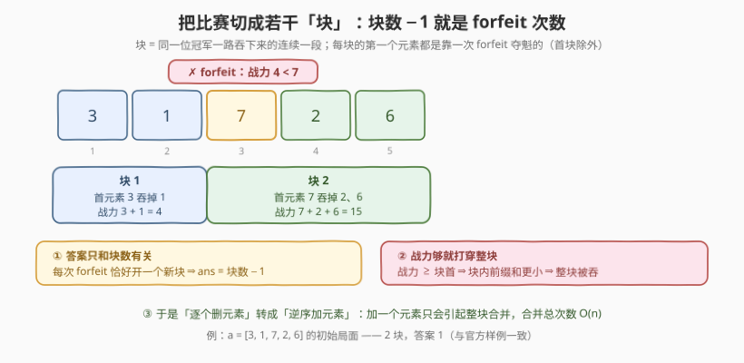
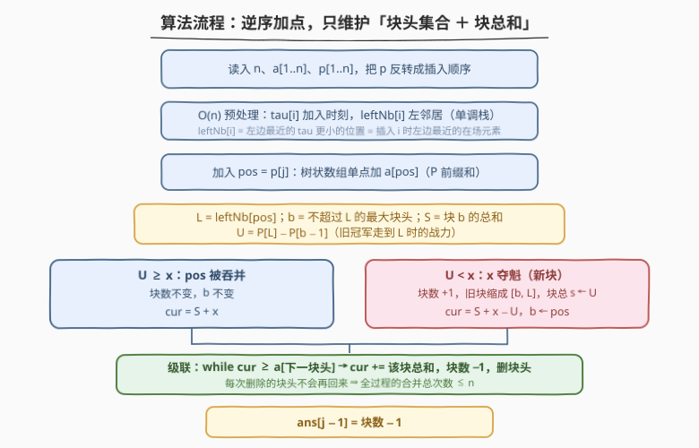
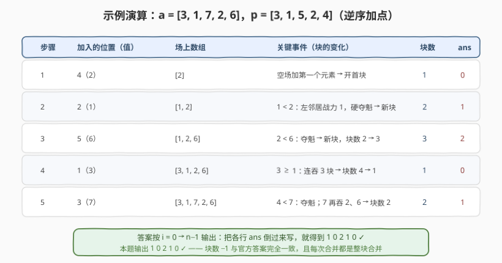

# Codeforces 2262B 淘汰游戏 题解

## 1. 题目概述

- **标题 / 题号**：淘汰游戏（Codeforces 2262B，英文名 Culling Game）
- **链接**：https://codeforces.com/problemset/problem/2262/B
- **来源**：Codeforces Round 1120 (Div. 1) · Problem B
- **难度**：$\ast 2000$（1750 分）
- **限制**：时间 2 s / 内存 256 MB
- **标签**：数据结构、树状数组、有序集合、均摊分析、逆序处理（官方标签：binary search、data structures、implementation、two pointers）

**题意**：$n$ 个巫师从左到右站成一列，第 $i$ 个的战力是 $a_i$。最左边的人先当擂主，战力等于自己的 $a$；之后擂主依次面对右边的每个人：若擂主战力 $s < x$，擂主**认输（forfeit）**、$x$ 成为新擂主且战力为 $x$；否则（$s \ge x$，**相等也算擂主赢**）擂主获胜，战力变成 $s + x$。给定 $1 \sim n$ 的排列 $p$，对每个 $0 \le i \le n-1$ 只删掉 $p_1, \dots, p_i$（其余人相对顺序不变）再打一遍，求**认输次数**；输出第 $i$ 个数对应「删掉 $p_1..p_i$」的局面。多测：先读 $t$，每组读 $n$、$a_1..a_n$、$p_1..p_n$，输出 $n$ 个整数。

**约束**：

- $1 \le t \le 10^4$，$\sum n \le 2 \times 10^5$
- $1 \le a_i \le 10^9$：擂主战力是已吞并元素之和，最大 $2\times 10^5 \cdot 10^9 = 2\times10^{14}$，必须 64 位
- $p$ 是 $1\sim n$ 的排列，元素互不相同
- 时限 2 s：需要 $O(n \log n)$；$\sum n$ 受限，允许每组按 $O(n)$ 重建结构

## 2. 示例

官方样例（输入 / 输出原样）：

```text
输入
3
4
1 2 4 3
1 2 3 4
5
3 1 7 2 6
3 1 5 2 4
6
10 1 2 20 3 4
4 1 2 3 5 6

输出
2 1 0 0
1 0 2 1 0
1 0 3 2 1 0
```

三组「一个人都没删」时的答案分别是 $2,1,0$：第一组 $[1,2,4,3]$ 中 $1<2$、$2<4$ 各认输一次，再被 $4 \ge 3$ 吞掉；第二组删掉值为 $7$ 的人后剩 $[3,1,2,6]$，擂主 $3 \ge 1$ 起一路吞到末尾，$0$ 次；第三组删掉值为 $20$ 的人后剩 $[10,1,2,3,4]$，$10$ 一口气吞完，也是 $0$ 次。

## 3. 解题思路

### 3.1 暴力思路

对每个 $i$ 重建剩余数组、完整模拟：单次 $O(n)$，共 $O(n^2) = 4\times10^{10}$，2 s 内不可能。删掉一个人会改变后面所有人的擂主战力，无法逐点修补。

### 3.2 核心观察：把比赛切成「块」



模拟结束后从左往右切段：**每段第一个元素是一位「没被打败过」的擂主**，这一段延伸到他第一次认输之前。记块内前缀和 $S_k = a_q + \dots + a_k$（$q$ 为块首），则块内条件为 $a_{k+1} \le S_k$ 对每一对相邻位置成立；块在 $r$ 结束意味着 $a_{r+1} > S_r$。

**观察 1**：每次认输恰好开启一个新块，首块无需认输就存在，故

$$\text{认输次数} = \text{块数} - 1$$

问题就变成：每个局面下数组被切成多少块。

**观察 2（打穿整块）**：若某位擂主战力 $W \ge a_q$（$a_q$ 为下一块的块首），他**必能吃掉整个块**。因为原擂主在块内的战力 $S_k$ 满足 $a_{k+1} \le S_k$，而新擂主走到第 $k$ 位时战力为 $W + (S_k - S_q) \ge S_q + (S_k - S_q) = S_k \ge a_{k+1}$，归纳即得。

这条观察是解题枢纽：**块与块之间只发生整块合并，绝不会「吃掉半块」**。

**观察 3（逆序加点）**：正着删很难，反过来做——从只剩 $p_n$ 出发，按 $p_{n-1}, p_{n-2}, \dots, p_1$ 依次把元素**加回**场上。加入一个人只影响他所在的那一块：要么被吞并（块数不变），要么夺魁（块数 $+1$），随后按观察 2 整块向右吞并。每吞掉一块，那个块头就被永久删除，故**合并总次数 $\le n$**，摊还 $O(1)$。

### 3.3 算法流程



1. **预处理左邻居**：设 $\tau_i$ 为 $i$ 被加回的时刻（$\tau_{p_n} = 1$ 最早）。加入 $i$ 时左边最近的「已在场上」的人，就是**左边最近的 $\tau$ 更小者**，单调栈 $O(n)$ 求出 `leftNb[i]`。
2. **维护结构**：树状数组求场上元素的**前缀和** $P$；块头有序集合；`blkSum[b]` 为以 $b$ 为头的块内元素和；块数 `cnt`。
3. **加入 $pos$**：$L = \text{leftNb}[pos]$，树状数组单点加。取 $b$ = **不超过 $L$ 的最大块头**，$S = \text{blkSum}[b]$，旧擂主走到 $L$ 时的战力 $U = P[L] - P[b-1]$。若 $U \ge a_{pos}$ 则被吞并、块头不变、`cur = S + x`；若 $U < a_{pos}$ 则夺魁、块数 $+1$、旧块缩成 $[b, L]$（`blkSum[b] = U`）、新块头 $pos$、`cur = S + x - U`。
4. **级联**：反复看当前块的后继块头 $q$，若 `cur >= a[q]` 则 `cur += blkSum[q]`、块数 $-1$、删掉 $q$；否则停。
5. **记录**：此时场上恰为 $\{p_j..p_n\}$，即「删掉 $p_1..p_{j-1}$」，故 `ans[j-1] = cnt - 1`。

### 3.4 示例演算



以 $a = [3,1,7,2,6]$、$p = [3,1,5,2,4]$ 为例逆序加点：加入 $p_5=4$（值 2）得 $[2]$，1 块；加入 $p_4=2$（值 1）得 $[1,2]$，$1<2$ 夺魁，2 块；加入 $p_3=5$（值 6）得 $[1,2,6]$，$2<6$ 夺魁，3 块；加入 $p_2=1$（值 3）得 $[3,1,2,6]$，$3 \ge 1$ 后连吞 3 块，回到 1 块；加入 $p_1=3$（值 7）得 $[3,1,7,2,6]$，$4 < 7$ 夺魁、$7$ 再吞 $2,6$，2 块。块数依次为 $1,2,3,1,2$，倒序取「块数 $-1$」即 `1 0 2 1 0`。第 4 步一次并掉 3 个块，正是摊还的来源。

## 4. 算法细节

1. **左邻居为何能用单调栈**：加入顺序固定为 $\tau$，$i$ 插入时场上恰是 $\{\tau < \tau_i\}$，于是「左边最近的在场元素」= 左边最近的 $\tau$ 更小者。用 $\tau$ 单调递增的栈，遇到更大的栈顶就弹掉（它不可能再成为任何人的答案），$O(n)$ 一遍。
2. **块头集合的三个操作**：查询不超过 $L$ 的最大块头（前驱）、取某块头的后继、删除块头。C++ 用 `std::set`；Python 没有内置有序集合，用**两级位图**（64 位一个 word，再用大整数 `top` 标记哪些 word 非空）把前驱做成 $O(1)$ 次位运算，后继用 `nxt` 链表 $O(1)$ 走。
3. **存块总和而不是区间和**：级联要「一整个块的和」，若每次用树状数组求区间和会多一个 $\log$；`blkSum[b]` 直接相加即可，单次合并 $O(1)$。
4. **两种情况的 `cur` 推导**：吞并时旧块总和 $S$ 变成 $S+x$；夺魁时旧块只剩 $[b, L]$（和为 $U$），新块和为 $(S - U) + x$——注意 $S$ 是加入 $x$ 之前的值。
5. **溢出**：战力上界 $2\times10^{14}$，`int` 必然溢出；C++ 中 `a`、`blkSum`、`cur`、`U` 全用 `long long`，Python 无此问题。
6. **多测清空**：所有结构按 $O(n)$ 新建（树状数组、`blkSum`、位图 word 数组），靠 $\sum n \le 2\times10^5$ 兜底；不要给 $10^4$ 组各开满长数组，也别留跨组残留的全局变量。

## 5. 正确性证明

**引理 1（块数与认输次数）**：任一阵型按上述规则切出 $B$ 块，则认输次数恰为 $B-1$。**证明**：第一位擂主不需要任何人认输；此后每次认输都让擂主换人，换人处正是旧块结束、新块开始之处，一一对应，故认输次数 $=B-1$。∎

**引理 2（整块吞并）**：设块以 $q$ 为首、到 $r$ 结束，块内前缀和 $S_k$。若某方战力 $W \ge a_q$ 并从 $q$ 开始对打，则他吞掉 $q..r$ 的全部元素。**证明**：对 $k$ 归纳证明「处理完第 $k$ 位后新擂主战力 $W_k \ge S_k$」。$k=q$ 时 $W_q = W + a_q \ge S_q$；若 $W_k \ge S_k$，由块定义 $a_{k+1} \le S_k \le W_k$，故第 $k+1$ 位被吞且 $W_{k+1} = W_k + a_{k+1} \ge S_k + a_{k+1} = S_{k+1}$，归纳成立。∎

**引理 3（插入的局部性）**：把 $x$ 插到 $L$ 之后，插入前的块结构在 $L$ 及其左侧完全不变；设 $L$ 所在块为 $[b,r]$，则插入后这段被重新切成 $[b,L]$ 和一个从 $x$（或从 $b$）开始、一直延续到 $r$ 的块，之后只可能整块合并。**证明**：记 $U$ 为插入前擂主走到 $L$ 的战力，$S$ 为 $[b,r]$ 的元素和（不含 $x$）。若 $U \ge x$，$x$ 被吞并，新擂主在 $L$ 右侧每一步的战力都比旧擂主多 $x$，故 $r$ 之前仍全被吞，块头仍是 $b$。若 $U < x$，$x$ 夺魁，$[b,r]$ 被切成 $[b,L]$ 与以 $x$ 开头的部分；旧擂主能吞掉 $L$ 右侧第一位（若存在），说明 $U \ge a_{L+1}$，于是 $x > U \ge a_{L+1}$，$x$ 吞下它后战力 $x + a_{L+1} > U + a_{L+1}$，继续归纳可知直到 $r$ 仍全被吞。两种情形下 $L$ 右侧原有的块都完整保留，之后由引理 2，战力够就整块吞并、不够就停。∎

**定理**：算法在第 $j$ 步维护的 `cnt` 等于集合 $\{p_j,\dots,p_n\}$ 真实模拟的块数，故 `ans[j-1] = cnt-1` 正确。**证明**：对 $j$ 从 $n$ 递减归纳。$j=n$ 时只有一个元素，块数为 1。设第 $j+1$ 步正确，第 $j$ 步只是把 $p_j$ 插入到正确结构中；由引理 3，插入后的块结构唯一且与真实模拟一致，级联判据来自引理 2，故 `cnt` 仍正确，再套引理 1 即得答案。∎

## 6. 复杂度分析

- **时间**：每组 $O(n \log n)$。预处理 $O(n)$；每次插入 $O(\log n)$（树状数组 $2$ 次前缀和 + $1$ 次单点加、有序集合常数次操作）外加若干次整块合并，而全局合并次数 $\le n-1$，摊还 $O(1)$。总运算量约 $3\times10^6$ 级别。
- **空间**：$O(n)$——树状数组、`blkSum`、`tau`、`leftNb` 各一个长度 $n+1$ 的数组，块头集合大小 $\le n$。
- **实测**（本机 clang -O2 / Python 3.9，$n=2\times10^5$）：C++ 约 $0.5$ s（含 I/O，对 2 s 有 3 倍余量）；Python 约 $1.6$ s，建议提交 PyPy3。

## 7. 参考代码

### C++17

```cpp
#include <iostream>
#include <vector>
#include <set>
using namespace std;
typedef long long ll;

int n;
vector<ll> tr;                                  // 树状数组：前缀和
void add(int i, ll v) { for (; i <= n; i += i & -i) tr[i] += v; }
ll pre(int i) { ll s = 0; for (; i > 0; i -= i & -i) s += tr[i]; return s; }

int main() {
    ios::sync_with_stdio(false);
    cin.tie(nullptr);
    int T;
    cin >> T;
    while (T--) {
        cin >> n;
        vector<ll> a(n + 1);
        for (int i = 1; i <= n; ++i) cin >> a[i];
        vector<int> p(n + 1);
        for (int i = 1; i <= n; ++i) cin >> p[i];
        vector<int> tau(n + 1), nb(n + 1), st;         // tau: 加入时刻
        for (int j = n; j >= 1; --j) tau[p[j]] = n - j + 1;
        for (int i = 1; i <= n; ++i) {                 // 左邻居 = 左边最近的 tau 更小者
            while (!st.empty() && tau[st.back()] > tau[i]) st.pop_back();
            nb[i] = st.empty() ? 0 : st.back();
            st.push_back(i);
        }
        tr.assign(n + 1, 0);
        set<int> heads;                                // 各块的头
        vector<ll> bs(n + 1, 0);                       // 以 i 为头的块的元素和
        vector<int> ans(n);
        int cnt = 0;                                   // 当前块数
        for (int j = n; j >= 1; --j) {                 // 逆序把 p[j] 加回场上
            int pos = p[j], L = nb[pos], b;
            ll x = a[pos], S, U, cur;
            add(pos, x);
            if (L == 0) {                              // 成为最左元素，自己开一块
                ++cnt; heads.insert(pos); b = pos; cur = x;
            } else {
                b = *prev(heads.upper_bound(L));       // L 所在块的头
                S = bs[b];
                U = pre(L) - pre(b - 1);               // 旧擂主走到 L 的战力
                if (U >= x) cur = S + x;               // 被吞并
                else {                                 // 夺魁，旧块缩成 [b, L]
                    ++cnt; heads.insert(pos);
                    bs[b] = U; b = pos; cur = S + x - U;
                }
            }
            auto it = heads.upper_bound(b);            // 整块整块向右吞
            while (it != heads.end() && cur >= a[*it]) {
                cur += bs[*it]; --cnt; it = heads.erase(it);
            }
            bs[b] = cur;
            ans[j - 1] = cnt - 1;                      // 此时场上恰为 p[j..n]
        }
        for (int i = 0; i < n; ++i) cout << ans[i] << " \n"[i + 1 == n];
    }
    return 0;
}
```

### Python3

```python
import sys


class Heads:                        # 块头位图：两级结构，O(1) 次位运算求前驱
    def __init__(self, n):
        self.w = [0] * ((n >> 6) + 1)       # 每 64 个位置一个 word
        self.t = 0                          # 第 k 位为 1 <=> word k 非空

    def add(self, p):
        self.w[p >> 6] |= 1 << (p & 63)
        self.t |= 1 << (p >> 6)

    def rem(self, p):
        w = p >> 6
        self.w[w] &= ~(1 << (p & 63))
        if not self.w[w]:
            self.t &= ~(1 << w)

    def pre(self, p):                   # 最大的块头 <= p，没有则 0
        w = p >> 6
        v = self.w[w] & ((1 << ((p & 63) + 1)) - 1)
        if v:
            return (w << 6) + v.bit_length() - 1
        t = self.t & ((1 << w) - 1)
        if not t:
            return 0
        w2 = t.bit_length() - 1
        return (w2 << 6) + self.w[w2].bit_length() - 1


def main():
    d = sys.stdin.buffer.read().split()
    q = 0
    T = int(d[q]); q += 1
    out = []
    for _ in range(T):
        n = int(d[q]); q += 1
        a = [0] + [int(v) for v in d[q:q + n]]; q += n
        p = [0] + [int(v) for v in d[q:q + n]]; q += n

        tau = [0] * (n + 1)                  # 加入时刻
        for j in range(n, 0, -1):
            tau[p[j]] = n - j + 1
        nb = [0] * (n + 1)                   # 左邻居 = 左边最近的 tau 更小者
        st = []
        for i in range(1, n + 1):
            ti = tau[i]
            while st and tau[st[-1]] > ti:
                st.pop()
            if st:
                nb[i] = st[-1]
            st.append(i)

        bit = [0] * (n + 1)                  # 树状数组：前缀和 + 单点加
        bs = [0] * (n + 1)                   # 以 i 为头的块总和
        nxt = [0] * (n + 1)                  # 块头链表的后继
        H = Heads(n)
        first = 0                            # 最左的块头
        cnt = 0
        ans = [0] * n

        for j in range(n, 0, -1):
            pos = p[j]; x = a[pos]; i = pos
            while i <= n:
                bit[i] += x; i += i & -i

            L = nb[pos]
            if L == 0:                       # 成为最左元素，自己开一块
                cnt += 1; H.add(pos); nxt[pos] = first; first = pos
                b = pos; cur = x
            else:
                b = H.pre(L); S = bs[b]; s = 0; i = L
                while i > 0:
                    s += bit[i]; i -= i & -i
                i = b - 1
                while i > 0:
                    s -= bit[i]; i -= i & -i
                if s >= x:                   # 被吞并
                    cur = S + x
                else:                        # 夺魁，旧块缩成 [b, L]
                    cnt += 1; H.add(pos); bs[b] = s
                    nxt[pos] = nxt[b]; nxt[b] = pos; b = pos; cur = S + x - s

            k = nxt[b]                       # 整块整块向右吞
            while k and cur >= a[k]:
                cur += bs[k]; cnt -= 1; H.rem(k); nxt[b] = nxt[k]; k = nxt[b]
            bs[b] = cur
            ans[j - 1] = cnt - 1

        out.append(' '.join(map(str, ans)))
    sys.stdout.write('\n'.join(out) + '\n')


main()
```

## 8. 边界情况与易错点

1. **答案与 $i$ 差一位**：输出第 $i$ 个数是「删掉 $p_1..p_i$」；逆序实现里加入 $p_j$ 后写 `ans[j-1]`，弄反会整体错位。
2. **只剩一个人**：`cnt = 1`，答案 `cnt-1 = 0`，不需要特判；但若直接把 `cnt` 当答案就整体多 1。
3. **相等算擂主赢**：条件是 `s < x` 才认输，判断要写成 `U >= x` 吞并、`U < x` 夺魁；写成严格大于会在 $a_i$ 重复时立刻错（如 $[4,4,1]$ 首位就该吞掉 $4$）。
4. **溢出**：最大战力 $2\times10^{14}$，`int` 溢出成负数会让所有比较失效；`a`、`blkSum`、`cur`、`U` 必须 `long long`。
5. **多测清空**：结构必须每组 $O(n)$ 重建，不要给 $10^4$ 组各开满数组，也别留跨组残留的全局状态。
6. **Python 位图边界**：位置从 1 开始，`w = p >> 6` 最大为 `n >> 6`，长度要写 `(n >> 6) + 1`；`pre` 查不到时返回 0，链表后继用 `while k and ...` 收敛。

## 相关题目与扩展

- [Codeforces 2263D Culling Game](https://codeforces.com/problemset/problem/2263/D)：本题的 Div. 2 版本，同一道题。
- [Codeforces 2262A1 Floor of MEX (Easy)](https://codeforces.com/problemset/problem/2262/A1) / [2262A2 (Hard)](https://codeforces.com/problemset/problem/2262/A2)：同场签到题及其困难版，可对照「同场 easy/hard 分别成篇」的写法。
- [LeetCode 1970. 你能穿过矩阵的最后一天](https://leetcode.cn/problems/last-day-where-you-can-still-cross/)：离线逆序 + 并查集，「删除难、加入易」的同款套路。
- [LeetCode 2421. 好路径的数目](https://leetcode.cn/problems/number-of-good-paths/)：按权值从小到大加点、动态维护连通块。

**延伸思考**：若改成「$s \le x$ 就换人」，块内条件变为 $a_{k+1} < S_k$，全部推导只需把 $\ge$ 换成 $>$；若要求每次删除后输出完整对战记录，输出量本身已是 $O(n^2)$，必须换「可持久化块结构」或只回答区间询问；若改问「再删多少人才让认输次数 $\le k$」，`cnt` 对删除集合并不单调，需按 $\tau$ 二分加回的人数，仍可 $O(n\log^2 n)$。
